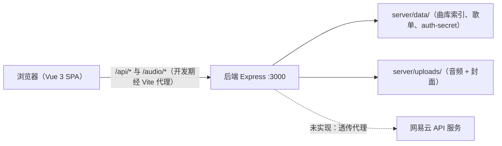
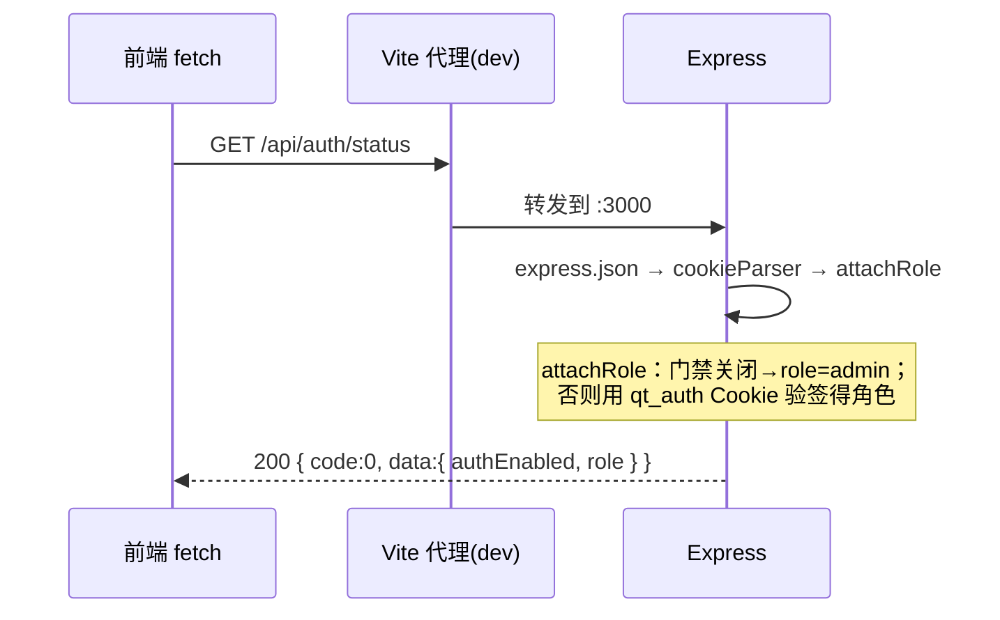
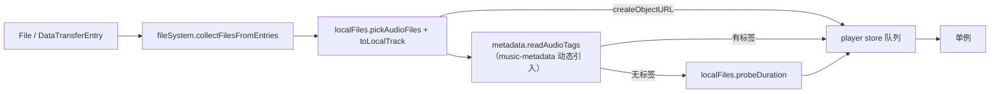

# 架构与代码地图

> 对应 PRD 5.1 技术选型 / 5.2 API 草案 / 5.4 工程结构 / 5.6 技术规范。
> 本文描述**当前代码实际状态**（2026-10-01，M1 骨架 + 云端曲库后端已落地），未实现的部分会明确标注「未实现」。

## 1. 运行拓扑



- 开发期：`npm run dev` 同时起 Vite(5173) 与 tsx watch 后端(3000)。Vite 把 `/api`、`/audio` 代理到 3000（见 `client/vite.config.ts`），因此前端代码里写相对路径即可，无跨域问题。
- 生产期（**未实现**）：前端 `client/dist` 由后端静态托管，单进程对外（PRD 4.5）。需注意 Express 5 的通配路由写法已变（`*` → `/*splat`）。

## 2. 实际依赖版本

| 位置   | 依赖                                                                                                                                    |
| ------ | --------------------------------------------------------------------------------------------------------------------------------------- |
| 根     | concurrently 10、prettier 3；`overrides.typescript=^5.9.3`                                                                              |
| server | express 5.2、cookie-parser 1.4、express-rate-limit 8.7；dev：tsx、tsup、vitest 5、supertest 7、@types/node 26                           |
| client | vue 3.5、vue-router 5.3、pinia 4；dev：vite 8.3、@vitejs/plugin-vue 6、unplugin-icons 24（+ `@iconify-json/ph`）、vue-tsc 3.3、vitest 5 |

> 注意 Express 5 与 vue-router 5 都是较新大版本，写新代码时如遇 API 差异以实际类型定义为准。

## 3. 目录结构

```
qingting-music/
├── AGENTS.md                     # AI 协作者入口（铁律 + 命令 + 索引）
├── README.md                     # 使用者视角：快速开始 / 命令 / 环境变量 / 进度
├── 音乐软件需求文档.md            # 需求唯一权威来源
├── docs/
│   ├── design/                   # drawio 架构图/线框 + mockup 高保真原型（样式事实来源）
│   └── dev/                      # 本目录：架构地图 / 开发约定 / 进度与交接
├── shared/src/index.ts           # 前后端共享类型 + 纯函数
├── server/
│   ├── src/
│   │   ├── index.ts              # 入口：装配配置 → 建目录 → 补密钥 → listen → 优雅退出
│   │   ├── app.ts                # createApp(config)：Express 装配（不含 listen，便于 supertest）
│   │   ├── config.ts             # 环境变量 → AppConfig；parseSize / parseTtl / describeAuthMode
│   │   ├── http.ts               # sendOk / sendFail / asyncHandler / apiNotFound / errorHandler
│   │   ├── services/auth.ts      # 签名 Cookie 签发验签、密码比对、密钥持久化
│   │   ├── services/storage.ts   # 曲库索引读写（data/songs.json，原子替换，无内存缓存）
│   │   ├── services/metadata.ts  # 音频标签解析（music-metadata）+ 文件名回退 + 上传名转码
│   │   ├── services/range.ts     # HTTP Range 解析（纯函数，PRD 11.2）
│   │   ├── middleware/auth.ts    # attachRole（角色解析）、requireAccess（401/403）
│   │   ├── middleware/rateLimit.ts # createLoginLimiter（429）
│   │   ├── routes/auth.ts        # /api/auth/{status,login,logout}
│   │   ├── routes/config.ts      # /api/config（onlineEnabled + maxUploadSize）
│   │   ├── routes/songs.ts       # /api/songs：列表 / 上传（重复 409+1001）/ 删除 / 重建索引
│   │   ├── routes/audio.ts       # /audio/:storedName（Range → 206/416）+ /covers/:name
│   │   ├── routes/stats.ts       # /api/stats：曲目数 + 总占用
│   │   └── types/express.d.ts    # 给 express Request 增加 role 字段
│   ├── test/                     # config / auth / app / shared / storage / metadata / range / songs / audio
│   ├── data/                     # 运行时生成（gitignore）：曲库索引、歌单、auth-secret
│   └── uploads/                  # 运行时生成（gitignore）：音频 + 封面
└── client/
    ├── index.html                # 含 .bg-glow 背景层与 #app 挂载点
    ├── vite.config.ts            # vue + unplugin-icons；@ 别名；dev 代理；vitest 配置
    ├── types/icons.d.ts          # ~icons/* 类型
    └── src/
        ├── main.ts               # createApp + pinia + theme.init() + player.restore() + router + mount
        ├── App.vue               # 仅 RouterView
        ├── styles/tokens.css     # 设计令牌（深/浅）、OKLCH 取色核心、原生控件自绘、reduced-motion
        ├── styles/global.css     # 重置、玻璃面板、外壳网格、播放条、Tab/卡片/徽标、移动端底线
        ├── assets/vinyl/*.png    # 彩胶分层素材（glow / base / grooves / emboss，来自 docs/design/mockup/img/vinyl）
        ├── layouts/PlayerLayout.vue   # 播放器外壳：AppSidebar + 内容区 + PlayerBar（侧栏折叠记忆）
        ├── layouts/ConsoleLayout.vue  # 控制台外壳：独立侧栏（概览/曲库管理/上传导入 + 返回播放器）
        ├── router/index.ts       # 路由表 + 身份守卫
        ├── stores/{auth,config,theme,library,transfer}.ts   # transfer = 本地列表→上传页的 File 交接（LC-07）
        ├── api/{http,auth,config,songs,upload}.ts
        ├── utils/                # format / player / localFiles / fileSystem / metadata / keyboard /
        │                         # marquee / library / confirm / lyrics / coverColor / playerState / shortcuts（纯逻辑优先，均带单测）
        ├── components/           # AppSidebar、PlayerBar、VolumeControl、QueuePopover、EmptyState、TrackRow、TrackList、TrackListHead、ScrollingText
        │                         # immersive/{LyricsView,ImTitle,ImControls}（三布局共享件）+ ImLayoutDuo / ImLayoutCenter / ImLayoutPoster（只管版式）
        └── views/                # LoginView、LocalView、LibraryView、OnlineView、PlaylistView、SettingsView
                                  # console/{ConsoleOverviewView,ConsoleSongsView,ConsoleUploadView}
```

## 4. 请求链路



中间件顺序固定在 `server/src/app.ts`：`express.json` → `cookieParser` → `attachRole` → 路由 → `/api` 404 → 错误兜底。**新增路由必须挂在 `attachRole` 之后**，否则 `req.role` 不存在。

## 5. 访问控制设计（PRD 3.11，已完整实现）

### 5.1 凭证格式

`qt_auth` Cookie = `签发时间戳.角色.HMAC-SHA256(secret, "时间戳.角色")`，属性 `httpOnly + sameSite=Lax + path=/`（`secure` 按 `req.protocol === "https"` 自动开启，`app.set("trust proxy", 1)` 已在 `app.ts` 设好，Nginx 场景可用），有效期 = `AUTH_TTL`（默认 30d）。**载荷不存过期时间**，有效期在验签时按当前配置判定，所以改 `AUTH_TTL` 即刻生效。

实现见 `server/src/services/auth.ts`：`signToken` / `verifyToken`（含 1 分钟时钟偏差容忍）/ `resolveRole` / `matchPassword` / `loadOrCreateSecret`。

### 5.2 三档语义与两级接口

| 角色        | 来源                  | 可用范围                                         |
| ----------- | --------------------- | ------------------------------------------------ |
| `anonymous` | 无 Cookie / 验签失败  | 仅本地播放（前端路由守卫 + `requireAccess` 401） |
| `visitor`   | 命中 `USER_PASSWORD`  | 访客级接口（曲库列表/音频流/歌单/在线音源）      |
| `admin`     | 命中 `ADMIN_PASSWORD` | 全部 + 管理级接口（上传/删除/统计/索引重建）     |

- 密码比对：`matchPassword` 用 sha256 定长摘要 + `timingSafeEqual`，且**遍历完整候选列表不提前返回**，避免耗时侧信道泄露命中哪一把密码。
- 门禁关闭（两把密码都未配置）：`attachRole` 直接把角色设为 `admin`，全功能开放（AC-05）。
- 登录限速：`createLoginLimiter` 15 分钟窗口内 10 次失败 → 429，成功登录不计入失败（AC-06）。
- 密钥持久化：`AUTH_SECRET` 未配置时 `loadOrCreateSecret` 生成 32 字节随机 hex 写入 `DATA_DIR/auth-secret`（0600），重启后会话不失效。

### 5.3 前端路由守卫矩阵（`client/src/router/index.ts`）

| 目标页面                                         | 门禁关闭        | anonymous             | visitor                  | admin        |
| ------------------------------------------------ | --------------- | --------------------- | ------------------------ | ------------ |
| `/local`                                         | ✅              | ✅                    | ✅                       | ✅           |
| `/login`                                         | 直接跳 `/local` | ✅                    | ✅                       | ✅           |
| `/library` `/online` `/playlist/:id` `/settings` | ✅              | → `/login?redirect=…` | ✅                       | ✅           |
| `/admin/*`                                       | ✅              | → `/login?redirect=…` | → `/library`（403 语义） | ✅           |
| `/`                                              | → `/library`    | → `/local`            | → `/library`             | → `/library` |

`stores/auth.ts` 的 `ensureLoaded()` 做并发去重，守卫在每个导航前 `await` 它，保证首次进入时角色已就绪。

## 6. 已实现的接口

| 方法   | 路径                 | 保护   | 返回                                                                                                                     |
| ------ | -------------------- | ------ | ------------------------------------------------------------------------------------------------------------------------ |
| GET    | `/api/health`        | 公开   | `{ status:"ok", uptimeSec, onlineEnabled }`                                                                              |
| GET    | `/api/config`        | 公开   | `{ onlineEnabled }`                                                                                                      |
| GET    | `/api/auth/status`   | 公开   | `{ authEnabled, role }`                                                                                                  |
| POST   | `/api/auth/login`    | 限速   | 命中角色 → Set-Cookie + `{ authEnabled, role }`；401 密码错误；400 门禁未启用；429 超限                                  |
| POST   | `/api/auth/logout`   | 公开   | 清 Cookie + `{ authEnabled, role:"anonymous" }`                                                                          |
| GET    | `/api/songs`         | 访客级 | `{ songs: Song[], totalSize }`（LB-04；过滤/排序在客户端做，LB-07）                                                      |
| POST   | `/api/songs/upload`  | 管理级 | multipart 字段 `file`；`?overwrite=1` 覆盖；重复（同名同大小）默认 **409 + `code:1001`**；非白名单 **415**、超限 **413** |
| DELETE | `/api/songs/:id`     | 管理级 | `{ id }`；同步删音频与封面文件（LB-05）                                                                                  |
| POST   | `/api/songs/reindex` | 管理级 | `{ scanned, added, removed, total }`（LB-11 / AD-05）                                                                    |
| GET    | `/api/stats`         | 管理级 | `{ songCount, totalSize }`（LB-10 / AD-03）                                                                              |
| GET    | `/audio/:storedName` | 访客级 | 音频流；带 `Range` → **206 + Content-Range**，越界 **416**（LB-06）                                                      |
| GET    | `/covers/:name`      | 公开   | 封面图；**只放图片扩展名**                                                                                               |
| —      | `/api/*` 未匹配      | 公开   | 404 `{ code:404, message:"接口不存在" }`                                                                                 |

**未实现**（PRD 5.2 草案中的其余接口）：`/api/playlists` 系列、`/api/online/:provider/*`。

### 6.1 云端曲库的关键实现（LB-01~06 / 10 / 11）

- **索引**：就是 `DATA_DIR/songs.json`（`services/storage.ts`），写入先写 `.tmp` 再 `rename` —— 同文件系统内 rename 是原子的，进程半路被杀不会留下半个 JSON。**每次请求现读现写、不上内存缓存**：文件很小，省掉一整套缓存失效的坑。
- **删文件与索引的先后**：**先写索引、再删文件**。最坏留个孤儿文件（reindex 能捞回）；反过来中途失败会留下指向已删文件的条目，界面上就是一排点不开的鬼影。
- **路径安全**：落盘名是 nanoid 随机名；`/audio`、`/covers` 先过文件名形状白名单（挡 `../`）再查扩展名。**不要把 `uploads/` 整个静态托管出去** —— 那样 `/covers/x.mp3` 就能绕过门禁拿到音频（AC-03 要求音频流访客级）。
- **中文文件名**：busboy（multer 底层）按 latin1 解 multipart 头里的 filename，`BEYOND-海阔天空` 会变成 `æµ·é天空`。上传后统一过 `decodeUploadFileName()`（取回字节再按 UTF-8 解）——**实测踩到，已单测**。
- **元数据与回退**：`services/metadata.ts` 用 music-metadata 取标题/歌手/专辑/时长/内嵌封面；解析失败退到文件名解析（与客户端 LC-03 共用 shared 里的 `parseTrackFileName`）。封面落盘为 `uploads/<id>.jpg|png`，`coverUrl` 指向 `/covers/<id>.jpg`。
- **Range**：`services/range.ts` 是纯函数，返回 `full | partial | unsatisfiable`。跟 RFC 7233：语法不合法（含多区间）**忽略该头回 200**，区间越界回 **416 + `Content-Range: bytes */size`**。边界值见 `server/test/range.test.ts`。

## 7. 前端关键实现

### 7.1 API 层（`client/src/api/http.ts`）

`apiGet<T>` / `apiPost<T>` 自动拆 `{ code:0, data }`，失败抛 `ApiError`（带 `status` 与 `code`）。页面侧统一 `catch (err) { err instanceof ApiError ? err.message : "…" }`，**不要把 HTTP 语义散落到组件里**。

### 7.2 Store（Pinia，统一 setup 语法）

| store    | 状态                                                                                                                                 | 说明                                                                                                                               |
| -------- | ------------------------------------------------------------------------------------------------------------------------------------ | ---------------------------------------------------------------------------------------------------------------------------------- |
| `auth`   | `role` / `authEnabled` / `loaded` + `canUseServer` `isAdmin` `isVisitor`                                                             | `ensureLoaded()` 供守卫并发去重；`login()` / `logout()` 直接落状态                                                                 |
| `config` | `onlineEnabled`                                                                                                                      | `PlayerLayout` 挂载时 `load()`；失败按未配置处理，不白屏                                                                           |
| `theme`  | `mode`                                                                                                                               | `init()` 在 `main.ts` 挂载前调用（避免首屏闪）；`setTheme()` 写 localStorage                                                       |
| `player` | `queue` / `currentIndex` / `playing` / `mode` / `volume` / `muted` / `progress` / `duration` / `notice` + `hasTrack` `displayRatio`… | 单例 `<audio>`（懒创建、挂入文档）；选曲与模式逻辑全部走 `utils/player.ts` 的纯函数；无 DOM 环境（单测）下不创建 audio，只维护状态 |

### 7.3 播放器与本地文件链路（PL-01~05 / LC-01~06）



- **纯逻辑集中在 `utils/`**：模式状态机与选曲（`player.ts`）、文件名解析与时长探测（`localFiles.ts`）、目录递归（`fileSystem.ts`）、标签映射与封面 URL（`metadata.ts`）、快捷键焦点判定（`keyboard.ts`）——均有单测；组件与 store 只做接线。
- **标签优先、文件名兜底**：`readAudioTags` 成功则用标签的标题/歌手/专辑/封面/时长，失败则回退到 `parseLocalFileName` + `probeDuration`（LC-03/04）。
- **生命周期**：所有本地音频与内嵌封面都是 Blob URL，移除单曲或清空列表时 `revokeObjectURL`（LC-06）；离开页面不释放（播放条跨页面持续播放）。
- **异常**：`audio.onerror` → `notice` 提示 + 自动 `next()`（PL-09）；自动播放被拦截时提示需要手势（iOS 策略）。
- **偏好与播放状态持久化**（PL-04 / PL-07）：模式/音量/静音 + 队列 + 当前曲目 + 进度存 `localStorage: qt-player`，`main.ts` 在挂载前调 `player.restore()`（不能放 `PlayerLayout`：直接落在 `/now` 时那个布局不挂载）。存档的裁剪与容错解析在 `utils/playerState.ts`：**只存非 `blob:` 的地址**（本地文件刷新即失效）。

### 7.4 组件约定

- 图标：`import IconXxx from "~icons/ph/<name>"`（Phosphor，构建期打包，`autoInstall: false`）。普通态用默认变体，播放/激活态用 `-fill`（PRD 3.8 / D7）。
- 空态：统一用 `EmptyState`（props：`icon` / `title` / `desc`，默认插槽放操作按钮），避免各页自造样式。
- 样式：组件内用 `<style scoped>`，只引用 `tokens.css` 的变量；跨组件共用的外壳/控件类放 `global.css`。

### 7.5 沉浸页歌词（LR-01~07 / VS-02 / VS-09；v4.85 起含自 AMLL 移植的弹簧）

```
LyricsView.vue（自研：两层外壳 + 行级景深 + 填充 + 交互）
  ├─ .ly            外壳：定位 + 承载「回到当前句」
  │   └─ .ly-view   视窗：上下渐隐遮罩 + 裁剪（遮罩只罩歌词，v4.79）
  │        └─ .ly-list  列表：位移由**弹簧**逐帧推（rAF），行按 `--depth` 做景深
  └─ .ly-resume     手动浏览后的回位入口
utils/spring.ts     弹簧（改编自 AMLL，其求解器本源是 pushkine 的 MIT 实现）
utils/lyrics.ts     解析（LRC/yrc）+ 行级/逐字进度 + 居中夹取
```

- **歌词数据**：`utils/lyrics.ts` 的 `parseLyrics`（LRC 行级 + yrc 逐字，含 `[offset:]` 与多标签展开，非法行跳过）、`currentLineIndex`、`wordFillProgress` / `lineProgress`、`centerShift` / `clampManualShift`（两端夹取，NaN 安全）。全部是纯函数、均有单测。
- **歌词来源（LR-02，v4.87）**：优先级 **手动导入 > 曲目内嵌 > 在线接口**，统一由 `stores/player` 的 `lyricsSource` 给出——沉浸页只消费它，不自己判断来源（否则“哪里有歌词”这句话会散在多个页面里）。手动歌词存在 `utils/lyricsLibrary.ts`：按曲目记忆（服务器/在线用 `id`，**本地曲目用“歌手|曲名”**，因为本地 id 每次拖进来都会重新生成），单独一份 localStorage（`qt-lyrics`）并在读回时过 `sanitizeImportedLyrics`；入口是沉浸页顶栏的「歌词来源」菜单（`immersive/LyricsSourceMenu.vue`）。文件解码走 `decodeLyricsBytes`：UTF-16 BOM → UTF-8 → GBK 回退。
- **增强型 LRC（v4.87）**：行内词级标签 `[00:12.00]<00:12.00>你<00:12.80>好<00:13.60>` 也解析成 `words`（末尾无文字的收尾标签决定末字时长，漏了就用下一句开始兜底）；`[offset:]` 同时作用于 LRC 与 yrc；所有时间归整到毫秒，避免相减留下浮点尾巴。
- **键盘滚动（LR-07，v4.87）**：歌词区 `tabindex="0"` + `role="group"`，聚焦时 ↑↓ / PgUp、PgDn / Home、End 接管并 `stopPropagation`——全局 ↑↓ 是调音量（PL-08），不拦住冒泡会一下双动作。点行跳转后退出手动浏览（用户是在“就听这里”）。
- **文字列的横向留白与裁剪外扩（v4.88）**：标题与歌词共用 `--im-text-pad-x`（列内一条左边界）；`.ly-view` 的裁剪框用“负外边距 + 等量内边距”左右各外扩 24px，让景深模糊的软边不被切，内容位置不变。
- **自动居中与手动滚动（LR-06/07）**：位移量统一是**正值 = 列表上移**，DOM 绑定写 `translateY(-shift)`；上限 = **末句中心到中线**所需位移（不是“内容高 − 窗口高”，那样末句到中线时上限会算成 0，列表就永远不动），上端夹在 0（首句贴标题，v4.83 定稿）。
- **弹簧（v4.86，按公式自行实现）**：`utils/spring.ts` 提供 `solveSpring`（阻尼简谐振子的解析解，欠/过阻尼两支）、`Spring`（`setTarget` / `setParams` / `snap` / `update` / `arrived`，全部从**当前位置与当前速度**续算）、以及 `posYSpringParams`（我们自己的参数策略：基础 mass 0.9；跳转/首末句 100/16；结束 150/24；正常 180~230、damping = `√stiffness×2.3`；ζ ≥ 1 走两个实根、ζ < 1 走衰减振荡；求解思路参考 pushkine 的 MIT 实现，文件名头已注明）。**用法**：`measure()` 只算**目标**位移，`driveTo()` 交给弹簧，rAF 逐帧推进并写回 `renderedShift`；跳转（当前句一次跨 >1 行）自动换慢速；`prefers-reduced-motion` 与**页面不可见**时 `snap()` 直接落位。
- **逐字辉光爆发（v4.86）**：`utils/lyricEmphasis.ts` 负责参数（时长 0.7~1.8s、长音更明显、末字加强、错峰随字数摊分）与关键帧（`sin²(πx)` 峰形 + 轻微放大/上浮/邻字推挤）；`LyricsView` 在某个字刚唱完时把它交给 `element.animate()`（`easing: linear`、`fill: none`，跑完不留残留样式）。降级不动、seek 不当成“刚唱完”。
- **景深（LR-04）**：JS 只写 `--depth`（距当前句的行数），模糊/缩放/透明度全在 CSS 派生——`filter: blur(calc(min(var(--depth,1),3) * 1.1px))`、`scale(0.965)`（= AMLL 的 `SCALE_ASPECT` 97）、opacity 未唱 .5 / 已唱 .58 / 当前 1；悬浮的行取消模糊（点击跳转要先看清）。
- **逐字与行级降级（LR-05）**：有逐字时间轴 → 当前句逐字 `<span class="ch">`（唱到的字亮起 + 主题色辉光）；仅有行级 → `.txt.fill` 用 `background-clip: text` 渐变，`--p` 由 `lineProgress` 推，前沿 ±0.25em 柔边（= AMLL 的 `wordFadeWidth` 默认带宽）。
- **锦线与留白（LR-06）**：锦线 = 视图垂直中线；**上端夹取**（开头几句不动列表，v4.69 需求方定案）、**下端不夹**（底部留半屏，末句也能到中线，v4.83）；列表**顶部不留白**（第一句紧贴标题）；`--ly-fade-top` 按需（贴顶 0% / 铺开 8%）。
- **手动浏览（LR-07）**：滚轮 / 拖动接管位移（拖动期间直接 `snap()` 跟手，不经过弹簧），一动就 `manual`，6s 无操作或点胶囊回位（回位走弹簧）；拖动超过 6px 不再触发点击跳转。
- **取色（VS-02）**：`utils/coverColor.ts` 只输出 `--cover-src` / `--cover-src-2` 两个原始色源，主题色/环境光/彩胶/SVG 标记全在 CSS 用 OKLCH 相对颜色派生。
- **许可**：本页代码均为自研；弹簧求解器的**思路**参考了 pushkine 的 MIT 实现（文件头署名），**不含 AGPL / GPL 代码**（AMLL 只当参考对象：v4.82 对照机制、v4.85 拄代码、v4.86 已全部换回自行实现）。

## 8. 样式体系

- **两种材质**：`.glass`（一级容器：侧栏/内容区/控制台主区/播放条，含 backdrop-filter）与 `.card`（岛**内**卡片，无 backdrop-filter，靠更实底色 + 描边区分）。玻璃叠玻璃会糊成一片，且违反 VS-07 层数克制，所以不要给岛内卡片再套 `.glass`。
- **令牌**：`tokens.css` 的 `:root`（深色默认）与 `:root[data-theme="light"]`。分组：`--bg-*` `--text-1|2|3` `--glass-*` `--hover` `--shadow` `--fill-track` `--danger*` `--radius-*`；展示色 `--accent` `--accent-2` `--accent-soft` `--glow1` `--glow2`；颜色源 `--cover-src` / `--cover-src-2`。深色 `--text-2/--text-3` 已按实机可读性上调至 .64/.46（v4.16，可读性优先于原型数值）。
- **投放区**：`.dropzone` + `.dz-badge/.dz-title/.dz-sub/.dz-note`（global.css），供本地播放与上传导入共用；接入真实拖拽后再换虚线边框 + dragover 高亮。
- **取色规则**：JS 只写颜色源；`--cv1` `--cv2` `--cover-deep` 等派生量用 `oklch(from var(--cover-src) clamp(0.4, l, 0.62) clamp(0.07, c, 0.15) h)`，每条派生前先写一条降级声明。`--cover-src*` 已用 `@property` 注册为 `<color>` 以支持 0.5s 平滑换色。
- **外壳网格**（`global.css`）：`grid-template-columns: 224px 1fr`（折叠 68px）+ `rows: 1fr 84px`，间距与页边 14px，面板圆角 18px（v4.17 从 12/16 微调，让岛更"浮"）；侧栏折叠状态存 `localStorage: qt-sidebar-collapsed`。
- **原生控件自绘清单**：range（轨道用 `--fill-track`，填充断点 `--p` 由 JS 同步）、checkbox、滚动条、`::selection`、`:focus-visible`。`select` 仍用原生 + `color-scheme` 跟随。
- **界面文案规则**：面向使用者（不出现接口名、需求编号、“下一步接入”）；未接入的功能不渲染假控件。详见 `开发约定.md` §5.1。
- **@media (prefers-reduced-motion: reduce)** 在 tokens.css 全局生效。

## 9. 共享类型（`shared/src/index.ts`）

`TrackSource` / `Role` / `AccessLevel` / `Track` / `Song` / `PlaylistItem` / `Playlist` / `AuthStatus` / `AppConfig` / `ApiOk` / `ApiErr` + 纯函数 `fileExtension` / `isAudioFileName` / `hasAccess` + 常量 `AUDIO_EXTENSIONS`。

该包无构建步骤：`package.json` 直接 `exports ./src/index.ts`。前端由 Vite 打包，后端由 tsup 打进产物（`tsup.config.ts` 里 `noExternal: ["@qingting/shared"]`，**新增源码形式的工作区包也要加进这里**）。向后端 `dist` 加依赖时别再忘。

## 10. 环境变量

见 `server/src/config.ts` 与 PRD 5.5。默认值：`PORT=3000`、`DATA_DIR=./data`、`UPLOAD_DIR=./uploads`、`MAX_UPLOAD_SIZE=300MB`、`AUTH_TTL=30d`；`USER_PASSWORD` / `ADMIN_PASSWORD` / `NETEASE_API_BASE` 未配置即对应功能关闭。`parseSize` 支持 `300MB`/`1.5GB`，`parseTtl` 支持 `30d`/`12h`/`60m`/`45s`，非法值一律回落默认（已有单测）。

## 11. 扩展指引

**加一个后端接口（5 步）**

1. 需要新环境变量 → 加进 `config.ts` 的 `AppConfig` + `loadConfig`（并在 `test/config.test.ts` 补用例）。
2. 业务逻辑放 `src/services/`（纯函数优先，便于单测）。
3. 路由文件放 `src/routes/`，导出 `createXxxRouter(config)`；用 `sendOk` / `sendFail` 返回。
4. 在 `app.ts` 里 `app.use("/api/xxx", ...)` 挂载（需鉴权的加 `requireAccess("visitor"|"admin")`）。
5. 在 `test/app.test.ts` 或新文件里用 supertest 补集成用例（含 401/403 分支）。

**加一个前端页面（4 步）**

1. `src/views/XxxView.vue`（`<script setup lang="ts">` + scoped 样式 + 只用令牌变量）。
2. `router/index.ts` 注册路由；决定是否需要 `meta.anonymous`（匿名可访问）或 `meta.admin`（仅管理员）。
3. 需要入口 → 在 `AppSidebar.vue` 的 `navItems` 里加（按 `auth` / `config` 条件裁剪）。
4. 需要接口 → 在 `src/api/` 加薄封装，状态放对应的 Pinia store。

**加一个基础函数**：必须同时提交 Vitest 用例（正常 + 异常路径），位置与被测文件同级 `*.test.ts`（前端）或 `server/test/*.test.ts`（后端）。

## 12. 测试基础设施

- 后端：`server/test/*.test.ts`，`npx vitest run`。集成测试用 supertest 直接 `request(createApp(testConfig({...})))`，`testConfig()` 工厂在 `test/app.test.ts` 里（默认门禁关闭）。登录流测试用 `firstCookie(res)` 取 Cookie 回传。
- 前端：`client/src/**/*.test.ts`，`environment: "node"`（当前只测纯函数；要测组件需另装 jsdom 并改 `vite.config.ts` 的 `test.environment`）。
- 注意 `vitest` 会读取 `client/vite.config.ts` 的 `test` 字段（该文件用 `defineConfig` from `vitest/config`）。
