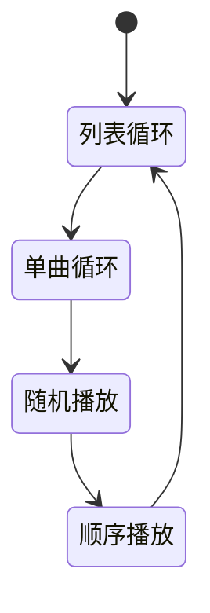
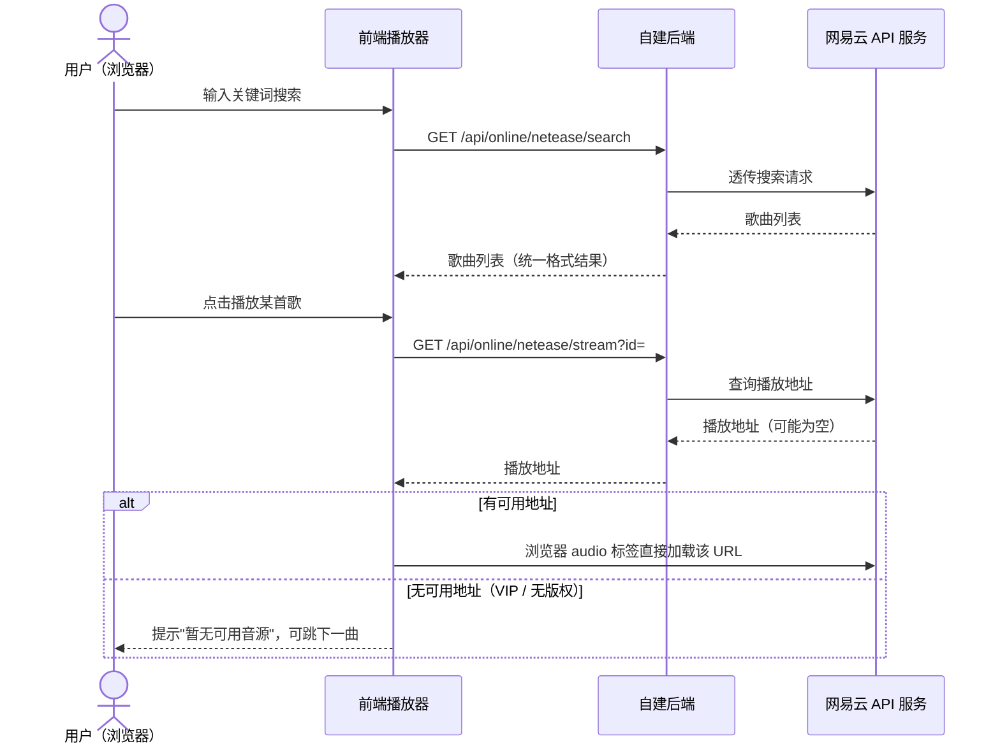
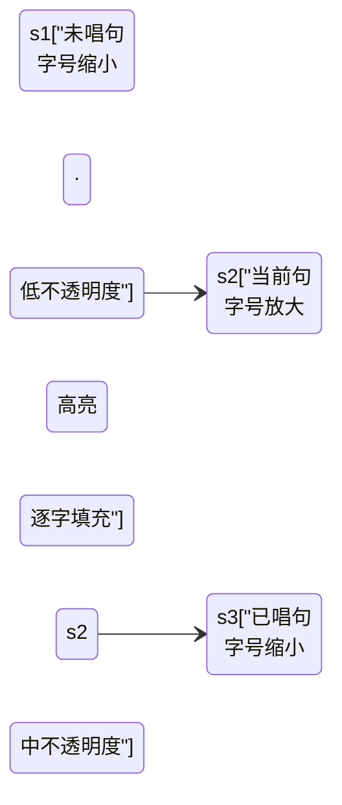
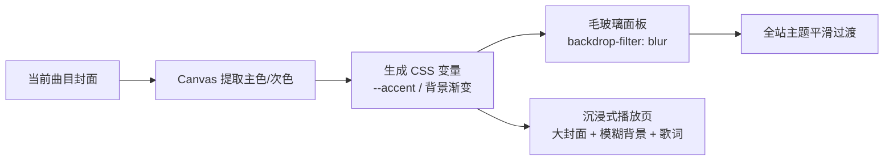
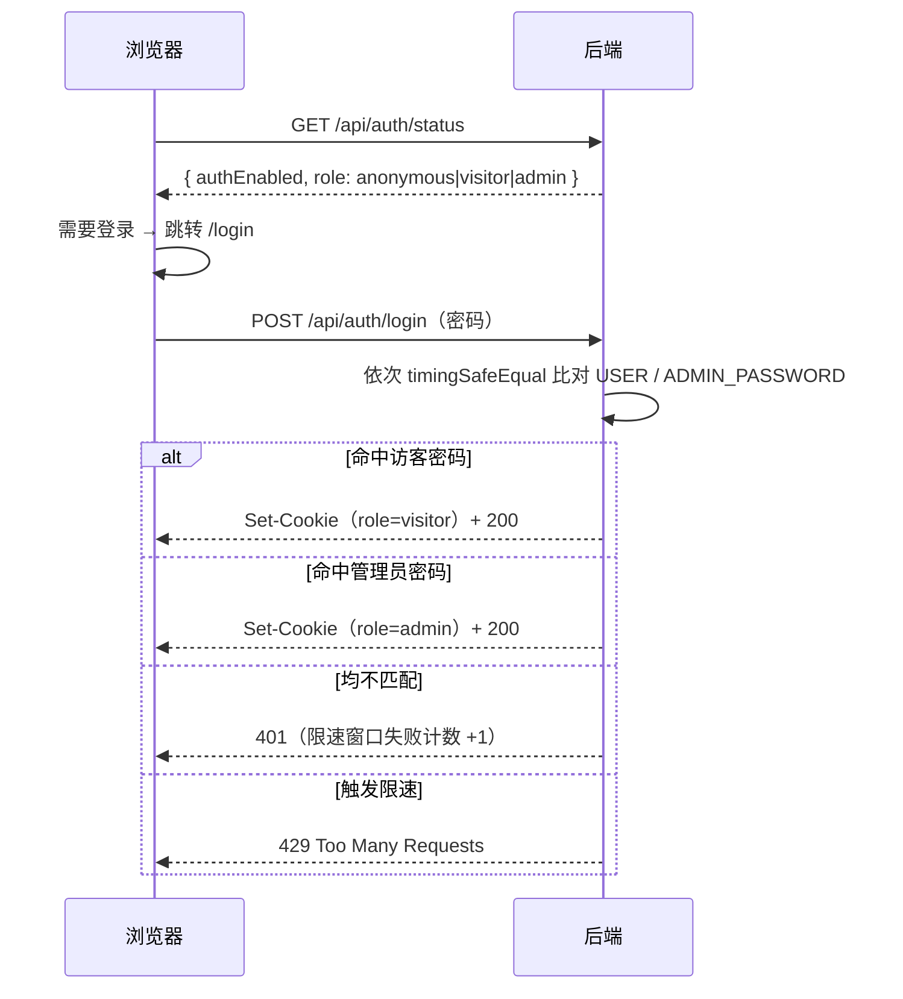
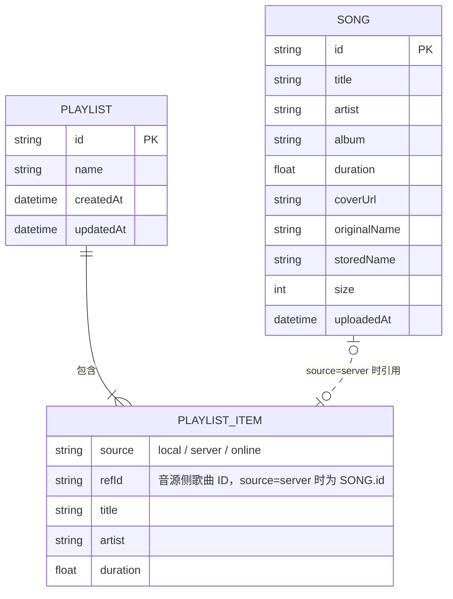

# 音乐软件需求文档（PRD）

| 项目名称 | 轻听音乐（2026-09-28 确认） |
| --- | --- |
| 文档版本 | v4.15（定稿） |
| 编写日期 | 2026-09-28（v2.6 起 2026-09-29） |
| 目标平台 | Web 网页应用（浏览器访问，响应式适配桌面优先） |
| 文档状态 | 已定稿 |

---

## 目录

- 1. 项目概述
- 2. 用户故事与核心场景
- 3. 功能需求：3.1 模块总览 / 3.2 播放器核心 / 3.3 本地播放 / 3.4 云端音乐库 / 3.5 在线音源 / 3.6 歌单 / 3.7 歌词 / 3.8 界面 / 3.9 视觉与动效 / 3.10 多端适配 / 3.11 访问控制 / 3.12 管理台
- 4. 非功能需求：性能 / 兼容性 / 安全 / 可靠性 / 部署
- 5. 技术方案：选型 / API 草案 / 数据模型 / 工程结构 / 环境变量汇总 / 技术规范
- 6. 里程碑规划（M1 / M2 / M3 / 远期）
- 7. 埋点与度量
- 8. 风险与约束
- 9. 术语表
- 10. 决策记录
- 11. 测试与验收计划
- 12. 部署手册大纲
- 修订记录

---

## 1. 项目概述

### 1.1 产品定位

一款**可私有部署的 Web 音乐播放器**：既能播放用户电脑里的本地音乐文件，也能通过自建服务器建立个人云端音乐库（上传、流式播放），并支持接入第三方在线音源（网易云音乐等）进行搜索和试听。

产品形态为"**本地 + 自有云端 + 在线聚合**"三合一的个人音乐中心，数据由用户自己掌控。

### 1.2 产品目标

1. **一处集中听歌**：本地文件、自建服务器音乐、在线音源在同一个界面内无缝切换播放。
2. **私有云音乐库**：用户部署自己的服务器，上传音乐后可在任意设备（电脑、手机浏览器）访问播放。
3. **够用且好用的播放体验**：覆盖主流播放器的基础体验（进度拖拽、播放模式、音量、封面、歌词）。
4. **架构可扩展**：在线音源以"适配器"方式接入，后续可扩展更多音源而无需改动播放器核心。

### 1.3 目标用户

- 本人（开发者本人）及小范围朋友使用；不面向公众提供服务。
- 用户特征：拥有一定量本地音乐文件（MP3/FLAC 等）；具备基本的服务器部署能力；在多设备（PC、手机）上听歌。

### 1.4 不做的事（Scope 边界）

- 不做面向公众的流媒体服务，不提供音乐分发。
- 不内置任何第三方音源的破解/去版权功能；在线音源仅做搜索与播放代理，仅供个人学习研究。
- 首期不做移动端原生 App（用移动端浏览器访问 Web 即可）。
- 不做多用户体系与社交功能（评论、分享、关注等）；权限仅"未登录 / 访客 / 管理员"三档（见 3.11）。

---

## 2. 用户故事与核心场景

### 2.1 核心用户故事

| 编号 | 用户故事 | 优先级 |
| --- | --- | --- |
| US-01 | 作为用户，我想把电脑里的音乐文件拖进网页直接播放，这样不用安装任何软件。 | P0 |
| US-02 | 作为用户，我想把音乐上传到自己的服务器，这样在其他设备上也能听。 | P0 |
| US-03 | 作为用户，我想在播放器里控制播放/暂停、切歌、拖进度、调音量，获得基础听歌体验。 | P0 |
| US-04 | 作为用户，我想看到歌曲的标题、歌手、专辑、封面、时长，而不是一串文件名。 | P0 |
| US-05 | 作为用户，我想搜索并播放在线音源（网易云）的歌曲，补充我没有的曲目。 | P1 |
| US-06 | 作为用户，我想创建歌单并把不同来源的歌曲收录进同一个歌单。 | P1 |
| US-07 | 作为用户，我想边听歌边看滚动歌词。 | P2 |
| US-08 | 作为用户，我想在手机浏览器里也能正常使用。 | P1 |
| US-09 | 作为部署者，我希望未登录的访问者只能播放本地文件；访客密码使用者可听云端曲库与在线音源；上传/删除等管理功能仅管理员密码解锁。 | P0 |
| US-10 | 作为管理员，我想要一个集中管理台页面：上传歌曲、管理曲库（搜索/删除/批量删除）、查看存储统计。 | P0 |

### 2.2 典型场景

**场景 A：本地听歌（无需服务器）**
用户打开网页 → 拖入 20 个本地 MP3 → 生成临时播放列表 → 点击播放、切歌、随机播放 → 关闭页面即结束，文件不上传、不留存。

**场景 B：云端音乐库（需要服务器）**
管理员在 PC 上打开"管理台"（3.12）→ 拖入文件夹批量上传（显示进度条）→ 服务器自动解析出标题/歌手/封面 → 用户在手机浏览器打开同一地址并以访客身份登录 → 在线流畅播放，拖动进度条即时响应。

**场景 C：在线补充听歌**
用户在"在线搜索"页输入关键词 → 调用网易云 API 返回结果列表 → 点击播放；遇到 VIP/无版权歌曲时给出明确提示并自动跳过或提示换源。

**场景 D：混合播放**
用户把 5 首本地歌 + 3 首服务器歌 + 2 首在线歌加进同一个歌单，连续播放时无感知切换来源。

---

## 3. 功能需求

优先级定义：

- **P0**：MVP 必须，第一版就要可用。
- **P1**：第一版发布后尽快补充。
- **P2**：远期规划，视情况排期。

### 3.1 模块总览

> 系统架构图（正式版）：`docs/design/系统架构图.drawio`（drawio 绘制，draw.io 打开可编辑，可导出 PNG 嵌入本文档）。

**关键设计概念——统一曲目（Track）抽象**：播放器核心只面向统一的 `Track` 对象播放，每个 Track 标记来源 `source: local | server | online`。本地文件对应浏览器 Blob URL，服务器文件对应后端流地址，在线歌曲对应第三方音频 URL。三种来源对播放器透明，这是"混合播放"（场景 D）得以实现的基础。

### 3.2 播放器核心（P0）

| 编号 | 需求 | 说明 | 优先级 |
| --- | --- | --- | --- |
| PL-01 | 播放/暂停 | 点击按钮或空格键切换 | P0 |
| PL-02 | 上一首/下一首 | "上一首"规则：当前播放超过 3 秒则回到本曲开头，否则切上一曲 | P0 |
| PL-03 | 进度条 | 显示当前进度/总时长；支持点击和拖拽跳转（seek） | P0 |
| PL-04 | 音量 | 滑杆调节 + 静音按钮，记忆上次音量 | P0 |
| PL-05 | 播放模式 | 顺序播放 / 列表循环 / 单曲循环 / 随机播放，四种模式循环切换 | P0 |
| PL-06 | 播放队列 | 当前播放队列列表：显示正在播放标识、可移除单曲、可清空 | P1 |
| PL-07 | 播放状态持久化 | 刷新页面后恢复上次播放的曲目与进度（localStorage） | P1 |
| PL-08 | 快捷键 | 空格播放/暂停、左右方向键快进快退 5 秒、上下方向键调音量 | P2 |
| PL-09 | 异常处理 | 音源加载失败时给出提示并自动跳下一曲 | P0 |
| PL-10 | 睡眠定时器 | 定时停止播放（15/30/60 分钟或播完当前列表），到点音量淡出后停止 | P2 |
| PL-11 | 淡入淡出 | 切歌/暂停/定时停止时的音量平滑过渡，可开关 | P2 |
| PL-12 | 倍速播放 | 0.5~2.0x 变速（有声书/播客场景），倍速随会话记忆 | P2 |
| PL-13 | 均衡器与音效 | 10 段图形 EQ（31Hz~16kHz，Web Audio BiquadFilterNode 链）+ 整体增益；预设（平直/流行/摇滚/爵士/古典）+ 自定义曲线保存；A/B 对比开关（关闭时音频直通）；增益过大时限幅防爆音；设置按浏览器本地存储（每设备独立）；界面位于设置页"音效" Tab | P1 |

**播放模式切换关系（PL-05）**：



**验收标准**：
- 切歌到出声延迟 ≤ 1 秒（网络正常时）。
- 进度拖拽后 0.5 秒内从新位置继续播放（依赖服务端 Range 支持）。
- 播放到列表末尾时，各播放模式行为符合定义。

### 3.3 本地音乐播放模块（P0）

| 编号 | 需求 | 说明 | 优先级 |
| --- | --- | --- | --- |
| LC-01 | 文件添加 | 点击按钮选择 或 拖拽文件/文件夹到页面；支持多选 | P0 |
| LC-02 | 格式支持 | MP3、FLAC、WAV、OGG、M4A/AAC、OPUS；非音频文件自动过滤并提示 | P0 |
| LC-03 | 信息解析 | 无元数据时按文件名解析"歌手 - 歌名"格式 | P0 |
| LC-04 | 元数据读取 | 前端解析 ID3/Vorbis 等标签，显示内嵌标题/歌手/封面 | P1 |
| LC-05 | 临时列表 | 添加后进入本地临时列表，可整体播放、单曲播放、清空 | P0 |
| LC-06 | 隐私约束 | 本地文件仅用浏览器 Blob URL 播放，**不经服务器、不上传** | P0 |
| LC-07 | 快捷转存 | 本地列表提供"上传到音乐库"入口，跳转管理台并带入所选文件（与 3.4/3.12 打通）；仅管理员身份可见 | P1 |

**验收标准**：拖入含 50 个文件（其中混有非音频）的文件夹时，仅音频进入列表，且界面无卡顿（解析异步进行）。

### 3.4 云端音乐库模块（P0，需服务器）

| 编号 | 需求 | 说明 | 优先级 |
| --- | --- | --- | --- |
| LB-01 | 上传 | 单个/批量/拖拽上传；显示每文件实时进度与总进度；支持同时上传多个 | P0 |
| LB-02 | 上传校验 | 按扩展名白名单校验；单文件大小上限默认 300MB（可配置）；重复文件（同文件名+同大小）提示跳过或覆盖 | P0 |
| LB-03 | 元数据解析 | 服务端解析音频标签：标题、歌手、专辑、时长、内嵌封面图；解析失败时回退用文件名 | P0 |
| LB-04 | 音乐列表 | 展示封面、标题、歌手、专辑、时长、大小、上传时间；支持按标题/歌手/上传时间排序 | P0 |
| LB-05 | 删除 | 单曲删除（需二次确认）；同步删除音频文件与封面文件；界面入口在管理台（3.12） | P0 |
| LB-06 | 流式播放 | 后端按 HTTP Range 响应音频流，支持边下边播、任意位置 seek | P0 |
| LB-07 | 搜索过滤 | 在音乐库内按关键词实时过滤（标题/歌手/专辑） | P1 |
| LB-08 | 分页/虚拟滚动 | 曲目超过 500 条时保证列表流畅 | P2 |
| LB-09 | 批量操作 | 批量删除、批量加入歌单 | P2 |
| LB-10 | 存储统计 | 曲目总数、总占用空间；由管理台实现，见 3.12 AD-03 | P1 |
| LB-11 | 索引重建 | "扫描 uploads 目录重建曲库索引"：重新解析元数据、重建 songs.json，用于索引损坏/误删后的容灾恢复；入口在管理台（AD-05） | P1 |
| LB-12 | 断点续传上传 | 大文件上传中断后从已传分片继续，避免整文件重传（分片上传） | P2 |

> 注：上传/删除/统计等管理操作的界面入口统一在管理台（3.12）；音乐库页面对所有登录用户为纯浏览视图。

**验收标准**：
- 上传 50MB 文件过程中页面可正常操作，失败文件有明确错误提示且不影响其他文件。
- 播放服务器曲目时拖动进度条到未缓冲位置，0.5 秒内从该位置继续播放。
- 删除歌曲后，列表、存储文件、封面均被清除。

### 3.5 在线音源接入模块（P1）

| 编号 | 需求 | 说明 | 优先级 |
| --- | --- | --- | --- |
| ON-01 | 音源适配层 | 定义统一 Provider 接口（search / getStreamUrl / getLyrics），播放器与前端页面不感知具体音源；多源架构参考 Folia（folia-major）的设计思路 | P0（架构） |
| ON-02 | 网易云搜索 | 接入自部署的 NeteaseCloudMusicApi（或增强分支 NeteaseCloudMusicApiEnhanced）：关键词搜索，返回标题/歌手/专辑/时长 | P1 |
| ON-03 | 网易云播放 | 获取歌曲播放地址并加入播放；对 VIP/无版权歌曲（无可用地址）给出明确提示 | P1 |
| ON-04 | 配置开关 | 后端通过环境变量配置第三方 API 地址；未配置时前端隐藏/置灰在线功能并显示配置指引 | P1 |
| ON-05 | 歌词获取 | 通过音源接口获取歌词（含逐字格式 yrc），进入歌词模块 | P1（配合 3.7 歌词 P1） |
| ON-06 | QQ 音乐接入 | 参考 yakult-green-tea/qq-music-api（Folia 同款方案）：需微信扫码登录后播放，作为独立适配器接入 | P2 |
| ON-07 | 多音源聚合搜索 | 一次搜索同时查询多个音源并合并结果 | P2 |
| ON-08 | 酷狗音乐接入 | 参考 MakcRe/KuGouMusicApi，作为独立适配器接入 | P2 |
| ON-09 | 歌词/封面多源回退匹配 | 歌词与封面按"网易云 → QQ → 酷狗"顺序自动回退匹配，失败支持手动修正（参考 Folia） | P2 |

> 注：Folia（folia-major）为 AGPL-3.0 协议。本项目只借鉴其交互设计与接入思路、代码自行实现，不复制其源码；若未来直接引用其代码，本项目须同样以 AGPL-3.0 开源（见 9. 风险）。

**验收标准**：未配置网易云 API 时，其余功能不受任何影响；配置后无需改前端代码，重启后端即生效。

**在线播放核心流程（ON-02 / ON-03）**：



### 3.6 歌单管理模块（P1）

| 编号 | 需求 | 说明 | 优先级 |
| --- | --- | --- | --- |
| PS-01 | 创建/重命名/删除歌单 | 歌单存储在服务器端 | P1 |
| PS-02 | 添加曲目 | 支持把任意来源（本地/云端/在线）的曲目加入歌单 | P1 |
| PS-03 | 播放歌单 | 整单播放、从某曲开始播放 | P1 |
| PS-04 | 曲目排序/移除 | 歌单内拖拽排序、移除单曲 | P2 |
| PS-05 | 收藏/最近播放 | 一键收藏单曲；自动记录最近播放 100 条 | P2 |
| PS-06 | 歌单导出 | 将歌单导出为文件（M3U8/JSON，格式开发时定） | P2 |

> 交互形态（2026-09-29 原型确认）：歌单以**侧栏分区**呈现（"歌 单"标题 + "＋"新建，列表项含曲目数徽标）；点击歌单在内容区打开**详情页**——头部（渐变封面/名称/曲目数/总时长）+ 操作（播放全部/重命名/导出/删除）+ 编号曲目列表；原"卡片网格"方案废弃。高保真原型见 `docs/design/mockup/`。

**说明**：本地文件加入歌单时，仅记录文件名等元信息作为"占位引用"——该文件在其他设备上不存在时，显示为灰色"本地缺失"状态，跳过播放。在线曲目入歌单时保存其音源与歌曲 ID。

### 3.7 歌词模块（P1，经 3.9 VS-03 确认提前）

**动效基准：Apple Music 歌词页**（2026-09-28 确认为歌词动效的唯一主要参考）。Folia 相关内容均为远期参考：其歌词效果在**项目主体完成后**再行评估探索（见里程碑"远期"），当前不进入任何里程碑。歌词行的三种视觉状态：



| 编号 | 需求 | 说明 | 优先级 |
| --- | --- | --- | --- |
| LR-01 | 歌词展示与解析 | P1 范围：LRC（行级时间轴，**含行内词级标签的增强型** `[mm:ss.xx]<mm:ss.xx>字`，v4.87 补上）+ yrc（网易云逐字，支撑卡拉OK填充），无逐字数据时自动退化为行级模式；qrc / krc / ttml / vtt 等其余逐字格式为远期增强，随对应音源接入后再支持 | P1 |
| LR-02 | 歌词来源 | 优先级：**用户手动导入 > 音频内嵌歌词 > 在线音源歌词接口**（多源回退匹配，见 ON-09）。注：v4.87 把手动导入从最后提到了最前，理由见下方“歌词来源”。 | P1 |
| LR-03 | 播放页 | 与沉浸式播放页合并实现，见 3.9 VS-03 | P1 |
| LR-04 | Apple Music 风格动效 | 当前句大字号高亮，前后句渐进缩小、降低不透明度，形成景深层次；句间切换用 transform/opacity 平滑过渡（遵守 VS-07 性能约束）；歌词区上下边缘渐隐遮罩 | P1 |
| LR-05 | 逐字卡拉OK填充 | 有逐字时间轴时，当前句内按字/词渐进填充高亮（Apple Music 标志性效果）；仅行级数据时整句渐亮 | P1（无逐字数据时自动降级，不阻塞验收） |
| LR-06 | 点击行跳转 | 点击任意歌词行 seek 到该句时间点；播放中当前句自动滚动居中 | P1 |
| LR-07 | 滚动交互 | 用户手动滚动歌词时暂停自动居中，数秒无操作后恢复，并提供"回到当前句"按钮；滚轮 / 拖动 / **键盘（↑↓、PgUp/PgDn、Home/End，v4.87）** 三种操作等价 | P2 |

> 动效参考开源库 **AMLL**（amll-dev/applemusic-like-lyrics，**AGPL-3.0**）：提供 `@applemusic-like-lyrics/core`（DOM 原生）与 Vue 绑定、YRC/QRC/TTML 逐词歌词解析模块，另有社区逐词歌词数据库；完整效果需 Chromium 120+（`mix-blend-mode: plus-lighter`）。
>
> **许可更正（v4.83 核实）**：本行早期版本写作“MIT”，**是错的**——GitHub 仓库与 npm 上 `core` / `vue` / `lyric` / `react` 四个包均为 `AGPL-3.0-only`（`npm view` 实测）。AGPL 是强传染许可：接入其代码，**整个项目（含 server）都成为 AGPL 衍生作品**，且本软件是网络服务（AGPL §13 还要求向使用者提供完整源码）。
>
> **决策：只参考它的思路，代码自己写（v4.86 定稿）**。三步演进：v4.84 直接接入 npm 包（需求方澄清“要抄的是代码，不是装包”）→ v4.85 回退为**移植其代码** → v4.86 又把移植的部分改成**按公式/按效果自行实现**（弹簧 = 阻尼简谐振子的解析解；逐字辉光爆发 = 按自己的峰形曲线生成）。这样既拿到了它的效果，**项目里也不含 AGPL / GPL 代码**（无 `LICENSE`、`package.json` 无 license 字段），界面风格、主题色、锦线策略、渐隐语言全是我们自己的。
>
> **自研与参考的分工（v4.86）**：歌词解析在 `utils/lyrics.ts`；行级景深/逐字与行级填充/点击跳转/手动滚动在 `LyricsView.vue`；**弹簧**在 `utils/spring.ts`（参考 pushkine 的 MIT 实现，文件头署名）；**逐字辉光爆发**在 `utils/lyricEmphasis.ts`。详见 [`docs/dev/架构与代码地图.md`](./docs/dev/架构与代码地图.md) 7.5。

#### 歌词来源：手动导入提到最前（v4.87）

需求方选的方向是“把逐字动效真正用起来”，而**用户的歌里没有逐字数据**——内嵌歌词大多只有行级，LR-05 的逐字填充与辉光爆发就永远显不出来。所以这一版补了两件事，把数据来源打开：

1. **解析端**：支持**增强型 LRC**（`[00:12.00]<00:12.00>你<00:12.80>好<00:13.60>`），这是各地歌词站与 K 歌工具导出的常见形式（末尾那个没有文字的标签就是收尾标记，末字时长靠它落定；漏了收尾就用下一句开始兜底）；顺手把 `[offset:]` 也补给了 yrc（此前只有普通 LRC 吃）。
2. **导入端**：沉浸页顶栏加一个**「歌词来源」**入口，可导入手上的 `.lrc` / `.yrc`，按曲目记住（服务器/在线曲目按 id，**本地曲目按“歌手|曲名”**——本地 id 每次拖进来都会变），可一键退回自带歌词。读文件时按 BOM → UTF-8 → **GBK 回退**（老播放器导出的歌词多半是 GBK，硬按 UTF-8 读是满屏乱码）。

**优先级因此改成：手动导入 > 内嵌 > 在线。** 原文档把手动排在最后，但手动导入是用户对着这首歌做的显式动作，而内嵌那份往往只有行级——不覆盖的话，这个入口对“内嵌已有行级歌词”的歌等于没用（而那正是最需要升级成逐字的场景）。想退回自带歌词，菜单里一键即可，所以这个“覆盖”是可逆的。

### 3.8 界面需求（信息结构）

整体布局：左侧导航 + 中间内容区 + 底部常驻播放条。

```
┌──────────┬────────────────────────────────────┐
│ ♫ 轻听音乐 │  [页面标题]  [排序/搜索/操作按钮]     │
│          ├────────────────────────────────────┤
│ ▸ 本地播放 │                                    │
│ ▸ 音乐库   │   内容区                             │
│ ▸ 在线搜索 │   （歌曲列表 / 搜索结果 / 歌单详情）    │
│ ▸ 我的歌单 │                                    │
│   ├ 日常   │                                    │
│   └ 运动   │                                    │
│ ▸ 管理     │  ← 仅管理员身份可见（3.12）           │
├──────────┴────────────────────────────────────┤
│ [封面] 歌名/歌手  │ ⏮ ▶ ⏭ 🔀 🔁 │ 1:23 ────●── 3:45 │ 🔊 │
└────────────────────────────────────────────────┘
```

> 注：图表规范见 5.6.6——线框类图不属于 Mermaid 擅长范围，正式线框已用 drawio 绘制：`docs/design/主界面线框.drawio`（本节）与 `docs/design/管理台线框.drawio`（3.12）；下文 ASCII 仍为快速示意。

界面要求：

- 玻璃拟态风格基调（见 3.9），支持深色/浅色主题切换（VS-08），默认深色。
- 图标统一来自 Iconify + Phosphor 图标集（单一图标集，见 5.1）；图标颜色使用 currentColor，随主题变量与封面取色联动；状态约定：普通态用 regular 粗细，播放中/激活态（如随机播放开启、正在播放入口）用 fill 粗细，对齐 Apple Music 的填充式播放态惯例。
- 歌曲行结构统一：封面缩略图（44px）、标题+歌手、专辑、时长、操作按钮（播放/加入歌单/删除）；行 hover 高亮，正在播放行有动效标识。
- 底部播放条常驻，任何页面都在；含封面、控制按钮组（播放模式 / 上一首 / 播放暂停 / 下一首 / 静音）、进度条、音量。
- **音量交互形态（v4.19 定稿）**：静音键位于控制按钮组末位（与原型的 5 按钮布局一致）；鼠标悬浮或键盘聚焦时在其上方展开**竖向**音量条——玻璃悬浮层材质 + 主题色填充轨道 + 百分比读数，点按钮即静音/取消静音；纯 CSS 控制显隐（含 `:focus-within`），触摸设备上仍可直接点按钮静音。
- 响应式与多端策略见 3.10（断点规范 RT-01 在 M1 确定，手机布局 M2 实施）。
- 侧栏支持**折叠为纯图标窄栏**（约 68px，含状态记忆），原型已实现（2026-09-29）。
- 侧栏底部仅保留"设置"入口与"折叠侧边栏"；主题切换、退出登录、管理控制台入口统一收纳至**设置页**——设置页为**顶部 Tab 形态**（常规 / 账户 / 在线音源 / 快捷键 / 音效 / 管理 / 关于，活跃 Tab 主题色下划线；管理 Tab 仅管理员可见，2026-09-29 确认）。
- 空状态设计：音乐库为空、无搜索结果、在线音源未配置等场景均有引导性文案与操作入口。

### 3.9 视觉风格与动效（已确认，2026-09-28）

**风格基调：玻璃拟态（Glassmorphism）双主题（默认深色）+ 跟随封面动态取色**



| 编号 | 需求 | 说明 | 优先级 |
| --- | --- | --- | --- |
| VS-01 | 玻璃拟态基底 | 封面模糊背景 + 半透明毛玻璃面板（backdrop-filter）+ 半透明描边；列表视图为默认视图；M1 以深色主题实现，且颜色全部走 CSS 变量，为 VS-08 双主题预留 | P0（M1 即按此实现） |
| VS-02 | 封面取色主题 | 从当前曲目封面提取主色/次色，注入 CSS 变量生成主题色与背景渐变，切歌平滑过渡；封面缺失/加载失败时回退固定色板；取色结果按当前主题适配亮度/对比度（浅色主题下使用加深的 accent 变体，保证文字对比度） | P1 |
| VS-03 | 沉浸式播放页 | 点击播放条展开全屏，布局参考用户稿并简化（2026-09-29）：左侧方形封面 + 右侧"标题/歌手 + 滚动歌词列" + 底部居中控制与进度；歌名条/喜欢/评论/HQ/歌词开关/队列/伴唱等周边控件不做；歌词动效按 3.7 的 Apple Music 基准实现（当前句主题色 + 逐字填充） | P1 |
| VS-04 | 封面动效 | 播放中封面缓慢旋转（或呼吸浮动），暂停即停；遵循 prefers-reduced-motion 降级为静态 | P1 |
| VS-05 | 频谱可视化 | Web Audio API（AnalyserNode）实时频谱：播放页大图 + 播放条迷你指示；在线音源受 CORS 限制取不到音频数据时自动隐藏 | P2 |
| VS-06 | 列表+网格混合 | 音乐库/歌单为紧凑列表（行高约 48px），专辑视图为封面卡片网格，视图可切换 | P1 |
| VS-07 | 性能与降级 | backdrop-filter 使用层数克制；模糊背景用低分辨率封面图；不支持的浏览器/低端设备降级为半透明纯色 | P0 |
| VS-08 | 主题切换 | 深色/浅色双主题，全部经 CSS 变量（`data-theme` 属性）驱动；默认跟随系统 `prefers-color-scheme`，用户手动切换后记忆选择（localStorage）；界面提供切换入口（导航/设置）；切换即时生效、无刷新；深色为推荐默认 | P1 |
| VS-09 | 歌词页布局选择 | 沉浸式播放页提供三种布局（2026-09-29 确认，参考 QQ 音乐）：经典双栏（封面左·歌词右）/ 沉浸歌词（纯歌词居中）/ **海报背景（彩胶）**——歌词左，右侧为按封面取色渲染的大黑胶唱片（纹路+胶环，播放时旋转，悬于右上角）；在设置-外观 Tab 以缩略图卡片选择，即时生效并按设备记忆（localStorage）；三种布局均沿用 3.7 歌词动效。**M1 组件化要求（2026-09-30 定稿）**：三布局在 Vue 中实现为三个独立组件（ImLayoutDuo / ImLayoutCenter / ImLayoutPoster），经 `<component :is>` 动态挂载切换；歌词滚动引擎、标题块、播放控制栏抽为共享子组件复用，布局组件只负责各自的版式与专属视觉层（如海报布局独占彩胶装配）。原型 mockup 的单页 CSS 类切换（.layout-duo/-center/-poster）仅是原型手段，且已证明易生层叠逃逸 bug（v3.9），不得照搬进 Vue；**v4.74：三布局全部落地**（`ImLayoutDuo` / `ImLayoutCenter` / `ImLayoutPoster`，设置 › 外观 以缩略图卡片选择、按设备记忆），彩胶按下方配方实现 | P1 |

> 彩胶实现配方（VS-09 海报背景，2026-09-30 定稿：QQ 音乐官方分层素材 + 用户实机验证实现，原型已移植）：**素材四张**（`glow`=background@2x / `base`=hightlight1@2x / `grooves`=hightlight2@2x / `emboss`=shadow@2x，270×270 @2x）。分层组装（自后向前）：**① 外圈光晕** = glow 素材作 `mask`、填主题色 `hsl(--theme-h,--theme-s,62%)`（素材本身浅灰、灰色无意义，有意义的是 alpha 分层——mask 填色才得到跟封面配色走的有机柔光，box-shadow 做不出这种不规则衰减；比盘体大 1.4 倍居中，随盘旋转 + 呼吸）→ **② 盘体装配**（圆形裁剪 `border-radius:50% + overflow:hidden + isolation:isolate`，混合只在盘内生效；整体随盘旋转）内叠三层：主题色 conic 漩涡 `--vinyl-gradient`（同色相只做明度/饱和度漩涡，即彩胶质感）→ emboss 大理石纹理（`mix-blend-mode:overlay` 0.6）→ 封面中心标签（inset 21%，原型用取色渐变，M1 接入真实封面 ``）→ **③ 固定高光** = base+grooves 两张叠同一元素（深反光 α 中位仅 8~9/255，拆开互相看不见，同元素 overlay 混合才凑出完整盘面光泽），**不随盘旋转**（光源固定）；定位三变量 `--vinyl-t/-r/-d` 收敛在 `.im-cover-wrap` 上供三层共用。整体 `rotate` **8s/圈**（45°/s 顺时针，QQ 实机视频实测值）、盘缘内阴影环（白边 1px + 向内 26px 深色晕开，源色 Tone 0.30 派生）增加厚度感、`will-change: transform`、暂停即停在最亮帧、遵循 prefers-reduced-motion。**DOM 结构对齐用户 01-colorfull 实现（2026-09-30 定稿；v5.23 修订一处）**：外壳 `.vinyl-assembly`（不转、不裁剪 —— 共享元素过渡捕获到的就是“盘”本身；边缘环 = `::after`）> 旋转盘 `.v-disc`（转 + overflow:hidden 裁剪）> 盘体/纹理/标签；高光 `.v-gloss` 为外壳子元素。**光晕自 v5.23 起是装配的兄弟节点 `.vinyl-glow`**（仍与盘同心、1.4 倍盘径居中，位置尺寸由同一组 `--vinyl-t/-r/-d` 派生）：它必须溢出盘外，而 View Transition 只快照“带名字那个元素”的边框盒 —— 留在外壳里会被方框硬裁出一圈方边（v5.23 实测：飞行末段盘外可见方形残影、落地即消失）；它随盘同频旋转 + 呼吸（v5.24 补齐漏掉的旋转那一半；暂停时旋转冻结在当前角度、呼吸撤掉停在最亮帧）。**彩胶不参与封面共享元素过渡（v5.25 撤回）**：它只走整页交叉淡化，所以上面这条“留在外壳里会被方框硬裁”的风险已不再适用；光晕挂装配外面这个结构保留（装饰物不放进将来可能要当共享元素的盒子里）。颜色源 `--cover-src/--cover-src-2` 须经 `@property` 注册为 `<color>`，调校用 OKLCH 相对颜色语法在 CSS 派生（见 3.9⑤），换封面整页平滑过渡而非硬切。注意：盘面颜色必须经 CSS 变量注入，禁止 JS 写内联 background（会覆盖全部图层，原型曾踩此坑）。

#### 设计令牌速查（从原型 mockup.css 提取，M1 前端直接迁移）

> 界面样式的唯一事实来源为 `docs/design/mockup/css/mockup.css`（已浏览器实测）；下表为关键令牌与配方的速查。

**① 玻璃拟态材质（.glass 面板，VS-01）**

| 令牌 | 深色 | 浅色 |
| --- | --- | --- |
| --glass-bg | rgba(255,255,255,.055) | rgba(255,255,255,.55) |
| --glass-border | rgba(255,255,255,.12) | rgba(255,255,255,.75) |
| --text-1 / 2 / 3 | 白 .92 / .60 / .36 | 深蓝黑 .92 / .62 / .40 |
| 毛玻璃 | backdrop-filter: blur(28px) saturate(1.5)（两主题同） | 同左 |
| 投影 | 0 8px 32px rgba(0,0,0,.35) | 0 8px 32px rgba(30,40,80,.12) |

> **岛内卡片（v4.16）**：放在 `.glass` 岛（侧栏/内容区/控制台主区）**里面**的卡片不再叠 backdrop-filter，改用更实的底色（深 `rgba(255,255,255,.1)` / 浅 `rgba(255,255,255,.8)`）+ 描边与岛面区分（前端类名 `.card`）。原因：VS-07 要求模糊层数克制，且玻璃叠玻璃会互相稀释成一片灰糊。深色文字不透明度亦由 .92/.60/.36 上调为 .94/.64/.46（实机偏暗，可读性优先于原型数值）。

**② Island 布局参数**

- 应用外壳网格：侧栏 224px（折叠 68px）+ 内容 1fr；行 = 1fr + 播放条 84px；岛间距与页边 14px；面板圆角 18px（v4.17 自 12/16 微调）
- 圆角体系：面板 18 / 行与卡片 12 / 按钮与输入框 10 / 封面缩略图 9（v4.17）
- 文字三级：--text-1 主文本 / --text-2 次级 / --text-3 弱化；深色实取值 .94/.64/.46，浅色 .94/.66/.48（可读性优先，v4.16 上调）
- 浅色主题专属：底色 #f1f2f5；岛面不透明度 .66（深色 .055，浅色底平、需更实）；描边用淡灰蓝细线 rgba(30,40,80,.09)；背景光晕按主题降为 accent 9%/6%（深色 26%/20% 会把浅色整页染紫，v4.17）
- 歌词页内容组：fit-content + 水平垂直居中，组内封面列 / 歌词列 / 间距均按 vh/vw 相对缩放（clamp 限幅）

**③ 动效参数**

| 动效 | 参数 |
| --- | --- |
| 彩胶旋转 | 8s linear/圈（45°/s 顺时针，2026-09-30 对照 QQ 实机视频实测修正，旧值 32s 差 4 倍）；播放 running / 暂停 paused；reduced-motion 静止 |
| 光晕呼吸 | 3.4s ease-in-out；opacity 1↔0.72；随盘旋转（素材形状不规则，转起来才可见）；**暂停时一起停，停在最亮帧** |
| 歌词滚动弹簧 | **自研**（`utils/spring.ts`；求解思路参考 pushkine 的 MIT 实现）：基础 mass 0.9；跳转 / 首末句 100/16（稳）、结束 150/24、正常播放 180~230（按句间间隔微调）且 damping = `√stiffness × 2.3`（过冲幅度稳定）。`prefers-reduced-motion` 与页面不可见时直接落位 |
| 逐字辉光爆发 | **自研**（`utils/lyricEmphasis.ts`，效果参考 AMLL）：字刚唱完时跑一次 0.7~1.8s 的关键帧（峰形 `sin²(πx)` 从 0 冲到峰再收回），带轻微放大/上浮/邻字推挤，辉光用我们的 `--accent-soft`；与常驻辉光叠加，降低动效时不跑 |
| 非当前句模糊 | **按距离递增**（对齐 AMLL `resolveBlurLevel` 的机制）：距当前句 1 / 2 / ≥3 行 = blur 1.1 / 2.2 / 3.3px；不透明度 未唱 0.5 / 已唱 0.58 / 当前 1；缩放 0.965（= AMLL `SCALE_ASPECT` 97）；**悬浮时取消模糊**（点击跳转要先看清） |
| 逐字发光 | 已唱字符常驻 `text-shadow: 0 0 18px accent-soft, 0 0 6px accent-soft`（常驻主题色，不用它的白色瞬时爆发） |
| 行级填充柔边 | 填充前沿 ±0.25em 渐变过渡（带宽合计 0.5em，= AMLL `wordFadeWidth` 默认值）；无此柔边时前沿是一道硬边 |
| 歌词渐隐与留白 | 下缘 14%；**上缘按需**（贴顶时 `0%`——否则当前句被压暗；锦线铺开后 `8%`——已唱句已被退远，宽渐隐带会让上半部分过渡发硬）；列表**顶部不留白**（第一句紧贴标题）、**底部留半屏**（末句能走到中线） |
| 面板/行反馈 | background 0.15s；主题切换 background 0.5s 无刷新 |
| 页面/弹层过渡 | iOS 曲线 cubic-bezier(0.32,0.72,0,1)：页面切换 fade+上移 0.32s（v5.28 补齐实现：只做进场，旧页直接让位）、**队列弹层：桌面 scale+fade 0.3s（右下原点）／手机 = 从底部升起的半屏抽屉（`translateY(100%)→0`，0.34s，同一曲线，v5.40）**；**沉浸页 = 底部升起的 sheet：进场 translateY(100%)→0，退回时同一段位移反向沉下（两向均 0.42s，v5.27 需求方指定，取代原来的 fade+scale 0.36s）；飞行期间 sheet 带 18px 上圆角（落地收回直角，所以不会看到圆角“啪”地弹平）与朝上的面板级投影，下层主壳同步压暗到 brightness(0.68) 再亮回来（v5.28）**；登录页 fade 0.4s；reduced-motion 全部静止 |
| View Transition 增强（**v5.26 已撤除**） | 曾在 v5.18~v5.25 用 View Transition API 做封面共享元素飞入/飞出（播放条小图 ⇆ 沉浸页大图，`qt-cover`、0.42s）。两个理由整体下线：① 彩胶那一对两端既不同形也不同画，怎么调都留痕（v5.23 方框残影 → v5.24 落地硬切 → v5.25 撤回）；② 撤掉后页面只靠各自的 CSS 入场动画（沉浸页 `im-in` 0.36s），少一层浏览器级的快照与清理逻辑。要做回来见 git 历史 v5.18~v5.25 与 `docs/dev/开发约定.md` 的归档小结 |

**④ 图层顺序（海报/彩胶布局，自后向前）**

官方素材 mask 光晕（主题色填充，1.4 倍盘径，随盘旋转+呼吸）→ 彩胶圆形装配（conic 漩涡+大理石纹理+封面标签，圆形裁剪+isolate）→ 固定光源高光层（不随盘转）→ 全页渐变遮罩（保证歌词可读）→ 歌词列（z-1）→ 顶栏与底部控制（z-2）

**⑤ 取色注入（VS-02）**

切歌时由 JS 将颜色源写入 `--cover-src / --cover-src-2` 两个原始色变量（预设调色板的 c1/c2，或封面提取的桶平均色 hex），另写 `--accent / --accent-soft / --glow1 / --glow2` 四个展示变量；**一切调校在 CSS 完成**——`--cv1 / --cv2 / --cover-deep / --vinyl-gradient` 与光晕填充全部用 **OKLCH 相对颜色语法**从颜色源派生（Monet/HCT 思路的 CSS 原生实现，Chrome 119+/Safari 16.4+）：`oklch(from var(--cover-src) clamp(0.4, l, 0.62) clamp(0.07, c, 0.15) h)`。**为什么是 OKLCH**：L（Tone）感知均匀——clamp 即统一所有封面盘面深度，绿黄不再过曝（HSL 需要 Rec.601 色相偏置表补偿的问题在此不存在）；C（Chroma）钳制 0.07~0.15 防过艳也防过灰（晨雾这类刻意低饱和配色不被强行提艳，这是 HSL 方案的已证缺陷）。光晕 = Tone 0.52~0.68 派生；标签描边环 = `--cover-deep`（Tone 0.30）+ color-mix 透明度。**降级**：每个派生都先写一条无 OKLCH 的声明（`var(--cover-src)` 原色 / color-mix），不支持相对色语法的浏览器自动保留降级值，功能无损仅失去统一深度。`--cover-src/2` 经 @property 注册为 `<color>`，换歌整页平滑过渡。两个颜色源变量严禁 JS 写内联 background（会覆盖多层图层，原型曾踩此坑）。背景光晕、彩胶盘体、外圈光晕、主题色、逐字发光全部联动；**严禁 JS 写内联 background**（重复强调，原型曾踩此坑）。

> **真实取色管线（VS-02 完整实现，原型已落地）**：带真实封面的歌，播放时 `loadThemes(cover)` 异步提取——封面缩 64×64、按色相分 24 桶加权（权重 = 饱和度 × 明度居中度，丢灰白黑与 l<0.1/l>0.95 像素），最高权重桶即主题色相，色相差 ≥0.11 的前 4 个候选留作备选，**原始桶平均色**交 CSS 调校后覆盖预设色源；预设调色板即时兜底（提取失败/画布污染自动保留），切歌竞态用 playingId 比对丢弃过期结果，提取结果按图片地址缓存。中心标签接真实封面 ``（无封面歌回落取色渐变）。**样张实测**（蓝帽人像，caijiao cover.jpg）：候选 = 201° 天蓝（胜，即画面主体蓝帽）/ 6° 肤色暖调 / 49° 黄 / 308° 品红，OKLCH 调校后盘面深青蓝、深度与 QQ 实机持平且深浅两主题无过曝。历史决策记录：QQ 式压深（提饱和+压明度）与 HSL 手调（偏置表+区间收束）均经用户对比后淘汰，OKLCH 方案由用户在对比实验室页（docs/design/mockup/hct-test.html）定稿。注意 file:// 下画布会被污染，真实管线必须走 http。

> **M1 实现（v4.77 落地，取代原型版 JS 调校）**：`client/src/utils/coverColor.ts` —— 封面画进 32×32 canvas 取像素（原型是 64×64，实测 32 已足够且更省），纯函数按**色相 12 桶**、每像素按「饱和度 × 中间调偏好」投票（丢半透明、近黑近白、彩度 <0.1 的像素），得票最高的桶取**平均色**当主色；第二色源优先取**异族**（色相差 ≥40° 且权重占比 ≥12%），否则取主色**同色相浅一档**（**不旋转色相**：实测 +45° 会把肤色棕 #c8aba2 转成橄榄绿 #c8c8a2，页脚环境光直接发浑）。**与原型的关键差异**：原型在 JS 里跑 `tuneTheme`（HSL 调校后再写六个变量），M1 按铁律 3 只写 `--cover-src / --cover-src-2` 两个**原始色源**，亮度/彩度夹取全部交给 CSS 的 OKLCH 相对颜色——包括 `--accent / --accent-2 / --accent-soft / --glow1 / --glow2` 也不再由 JS 写。取不到可用颜色（纯灰阶 / 全透明 / canvas 被污染）一律保持默认配色，**不拿灰凑色**。

### 3.10 多端适配（已确认，2026-09-28）

**结论**：手机适配在 M2 实施，目标为原生级体验；M1 仅保证移动端不白屏。平板不做单独布局。支持 PWA。

| 编号 | 需求 | 说明 | 优先级 |
| --- | --- | --- | --- |
| RT-01 | 断点规范 | ≥1280px 桌面完整布局；768~1280px 平板沿用桌面布局；<768px 手机布局 | P0（M1 定规范并按桌面实现） |
| RT-02 | 手机布局 | <768px：导航收起为底部标签栏或抽屉；播放条简化为迷你条，点击展开沉浸式播放页；列表单列 | P1 |
| RT-03 | 听歌完整 | 手机端覆盖浏览/搜索/播放/切歌/歌词；上传、删除、歌单管理等管理操作以桌面为主（手机端隐藏或只读） | P1 |
| RT-04 | 锁屏/通知栏控制 | 集成 Media Session API：锁屏与通知栏显示封面/歌名/歌手，支持播放/暂停/上一首/下一首 | P1 |
| RT-05 | 手势操作 | 沉浸式播放页左右滑动切换上/下一曲、下滑收起；列表侧滑操作为 P2 可选 | P1 |
| RT-06 | 横竖屏 | 手机横屏时播放页自适应布局 | P2 |
| RT-07 | PWA 支持 | vite-plugin-pwa：manifest（名称/图标/主题色）+ Service Worker 缓存应用外壳与静态资源（音频不缓存）；可添加到主屏幕全屏运行 | P1 |
| RT-08 | 移动端底线 | M1 期间移动端访问不白屏、布局不崩；无法正常使用时给出"请使用电脑访问"提示 | P0 |

### 3.11 访问控制（已确认，2026-09-28）

**访问模型（三档）**：未登录 = 仅本地播放；访客密码（USER_PASSWORD）= 听云端曲库/歌单/在线音源；管理员密码（ADMIN_PASSWORD）= 额外解锁管理台（上传/删除/统计）。

| 编号 | 需求 | 说明 | 优先级 |
| --- | --- | --- | --- |
| AC-01 | 未登录（匿名）模式 | 未登录时仅可使用本地播放模块（3.3，纯浏览器、不经服务器）；服务器功能不可用，界面展示"登录后解锁"引导 | P0 |
| AC-02 | 登录（密码即角色） | 登录页输入密码，前端提交 POST /api/auth/login；后端以 crypto.timingSafeEqual 依次与 USER_PASSWORD、ADMIN_PASSWORD 比对，命中即获得对应角色（visitor / admin），Set-Cookie 颁发含角色的签名 Cookie，之后免输 | P0 |
| AC-03 | 接口分级保护 | 接口分两级：访客级（音乐库列表/音频流/歌单/在线音源搜索播放）要求 visitor 及以上；管理级（上传/删除/统计）要求 admin。鉴权中间件统一校验：未登录 401、角色不足 403 | P0 |
| AC-04 | 登出 | 提供登出入口（POST /api/auth/logout），清除凭证回到未登录状态 | P1 |
| AC-05 | 密码配置 | 两档密码均为环境变量。组合规则：两把都未配置 → 门禁关闭、全功能开放（本机场景）；仅配置 ADMIN_PASSWORD → 无访客档，登录页仅管理员入口；仅配置 USER_PASSWORD → 访客可听，管理功能对所有人关闭；两把都配置 → 完整三档 | P0 |
| AC-06 | 登录防爆破 | /api/auth/login 失败限速（express-rate-limit）：默认 15 分钟窗口内最多 10 次失败，超限返回 429 并提示稍后再试 | P0 |
| AC-07 | 登录页 | 独立 /login 路由：玻璃拟态登录卡片（居中 + 封面模糊背景，风格同 3.9）；单密码输入框（后端自动识别角色）；提供"先听听本地歌"未登录入口；登录成功跳回来源页；门禁关闭的环境直接跳过登录页 | P0 |
| AC-08 | 角色凭证 | 角色写入签名 Cookie 载荷（签发时间戳 + 角色 + HMAC），无状态校验；已知限制：修改密码后旧凭证在有效期内仍可用，需要强制全员下线时轮换 AUTH_SECRET | P0 |

**技术实现（已确认，2026-09-28）**：



- **凭证方案：签名 Cookie**（cookie-parser + HMAC 签名）。载荷为"签发时间戳 + 角色"，无状态、无服务端存储；属性 httpOnly + sameSite=Lax，HTTPS 部署时启用 secure；有效期默认 30 天，环境变量 AUTH_TTL 可配。登出即清除 Cookie。
- **签名密钥**：环境变量 AUTH_SECRET；未配置时服务首次启动自动生成随机密钥并持久化到 data 目录（重启后会话不失效）。
- **不引入**：密码哈希库（明文比对 + timingSafeEqual 已足够）、JWT、session 存储、鉴权框架。

**认证 API 草案**：

| 方法 | 路径 | 说明 |
| --- | --- | --- |
| GET | `/api/auth/status` | 返回 `{ authEnabled, role }`（anonymous / visitor / admin），前端据此决定进入未登录模式、登录页还是管理台 |
| POST | `/api/auth/login` | 密码与两把密码依次比对，返回角色并 Set-Cookie；受 AC-06 限速保护 |
| POST | `/api/auth/logout` | 清除凭证 Cookie |

说明：两把密码均为部署者单密码，不做注册、多用户体系、找回密码（私有部署定位）；每个设备各自登录一次。访客/管理员已是本产品最大权限粒度，更细粒度权限列为远期评估。

### 3.12 管理控制台（已确认，2026-09-29 改版）

**独立系统形态**（2026-09-29 确认，参照商品后台模式）：管理功能不内嵌于播放器，而是独立的控制台页面（`/admin` 独立布局）——自己的侧栏导航（概览 / 曲库管理 / 上传导入）与页面结构，从播放器侧栏"管理台"入口进入，"返回播放器"退出；仅 admin 角色可进入（AD-04）。

| 编号 | 需求 | 说明 | 优先级 |
| --- | --- | --- | --- |
| AD-01 | 上传导入 | 独立分区页：拖拽/多选上传，单文件与总进度实时显示；重复文件（同名同大小）提示跳过/覆盖；失败逐文件提示不影响批次（即 LB-01/02 的界面呈现） | P0 |
| AD-02 | 曲库管理 | 独立分区页：搜索过滤、按标题/歌手/大小/上传时间排序、单曲删除（二次确认）、复选框批量删除（二次确认并显示条数） | P0 |
| AD-03 | 概览统计 | 存储统计（曲目总数/占用空间，LB-10）与上传统计；更多图表（最常播放/来源占比）随 M2 交付 | P1 |
| AD-04 | 访问控制 | /admin 仅 admin 角色可进入，visitor/未登录访问时重定向登录页；播放器导航入口仅管理员可见 | P0 |
| AD-05 | 索引重建入口 | "重建索引"按钮（实现 LB-11）：执行时显示扫描/解析进度，完成后刷新列表并提示结果 | P1 |

说明：音乐库页（3.4）面向所有登录用户为纯浏览视图；上传/删除等管理操作全部在控制台。歌曲元数据编辑（改歌名/封面等）不在本期范围，远期评估。

---

## 4. 非功能需求

### 4.1 性能

| 指标 | 要求 |
| --- | --- |
| 首屏加载（生产构建） | ≤ 2 秒（常规网络） |
| 切歌响应 | ≤ 1 秒出声 |
| seek 响应 | ≤ 0.5 秒 |
| 音乐列表（1000 条） | 滚动流畅，无感知卡顿（必要时虚拟滚动） |
| 并发 | 私有部署，满足 1~5 人同时在线播放即可 |

### 4.2 兼容性

- 浏览器：Chrome、Edge、Firefox、Safari 最新版及前一主版本。
- 玻璃拟态依赖 backdrop-filter（Safari 需 -webkit- 前缀），不支持的环境按 VS-07 降级为半透明纯色，不影响功能。
- 音频格式在 Safari 上与 Chrome 存在差异（如 FLAC/OPUS），按浏览器能力降级提示，不白屏；服务端按需转码为远期评估项（见 8 / 里程碑"远期"）。
- 移动端浏览器（iOS Safari、Android Chrome）可用（P1）。
- iOS 音频策略：首次播放必须由用户手势触发（自动播放受限）；后台/锁屏播放依赖 Media Session（RT-04），移动端实现时真机逐项验证。

### 4.3 安全

- 上传仅允许音频扩展名白名单；服务端存储文件名使用随机名，杜绝路径穿越。
- 删除/上传接口做基础校验；访问控制按 3.11 实现（未登录仅本地播放，访客密码听云端，管理员密码解锁管理台；接口分级校验，未登录 401、角色不足 403）；反向代理鉴权（Nginx BasicAuth 等）可作为额外加固。
- 敏感配置（第三方 API 地址等）走环境变量，不硬编码。
- 公网部署必须启用 HTTPS（音频接口经 HTTPS 混合内容限制）。

### 4.4 可靠性与容错

- 上传失败（网络/超限/格式）逐文件提示，不中断批次中其他文件。
- 在线音源请求失败时明确提示"音源服务不可用"，并给出配置指引。
- 后端数据（曲目索引、歌单）以文件形式落盘，服务重启不丢失。

### 4.5 部署

- 提供 `npm install && npm run dev` 的本地开发方式。
- 提供生产部署方式：前端构建产物由后端静态托管，单进程即可对外服务；支持 Docker 部署（P1 提供 Dockerfile）。
- 端口、存储路径、第三方音源地址等均可通过环境变量配置。

---

## 5. 技术方案（选型已确认）

### 5.1 技术选型

> 以下选型已与需求方确认（2026-09-28），作为开发约束执行。

| 层 | 选型 | 说明 |
| --- | --- | --- |
| 前端框架 | Vue 3 + Vite | 组合式 API + `<script setup>` 语法 |
| 开发语言 | TypeScript（前后端） | 数据模型即类型定义，见下方"类型共享" |
| 状态管理 | Pinia | 播放器状态（当前曲目/队列/播放模式/音量）做成全局单例 store |
| 路由 | Vue Router | 对应左侧导航的四个页面 |
| UI 样式 | 手写 CSS + CSS 变量；**Reka UI（原 Radix Vue，unovue/reka-ui）提供行为层** | 玻璃拟态风格（VS-01）：毛玻璃面板/模糊背景全定制，**不引入带样式的组件库**；主题色由封面取色动态注入（VS-02）；深色/浅色双主题经 data-theme 切换（VS-08）。组件策略（2026-09-30 定稿，同日由 Headless UI 改选）：无障碍交互复杂件用 Reka UI 无样式行为层——其 data-attribute 样式模型（data-state 等）与纯 CSS 令牌方案天然契合；分工：DropdownMenu/ContextMenu（歌曲「…」与右键菜单，含子菜单/勾选项）、Tooltip、Toast、Dialog（元信息弹窗 focus trap）、Select（EQ 预设）、Switch（A/B 开关）等 ~50 原语覆盖 Headless UI 缺席的件；简单件（Button/Input/滑杆/复选框）直接手写 CSS（原型已验证：滑杆自绘 + 自定义复选框 + selection/focus-visible 令牌化，v4.11~v4.12）；禁止 UI 库自带皮肤破功；**迁移规则（2026-09-30，用户定稿）**：参考 shadcn-vue 系实现时只翻译结构与行为（组件组合、Reka API、collapse/tooltip 门控），**丢弃其 Tailwind utility 类**，样式一律翻成自有语义类 + 令牌（参照原型 sb-/nav- 命名）——视觉语言必须保持 mockup.css 单一事实来源，不做 utility-first |
| 图标 | Iconify（unplugin-icons 构建期打包）+ Phosphor 图标集（前缀 ph） | 聚合 200+ 开源图标集按需引入；构建期本地化、不依赖运行时图标 API，符合 PWA 离线要求（RT-07）；全站锁定单一图标集。Phosphor：圆角端点 + 6 种粗细（thin/light/regular/bold/fill/duotone），公认最接近 Apple SF Symbols 的开源图标库，9000+ 图标 MIT；fill 变体用作播放/激活态（对齐 Apple Music 惯例） |
| 封面取色 | Canvas 自实现（备选 node-vibrant） | 从封面提取主色/次色，生成 --accent 等主题变量 |
| 频谱可视化 / 均衡器 | Web Audio API（AnalyserNode + BiquadFilterNode 链） | 同一 AudioContext 图：频谱（VS-05）与 10 段 EQ（PL-13）共用，零框架依赖 |
| PWA | vite-plugin-pwa | manifest + Service Worker，添加到主屏幕（RT-07） |
| 移动端增强 | Media Session API（浏览器内置） | 锁屏/通知栏播放控制（RT-04） |
| 歌词动效 | 自研实现（弹簧在 `utils/spring.ts`，逐字爆发在 `utils/lyricEmphasis.ts`；仅**参考** AMLL 与 pushkine 的思路与公式，**未拄代码、未装包**），项目不含 AGPL / GPL 代码 | Apple Music 风格（LR-04/05）：弹簧滚动、按距离模糊、逐字渐变与辉光爆发、点击跳转、手动滚动与回位 |
| 后端 | Node.js + Express（TypeScript） | 开发用 tsx watch，部署前编译为 JS |
| 上传处理 | multer | 磁盘存储 + 大小/扩展名校验 |
| 元数据解析 | music-metadata | 解析 ID3/Vorbis/FLAC 标签与内嵌封面 |
| 数据存储 | JSON 文件起步，曲目量大后迁移 SQLite | 私有规模下 JSON 足够，降低部署依赖 |
| 在线音源 | 后端透传代理：网易云（NeteaseCloudMusicApi / api-enhanced）、QQ 音乐（qq-music-api）、酷狗（KuGouMusicApi） | 避免浏览器跨域，统一出口；各音源为独立适配器可插拔（见 3.5） |
| 访问门禁 | 签名 Cookie（cookie-parser）+ timingSafeEqual + express-rate-limit | 双密码角色门禁（3.11：访客/管理员）；新增依赖仅 cookie-parser、express-rate-limit 两个，不引入密码哈希库与 JWT/session 框架 |

**类型共享**：`Track / Song / Playlist / PlaylistItem` 等接口定义放在 `shared/` 目录，前后端引用同一份（workspace 内路径引用）。接口字段变更时前后端编译期即可发现不一致，避免"后端改了字段、前端还在用旧的"这类问题。

### 5.2 核心 API 草案

| 方法 | 路径 | 说明 |
| --- | --- | --- |
| GET | `/api/auth/status` | 登录态与门禁开关查询（见 3.11 认证 API） |
| POST | `/api/auth/login` | 登录：校验访问密码，颁发签名 Cookie（限速保护） |
| POST | `/api/auth/logout` | 登出：清除凭证 |
| GET | `/api/config` | 返回功能开关（如 onlineEnabled） |
| GET | `/api/songs` | 云端音乐列表（访客及以上） |
| POST | `/api/songs/upload` | 上传音频（multipart，字段 file）（管理员） |
| DELETE | `/api/songs/:id` | 删除曲目及文件（管理员） |
| POST | `/api/songs/reindex` | 扫描 uploads 重建曲库索引（管理员，LB-11） |
| GET | `/api/stats` | 存储统计：曲目数/总大小（管理员） |
| GET | `/audio/:storedName` | 音频流（支持 Range 请求，206 响应） |
| GET | `/api/playlists` / `POST` / `PUT` / `DELETE` | 歌单 CRUD |
| GET | `/api/online/:provider/search?keywords=` | 音源搜索（透传代理） |
| GET | `/api/online/:provider/stream?id=` | 获取播放地址 |
| GET | `/api/online/:provider/lyrics?id=` | 获取歌词（含逐字格式，ON-05，配合 3.7） |

### 5.3 数据模型草案

**实体关系（服务端持久化部分）**：



> 命名约定：全链路统一 camelCase（含 JSON 文件存储与 SQLite 列名），不做存储层与接口层的命名映射，见 5.6。

前端统一抽象（TypeScript）：

```ts
// 前端统一曲目抽象（播放器只认它）
Track {
  id: string
  source: 'local' | 'server' | 'online'
  url: string            // 本地=Blob URL；服务器=/audio/xx；在线=第三方URL
  title, artist, album: string
  cover: string | null
  duration: number | null
}

// 服务端曲目记录
Song {
  id, title, artist, album
  duration: number
  coverUrl: string | null
  originalName, storedName: string   // 原名 / 随机存储名
  size: number
  uploadedAt: timestamp
}

// 歌单
Playlist {
  id, name: string
  items: PlaylistItem[]   // { source, refId?, title, artist, cover?, duration? }
  createdAt, updatedAt
}
```

### 5.4 工程结构（建议）

```
music-app/
├── package.json            # workspace 根：一条命令装齐依赖，同时启动前后端
├── client/                 # Vue 3 + Vite + TS
│   └── src/
│       ├── stores/player.ts     # Pinia 播放器 store（核心状态与控制逻辑）
│       ├── views/               # LocalView / LibraryView / OnlineView / PlaylistView / LoginView / AdminView
│       ├── components/          # PlayerBar、SongRow、UploadZone、CoverArt…
│       ├── api/                 # 后端接口封装（fetch，含上传进度）
│       └── assets/              # 全局样式（图标经 unplugin-icons 按需打包，不落本地文件）
├── server/                 # Express + TS
│   └── src/
│       ├── routes/              # auth / songs / playlists / online（音源代理）/ stats
│       ├── middleware/          # 鉴权（角色门禁，见 3.11）、登录限速
│       ├── services/            # 元数据解析、文件存储
│       ├── db/                  # JSON/SQLite 读写
│       └── index.ts             # 应用入口
│   └── uploads/            # 音频 + 封面（运行时生成，不入库）
└── shared/                 # 前后端共享 TS 类型（Track/Song/Playlist…）
```

### 5.5 环境变量汇总

> 所有配置项的唯一权威清单（此前散落于 3.5 / 3.11 / 4.5，此处汇总）。

| 变量 | 作用 | 默认值 | 必填 |
| --- | --- | --- | --- |
| PORT | 服务监听端口 | 3000 | 否 |
| DATA_DIR | 数据目录（曲库/歌单索引 JSON、AUTH_SECRET 持久化） | ./data | 否 |
| UPLOAD_DIR | 音频与封面存储目录 | ./uploads | 否 |
| MAX_UPLOAD_SIZE | 单文件上传上限 | 300MB | 否 |
| USER_PASSWORD | 访客密码（未配置则无访客档） | 无 | 否 |
| ADMIN_PASSWORD | 管理员密码（未配置则无管理档；两把都未配置 = 门禁关闭，见 AC-05） | 无 | 否 |
| AUTH_SECRET | Cookie 签名密钥（未配置时首次启动自动生成并持久化到 DATA_DIR） | 自动生成 | 否 |
| AUTH_TTL | 登录有效期 | 30d | 否 |
| NETEASE_API_BASE | 网易云 API 服务地址（未配置则隐藏在线音源功能，见 ON-04） | 无 | 否 |
| QQ_API_BASE / KUGOU_API_BASE | QQ 音乐 / 酷狗 API 地址（M3 接入时启用，见 ON-06/08） | 无 | 否 |

说明：全部变量均可选，最小配置 = 一条启动命令即可运行（门禁关闭、无在线音源）。登录限速参数（AC-06）内置默认值（15 分钟 / 10 次），暂不暴露为环境变量。

### 5.6 技术规范

#### 5.6.1 命名与数据格式

- **命名全链路 camelCase**：API JSON 字段、JSON 文件存储、SQLite 列名统一 camelCase（如 coverUrl、uploadedAt），不做存储层与接口层的命名映射。
- 时间：ISO 8601 字符串（UTC）；时长用秒（number）。
- ID：nanoid 随机生成；在线音源曲目在歌单等引用场景用 `provider:id` 形式（如 `netease:123456`）。

#### 5.6.2 API 设计规范

- 响应结构：成功 `{ code: 0, data: ... }`；失败时 HTTP 状态码正确使用（400/401/403/404/429/500），body 为 `{ code: <业务码>, message: "<人读信息>" }`。业务码仅在前端需要分支处理时定义（如 SONG_DUPLICATE），不预先建大而全的错误码表。
- 分页（LB-08 启用时）：请求 `?page=&pageSize=`，响应 `{ items, total, page, pageSize }`。
- 路径：资源用复数名词（/songs、/playlists），动作用动词（/upload、/reindex、/auth/login）；音频流走 /audio 前缀（非 /api）。

#### 5.6.3 Git 规范

- 提交信息：Conventional Commits（feat / fix / docs / test / refactor / chore），与现有仓库实践一致。
- 分支：main 直接开发；里程碑完成打 tag（m1 / m2 / m3）；大型功能可选 feature/* 分支。
- 粒度：实现与测试同次提交（呼应 11.2）；文档变更用独立 docs: 提交。

#### 5.6.4 代码风格

- TypeScript strict 模式；禁用 any（确需动态类型时 unknown + 类型收窄）。
- ESLint + Prettier，配置入库；格式以 Prettier 输出为准，不争论风格。
- 命名：Vue 组件 PascalCase、composables 用 useXxx、其余标识符 camelCase；文件名与主导出体一致。
- 公共导出函数写一句话 JSDoc；注释解释"为什么"，不复述"做什么"。

#### 5.6.5 CSS 规范

- 变量命名分组：`--color-*`（语义色）、`--glass-*`（玻璃拟态面板）、`--space-*` / `--radius-*` / `--font-*`。
- 主题：变量在 `:root`（深色默认）与 `[data-theme="light"]` 两处定义；组件样式**只引用变量，不写死颜色**（VS-08 双主题的实现前提）。
- 类名：简化 BEM（block__element--modifier）。

#### 5.6.6 图表规范

- **Mermaid**（文档内嵌、Git 原生渲染）：时序图、状态机、逻辑关系流程图、小规模 ER 图——即 Mermaid 擅长且效果好的类型；现存 6 张均属此类。
- **drawio**（`docs/design/*.drawio`，XML 可入 Git）：架构总览、界面线框等 Mermaid 无法良好表达的布局类图；导出 PNG 供文档引用。经 drawio MCP（`npx @drawio/mcp`）由 AI 生成，draw.io 编辑器可继续手调。
- **HTML mockup**（高保真界面设计）：开发阶段由 AI 直接编写静态 HTML/CSS 预览真实观感（玻璃拟态、双主题、动效），可演进为前端组件代码；Figma 类 MCP 偏读取设计稿、组件生成类 MCP 偏产代码，均不优于该路径，故不引入。
- 原则：文档正文图表优先 Git 内可直接渲染；布局精确性与美观需求外置到 drawio / HTML mockup。

---

## 6. 里程碑规划

| 阶段 | 内容 | 交付标准 |
| --- | --- | --- |
| **M1（MVP）** | 播放器核心（3.2 P0）+ 本地播放（3.3 P0）+ 云端音乐库（3.4 P0）+ 访问门禁与登录页（3.11，AC-01~03、05~08）+ 管理台上传与曲库管理（3.12，AD-01/02/04）+ 玻璃拟态基础视觉（VS-01/07，列表视图）+ 断点规范与移动端底线（RT-01/08） | 场景 A、B 完整走通；一人可部署自用 |
| **M2（V1）** | 沉浸式播放页 + 歌词（Apple Music 基准，LR-01~06）+ 封面取色 + 封面动效 + 主题切换（VS-02/03/04/08，3.7）+ 网易云接入（3.5 P1）+ 歌单（3.6 P1）+ 音乐库过滤 + 均衡器（PL-13）+ 手机原生级适配（RT-02~05）+ PWA（RT-07）+ 登出（AC-04）+ 存储统计（AD-03）+ 索引重建（LB-11/AD-05）+ 播放状态持久化 | 场景 C、D 走通；手机浏览器体验接近原生 App；视觉体验完整 |
| **M3（V2）** | 频谱可视化（VS-05）+ 专辑网格视图完善（VS-06）+ 歌词滚动交互（LR-07）+ 收藏/最近播放 + 快捷键 + Docker 部署 + QQ 音乐接入（ON-06）+ 酷狗接入（ON-08）+ 歌词多源回退（ON-09）+ 断点续传（LB-12） | 长期自用体验完善 |
| **远期（主体完成后）** | 参考 Folia 探索更多歌词动效（文字 PV 式主题等）及其余逐字格式（qrc/krc/ttml/vtt）；服务端音频转码评估（ffmpeg，FLAC→AAC）；播放体验细节（PL-10~12：睡眠定时器/淡入淡出/倍速） | 选做，不构成发布承诺 |

---

## 7. 埋点与度量（自用版可简化）

- 基础统计：曲库总量、最常播放 Top 20、各来源播放占比。
- 健康：后端接口错误率、上传失败率。

---

## 8. 风险与约束

| 风险 | 影响 | 应对 |
| --- | --- | --- |
| **版权合规**：在线音源代理仅限个人学习使用，若公开提供服务存在法律风险 | 高 | 产品定位私有部署；文档与界面明确"仅供个人学习"；不对外注册开放 |
| **第三方 API 不稳定**：网易云非官方接口随时可能变动失效 | 中 | 适配层隔离（ON-01），失效不影响本地/云端功能；API 地址可配置可更换 |
| **QQ 音乐需扫码登录、接口非官方** | 中 | 参考 yakult-green-tea/qq-music-api（Folia 同款）做独立适配器（ON-06）；失效不影响主线 |
| **参考项目 AGPL-3.0 协议**（Folia 等） | 中 | 只借鉴交互设计与接入思路，代码自行实现；若直接引用其代码，本项目须同样 AGPL-3.0 开源 |
| 浏览器音频格式兼容（Safari） | 低 | 按能力检测提示；远期评估服务端 ffmpeg 按需转码（FLAC→AAC），兼顾外网带宽 |
| 大批量上传稳定性 | 低 | 逐文件独立处理 + 失败重试；断点续传见 LB-12（M3） |
| 服务器存储容量增长 | 低 | 存储统计（LB-10）提示清理 |
| 外网访问上行带宽（公网播放无损） | 中（公网部署时） | 远期评估服务端转码与码率切换；局域网使用不受影响 |
| iOS 音频策略限制（自动播放/后台播放） | 中（M2 起） | 首播绑定用户手势；Media Session 接入（RT-04）；真机走查列入 M2 验收清单 |

---

## 9. 术语表

| 术语 | 含义 |
| --- | --- |
| Track（曲目） | 播放器内统一抽象，屏蔽本地/云端/在线三种来源差异 |
| 音乐库 | 部署在自建服务器上的个人曲库 |
| 音源 / Provider | 第三方在线音乐服务的适配器（如网易云） |
| Range 请求 | HTTP 分段请求，流式播放与进度拖拽的基础 |
| 角色（Role） | 访问控制三档身份：anonymous（未登录）/ visitor（访客）/ admin（管理员） |
| 管理台 | 管理员专用页面（/admin）：上传、曲库管理、存储统计（见 3.12） |
| 签名 Cookie | 登录凭证：签发时间戳 + 角色 + HMAC 签名，无状态校验（见 3.11） |
| MVP | 最小可用版本（里程碑 M1） |

---

## 10. 决策记录（原待确认问题，已全部关闭）

| 编号 | 决策点 | 结论 |
| --- | --- | --- |
| D1 | 产品名称 | 轻听音乐；Logo 暂缓，先用文字标识 |
| D2 | 多端适配时机 | M1 纯桌面（移动端保底不白屏）；M2 手机原生级适配 + PWA（见 3.10） |
| D3 | 访问保护 | 双密码三档：未登录仅本地 / 访客听云端 / 管理员解锁管理台；未配置密码则不启用门禁（见 3.11/3.12） |
| D4 | 在线音源 | 网易云优先（P1）；QQ 音乐、酷狗参考 Folia 所用 API 于 M3 接入（见 3.5） |
| D5 | 歌词 | 提前至 P1；动效唯一基准 Apple Music（见 3.7）；Folia 为远期探索 |
| D6 | 主题 | 深色/浅色双主题切换（VS-08），默认深色、跟随系统可记忆（v1.4 确认，推翻 v0.4"浅色暂不做"） |
| D7 | 图标 | Iconify + Phosphor 图标集（v1.5/v1.6 确认）；状态约定：regular=普通态，fill=播放/激活态 |

---

## 11. 测试与验收计划

**策略**：强制单元测试（11.2）+ 里程碑手工验收走查（11.1）双轨，E2E 自动化为建议增强（11.3），测试报告由 AI 汇总生成（11.4）。**每个基础函数必须有单元测试用例（非可选）**；HTTP 集成测试为建议增强，不设覆盖率百分比指标，以"每个基础函数至少一条用例"替代。

### 11.1 手工验收 checklist

- 浏览器矩阵：Chrome / Edge 最新版（M1 必测）；Safari、iOS Safari / Android Chrome（M2 起必测）。
- 发现的缺陷记录后修复并复验，通过才算里程碑交付。

**M1 验收清单（对照场景 A / B）**：

| 编号 | 检查项 | 预期 |
| --- | --- | --- |
| T1 | 拖入本地音频（混入非音频文件） | 仅音频入列，界面无卡顿 |
| T2 | 播放/暂停/切歌/进度拖拽/音量 | 符合 3.2 验收标准（seek ≤ 0.5s，音量记忆） |
| T3 | 四种播放模式切换 | 列表循环 / 单曲循环 / 随机 / 顺序行为正确 |
| T4 | 管理台上传 50MB 文件 | 进度正常；失败不影响批次；元数据/封面解析成功，失败回退文件名 |
| T5 | 播放云端曲目并拖拽进度 | Range 生效，任意位置 ≤ 0.5s 续播 |
| T6 | 管理台删除曲目 | 列表、音频文件、封面同步清除 |
| T7 | 三档权限走查 | 未登录仅本地；访客可听不可管；管理员全功能；401/403 行为正确 |
| T8 | 未配置任何密码启动 | 门禁关闭，全功能直接可用（AC-05） |
| T9 | 界面与底线 | 深色玻璃拟态渲染正常（毛玻璃/描边/播放条）；移动端访问不白屏（RT-08） |

M2 / M3 清单在对应里程碑开工前补充（歌词动效、主题切换、移动端手势、PWA 离线等）。

### 11.2 单元测试（强制）

**硬性规则：每个基础函数——工具函数、服务层核心逻辑、解析器、store 逻辑——必须有至少一个单元测试用例（正常路径 + 异常路径），实现与测试同次提交；无用例的基础函数视为未完成。** 框架统一用 Vitest（前后端通用）；HTTP 层集成测试用 supertest（建议、非强制）。

首批必测的基础函数（随 M1 开发逐步建立，新增基础函数同样适用本规则）：

| 层 | 基础函数 / 逻辑 | 对应需求 |
| --- | --- | --- |
| 服务端 | 扩展名白名单校验、文件名"歌手 - 歌名"回退解析 | LB-02 / LC-03 |
| 服务端 | 元数据解析及失败回退 | LB-03 |
| 服务端 | 签名 Cookie 签发/校验、角色判定、密码 timingSafeEqual 比对 | AC-02 / AC-08 |
| 服务端 | Range 请求边界解析（起点/终点/越界/非法值） | LB-06 |
| 前端 | LRC / yrc 歌词解析器（含非法行容错） | LR-01 |
| 前端 | 播放模式状态机（四种模式切换与边界） | PL-05 |
| 前端 | 播放队列操作（增/删/清空、随机下一曲计算） | PL-05/06 |
| 前端 | 封面取色主色提取与主题变量映射（含深浅主题对比度适配） | VS-02 |
| 前端 | 时间/进度与文件大小格式化 | 界面通用 |

### 11.3 E2E 自动化（建议，非强制）

- **框架与范围**：Playwright 驱动真实浏览器，把场景 A~D 与 11.1 清单 T1~T9 中可自动化的部分固化为回归脚本。
- **断言手段**：`page.evaluate` 读取 `<audio>` 播放状态（paused / currentTime 推进）；网络层断言 seek 触发 Range 请求与 206 响应；Cookie 预置遍历三档角色验证 401/403；设备模拟（手机视口）验证移动端不白屏（RT-08）；关键页面截图做视觉回归对比（深浅主题切换、玻璃拟态渲染未崩坏）。
- **保留手工**：真机 iOS 锁屏/通知栏与手势（RT-04/05）；玻璃拟态质感、歌词动效流畅度等"好不好看"的视觉终审。
- **AI 探索性测试**：里程碑发布前，用 AI 浏览器代理做边界探索（异常输入：0 字节/超大/非音频文件；快速连点；进度条两端拖拽；权限绕过尝试等），发现的问题转为正式用例或缺陷单。

### 11.4 测试报告（AI 生成）

- **触发时机**：每个里程碑（M1/M2/M3）交付前必须产出一份测试报告并入库；日常回归可产出简化版。
- **生成方式**：AI 汇总三类输入——Playwright 运行结果（JSON/HTML）、手工走查记录、AI 探索测试发现——生成 Markdown 报告初稿，**人工确认后**入库至 `docs/test-reports/`（命名如 `2026-XX-XX-M1-验收报告.md`）。
- **报告内容规范**：

| 章节 | 内容 |
| --- | --- |
| 基本信息 | 版本号、日期、测试环境、浏览器矩阵 |
| 执行汇总 | 用例总数 / 通过 / 失败 / 跳过，按需求编号（PL / LB / AC…）分组统计 |
| 失败详情 | 对应需求编号、复现步骤、日志与截图路径 |
| 手工项结果 | 真机走查结论、视觉终审结论 |
| 探索测试发现 | AI 探索性测试发现的问题，及转为正式用例的清单 |
| 结论 | 是否达到该里程碑交付标准（见第 6 章）及遗留问题清单 |

---

## 12. 部署手册大纲

> 开发完成后按此大纲落地为项目 README 的部署章节。

1. **运行环境**：Node.js ≥ 20 LTS；生产模式 = 前端构建产物由后端静态托管，单进程对外服务。
2. **快速开始**：安装依赖 → 配置 .env（见 5.5）→ 启动 → 浏览器访问 `http://localhost:PORT`。
3. **数据目录结构**：
   - `uploads/` — 音频文件（随机名）+ 封面图片
   - `data/` — 曲库索引 songs.json、歌单 playlists.json、auth-secret（自动生成）
4. **备份与恢复**：定期备份 `data/` 与 `uploads/` 两个目录即可完整恢复；索引损坏时用索引重建（LB-11）从音频文件重新生成。
5. **公网部署**：必须启用 HTTPS（见 4.3）；建议 Nginx 反向代理并加装访问限速；域名仅部署者本人使用。
6. **Docker（M3 提供）**：单镜像部署，DATA_DIR / UPLOAD_DIR 挂载为数据卷。
7. **升级**：停服 → 备份数据目录 → 替换程序 → 启动；数据格式变更时在 CHANGELOG 注明迁移步骤。

---

## 修订记录

| 版本 | 日期 | 变更 |
| --- | --- | --- |
| v0.1 | 2026-09-28 | 初稿 |
| v0.2 | 2026-09-28 | 图表改用 Mermaid：架构图重构为流程图，新增播放模式状态图、在线播放时序图、数据模型 ER 图 |
| v0.3 | 2026-09-28 | 技术选型经确认定稿：Vue 3 + Vite + Pinia + Vue Router + 手写 CSS（前端），Node.js + Express + TypeScript（后端）；第 5 章由"建议"改为"已确认选型"，新增 5.4 工程结构 |
| v0.4 | 2026-09-28 | 新增 3.9 视觉风格与动效：深色玻璃拟态 + 封面动态取色（VS-02）、沉浸式播放页与封面动效 P1（VS-03/04）、频谱可视化 P2（VS-05）、列表+网格混合（VS-06）；歌词由 P2 提前至 P1；同步更新界面要求、兼容性、选型表与里程碑 |
| v0.5 | 2026-09-28 | 新增 3.10 多端适配：手机适配 M2 实施且目标原生级体验（RT-02~05：手机布局/听歌完整/锁屏控制/手势），M1 仅保移动端不白屏（RT-08）；新增 PWA 支持（RT-07，vite-plugin-pwa）；平板随桌面布局；同步更新里程碑与选型表 |
| v0.6 | 2026-09-28 | 歌词动效确认以 Apple Music 为基准（LR-04：句级景深缩放/渐隐遮罩 P1；LR-05：逐字卡拉OK填充 P2 数据可用即启用；LR-06：点击行跳转 P1；LR-07：手动滚动暂停居中 P2）；LR-01 扩展为支持逐字时间轴（yrc）并自动降级；同步更新 VS-03、选型表与里程碑 |
| v0.7 | 2026-09-28 | 参考 Folia（folia-major）项目增强：3.5 新增 ON-08 酷狗接入、ON-09 歌词/封面多源回退匹配，ON-06 QQ 音乐明确采用 qq-music-api 方案，ON-05 歌词获取提前至 P1；3.7 LR-01 扩展多逐字格式（yrc/qrc/krc/ttml/vtt），新增 LR-08 歌词动画主题系统（P2）；新增 AGPL-3.0 合规风险条目；同步更新选型表与里程碑 |
| v0.8 | 2026-09-28 | 确认歌词动效唯一主要参考为 Apple Music：删除 LR-08 歌词动画主题系统（Folia 多主题方案不采用，Folia 仅保留逐字格式与多源匹配参考）；LR-05 逐字卡拉OK由 P2 提升至 P1（无逐字数据自动降级）；里程碑相应调整（逐字卡拉OK进 M2） |
| v0.9 | 2026-09-28 | 明确 Folia 定位为远期参考：其歌词效果待项目主体完成后再评估探索，新增里程碑"远期"行（文字 PV 式主题、其余逐字格式），不进入 M1~M3；LR-01 P1 范围收窄为 LRC + yrc（支撑 Apple Music 卡拉OK所需），其余逐字格式随对应音源接入后再支持 |
| v0.10 | 2026-09-28 | 产品名确认：轻听音乐（全文替换，Logo 暂缓用文字标识）；更新待确认清单 |
| v1.0 | 2026-09-28 | 访问控制确认，新增 3.11（AC-01~05）：未登录仅可本地播放，访问密码解锁音乐库/上传/歌单/在线音源，未配置密码不启用门禁；新增 US-09；同步更新安全要求、选型表与里程碑。全部待确认问题关闭，**文档定稿 v1.0** |
| v1.1 | 2026-09-28 | 登录后端技术选型确认并写入 3.11：签名 Cookie（cookie-parser + HMAC，30 天可配）、明文密码 + timingSafeEqual 比对、登录限速（AC-06，express-rate-limit）、独立登录页（AC-07，/login 玻璃拟态卡片）；新增认证 API 草案（status/login/logout）与登录时序图；新增环境变量 AUTH_SECRET/AUTH_TTL 约定；同步更新选型表与 M1 里程碑 |
| v1.2 | 2026-09-28 | 权限模型升级为双密码三档（未登录仅本地 / 访客 USER_PASSWORD 听云端 / 管理员 ADMIN_PASSWORD 解锁管理），接口分级保护（访客级/管理级，401/403），新增 AC-08 角色凭证；新增 3.12 管理台（独立 /admin：AD-01 上传区、AD-02 曲库管理、AD-03 存储统计 P1、AD-04 访问控制），含线框图；新增 US-10；LB-05/LB-10 入口归管理台；导航新增"管理"入口；API 草案标注角色并新增 /api/stats；里程碑同步 |
| v1.3 | 2026-09-28 | 文档整理：新增目录；第 10 节由"待确认问题清单"改为决策记录表（D1~D5）；术语统一为三档角色（未登录/访客/管理员）；修正单密码时代的过期描述（1.4 范围边界、场景 B、LC-07、4.3 安全）；3.4 增补管理台入口注记；5.4 工程结构补充 LoginView/AdminView 与 middleware；术语表补充角色/管理台/签名 Cookie 术语 |
| v1.4 | 2026-09-28 | 新增 VS-08 主题切换（P1，M2）：深色/浅色双主题，CSS 变量 + data-theme 驱动，默认跟随系统、手动切换后记忆；VS-01 改为 M1 深色实现但颜色全部走 CSS 变量预留双主题；VS-02 补充取色结果按主题适配对比度；同步更新 3.8 界面基调、选型表与 M2 里程碑（推翻 v0.4"浅色暂不做"决策） |
| v1.5 | 2026-09-28 | 图标方案确认：引入 Iconify 图标框架（unplugin-icons 构建期打包，默认 Lucide 图标集，currentColor 随主题联动）；3.8 增补图标规范；5.4 工程结构同步（图标经构建期打包，不落本地 assets） |
| v1.6 | 2026-09-28 | 图标集由 Lucide 换为 Phosphor（前缀 ph）：圆角端点 + 6 种粗细更贴近 Apple Music / SF Symbols 气质；定下状态约定（regular=普通态，fill=播放/激活态）；Iconify + unplugin-icons 框架不变，仅换图标集 |
| v1.7 | 2026-09-28 | 补齐交付性缺口：新增 5.5 环境变量汇总表（全量配置一处可查）；新增 11 测试与验收计划（M1 手工验收清单 T1~T9 + 可选自动化范围）；新增 12 部署手册大纲；新增 LB-11 索引重建（容灾，P1/M2）与 LB-12 断点续传（P2/M3）及管理台入口 AD-05；API 草案补 /api/songs/reindex 与歌词端点；修正 M3 里程碑残留的"存储统计"（v1.2 已移至 M2） |
| v1.8 | 2026-09-28 | 远期池轻量留档（不扩排期）：新增 PL-10 睡眠定时器 / PL-11 淡入淡出 / PL-12 倍速播放（P2，归远期）；4.2 补 iOS 音频策略限制（首播手势要求、Media Session 依赖）；风险表更新 Safari 格式应对（远期 ffmpeg 转码）并新增外网上行带宽、iOS 音频策略两条风险；远期里程碑同步转码评估与 PL-10~12 |
| v1.9 | 2026-09-28 | 决策记录补全 D6（双主题切换）/ D7（Phosphor 图标）；项目迁入独立目录 qingting-music 并建立 git 仓库，本版为首次提交版本 |
| v2.0 | 2026-09-28 | 测试策略硬化：11.2 由"自动化测试（可选，P2）"改为"单元测试（强制）"——每个基础函数必须有单测用例（正常+异常路径），实现与测试同次提交，无用例视为未完成；列出 M1 首批必测基础函数清单（9 类，含对应需求编号）；Vitest 定为统一单测框架 |
| v2.1 | 2026-09-28 | 新增 11.3 E2E 自动化（建议，非强制）：Playwright 固化场景级回归（播放状态/Range/权限/设备模拟/截图对比），真机项与视觉终审保留手工，AI 浏览器代理做发布前边界探索；新增 11.4 测试报告（AI 生成）：里程碑交付前必须产出，AI 汇总 E2E 结果 + 手工记录 + 探索发现生成 Markdown 报告，人工确认后入库 docs/test-reports/，含报告内容规范表；策略句更新为三层体系 |
| v2.2 | 2026-09-28 | 新增 5.6 技术规范：命名与数据格式（全链路 camelCase / ISO 8601 / nanoid 与 provider:id）、API 设计规范（响应结构/业务码原则/分页/路径约定）、Git 规范（Conventional Commits / main + 里程碑 tag）、代码风格（TS strict / ESLint+Prettier / 命名约定）、CSS 规范（变量分组 / data-theme 双主题 / 简化 BEM）；5.3 ER 图字段由 snake_case 改为 camelCase 消除命名不一致 |
| v2.3 | 2026-09-28 | 确立图表分工规范（新增 5.6.6）：Mermaid 擅长类（时序/状态/逻辑流/小 ER，共 7 张）留文档内嵌；线框与布局类图归 drawio（docs/design/，经 drawio MCP 生成，产出前暂以 ASCII 示意）；删除 3.10 断点策略 Mermaid 弱图（信息与 RT-01 表格重复） |
| v2.4 | 2026-09-28 | 产出正式线框：docs/design/主界面线框.drawio 与 docs/design/管理台线框.drawio（经 drawio MCP 生成，含导航/播放条/上传区/管理列表等完整布局），3.8 与 3.12 注记指向正式文件，ASCII 降为快速示意 |
| v2.5 | 2026-09-28 | 3.1 模块总览架构图由 Mermaid 迁移为 drawio（docs/design/系统架构图.drawio，含前端/后端容器、存储与音源节点及全部连线），正文改指向正式文件；5.6.6 补充高保真界面设计路径为 HTML mockup（评估 Figma 类与组件生成类 MCP 后不引入），现存 Mermaid 图更新为 6 张 |
| v2.6 | 2026-09-29 | 歌单交互改版（原型确认）：侧栏"歌 单"分区（＋新建、曲目数徽标）替代"我的歌单"页面，内容区改为歌单详情页（头部信息 + 播放全部/重命名/导出/删除 + 编号曲目列表），卡片网格方案废弃；新增 PS-06 歌单导出（P2）；mockup 已同步实现并浏览器实测通过（docs/design/mockup/） |
| v2.7 | 2026-09-29 | 侧栏折叠功能（原型实现并浏览器实测）：3.8 新增界面要求——侧栏可折叠为约 68px 纯图标窄栏、状态经 localStorage 记忆、遵循动效降级；mockup 同步实现（折叠按钮位于侧栏底部，双箭头图标随状态旋转） |
| v2.8 | 2026-09-29 | 沉浸式播放页布局改版（原型确认，参考用户稿）：左方形封面 + 右侧标题/歌词列 + 底部三段式控制栏（歌名/喜欢/评论 · 控制/进度 · HQ/歌词开关/队列 + 伴唱按钮），替换旋转圆盘方案；逐字填充与点击跳转保留；mockup 已实现并浏览器实测通过 |
| v2.9 | 2026-09-29 | 歌词动效确认 AMLL 风格并写入 3.7：参考/可接入 Steve-xmh/applemusic-like-lyrics（MIT，@applemusic-like-lyrics/core + Vue 绑定 + 逐词歌词解析）；mockup 已模拟其三大标志效果——非当前句模糊（blur 分级）、弹簧滚动（transform 缓动居中）、逐字发光（text-shadow），浏览器实测通过；选型表歌词动效行同步 |
| v2.10 | 2026-09-29 | 沉浸页简化（原型确认）：移除底部歌名条（喜欢/评论/更多）、"伴"按钮、HQ 徽章/歌词开关/队列按钮等周边控件，仅保留封面 + 标题歌词 + 居中控制与进度；mockup 与 VS-03 描述同步，冗余 CSS 一并清理 |
| v2.11 | 2026-09-29 | 管理台改版为独立控制台（原型确认）：独立页面 /admin 独立布局（侧栏导航：概览/曲库管理/上传导入 + 返回播放器），播放器内不再内嵌管理页；3.12 章节重写并删除 ASCII 线框（drawio 线框仍存 docs/design/）；mockup 实现并浏览器实测通过 |
| v2.12 | 2026-09-29 | 设置页（原型确认）：主题切换/退出登录/管理控制台入口由侧栏收纳至设置页（外观/账户/管理三卡片，管理卡仅管理员可见），侧栏底部仅留设置与折叠侧边栏；3.8 界面要求同步；mockup 实现并浏览器实测通过（主题分段切换/控制台入口/身份徽标） |
| v2.13 | 2026-09-29 | 设置页改版为顶部 Tab 形态（原型确认，参考用户稿）：常规/账户/在线音源/快捷键/管理/关于 六个 Tab（管理 Tab 仅管理员可见），新增在线音源连接状态展示（ON-04 的界面落点）与快捷键清单（PL-08）；mockup 实现并浏览器实测通过 |
| v2.14 | 2026-09-29 | 新增均衡器与音效（原型确认，参考用户稿）：PL-13（P1，M2）——10 段 EQ + 整体增益 + 预设/自定义保存 + A/B 开关 + 限幅保护 + 每设备本地存储；设置页新增"音效" Tab；选型表频谱行扩展为 AnalyserNode + BiquadFilterNode 链；mockup 实现并浏览器实测通过（预设联动/拖动标记自定义/localStorage 持久化） |
| v3.0 | 2026-09-29 | 新增 3.9 设计令牌速查：玻璃拟态材质（--glass/--text 令牌实际值）、Island 布局参数（外壳网格/圆角体系/文字三级）、动效参数表（彩胶旋转/光晕呼吸/弹簧滚动/模糊分级/逐字发光）、海报布局图层顺序、取色注入六变量清单（含"禁用内联 background"警示）；声明 mockup.css 为界面样式唯一事实来源，M1 前端直接迁移 |
| v3.1 | 2026-09-29 | 新增 iOS 风格组件过渡系统（3.9 动效表增行）：页面切换 fade+上移 0.32s、队列弹层 scale+fade 0.3s 右下原点、沉浸页 fade+scale 0.36s、登录页 fade，统一曲线 cubic-bezier(0.32,0.72,0,1)；利用 display 翻转重播动画零 JS 成本；玻璃面板补主题切换平滑过渡；reduced-motion 全覆盖 |
| v3.2 | 2026-09-29 | 接入 View Transition API（特性检测，不可用自动降级 CSS 动画）：页面切换交叉淡化 0.28s 接管；封面共享元素形变（播放条小图 ⇆ 沉浸页大图，view-transition-name 动态交换 + 0.42s iOS 曲线）；3.9 动效表增行；正式开发 Vue 可用 vue-view-transitions 或原生 API 同样接入 |
| v3.3 | 2026-09-30 | 彩胶配方换用 QQ 音乐官方分层素材并浏览器实测定稿（用户同款实现验证）：光晕 = background@2x 作 mask 填主题色（有机柔光）、盘体 = 主题色 conic 漩涡 + shadow@2x 大理石 overlay + 封面标签、高光 = hightlight1+2 同元素 overlay 固定光源；装配圆形裁剪 + isolation 约束混合；@property 注册 --theme-h/s/l 平滑换肤；3.9 配方注记/动效表/图层顺序全面同步；移除已固化的临时调参面板。同日补全取色联动：切歌时封面主色经 hexToHsl+tuneTheme 写入主题三变量，彩胶盘体/光晕随封面换色（夜行蓝盘/焰火红盘实测通过） |
| v3.4 | 2026-09-30 | 取色感知修正（用户反馈绿色过曝）：① tuneTheme 去掉预设色的饱和度 ×1.5 提升（设计色本身鲜活，提升后全部撞死 0.9 上限霓虹化），饱和度收 0.5~0.75；② 新增色相感知偏置——HSL 明度非感知均匀，绿黄观感远亮于蓝，黄绿 -0.10 / 青·橙黄 -0.05 / 品红红 -0.03 / 蓝紫 0，明度收 0.42~0.60；③ --cv1/--cv2 封面模拟色同样过 tuneTheme（原 c2 亮绿直接铺标签刺眼）；④ 光晕填充亮度改由 calc(var(--theme-l) + 4%) 派生。实测夜行蓝/落日公路金/绿野信深绿/焰火玫红四盘均无过曝；3.9⑤ 重写 |
| v3.5 | 2026-09-30 | 真实取色管线落地 mockup（VS-02 完整实现，用户指定样张实测）：canvas 64×64 → 24 色相桶加权 → 前 4 候选过 tuneTheme，预设调色板即时兜底、异步覆盖，playingId 竞态保护，按图片地址缓存；中心标签接真实封面 img（无封面歌回落渐变）；新增 s9「样张实测」测试歌曲（蓝帽人像 cover.jpg）——候选 201° 天蓝（画面主体蓝帽胜出）/6° 肤色/49° 黄/308° 品红，盘面天蓝柔和，深浅两主题实测均无过曝；3.9⑤ 增补管线注记（file:// 画布污染警示） |
| v3.6 | 2026-09-30 | 真实采样压深对齐 QQ 音乐（用户对照 QQ 实机截图反馈取样色偏淡）：tuneTheme 增加 deep 档——extractThemes 出口对候选色饱和度 ×1.5 收 0.55~0.78、明度 -0.04 收 0.36~0.52（照片色偏淡偏灰，QQ 同款「提饱和+压明度」策略）；预设调色板档位不变（保护刻意低饱和配色）；样张复测 201°/50%/60% → 201°/74%/52%，盘面深度与 QQ 实机持平；3.9⑤ 同步 |
| v3.7 | 2026-09-30 | 回退压深档（用户定稿：「还是原来颜色好看，原来颜色很符合封面」——淡蓝封面就该配浅蓝盘，取色忠实原色优先于 QQ 的压深口味）：tuneTheme 回到单一档位（饱和度 0.5~0.75、明度 0.4~0.6，预设色与照片采样同路径）；QQ 式压深配方（×1.5 收 0.55~0.78 / -0.04 收 0.36~0.52）记入 3.9⑤ 作为 M1 可配置项；样张复测回到 201°/50%/60% |
| v3.8 | 2026-09-30 | 取色调校迁移 OKLCH 感知钳制（用户在对比实验室页定稿：「原始色讨喜但可能过艳，HSL 手调不太行，OKLCH 更好」）：JS 只注入原始颜色源 --cover-src/--cover-src-2（@property 注册 <color>，0.5s 平滑过渡），--cv1/--cv2/--cover-deep/--vinyl-gradient/光晕全部改为 OKLCH 相对颜色语法派生（Tone clamp 0.4~0.62、Chroma clamp 0.07~0.15，光晕 0.52~0.68）；删除 tuneTheme/hexToHsl/偏置表约 80 行；每条派生带无 OKLCH 降级声明；标签描边环改 color-mix(in oklab)；extractThemes 改返回原始桶平均 hex；实测样张深青蓝盘/晨雾灰蓝不被提艳；3.9⑤ 与 318 配方注记重写 |
| v3.9 | 2026-09-30 | 修复双栏布局彩胶层逃逸（用户报 bug）：.vinyl-assembly 仅海报布局有定位样式，双栏/居中下无定位的装配容器令绝对定位子层（v-vinyl/v-texture/v-label/v-glow/v-gloss）逃逸到上层祖先——大椭圆即被拉扁的 v-label；修复 = 彩胶各层默认 display:none、仅 .layout-poster 作用域渲染 + .vinyl-assembly 基础 position:relative；同时发现双栏封面选择器 .im-cover 类从未存在于装配元素上（用户截图中的"封面"实为逃逸层），补 im-cover 类使双栏恢复方形封面色 |
| v4.0 | 2026-09-30 | M1 组件化决策（用户定稿）：沉浸页三布局在 Vue 中实现为三个独立组件（ImLayoutDuo/ImLayoutCenter/ImLayoutPoster），`<component :is>` 动态挂载，歌词引擎/标题/控制栏抽为共享子组件；明确原型单页 CSS 类切换只是原型手段、且已暴露层叠逃逸问题，禁止照搬；VS-09 增补实现要求 |
| v4.1 | 2026-09-30 | 核对用户 01-colorfull 实测实现（唱片效果/01-colorfull）：① 转速修正 32s→8s/圈（用户对照 QQ 实机视频实测 45°/s，旧值凭感觉拍差 4 倍）；② 移植盘缘内阴影环（白边+深色晕开增厚度感）与 will-change:transform；③ v-label 补 overflow:hidden；④ 清理前代旋转盘 .disc/.disc-wrap 死代码（连同 reduced-motion 引用）；⑤ 保留差异：光晕填充用 OKLCH 派生（优于其固定 hsl 62%）、reduced-motion 覆盖更全；动效表与 318 配方注记同步 |
| v4.2 | 2026-09-30 | 彩胶 DOM 结构对齐用户 01-colorfull（用户指出原实现用一个元素包住整个唱片）：外壳 .vinyl-assembly（不转、不裁剪；光晕改 ::before 伪元素 mask+主题色 inset -20%、边缘环 ::after）> 旋转盘新 .v-disc（spin 8s + 裁剪 + will-change）> 盘体/纹理/标签；高光 .v-gloss 移入壳内（inset:0）；独立 .v-glow div 与三变量坐标共享删除（--vinyl-t/-r/-d 仅定位外壳）；渲染经浏览器验证与重构前一致；M1 ImLayoutPoster 按此结构组织（外壳/旋转盘/高光三子件） |
| v4.3 | 2026-09-30 | 修复海报布局右下主题色"色渍"（用户报 bug）：沉浸页初版的环境光背景（双对角径向光斑 glow1 左上 / glow2 右下 85%/90%）在前彩胶时代用于平衡画面，海报布局下与彩胶有机光晕同为主题色、且脱离光源孤立存在，读作色渍；修复 = .immersive.layout-poster 撤掉右下 glow2 径向光、仅保留歌词区左上 glow1，彩胶光晕成为画面唯一主光源；双栏/居中布局的双对角环境光不变 |
| v4.4 | 2026-09-30 | 双栏封面补齐（用户提问封面四周应带主题色）：① 有真实封面的歌双栏直接显示封面图（新增 #im-cover-art 于装配壳内，duo 作用域显示，无封面歌回落 cv1→cv2 渐变）；② 封面后方铺主题色环境光——.im-cover::before（z-index -1 + 外壳 isolation 画在封面后方，inset -18%，accent 20% 径向），封面把颜色洒到四周（QQ 同款）；setLabelArt 统一管理两处封面图（hidden 属性替代 inline display） |
| v4.6 | 2026-09-30 | 双栏右列与封面垂直居中对齐（用户要求右列下移）：根因不是列未居中（.im-right 中心与封面中心本就对齐），而是歌词窗口固定 66vh、行块被钳在窗口顶部，行块下方的大段空白使整组视觉偏上；修复 = 双栏作用域 .lyrics 改 height:auto 贴合列表内容，标题+歌词行块作为整组随 .im-right 的 justify-content:center 与封面居中（实测右组中心 414 = 封面中心 414，标题下移 75px）。注：此为 v4.5 纯居中方案回退后的替代实现，不依赖 JS 重算 |
| v4.7 | 2026-09-30 | 双栏歌词改 QQ 式「钉槽」高亮（用户对照 QQ 实机截图定稿）：首句高亮在第一行自然位；自第二句起当前句永远固定停在歌词区第二行槽位（target = cur.offsetTop − children[1].offsetTop），列表在其下滑动——上句留钉位上方一行、下方逐渐放空，过渡期高亮行从第一行滑到第二行后钉住。海报布局保持锚上 1/3 不变；滚动定位抽为 positionLyrics() 并挂开页/切布局/resize 三个重算点（hidden 态几何为 0 的固化 bug 一并根治）；实测第 5 句 translate −202px = 恰好 4 行距，钉位精确 |
| v4.8 | 2026-09-30 | 控制台上传队列重做（用户反馈「应有正在上传的列表、现布局与风格不合」）：裸容器升级为玻璃拟态面板——队列头（任务数/进行中计数 + 清空已完成按钮）+ 滚动列表（≤380px）+ 空态提示；上传项加图标/文件大小/状态文案（上传中→已完成 ✓）；25% 概率模拟 AD-01 重复文件 → 橙色提示 + 跳过/覆盖按钮（跳过淡出移除、覆盖续传）；全局补 [hidden]{display:none!important} 兜底（author 级 .btn display 规则此前会盖掉 UA hidden，清空按钮在无已完成项时误显示） |
| v4.9 | 2026-09-30 | 上传后元信息管理（用户提出，AD-02 原型落地）：① 上传完成任务项出现「填写信息」按钮 → 玻璃拟态编辑弹窗（歌名/歌手/专辑，Esc/取消可关）→ 保存并入库：新歌 unshift 进 SONGS（自动轮换配色/随机时长/占位歌词），音乐库、曲库管理、概览曲目总数（128 基准 +1 累加）三处联动；② 曲库管理每行新增「编辑」按钮复用同一弹窗（预填现值，保存同步 SONGS 与行显示）；③ renderAdmin 重渲染的监听器改只绑一次（原实现每次入库重复绑定）；④ 干净回归：上传入库/编辑改名/联动计数全通过 |
| v4.10 | 2026-09-30 | 上传队列面板与拖拽区同宽对齐（用户审美反馈）：去掉 max-width 980 居中限制，面板与上方 dropzone 左右边缘逐像素对齐（实测 260/1400 完全一致）；行内栅格比例随全宽重调（图标 34 / 名称 1.1fr / 进度条 1.3fr / 状态 100px，列距 20px） |
| v4.11 | 2026-09-30 | 修复 EQ 滑杆黑色轨道（用户报 bug，对照播放进度条）：原生 range 的 accent-color 内绘轨道与主题令牌脱节（部分内核/偏好下渲染纯黑）。修复三层：① :root 按主题声明 color-scheme dark/light（原生控件全局跟随主题）；② range 全部 appearance:none 自绘——轨道用 --fill-track（与播放进度条同一令牌）、蓝色填充用渐变断点 --p 随值同步（EQ 竖杆经 rotate(-90deg) 后「向右=已填充」即朝下）、Firefox 提供 -moz 对应伪元素；③ JS syncRangeFill 在初始化与 input 时同步 --p。附：调试中发现并修复 syncRangeFill 误用已删除的 clamp() 导致的顶层 ReferenceError（脚本初始化中断、曲库空白） |
| v4.12 | 2026-09-30 | 原生控件风格统一审计收尾：自定义复选框（appearance:none + 主题色勾选块 + 白对勾，管理台批量选择用）；补 ::selection 主题色 30% 与 :focus-visible 主题色焦点环（此前为零覆盖）；滚动条已有令牌化样式确认无需改。至此原生控件自定义清单完成：滑杆/复选框/滚动条自绘，select 暂留原生 + color-scheme 跟随 |
| v4.13 | 2026-09-30 | M1 组件行为层选型定稿（用户确认）：Headless UI Vue（@headlessui/vue）——无样式、只管无障碍交互（键盘导航/focus 管理/ARIA），符合 HeadlessUI 官网风格预期；分工：Listbox 替代原生 select（EQ 预设）、Switch 替代 A/B 开关、Dialog 承载元信息弹窗、Popover/Menu 做右键/更多菜单，皮肤全部用玻璃令牌自绘；简单件（Button/Input/滑杆/复选框）继续手写 CSS（v4.11~v4.12 已令牌化验证）；选型表 UI 样式行重写 |
| v4.14 | 2026-09-30 | 组件行为层改选 Reka UI（用户确认，替代 v4.13 的 Headless UI）：原 Radix Vue（unovue/reka-ui），~50 无样式 WAI-ARIA 原语、data-attribute 样式模型与纯 CSS 令牌方案契合，shadcn-vue/Nuxt UI 底座（Vue 无头生态最活跃）；补齐轻听必需而 Headless UI 缺席的件——Context Menu（歌曲右键）、Tooltip、Toast、DropdownMenu（子菜单/勾选项）；分工：DropdownMenu/ContextMenu/Tooltip/Toast/Dialog/Select/Switch，皮肤全令牌化；简单件维持手写 CSS；选型表 UI 样式行重写 |
| v4.15 | 2026-09-30 | M1 组件迁移规则定稿（用户审美决策）：参考 shadcn-vue 系实现（如 sidebar 组件族）时只翻译结构与行为，丢弃 Tailwind utility 类，样式翻成自有语义类 + 令牌——utility-first 把视觉语言散进每个模板行、无单一事实来源，与玻璃拟态令牌体系相悖；结构/行为层（Reka API、折叠门控、快捷键、Tooltip gating）照搬 |
| v4.16 | 2026-09-30 | 界面裁决权明确归需求方感受（用户定稿）：**美观 + 易用为最高目标，原型降级为参考与素材库**，不是不可修改的教条；改样式不必先改原型，但需保持单一视觉语言并同步回写原型与本文决策记录（铁律见 AGENTS.md）。同时沉淀四条落地规则：① 控制台内容区与播放器外壳统一为玻璃岛（补完 v2.11 独立控制台形态）；② 新增"岛内卡片"材质 `.card`——放进 `.glass` 岛内的卡片不再叠 backdrop-filter（VS-07 层数克制，避免玻璃叠玻璃糊成一片）；③ 深色文字不透明度上调（--text-2/3 由 .60/.36 → .64/.46）提升可读性；④ 界面文案改为使用者口吻（不出现接口名/需求编号/"下一步接入"），未接入的功能不渲染假控件、改用完整空态说明 |
| v4.17 | 2026-09-30 | 界面二审（AI 自检后自行优化，用户授权"先改你觉得不好的点"）：① 播放条空闲态退为幽灵态（无曲目时不再显示点不动的高亮主按钮与亮色封面块，选歌后才亮主题色）；② 岛屿间距/页边 12→14px、面板圆角 16→18px；③ 空态升级——图标套主题色软底圆徽 + 光晕，新增 `fill` 属性使其在页面内垂直居中（不再顶在上方）；④ 字体栈改为 system-ui 优先（Windows 下命中 Segoe UI Variable Text，中文回落雅黑 UI）；⑤ 浅色主题重做：底色更中性（#f1f2f5）、岛面不透明度 .55→.66、描边改淡灰蓝细线（白描边在白底上等于没有）、光晕按主题降为 accent 9%/6%（原深色值会把浅色整页染成淡紫）、投影改为 -14px 扩散的深投影；⑥ 设置页 Tab 与卡片同宽 720px；⑦ 上传页正文区限宽 900px。原型 mockup.css 已同步头部声明（降级为参考）与岛屿数值 |
| v5.54 | 2026-10-01 | **确认对话框改为“原地淡出”**。需求方：“点击取消后的动画能否改成透明逐渐为0，因为现在的动画有卡顿。”先把事实量清楚（真实 Chromium 里采样）：关闭过程中面板的 transform 是 `scale(.989)+translateY(4.35)` → `scale(.983)+translateY(6.98)`（在缩小 + 下滑），而面板带 `backdrop-filter: blur(64px)` —— **对带背景模糊的元素动 transform，浏览器每帧都要重算模糊区域并重新栅格化面板里的文字**，真机上就是那种“卡一下”的观感（本机帧间隔实测无长帧，说明不是丢帧，而是这块逐帧重算的重活）。改法：面板开/关**只做 opacity**（去掉 `transform`），关闭曲线从 `--ease-ios`（一上来就从 1.00 掉到 0.89）换成 `ease`（开头就慢慢淡），遮罩同步；节点先从不透明开始淡 ✓ 实测：关闭全程 `transform` 恒为 `none`、opacity 逐帧 1.00→0.98→0.95→…→0.30、无长帧、取消不会误清队列（仍 13 首）。维护提醒：任何**带 `backdrop-filter` 的面板**都不要拿 transform 做进出场（手机底抽屉的位移是它自身的语义，见开发约定）。 |
需求方：“在点击清空列表按钮后能否弹出我们自己对话框。”原来 `utils/confirm` 是原生 `confirm()` 占位（系统白框、样式不可改、挡住整个标签页，手机上没得调）。改法：入口不变（`await confirmAction({ title, description, confirmText, tone })`，全站只有这一处），界面换成 `components/ConfirmDialog.vue`（Reka Dialog 行为层 + 自绘玻璃，挂在 App.vue 全站一份），请求进模块内的 FIFO 队列、由对话框渲染并回传 boolean。文案从“一句问句”升级为**标题 + 后果说明**（“列表里的 13 首会全部移除，播放同时停止；不会删除任何歌曲文件”），破坏性动作用 `btn-danger`、上传这类用 `primary`。⚠️ 两处体验决策：① **默认焦点给“取消”**（回车 = 取消，macOS 同款）——破坏性动作里“回车 = 确定”太容易误删；② 材质取“大面”那一档 `--tray-*`（而不是小浮层的 `--panel-*`）：对话框背后常常是成片正文（队列抽屉、列表页），0.52 会让两层文字叠成一片。顺带把“Esc 只关最上面那层”抽成 `utils/topLayer.ts`（沉浸页 / 队列抽屉 / 对话框共用），并修掉两个真 bug：① `QueuePanel` 的 `if (!confirmAction(...))` 漏了 `await` → 判断永远为假，**点取消也会照清**；② 遮罩/面板的 `transition: visibility .2s` 写法在打开后的前 100ms 仍是 hidden → `focus()` 静默失败（时间线实测 0/16ms 两次聚焦都不生效，100ms 后手动聚焦才成功），改为 `visibility 0s .2s`（显示立即、隐藏延迟）。实测（1280×800 / 390×844）：卡片 360×169 居中、浅色 `rgba(252,252,253,.88)` / 深色 `rgba(50,50,54,.80)`；Esc / 点遮罩 / 取消 / 确定 四条路径均正确（确定才真清 13→0）；**原生对话框 0 次**；三层叠加时 Esc 依次只关：对话框 → 抽屉 → 整页；关闭态遮罩不拦点击；焦点落在取消键上；零控制台 error/warning。 |
需求方：“背景的光晕能动起来吗，现在背景的光晕很死板。”原来两个 `radial-gradient` 直接写在 `.im` 的 `background` 上 —— 是**静态**的。改法：拆出独立图层 `.im-glow`（`position:absolute` + `z-index:-1`，画在主题底色之上、薄雾与内容之下），两个伪元素各持一层渐变、各自漂移；动画**只动 `transform` / `opacity`**（合成层，不必逐帧重绘整屏渐变），位移 + 缩放 + 明暗 + 轻微倾斜四个属性合起来像呼吸，周期取 16s / 26s 且**不成倍数**（看不出循环）。⚠️ 两个坑：① `.im > *`（给每个子元素建绘制层那条）与 `.im-glow` 的规则**特异性相同、源码顺序在后**，会把它的 `position:absolute` 压成 `relative` —— 空 div 高度塌成 0，什么都不画（表面症状就是“光晕没了”，一度误判成父级是 flex 列容器）；改成 `.im > :not(.im-glow)`。② 图层要比视口**大一圈**（`inset: -12%`），否则位移会让边缘露出一条没染上色的硬边（左上那片颜色很浓，看得出来）；代价是层内百分比要按 1.24 倍视口折算（`120% 90% at 16% 0%` → `96.8% 72.6% at 22.6% 9.7%`）。幅度是实测调出来的，别凭感觉调小：±2.5%/scale 1.08 时两端状态像素差只有 3.4/255，把两张端点图摆在一起都看不出区别（等于还是死板）→ 现在 ±7%、scale 1↔1.3、opacity .65↔1。实测（390×844）：图层 484×1047 盖满视口且**不产生滚动条**；`glow-drift-a 16s` / `glow-drift-b 26s` 在跑，3s 内位移与缩放都在变；`prefers-reduced-motion: reduce` 下 `animation-name` 为 `none`（静止即 v5.51 的静态观感）；零控制台 error/warning。 |
需求方：“在歌词界面如果这时刷新页面就会播放歌词界面从下往上的动画，这好像有点不合理。”真因：`<Transition>` 本来不管首屏（默认没有 `appear`），但**路由组件是懒加载的** —— 首屏先渲染成空、拿到 chunk 之后再挂上，于是这一次“从无到有”被当成一次普通的 enter，连那段“从底部升起”一并播了（实测刷新后头一帧就是 `im-sheet-enter-from,im-sheet-enter-active` + 位移 844 = 整个屏幕外）。而那段动画的语义是“从列表页进入沉浸页”，刷新时压根没有“上一页”。改法：首个路由组件挂载之前不允许 CSS 过渡（`:css="false"`，Vue 跳过过渡类与等待、元素一帧到位），**那一次 enter 走完之后再放开**（用 `@after-enter`，加一条“第二次导航后也放开”的兜底）。两个失败方案已实测排除并写进注释：① 在 App 的 `onMounted` 放开 —— 路由组件懒加载，App 挂载时 RouterView 里还是空的，那一刻放开盖不住首屏那一次 enter；② 用 `router.isReady()` —— 它与首屏渲染谁先谁后取决于微任务顺序。实测（390×844，零控制台错误）：应用内从列表进入沉浸页仍有 enter 类与 844 位移（动画保留）；**刷新后首帧 `m42 = 0`、无任何 enter 类**（直接到位）；刷新后再从应用内进入，动画又恢复。 |
| v5.50 | 2026-10-01 | **队列抽屉补上收起动画**。需求方：“歌曲列表收回是没有过渡动画”。真因：Reka 的 Dialog **一关就卸载**，所以只有进场动画（CSS `animation`），收起时元素直接消失 —— 这不是样式没写，而是根本没有可以播动画的元素。改法：`DialogOverlay` 与 `DialogContent` 都加 `force-mount`（常驻 DOM），开合改由 Reka 的 `data-state` 驱动 CSS **过渡**：base 态是“收在屏幕外”（`transform: translateY(100%)` + `visibility: hidden`），`[data-state="open"]` 才是升起后的位置；`visibility` 一同过渡（离散属性会在过渡结束时才真的隐藏，反向在开头就可见），所以收起动画能完整放完。⚠️ 连带两条：① 遮罩也必须带 `visibility: hidden` —— `opacity: 0` 不等于不可点，实测关闭态的透明遮罩把**整页点击**都拦住了（列表行点不动）；② 之前那条“抽屉打开时淡出走带键”的选择器要补上 `[data-state="open"]`，否则常驻 DOM 后控件会被永久淡出。实测（390×844）：关闭态 sheet `translateY(422)` / `visibility: hidden`、遮罩 `opacity 0` 且不拦点击（该点无元素）、控件 `opacity 1`；打开后 sheet 回到 `translateY(0)`、遮罩 1、控件 0；点遮罩关：120ms 时 sheet 已在 `375/422`（中间帧）、遮罩 0.11（渐变中）→ 500ms 后完全收起；Esc 同路径同样有中间帧；再次打开正常；零控制台错误。 |
| v5.49 | 2026-10-01 | **队列抽屉的透度改成“面板玻璃那一档”**。需求方：“并没有过分的透，甚至看不出来透”—— v5.48 把两个抽屉统一到 `--tray-*`（0.88 / 0.80），但那是为**左侧抽屉**定的：它背后是“被遮罩压暗过的页面 + 成片正文”，要实一档才不显脏、不会比页面上的岛暗；而队列抽屉背后是沉浸页本身（明亮 + 封面光晕），0.88 在白底上根本看不出透，反而不像玻璃。改法：队列抽屉改用 `--panel-bg` / `--panel-blur`（0.52 / 0.46，与队列浮层同一套）—— 透度看得见，封面颜色能透上来。能这么透的底气来自 v5.48 那条“打开时把走带键与进度行淡出”：背后已无同屏控件，所以不靠模糊也站得住。实测（390×844）：浮岛浅色 `rgba(252,252,253,.52)` + `blur(64px) saturate(2)`；浮岛深色 `rgba(46,46,50,.46)` + `saturate(1.9)`；打开时控件与进度行 `opacity 0`、关闭后回到 1；零控制台错误。 |
| v5.48 | 2026-10-01 | **队列底部抽屉 тоже 玻璃化：材质跟模式走，并把背后的走带键淡出**。需求方（实拍）：“这个下弹出的播放列表有玻璃浮岛效果吗？”—— 之前是刻意的实心面（`--plane`）：背后正好是同屏那排走带键，玻璃一透就是“两层控件叠着”，而模糊在某些环境里不参与合成（实测 0.94 遮盖度下仍能认出那几个键）。改法两步：① 队列抽屉与左侧抽屉**共用同一套 `--tray-*` 令牌**（浮岛 = 玻璃 `rgba(255,255,255,.88)` / 深色 `rgba(50,50,54,.80)` + `blur(64px)`；flat = `--plane` 实心），材质不再靠组件判断；② 抽屉打开时把那排走带键与进度行**淡出**（`body:has(.q-sheet) .im-ctrls, … .im-progress { opacity: 0 }` + 0.2s 过渡）—— 它们本来就被抽屉盖住，淡出在视觉上零代价，却让玻璃背后变干净，于是“不靠模糊也能看”。用 `:has()` 而不是共享状态：`.q-sheet` 只在手机端存在（桌面是浮层），不会误触；不支持 `:has()` 的环境只是少一层润色。实测（390×844）：浮岛浅色 `rgba(255,255,255,.88)` + `blur(64px) saturate(2)`、浮岛深色 `rgba(50,50,54,.80)` + `saturate(1.9)`、flat 深色 `rgb(35,35,38)` + 无模糊；抽屉打开时 `.im-ctrls` / `.im-progress` 均为 `opacity: 0`（带 opacity 过渡），关闭后回到 1；`:has()` 支持为 true；零控制台错误。仍存的权衡：玻璃背后的**正文**（如歌词行）在模糊不生效的环境里会留一层淡影，这是“内容透玻璃”的常规表现（与控件不同，不需要再处理）。 |
| v5.47 | 2026-10-01 | **设置页 Tab 窄屏改横向滚动（标签不再被挤成竖排）**。需求方（手机实拍）：“设置界面 tab 的标题文字都竖起来了，我的想法是可以滑动或者滚动”。真因：`.tabs` 是 flex 行，而 `.tab` 默认 `flex-shrink: 1` —— 7 个标签（总需求宽度实测 478px）排不进 330px 的可用宽时，它们被压缩到只能一字一行。改法：`.tabs-wrap` 变横向滚动容器（`overflow-x: auto` + 隐掉滚动条）、`.tab` 加 `flex: none` + `white-space: nowrap`、`.tabs` 加 `width: max-content; min-width: 100%`（发丝线仍铺满）；并给 `useActiveIndicator` 加 `keepInView`：选中项（点、键盘、身份变化导致 Tab 增减、或从别处进来）自动滚回可视区（`scrollIntoView({ block: "nearest", inline: "nearest" })`）。**备选方案与取舍**：① 换行成两行——标签全可见，但下划线是一根横线、只能描述“单行里的位置”，换行后它就没意义（要退回每格自带下划线，丢掉 v5.6 那个滑动效果），且页头高度变成两行；② 窄屏改下拉选择器——肯定放得下，但把“页内导航”读成了表单控件，而且每次切换多一步；③ 缩写标签——会动 PRD 里的分组名。选横滑：单行不变 → 下划线仍成立，手机上手势天然，而 768px 及以上这 7 个标签本来就放得下（实测 1280 不产生滚动）。实测（390×844）：wrap 可视 330 / 内容 478、7 个标签高度均为 39px（单行）、下划线与选中格完全重合（x/w 一致）、页面无横向溢出；点「关于」后 `scrollLeft` 148、选中格完整可见；1280 下 `scrollW == clientW`（无滚动）；零控制台错误。 |
| v5.46 | 2026-10-01 | **抽屉的材质跟着材质模式走：浮岛 = 玻璃、flat = 实心**（需求方：“玻璃岛模式下侧边栏应该也有玻璃拟态风格吧”，随后又指出“浅色模式下玻璃岛外观下，侧边栏为什么有点暗？”）。v5.43 为了让抽屉不把背后正文透出来，把它做成了不透明面 —— 代价是浮岛模式下它不再是玻璃。改法：把抽屉材质提成一组令牌（`--tray-bg` / `--tray-blur` / `--tray-shadow`）：浮岛 = `rgba(255,255,255,.88)` + `blur(64px) saturate(2)`（深色 `rgba(50,50,54,.80)` + `saturate(1.9)`）+ 右向投影，flat = `--plane` 实心（无模糊、无投影）—— 组件只读令牌、不判断模式。两个数值都是量出来的：① 透明度不能照抄小浮层（.52/.46）—— 抽屉玻璃透出来的那部分**恰好是“被遮罩压暗过的页面”**（遮罩在抽屉下面），而桌面侧栏岛透出来的是没被压暗的页面，同一句 .78 在抽屉里就比岛暗一截（这就是“有点暗”的真因）；取 .88/.80 后与页面上的岛大致同亮，仍留 12% / 20% 的透度（封面色还在）；② 也不能太透 —— `backdrop-filter` 在部分环境里不参与合成（无头 Firefox 与 VS Code 自带浏览器（Electron）实测都不合），太透就会糊成两层字。**队列底部抽屉是例外**：它背后是同屏的第二套控件（走带键），所以始终不透明（`--plane`）。实测（390×844）：浮岛浅色 `rgba(255,255,255,.88)` + `blur(64px) saturate(2)`；浮岛深色 `rgba(50,50,54,.80)` + `saturate(1.9)`；flat 深色 `rgb(35,35,38)` + `blur: none` + 无投影；队列抽屉两种材质下都不透明；右描边 1px；零控制台错误。 |
| v5.45 | 2026-10-01 | **深色下抽屉不再像一块黑斑：新增 `--tray-bg` 令牌**。需求方（玻璃浮岛外观 + 深色）：“深色模式下，这个侧边栏也太黑了吧”。真因：抽屉与队列抽屉的底色都用了 `--bg-base`，而浮岛模式下深色的页面底是**近黑** `#0a0c12`（flat 是 `#191919`）—— 页面自己还有一层封面环境光撑着，抽屉没有，于是它比身后的页面更黑、读成一块黑斑。改法：临时“大面”（手机左侧抽屉、队列底部抽屉）统一改用新令牌 `--tray-bg`（= `--plane`，即“实心面板色”，**比页面底亮一档**：深色 `#232326`、浅色 `#ffffff`）—— “比页面底亮一档”正是“这块浮在页面之上”的通用写法（iOS 的 sheet 同理）。实测（浮岛，无头 Firefox 390）：浅色 页面底亮度 242 → 抽屉 / 队列抽屉 255；深色 页面底 12 → 抽屉 / 队列抽屉 35（`rgb(35,35,38)`）；两处抽屉同值；零控制台错误。 |
| v5.44 | 2026-10-01 | **修掉抽屉里“选中项背景右侧被切平”**（需求方：“侧边栏按钮选中这块背景处又出现了之前一样的问题右侧部分被分割”—— 就是 v4.70 那类“行的底色与容器宽度不一致”）。真因：`AppSidebar` 的内容层 `.sb-inner` 写死了展开态宽度 **224px**（那是桌面外壳的列宽），而抽屉内宽只有 **208** —— 溢出的 16px 被 `.sidebar` 的 `overflow: hidden` 裁掉，于是行的**右圆角与 12px 内缩全没了**（实测：项 26~226 宽 200，而岛只到 222 → 左 12px / 右 0px）。改法：抽屉里让内容层跟着宿主走（`.nav-drawer :deep(.sb-inner) { width: 100% }`；抽屉不会折叠，不需要那两档固定宽度）。**顺带修掉同源的第二例**：`AppSidebar` 里四条 `.app.collapsed …` 规则（改宽度、藏标签、藏折叠箭头、藏新建按钮）在外壳折叠时会**跨进抽屉**（抽屉里渲染的是同一个组件），已全部收窄为 `.app.collapsed > .sidebar …`。实测：抽屉里内容层 208 = 岛宽、项 184、左右内缩各 12px、右圆角完整；把外壳置为折叠态后抽屉仍是 208/184、标签与新建按钮都在；桌面 1280 侧栏不受影响（224 / 200 / 12-12）；零控制台错误。 |
| v5.43 | 2026-10-01 | **修好手机左侧抽屉（点 ☰ 没反应 + 只看到一层“黑阴影”）**。需求方：“点击展开侧边栏按钮你得测试一下，我现在点击没有反应而且会有一层黑阴影覆盖在上面”。真因：v5.34 为手机加的那条**通用** `.sidebar { display: none }` 把抽屉里那份 `AppSidebar`（`.nav-drawer > .sidebar`）也一起藏了 —— 抽屉面板自己没有底色，于是只剩遮罩那一层压暗，点哪里都被遮罩吃掉（所以“没反应”）。也就是说手机抽屉从 v5.34 起一直是**空面板**，之前的验证只量了“抽屉的 transform / 遮罩状态”，没量“抽屉里有没有内容”。改法：① 收窄为 `.app > .sidebar`（只管外壳里那条常驻侧栏）；② 抽屉自己当成一块**面**（`--bg-base` + 右侧 18px 圆角 + 朝右投影），并撤掉里面侧栏那层“岛”壳（面板里再套卡 = 同一层级说两遍，简约优先；不垫底时正文会从抽屉里透出来，截图里两层字叠在一起）；③ 底部内边距带 `env(safe-area-inset-bottom)`（页脚的设置/收起侧栏是可点的）。实测（无头 Firefox 390×844 + VS Code 自带浏览器 500×934）：手机端抽屉 236×844、`x=0`、`visibility: visible`，里面侧栏 208×816、`display: block`，三项导航都在，点导航项 → 路由 `/local` 且抽屉自动收起，遮罩/左滑/Esc 仍能关；浅色与深色都看过截图；桌面 1280 下外壳侧栏仍是 224×674、无抽屉/遮罩/入口按钮；零控制台错误。 |
| v5.42 | 2026-10-01 | **手机队列抽屉补上无障碍描述（顺手消掉一条控制台告警）**。在 VS Code 自带浏览器里复核时发现 Reka 报 `Missing Description or aria-describedby="undefined" for DialogContent` —— v5.40 只给了 `DialogTitle`（Reka 的 Dialog 对**标题与描述两者**都有要求，Popover 没这条，所以桌面浮层从来没报过），而之前的无头验证脚本**只收 `console` 的 error**，把这条 warning 漏了。改法：补 `<DialogDescription class="sr-only">`（“查看当前播放队列，可切换曲目，或把某一首移出队列。”）。实测（自带浏览器）：抽屉的 `aria-labelledby` → “播放队列”、`aria-describedby` → 那段描述，同一查询下 Warnings 归零。附带结论（写进 AGENTS）：验证要把 warning 一起看。 |
| v5.41 | 2026-10-01 | **进度行两侧缝隙对齐 + 手机队列抽屉高度自适应**（需求方：“1. 不需要收起 2. 可以”，并提出“进度条左右时间和进度条之间缝隙宽度不一致”）。① 缝隙真因：`.time` 有 `min-width`（给 `4:43` 这种 4 位数留位），而文字默认左对齐 —— 多出来的空隙全堆在“时间 ↔ 进度条”之间，实测桌面播放条**左 21px / 右 10px**（沉浸页同一个毛病，只是尺寸小一档）。改法：两枚时间都**贴着进度条**排（`first-child` 靠右、`last-child` 靠左），多余空间放到外侧；实测两侧都是 10px、外侧留白从 0/11 变成 11/11（沉浸页 12/12）。配方写在 `global.css` 的 `.time` 上，播放条与沉浸页共用一份。② 抽屉高度：`height: 50vh` → `max-height: 50vh`（由内容撑），队列只有一两首时贴着底部收短、不再空着半屏（实测：13 首 = 422px 顶到上限；只留两行 = 184px）。③ 点某首之后抽屉**保持打开**（需求方：“不需要收起”）。 |
| v5.40 | 2026-10-01 | **手机队列从浮层改为「从底部升起的半屏抽屉」**。需求方：“这个得改进一下了，点击列表按钮后让它从底部弹出来占满下半屏幕”。做法与理由：① 壳层按断点分家 —— 桌面仍是 Reka Popover 浮层（一分未动），手机改成 Reka **Dialog** 的半屏抽屉（`height: 50vh`、上圆角、把手、遮罩；Esc / 点遮罩关闭 / 焦点锁在面板里 / `aria-modal` / 关闭后焦点归还触发器都由 Dialog 给）。用 `50vh` 而不是 `50dvh`：外壳本身就是 `100vh`（`global.css` 的 `.app`），两处同单位抽屉上沿才正好落在屏幕正中。② **内容抽成 `components/QueuePanel.vue`**：标题行 + 清空 + 列表只有一份，两套壳层共用（原来整个队列内容都写在 `QueuePopover` 里）。③ 排版按“手机上的当前播放列表”重做：行文字 14px（跟主列表同尺寸，浮层那套 12.5px 在半屏里显小）、**删除键常显**（触屏没有 hover，原来 `opacity: 0` 等于这枚键在手机上不存在 —— 需求方旧实拍里整列 × 都是隐形的）、底部内边距带 `env(safe-area-inset-bottom)`。④ 材质：抽屉是**实心面**（`--bg-base`），不是玻璃 —— 实拍发现背后那排走带键（实测 y 762~818 就在抽屉范围内）会从 0.94 遮盖度的玻璃里透出轮廓，而且 `backdrop-filter` 在部分环境里不参与合成（无头浏览器实测不糊），不能把“看不清”赌在模糊上；半屏的实时 64px 模糊在手机上也是真开销。“透”交给遮罩（抽屉外的页面仍然透出来并被压暗）。⑤ **Esc 分层**：沉浸页在 `window` 上听 Esc（收起整页）、Reka 也在 `window` 上听（关抽屉），两个同级监听“谁先注册谁先跑”——实测按一下会把抽屉与整页一起关。改成在**捕获阶段**的 `window` 监听里拦住并自己关抽屉（捕获一定先于冒泡），保证“Esc 只关最上面那层”。⑥ 手势：把手下滑 ≥40px 收起，与左抽屉的左滑同一档阈值，且只认真实触摸。实测（无头 Firefox 390×844）：抽屉 x=0 / y=422 / w=390 / h=422（正好下半屏）、遮罩覆盖视口、把手 `touch-action: none`、`DialogTitle`（`sr-only`）就位、行标题 14px、删除键 `opacity: 1`、列表可滚、无横向溢出；点第 3 行 → 换到第 3 首且抽屉保持打开；Esc / 点遮罩 → 只关抽屉、沉浸页仍在；把手下滑 30px 不关、60px 关；桌面侧 `.q-pop` 仍是 390×470 的浮层、无抽屉、零控制台错误。 |
| v5.39 | 2026-10-01 | **手机沉浸页底部：一排五个键，音量整枚收起**。需求方：“去掉音量按钮，把播放模式切换按钮放在上一曲的左侧，列表按钮放在下一首的右侧，音量按钮功能直接由手机自己接管了”。做法：① 模板里把队列与音量放进**同一组、顺序相邻**（队列在前）→ DOM 顺序天然就是「模式 / 走带键 / 队列+音量」，手机上去掉音量后正好是「模式 上一曲 播放 下一曲 队列」，**不用 order 去搬**；桌面照旧显音量（队列 `v-if="isMobile"` 不渲染）。② 手机图标统一 22px（原来“次级键”是 19px，这个概念随两排布局一起取消），走带键间距 26px、整排 `nowrap`。③ 音量收起踩了一个坑：`.vctl` 是 `VolumeControl` 的根元素，在 `ImControls` 的 scoped 样式里写 `.im-ctrls .vctl` 会被编译出 `data-v` 属性、**永远匹配不上**（实测没藏住且无任何报错）—— 必须用 `:deep()`（顺带把特异性抬到 (0,3,0)，压过组件自己的 (0,2,0)）。实测（无头 Firefox 390×844）：可见键 5 枚，x 依次 75 / 119 / 167 / 249 / 293（模式在最左、队列在最右、播放 56px）、`.vctl` 为 `display:none`、无横向溢出；桌面仍是 模式/上一曲/播放/下一曲/静音 五枚、无队列键，与改前一致。 |
| v5.38 | 2026-10-01 | **手机沉浸页：进度条与走带键上下调换**。需求方（QQ 音乐截图，红框圈住底部进度条）：“播放按钮那一排和进度条调换位置”。做法：只改**手机断点**的排布（`.im-progress { order: -1 }`），DOM 结构与桌面都不动 —— 进度条移到上面、走带键落到屏幕最底部，把最好够到的区域留给最常用的三个键（进度只是“看一眼”的信息）。实测（无头 Firefox）：手机 progressY 734 < ctrlsY 762（进度在上）、`order: -1`；桌面 progressY 760 > ctrlsY 698（进度在下）、`order: 0`，与改前一致；零控制台报错。 |
| v5.37 | 2026-10-01 | **迷你条进度改成封面外圈的环（QQ 音乐那种）**。需求方：“这里播放进度条去掉，改成 qq 音乐端围绕封面的进度条”，并指出“我们的封面是圆角矩形，你写的是圆形的”。做法（**抄的是社区标准配方**：CSS-Tricks《Building a Progress Ring, Quickly》+ MDN `pathLength` / `stroke-dashoffset`）：① 顶部那条 3px 细线撤掉（同一个信息不再两个入口，而且 3px 热区本就点不准）；② 环用 SVG（`conic-gradient` 在 40px 小圆上有锯齿、且做不了圆头收尾），**形状跟着封面轮廓** —— 封面是 40×40 圆角矩形，所以用 `<rect>` 而不是 `<circle>`：圆环会切在封面的四个角上（角上离中心最远）。环画在封面**外扩 3px** 的圆角矩形上，且圆角半径同步 +3px（`rx: calc(var(--radius-cover) + 3px)`，用 CSS 属性写，改令牌环自己跟上）→ 四边与四角间距均匀。③ 圆弧长度用 `pathLength="100"` 归一化（就是原文评论区那个“把路径凑成 100”的手工技巧的标准写法）→ 进度只跟比例有关，**与周长、圆角半径都无关**，于是 JS 一行几何都不用算（原文要在 JS 里 `r.baseVal.value * 2π` 再写内联样式）；④ 原文的 `rotate(-90deg)`（把圆挪到 12 点方向）**不适用**：转矩形会把矩形转歪，`<rect>` 的起点本来就在上边。踩坑：`calc()` 算出的是**无单位数**，而 `stroke-dashoffset` 要长度 → 写成 `calc(100 * …)` 整条声明会被丢弃（实测偏移恒 0、环不动），必须写 `calc(100px * …)`。实测（无头 Firefox 390×844）：环 46×46 与封面 40×40 同心、`rx` 生效（圆角矩形）、`p=0.60` 时 `dashoffset=39.69px`（≈ 100×0.4）、描边取封面主题色；顶部进度行在手机上 `display:none`、桌面仍为 `flex`（不受影响）；特写截图确认环跟着封面轮廓。 |
| v5.36 | 2026-10-01 | **页头收尾：☰ 与标题“看着一样高”、描述与图标左对齐**。需求方：“标题字体可以小一点或者图标大一点，要让图标和标题的高度看起来一样高，且下面的描述也要能和图标左对齐”。① **尺寸同源**：手机标题 22→**20px**、☰ 图标 20→**26px**、触摸目标 34→**40px**，三者由 `.page-head` 上的 `--page-h1-size` / `--nav-toggle-size` / `--nav-toggle-icon` 一组变量给（改一处三处一起变）。为什么图标要比字号大一档：**汉字字形几乎占满 em，而 Phosphor 图标只占画布 ~80%** —— 20px 图标配 20px 汉字看着就是小一号；26px 图标的“墨高”≈ 21px，与 20px 汉字相当。② **描述与图标（而非按钮热区）左对齐**：缩进 = `calc((--nav-toggle-size − --nav-toggle-icon) / 2)` = 7px，只在手机断点写（桌面没有这枚按钮，写了会凭空多出缩进）。③ **顺带修一个叠加偏差**：标题块栅格原本 `align-items: center`，它先把 ☰ 在本行居中、再叠上“按标题行盒算的负 margin-top” → 实测偏高 3.5px；改 `align-items: start`，让负边距单独决定位置（☰ 中心 = 标题首行中心，实测差 0）。实测（无头 Firefox 390×844）：按钮 40×40、图标 26×26（内缩 7），标题 20px / 行盒 26px，☰ 与标题首行中心差 **0**，描述文字与图标同 x；零控制台报错。**又补**：需求方圈出 ☰ 与标题之间那段空白（“汉堡菜单图标和标题之间再近一点”）→ 间距由 12px 收到 **4px**：按钮透明热区自带 7px 内缩，图标墨迹到标题最终 11px（实测标题左缘 82→**74**、墨迹间距 19→**11px**）。 |
| v5.35 | 2026-10-01 | **手机抽屉的入口按钮移进页头，与标题同一行**。需求方：“手机端汉堡菜单按钮建议和标题在一行”。原实现把按钮 `position: fixed` 在 (18, 18) 对齐内容岛左上角，而标题在自己那一行的更下方 —— 两者靠“猜标题的行高与页面内边距”对齐，改一处样式就错位（实测差 23px）。改法：新增 `components/NavToggle.vue`，**渲染在各页 `.page-head` 的第一个子元素**，于是与标题天然同行同中线；页头本就住在滚动区外面（v4.41 的固定帧），按钮不会被列表滚走，也就不再需要 `fixed` / `z-index` / `pointer-events` 那一套。抽屉面板仍在外壳里（它要盖住整页），所以开合状态提到 `composables/useNavDrawer.ts`（模块级单例，只一个布尔值：按钮与面板分居两处，不抽一层就无法共享）。同时删掉 `global.css` 里给浮动按钮让位的 `.page-head { padding-left: 42px }`（按钮进流后自己就占了那一段）。实测（Chromium 390×844，library / local / settings / online 四页）：按钮与 h1 的**中线差 0px**、同一行；按钮开合抽屉正常（drawerX −245→0、遮罩与 aria-expanded 同步）；桌面无按钮无抽屉，栅格 68px/224px 与改前一致。**补充**（需求方看截图后指出）：按钮应对齐**标题那一行**，不被下面那行描述带偏。`<h1>` 里包着 `.sub` 描述（整块 47～64px 高），而 flex 居中的参照又是“最高的那个元素”——页头里那组操作按钮在窄屏会换行、把标题块挤下去（/local 实测偏低 11px）。改法：标题的字号/行高抽成 `--page-h1-size` / `--page-h1-leading`，抽屉按钮按同一组值把自己居中到标题的**行盒**上（不写魔法数）；手机断点里标题块也改成按页头顶端对齐（`.page-head h1 { align-self: flex-start }`）。实测四页（library / local / settings / online）按钮与标题首行的**中线差均为 0px**，标题顶端恒在 53px；桌面 `align-self` 仍为 `auto`、标题 y=37、栅格 68px/1170px 不变。**再补**（需求方圈出描述：“这个要左对齐”）：`.sub` 当时在 `<h1>` 里，只能跟着标题缩进。改成页头**两行结构** —— `components/NavToggle` + `<h1>` + `.sub` 一起装进 `.page-head__title`（`display: grid`，`grid-template-columns: auto minmax(0,1fr)`，描述 `grid-column: 1/-1` 横跨两列）→ 描述回到页面内容左边界（与搜索框/列表同列，实测 x=31 = ☰ 的 x），标题仍在 ☰ 右侧；顺带修掉一个无效 HTML（`<div>` 不能放进 `h1`，它只接短语内容）。另一处连带问题：给☰腾出的 46px 把 `/local` 的标题挤成两行（列宽 67px < 文字 88px），而标题换行又会让按钮按“整行”居中时偏低 14px —— 两条一起修：按钮保持按**首行**定位（顶 + 派生偏移，换行也不怕），手机断点下页头允许换行（`.page-head { flex-wrap: wrap }`，宁可让两个操作按钮另起一行，也不让标题断字）。实测四页（library/local/online/settings）：描述与 ☰ 同 x=31、标题均 1 行、按钮与标题首行差 **−1px**、无横向溢出；桌面仍为“标题在上描述在下”（h1x = subx = 123）且 `flex-wrap: nowrap` 不泄露。 |
| v5.34 | 2026-10-01 | **手机导航改成 Salt 式左侧抽屉（取代 v5.32 的底部标签栏）；桌面侧栏一分不变**。需求方：“之前的侧边栏不能像 salt player 收起来吗？”→ 本轮只改手机端（中途我一度把桌面也改成“收起即完全隐藏 + 左缘临时滑出”，需求方澄清后回退）。① 新增 `components/NavDrawer.vue`：**只在 <768px 渲染**（桌面零元素、零副作用），抽屉里直接装同一份 `AppSidebar`（导航项仍与桌面共用 `useNavItems`）；打开＝左上角按钮（仅手机出现，页头在手机断点给它让出 42px）或**屏幕左缘右滑**；关闭＝遮罩、抽屉内左滑、Esc、选完页面自动收起 —— 与 Salt 的抽屉语言一致。② 外壳回到两行（内容 / 迷你播放条）：底栏那 52px 常驻高度还给封面与列表。③ 桌面侧栏保持既有行为（收起 = 缩成 **68px 图标条**，`AppSidebar` 自己的按钮），无汉堡键、无遮罩、无抽屉。④ `AppSidebar` 多加一个 `toggleLabel` 属性（默认仍是“折叠侧边栏”，抽屉里传“收起侧栏”），桌面文案不变。实测（Chromium 390×844 / 1280×800）：手机两行栅格 746/56px、无底栏、无横向溢出，按钮与左缘右滑都能拉出（drawerX -245→0）、遮罩仅在打开时出现、点导航项即切页并自动收起（/library → /local）；桌面两态 68px/224px 与改前完全一致，无汉堡键/遮罩/抽屉残留，重载后零警告零报错。 |
| v5.33 | 2026-10-01 | **按 Salt Player（椒盐音乐）对齐手机端**。需求方给定移动端参考对象并要求“都要”。① **迷你条只留两枚键**：播放/暂停 + 下一首（上一首改走手势）—— 390px 宽下更接近 Salt 的松弛感；音量/模式/队列仍收起（沉浸页才是完整控制区）。② **迷你条显示歌词**（Salt：“支持迷你播放条歌词”）：第二行优先显示当前歌词行（`currentLineIndex` 复用），无歌词时退回「歌手 · 专辑」；不做跑马灯（歌词几秒换一句，每换一句重启滚动很乱）；断点判断用 `composables/useMediaQuery`（`MOBILE_QUERY` 与 CSS 同值）—— **内容不同**只能换文本，不能靠 CSS 显隐（两个 ScrollingText 都在树上会各跑一份测量）。③ **长按播放键进沉浸**（Salt：“独家长按播放键沉浸模式”）：500ms 长按打开沉浸页，并抑制随之而来的 click（不会误切播放/暂停）。④ **手势（RT-05）**：迷你条信息区左右滑切歌（滑过就抑制 click，不会误开沉浸页）；沉浸页封面区左右滑切歌、下滑收起、上滑歌词铺满（`is-lyrics-focus`：封面让位、歌词 300→473px）；手势均**只认真实触摸**且排除歌词区/控件区/顶栏（它们自己有滚动与点击语义）。⑤ **沉浸页手机版控件分布**：走带键独占一排（主键 48→56px、间距 26px），模式/队列/静音降到下一排小键（图标 19px）—— 顺带补上手机端缺失的**队列入口**（迷你条收起了队列键，此前手机上打不开队列）；桌面三组仍是一行（组间距与键间距同为 20px，看不出分组）。⑥ **横屏手机（RT-06）**：宽够高不够时上下叠会把封面顶出屏幕，改成回到两栏、封面尺寸由**高度**派生（`min(38vh, 220px)`）。实测（Chromium 390×844 / 667×375 横屏 / 1280×800）：左滑→下一首、右滑→上一首、歌词区不抢手势、上滑 300→473px 且封面隐藏、下滑先退铺满再收起（路径回 /library）、长按后 playbackState 仍为 playing（未被误切）、桌面控件仍是一排且无队列键、横屏两栏 142.6/468.6 无溢出，两轮均零控制台报错。 |
| v5.32 | 2026-10-01 | **手机端从“不白屏”变成“能用”（RT-01/02/03）+ 锁屏与通知栏控制（RT-04）；移动端参考对象定为 Salt Player（椒盐音乐）**。需求方：“继续完善client端”并选定两项。① **导航**：`<768px` 侧栏原本直接 `display:none`，手机上根本进不了音乐库/设置 —— 新增 `components/MobileTabBar.vue` 底部标签栏（外壳栅格第三行），一级导航抽成 `composables/useNavItems.ts` 由侧栏与底栏**共用一份**（按身份/音源裁剪的逻辑不再两处各写）；选中态只改主题色 + 字重（不只靠颜色区分），触摸目标 ≥52px，底部吃 `env(safe-area-inset-bottom)`。② **播放条→迷你条**：手机只留 封面+曲目信息（点它展开沉浸页，与桌面同一处热区）、上一首/播放/下一首、**顶沿 3px 进度细线**（信息不丢、不占高度，且**不可交互**：3px 热区点不准，快进统一进沉浸页）；模式/音量/队列收起。外壳行数 `1fr 72px` → `1fr auto auto`（`auto` 才装得下安全区）。③ **列表**：手机再收「来源」列（`--row-grid: 44px 1fr 48px 40px`，列距 20→12px；表头与行**同断点各自隐藏单元格**，否则列会错位），删除键按 RT-03 隐藏（属管理操作）。**触摸可达性（本轮最实的一处）**：行的播放手势是双击、操作键靠 `:hover` 显形 —— 手机上两样都点不出来。补 `utils/pointer.ts` 的 `isTouchTap`（`click` 的 `pointerType === "touch"` 即播这首，桌面行为不变）+ `@media (hover: none)` 常显操作键兜底。④ **管理台**：手机端不出管理界面（RT-03），改 `EmptyState` 提示「请使用电脑访问」+ 一条回音乐库的出口（控制台布局里没有底部标签栏，不给出口就是死路）。⑤ **RT-04 Media Session**：`utils/mediaSession.ts`（纯函数 `buildMetadata` / `buildPositionState` + 浏览器薄封装）+ `composables/useMediaSession.ts` 挂在 `App.vue`（播放器是单例，挂 PlayerLayout 会一进控制台就解绑）；锁屏/通知栏显示封面+歌名+歌手+专辑，`play/pause/nexttrack/previoustrack/seekbackward/seekforward` 六个动作全接上（快退快进与 PL-08 键盘同档 ±5s）；`setPositionState` 的非法值引擎会**抛异常**（`position > duration`、NaN、`duration ≤ 0`），所以取值先过纯函数：非有限值放弃、越界**夹取**。实测（Chromium 390×844 + 真实 Firefox 156 无头）：`--scrollbar-size` 两边均 0px、三行栅格 681/56/51px（FF 680.8/56/51.2）、底栏 3 项且选中态正确、迷你条只剩三键、进度线 3px 贴顶、行栅格一致、`scrollWidth` = 视口宽（无横向溢出）、**两引擎 `navigator.mediaSession.playbackState` 均为 playing 且 metadata 齐全、`setPositionState` 7 次采样递增无一次非法值**、零控制台报错；新增 `useNavItems` / `mediaSession` / `pointer` 三份单测（client 275、全量 378）。 |
| v5.31 | 2026-10-01 | **`--scrollbar-size` 的两处隐患收口（Firefox 侧栏那条的真正病根）**。需求方自己查出并圈出了 `margin-right: calc(var(--scrollbar-size) * -1)`（DevTools 截图：`<html>` 的内联 style 里有 `--dpr` 却**没有** `--scrollbar-size`）。一条声明上叠了两个隐患：① **令牌缺失/为空时 `calc()` 整条失效** → 声明被丢弃（不是算出 0）→ 引擎预留了滚动条槽却拿不到补偿，内容被挤歪；② v5.30 的实测逻辑在量到 0 时**跳过写入** → 于是“根本不预留槽”的引擎反而留着 10px 补偿，往另一边歪。改法：三处用法（`AppSidebar` / `ConsoleLayout` / `.page-frame > *`）全部改成 `var(--scrollbar-size, 0px)` 兜底；`syncScrollbarSize` **0 也照写**（0 = 本引擎不占位 → 补偿归零）。实测（Chromium）：令牌 10px、探针复算 10、`margin-right: -10px`、侧栏几何与改前一致（内容盒展开 200 / 折叠 44）。实测（Firefox 155，Playwright 驱动真实 Firefox）：`--scrollbar-size: 0px`（该环境下 gutter 实际预留 **0**）→ `margin-right: 0` → 侧栏内容盒 **200 / 折叠 44**，与 Chromium 完全一致，控制台零错误；需求方刷新后实测通过。 |
| v5.30 | 2026-10-01 | **滚动条宽度改成实测（修 Firefox 下侧栏被挤歪）**。需求方（Chromium / Firefox 并排截图，红框圈在侧栏导航图标处）：“最新版火狐浏览器侧边栏这里会有 bug”。真因：`--scrollbar-size` 写死 **10px** —— 那是 Chromium `::-webkit-scrollbar` 的宽度；Firefox 不认这个伪元素、只认 `scrollbar-width: thin`（宽度由引擎/平台给，不是 10px），而侧栏/页框/控制台都靠 `scrollbar-gutter: stable` + `margin-right: calc(var(--scrollbar-size) * -1)` 把滚动条槽挪进内边距 —— 令牌与实际宽度不等，内容盒就窄/宽出几个像素（折叠态最明显：导航项与它的高亮一起被挤歪）。改法：新增 `utils/scrollbar.ts`（纯函数 `scrollbarSizeFrom(外框宽, 内容盒宽)` + 离屏探针 `syncScrollbarSize`），`main.ts` 启动时实测一次写回令牌，CSS 里的 10px 降为**首帧兑底值**；宽度不随窗口尺寸变，所以不需跟 resize。实测（Chromium）：令牌 10px = 实测值，侧栏几何与改前**完全一致**（内容盒展开 200 / 折叠 44）；新加 5 例单测。 |
| v5.29 | 2026-10-01 | **从沉浸页退回时，设置页的面板不再“白播”一次滑入**。需求方：“假设主页内容是设置界面，从歌词界面返回时，TabsContent 会出现从右向左的过渡动画”。真因：面板滑入是 CSS **动画**、挂在面板**内容**上（Reka 面板懒挂载，内容每次切换都重建 —— 这正是 v5.5/v5.7 想要的），而“整页重挂”也会重建它：进入沉浸页时主壳连同设置页一起被卸载，退回时重新挂载 → 动画从头播一次，看着像刚切过 Tab。改法：加持久标记 `is-switching`（与下划线那条 `is-ready` 同一个思路）—— 只有用户真的切过 Tab（`watch(active)` 里置真）才给面板加动画，选择器改成 `.is-switching .tabs-wrap ~ [role="tabpanel"] > *`。实测：从沉浸页来回一趟后面板 `getAnimations()` 为空、`transform: none`；键盘切一次 Tab 则 `is-switching: true` + `tab-panel-in` 在跑、起始 `translateX(10px)`。**顺带修掉一个静默失效**：那两条 Tab 相关的 `prefers-reduced-motion` 覆盖原本写在文件前面那个通用块里，而同优先级的原规则在**后面** —— 按源码顺序被压掉，等于减少动效下面板照样滑（同 v5.7 的教训：@media 不增加优先级，覆盖块要跟在被覆盖的规则后面）。 |
| v5.28 | 2026-10-01 | **沉浸页 sheet 补齐三笔 + 内页切换终于有了过渡**（需求方确认三项全做）。① **sheet 只在该动的时候带圆角与投影**：飞行期间 `border-radius: 18px 18px 0 0`（面板语言）+ 朝上的面板级投影，升到铺满时圆角收回直角 —— 关键是**把圆角也放进 transition 里一起插值**，否则落地那一帧会把 18px 圆角“啪”地弹平（实测飞行中 5.7px → 0.24px 平滑收敛；退回时反向 14.5px → 18px）。② **主壳压暗**（scrim）：升起时下面的主壳 `filter: brightness(0.68)`、退回时同一时长亮回来（实测 0.782 → 0.684 / 0.938 → 0.999），用 filter 表达就不用额外加一层遮罩元素。③ **内页切换（PRD 3.9 里写着、此前一直是瞬切）**：主壳与控制台的 `<RouterView>` 各包一层 `<Transition name="page">`，淡入 + 上移 10px / 0.32s（数字沿用原型 `page-in`），**只做进场、不给 leave 类** —— 两页同时在场会叠字、也会把内容高度撑成两份，所以旧页直接让位。实测进设置页：70ms 时 opacity 0.33 / y 7px，210ms 0.97 / 0，610ms 类已摘。 |
| v5.27 | 2026-10-01 | **沉浸页改成“从底部升起的 sheet”，退回时反向沉下**。需求方：“点击主界面封面时歌词界面从底部往上升上去，点击退回时动画反向播放、向下沉下去”。做法：`App.vue` 的 `<RouterView>` 外包一层 `<Transition :name>`，用“首个匹配记录的 path”当**层**标识（主壳内换页不换层，侧栏/播放条不会被重挂）；只有 `/now` 参与的换层才叫 `im-sheet`，过渡类写在 `ImmersiveView` 的 scoped 样式里，于是**两个方向都只有那张 sheet 在动**：进场 `translateY(100%) → 0`、退回 `0 → translateY(100%)`，两向均 0.42s + iOS 曲线（视觉上就是同一段动画正反播）。原来的 `im-in`（fade+scale 0.36s）与它的关键帧一并删除。主壳在 sheet 升起时“原地留住”（`.app.im-sheet-lease-active` 只声明时长、不改属性：Vue 靠元素上声明的 transition 时长决定何时拆除离场元素，少了这条它会一开场就消失、sheet 升到一片空白上）。实测：开 y 560→34→0、关 y 415→728→移除，主壳全程在原地且过渡结束才被拆除。**踩到并已修**：过渡名必须在**路由变化的那一刻**算出来（只看当前 route 的话，`/now` → 主壳时名字已是空字符串 —— 升上去有动画、沉下去没有）。 |
| v5.26 | 2026-10-01 | **View Transition 代码整体删除**。需求方：“VT 代码你给删除干净吧”。删掉的东西：`utils/viewTransition.ts` 与其单测（`VT_WATCHDOG_MS` / `withViewTransition` / `shouldUseViewTransition`；client 单测 254 → 246，全量 357 → 349）、`global.css` 里整套 `::view-transition-*` 规则与方向开关/关键帧、两个组件的 `vt-cover`、`<html data-vt>` / `data-vt-dir` 与沉浸页的 `no-enter`（v5.21 的“持久标记”也随之退休）。保留 `router.replace(来路)`：它原本是为 VT 选的，但理由已经独立成立 —— 不往历史里再压一条 `/now`，关掉沉浸页后浏览器后退不会又跳回来。现在沉浸页开合只剩它自己的 CSS 入场动画（`im-in` 0.36s）。 |
| v5.25 | 2026-10-01 | **彩胶从封面共享元素过渡里撤出（回到整页交叉淡化）**。需求方：“如果做不到完美就退回普通过渡效果吧”。背景：v5.22 把彩胶接进封面飞入，之后连着修了三轮（v5.23 方框残影、v5.24 落地硬切改交叉淡化），但根上的问题修不掉 —— **View Transition 只能形变盒子、不能换形换画**，而这一对两端既不同形（圆唱片 vs 圆角方封面）也不同画（唱片+中心小标签 vs 满幅封面），每修一层就冒出下一层。据此按需求方裁决撤回：`.vinyl-assembly` 不再挂 `.vt-cover`，彩胶只走整页交叉淡化（与 v5.18 的原始结论一致），同时删掉已无对象的 `data-vt` 盘暂停规则（不再有快照，盘就该照常转），并在组件与 CSS 里写清“想接回来要加回哪两处”。实测（读 `document.getAnimations()`）：彩胶方向只剩 `root` 的整页交叉淡化与播放条封面在原地的淡出/淡入（**没有** `group(qt-cover)`，即没有飞行）；双栏方向仍有 `group(qt-cover)` 飞行 + 头/尾交叉淡化。**保留的成果**：① 双栏的头/尾交叉淡化（v5.24，落地不再硬切）；② 光晕随盘旋转（v5.24）；③ 光晕作为装配的兄弟节点（v5.23，结构本身更干净）。**规律（已写进开发约定）**：先问“两端是不是同一张画”，否则不接共享元素过渡；真想让形状变形，那是自己写 `clip-path` 的事，与 VT 无关。 |
| v5.24 | 2026-10-01 | **彩胶飞出的“落地硬切”修掉（换成头/尾交叉淡化）+ 光晕补上随盘旋转**。需求方：“从彩胶歌词页面到主页封面过渡还是突兀——最后阶段突然从圆形唱片一下子变成方形封面”，并要求把 v5.23 记下的光晕旋转偏差按原型补上。① **硬切的原因**：View Transition 只能形变**盒子**，位图本身不换形（圆形唱片那侧始终是圆的），而两端根本不是“同一张画”（彩胶是圆唱片+中心小标签，播放条是满幅方形封面），于是快照层被拆掉的那一瞬必然是硬切。改法：**方向的语义从“按死一侧”改成“谁唱主角 + 一小段交叉淡化”** —— 飞入时小图（旧）在开头 ~28% 内淡出，飞出时方形封面（新）在末尾 ~28% 内淡入，中间 ~70% 仍只有一张大位图（保住 v5.19 的“不叠两张半透明图”）。实测（慢放到 1.4s、读 `document.getAnimations()`）：飞出时 `vt-cover-tail-in` 关键帧 `0:0 / 0.72:0 / 1:1`，在 77.7% 处不透明度 0.20、89.3% 处 0.62；飞入时 `vt-cover-head-out` 关键帧 `0:1 / 0.28:0 / 1:0`，在 11% 处 0.6、26% 处 0.07；另一侧整段无动画（全程不透明）。② **光晕旋转**：按原型与 3.9 动效表补上 `v-spin 8s linear infinite`（与盘同频同向，实测两者的 `matrix` 完全一致），呼吸仍只随播放挂、暂停不变（旋转冻结在当前角度、呼吸撤掉停在最亮帧）。 |
| v5.23 | 2026-10-01 | **彩胶飞入/飞出：方框裁光晕的“方形残影”修掉**。需求方：“到最后彩胶外部会有可见方形残影包裹；彩胶到主页面会从彩胶盘突然过渡成方形封面”。复现（把封面组放慢到 1.4s 逐帧截屏，比看录像准）：飞行末段盘外出现**一圈直边**，落地即消失。根因：**View Transition 只快照“带名字那个元素”的边框盒**，而光晕是外壳的 `::before`、`inset: -20%` 天生要溢出盘外 —— 在快照里被方形盒子硬裁（落地换成实况的完整柔光，所以只在飞行中出现、落地就没了；缩小到播放条大小时这圈方边就直接读成“方形封面”）。改法：**把光晕挪出共享元素的子树** —— 从 `.vinyl-assembly::before` 改成它的兄弟节点 `.vinyl-glow`（位置尺寸仍由同一组 `--vinyl-t/-r/-d` 派生，实测 1.4 倍盘径、圆心与盘严格重合）。飞行快照从此只剩圆盘（盒子四角本就透明），光晕照常跟着页面淡化／淡入，两边互不干扰；`data-vt` 的暂停规则也随之收窄成只管 `.v-disc`（不在快照里的东西不用停）。实测：两个方向的中途帧都是干净的一张圆彩胶、无方边；落地后实况与改前逐像素一致。**另记一处已知偏差（未改，待需求方定）**：原型与 3.9 动效表都写着光晕“随盘旋转 + 呼吸”，Vue 版只做了呼吸、`disc-spin` 那一半漏了。 |
| v5.22 | 2026-10-01 | **彩胶（海报布局）也参与封面飞入；顺带修掉方向开关“写了但从未生效”的老毛病**。需求方：“从主界面到彩胶界面应该也有过渡动画”。v5.18 曾判定“海报布局不能参与”（彩胶半出画 + 随盘旋转 + 与播放条小图不是同一张画 → 两图叠加），v5.22 逐条推翻：① 共享元素**取外壳 `.vinyl-assembly`**（只管摆放、不旋转）而不是中心标签或旋转盘 —— 后两者跟着盘一起转，点击那一刻的角度是随机的，飞起来就是“边飞边转”，落地还差出 8s/圈 → 420ms 的 19°；② “不是同一张画会叠加”不再是问题，那本该由方向开关解决；③ 半出画不影响：View Transition 做的就是两端目标盒的形变（现在两个方向飞的都是一整张彩胶，落地落回右上角原位）。另修掉一个 **v5.19 就潜伏的缺陷**：方向开关 `html[data-vt-dir="out"] ::view-transition-new(qt-cover) { opacity: 0 }` **从来没生效**（`::view-transition-*(名字)` 不是 `<html>` 的元素后代，规则静默失效），所以**飞出方向一直在飞播放条那张 52px 糊图**（需求方看到的就是“关闭时闪一下方图”）。定位手段（建议留用）：给 old/new 两侧各画一圈描边（红/蓝）截中途帧 → 飞的是蓝（new=小图）；再试一次“两侧同时 `opacity: 0 !important`”确认写法本身有效（那次飞行的图彻底消失）→ 锁定问题只在“方向前缀”。改法：方向改用**继承的自定义属性**（`html[data-vt-dir="in"] { --vt-old-opacity: 0 }` + `::view-transition-old(qt-cover) { opacity: var(--vt-old-opacity, 1) }`）。实测四组（双栏/彩胶 × 进/出）都只画大位图那一侧。**补一条动效纪律**：盘在过渡期间要停住（快照是冻结帧、实况在转，落地会跳），用 `animation-play-state: paused` 而非撤掉动画 —— 实测 `currentTime` 冻在 1512ms、结束后从 1512 继续（不回 0），且这条要写成 `html[data-vt="on"] .poster.is-playing .v-disc` 才压得过组件自己的 `running`。 |
| v5.21 | 2026-10-01 | **封面飞入结束后“闪一下”修掉（压动画的方式错了）**。需求方：“主页面点击封面进入歌词界面后动画结束后会闪烁一下”。复现：展开过渡末尾（390ms）`.im` 上没动画（被 v5.18 那条 `html[data-vt="on"] .im { animation: none }` 压着），但**过渡一结束 `data-vt` 被撤掉，那条覆盖失效，被取消的入场动画 `im-in` 就从第一帧重新开播**（650ms 采样：`im-in@running`）—— 快照刚拆、页面刚露出来，正好看到它从透明淡入一遍。改法：不再拿“过渡的生死”当开关，改用**持久标记**——`<html data-vt>` 只当“这次进了过渡”的信号，`ImmersiveView` 在 **setup 里读一次**，是就给自己挂 `no-enter` 类（`animation: none`），整个页面实例都不再放入场动画。实测：过渡中与结束后 `.im` 透明度**稳定 1.000、无任何动画**（修前结束后 `im-in@running`）；直接进 `/now`（无过渡）时仍然是 `animation-name: im-in` / 0.36s —— 正常入场动画没被误伤；关闭方向全页无重播动画。 |
| v5.20 | 2026-10-01 | **未登录也能进设置页（修掉“看得见但点不进去”的入口）**。需求方：“为什么点击设置需要密码？”。两个原因叠在一起：① **开发环境被改了**（AI 自查时用 `$env:USER_PASSWORD=...; $env:ADMIN_PASSWORD=...; npm run dev` 重启过后端，这台机器从「门禁关闭」变成了「门禁开启」，未登录时任何非 anonymous 路由都被送去 /login，而设置页就在其中；现已按原样重启、并把我测试时留下的 admin cookie 登出清掉）；② **确实是产品缺陷**：侧栏在未登录时也会显示「设置」，点进去却要密码。而设置里真正跟服务端有关的只有「在线音源」一个分组，主题 / 沉浸页布局 / 快捷键 / 音效 都是**纯本地偏好**（AC-01 的未登录模式同样需要它们）。改法：`/settings` 加 `meta.anonymous`；分组按身份裁剪（`在线音源` 仅 `canUseServer` 时出现，管理台仍由 `meta.admin` 挡）；账户分组按身份换文案与动作（未登录：「未登录：只能用本地文件…」+「去登录」（带 redirect 回设置页），已登录才是「退出登录」）；身份变化把当前分组抽走时退回「外观」（否则面板停在不存在的值上白屏）。实测：门禁开启且未登录 —— 侧栏只剩「本地播放」，点设置**进得去**，分组 = 外观/账户/快捷键/音效/关于，账户页身份「未登录」，「去登录」→ `/login?redirect=/settings` → 用访客密码登录后回到设置页且分组多出「在线音源」；门禁关闭（原状态）下分组为 外观/账户/在线音源/快捷键/音效/管理/关于。 |
| v5.19 | 2026-10-01 | **对照原型（mockup）逐条核了封面飞入，并改掉一处观感缺陷**。需求方：“你还是结合 docs/design/mockup 原型里面的参考一下吧”。原型那边三处与我们的实现不同，逐条结论：① **动态搬名字**（`#pb-cover.style.viewTransitionName = show ? "none" : "cover"`）——原型是单页 overlay，两个封面共存，所以它必须在回调里把名字从一个小图搬到另一个；我们的 `/now` 是顶层路由、播放条会挂掉，任一时刻只有一个带名字的元素，**不需要这一步**（但把这条记进代码与约定：将来若改成 overlay，这步就是必需的）；② **时长/曲线的写法**——原型把时长写在 `::view-transition-old/new(root)` 上、曲线用 `var(--ease-ios)`，这两个我们已采纳（同时保留 `group(root)` 那份；曲线改用令牌 + 字面量兼底，自定义属性是继承的，确实拿得到）；③ **交叉淡化**——原型没关掉默认的旧/新交叉淡化，我们**没采纳**：实测那一版飞行中途两张半透明的图叠在一起、**几乎看不见封面**（截图对比）；但参考仓库那种“`animation: none` 两侧都画”也不对——飞行中的快照是被拉伸的位图，两端分辨率差 5 倍（播放条 52px / 沉浸页 ~254px），有一侧必定是糊图。定稿：**只画大位图那一侧**，方向由调用方告知（`withViewTransition(update, "in" | "out")` → `<html data-vt-dir>`），飞入藏 `old`、飞出藏 `new`。实测两个方向的中途帧都能看清封面上的 “BEYOND CONTROL” 小字（改前那一帧是糊的）。**（v5.22 复核纠正：这里“两个方向都验过”的说法不成立 —— 那条方向开关的写法当时就没匹配上，飞出方向一直在飞糊图，见 v5.22 行。）** |
| v5.18 | 2026-10-01 | **封面飞入/飞出沉浸页落地（View Transition API，VS-03）**。需求方：“这个封面飞入歌词页面的功能能做吗，代码可以参考 D:\Programming\Workspace\music-player1，我记得是 view transition API”。做法：① 两端（播放条 `.pb-left .cover`、双栏 `.cover`）各挂 `.vt-cover` → 同一个 `view-transition-name: qt-cover`，浏览器把“旧状态/新状态”配成同一元素的位移与尺寸形变；两个页面不会同时存在（`/now` 是顶层路由、不套主布局），不会撞“同名元素只能有一个”；② 新工具 `utils/viewTransition.ts`（纯函数 `shouldUseViewTransition` + `withViewTransition`）：回调里 `await 导航` 再 `nextTick()`（快照要等 DOM 落地）、**看门狗 1.5s** 超时强拆快照层（参考仓库同一思路）、过渡期间给 `<html>` 挂 `data-vt` 让新页面自己的入场动画让位（否则快照拍到的是 opacity 0 的空页）；③ CSS 只在 `global.css` 一份：cover 组 420ms / root 280ms、封面这一对 **关掉交叉淡化**（否则大小两图飞行中叠影），封面组的旧/新 `height: 100%`。**三个实测发现**：① **`router.back()` 会把手动起的过渡掐掉** —— 同一次关闭，`back()` 时过渡在 ready 后 **11ms** 就被跳过（伪元素动画 6→0），`replace()` 时 6 个动画跑满 **435ms**，所以关闭改成 `router.replace(来路)`（副作用正好是对的：`/now` 这条历史被来路替掉，关掉后按浏览器后退回到的是进沉浸页之前那页）；② 缓动是**生效的**：直接读 `getComputedTiming().progress` 是线性（看不出），但采样渲染出来的 transform 宽度（52→254）实测 58ms 已走 28%、160ms 走 89% —— 快起慢收的 iOS 手感 ✓；③ **海报布局不能参与**：把彩胶（或它的中心标签）当共享元素时，目标本身半出画且随盘旋转，而且它与播放条小图**不是同一张画**，“免掉交叉淡化”就变成两图直接叠加（实测：绿色方形压住黄盘）——所以海报布局只走整页淡化。实测：展开/关闭 `::view-transition-group(qt-cover)` 都在跑、持续时间 420ms/435ms，旧新两态都只有一个共享元素；`prefers-reduced-motion: reduce` 下**连 `startViewTransition` 都不调**（0 次）但导航照常。 |
| v5.17 | 2026-10-01 | **折叠窄栏里 logo 不居中修掉（按中轴对齐图标列）**。需求方（截图圈出窄栏里的标记）：“这个 logo 在侧边栏是不是没有居中”。复现：窄栏（68px）中轴 = 48，而标记盒 38–64、中轴 51 —— **偏右 3px**（这正是 v5.16 把标记从 22px 加到 26px 带来的）—— 图标仍然是 38–57、中轴 47.5。“宽度不同但左内边距相同”并不等于中轴对齐：图标列宽 19px、标记盒 26px，差 7px，左对齐后中轴就差了 (26−19)/2 = 3.5px。改法：把品牌行的**左内边距改成 `calc(12px − (--brand-mark-size − 19px) / 2)`**（侧栏 26 → 8.5px，控制台 24 → 9.5px）。于是标记中轴与图标列中轴**重合**，而且顺带把品牌文字与导航文字对到同一条竖向基准（68.5 / 69）。实测窄栏：标记轴 47.5 = 图标轴 47.5（与侧栏轴 48 的 −0.5 两者完全相同）；左内边距与折叠状态无关，所以仍然没有“点一下换布局”的瞬跳。 |
| v5.16 | 2026-10-01 | **品牌 logo 上页 + 抹掉 AI 水印（需求方给图）**。需求方：“先把 AI 生成的水印去掉（在右下角）；然后把 logo 加到页上”。做法三步：① **裁掉水印而不是涂白** —— 用“只认深色”的严格阈值（亮度 < 140）求 artwork 包围盒（129,54)–(668,685)，水印是浅灰、像素落在 x 631–751 / y 725–753，天然在包围盒之外，按包围盒 + 2% 边距裁剪后就根本不在结果里（涂白/模糊在有渐变或纹理的底上一定会露）；② **取覆盖率做透明底单色标记** —— 原图是“墨色标记压在白底上”，按白底合成的逆运算（alpha = 1 − 归一化亮度）得到 alpha，768² → 裁到 566×658 → 导出 275×320（21 KB）；③ **上页用遮罩上色而不是直接 **：`.brand-mark { background: var(--accent); mask: url(logo-mark.png) center / contain }`，于是深浅主题与封面取色都跟着走，也不会拖着一个白底方块进玻璃岛；侧栏（26px）/ 控制台（24px）/ 登录页（30px，复用 `--brand-mark-size`）三处共用一条规则（原来三处各写一份 ♫ 字形）。实测：标记在展开/收起两态都是 26×26、与导航图标左边界对齐（都在 38），折叠全过程 logo 盒 / 标记 / 首项的几何**各只有 1 个取值**（v5.12/v5.13 的“不跳”承诺没被破）；登录页 30px 渲染正常。 |
| v5.15 | 2026-10-01 | **侧栏的“滚动条问题”修掉（结构性改动：品牌/页脚固定，中段滚动 + 滚动条槽常留且挪进内边距）**。需求方：“先修一下侧栏的滚动条问题”。复现：窗口高 ≤ 440px 时侧栏整列出现 10px 竖向滚动条，而且**「设置 / 折叠侧边栏」被推到滚动区外面**（实测 300px 高时页脚底 318 > 可视底 174，页脚整体不可见）；歌单列表长起来后是同一个后果。真因不是某条样式写错，而是**滚动范围划错了**：整个 `.sb-inner` 都是滚动容器（`overflow-y: auto`），品牌、导航、歌单、页脚全在一条滚动流里 —— 于是 ① 外壳控件会被内容挤走，② 任何“要不要滚动”的变化都会把项与高亮挤窄 10px。改法两条：**分工** —— 品牌与页脚 `flex: none` 钉住，导航 + 歌单包进 `.sb-scroll` 作为唯一滚动区（shadcn 的 SidebarHeader/Content/Footer 同样分工），窗口再矮也只是中段变矮并可滚动，页脚永远在手边；**滚动条槽常留并挪进内边距** —— `scrollbar-gutter: stable` + `margin-right: calc(var(--scrollbar-size) * -1)`，于是滚动区的内容盒宽度与不滚动时**完全一致**（展开 200 / 折叠 44，左右都是 12px 对称），滚动条落在面板边缘 2px 处、永远不压住项与高亮（没有这条负边距，稳定槽会让内容永久缩窄 10px，变成左 12 / 右 22，一眼就歪）。实测：窗口高 880 / 620 / 420 / 300 四档，再加注入 40 条歌单令列表溢出 —— 导航项始终 `[26, 200]`（滚动条出现前后同值）、页脚四档全部可见、侧栏自身滚动条 0；溢出状态下收起/展开 11 帧，高亮 left 恒 26、图标/品牌/页脚各只有 1 个取值。控制台侧栏（`ConsoleLayout`）同一毛病一并改掉，顺手把它的项间距从 0 / 2px 两种节奏统一到 4px。 |
| v5.14 | 2026-10-01 | **侧栏折叠/展开时“底部跳一下”修掉——是横向滚动条（v5.10~v5.13 系列的最后一处）**。需求方：“侧边栏底部在收起和展开时会出现跳变，看起来这个跳变东西是滚动条”（判断完全正确）。真因：`.sb-inner` 只写了 `overflow-y: auto`，按 CSS 规范配对的 `overflow-x` 会被算成 `auto`；而展开动画里有那么两三帧内层只有 81px 宽、标签与品牌文字已经**瞬时显形**（`nowrap`，宽 117px）→ 触发横向溢出 → **底部冒出一条 10px 高的横向滚动条**，两帧后才消失。实测（每 25ms 采一次 `scrollWidth - clientWidth` 与 `offsetHeight - clientHeight`）：展开第 25ms 横向溢出 36px、滚动条高度 10px，第 50ms 溢 6px，第 75ms 起恢复 0；收起方向因为没有“文字瞬时显形”而不复现（这也是为什么它只在展开时看得见）。改法：显式写 `overflow-x: hidden`（要的是**裁切**不是滚动），纵向滚动行为不变。实测两方向**滚动条高度 0 帧 > 1px**。 |
| v5.13 | 2026-10-01 | **选中高亮改成“跟着面板一起缩”（v5.10 的接续修正）**。需求方：“被选中后会有高亮，这个高亮的背景在侧边栏收起或者展开时会前后动”。真因：v5.10 为了避免文字回流，把内层宽度做成了**瞬时**切换（224 ↩ 68），而高就是项自己的底色 —— 于是它在点击那一帧从 200px 瞬变 44px，面板才开始慢慢缩，看着就是“高亮先跳一下”。改法：**让内层宽度与内边距跟列宽用同一时长/缓动一起动画**（`transition: width 0.25s ease, padding 0.25s ease`），文字仍然不会回流（标签 `nowrap` + 外层 `overflow: hidden`）；同时把折叠态那些“点一下就地换布局”的覆盖全删了（`.nav-item` 的 `justify-content/padding`、`.sb-sep` 的 margin、`.sb-section-head` 的 justify、`.sb-logo` 的 text-align）—— 它们的后果是每个元素都在点击那一帧横跳；包车时图标本来就在 `12+12=24`，恰好也是窄栏的居中位（68/2 − 19/2 = 24.5），不需要额外居中。`.sb-add`（歌单分组右上角）在折叠态直接 `display: none`（shadcn 的 `SidebarGroupAction` 在 icon 态也是 hidden），否则标签一藏它会被 `space-between` 推到最左、瞬跳 161px。实测（收起 224 → 68）：高亮宽度 9 个中间值、**left 恒 26**，主图标与页脚图标的 x/y **只有 1 个取值**（全程不动），分隔线跟着面板平滑变化。 |
| v5.12 | 2026-10-01 | **侧栏折叠/展开时“图标在跳”修掉（v5.10/v5.11 的收尾）**。需求方（发来录屏）：“侧边栏展开收起时图标感觉在跳动”。逐帧量了一下（每 30ms 采一次图标的绝对坐标）：收起瞬间图标从 `[38, 86.4]` **瞬时下跳 4px 到 `[38.5, 90.4]`**，之后面板从 203 → 68 动画的整个过程中图标一动不动 —— 也就是“跳”是**点击那一帧的瞬移**，不是动画。真因：折叠态为了让 ♫ 在窄栏里有存在感把字号提到 20px，而**字号一变行高就跟着变**，logo 盒子 44 → 48，下面所有项整体下移 4px。改法：给 `.sb-logo` 写死 `line-height: 22px`（两态盒子都是 44）—— 不再靠“行高由字号推”。实测：收起与展开全程 **0 帧图标位置发生变化**（页脚那枚折叠箭头除外，它是 `transform` 旋转 0.25s，测到的是旋转中的包围盒）。 |
| v5.11 | 2026-10-01 | **侧栏导航项之间加 4px 间距，并与页脚统一（折叠态的“挤在一起”）**。需求方（圈住折叠态的前两项）：“又挤在一起了”。先查了历史：`.nav-item` **从来没有过纵向间距**（`.nav-item { gap: 12px }` 是图标与文字的横向间距），而页脚那两枚是 2px —— 也就是“主体 0、页脚 2px”两种节奏并存（不是这次改出来的回归，但确实看着像 bug：悬浮/选中的圆角底色上下贴成一块）。改法：主导航包一层 `<nav class="sb-nav">`（顺便拿到 `navigation` 地标），`.sb-nav` 与 `.sb-foot` **共用一条规则** `display:flex; flex-direction: column; gap: 4px`（4px 取自 shadcn 的 sidebar：`SidebarMenu` 的 `gap-1`）。实测：折叠/展开两态下导航与页脚的项间距都是 4px，`<nav>` 地标就位。 |
| v5.10 | 2026-10-01 | **侧栏折叠/展开时文字被挤成竖排的抖动修掉（参考 shadcn-vue 的 sidebar 做法）**。需求方（发来录屏 + 指向 `music-player1`）：“主页面侧边栏还有 bug”。先复现出真因（列宽动画的 0.25s 里，列宽从 68 → 224，而标签/logo 在那一刻已经显形且会换行）：实测 t=30ms 侧栏只有 89px，标签高度被挤成 **67px（四行）**、logo 的 scrollWidth 104 溢出容器，而且 `.sidebar` 只写了 `overflow-y: auto` —— 按 CSS 规范 overflow-x 会被计算成 auto，于是**动画期间真的会出横向滚动条**。改法照 shadcn-vue 的 sidebar（v4.15 早就定过：参考它只翻译结构与行为，丢 Tailwind）：① 内容包一层 `.sb-inner`，**固定“展开时的宽度”（224px / 折叠态 68px —— 等于列宽本身）**，宽度动画只发生在网格列上，所以文字**不跟着列宽回流**；② 外层 `.sidebar` 改成 `overflow: hidden`（只裁切、不滚动），“多出来的部分被窗口慢慢露出来”；③ 标签与 logo `white-space: nowrap`（只能被裁，不能变成竖排）。实测：收起与展开全程 `clientWidth == scrollWidth`（不再溢出）、标签高度**恒定 17px**（不再是 67/34）、折叠态图标左右各 9px 居中、窄屏仍 `display: none`。**修正（同一版内）**：内层宽度一开始写成 200/52（把 224 − 2×12 的 padding 又减了一次），而全局是 border-box —— 结果侧栏 224 而内层只有 200，右侧多出一条 **24px 空面板**（需求方圈图问“这里为什么多出来一部分”）；改成等于列宽的 224/68 后，内层右边界与侧栏右边界重合（实测右边距 0）。 |
| v5.9 | 2026-10-01 | **设置页的「模式 / 材质」分段控件抽成组件，并给选中底板加上滑动（v5.8 的下一站）**。需求方：“这个在切换时没有动画过渡”（圈的是材质那排）。原来的做法是“选中项自己的 `background: var(--accent)`”，所以只能原地淡入淡出。改法：新建 `components/SegmentedControl.vue` —— **行为层给 Reka 的 `RadioGroup`**（`role=radiogroup/radio`、`aria-checked`、roving tabindex、←→ 切选项），**皮肤仍是我们的**（`.seg` 那套从 global.css 搬进组件，选中态改挂 `[data-state="checked"]`），选中底板抽成一条**共享元素**，位置尺寸由新的组合式函数 `composables/useActiveIndicator.ts` 量出来写成 CSS 变量，滑动交给 `transform / width 0.22s var(--ease-ios)`。同一份实现也回接给 Tab 的下划线（v5.6 那段内联逻辑搬过去），因为两处干的是同一件事（“两处各写一份必然漂”—— v4.95 的教训）。踩到两个坑：① **底板是 `.seg` 之后的兄弟节点、后画的在上，选中项的文字被盖得看不见**（看上去像字体或颜色问题）→ 给 `.seg__opt` 加 `position: relative; z-index: 1` 把文字提到上面；② **`ref="name"` 这种字符串 ref 在 vue-tsc 眼里不算“读过这个变量”**，只在模板里用它会被 `noUnusedLocals` 报 TS6133 → 改用**函数 ref**（`:ref="setRoot"`，组合式函数内部持有那个 ref）。实测：`role=radiogroup` + 两个 `button[role=radio]`、底板与选中项偏差 ≤0.2px（dpr 1.25 的舍入）、切页中途抓到 `transform@220` 在跑（确实在滑）、主题切换与复原正常、Tab 下划线重构后仍逐项对齐、刷新控制台无告警。 |
| v5.8 | 2026-10-01 | **快捷键的键帽改成“真键”的样子（参考 Reka 文档里那排键帽）**。需求方：“表示键盘按钮的快捷风格可以参考 [Stepper | Reka UI]”（指的是文档 Accessibility 里那排键帽）。做法：不再是一枚“灰底小标签”，按三个细节做 —— ① **等宽 + 居中**（`min-width: 22px` + `inline-flex` 居中：← → ↑ ↓ 与「空格」长短不同但脊线对齐）；② **底部那道“边”**（`inset 0 -1px 0 rgba(0,0,0,.2)` = 键的前脸，`0 1px 2px rgba(0,0,0,.12)` = 键坐在桌面上 —— 厚度感全在这里，不是把描边加粗）；③ **文字用 `--text-1`**（键是画面里的“实体”，不该跟正文注释一样灰）。格子 22px 高、圆角 6px、字号 11.5/500，底色与描边仍走 `--glass-bg-strong` / `--glass-border`（深浅主题自动对）。配方收进 `global.css` **共用**（以后沉浸页提示、弹层要键帽直接写 `<kbd>`），宿主只留“一组键的间距”（`.keys { inline-flex; gap: 6px }`）。实测：深色 `rgba(255,255,255,.1)` + 白 11% 描边 + 近白文字、浅色 `rgba(255,255,255,.92)` + `rgba(0,0,0,.1)` 描边 + 近黑文字，都是 22px 高 / 6px 圆角 / 间距 6px，两主题截图都确认像键。期间第三次踩到“**页面不可见 → transition 不推进**”：主题切换后标题色看着“落后一个主题”，一度当成 bug（真因是 `body { transition: color .3s }` 冻在起点），已写进开发约定。 |
| v5.7 | 2026-10-01 | **切 Tab 的内容改成正向滑入，并修掉 v5.6 引入的一个静默回归**。需求方：“tabs 内容切换能有过渡效果吗？”（v5.5 明明加过淡入）—— 一查发现**那条规则从 v5.6 起就再没匹配过**：v5.6 给 `TabsList` 外面裹了 `.tabs-wrap`，面板因此变成 `.tabs-wrap` 的兄弟、不再是 `.tabs` 的兄弟，而选择器写的是 `.tabs ~ [role="tabpanel"]` —— **靠 DOM 结构写的选择器，加一层包裹就静默失效**（页面毫无报错，只是不再有动画）。修掉之后顺手把过渡升级成**跟方向一致的滑入**：新增纯函数 `utils/tabs.ts` 的 `tabSlideDirection(keys, to, from)` 算出 `--panel-dir`（±1）挂在 TabsRoot 上（JS 只写原始值），关键帧 `translateX(calc(var(--panel-dir) * 10px))` + opacity、0.2s ease-out —— 与下划线“往哪边滑”是同一个方向、说的是同一件事。不做真交叉淡入的理由：懒挂载下旧内容会立刻被卸掉，想两边同时在只能 forceMount + 把非活动面板脱离文档流，而各页高度差很多 —— 要么高度“啪啪”跳，要么容器永远跟最高那页一样高。实测：内容动画确实挂在 `tab-panel-in 0.2s ease-out` 上、TabsRoot 行内能看到 `--panel-dir: 1`；方向逻辑 8 个用例（往后 / 往前 / 同一项 / 找不到 key / 列表为空）全绿，单测 341 → **349**。 |
| v5.6 | 2026-10-01 | **Tab 下划线改成“会滑过去”的指示条**。需求方（发来操作视频）：“是 tabs 下的横线没有滑动效果”。真因：下划线原来是**每个 tab 自己的 `border-bottom`**（选中时把 `transparent` 换成主题色）—— 边框不会从一格滑到另一格，只能原地淡入淡出，切页时看着就是“灭了又亮”。改法：改成一条**共享的指示条** `.tabs__ink`（`position: absolute`，2px 主题色），位置与宽度由 JS 量当前 Tab 的 `offsetLeft / offsetWidth` 写成两个 CSS 变量（`--ink-x` / `--ink-w` —— 与取色管线同一条原则：**JS 只写原始值，怎么用留在 CSS**），滑动交给 `transition: transform / width 0.25s var(--ease-ios)`；tab 自己那 2px 透明边框留着占位（否则整条矮 2px），选中态只剩“文字变亮”。三条兜底：① 首帧量完再加 `is-ready` 才开过渡，否则开页时指示条会从 0 滑到第一格（假动画）；② 点击 / 键盘 / “管理”Tab 因身份出现都要重量（`watch(active)` + `watch(tabs)`）；③ `ResizeObserver` 兜窗口缩放、侧栏折叠、字体替换；`prefers-reduced-motion` 下不滑、直接到位。实测：指示条与当前格子的 x / 宽 / 底边**逐项对齐**（278 / 59 / 122），切页中途抓到“指示条 304、目标 494”且 `transform@250ms` 在跑，键盘 ←→ 也带动指示条，缩到 1000px 宽仍对齐。 |
| v5.5 | 2026-10-01 | **切 Tab 时面板内容淡入（补上“没有动画过渡”的另一半）**。需求方：“那为什么没有动画过渡”。查下来是两半：标签本身**有**过渡（`.tab` 的 `color / border-color 0.15s`，切页时 `getAnimations()` 抓得到），缺的是**面板内容** —— Reka 的面板是懒挂载的（非活动面板只留一个 `hidden` 的空壳，因为 `aria-controls` 要指得到），内容每次切换都是重新创建，所以它“无中生有”地出现。改法：把动画挂到**内容**上（`.tabs ~ [role="tabpanel"] > * { animation: tab-panel-in 0.18s ease-out }`，只做 opacity + 2px 位移）—— 挂在面板壳上不会重播（壳一直存在、不重新挂载）；`prefers-reduced-motion` 下不播。实测：每次切换内容元素都是 `tab-panel-in 0.18s ease-out`、起始 `opacity: 0`（中途抓到 0.057）→ 稳定 1。附带（v5.4，未单列一行）：核对 Reka Tabs 现状时发现 `TabsList` 没有无障碍名字，补了 `aria-label="设置分组"`。 |
| v5.3 | 2026-10-01 | **浮层面板的主题色光晕调弱（v5.2 的收尾，两轮）**。需求方实拍（暗色 + 黄色封面的沉浸页）：面板四周一圈明显的黄光 →“光效再低一点”→“还可以再弱点”。做法：从“一团光”收紧到几乎只剩“暖边”——光晕浓度 深 45% → 25% → **12%**、浅 50% → 30% → **15%**，半径 34 → 30 → **26px**、负 spread -6 → -10 → **-14px**。教训：**主题色亮度随封面变**，同一个浓度在黄/亮色封面上比深色封面浓得多，所以这类光晕要按“最亮的那一档封面”定浓度；浮层的层级本来也主要靠投影与描边，光晕只做补充 ——“要亮”是播放按钮悬停那边的事。实测（终值）：暗色 `color(srgb .647 .502 .167 / .12) 0 0 26px -14px`、浅色 `… / .15) 0 0 26px -14px`，面板四周无泛光，只剩描边 + 投影 + 一丝暖边。 |
| v5.2 | 2026-10-01 | **浮层面板改成“真透”，层级改由描边 / 阴影 / 光效承担（“越靠上越实”的材质阶梯退役）**。需求方：“现在看着有点不那么透”→“不能该透就透吗，然后用阴影或者光效表示层级吗？”。先查“为什么看着不透”，结论是物理的：**面板色与它背后的底色太接近**（浅色面板 252 vs 页底 245、深色面板 46 vs 页底 ~25），所以在平坦底色上调 alpha 几乎看不出来——实测把 alpha 从 0.74 降到 0.55、blur 40 → 64px，曲库页只差 4/255，而背后有内容的沉浸页平均差 22/255。据此改：① `--panel-bg` 深 0.74 → **0.46**、浅 0.72 → **0.52**，`--panel-blur` 40 → **64px**；② 层级不再靠“越靠上的层越实”，改为**描边 + 加强的投影（0 18px 44px -16px / 0 20px 46px -16px）+ 一圈跟着封面走的主题色光晕**（`0 0 34px -6px`，深 45% / 浅 50%）。实测曲库页旧→新：深色 14162 像素有变化（峰值 11）、浅色 9039（峰值 20），差异主要在面板边缘的光晕与投影；队列面板用的是同一份 `--panel-*`，文字依旧清晰，浅色下能看见背后内容淡淡透出。 |
| v5.1 | 2026-10-01 | **播放按钮的光效再加强一档（v4.99/v5.0 的继续）**。需求方：“在加点”。做法：不是换一个更亮的颜色，而是**灯芯变实 + 再铺一层**——原三层 3px/9px/20px 改为四层：2px 的**灯芯**（同一个主题色、浓度 55% → 90%）+ 9px / 20px / 32px 三层 `--glow-halo`（让衰减连续、不出现一圈硬边）。横向比了 8 个写法（都相对“无光基线”量 `.im-ctrls` 268×60）：现状三层 浅色峰值 88 / 可见 6531、深色 51 / 5820；只把半径推大（4/12/28）反而**峰值下降到 74**（摊薄了）；只加宽不加密（4 层同浓度）浅色 96 / 9164；近核加密（2px/90%）浅色 124 / 7201、深色 72 / 5977；**灯芯 + 四层（采用）浅色 133 / 9527、深色 77 / 8068**，两主题都又亮又宽。另试过给灯芯掺白（80% 主题色 + 20% 白）：深色峰值 85 略高，但浅色主题白芯落在浅色圆盘上基本看不见（面积反而小了），仍然不采用。实测：图标色仍是主题色；旁边几枚按钮的 6px 光未动。 |
| v5.0 | 2026-10-01 | **光效的过渡改成“进慢出快”**。需求方：“改改，我看效果”。做法：`transition` 取的是**目标状态**那份声明，所以两程可以不一样——`.ctl`（静止态）写**熄灭**那一程 `filter 0.12s ease`（移开马上收、不黏手），`.ctl:hover:not(:disabled)` 写**亮起**那一程 `filter 0.22s ease-out`（快起慢收，像灯丝升温）；`color` 两程都留 0.15s（旁边那几枚按钮的文字色过渡不变）。实测：悬停瞬间 `getAnimations()` 抓到 `filter / 220ms / ease-out`、移开瞬间 `filter / 120ms / ease`，静止态声明为 0.12s；邻居按钮是 `color 150ms` + `filter 220ms ease-out`，与主按钮同步。 |
| v4.99 | 2026-10-01 | **播放按钮的悬停光效加强成三层次，并查清“HDR 光效”这条路（v4.98 的继续调亮）**。需求方问：“要是有 hdr 光效是不是可以更加明显”。先把 HDR 摸清：① 真 HDR 输出浏览器只给**视频与图片**（PQ/HLG），CSS 颜色一律被映射回 SDR，“只让一个按钮进 HDR”做不到；② 实测本机 `(color-gamut: p3)` 与 `(dynamic-range: high)` 都是 false、`color(rec2100-pq)` 不支持；③ `oklch(1.2 …)` 这类“超白”语法虽被接受，但会被裁到屏幕白点 —— 在 SDR 屏上它就等于**加白**，而浅色主题里的“光”是**暗色**的主题色（v4.98），加白只会被洗掉。所以“更亮”只能靠**把浓度压在轮廓上 + 多铺几层**：两层 4px/14px → **三层 3px / 9px / 20px（仍是同一个 `--glow-halo`）**，也就是灯丝的衰减形状。横向比了 5 个写法（都相对“无光基线”量 `.im-ctrls`，268×60）：现状两层 浅色峰值差 60 / 深色 34；加白亮芯（`color-mix(--accent 35%, white)`）深色 96 但**浅色主题失效**（反而降到 46——白芯落在浅色圆盘上看不见）；纯白 1px 芯 深色 133 / 浅色 58；**三层 浅色 88 / 深色 51**，两主题都增强且不引入新颜色 → 采用三层次。实测：浅色峰值 60 → **88**、可见像素 5100 → 6531；深色 34 → **51**、4419 → 5820；图标色仍是主题色。 |
| v4.98 | 2026-10-01 | **播放按钮悬停不再把图标换成白/黑，改成加光（v4.97 的同一条“光效”线）**。需求方指出：“鼠标放在播放按钮上时中间图标的颜色不应该变成白色或者黑色，应该加上光效”。真因：`.ctl:hover:not(:disabled) { color: var(--text-1) }` 本来是给**旁边那几枚图标按钮**（--text-2 → --text-1）写的，但主按钮自带 `class="ctl play"`，这条 (0,3,0) 会盖掉 `.ctl.play` 的 (0,2,0) 主题色——实测悬停色浅色主题 `rgba(18,24,38,.94)`（近黑）、深色主题 `rgba(255,255,255,.94)`（近白），正是需求方看到的现象。改法：① 那条规则加 `:not(.play)`，主按钮图标保持主题色；② 主按钮的悬停反馈只剩光——`filter: drop-shadow(0 0 4px var(--glow-halo)) drop-shadow(0 0 14px var(--glow-halo))`（同一令牌：4px 贴着轮廓 + 14px 向外散），并去掉原来的 `brightness(1.12)`（乘性提亮同样属于“颜色变了”）。踩到的坑：**只用一层 10px 在浅色主题下几乎看不见**（峰值差只剩 4/255）——圆盘只有 14% 不透明度，而 `drop-shadow` 的浓度跟着内容 alpha 走，散开就把浓度摊没了；收紧到 4px 才压得住（峰值差 60/255、5100+ 像素可见；深色 34/255）。顺带收口：沉浸页那份 scoped 的 `.ctl` / `.ctl.play` / hover / 图标尺寸（v4.95“两处各写一套”的第二个例子）删掉，宿主只留尺寸令牌（`--ctl-icon-size` / `--ctl-play-size` / `--ctl-play-icon`），配方只在 global.css（默认 21 / 42 / 26px，沉浸页 22 / 48 / 30px）。实测：两处主按钮悬停色＝主题色（浅色 `oklch(0.38 0.11 84.5)`、深色 `oklch(0.62 0.11 84.5)`），邻居按钮仍是 --text-1 + 6px 光；两处主按钮尺寸与图标尺寸与改前完全一致（播放条 42/26、沉浸页 48/30，邻居 21/22）。 |
| v4.97 | 2026-10-01 | **播放中，走过的这一段进度条也散一圈柔光**。需求方：“进度条是不是也可以加点光效？”做法：`.progress.playing .fill` 加 `box-shadow: 0 0 8px var(--accent-soft)`——**与手柄共用同一份柔光配方**，于是“亮着的这一整段”看着是同一个光源（手柄是灯芯、走过的部分是灯身），光色仍跟着封面走（VS-02），不新增颜色。三条规矩：① **静止不亮**，暂停就收拾干净（v4.30），只留 0.3s 亮/灭过渡；② **不跟着手柄一起呼吸**——一幅画面只让一个东西脉动，且 `box-shadow` 不是合成层属性、逐帧动它就是每帧重绘（v4.94 记过的坑）；填充宽度本来就跟 `timeupdate`（~4Hz）在变，这层光搭同一趟重绘，不额外加负担；③ 与手柄同在一条轨道上，**别各写一个 blur 值**（要调两处一起调）。客观量了一下（把截图塞回 `<canvas>` 逐像素比对 `.im-ctl` 700×95）：无光基线 vs 现状，浅色 4353 像素有差异（>4 级 2624、峰值 128/255，集中在走过的段与播放头那一端），深色 4865 像素（>4 级 3806、峰值 166）；另比过更亮的 10px/38% 与 12px/50%（差异像素约翻倍）。**先按“与手柄同一份配方”上线**：同一画面里两个光值不一致会显脏，要更亮就连手柄一起调。 |
| v4.96 | 2026-10-01 | **滑杆手柄改成“指针在轨道上 / 键盘聚焦 / 拖动中”才显示（v4.95 的收尾）**。需求方：“手柄只有鼠标放在轨道时才显示”。做法：`.progress .knob, .vol-pop__thumb` 默认 `opacity: 0`（+ 0.15s 淡入），出现条件收成**共用的一条规则**：`:hover` / `:focus-within` / **`.seeking` / `.dragging`**——最后一条是必需的，**指针捕获不保证 `:hover` 还在**（实测按住手柄拖到轨道外，手柄直接消失）；两个宿主因此各加一个状态类（`PlayerBar` 的 `seeking`、`VolumeControl` 的 `dragging`）。实测四态：指针移开 opacity 0 → 悬停轨道 1；音量面板刚打开时指针还在喇叭键上，thumb 仍是 0 → 悬停轨道 1 → 拖出轨道外仍是 1（类为 `vol-pop__track dragging`）；进度条播放中组合类 `progress playing seeking` 正确，松手挪开回到 0。`prefers-reduced-motion` 下取消淡入淡出，直接切换。 |
| v4.95 | 2026-10-01 | **音量条与进度条统一成同一套「滑杆语言」（v4.94 的收尾）**。需求方：“音量条样式也优化一下吧”。原来两条各写一套：进度条是 5px 轨道 + 9px 圆点 + 柔光（v4.93/v4.94 刚修好），音量条还是 6px 轨道 + 13px 无光圆点。做法：把**手柄的视觉配方抽成共用的一条规则**（`global.css` 的 `.progress .knob, .vol-pop__thumb`：9px / 主题色 / `0 0 8px var(--accent-soft)`），两个宿主各自只留定位（进度条横向 `left` + `translate`，音量竖向 `bottom` + `translateY`）；音量条的底轨与填充 6 → 5px，与进度条一致（面板只有 18px 宽，轨道再粗就显得笨）。实测：两处手柄都是 9.0×9.0、底轨与填充都是 5px、滑块带柔光；深色探针截图确认体积感与进度条一致。 |
| v4.94 | 2026-10-01 | **播放中，进度手柄四周散一圈主题色光晕（v4.93 的下一步）**。需求方：“个手柄还能优化一下吗？比如说播放时它的四周散发主题颜色光效这样更加好看”。做法：手柄加一个 `::after` 光晕（`inset: -5px` + `radial-gradient(circle, var(--accent-soft), transparent 70%)`），**只有播放中才呼吸**（`knob-glow` 2.4s：`scale` 0.85 → 1.55、`opacity` 0.6 → 0），暂停就干干净净；颜色取 `--accent-soft`，跟着封面取色走（VS-02）。两个规矩：① 光晕**只动 `transform` / `opacity`**（合成层）——动 `box-shadow` 会每帧重绘、动 `filter: blur()` 会每帧重算，是这类“呼吸光”最常见的性能坑；② `prefers-reduced-motion` 下不呼吸，改成一圈**静态**光晕（opacity .35），状态仍看得出来。实测：播放中 `animation: knob-glow 2.4s`（中途读到 scale 1.30 / opacity 0.21）、暂停 `animation: none` + 光晕 opacity 0、降级态静态 0.35；深色探针截图确认无黑环、光晕柔和。两份重复的手柄样式已收到 `global.css`（沉浸页只留“悬停才出现”的差异）。 |
| v4.93 | 2026-10-01 | **深色下进度条手柄的黑圈去掉（VS-08 双主题）**。需求方：“在深色模式下进度条手柄处有圈黑色”。真因：`.progress .knob` 用 `border: 2px solid var(--bg-base)` 描了一圈“表面色”，想做“从轨道里挖出来”的效果——浅色下 `--bg-base ≈ #f0f0f2` 恰好与条子同色所以看不出问题，**深色下它接近纯黑**，套在玻璃条上就是一圈黑圈。改法：**不描边**，手柄就是一枚 9px 主题色圆点 + 一圈柔光（`0 0 8px var(--accent-soft)`，本来就有的那个）。启发：**“拿表面色描一圈”只在表面色可预测时成立**，而播放条/沉浸页的底是玻璃与封面渐变，预测不了。顺带把两份重复的手柄样式收口到 `global.css`（沉浸页只保留“悬停才出现”的差异）。实测：深色下 `border: 0px`、9×9 圆点无环（元素探针截图确认）。 |
| v4.92 | 2026-10-01 | **细线“有的粗有的细”修掉（v4.91 的收尾）**。需求方实拍：“怎么有的细线粗有的细”。真因是几何的，量出来三条：① 屏幕 `devicePixelRatio = 1.25`（Windows 125% 缩放）→ 1px 的 CSS 线 = **1.25 个设备像素**，浏览器凑整后有的位置占 1 个、有的占 2 个；② 行距 77px → 线的设备 y 落在 65 / 161.25 / 257.5 / 353.75…，相位按 0 / .25 / .5 / .75 循环（实测）；③ 于是同一种线看起来粗细深浅不一。修法：**① 让线恒等于 1 个设备像素**——JS 在启动与缩放变化时把 `devicePixelRatio` 写进 `--dpr`，CSS 里 `--px-scale: calc(1 / var(--dpr, 1))`，分隔线 `transform: scaleY(var(--px-scale))`（JS 只写一个原始值，怎么用留在 CSS）；**② 行距取 4 的倍数**——`--row-list-gap` 4px（flex gap 在分隔线两侧各算一次）+ 线的下外边距 3px = 12px，行距 76px；控制台曲库行高 62 → 64（它的线是行的 `::before`，行距就是行高）。实测（CDP 模拟 125%）：12 条线的**相位完全一致**（种类数 1）、线高 0.8 CSS = **1.0 设备像素**、行距 76px；窄屏仍无线、行距同 76px。附带：排障中发现 Vite 把这份 CSS 的转换缓存成了空串（`__vite__css = ""`，整页掉样式），重启 dev server 即恢复。 |
| v4.91 | 2026-10-01 | **行分隔线改成按“宽/窄”自动切换（把 v4.90 的取舍落成机制）**。需求方：“那就窄列表不采取细线，宽列表采用细线吧”。做法：把 v4.90 删掉的 1px 分隔线（`.row-sep`，仍是独立元素、归属明确）恢复并常驻，由 CSS 按**同一个 1024px 断点**切换——宽屏（专辑列展开、行横跨多列）看得见线，≤1024px（专辑列收起）隐掉；`--row-list-gap` 宽屏 6px、窄屏 13px，**两种模式行距都是 13px（实测 77px）**，区别只在那条线。控制台曲库列表同一口径（它的线是行内 `::before`，宽屏 gap 0 / 窄屏 13px）；队列弹层算窄列表，不画线。断点**刻意复用“专辑列收起”那条**：列一收，线就不必要了——不新造第二条断点。实测：1532px 宽 → gap 6px、12 条可见、行距 77px；900px 窄 → gap 13px、0 条可见、行距仍 77px。 |
| v4.90 | 2026-10-01 | **列表去掉行分隔线，分隔交给间距（v4.30 简约优先）**。需求方圈住曲库的行间细线：“这些细线都可以去掉了”。删掉 v4.45 的独立 1px 元素（`.row-sep`）与控制台曲库行的 `::before` 分隔线；`.row-list` / `.songs` 的 gap 由 6px 补到 **13px**（= 原先 6 + 1 + 6）——实测**行距仍是 77px、一格没变**，只是不再有那道横线，`--row-list-gap` 成为唯一旋钮。没动两类“不是行分隔”的线：控制台上传队列**卡片标题**的分隔线（分组用，不是行间）、与表头/卡片自身的结构描边（v4.57 “影管深度、边管边界”）。实测：曲库 13 行、`.row-sep` 归零、行距 [77,77,77,77]、首行高 64px 不变；控制台曲库页因当前身份非管理员未能在浏览器复核（纯 CSS 改动，与曲库同一套）。**补充（需求方提醒）：“有细线和没有细线是不同取舍吧”** —— 是。细线的功能是**引导视线不串行**（列铺得越宽、行首锚点越少越有用），间距则更透气；本次按需求方当下偏好选间距，**不是“细线就是装饰/就是错”**。判据（行是否跨很多列、有无行首锚点、是否想用底色/宽屏才加线）已写进 [`docs/dev/开发约定.md`](./docs/dev/开发约定.md)；回退成本：`--row-list-gap` 调回 6px + 在 `TrackList` 里恢复那个 1px 元素。 |
| v4.89 | 2026-10-01 | **封面动效改为“参考实现的做法”：摆正 + 播/停缩放（VS-03）**。需求方问“这个界面封面是不是有个初始倾斜角度？”，继而要求“参考一下别人是怎么做的”。查了 AMLL 的 `react-full/Cover`（我们认的 Apple Music 参考实现）：封面**平面**（`transform: scale(1)`，无任何 rotate）、一层大而柔的投影（`drop-shadow(0 1em 1.2em rgba(0,0,0,.19))`）、**状态靠缩放表达**——暂停时缩到 `--scale-level`（默认 0.75）、投影一并收紧，过渡曲线 `cubic-bezier(.3,.2,.2,1.4)`（带回弹）；圆角是 squircle（`corner-smoothing`）。据此：① 去掉 v4.71~v4.88 的**静置 5° 斜侧 + 指针跟随**（参考实现里封面都是平的，3D 倾斜是电视/影音类封面的语言，不是音乐播放器的）；② `playing` 驱动 `.cover.paused`：暂停 `scale(0.9)` + 投影收紧，幅度取 0.9 而不是参考的 0.75（我们的封面铺满固定栅格列，缩太狠会利一大块空），曲线照搬它的回弹；③ `prefers-reduced-motion` 下去掉过渡过程、状态直接到位。实测：暂停 `matrix(0.9)`、播放 `matrix(1)`，投影随之切换。未做：squircle 圆角（需要 JS 库或 mask，当前 border-radius 14px 已统一）。 |
| v4.88 | 2026-10-01 | **沉浸页文字列加横向留白（LR-04 微调）**。需求方圈图：“歌词左边没有过渡显得很生硬”——量下来是文字紧贴列的左边界（内边距 0，原型那里有 8px），左边完全没有呼吸空间。改为给整条文字列留出 **16px 横向内缩**（新令牌 `--im-text-pad-x`，**歌词与标题共用**：列内只能有一条左边界，两处各写一份迟早会错开）；实测标题与歌词的文字左边界同落在 607。排查时还确认了两件事：① 行的模糊软边确实会被裁剪框切掉一点，但 A/B 探针截图对比只差 ~2px、肉眼几乎看不出，不是这次的原因；仍按预防性处理保留“裁剪框左右各外扩 24px、内容位置不动”（负外边距 + 等量内边距）。② 当前句字号是**一帧跳完**的（22.6 → 32px，`transition` 里没有 font-size），与原型（只变模糊/颜色）不同，已记入待办。 |
| v4.87 | 2026-10-01 | **歌词来源打开 + 滚动键盘化（LR-01/02/07）**，需求方选的是“继续打磨歌词（LR-05/LR-07）”。① **增强型 LRC**：解析行内词级标签 `[mm:ss.xx]<mm:ss.xx>字…`（歌词站/K 歌工具导出的常见格式），末尾无文字的收尾标签决定末字时长，漏了就由下一句开始兜底；顺带把 `[offset:]` 补给 yrc（此前只有 LRC 吃）；时间统一归整到毫秒，避免相减带来 `0.8000000000000007` 这类浮点尾巴。② **手动导入歌词**：沉浸页顶栏新增「歌词来源」菜单（Reka 弹层），可导入 `.lrc` / `.yrc`，按曲目记忆（本地曲目用“歌手|曲名”当键，因为本地 id 每次重生成），可一键退回；解码走 BOM → UTF-8 → **GBK 回退**（实测 GBK 文件导入后中文正常）。来源优先级因此改成 **手动导入 > 内嵌 > 在线**（原文档把手动排最后，但那是唯一能把“已有行级歌词”升级成逐字的入口，详见 3.7）。③ **LR-07 键盘化**：歌词区可聚焦，↑↓ / PgUp、PgDn / Home、End 滚动，并 **stopPropagation** 避开全局 ↑↓ 调音量；点行跳转后退出手动浏览；键盘焦点也有焦点环。④ **顺手修一个真缺陷**：Vite 开发代理漏了 `/covers`，被 SPA 兜底成 index.html——**封面在开发环境一直没加载出来**，取色也跟着退回了默认色（实测 `naturalWidth` 从 0 变 800，`--cover-src` 才真的有了值）。门禁：typecheck / build 0，单测 **341**（server 103 + client 238）。 |
| v4.86 | 2026-10-01 | **去掉 AGPL + 逐字辉光爆发落地（LR-04/05，需求方："1、2 都做"）**。① **去 AGPL**：上一版的弹簧是抄 AMLL 的（参数策略那段属 AGPL），本版换成**按公式自行实现**——求解器写的是阻尼简谐振子的解析解（欠/过阻尼两支，思路与署名归 pushkine 的 MIT 实现），参数策略换成我们自己的常数（跳转/首末句 100/16、结束 150/24、正常 180~230、damping = `√stiffness×2.3`）；根 `LICENSE` 删除、`package.json` 去掉 license 字段。**项目里现在不含 AGPL / GPL 代码。** ② **逐字辉光爆发**（新增 `utils/lyricEmphasis.ts` + 10 例单测）：字刚唱完时跑一次 0.7~1.8s 的关键帧动画——峰形用 `sin²(πx)`（两端 0、中段 1），同时轻微放大/上浮/邻字相互推挤；辉光用我们的 `--accent-soft`（不是它的白），与常驻 `.done` 辉光叠加（常驻管"一直亮着"，爆发管"刚亮起来那一下"）；降低动效时不跑、大跳（seek）不当成"刚唱完"而白闪。③ **顺手修掉一个真缺陷（LR-06/07）**：列表位移的夹取上限一直用“内容总高 − 窗口高”，而**末句能到中线时，内容（含半屏下留白）还比窗口矮**，上限算出 0——也就是说**自动居中与手动滚动其实一起被夹死在原位**（改这一版时才在浏览器里量出来）。现在改成“末句中心刚好到中线”为上限，并明确口径：**正值 = 列表上移**（DOM 写 `-shift`），上端仍然夹住（首句贴标题，不把开头的行推到中线）。实测：中间句中心 484 / 窗口中线 483、末句 483/483，滚轮能走并弹「回到当前句」，点回位回到 483。门禁：typecheck / build 0，单测 **315**（server 103 + client 212）。 |
| v4.85 | 2026-10-01 | **回退 npm 包接入，改为"移植它们的代码"（LR-04/05/06/07）**。需求方澄清：「我说的是抄他们的代码，这样才能有我们的风格，不是直接让你把他们的 npm 包给加进来」——v4.84 我理解错了。**做法**：① 卸载 `@applemusic-like-lyrics/*`、删除桥接层 `utils/amllLyrics.ts`，**恢复自研实现**（同时补回 v4.83 那两处修正：列表顶部不留白、底部留半屏给末句走中线、顶部渐隐按需）；② 把值得抄的部分**移植进我们自己的代码**：**物理弹簧**新增 `client/src/utils/spring.ts`（移植其 `solveSpring` 解析解、`arrived()` 同口径阈值、以及 `getPosYSpringPolicy` 那套参数策略——基础 mass 0.9、跳转 90/15、结束 140/22、正常播放 stiffness 170~220 且 damping = `sqrt(stiffness)×2.2`，12 例单测），`LyricsView.vue` 的列表位移改由 rAF 逐帧推弹簧（去掉 CSS 过渡），跳转/首末句换慢速参数，`prefers-reduced-motion` 与页面不可见时直接落位。**弹簧为什么比 CSS 过渡好**：过渡是固定曲线只能"滑过去"；弹簧从当前位置与**当前速度**续算，中途改目标不会顿，句子间隔短时自然带一点过冲。**许可**：弹簧求解器在 AMLL 源码里就标注 `MIT License github.com/pushkine`（pushkine 的 MIT），但同一次抄入的其它机制属 AGPL 的 AMLL，因此仓库仍为 **AGPL-3.0-only**，并在文件头保留署名与"改编自 AMLL"注释。实测：首句贴顶（y=0，标题下 18px）、末句中心 **210 = 视窗高 420 的一半**、铺开后 `--ly-fade-top: 8%`。门禁：typecheck / build 0，单测 304（server 103 + client 201）。 |
| v4.81 | 2026-10-01 | **播放快捷键落地（PL-08）**。空格切播放、左右方向键快退/快进 5 秒、上下方向键按 5% 调音量（PRD 原定键位）。**抽成共享纯函数** `utils/shortcuts.ts` 的 `handleShortcut()`：主壳与沉浸页共用同一套判定——沉浸页当时就是因为没有共享件而自己接了个空格键，两处各写一份必然漂。规则：焦点在输入框里一律不接管（否则打字时按方向键会去拖进度条，实测验证）；带 Ctrl/Alt/Meta/Shift 的组合不接管；空格不允许长按连发（会疯狂切换），方向键允许（按住连续快进是预期行为）。**沉浸页还多一条**：空格只在没聚焦元素时接管（聚焦在按钮上时空格该按那个按钮，否则会出现“既点了按钮又切了播放”的双动作），而**方向键焦点在哪都接管**（按钮不吃方向键）。设置 › 快捷键 那页从“随后续版本补上”换成真实键位表。新增 7 例单测（客户端 182 → 189）。实测：主壳 ArrowRight 2.13→7.13、ArrowLeft 回到 2.13、音量 0.52→0.62→0.57、空格播放暂停；搜索框聚焦时方向键不动任何东西；沉浸页 ArrowRight 1.93→6.93；沉浸页聚焦关闭按钮时空格只关页、不切播放。 |
| v4.84 | 2026-10-01 | **歌词动效整个接入 AMLL（LR-04/05/06/07；仓库许可改为 AGPL-3.0-only）**。需求方先提“实在不行直接搬别人源码”，在得知 AMLL 为 AGPL-3.0、接入会令整个项目（含 server）成为 AGPL 衍生作品后明确“**不商用、后续会开源**”，遂定案接入——AGPL 的两项要求本就满足。**做了什么**：装 `@applemusic-like-lyrics/core@0.6.0` + `@applemusic-like-lyrics/vue@0.6.0`，`LyricsView.vue` 改为壳层，渲染与全部动效（物理弹簧、逐字渐变遮罩、按距离模糊、缩放、悬浮取消模糊、滚轮/拖动与自动回位）交给它；歌词数据仍走自己的解析器 + 新增纯函数 `utils/amllLyrics.ts`（秒→毫秒整数、行级歌词补“整行一词”、逐字行行尾取末字结束时间，5 例单测）。**删掉自研实现**（`wordFillProgress` / `lineProgress` / `centerShift` / `clampManualShift` 及其单测，客户端 189 → 179 例）。**四个踩坑与决定**：① AMLL 的根元素是**包裹层**、真正的播放器在里层且 `height: 100%`——包裹层高度为 auto 时百分比解析成 0，它会把所有行当“不在可视区”剔除（DOM 里只剩间奏点与底栏，实测），必须给包裹层确定高度；② 它的 class 落在包裹层，内层要用 `:deep()` 才能改；③ 它默认 `mix-blend-mode: plus-lighter`（那是为**深色**底设计的）——我们的沉浸页在浅色封面下整页浅底，叠加会把歌词冲淡到看不见，改回常规混合（逐字高亮靠它内部遮罩，不依赖混合模式）；④ **锚线策略仍故意偏离 AMLL**：它每句都对齐同一锚线、不做两端夹取（歌开头必留大片空白，它的封面/标题长在那片空白里），我们的标题在歌词区**上方**，那片空白是纯浪费——所以开头几句把锚线压到“该句贴顶”（等价 v4.83 的夹取），攒够已唱句后回到 `BASE_ALIGN = 0.5`。实测：首句中心 23px（贴标题），中段/末段当前句中心 **205px = 视窗高 410 的一半**（末句也能到中线，需求方圈图第二处）；点击行 seek 到 71.3s 生效；滚轮后出现回位胶囊、点它调 `resetScroll()` 收回。门禁：typecheck / build 0，单测 282（server 103 + client 179）。**注：本版做法已于 v4.85 回退并改为“移植其代码”（需求方本意），保留此记录以便追溯。** |
| v4.83 | 2026-10-01 | **歌词锚线策略重定 + 许可更正（LR-04/06）**。需求方圈图指出两处：① 最后一句被顶在底部、不在中线；② 标题与第一句之间凭空一条空当（DevTools 圈出 `padding-top: 57px` 即 v4.82 那条留白）。**先核实 AMLL 源码再动手**：`packages/core/src/lyric-player/base/index.ts` 的 `layoutConfig = { alignAnchor: Center, alignPosition: 0.35 }`，`layout.ts` 里 `viewportStartY = containerHeight * alignPosition - anchorOffset - scrollOffset - focalTopY`——即**每句（含首末）都对齐同一条锚线**（默认容器高 35%，非正中），`minOffset/maxOffset` 只钳制**用户手动滚动的量**，自动对齐不夹取：它开头/结尾都留大片空白（那片空白是它的封面与标题长的地方）。**决策：不接入也不抄 AMLL 源码**——其许可为 **AGPL-3.0**（GitHub 仓库与 npm 上 core/vue/lyric/react 四个包均为 `AGPL-3.0-only`，`npm view` 实测；本 PRD 早期条目误记为 MIT，此处更正），AGPL 是强传染许可，而本软件是网络服务，接入即令**整个项目（含 server）**成为 AGPL 衍生作品并须向使用者提供源码。因此仍按其**机制**自行实现，锚线策略按本产品需求定（需求方定案：**上端不越界、下端可到中线**）。**修法**：① 顶部留白取消（`padding-top: 0`），第一句紧贴标题（实测标题底边→第一句 ≈ 18px，修前 75px）；② 顶端渐隐改**按需**（`--ly-fade-top` 由 JS 按是否滚动写值：未滚动 `0%`、滚过后 `14%`）——没滚动时顶上本来就没有正在离开的行，淡出只会白吃掉第一句还逼出一条留白；③ 列表**底部留白 = 视图半高**，给末句走到中线留出行程。实测：duo 布局 viewH 420 / padBottom 210，poster 410/205；点最后一句（第 44 句）后末句中心 **205 = 视图高一半**（修前被夹在底部）；未滚动时 `--ly-fade-top: 0%` 且遮罩首段为 `#000 0%`（第一句不淡），滚过后 `14%`。门禁：typecheck/build 0，单测 292 不变。 |
| v4.82 | 2026-10-01 | **AMLL 对照核实 + 三处动效对齐（LR-04/05/06）+ 顺手修一个真缺陷**（需求方问“动效参考 AMLL 这块有参考吗”，属于文档诚实性核查）。**核实结论**：未引入 AMLL 依赖（全仓 `package.json` 无相关包），原型与正式实现都是按其效果自行实现——但对着 AMLL 源码逐条核后，机制上有 4 处与文档/AMLL 不一致。本次对齐三处：① **模糊改成按距离递增**（AMLL `resolveBlurLevel` = 1 + 距当前句的行数，5px 上限、窄视口 ×0.8；我们取 1.1px × min(距离, 3)，实测 computed = 0 / 1.1 / 2.2 / 3.3px，此前是“所有非当前句固定 1.7px”，远景没有纵深）；② **行级填充前沿加柔边** ±0.25em（AMLL `wordFadeWidth` 默认 0.5em = 整段渐变带宽，我们取单边一半；实测解析出的渐变 = `accent calc(50% − 7.58px) → accent 50% → text-2 calc(50% + 7.58px)`，此前前沿是一道硬边）；③ **悬浮取消模糊**（AMLL 同做法 `:hover .lyricLine { filter: unset }`）——LR-06 是点击行跳转，得先看清才点得下去。**有意不做的两处**（取舍交给需求方，见 3.7 注）：物理弹簧（AMLL 默认真弹簧、按行间隔动态调 stiffness 170~220）——它是 rAF 逐帧推位置，会与 LR-07 手动滚动抢控制权，且页面不可见时不推进；逐字发光用常驻主题色 `text-shadow` 而非 AMLL 的白色**瞬时爆发**（`Element.animate` + `mix-blend-mode: plus-lighter`，要 Chromium 120+）。**自评发现的真缺陷**：歌开头/结尾时“正在唱的那句”正好落在上下渐隐带里被遮罩压到半透明（最该看清的一句最看不清）——根因是 `centerShift()` 的夹取（不把列表推出两端，需求方早前定案）让首句停在 y=0、末句停在 y=viewH，都压在 14% 渐隐带内。修法：渐隐带高度写成 CSS 变量 `--ly-fade`（**单一事实来源**），`measure()` 读同一个变量把等宽留白垫在列表两端，首句停在不透明区上沿、末句停在下沿；留白只有渐隐带高（≈59px），不会回到“隔太远”。实测 viewH 420 → pad 59px、当前句 y 58~156 → 遮罩 alpha 0.99/1（修前落在 0~0.7），中间句仍精确居中（offFromCenter = 0），末句 bottom = 不透明区下沿。**踩坑记录**：页面 `visibility: hidden` 时 CSS transition 不推进，`getComputedStyle().transform` 读到的是动画前的旧值（与已知的“不可见时 rAF 不触发”同源）——我一度据此误判“位移慢一拍”，实际内联 `style` 一直是对的；判断这类问题看 `getAttribute("style")` 而不是 computed。门禁：typecheck / build 0，单测 292（server 103 + client 189）不变（本次都在组件内，未新增纯函数）。 |
| v4.80 | 2026-10-01 | **快捷转存到音乐库落地（LC-07）**。本地列表页头加「上传到音乐库」（**仅管理员可见**，且只有在真的拿得到原始文件时才出现——不做点了没反应的置灰按钮）；点下先确认“把本地列表里的 N 首上传到音乐库？”，确认后带文件跳到管理台上传页，用那边现成的队列/进度/重试/重复处理来传。**关键实现**：`Track.url` 只是 Blob URL，转存必须拿到**原始 File**，而 File 只在拖入的那一刻存在——新增模块级登记处（`utils/localFiles.ts` 的 `rememberLocalSource`/`localSourceFor`/`forgetLocalSource`，4 例单测），放模块作用域是为了让 LocalView 切页再回来时不丢；**释放时机与 Blob URL 完全对齐**（`player.ts` 的 `releaseTrack()` 里一起忘掉，否则会拿一个早已移除的曲目的 File）。交接不塞路由/URL（File 不可序列化），改用一个一次性交接 store（`stores/transfer.ts` 的 `queue()` / `take()`，上传页挂载时取走并清空，刷新或后退都不会重复上传）。实测：本地列表 3 首 → 确认对话框 → 跳到上传页并自动开传 → “3 个任务 · 完成 2 · 重复 1”（重复的那首正是之前已上传过的，走 LB-02 的 409+覆盖/跳过），曲库从 1 首变 3 首。 |
| v4.79 | 2026-10-01 | **歌词手动滚动落地（LR-07）**。滚轮 / 拖动（鼠标与触摸同一套 pointer 事件）接管歌词位移：一动就进入手动浏览（从当前显示位置接着走、**不跳**），不再跟随当前句；无操作 6 秒自动回到当前句，并给一个「回到当前句」入口（浮在歌词列底部的小肚囊，走浮层材质 `--chrome-bg`）。细节：① 换歌/换歌词直接回位（老位置对新歌没有意义）；② 拖动超过 6px 就不算点击——否则滑一下歌就跳走了（LR-06 的点击 seek 必须活下来）；③ 手动时把 `.ly-list` 的位移过渡 0.7s 缩到 0.16s、拖动中完全去掉（0.7s 的减速曲线在手动场景下不跟手）；④ 指针停在按钮上时暂停倒计时——**实测教训**：不加这条时倒计时到点会在你鼠标伸过去的路上把按钮收走，连点都点不到。**顺手修一个真缺陷**：原来的上下渐隐 `mask-image` 挂在 `.ly` 上，会把底部的回位按钮一起淡掉（实测按钮几乎看不见）；拆成 `.ly`（只定位、承载按钮）+ `.ly-view`（渐隐与裁剪）两层，遮罩只罩歌词。新增纯函数 `centerShift`（把 v4.69 的斜取规则从组件里提出来——它当时没有单测）与 `clampManualShift`，歌词单测 22 → 28 例（客户端 170 → 178）。实测：滚轮 → `translateY(-191px)` + 按钮出现；悬停 7.5 秒不被收回；点按钮 → 回位；再滚一次等 6 秒 → 自动回位；拖动 140px 期间播放时间不变（没被当成点击）。 |
| v4.78 | 2026-10-01 | **曲目级持久化落地（PL-07）**。存档从“只有偏好（模式/音量/静音）”扩成 **偏好 + 队列 + 当前曲目 + 播放进度**；新增纯函数模块 `client/src/utils/playerState.ts`（**16 例单测**，客户端 154 → 170）：`isResumableUrl` / `sanitizeSnapshot` / `parseSnapshot`。**关键约束与决策**：本地文件走 Blob URL，刷新后必然失效——存下来只会得到点了没反应的死行，所以**只存非 blob 的地址**（云端曲目 `/audio/xx` 尚能续上），并把**“丢了几首本地曲目”一并存下**（一开始想在恢复时事后统计，实测算不出来：存盘时那些曲目就已经滤掉了，提示永远不会出现）；刷新后不恢复成“缺失占位”而是**直接不显示 + 一句提示**（占位行就是假控件，违 §5.1）。恢复**不自动播放**（浏览器会拦、用户也没点），只把曲目与进度摆好：实测刷新后 `audio.currentTime = 7.59`、界面 0:07/3:59，按播放从 7.6 继续而不是从头。其他细节：进度存盘 5s 节流（timeupdate ≈4Hz）、暂停/点进度即存（停在离开的地方）、队列上限 300 首、`localStorage` 满了不影响播放。**顺手修一个真 bug**：`restore()` 原先只在 `PlayerLayout` 的 `onMounted` 里调，直接从 `/now`（沉浸页，不挂该布局）刷新时根本不会恢复——挪到 `main.ts` 与 `theme.init()` 并列，首屏前落到 store。 |
| v4.77 | 2026-10-01 | **封面取色落地（VS-02），主题色/光晕/彩胶从此跟着封面走**（需求方：“主题会跟着封面颜色走这个还没做吧”——确实没做）。新增 `client/src/utils/coverColor.ts`：纯函数 `extractCoverColors`（RGBA 像素 → 两个原始色源）+ 薄 DOM 层（`loadCoverColors` / `applyCoverColors`），**14 例单测**（客户端 140 → 154）。接入：`stores/player.ts` 在 `cover` 变化时写 `<html>` 的两个变量（缓存上限 64 + 竞态序号——切歌快时慢的那次不许覆盖新的；无封面 → 撒掉变量回默认；跳域才设 `crossOrigin`；canvas 读不到就诚实降级）。`tokens.css` 把 `--accent / --accent-2`（及由其派生的 `--accent-soft / --glow1 / --glow2`）全部改为从色源派生，深浅主题分别夹取（浅色主题压到 L 0.38~0.54，否则亮黄封面在白底上看不清）。**四处基于实测的修正**：① **主题色彩度地板 0.06 → 0.11**（实测灰调封面——深色人像、暮片色——取出来是暖灰，悬浮行/进度/主按钮集体发脏灰，整页丢掉颜色身份；彩胶仍留 0.07：大面积装饰色不该被强行提艳，PRD 的“晨雾”原则）；② 新增 **`--on-accent`** 取代写死的白：主题色现在由封面决定，深色主题下它是浅色，白字实测只有 **1.91:1**，改用 `--bg-base`（深色主题近黑）后 **9.22:1**，浅色主题用纯白 5.32:1；③ **盘面比环境光再沉一档**（`--vinyl-gradient` 上限 0.62 → 0.56、彩度地板 0.09）——盘面是**物体**不是**光**，实测暖色低彩度封面下盘体被夹到 0.62 后变成一圈奶白、与中间那张亮封面糊在一起；④ 次色源不旋转色相（见 ⑤）。实测：A-Lin（深色人像封面）→ `#c8aba2` 暖棕；光辉岁月 → `#8a7b5d`；喜欢你 → `#a2623e`；切歌整页 0.5s 过渡，两主题下主题色对底色的对比度 ≥ 4.5:1。 |
| v4.76 | 2026-10-01 | **界面文案自检（需求方：“这个文字描述有问题”）**。起因：设置 › 外观 的布局说明写着“海报背景＝…（盘面颜色跟着封面走）”，但 **VS-02 封面取色尚未接入**（客户端没有任何地方写 `--cover-src` / `--accent`，值在 `tokens.css` 里写死），界面在承诺一个不存在的能力——违反 §5.1「未接入的功能不假装可用」。顺同一规则把所有**渲染出来的**文案过了一遍，共修 8 处：① 删掉上述假承诺；② 删掉界面上的**需求编号 / 里程碑名**（“（VS-08）”“（AC-01/03）”“（ON-04）”“（PL-08）”“（PL-13）”“里程碑 M2（PS-01~05）”“随 M2 交付”“v0.1.0 · M1 开发中”）——编号只该留在注释/提交/文档里；③ 删掉**实现细节**（“全部颜色走 CSS 变量，切换即时生效”“可切换比对”）；④ 删掉**与控件重复的说明**（三张缩略图卡片已经把版式画出来了，不必再逐条列“经典双栏＝封面左…”）；⑤ 未实现的键位不再渲染成可用（快捷键页原来把 `←/→`、`↑/↓` 列成两行 kbd 提示）；⑥ 歌单页不再显示内部 ID（“歌单 ID：xxx”）与“侧栏分区与详情页结构已就位”，改用标准空态（标题 + 说明）；⑦ 设置卡标题与行标签去重（“歌词页布局 / 沉浸式播放页” → “沉浸式播放页 / 布局”，与“主题 / 模式·材质”同构）；⑧ 关于页删掉“需求文档见仓库根目录”。自检清单写进 `开发约定.md` §5.1（四条：需求编号 / 实现细节 / 未实现的能力承诺 / 与控件重复的说明）。 |
| v4.75 | 2026-10-01 | **彩胶定位重构：从“三个视口单位各管一摊”改为“同源派生”，真正钉在右上角**（需求方：放大缩小页面时彩胶会到处跑动；参照实拍 QQ 音乐，唱片应固定在右上角）。原实现 size = `min(86vh, 62vw)`（高度/宽度两个驱动轮流接管）+ `top: -27vh` + `right: -19vw`——**三个变量三种缩放率**，纵横比一变盘就滑走（实测同一台机器换窗口尺寸：盘心在窗口宽的 88%～94.8% 之间摆、盘径 558～860px 之间变、盘底 56.6%～65.8%）。改为：① **盘径只由 `vmin` 一条驱动** `min(80vmin, 62vw, 860px)`（宽高都平滑跟随、不会在两种模式间切换；`62vw` 是方屏/竖屏下的安全网——否则 vmin 偏大会把盘顶到歌词嘴边，721×1200 实测只剩 28px；`860px` 是大屏绝对上限）；② **两个偏移改成盘径的百分比** `calc(var(--vinyl-d) * -0.34 / -0.31)`——不论窗口多大，盘与右上角的相对关系永远一致（系数按需求方实拍校准：1226×935 下盘心落在窗口 88% 宽 / 18% 高处，与 QQ 参照一致）；③ 窄屏媒体查询只改盘径，偏移自动跟着派生，不再手写第二份。实测新口径（八个窗口尺寸，含 760×760 方屏与 480×900 窄屏）：盘心 X 88.2～91.4%、盘底 57.3～59.6%、盘心 Y 16.4～19.8%，无一与歌词重叠（最小空隙 31px）。 |
| v4.74 | 2026-10-01 | **海报背景（彩胶）落地，VS-09 三布局收口**。新增 `components/immersive/ImLayoutPoster.vue`，按 3.9⑤ 配方装配：四张官方分层素材搬进 `client/src/assets/vinyl`（glow 270²、base/emboss/grooves 800²）；外壳 `.vinyl-assembly`（`::before` = glow 作 mask、填 oklch 从 `--cover-src` 派生的色，`inset:-20%` 溢出盘外 1.4 倍，随盘旋转 + 播放时呼吸；`::after` = 盘缘内阴影环）> 旋转盘 `.v-disc`（8s/圈顺时针 + 圆形裁剪 + `isolation`）> 盘体（`--vinyl-gradient` conic 漩涡，新增到 `tokens.css`）/ 纹理（emboss `overlay` 0.6）/ 中心标签（真实封面 ``，无封面退主题色渐变 + 音符图标），固定光源高光 `.v-gloss` 挂外壳内、不随盘转；暂停 = `animation-play-state: paused`（停在当前角度）+ **整个呼吸动画撤掉**（回到 opacity 1 最亮帧）；reduced-motion 全静止。**三处主动偏离原型**（都写清了理由）：① **不加方向性遮罩**——原型那层左实右虚的全页渐变淡到 70% 处会把彩胶左侧掠白，页面已有的统一薄雾已足够保证可读，而彩胶最左的鼓包在画面外的右上角、天然与歌词错开（简约优先：能用一层说清的可读性不加第二层）；② 盘径补宽度上限 `min(86vh, 62vw)`——实测 1226×935 下原型值会让盘左缘 618px 贴到歌词右缘 613px；③ 页面级环境光改成**按布局表开关**：`ImmersiveView` 用一张 `LAYOUTS` 表声明「组件 + 该布局要不要右下环境光」（海报布局关掉——那束光与彩胶光晕同色却脱离光源孤立存在，读作色渍，v4.3），**而不是让布局组件盖一层不透明底**（那样会在顶栏/底栏留接缝）。设置 › 外观 的布局选择改为**三张缩略图卡片**（CSS 画的版式小样，用封面色源着色），满足 VS-09「缩略图卡片选择」；`ImmersiveView` 加 `overflow:hidden`（彩胶伸出视口，不能变成滚动区域）。实测：浅/深两主题 + 480px 窄屏三口径，盘面/纹理/高光/边缘环/光晕（`oklch(0.667 0.15 269)` = 封面色派生）全部到位，盘与歌词列间距 86px、无横向滚动。 |
| v4.73 | 2026-10-01 | **队列行加行间距**（需求方：“这个挨的有点紧了”）。队列行之间原本没有间距，悬浮态与“播放中”的底色直接贴在一起；改用与主列表**同一套行节奏**（flex 列 + `gap: 6px`，与 `.row-list` 一致），并给行加 `flex: none` 防止列方向 flex 把行压矮。不用给行加 `margin`（首尾会多出半格、滚动位置也不好算）。 |
| v4.72 | 2026-10-01 | **队列弹层：当前行的底色铺满整行**（需求方：“正在播放的和悬浮选中的长度要一样”）。原来底色铺在 `.q-main` 上（不含右侧删除键那块），看着比悬浮态短一截；改铺到 `.q-item.current` 并排在 `:hover` 之后（保证播放中的行悬停时仍是主题色）。实测：当前行与悬浮行宽度一致（368px = 368px）。 |
| v4.71 | 2026-10-01 | **沉浸页封面：卡片式 3D 倾斜取代呼吸浮动**（需求方：“不要让封面乱动，斜侧着放一点，鼠标悬浮时跟着鼠标位置改方位，像一张卡片”）。去掉 `cover-breathe` 关键帧与 `is-playing` 动画；`cover-wrap` 加 `perspective: 1000px`，封面静置 `rotateX(1.5deg) rotateY(-5deg)`，悬浮时由 `--mx/--my`（JS 只写**原始指针位置** 0~1，角度在 CSS 用 `calc` 派生）驱动。旋转方向按 CSS 的右手系推导并写进注释：**rotateX 为正时下边靠近观看者（抬头要取负）、rotateY 为正时右边转进去（指针在右应取负）**。遵循 `prefers-reduced-motion`（不跟指针、去掉过渡）。**踩坑**：节流把**取值**放进了 rAF 回调 → 丢掉同一帧内最后一次移动（实测移到 85% 处只读到 0.33）；改为事件里先记最新位置、rAF 只负责应用。 |
| v4.70 | 2026-10-01 | **队列弹层：滚动条贴面板边缘**（需求方实拍：“有点抽象，两个宽度最好一致”）。原来面板右内边距 10px + 列表再加 2px，滚动条就“悬”在右留白中间，行宽与面板内宽看着不一致。改法与列表页 `.page-frame__scroll` 同一套：把面板水平内边距提成变量 `--q-pad`，列表 `margin-right: calc(var(--q-pad) * -1)` + `padding-right: var(--q-pad)` —— 滚动条落进面板的留白区，行右边缘到边框的距离不变。实测：列表右边缘距面板边框 **1px**（即边框本身），行内容仍距面板边框 11px，滚动条宽 9px。 |
| v4.69 | 2026-10-01 | **歌词自动居中加夹取 + 第二个布局（沉浸歌词）+ 设置页可选**。① **修“隔太远”**（需求方实拍）：自动居中原来没有夹取，整首歌刚开头时把第 1 行硬推到中线 → 上方空出一大片；末尾同理会推过头。改为 `shift = clamp(desired, 0, listHeight - viewportHeight)`（前几句从顶部开始排，当前句越过中线才真正居中，Apple / Spotify 同款）。实测：第 1 句时 `translateY(0px)`、上方空隙 0px；第 21 句中心 210px = 视窗中线 210px。② 新增 `ImLayoutCenter.vue`（版式取自原型 `.layout-center`：单列 720px、标题与歌词居中），经 `<component :is>` 与双栏切换——仍是**独立组件**，不照搬原型的类切换（VS-09）。③ 设置 › 外观 新增「歌词页布局」选择（经典双栏 / 沉浸歌词），按设备记忆 `qt-im-layout`。**未做**：海报背景（彩胶）与其缩略图卡片选择——`ImLayout` 类型暂不含 `poster`，避免类型允许而组件不存在（切过去会渲染空白）。 |
| v4.68 | 2026-10-01 | **光效浓度调准 + `--accent-soft` 改为派生**（需求方：“光效颜色应该是主题色”）。① 光本来就是 `--accent` 派生，但 38% 透明度在浅色底上会被洗成淡紫灰、看不出是主题色 → `--glow-halo` 38% → **55%**（光圈 `--glow-ring` 保持 16%：它只是 1px 边界，再亮就抢画面）；② `--accent-soft` 原来是**写死的** `rgba(124,140,255,.14)`——数值恰好与当前 accent 一致，但 VS-02 取色管线接上后它不会跟着封面走，会出现“同一套光分家”，改为 `color-mix(in srgb, var(--accent) 14%, transparent)`。实测：悬浮 `drop-shadow(color(srgb .486275 .54902 1 / .55) 0 0 6px)` = `rgb(124,140,255)`@55% = 主题色。 |
| v4.67 | 2026-10-01 | **悬浮反馈从“放大”改成“光效”**（需求方：“这些按钮都不要放大效果”，并提议把 HarmonyOS 那种光效引入玻璃拟态）。定稿：**光只用在“可交互”与“播放中/选中”两种状态上**——它承载信息（这里能点 / 正在放），不是装饰（遵守 v4.30 “颜色只用于表达状态”）。新增令牌 `--glow-ring`（淡主题色光圈）/ `--glow-halo`（柔光），全部由 `--accent` 派生（VS-02 取色接上后自动跟封面走）；`.ctl:hover` 去掉 `transform: scale(1.08)`，改用 `filter: drop-shadow(0 0 6px var(--glow-halo))`（SVG 图标只能靠 drop-shadow 上光，text-shadow 无效；filter 也不改盒子尺寸 → 悬浮时目标不会动）；两条 `filter` 必须写在一起（后写的会覆盖前写的）；过渡从 `transform` 改成 `filter`。播放键与沉浸页控制行同步。实测：模式键/播放键悬浮前后均 `transform: none`、尺寸不变，悬浮时 `filter: drop-shadow(... 0.38)` 生效。 |
| v4.66 | 2026-10-01 | **音量按钮悬浮不再放大**（需求方）。理由：它悬浮本来就会开面板，**面板就是反馈**；再让按钮自己 `scale(1.08)`，鼠标刚落上去目标就变大，反而像在躲。保留颜色变化（`--text-2` → `--text-1`），移除 `transform` 的过渡。播放条上其他只有图标的控件（播放 / 上一首 / 下一首）**保持放大**——它们除放大没有别的反馈。实测：音量按钮悬浮前后 `21×21 / transform: none` 且面板照常打开；对照组模式键 `21 → 23`（`matrix(1.08)`）不变。 |
| v4.65 | 2026-10-01 | **修 v4.64 自绘滑杆的两处遗漏**（需求方：“离按钮太近 / 音量轨道不显示”）。① **漏了底轨**：原来那条灰轨是原生 `input[type=range]` 的轨道（由 tokens.css 画），换成自绘后只画了“已填充部分 + 滑块”，灰轨就没了——已用 `.vol-pop__track::before` 补回（`--fill-track`，6px，与填充同轴）；② 面板与按钮间距 `side-offset` 4 → 10（实量间隙 9px）。实测：轨道 `rgba(18,24,38,.12)`，52% 时填充 44px、上方灰轨 40px，分界清楚。**教训：把原生控件换成自绘时，要把原生“白送”的那几层逐个列出来对一遍（轨道、滑块、焦点环、键盘、ARIA），漏一个就是一个 bug**。 |
| v4.64 | 2026-10-01 | **修：音量滑杆拖不动**（需求方：“无法拖拽了”）。真因是浏览器层面的硬伤：`input[type=range]` 被 CSS **旋转**后，**点击映射对、拖动不跟手**——Chrome 用未旋转的几何算拖动位移，实测指针从底部拖到顶部、值只从 0 走到 0.01（约 1%）。那个 `rotate(-90deg)` 的老写法本身就撑不住，改成**自绘竖向滑杆**（与播放条进度条同一套 pointer 交互，向上 = 变大）；同时自己接键盘（↑↓/←→/Home/End，Shift 步长 0.1）并补 `role="slider"` + `aria-valuenow/valuetext/orientation`，把原生输入框本来白送的键盘与 a11y 补回来。实测拖拽逐步跟手：底部 3% → 23% → 47% → 72% → 92%，`aria-valuenow` 同步。 |
| v4.63 | 2026-10-01 | **浮层改回玻璃：建立材质阶梯**（需求方：“音量条应该也有玻璃拟态效果吧”）。v4.60 把音量面板改成实底、理由写的是“背后平坦没有内容可模糊”——**真因搞错了**：面板与它下面的播放条用了**同一个填充值**（都是 `--chrome-bg`），同色叠同色当然等于没画。定稿为三层阶梯（同 iOS）：页面底 → 岛/播放条（`--chrome-*`）→ 弹出的临时面板（`--panel-bg` 更实一档 / `--panel-blur` 更强 / `--panel-sheen` 顶部内高光 / `--panel-shadow`）。音量面板与队列弹层均改用 `--panel-*`（仍是玻璃）。另：`--shadow` 在 flat 模式被归零，浮层的投影改用 `--panel-shadow`，否则平坦模式下弹层会“贴”在背景上。 |
| v4.62 | 2026-10-01 | **音量控件抽成共享组件**（需求方：“歌词页面的音量条风格和主页保持一致”）。新增 `components/VolumeControl.vue`：播放条与沉浸页**共用同一个**（触发按钮 + Reka HoverCard 竖向面板 + 静音语义全在里面），沉浸页原来那条横向滑杆删掉。两处不再各写一套——同一个控件写两遍必然走偏，这次就是实例（主页 v4.60 已换成悬浮竖条，沉浸页还留着横条）。图标尺寸由 `--ctl-icon-size` 交给宿主（播放条 21px / 沉浸页 22px）。**已知债务**：`ImControls` 与 `PlayerBar` 的**标记与进度条交互**仍有重复（逻辑无重复，store 是唯一来源），等第三个消费者出现时一起抽 `PlaybackControls`。 |
| v4.61 | 2026-10-01 | **音量面板收尾（需求方意见：去三角 / 贴近按钮 / 窄一点）**：① `HoverCardArrow` 小三角拿掉（底边离按钮只有 4px，箭头反而多一层噪音）；② `:side-offset` 10 → 4，面板下移贴近音量按钮；③ 面板 60 → 46px 宽（内边距 10 → 8），只需容下 18px 滑杆与“100%”读数（实测读数 29px）。另清理 scoped 块里那段失效的 `prefers-reduced-motion`（对 Teleport 出去的面板永远匹配不上，是死代码）。实测：箭头元素不存在、面板宽 47px、与按钮间距 4px。 |
| v4.60 | 2026-10-01 | **Reka 接入做干净：音量浮层换 HoverCard、设置页 Tabs 换 Reka Tabs**（延续 v4.59）。① 音量面板改用 Reka `HoverCard`（`open-delay` / `close-delay` + 可交互内容判定）—— 手写的 `::after` 透明“桥接”补丁与 `::before` 小三角**退役**，箭头用 `HoverCardArrow`；实测鼠标从按钮移入面板后仍保持打开（这正是当年补丁要解决的问题）。② 设置页 Tabs 改 `TabsRoot/TabsList/TabsTrigger/TabsContent`，**6 个面板一并包进 `TabsContent`**（否则 `aria-controls` 指向不存在的面板，等于写假 ARIA）；`.tab.active` 改为 `.tab[data-state="active"]`；实测 `role=tablist/tabpanel`、`aria-selected`、方向键切 Tab 均正常。③ 两个实测坑（已写进约定）：**Teleport 出去的内容拿不到 Vue 的 scoped 属性**（类名在但选择器不匹配 → 弹层弹出但完全没样式，两个弹层都中招过）；**素材材质要看“背后有没有内容”**——背后是平坦底色时用 chrome 玻璃会变成“看不见的一圈描边”（音量面板实拍发现的回归），改用实底 `--plane-2`。 |
| v4.59 | 2026-10-01 | **接入 Reka UI（首次真正使用）+ PL-06 播放队列弹层 + 材质默认值改为「实心面板」**。① 依赖：`reka-ui@2.10.5` 装入 client（已复核写入 `package.json`；`vue-demi` 的 postinstall 被本机策略拦下，手动执行后确认已指向 Vue 3）。② PL-06：新增 `components/QueuePopover.vue`——行为层用 Reka `Popover`（开关、点外部关闭、Esc、焦点归还、碰撞避让），样式仍全自写；内容为「正在播放标识 + 可移除单曲 + 可清空」，清空走 `confirmAction`；触发按钮由 PlayerBar 经 `#trigger` 插槽传入，避免复制播放条那套控件样式。实测：`role="dialog"` / 触发器 `aria-expanded` 正确、跳曲、移除单曲（同时从本地列表同步消失，因为本地列表就是队列）、Esc 关闭均通过。③ 材质：两套都保留，**默认改为「实心面板」（需求方 v4.59 定稿）**，`resolveInitialMaterial()` 反向默认。**未做（下一批）**：音量浮层（桥接 hack 待退役）与设置页 Tabs 换 Reka 行为层。 |
| v4.58 | 2026-10-01 | **沉浸式播放页第一批：共享件 + 经典双栏 + 入口 + 内嵌歌词打通**（VS-03 / VS-09 第一步 / LR-02 第一优先级 / LR-04~06）。新增 `components/immersive/` 下四个文件：`LyricsView.vue`（歌词引擎：LR-04 景深与上下渐隐、LR-05 逐字填充与行级降级、LR-06 点击行 seek + 当前句自动居中）、`ImTitle.vue`、`ImControls.vue`（状态与动作全部走 player store，与播放条同一来源）、`ImLayoutDuo.vue`（只管版式 + 封面呼吸动效 VS-04）；`views/ImmersiveView.vue` + 路由 `/now`（独立于主布局的全屏页，`meta.anonymous`）+ 播放条左侧点击/回车展开（VS-03）。歌词来源：`Track` 新增可选字段 `lyrics`，`pickTags` 读 `common.lyrics`，本地导入时随标签一次读入（实测需求方 D:\Music 的 MP3 自带内嵌 LRC，44 行解析成功）；在线/手动 .lrc 两条来源留 player store 的 `lyricsText` 入口（优先曲目自带，符合 LR-02 优先级）。测试计划新增 `wordFillProgress` / `lineProgress` 用例（含除零、越界、末句兜底），客户端 131 → 140 例。**本页不用玻璃面板**（v4.55 结论：玻璃后面没有高频细节时不成立），可读性靠跟随主题的薄雾。未做：另两个布局（ImLayoutCenter / ImLayoutPoster 与彩胶装配）、设置页布局选择（VS-09）、封面取色（VS-02）、LR-07 手动滚动。 |
| v4.57 | 2026-10-01 | **浅色下卡片上边缘看不清：影与边职责不同，不是二选一**（需求方：“卡片上部阴影不清楚，导致上半部分看起来和背景融为一体了”）。真因是几何的：我们的投影**全是朝下的偏移**（`0 1px 2px` / `0 10px 22px -16px`），**上边缘永远没有影**；浅色 flat 下岛面与卡面都是纯白，上半部分既无影差也无色差，必然融屏。白色已无法再提亮 → 浅色下这条边界只能由描边给。定稿：**影管深度、边管边界**；判据是“相邻两层的色差”——色差足够大（白岛 vs 灰页）不用线，色差为零（白卡 vs 白岛）必须有线；深色下 `--plane-2` 比岛面亮一档，色差本身说明分组，细线只负责收边。flat 模式的 `.card` 最终＝`--plane-2` 卡面 + `--glass-border` 细线 + `--card-shadow`。（不用“给投影加负偏移”来造上影：会同时把下边缘的深度感做脏。） |
| v4.56 | 2026-10-01 | **材质双模式修正：岛内卡片投影保留**（需求方：“岛内部的卡片阴影应该依旧存在吧”）。v4.55 把 `--card-shadow` 一起归零、改用一条细线补层次，是错的：`--shadow`（页面级、32px 大扩散）才是“岛浮在页面上”的语言，flat 模式该撤；`--card-shadow`（贴边小投影）说的是“这张卡片是表面上的一个分组”，与岛浮不浮无关——Apple 自身的 inset grouped 列表就是“白卡 + 轻投影”。**用线代替影＝拿装饰性线条换层次，违反简约优先**。改法：flat 不再覆盖 `--card-shadow`，卡片 = `--plane-2` 卡面 + `--card-shadow` + 无描边；新增 `--plane-2` 解决“深色下投影不可见”的岛内层次——浅色同岛色（靠影分层，与 islands 模式同一套），深色比岛面亮一档（`#232326` → `#2b2b2f`）。 |
| v4.55 | 2026-10-01 | **材质对比模式（回应“我们的玻璃拟态不太像 Apple Music”）**。实测 `music.apple.com/cn/new` 的材质后定位真因（不是参数问题）：① 玻璃后面没有高频细节可模糊（我背后是平滑光晕），存在感只剩描边+投影 → 读作半透明卡片而非一层材质；② 1px 描边 + 大投影是“卡片/窗口”的语言，Apple 的玻璃两者全无；③ 深色岛面填充仅 0.055，层次全靠描边撑；④ Apple 底色是不透明中性色（浅 `#fff` / 深 `#1f1f1f`），我们整页被封面光晕染紫。Apple 实测配方：导航玻璃 `saturate(2.2) blur(16px)` + `rgba(245,245,247,.55)` / 深 `rgba(38,38,40,.6)`；悬浮件 `blur(60px) saturate(2)` + alpha `.48~.6`；**描边 0 / 投影 none / 卡片完全透明**。决策：把“材质”抽成可切换维度（`<html data-material>`，设置›外观 可切、localStorage `qt-material` 记忆），**默认仍为现状的玻璃浮岛**（外观基线不替需求方改）；`flat` 模式＝中性底色 + 实心面板，玻璃只留给“浮在内容之上”的 chrome（播放条等）。样式集中在 `client/src/styles/material.css`，两模式共用同一套令牌名（组件不得判断模式）。 |
| v4.54 | 2026-10-01 | **沉浸页第一步：歌词解析器落地**（3.7 LR-01 的前置，PRD 11.2 明确要求配单测）：新增 `client/src/utils/lyrics.ts` 的 `parseLyrics()` 与 `currentLineIndex()`。支持 LRC（`[mm:ss.xx]`，一行多标签展开、`[offset:±ms]` 生效、按时间排序）与 yrc 逐字（行头 `[起始ms,时长ms]` + 行内 `(偏移,时长,0)字`，输出秒制的 `words`，`hasWordTiming` 供 LR-05 决定逐字填充还是整句渐亮）；非法行/空行/元信息标签一律跳过（容错）。单测 13 例（客户端 118 → 131）。**本步只做解析器**：三布局组件（ImLayoutDuo/Center/Poster）、歌词引擎与动效（LR-04/05/06）、封面取色（VS-02）与封面动效（VS-04）尚未开工。 |
| v4.53 | 2026-10-01 | 修掉控制台刷屏的 `ResizeObserver loop completed with undelivered notifications`（开发日志里成百条）：`ScrollingText` 的 ResizeObserver 回调直接调 `measure()`，而 `measure()` 会往 body 插一个离屏探针量字形宽度——**在 RO 回调里改布局**，本帧的 RO 通知就“送不出去”。改为合并到下一帧再量（`scheduleMeasure`：一帧内多次触发只量一次，卸载时 `cancelAnimationFrame`），初始量取与字体就绪后的重量也统一走它。实测：页面加载 + 加曲 + 侧栏折叠/展开 3 次，控制台 **0 条**错误。另：日志里那条 `Property "totalLabel" ... is not defined` 是 HMR 中间态的残留，当前源码里没有这个标识符。 |
| v4.52 | 2026-10-01 | **播放主按钮重做**（用户三步：“这个实心按钮不好看吧” → 指向空态圆徽“像这样半透明” → “周围再来主题色的阴影”）：原来 `.ctl.play` 是**实心主题色圆 + 白图标**（原型 `mockup.css` 也是这么写的）。改为与空态圆徽（`EmptyState` 的 `.empty__badge`）同一套语言：`--accent-soft` 半透明软底 + `--accent` 图标 + `0 0 0 1px accent 16%` 极淡描边 + 主题色光晕（初版 `0 6px 22px -6px accent 65%`，用户“阴影收敛点”后改为 `0 3px 14px -7px accent 45%`——半径减半、不透明度降到 45%，光晕只当“坐得稳一点”的一层，不抢旁边的进度条与图标）；悬浮只 `brightness(1.12)`（软底本身已是主题色，再叠底色会发闷）；**空闲态连软底与光晕一起收掉**（有色却点不动的按钮最像“坏了”）。原型同步改。实测：`bg = --accent-soft`、`color = --accent`、双层阴影、图标 26px（相邻控件 21px）、按钮 42px。 |
| v4.51 | 2026-10-01 | **样式 reset 边界说明 + 补齐链接**（用户问：“没有清除浏览器默认样式吗？”）：本项目有**最小 reset**（`* { box-sizing: border-box; margin: 0; padding: 0 }` + `button/input/select` 继承字体/颜色 + tokens.css 里的 `color-scheme`/`::selection`/`:focus-visible`/滚动条/`prefers-reduced-motion`），但**漏了 `a`**：按钮样式的 RouterLink（音乐库与曲库管理的空态入口）带着浏览器默认**下划线**（已用浏览器实测确认，本修订补 `a { color: inherit; text-decoration: none }`）。同时删掉 `AppSidebar`/`ConsoleLayout` 里重复的 `text-decoration: none`（规则只留一处）。`select` 仍用原生，按既有决定（原生外观 + `color-scheme` 跟随）。实测：四个页面的链接均无下划线、按钮样式链接的白字与主题色底不变。 |
| v4.50 | 2026-10-01 | **固定帧里的宽度对齐收口**（用户看上传页：“是两个宽度不一致啊”——投放卡比队列卡片宽一条滚动条）：① `scrollbar-gutter` 收窄的只是**内容盒**，块自己的底色/描边仍然满宽，所以卡片对不齐——改为在**唯一一处**（`.page-frame > *:not(.page-frame__scroll)`）给固定层加 `margin-right: var(--scrollbar-size)`，表头也吃这条规则，于是它的列与滚动区里的行天然对齐（各写一份就会漂）；② **踩到**：Chromium 里一旦设了 `scrollbar-color`，它就改用原生滚动条并**忽略** `::-webkit-scrollbar` 的宽高（实测宽度变成平台默认 16px，而不是令牌的 10px）——两个引擎分开写（`@supports not selector(::-webkit-scrollbar)` 给 Firefox），滚动条宽度令牌化 `--scrollbar-size: 10px`。实测：投放卡 / 队列卡片 / 页头右边界同为 1232，表头与行的列左边界完全一致（135 / 678 / 1004 / 1088）。 |
| v4.49 | 2026-10-01 | **后端云端曲库落地**（前端早已照契约写好，本轮补上服务端：LB-01~06 / 10 / 11 + AD-02/03/05 的服务端部分）：新增 `services/{storage,metadata,range}` 与 `routes/{songs,audio,stats}`；`/api/config` 开始返回 `maxUploadSize`。关键决策：① 索引就是 `data/songs.json`，写入用**先写 .tmp 再 rename** 的原子替换，每次请求现读现写、不上内存缓存；② **删除先写索引再删文件**（最坏留个孤儿文件，reindex 能捞回；反过来会留下指向已删文件的鬼影）；③ 音频流走 `/audio/:storedName`（访客级，AC-03），封面走 `/covers/:name` 且**只放图片扩展名**——不把 uploads 目录整个静态托管，那样音频就绕过了门禁；④ **踩到并修掉**：busboy 按 latin1 解 multipart 里的 filename，中文文件名会变成乱码（`BEYOND-海阔天空` → `æµ·é...`），新增 `decodeUploadFileName` 转回来（附单测）；⑤ 标签解析失败退到**文件名回退**（LC-03 与 LB-03 共用 shared 里同一套规则，不再各写一份）；⑥ `/api/stats` 返回 `{ songCount, totalSize }`（概览页后续接）。服务端单测 41 → **103** 例（含 Range 边界、重复/覆盖、415/413/401/403、reindex 容灾、中文文件名）。 |
| v4.48 | 2026-10-01 | 行节奏**分清两个旋钮**（用户：“行高太大了，我之前说的是要距细线远一点”——之前 v4.42/v4.43 把“拥挤”当成“行太小”，一路把行高拱到 76px，实际他指的是内容**离分隔线太近**）：行盒子收回 `min-height` 76 → **64px**、上下内边距 12 → **10px**（封面保持 44px，正好填满封面列）；而“离细线远”交给 `.row-list` 的 `gap` 2 → **6px**（分隔线上下各得一整条 gap，行到线 = gap）——这档调了三轮：2px 太贴、改为 10px 又太远，6px 才合适。实测：行盒 64px、行距 77px、行到线 6px、封面到线 ≈16px（原来 ≈14px）、四列仍对齐。**教训**：行盒子高与“内容到分隔线的距离”是两个独立旋钮，别用行高去调距离。 |
| v4.47 | 2026-10-01 | 列表项**建模定调**（用户问：“Vuetify 那个‘分隔线作为一种列表项类型’的建模，这个能抄吗”）：**抄心智模型，不抄 API**。① 采納：`.row-list` 就是一层纵向栈，行 `.row` / 分隔线 `.row-sep` / 将来的分组标题各是一种“项”，每种一个配方类，新增种类不另起结构；② 不采納：不引入类型化的项数组（`{ type: 'divider' }`）——那会把数据整形推给每个调用方，而分组逻辑应该落在带单测的纯函数里；而且当前没有分组需求（M3 路线里是专辑**网格**，不是分组列表），提前造就是没人用的分支。将来要做时给 `TrackList` 增量加 `:items`/`:groupBy` 即可，现有调用点一行不用改。 |
| v4.46 | 2026-10-01 | 二次确认**收成唯一入口**（用户：“不要这样，后期会有弹窗提示的，你现阶段用 alert 代替就行”）：新增 `utils/confirm.ts` 的 `confirmAction(message)`，当前内部是原生对话框（占位），后期换成设计好的弹窗**只改这一处**；`LocalView` 的清空、曲库管理的单曲/批量删除三处全部改走它，v4.38 那套 `.confirm-hint` 就地确认（含全局样式）一并删除。实现用 `globalThis.confirm` 而不是 `window.confirm`：单测跑在 Node 里没有 `window`，而“环境没有对话框”就该按**取消**处理（宁可不删，不可误删）——这条也写进了单测（共 3 例：确定 / 取消 / 无对话框）。 |
| v4.45 | 2026-10-01 | 分隔线**做成独立元素**（用户：“干脆细线独立出来得了，这个不是更好操作点？”）：新增 `components/TrackList.vue` 负责“行 + 行间的 `<div class="row-sep">`”，本地播放与音乐库改用它（调用方只传 `tracks`、接 `play`/`remove`）。这样既拿到了“归属明确、DevTools 可点、只写一处”，又不让每个列表自己拼分隔线。`TrackRow` 随之不再需要 `position: relative`（伪元素没了），在播判定统一改为按 id。实测：8 行 7 条线、DOM 顺序 `row, sep, row, sep…`、线高 1px、两端内缩 12px、上下各留 2px、间距 81px、四列仍对齐。 |
| v4.44 | 2026-10-01 | 分隔线**改到前一行、并且画在行外面**（用户看 DevTools：“这个写法是有问题吧”“这个线不应该写到外部 row 吗”）：原写法是后一行的 `::before { top: 0 }`，线落在行的盒子里——高亮/悬浮行的底色上会横着一条线，且最后一行下面还会凭空多一条。改为 `.row:not(:last-of-type)::after { top: 100% }`，正好落在 `.row-list` 的 2px 缝里（行外、不穿任何底色）。同时把表头与行的几何全部收进共享令牌（新增 `--row-pad-x`，此前 12px 在三处硬编码），两个曲目列表容器统一成 `.row-list`（此前本地列表有 2px 缝、音乐库没有）。实测：线 y 落在 298（行底）与 300（下一行顶）之间的缝里、高亮行 `::before` 为 `none`、末行无分隔线。 |
| v4.43 | 2026-10-01 | 再次放开列表节奏（用户：“还是有点拥挤，你确定改了？”——v4.42 确实已生效，但只动了行高）：行高 68 → **76px**、上下内边距 10 → **12px**、封面 40 → **44px**（正好填满 44px 封面列）、歌名与歌手间距 3 → **5px**、列间距 14 → **20px**。**教训**：“拥挤”不只由行高决定，行内呼吸（两行文字的行间、列与列的间距）同样重要，只调行高是治标。列间距抽成令牌 `--row-gap`，表头与行共用（各写一份就会错位）。 |
| v4.42 | 2026-10-01 | 列表**放松节奏**（用户：“你看看是不是有点拥挤”，深色下尤其明显）：曲目行 `min-height` 62 → **68px**、上下内边距 8 → **10px**（封面 40px 居中后上下各留 14px）；表头与第一行之间加 6px 留白（之前紧贴，两行字黏成一块）。实测行距 70px（68 + 2px 间隔）、首行与表头间距 6px。 |
| v4.41 | 2026-10-01 | 表头**搬到滚动区外面**（用户：“即使有底色，背景也应该保持一致”“不然看着很突兀”）：表头作为固定帧的普通子元素，标签常驻、列表在它下面滚——这样**根本不需要底色**，也就没有色带问题（比 v4.40 的“不吸顶”多保留了常驻标签）。宽度对齐用 `scrollbar-gutter: stable`（两边各留同一条槽），不写滚动条宽度的魔数；实测只给滚动区加槽时列差 11px，两边都加后完全一致。 |
| v4.40 | 2026-10-01 | 表头**取消吸顶与底色**（用户实拍：“是不是有个背景色”）：吸顶要有不透明底，而玻璃岛面上任何不透明色都会露成一条色带——两者不可兼得，取“干净”。`TrackListHead` 与曲库管理 `.sg--head` 同步去掉 `position: sticky` 与底色，v4.38 为它新增的 `--island-solid` 令牌一并移除（已无引用）。 |
| v4.39 | 2026-10-01 | 表头**不为封面列留空位**（用户：“直接对齐封面就行啊”）：`曲目` 用 `grid-column: 1 / 3` 跨过封面列，标签左边缘与封面一致；后面的专辑 / 来源 / 时长仍在原列，列对齐不受影响（≤1024px 收起专辑列时同样成立）。 |
| v4.38 | 2026-10-01 | 曲目列表**加表头 + 列宽统一**（用户要求“我们这里也能加上表头”）：新增 `TrackListHead`（曲目 / 专辑 / 来源 / 时长，随列表吸顶），列宽抽成全局 `--row-grid`，表头与 `TrackRow` 读同一份，不再各写一遍。实测踩到“表头与行错位 27~46px”：行最后一列是 `auto`，有操作键的行把 fr 列挤窄、表头（空单元格）另行计算 → 改成**固定宽 56px** 后两边列左边界完全一致。另：吸顶表头改用新令牌 `--island-solid`（`--glass-bg-strong` 在深色下只有 10% 白，滚过去的行会透出字符残影）。**清空列表按钮改红色 + 就地二次确认**（用户要求）：`btn-danger`，点后按钮区就地改写为“确定清空这 N 首？[取消][清空]”，不弹模态（与曲库管理删除同一套语言）。 |
| v4.37 | 2026-10-01 | 列表页“添加文件”动作**并入页头操作组**（用户：“选择文件按钮不能放到清空列表按钮旁边吗，不需要单独起一行”）：有内容时不再渲染紧凑投放条，空态才摆开投放卡（它承载格式/上限/重名/隐私说明）；拖入反馈改为`.drag-veil` 浮层（`pointer-events: none`、不挤动列表）。上传导入页同规则：拖拽监听从投放卡改挂 `window`（只接管 `types` 含 `Files` 的拖拽），否则投放卡隐藏后整页拖入会失效。 |
| v4.36 | 2026-09-30 | 列表页改为**“固定帧 + 列表内滚”（方案 A，用户裁决）**：岛本身不再滚动（`overflow: hidden`），页头（标题 + 计数）与操作区（拖入 / 搜索 / 排序 / 批量操作）作为**固定层**，只有内层滚动区滚——滚到任何位置都能看到“这是什么页 + 多少首 + 添加/搜索”，且不需要任何吸顶 hack。（为何不用吸顶做“整个上部”：页头待在带内边距的内容块里，吸顶时**盖不住岛全宽**，列表会从缝里露出，已实拍验证。）落地三个配方：`.page-frame` / `.page-frame__scroll`（负边距铺到岛边、滚动条贴岛，`min-height: 180px` 兵底）/ `.page-frame__fill`（空态居中），本地播放 / 音乐库 / 曲库管理 / 上传导入四页启用；曲库管理表头 `position: sticky` 随滚动停留。实测四页：岛 `scrollTop` 恒为 0、内层滚动生效、页头位置不变。 |
| v4.35 | 2026-09-30 | 列表页常驻操作条**吸顶**（用户实拍：“这块不应该滚动上去吧”）：新增配方 `.sticky-bar`（`position: sticky; top: 0` + 接近实底 + 背景模糊，否则列表文字会从它下面透叠），应用到本地页的投放区（紧凑态）与音乐库 / 曲库管理的工具条——拖入、搜索、批量操作不随列表滚走。同时把滚动容器（`.content` / `.cs-main`）的 `padding-top` 挪到内容块上：滚动容器带顶部内边距时，吸附元素只能贴到内容盒下沿，上方会留一条 22px 的缝、列表会从缝里穿过去（实测修好后吸顶条与岛顶偏差 ≤1px）。 |
| v4.34 | 2026-09-30 | 正文改为**铺满内容岛**（用户：“这块就不能占满整个卡片吗？”“还有这里也是”“可以留白但是不能留的太多”）：撤掉 v4.30/v4.32 的 880px 限宽与居中（连 `--content-width` 令牌一起删），设置页早年定下的 720px（Tab 与卡片同宽）也一并放开——页头 / 投放区 / 列表 / 设置卡片现在都随岛宽铺满（实测本地页 1119px、控制台 963px，左右只剩岛内边距 27px）。同时**行内多余空间用真实信息填**：曲目行新增**专辑列**（`44px | 歌名·歌手(1.5fr) | 专辑(1fr) | 来源 | 时长 | 操作`），窄屏（≤1024px）自动收起专辑列；留白原则细化为“**可以留白，但要克制且分布开**，不要单边一大片”。 |
| v4.33 | 2026-09-30 | 分隔线两端**内缩**（用户：“细线得短点，超过了圆角矩形就不好看了”）：伪元素直线改为 `left/right: 12px`——数值取行的水平内边距（也正好等于圆角半径），线的两端刚好落在圆角起弧处之内，不再顶到/超出圆角矩形；曲库管理表格同理（`8px`，即它自己的内边距）。 |
| v4.32 | 2026-09-30 | 正文列在岛内**居中**（用户实拍问“这里为什么空出来这么多”）：v4.30 把正文收到 880px 后，左对齐会在岛右侧留下**单边**大片空白（看着像没排好，而不是有意留白）。改为在布局层统一约束正文块：`.content > section` / `.cs-main > section { max-width: var(--content-width); margin-inline: auto }`——左右留白对称（实测本地页 146/146px、控制台两页 68/68px），同时删掉各页面重复写的 max-width（页头/投放区/列表因此自然对齐）。 |
| v4.31 | 2026-09-30 | 修复分隔线末端的“弧”（用户实拍：行末尾看到一小段弧线）：行有 12px 圆角，用 `border-top` 画分隔线时线会**沿着圆角拐下去**，两端各留一小段弧。改为**伪元素画直线**（`position: absolute; top: 0; left/right: 0; height: 1px`，`border-radius: 0`）——行的圆角仍留给悬浮/选中底色用；曲目行与曲库管理表格同步（实测 `border-top-width: 0`、伪元素 1px / radius 0 / 横跨整行）。教训：**带圆角的行不要用 border 画分割线** |
| v4.30 | 2026-09-30 | “简约优先”定调 + 正文列宽收窄（用户要求“我们的改动肯定是要遵守简约和美观的”）：① 将该原则写进 `AGENTS.md` 铁律 2 与《开发约定》（检查顺序：层级/间距 → 一条分隔线 → 才是底色/描边/图标；颜色只表意不装饰；每个新元素都要能回答“它承载什么信息”）；② 新增令牌 `--content-width: 880px`，本地列表 / 音乐库 / 上传队列 / 曲库管理表格统一引用，持 1080px 散落魔法数——原 1080px 下标题列高达 790px 而歌名只有 60~200px，每行约 600px 死空间、元信息被推到屏幕两端（实测收窄后标题列 590px）；③ 斑马纹经实拍对比后不采用（见 v4.29） |
| v4.29 | 2026-09-30 | 列表行区分方式定稿（用户问“需要加点什么来区分每一行吗？比如斑马背景”）：**斑马纹不采用**——圆角行 + 没有列分隔线时，极淡斑马纹看着像“残留的悬浮态”而非条纹（已实拍对比，密集连续表格才适合）；定稿两套语言：① **集合型列表**（本地/音乐库曲目、曲库管理表格）用**极淡细分割线**（`--glass-border`）区分相邻行，行高 62px 下不会显挤，悬浮/选中仍是圆角底色块；② **任务型列表**（上传队列，行带状态底色）用**间距 + 行块**，不与细线混用——行有底色时再画线就是 v4.28 修过的“又贴紧又描边”。 |
| v4.28 | 2026-09-30 | 列表行节奏统一（用户反馈“这个列表之间靠的有点紧凑了”）：上传队列行高 56 → 64px、行间距 6px 且**去掉 1px 分割线**（行本身有圆角与底色，再贴紧就更显挤），结果行上间距 4 → 5px；同一套“两行文字需要呼吸”的判断也应用到另外两个列表——`TrackRow`（本地/音乐库曲目行）与曲库管理表格由 54~56 → 62px；失败行补上悬浮反馈（`.up--failed:hover` 加深一档，否则悬浮时底色不变、看着像点不动） |
| v4.27 | 2026-09-30 | 上传队列的错误呈现升级（用户追问“这里展现是最优解法吗” → 自评四点不足并重做）：① **结果行紧贴文件名**——文件名下面直接叠一行结果（成功写“大小 · 解析出的歌名”，失败写原因），不再把原因对齐到最右边让眼睛横跨整行；② **区分可重试与不可重试**——“文件不合规”类错误（400 / 413 / 415）重试永远不会成功，不给重试按钮（只给移除），“网络中断 / 5xx / 429”才给重试；③ 汇总只说需要知道的：“5 个任务 · 完成 1 · 重复 1 · 失败 3”（有失败时标警示色）并给「全部重试（N）」，逐个找问题变成一眼可见；④ 失败行加极淡警示底便于扫读，汇总行挂 `aria-live="polite"` 便于读屏。附：`formatSize` 支持指定小数位（上限提示用 0 位，行文“300 MB”而不是“300.0 MB”） |
| v4.26 | 2026-09-30 | 控制台曲库两页落地（AD-01 / AD-02~03，前端先行）：① **上传导入**——拖拽与多选、逐文件顺序上传（某个失败/重复不影响后面的）、每个文件独立进度与结果、重复文件就地给“覆盖 / 跳过”（409 + 业务码 1001）、失败可重试或取消、非音频文件计入“已忽略”、单文件上限读 `/api/config`（未提供时兑底 300MB）、上传成功直接插进曲库 store；② **曲库管理**——曲目总数与占用空间、关键词搜索、按上传时间/标题/歌手/大小排序（升降序可切）、单曲删除（行内二次确认）、全选与批量删除（工具条上确认并显示条数，失败的保留选中方便重试）；③ 上传队列观感修正（用户反馈“这里没有美感了”）：进度条**不再单独占一整列**（不上传时那一列就是一条无意义的长灰线），改为“进度 / 状态共用一列、进度条仅上传时出现”，图标由硬边框方块改为**柔和着色圆形**（上传中轻微呼吸，遵 `prefers-reduced-motion`），行加悬浮反馈 |
| v4.25 | 2026-09-30 | 长文本滚动收尾 + 曲库前端数据层（用户报“有bug”并给定改法“把封面和歌曲信息都做成固定宽度”）：① 滚动改为**明显溢出才滚**（阈值 24px，`MARQUEE_MIN_OVERFLOW_PX`）——歌手行只溢 4px 却按整份副本滚，长时间停在“Ⅱ) G.E.M. …”这种断层上，看着像渲染坏了；溢出不足时回到省略号 + `title` 悬浮提示（全文仍看得到）；② 滚动时容器两嘴加 `mask-image` 渐隐，接缝处的字是沁入而不是硬切；③ 播放条左侧**固定宽度**定稿：可用宽度 `--pb-left-width` 固定 240px（封面 52 + 信息区 176，窄屏 168），不再随窗口/侧栏变化，长文本要不要滚动只取决于歌名本身；④ 曲库前端数据层先落地（接口契约写进 shared：`SongListResult` / `SONG_DUPLICATE_CODE`）：`api/songs`、`api/upload`（XHR 取进度）、`stores/library`（加载/上传插入/删除，刷新失败保留旧列表）、`utils/library`（过滤/排序/转 Track）、`LibraryView`（浏览 + 搜索 + 播放 + 失败面板与重试）；后端未接入时页面给可读提示而不是白屏 |
| v4.23 | 2026-09-30 | 音量 / 静音语义与表现统一（用户反馈“三个效果都不统一”，并定调“统一成图一就行；把音量条变灰会让人以为点不了”）：定稿 **“音量为 0 就是静音”，且统一采用“0% 表现”**——① 拖到 0 时 `muted` 一并置真，`setVolume(0)` 与点静音键等价，不再出现“0%”与“已静音”两套说法；② UI 四处一致：斜杠图标 + 滑杆按 0 显示（旋钮落底、`--p: 0%`）+ 读数统一为百分比（静音时即“0%”）；③ **不给滑杆清灰/降透明度**（会被误读成“禁用、点不了”），空轨道 + 旋钮落底已足够表达 0；④ 新增“可恢复音量” `lastAudibleVolume`：静音（或已归零）后再点静音键是**恢复音量**，而不是把 `muted` 再翻一次，修掉“点了取消静音却没声音”（PRD 3.8 / PL-04）。另：改模板时踩到 `</span>` 重复导致 Vite 报 `Invalid end tag`、而 `vue-tsc` 静默通过——改完模板要跑一次 `npm.cmd run build` 复核 |
| v4.22 | 2026-09-30 | 播放条长文本滚动定稿（用户提出“要循环滚动”“歌手和专辑也要能滚”）：① 长歌名由“来回弹”改为**无缝单向循环**——恒定渲染两份相同文本（`translateX(-50%)` 首尾相接），间隔用副本自己的 `padding-right` 而非 flex `gap`（gap 会让 -50% 少走半个间隔、接缝处跳动），速度恒定 30px/s 并夹在 8~30 秒（`utils/marquee.ts`）；② 触发条件 = 播放中或鼠标停在左侧信息区，其余时间退回**单行 + 省略号**（静止态最好读）；③ 歌手 · 专辑行同样支持滚动，并修掉“超长时折成两行”的排版问题（此前 `.pb-artist` 漏了 nowrap）；④ 抽出可复用组件 `components/ScrollingText.vue` + 离屏探针测宽 `measureTextWidth()`——模板里不再挂“测量用元素”，溢出判定与渲染分支彻底解耦（v4.21 多加一个隐藏 span 就曾让 vue-tsc 生成坏代码、报 4 个莫须有的 TS6133）；⑤ 静音态观感修正（用户反馈“这个效果不对”）：读数不再被挤成两行（nowrap + 面板 min-width 60），静音不再用错误红而改中性色，滑杆转灰但**保留音量位置**（拖动即自动解除静音，store 已有此行为）；纯 CSS 表达静音，无新增 JS 状态 |
| v4.21 | 2026-09-30 | 播放条细节（用户提出 + AI 排查）：① 长歌名在播放条溢出时**悬浮横向滚动**（只对真正溢出的标题启用，短标题不滚；滚动时长按恒定速度换算并夹在 6~20 秒，实现于 `utils/marquee.ts` 与 `.pb-title--scrollable`）；② 播放条提示改为**瞬时**（8 秒自动消失）并区分两类："播放成功即清"（自动播放被拦）与粘性（加载失败，不能被自动跳转清掉）；③ 修复播放状态与真实元素脱节——`playing` 改为跟随 `audio` 的 play/pause 事件驱动（此前会出现进度在走但图标仍为"播放"） |
| v4.20 | 2026-09-30 | 岛内卡片补回投影（用户实测浅色主题下看不清卡片边界）：新增 `--card-shadow` 令牌按主题分档——深色 `0 1px 2px rgba(0,0,0,.22)`（仅轻压边缘），浅色双层 `0 1px 2px rgba(30,40,80,.06) + 0 10px 22px -16px rgba(30,40,80,.24)`（拉开白卡片与白岛面）；`.card` 与 `.dropzone` 同步应用。修正 v4.16 "岛内卡片不叠模糊"的副作用：去模糊是对的，但当时连投影一起去掉导致浅色下失去层次 |
| v4.19 | 2026-09-30 | 3.8 界面要求补充“音量交互形态”（用户定稿）：静音键保留在控制按钮组末位（与原型 5 按钮布局一致，AI 曾擅自移到右侧，已改回），悬浮/聚焦时在其上方展开竖向音量条（玻璃悬浮层 + 主题色填充 + 百分比读数，纯 CSS 控制显隐，带 `:focus-within` 保证键盘可达）。同日修复悬浮可用性 bug（用户实测报）：浮层与按钮间的空隙让鼠标在移向滑杆的途中离开悬浮区、浮层未碰到就消失——改为底部小三角（旋转 45° 方块，背景继承浮层）指向按钮 + 一条透明“桥”填满空隙；实测从按钮向滑杆的 8 段路径上浮层全程保持展开 |
| v4.18 | 2026-09-30 | LC-03 文件名回退解析规则细化（真实曲库 D:\Music 实测后定）：除"歌手 - 歌名"（分隔符两侧带空格，含 – / —）外，**兼容无空格命名"歌手-歌名.mp3"**——按最后一个连字符拆分，要求两侧均 ≥ 2 字符（既拆 "Adele-Rolling in the Deep"，又不会把歌手名 "A-Lin" 拆成 A / Lin）。已知局限：纯西文的 "Hello-World" 这类标题会被误拆；有标签时以标签为准，回退仅在无标签/解析失败时生效 |
| v2.15 | 2026-09-29 | 歌词页多布局（原型确认，参考 QQ 音乐三形态）：新增 VS-09（P1）——经典双栏/沉浸歌词居中/海报背景，设置页"常规"Tab 更名"外观"并收纳歌词布局缩略图选择与主题切换；mockup 三布局实现并浏览器实测通过（切换即时生效、localStorage 记忆） |
| v2.16 | 2026-09-29 | 海报背景明确为"彩胶"形态（原型确认）：右侧大黑胶唱片按封面取色渲染（纹路/中心标/播放旋转/伸出右缘，颜色随切歌变化），VS-09 描述更新；mockup 实测通过 |
| v2.17 | 2026-09-29 | 彩胶重构定稿（原型确认，参考 QQ 音乐实机视频与社区通用做法）：定位右上角、顶部微出画；盘面分层 = 细纹 + 同心折射光带 + 锥形高光 + 半透明白胶 + 封面渐变（正式版换封面图）+ 外圈胶环，无中心标；修复 JS 内联背景覆盖 CSS 图层的根因缺陷；3.9 增补实现配方注记（含"禁用内联 background"警示） |
| v3.0 | 2026-09-29 | 新增 3.9 设计令牌速查：玻璃拟态材质（--glass/--text 令牌实际值）、Island 布局参数（外壳网格/圆角体系/文字三级）、动效参数表（彩胶旋转/光晕呼吸/弹簧滚动/模糊分级/逐字发光）、海报布局图层顺序、取色注入六变量清单（含"禁用内联 background"警示）；声明 mockup.css 为界面样式唯一事实来源，M1 前端直接迁移。附：v2.18~v2.19 期间原型迭代（光晕加强/消除断层/呼吸/暂停常驻/彩胶定位校准/设置 Tab 化）为纯 mockup 代码调整，未触及文档内容，故无对应修订条目 |
