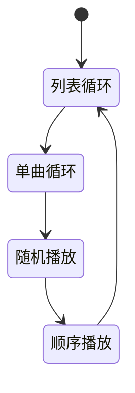
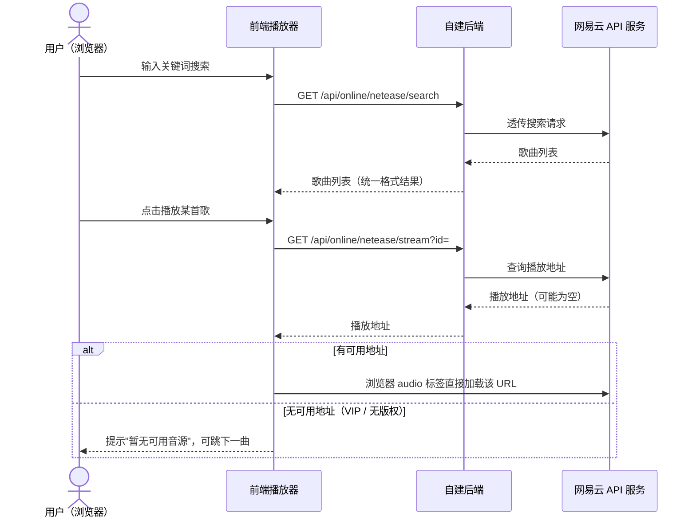
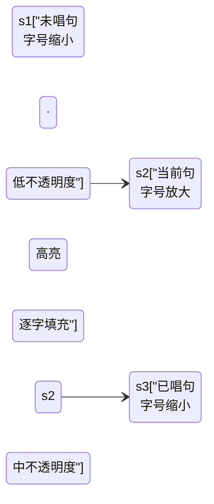
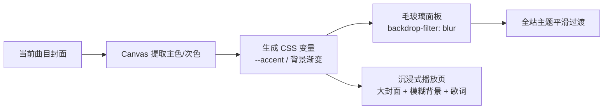
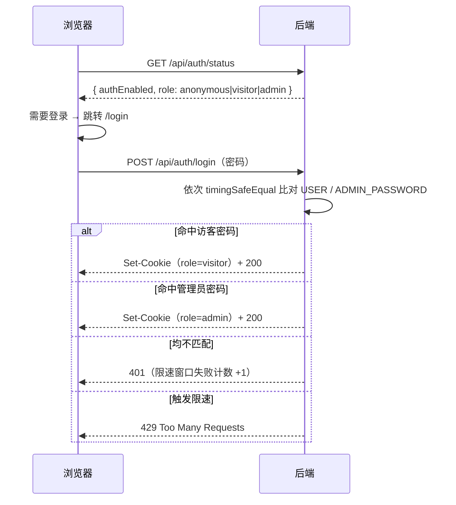
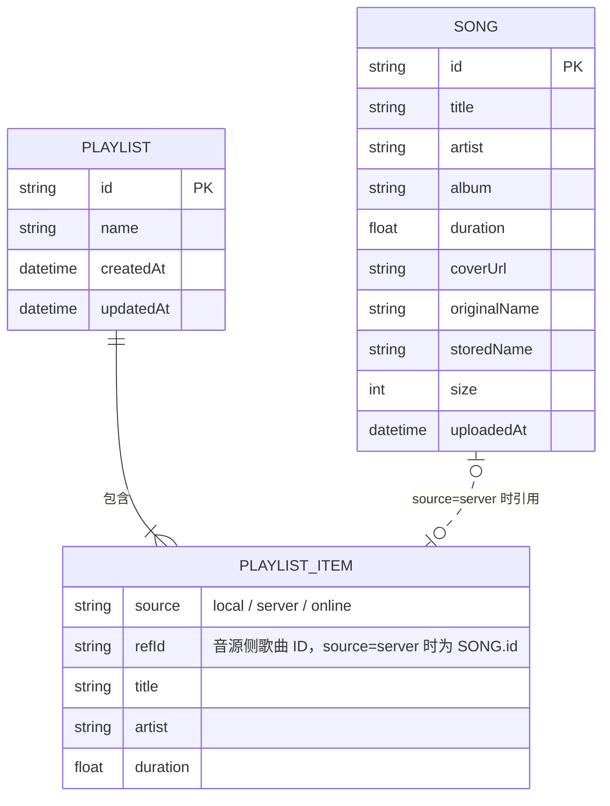

# 音乐软件需求文档（PRD）

| 项目名称 | 轻听音乐（2026-09-28 确认） |
| --- | --- |
| 文档版本 | v2.5（定稿） |
| 编写日期 | 2026-09-28 |
| 目标平台 | Web 网页应用（浏览器访问，响应式适配桌面优先） |
| 文档状态 | 已定稿 |

---

## 目录

- 1. 项目概述
- 2. 用户故事与核心场景
- 3. 功能需求：3.1 模块总览 / 3.2 播放器核心 / 3.3 本地播放 / 3.4 云端音乐库 / 3.5 在线音源 / 3.6 歌单 / 3.7 歌词 / 3.8 界面 / 3.9 视觉与动效 / 3.10 多端适配 / 3.11 访问控制 / 3.12 管理台
- 4. 非功能需求：性能 / 兼容性 / 安全 / 可靠性 / 部署
- 5. 技术方案：选型 / API 草案 / 数据模型 / 工程结构 / 环境变量汇总 / 技术规范
- 6. 里程碑规划（M1 / M2 / M3 / 远期）
- 7. 埋点与度量
- 8. 风险与约束
- 9. 术语表
- 10. 决策记录
- 11. 测试与验收计划
- 12. 部署手册大纲
- 修订记录

---

## 1. 项目概述

### 1.1 产品定位

一款**可私有部署的 Web 音乐播放器**：既能播放用户电脑里的本地音乐文件，也能通过自建服务器建立个人云端音乐库（上传、流式播放），并支持接入第三方在线音源（网易云音乐等）进行搜索和试听。

产品形态为"**本地 + 自有云端 + 在线聚合**"三合一的个人音乐中心，数据由用户自己掌控。

### 1.2 产品目标

1. **一处集中听歌**：本地文件、自建服务器音乐、在线音源在同一个界面内无缝切换播放。
2. **私有云音乐库**：用户部署自己的服务器，上传音乐后可在任意设备（电脑、手机浏览器）访问播放。
3. **够用且好用的播放体验**：覆盖主流播放器的基础体验（进度拖拽、播放模式、音量、封面、歌词）。
4. **架构可扩展**：在线音源以"适配器"方式接入，后续可扩展更多音源而无需改动播放器核心。

### 1.3 目标用户

- 本人（开发者本人）及小范围朋友使用；不面向公众提供服务。
- 用户特征：拥有一定量本地音乐文件（MP3/FLAC 等）；具备基本的服务器部署能力；在多设备（PC、手机）上听歌。

### 1.4 不做的事（Scope 边界）

- 不做面向公众的流媒体服务，不提供音乐分发。
- 不内置任何第三方音源的破解/去版权功能；在线音源仅做搜索与播放代理，仅供个人学习研究。
- 首期不做移动端原生 App（用移动端浏览器访问 Web 即可）。
- 不做多用户体系与社交功能（评论、分享、关注等）；权限仅"未登录 / 访客 / 管理员"三档（见 3.11）。

---

## 2. 用户故事与核心场景

### 2.1 核心用户故事

| 编号 | 用户故事 | 优先级 |
| --- | --- | --- |
| US-01 | 作为用户，我想把电脑里的音乐文件拖进网页直接播放，这样不用安装任何软件。 | P0 |
| US-02 | 作为用户，我想把音乐上传到自己的服务器，这样在其他设备上也能听。 | P0 |
| US-03 | 作为用户，我想在播放器里控制播放/暂停、切歌、拖进度、调音量，获得基础听歌体验。 | P0 |
| US-04 | 作为用户，我想看到歌曲的标题、歌手、专辑、封面、时长，而不是一串文件名。 | P0 |
| US-05 | 作为用户，我想搜索并播放在线音源（网易云）的歌曲，补充我没有的曲目。 | P1 |
| US-06 | 作为用户，我想创建歌单并把不同来源的歌曲收录进同一个歌单。 | P1 |
| US-07 | 作为用户，我想边听歌边看滚动歌词。 | P2 |
| US-08 | 作为用户，我想在手机浏览器里也能正常使用。 | P1 |
| US-09 | 作为部署者，我希望未登录的访问者只能播放本地文件；访客密码使用者可听云端曲库与在线音源；上传/删除等管理功能仅管理员密码解锁。 | P0 |
| US-10 | 作为管理员，我想要一个集中管理台页面：上传歌曲、管理曲库（搜索/删除/批量删除）、查看存储统计。 | P0 |

### 2.2 典型场景

**场景 A：本地听歌（无需服务器）**
用户打开网页 → 拖入 20 个本地 MP3 → 生成临时播放列表 → 点击播放、切歌、随机播放 → 关闭页面即结束，文件不上传、不留存。

**场景 B：云端音乐库（需要服务器）**
管理员在 PC 上打开"管理台"（3.12）→ 拖入文件夹批量上传（显示进度条）→ 服务器自动解析出标题/歌手/封面 → 用户在手机浏览器打开同一地址并以访客身份登录 → 在线流畅播放，拖动进度条即时响应。

**场景 C：在线补充听歌**
用户在"在线搜索"页输入关键词 → 调用网易云 API 返回结果列表 → 点击播放；遇到 VIP/无版权歌曲时给出明确提示并自动跳过或提示换源。

**场景 D：混合播放**
用户把 5 首本地歌 + 3 首服务器歌 + 2 首在线歌加进同一个歌单，连续播放时无感知切换来源。

---

## 3. 功能需求

优先级定义：

- **P0**：MVP 必须，第一版就要可用。
- **P1**：第一版发布后尽快补充。
- **P2**：远期规划，视情况排期。

### 3.1 模块总览

> 系统架构图（正式版）：`docs/design/系统架构图.drawio`（drawio 绘制，draw.io 打开可编辑，可导出 PNG 嵌入本文档）。

**关键设计概念——统一曲目（Track）抽象**：播放器核心只面向统一的 `Track` 对象播放，每个 Track 标记来源 `source: local | server | online`。本地文件对应浏览器 Blob URL，服务器文件对应后端流地址，在线歌曲对应第三方音频 URL。三种来源对播放器透明，这是"混合播放"（场景 D）得以实现的基础。

### 3.2 播放器核心（P0）

| 编号 | 需求 | 说明 | 优先级 |
| --- | --- | --- | --- |
| PL-01 | 播放/暂停 | 点击按钮或空格键切换 | P0 |
| PL-02 | 上一首/下一首 | "上一首"规则：当前播放超过 3 秒则回到本曲开头，否则切上一曲 | P0 |
| PL-03 | 进度条 | 显示当前进度/总时长；支持点击和拖拽跳转（seek） | P0 |
| PL-04 | 音量 | 滑杆调节 + 静音按钮，记忆上次音量 | P0 |
| PL-05 | 播放模式 | 顺序播放 / 列表循环 / 单曲循环 / 随机播放，四种模式循环切换 | P0 |
| PL-06 | 播放队列 | 当前播放队列列表：显示正在播放标识、可移除单曲、可清空 | P1 |
| PL-07 | 播放状态持久化 | 刷新页面后恢复上次播放的曲目与进度（localStorage） | P1 |
| PL-08 | 快捷键 | 空格播放/暂停、左右方向键快进快退 5 秒、上下方向键调音量 | P2 |
| PL-09 | 异常处理 | 音源加载失败时给出提示并自动跳下一曲 | P0 |
| PL-10 | 睡眠定时器 | 定时停止播放（15/30/60 分钟或播完当前列表），到点音量淡出后停止 | P2 |
| PL-11 | 淡入淡出 | 切歌/暂停/定时停止时的音量平滑过渡，可开关 | P2 |
| PL-12 | 倍速播放 | 0.5~2.0x 变速（有声书/播客场景），倍速随会话记忆 | P2 |

**播放模式切换关系（PL-05）**：



**验收标准**：
- 切歌到出声延迟 ≤ 1 秒（网络正常时）。
- 进度拖拽后 0.5 秒内从新位置继续播放（依赖服务端 Range 支持）。
- 播放到列表末尾时，各播放模式行为符合定义。

### 3.3 本地音乐播放模块（P0）

| 编号 | 需求 | 说明 | 优先级 |
| --- | --- | --- | --- |
| LC-01 | 文件添加 | 点击按钮选择 或 拖拽文件/文件夹到页面；支持多选 | P0 |
| LC-02 | 格式支持 | MP3、FLAC、WAV、OGG、M4A/AAC、OPUS；非音频文件自动过滤并提示 | P0 |
| LC-03 | 信息解析 | 无元数据时按文件名解析"歌手 - 歌名"格式 | P0 |
| LC-04 | 元数据读取 | 前端解析 ID3/Vorbis 等标签，显示内嵌标题/歌手/封面 | P1 |
| LC-05 | 临时列表 | 添加后进入本地临时列表，可整体播放、单曲播放、清空 | P0 |
| LC-06 | 隐私约束 | 本地文件仅用浏览器 Blob URL 播放，**不经服务器、不上传** | P0 |
| LC-07 | 快捷转存 | 本地列表提供"上传到音乐库"入口，跳转管理台并带入所选文件（与 3.4/3.12 打通）；仅管理员身份可见 | P1 |

**验收标准**：拖入含 50 个文件（其中混有非音频）的文件夹时，仅音频进入列表，且界面无卡顿（解析异步进行）。

### 3.4 云端音乐库模块（P0，需服务器）

| 编号 | 需求 | 说明 | 优先级 |
| --- | --- | --- | --- |
| LB-01 | 上传 | 单个/批量/拖拽上传；显示每文件实时进度与总进度；支持同时上传多个 | P0 |
| LB-02 | 上传校验 | 按扩展名白名单校验；单文件大小上限默认 300MB（可配置）；重复文件（同文件名+同大小）提示跳过或覆盖 | P0 |
| LB-03 | 元数据解析 | 服务端解析音频标签：标题、歌手、专辑、时长、内嵌封面图；解析失败时回退用文件名 | P0 |
| LB-04 | 音乐列表 | 展示封面、标题、歌手、专辑、时长、大小、上传时间；支持按标题/歌手/上传时间排序 | P0 |
| LB-05 | 删除 | 单曲删除（需二次确认）；同步删除音频文件与封面文件；界面入口在管理台（3.12） | P0 |
| LB-06 | 流式播放 | 后端按 HTTP Range 响应音频流，支持边下边播、任意位置 seek | P0 |
| LB-07 | 搜索过滤 | 在音乐库内按关键词实时过滤（标题/歌手/专辑） | P1 |
| LB-08 | 分页/虚拟滚动 | 曲目超过 500 条时保证列表流畅 | P2 |
| LB-09 | 批量操作 | 批量删除、批量加入歌单 | P2 |
| LB-10 | 存储统计 | 曲目总数、总占用空间；由管理台实现，见 3.12 AD-03 | P1 |
| LB-11 | 索引重建 | "扫描 uploads 目录重建曲库索引"：重新解析元数据、重建 songs.json，用于索引损坏/误删后的容灾恢复；入口在管理台（AD-05） | P1 |
| LB-12 | 断点续传上传 | 大文件上传中断后从已传分片继续，避免整文件重传（分片上传） | P2 |

> 注：上传/删除/统计等管理操作的界面入口统一在管理台（3.12）；音乐库页面对所有登录用户为纯浏览视图。

**验收标准**：
- 上传 50MB 文件过程中页面可正常操作，失败文件有明确错误提示且不影响其他文件。
- 播放服务器曲目时拖动进度条到未缓冲位置，0.5 秒内从该位置继续播放。
- 删除歌曲后，列表、存储文件、封面均被清除。

### 3.5 在线音源接入模块（P1）

| 编号 | 需求 | 说明 | 优先级 |
| --- | --- | --- | --- |
| ON-01 | 音源适配层 | 定义统一 Provider 接口（search / getStreamUrl / getLyrics），播放器与前端页面不感知具体音源；多源架构参考 Folia（folia-major）的设计思路 | P0（架构） |
| ON-02 | 网易云搜索 | 接入自部署的 NeteaseCloudMusicApi（或增强分支 NeteaseCloudMusicApiEnhanced）：关键词搜索，返回标题/歌手/专辑/时长 | P1 |
| ON-03 | 网易云播放 | 获取歌曲播放地址并加入播放；对 VIP/无版权歌曲（无可用地址）给出明确提示 | P1 |
| ON-04 | 配置开关 | 后端通过环境变量配置第三方 API 地址；未配置时前端隐藏/置灰在线功能并显示配置指引 | P1 |
| ON-05 | 歌词获取 | 通过音源接口获取歌词（含逐字格式 yrc），进入歌词模块 | P1（配合 3.7 歌词 P1） |
| ON-06 | QQ 音乐接入 | 参考 yakult-green-tea/qq-music-api（Folia 同款方案）：需微信扫码登录后播放，作为独立适配器接入 | P2 |
| ON-07 | 多音源聚合搜索 | 一次搜索同时查询多个音源并合并结果 | P2 |
| ON-08 | 酷狗音乐接入 | 参考 MakcRe/KuGouMusicApi，作为独立适配器接入 | P2 |
| ON-09 | 歌词/封面多源回退匹配 | 歌词与封面按"网易云 → QQ → 酷狗"顺序自动回退匹配，失败支持手动修正（参考 Folia） | P2 |

> 注：Folia（folia-major）为 AGPL-3.0 协议。本项目只借鉴其交互设计与接入思路、代码自行实现，不复制其源码；若未来直接引用其代码，本项目须同样以 AGPL-3.0 开源（见 9. 风险）。

**验收标准**：未配置网易云 API 时，其余功能不受任何影响；配置后无需改前端代码，重启后端即生效。

**在线播放核心流程（ON-02 / ON-03）**：



### 3.6 歌单管理模块（P1）

| 编号 | 需求 | 说明 | 优先级 |
| --- | --- | --- | --- |
| PS-01 | 创建/重命名/删除歌单 | 歌单存储在服务器端 | P1 |
| PS-02 | 添加曲目 | 支持把任意来源（本地/云端/在线）的曲目加入歌单 | P1 |
| PS-03 | 播放歌单 | 整单播放、从某曲开始播放 | P1 |
| PS-04 | 曲目排序/移除 | 歌单内拖拽排序、移除单曲 | P2 |
| PS-05 | 收藏/最近播放 | 一键收藏单曲；自动记录最近播放 100 条 | P2 |

**说明**：本地文件加入歌单时，仅记录文件名等元信息作为"占位引用"——该文件在其他设备上不存在时，显示为灰色"本地缺失"状态，跳过播放。在线曲目入歌单时保存其音源与歌曲 ID。

### 3.7 歌词模块（P1，经 3.9 VS-03 确认提前）

**动效基准：Apple Music 歌词页**（2026-09-28 确认为歌词动效的唯一主要参考）。Folia 相关内容均为远期参考：其歌词效果在**项目主体完成后**再行评估探索（见里程碑"远期"），当前不进入任何里程碑。歌词行的三种视觉状态：



| 编号 | 需求 | 说明 | 优先级 |
| --- | --- | --- | --- |
| LR-01 | 歌词展示与解析 | P1 范围：LRC（行级时间轴）+ yrc（网易云逐字，支撑卡拉OK填充），无逐字数据时自动退化为行级模式；qrc / krc / ttml / vtt 等其余逐字格式为远期增强，随对应音源接入后再支持 | P1 |
| LR-02 | 歌词来源 | 优先级：音频内嵌歌词 > 在线音源歌词接口（多源回退匹配，见 ON-09） > 用户手动上传 .lrc | P1 |
| LR-03 | 播放页 | 与沉浸式播放页合并实现，见 3.9 VS-03 | P1 |
| LR-04 | Apple Music 风格动效 | 当前句大字号高亮，前后句渐进缩小、降低不透明度，形成景深层次；句间切换用 transform/opacity 平滑过渡（遵守 VS-07 性能约束）；歌词区上下边缘渐隐遮罩 | P1 |
| LR-05 | 逐字卡拉OK填充 | 有逐字时间轴时，当前句内按字/词渐进填充高亮（Apple Music 标志性效果）；仅行级数据时整句渐亮 | P1（无逐字数据时自动降级，不阻塞验收） |
| LR-06 | 点击行跳转 | 点击任意歌词行 seek 到该句时间点；播放中当前句自动滚动居中 | P1 |
| LR-07 | 滚动交互 | 用户手动滚动歌词时暂停自动居中，数秒无操作后恢复，并提供"回到当前句"按钮 | P2 |

### 3.8 界面需求（信息结构）

整体布局：左侧导航 + 中间内容区 + 底部常驻播放条。

```
┌──────────┬────────────────────────────────────┐
│ ♫ 轻听音乐 │  [页面标题]  [排序/搜索/操作按钮]     │
│          ├────────────────────────────────────┤
│ ▸ 本地播放 │                                    │
│ ▸ 音乐库   │   内容区                             │
│ ▸ 在线搜索 │   （歌曲列表 / 搜索结果 / 歌单详情）    │
│ ▸ 我的歌单 │                                    │
│   ├ 日常   │                                    │
│   └ 运动   │                                    │
│ ▸ 管理     │  ← 仅管理员身份可见（3.12）           │
├──────────┴────────────────────────────────────┤
│ [封面] 歌名/歌手  │ ⏮ ▶ ⏭ 🔀 🔁 │ 1:23 ────●── 3:45 │ 🔊 │
└────────────────────────────────────────────────┘
```

> 注：图表规范见 5.6.6——线框类图不属于 Mermaid 擅长范围，正式线框已用 drawio 绘制：`docs/design/主界面线框.drawio`（本节）与 `docs/design/管理台线框.drawio`（3.12）；下文 ASCII 仍为快速示意。

界面要求：

- 玻璃拟态风格基调（见 3.9），支持深色/浅色主题切换（VS-08），默认深色。
- 图标统一来自 Iconify + Phosphor 图标集（单一图标集，见 5.1）；图标颜色使用 currentColor，随主题变量与封面取色联动；状态约定：普通态用 regular 粗细，播放中/激活态（如随机播放开启、正在播放入口）用 fill 粗细，对齐 Apple Music 的填充式播放态惯例。
- 歌曲行结构统一：封面缩略图（44px）、标题+歌手、专辑、时长、操作按钮（播放/加入歌单/删除）；行 hover 高亮，正在播放行有动效标识。
- 底部播放条常驻，任何页面都在；含封面、控制按钮组、进度条、音量。
- 响应式与多端策略见 3.10（断点规范 RT-01 在 M1 确定，手机布局 M2 实施）。
- 空状态设计：音乐库为空、无搜索结果、在线音源未配置等场景均有引导性文案与操作入口。

### 3.9 视觉风格与动效（已确认，2026-09-28）

**风格基调：玻璃拟态（Glassmorphism）双主题（默认深色）+ 跟随封面动态取色**



| 编号 | 需求 | 说明 | 优先级 |
| --- | --- | --- | --- |
| VS-01 | 玻璃拟态基底 | 封面模糊背景 + 半透明毛玻璃面板（backdrop-filter）+ 半透明描边；列表视图为默认视图；M1 以深色主题实现，且颜色全部走 CSS 变量，为 VS-08 双主题预留 | P0（M1 即按此实现） |
| VS-02 | 封面取色主题 | 从当前曲目封面提取主色/次色，注入 CSS 变量生成主题色与背景渐变，切歌平滑过渡；封面缺失/加载失败时回退固定色板；取色结果按当前主题适配亮度/对比度（浅色主题下使用加深的 accent 变体，保证文字对比度） | P1 |
| VS-03 | 沉浸式播放页 | 点击播放条展开全屏：大封面 + 模糊背景 + 滚动歌词；歌词动效按 3.7 的 Apple Music 基准实现 | P1 |
| VS-04 | 封面动效 | 播放中封面缓慢旋转（或呼吸浮动），暂停即停；遵循 prefers-reduced-motion 降级为静态 | P1 |
| VS-05 | 频谱可视化 | Web Audio API（AnalyserNode）实时频谱：播放页大图 + 播放条迷你指示；在线音源受 CORS 限制取不到音频数据时自动隐藏 | P2 |
| VS-06 | 列表+网格混合 | 音乐库/歌单为紧凑列表（行高约 48px），专辑视图为封面卡片网格，视图可切换 | P1 |
| VS-07 | 性能与降级 | backdrop-filter 使用层数克制；模糊背景用低分辨率封面图；不支持的浏览器/低端设备降级为半透明纯色 | P0 |
| VS-08 | 主题切换 | 深色/浅色双主题，全部经 CSS 变量（`data-theme` 属性）驱动；默认跟随系统 `prefers-color-scheme`，用户手动切换后记忆选择（localStorage）；界面提供切换入口（导航/设置）；切换即时生效、无刷新；深色为推荐默认 | P1 |

### 3.10 多端适配（已确认，2026-09-28）

**结论**：手机适配在 M2 实施，目标为原生级体验；M1 仅保证移动端不白屏。平板不做单独布局。支持 PWA。

| 编号 | 需求 | 说明 | 优先级 |
| --- | --- | --- | --- |
| RT-01 | 断点规范 | ≥1280px 桌面完整布局；768~1280px 平板沿用桌面布局；<768px 手机布局 | P0（M1 定规范并按桌面实现） |
| RT-02 | 手机布局 | <768px：导航收起为底部标签栏或抽屉；播放条简化为迷你条，点击展开沉浸式播放页；列表单列 | P1 |
| RT-03 | 听歌完整 | 手机端覆盖浏览/搜索/播放/切歌/歌词；上传、删除、歌单管理等管理操作以桌面为主（手机端隐藏或只读） | P1 |
| RT-04 | 锁屏/通知栏控制 | 集成 Media Session API：锁屏与通知栏显示封面/歌名/歌手，支持播放/暂停/上一首/下一首 | P1 |
| RT-05 | 手势操作 | 沉浸式播放页左右滑动切换上/下一曲、下滑收起；列表侧滑操作为 P2 可选 | P1 |
| RT-06 | 横竖屏 | 手机横屏时播放页自适应布局 | P2 |
| RT-07 | PWA 支持 | vite-plugin-pwa：manifest（名称/图标/主题色）+ Service Worker 缓存应用外壳与静态资源（音频不缓存）；可添加到主屏幕全屏运行 | P1 |
| RT-08 | 移动端底线 | M1 期间移动端访问不白屏、布局不崩；无法正常使用时给出"请使用电脑访问"提示 | P0 |

### 3.11 访问控制（已确认，2026-09-28）

**访问模型（三档）**：未登录 = 仅本地播放；访客密码（USER_PASSWORD）= 听云端曲库/歌单/在线音源；管理员密码（ADMIN_PASSWORD）= 额外解锁管理台（上传/删除/统计）。

| 编号 | 需求 | 说明 | 优先级 |
| --- | --- | --- | --- |
| AC-01 | 未登录（匿名）模式 | 未登录时仅可使用本地播放模块（3.3，纯浏览器、不经服务器）；服务器功能不可用，界面展示"登录后解锁"引导 | P0 |
| AC-02 | 登录（密码即角色） | 登录页输入密码，前端提交 POST /api/auth/login；后端以 crypto.timingSafeEqual 依次与 USER_PASSWORD、ADMIN_PASSWORD 比对，命中即获得对应角色（visitor / admin），Set-Cookie 颁发含角色的签名 Cookie，之后免输 | P0 |
| AC-03 | 接口分级保护 | 接口分两级：访客级（音乐库列表/音频流/歌单/在线音源搜索播放）要求 visitor 及以上；管理级（上传/删除/统计）要求 admin。鉴权中间件统一校验：未登录 401、角色不足 403 | P0 |
| AC-04 | 登出 | 提供登出入口（POST /api/auth/logout），清除凭证回到未登录状态 | P1 |
| AC-05 | 密码配置 | 两档密码均为环境变量。组合规则：两把都未配置 → 门禁关闭、全功能开放（本机场景）；仅配置 ADMIN_PASSWORD → 无访客档，登录页仅管理员入口；仅配置 USER_PASSWORD → 访客可听，管理功能对所有人关闭；两把都配置 → 完整三档 | P0 |
| AC-06 | 登录防爆破 | /api/auth/login 失败限速（express-rate-limit）：默认 15 分钟窗口内最多 10 次失败，超限返回 429 并提示稍后再试 | P0 |
| AC-07 | 登录页 | 独立 /login 路由：玻璃拟态登录卡片（居中 + 封面模糊背景，风格同 3.9）；单密码输入框（后端自动识别角色）；提供"先听听本地歌"未登录入口；登录成功跳回来源页；门禁关闭的环境直接跳过登录页 | P0 |
| AC-08 | 角色凭证 | 角色写入签名 Cookie 载荷（签发时间戳 + 角色 + HMAC），无状态校验；已知限制：修改密码后旧凭证在有效期内仍可用，需要强制全员下线时轮换 AUTH_SECRET | P0 |

**技术实现（已确认，2026-09-28）**：



- **凭证方案：签名 Cookie**（cookie-parser + HMAC 签名）。载荷为"签发时间戳 + 角色"，无状态、无服务端存储；属性 httpOnly + sameSite=Lax，HTTPS 部署时启用 secure；有效期默认 30 天，环境变量 AUTH_TTL 可配。登出即清除 Cookie。
- **签名密钥**：环境变量 AUTH_SECRET；未配置时服务首次启动自动生成随机密钥并持久化到 data 目录（重启后会话不失效）。
- **不引入**：密码哈希库（明文比对 + timingSafeEqual 已足够）、JWT、session 存储、鉴权框架。

**认证 API 草案**：

| 方法 | 路径 | 说明 |
| --- | --- | --- |
| GET | `/api/auth/status` | 返回 `{ authEnabled, role }`（anonymous / visitor / admin），前端据此决定进入未登录模式、登录页还是管理台 |
| POST | `/api/auth/login` | 密码与两把密码依次比对，返回角色并 Set-Cookie；受 AC-06 限速保护 |
| POST | `/api/auth/logout` | 清除凭证 Cookie |

说明：两把密码均为部署者单密码，不做注册、多用户体系、找回密码（私有部署定位）；每个设备各自登录一次。访客/管理员已是本产品最大权限粒度，更细粒度权限列为远期评估。

### 3.12 管理台（已确认，2026-09-28）

管理员专用的集中管理页面，独立路由 `/admin`；导航栏"管理"入口仅管理员身份可见。

线框（正式版见 `docs/design/管理台线框.drawio`；下文 ASCII 为快速示意）：

```
┌────────────────────────────────────────────────┐
│ 管理台                 曲目 128 首 · 占用 6.4 GB │
├────────────────────────────────────────────────┤
│ ┌──────────────────────────────────────────┐   │
│ │ 上传区：拖入音频文件或点击选择              │   │
│ │ [歌曲A ████░░ 67%] [歌曲B 等待中]          │   │
│ └──────────────────────────────────────────┘   │
│ 搜索[______] 排序[上传时间▾]  已选 3 项 [批量删除] │
│ ☑  封面  歌名         歌手     大小    操作       │
│ ☐  []    歌曲一      歌手A    8.2MB   [删除]     │
│ ☐  []    歌曲二      歌手B    5.1MB   [删除]     │
└────────────────────────────────────────────────┘
```

| 编号 | 需求 | 说明 | 优先级 |
| --- | --- | --- | --- |
| AD-01 | 上传区 | 拖拽/多选上传，单文件与总进度实时显示；重复文件（同名同大小）提示跳过/覆盖；失败逐文件提示不影响批次（即 LB-01/02 的界面呈现） | P0 |
| AD-02 | 曲库管理列表 | 全量曲目：搜索过滤、按标题/歌手/大小/上传时间排序、单曲删除（二次确认）、复选框批量删除（二次确认并显示将删除的条数） | P0 |
| AD-03 | 存储统计 | 曲目总数、总占用空间，页面顶部常驻展示（实现 LB-10） | P1 |
| AD-04 | 访问控制 | /admin 仅 admin 角色可进入，visitor/未登录访问时重定向登录页；导航入口仅管理员可见 | P0 |
| AD-05 | 索引重建入口 | "重建索引"按钮（实现 LB-11）：执行时显示扫描/解析进度，完成后刷新列表并提示结果 | P1 |

说明：音乐库页（3.4）面向所有登录用户为纯浏览视图；上传/删除等管理操作集中在管理台。歌曲元数据编辑（改歌名/封面等）不在本期范围，远期评估。

---

## 4. 非功能需求

### 4.1 性能

| 指标 | 要求 |
| --- | --- |
| 首屏加载（生产构建） | ≤ 2 秒（常规网络） |
| 切歌响应 | ≤ 1 秒出声 |
| seek 响应 | ≤ 0.5 秒 |
| 音乐列表（1000 条） | 滚动流畅，无感知卡顿（必要时虚拟滚动） |
| 并发 | 私有部署，满足 1~5 人同时在线播放即可 |

### 4.2 兼容性

- 浏览器：Chrome、Edge、Firefox、Safari 最新版及前一主版本。
- 玻璃拟态依赖 backdrop-filter（Safari 需 -webkit- 前缀），不支持的环境按 VS-07 降级为半透明纯色，不影响功能。
- 音频格式在 Safari 上与 Chrome 存在差异（如 FLAC/OPUS），按浏览器能力降级提示，不白屏；服务端按需转码为远期评估项（见 8 / 里程碑"远期"）。
- 移动端浏览器（iOS Safari、Android Chrome）可用（P1）。
- iOS 音频策略：首次播放必须由用户手势触发（自动播放受限）；后台/锁屏播放依赖 Media Session（RT-04），移动端实现时真机逐项验证。

### 4.3 安全

- 上传仅允许音频扩展名白名单；服务端存储文件名使用随机名，杜绝路径穿越。
- 删除/上传接口做基础校验；访问控制按 3.11 实现（未登录仅本地播放，访客密码听云端，管理员密码解锁管理台；接口分级校验，未登录 401、角色不足 403）；反向代理鉴权（Nginx BasicAuth 等）可作为额外加固。
- 敏感配置（第三方 API 地址等）走环境变量，不硬编码。
- 公网部署必须启用 HTTPS（音频接口经 HTTPS 混合内容限制）。

### 4.4 可靠性与容错

- 上传失败（网络/超限/格式）逐文件提示，不中断批次中其他文件。
- 在线音源请求失败时明确提示"音源服务不可用"，并给出配置指引。
- 后端数据（曲目索引、歌单）以文件形式落盘，服务重启不丢失。

### 4.5 部署

- 提供 `npm install && npm run dev` 的本地开发方式。
- 提供生产部署方式：前端构建产物由后端静态托管，单进程即可对外服务；支持 Docker 部署（P1 提供 Dockerfile）。
- 端口、存储路径、第三方音源地址等均可通过环境变量配置。

---

## 5. 技术方案（选型已确认）

### 5.1 技术选型

> 以下选型已与需求方确认（2026-09-28），作为开发约束执行。

| 层 | 选型 | 说明 |
| --- | --- | --- |
| 前端框架 | Vue 3 + Vite | 组合式 API + `<script setup>` 语法 |
| 开发语言 | TypeScript（前后端） | 数据模型即类型定义，见下方"类型共享" |
| 状态管理 | Pinia | 播放器状态（当前曲目/队列/播放模式/音量）做成全局单例 store |
| 路由 | Vue Router | 对应左侧导航的四个页面 |
| UI 样式 | 手写 CSS + CSS 变量 | 玻璃拟态风格（VS-01）：毛玻璃面板/模糊背景全定制，不引入组件库；主题色由封面取色动态注入（VS-02）；深色/浅色双主题经 data-theme 切换（VS-08） |
| 图标 | Iconify（unplugin-icons 构建期打包）+ Phosphor 图标集（前缀 ph） | 聚合 200+ 开源图标集按需引入；构建期本地化、不依赖运行时图标 API，符合 PWA 离线要求（RT-07）；全站锁定单一图标集。Phosphor：圆角端点 + 6 种粗细（thin/light/regular/bold/fill/duotone），公认最接近 Apple SF Symbols 的开源图标库，9000+ 图标 MIT；fill 变体用作播放/激活态（对齐 Apple Music 惯例） |
| 封面取色 | Canvas 自实现（备选 node-vibrant） | 从封面提取主色/次色，生成 --accent 等主题变量 |
| 频谱可视化 | Web Audio API（AnalyserNode） | 零额外依赖实现实时频谱（VS-05） |
| PWA | vite-plugin-pwa | manifest + Service Worker，添加到主屏幕（RT-07） |
| 移动端增强 | Media Session API（浏览器内置） | 锁屏/通知栏播放控制（RT-04） |
| 歌词动效 | CSS transform/opacity + requestAnimationFrame | Apple Music 风格（LR-04/05），无额外依赖 |
| 后端 | Node.js + Express（TypeScript） | 开发用 tsx watch，部署前编译为 JS |
| 上传处理 | multer | 磁盘存储 + 大小/扩展名校验 |
| 元数据解析 | music-metadata | 解析 ID3/Vorbis/FLAC 标签与内嵌封面 |
| 数据存储 | JSON 文件起步，曲目量大后迁移 SQLite | 私有规模下 JSON 足够，降低部署依赖 |
| 在线音源 | 后端透传代理：网易云（NeteaseCloudMusicApi / api-enhanced）、QQ 音乐（qq-music-api）、酷狗（KuGouMusicApi） | 避免浏览器跨域，统一出口；各音源为独立适配器可插拔（见 3.5） |
| 访问门禁 | 签名 Cookie（cookie-parser）+ timingSafeEqual + express-rate-limit | 双密码角色门禁（3.11：访客/管理员）；新增依赖仅 cookie-parser、express-rate-limit 两个，不引入密码哈希库与 JWT/session 框架 |

**类型共享**：`Track / Song / Playlist / PlaylistItem` 等接口定义放在 `shared/` 目录，前后端引用同一份（workspace 内路径引用）。接口字段变更时前后端编译期即可发现不一致，避免"后端改了字段、前端还在用旧的"这类问题。

### 5.2 核心 API 草案

| 方法 | 路径 | 说明 |
| --- | --- | --- |
| GET | `/api/auth/status` | 登录态与门禁开关查询（见 3.11 认证 API） |
| POST | `/api/auth/login` | 登录：校验访问密码，颁发签名 Cookie（限速保护） |
| POST | `/api/auth/logout` | 登出：清除凭证 |
| GET | `/api/config` | 返回功能开关（如 onlineEnabled） |
| GET | `/api/songs` | 云端音乐列表（访客及以上） |
| POST | `/api/songs/upload` | 上传音频（multipart，字段 file）（管理员） |
| DELETE | `/api/songs/:id` | 删除曲目及文件（管理员） |
| POST | `/api/songs/reindex` | 扫描 uploads 重建曲库索引（管理员，LB-11） |
| GET | `/api/stats` | 存储统计：曲目数/总大小（管理员） |
| GET | `/audio/:storedName` | 音频流（支持 Range 请求，206 响应） |
| GET | `/api/playlists` / `POST` / `PUT` / `DELETE` | 歌单 CRUD |
| GET | `/api/online/:provider/search?keywords=` | 音源搜索（透传代理） |
| GET | `/api/online/:provider/stream?id=` | 获取播放地址 |
| GET | `/api/online/:provider/lyrics?id=` | 获取歌词（含逐字格式，ON-05，配合 3.7） |

### 5.3 数据模型草案

**实体关系（服务端持久化部分）**：



> 命名约定：全链路统一 camelCase（含 JSON 文件存储与 SQLite 列名），不做存储层与接口层的命名映射，见 5.6。

前端统一抽象（TypeScript）：

```ts
// 前端统一曲目抽象（播放器只认它）
Track {
  id: string
  source: 'local' | 'server' | 'online'
  url: string            // 本地=Blob URL；服务器=/audio/xx；在线=第三方URL
  title, artist, album: string
  cover: string | null
  duration: number | null
}

// 服务端曲目记录
Song {
  id, title, artist, album
  duration: number
  coverUrl: string | null
  originalName, storedName: string   // 原名 / 随机存储名
  size: number
  uploadedAt: timestamp
}

// 歌单
Playlist {
  id, name: string
  items: PlaylistItem[]   // { source, refId?, title, artist, cover?, duration? }
  createdAt, updatedAt
}
```

### 5.4 工程结构（建议）

```
music-app/
├── package.json            # workspace 根：一条命令装齐依赖，同时启动前后端
├── client/                 # Vue 3 + Vite + TS
│   └── src/
│       ├── stores/player.ts     # Pinia 播放器 store（核心状态与控制逻辑）
│       ├── views/               # LocalView / LibraryView / OnlineView / PlaylistView / LoginView / AdminView
│       ├── components/          # PlayerBar、SongRow、UploadZone、CoverArt…
│       ├── api/                 # 后端接口封装（fetch，含上传进度）
│       └── assets/              # 全局样式（图标经 unplugin-icons 按需打包，不落本地文件）
├── server/                 # Express + TS
│   └── src/
│       ├── routes/              # auth / songs / playlists / online（音源代理）/ stats
│       ├── middleware/          # 鉴权（角色门禁，见 3.11）、登录限速
│       ├── services/            # 元数据解析、文件存储
│       ├── db/                  # JSON/SQLite 读写
│       └── index.ts             # 应用入口
│   └── uploads/            # 音频 + 封面（运行时生成，不入库）
└── shared/                 # 前后端共享 TS 类型（Track/Song/Playlist…）
```

### 5.5 环境变量汇总

> 所有配置项的唯一权威清单（此前散落于 3.5 / 3.11 / 4.5，此处汇总）。

| 变量 | 作用 | 默认值 | 必填 |
| --- | --- | --- | --- |
| PORT | 服务监听端口 | 3000 | 否 |
| DATA_DIR | 数据目录（曲库/歌单索引 JSON、AUTH_SECRET 持久化） | ./data | 否 |
| UPLOAD_DIR | 音频与封面存储目录 | ./uploads | 否 |
| MAX_UPLOAD_SIZE | 单文件上传上限 | 300MB | 否 |
| USER_PASSWORD | 访客密码（未配置则无访客档） | 无 | 否 |
| ADMIN_PASSWORD | 管理员密码（未配置则无管理档；两把都未配置 = 门禁关闭，见 AC-05） | 无 | 否 |
| AUTH_SECRET | Cookie 签名密钥（未配置时首次启动自动生成并持久化到 DATA_DIR） | 自动生成 | 否 |
| AUTH_TTL | 登录有效期 | 30d | 否 |
| NETEASE_API_BASE | 网易云 API 服务地址（未配置则隐藏在线音源功能，见 ON-04） | 无 | 否 |
| QQ_API_BASE / KUGOU_API_BASE | QQ 音乐 / 酷狗 API 地址（M3 接入时启用，见 ON-06/08） | 无 | 否 |

说明：全部变量均可选，最小配置 = 一条启动命令即可运行（门禁关闭、无在线音源）。登录限速参数（AC-06）内置默认值（15 分钟 / 10 次），暂不暴露为环境变量。

### 5.6 技术规范

#### 5.6.1 命名与数据格式

- **命名全链路 camelCase**：API JSON 字段、JSON 文件存储、SQLite 列名统一 camelCase（如 coverUrl、uploadedAt），不做存储层与接口层的命名映射。
- 时间：ISO 8601 字符串（UTC）；时长用秒（number）。
- ID：nanoid 随机生成；在线音源曲目在歌单等引用场景用 `provider:id` 形式（如 `netease:123456`）。

#### 5.6.2 API 设计规范

- 响应结构：成功 `{ code: 0, data: ... }`；失败时 HTTP 状态码正确使用（400/401/403/404/429/500），body 为 `{ code: <业务码>, message: "<人读信息>" }`。业务码仅在前端需要分支处理时定义（如 SONG_DUPLICATE），不预先建大而全的错误码表。
- 分页（LB-08 启用时）：请求 `?page=&pageSize=`，响应 `{ items, total, page, pageSize }`。
- 路径：资源用复数名词（/songs、/playlists），动作用动词（/upload、/reindex、/auth/login）；音频流走 /audio 前缀（非 /api）。

#### 5.6.3 Git 规范

- 提交信息：Conventional Commits（feat / fix / docs / test / refactor / chore），与现有仓库实践一致。
- 分支：main 直接开发；里程碑完成打 tag（m1 / m2 / m3）；大型功能可选 feature/* 分支。
- 粒度：实现与测试同次提交（呼应 11.2）；文档变更用独立 docs: 提交。

#### 5.6.4 代码风格

- TypeScript strict 模式；禁用 any（确需动态类型时 unknown + 类型收窄）。
- ESLint + Prettier，配置入库；格式以 Prettier 输出为准，不争论风格。
- 命名：Vue 组件 PascalCase、composables 用 useXxx、其余标识符 camelCase；文件名与主导出体一致。
- 公共导出函数写一句话 JSDoc；注释解释"为什么"，不复述"做什么"。

#### 5.6.5 CSS 规范

- 变量命名分组：`--color-*`（语义色）、`--glass-*`（玻璃拟态面板）、`--space-*` / `--radius-*` / `--font-*`。
- 主题：变量在 `:root`（深色默认）与 `[data-theme="light"]` 两处定义；组件样式**只引用变量，不写死颜色**（VS-08 双主题的实现前提）。
- 类名：简化 BEM（block__element--modifier）。

#### 5.6.6 图表规范

- **Mermaid**（文档内嵌、Git 原生渲染）：时序图、状态机、逻辑关系流程图、小规模 ER 图——即 Mermaid 擅长且效果好的类型；现存 6 张均属此类。
- **drawio**（`docs/design/*.drawio`，XML 可入 Git）：架构总览、界面线框等 Mermaid 无法良好表达的布局类图；导出 PNG 供文档引用。经 drawio MCP（`npx @drawio/mcp`）由 AI 生成，draw.io 编辑器可继续手调。
- **HTML mockup**（高保真界面设计）：开发阶段由 AI 直接编写静态 HTML/CSS 预览真实观感（玻璃拟态、双主题、动效），可演进为前端组件代码；Figma 类 MCP 偏读取设计稿、组件生成类 MCP 偏产代码，均不优于该路径，故不引入。
- 原则：文档正文图表优先 Git 内可直接渲染；布局精确性与美观需求外置到 drawio / HTML mockup。

---

## 6. 里程碑规划

| 阶段 | 内容 | 交付标准 |
| --- | --- | --- |
| **M1（MVP）** | 播放器核心（3.2 P0）+ 本地播放（3.3 P0）+ 云端音乐库（3.4 P0）+ 访问门禁与登录页（3.11，AC-01~03、05~08）+ 管理台上传与曲库管理（3.12，AD-01/02/04）+ 玻璃拟态基础视觉（VS-01/07，列表视图）+ 断点规范与移动端底线（RT-01/08） | 场景 A、B 完整走通；一人可部署自用 |
| **M2（V1）** | 沉浸式播放页 + 歌词（Apple Music 基准，LR-01~06）+ 封面取色 + 封面动效 + 主题切换（VS-02/03/04/08，3.7）+ 网易云接入（3.5 P1）+ 歌单（3.6 P1）+ 音乐库过滤 + 手机原生级适配（RT-02~05）+ PWA（RT-07）+ 登出（AC-04）+ 存储统计（AD-03）+ 索引重建（LB-11/AD-05）+ 播放状态持久化 | 场景 C、D 走通；手机浏览器体验接近原生 App；视觉体验完整 |
| **M3（V2）** | 频谱可视化（VS-05）+ 专辑网格视图完善（VS-06）+ 歌词滚动交互（LR-07）+ 收藏/最近播放 + 快捷键 + Docker 部署 + QQ 音乐接入（ON-06）+ 酷狗接入（ON-08）+ 歌词多源回退（ON-09）+ 断点续传（LB-12） | 长期自用体验完善 |
| **远期（主体完成后）** | 参考 Folia 探索更多歌词动效（文字 PV 式主题等）及其余逐字格式（qrc/krc/ttml/vtt）；服务端音频转码评估（ffmpeg，FLAC→AAC）；播放体验细节（PL-10~12：睡眠定时器/淡入淡出/倍速） | 选做，不构成发布承诺 |

---

## 7. 埋点与度量（自用版可简化）

- 基础统计：曲库总量、最常播放 Top 20、各来源播放占比。
- 健康：后端接口错误率、上传失败率。

---

## 8. 风险与约束

| 风险 | 影响 | 应对 |
| --- | --- | --- |
| **版权合规**：在线音源代理仅限个人学习使用，若公开提供服务存在法律风险 | 高 | 产品定位私有部署；文档与界面明确"仅供个人学习"；不对外注册开放 |
| **第三方 API 不稳定**：网易云非官方接口随时可能变动失效 | 中 | 适配层隔离（ON-01），失效不影响本地/云端功能；API 地址可配置可更换 |
| **QQ 音乐需扫码登录、接口非官方** | 中 | 参考 yakult-green-tea/qq-music-api（Folia 同款）做独立适配器（ON-06）；失效不影响主线 |
| **参考项目 AGPL-3.0 协议**（Folia 等） | 中 | 只借鉴交互设计与接入思路，代码自行实现；若直接引用其代码，本项目须同样 AGPL-3.0 开源 |
| 浏览器音频格式兼容（Safari） | 低 | 按能力检测提示；远期评估服务端 ffmpeg 按需转码（FLAC→AAC），兼顾外网带宽 |
| 大批量上传稳定性 | 低 | 逐文件独立处理 + 失败重试；断点续传见 LB-12（M3） |
| 服务器存储容量增长 | 低 | 存储统计（LB-10）提示清理 |
| 外网访问上行带宽（公网播放无损） | 中（公网部署时） | 远期评估服务端转码与码率切换；局域网使用不受影响 |
| iOS 音频策略限制（自动播放/后台播放） | 中（M2 起） | 首播绑定用户手势；Media Session 接入（RT-04）；真机走查列入 M2 验收清单 |

---

## 9. 术语表

| 术语 | 含义 |
| --- | --- |
| Track（曲目） | 播放器内统一抽象，屏蔽本地/云端/在线三种来源差异 |
| 音乐库 | 部署在自建服务器上的个人曲库 |
| 音源 / Provider | 第三方在线音乐服务的适配器（如网易云） |
| Range 请求 | HTTP 分段请求，流式播放与进度拖拽的基础 |
| 角色（Role） | 访问控制三档身份：anonymous（未登录）/ visitor（访客）/ admin（管理员） |
| 管理台 | 管理员专用页面（/admin）：上传、曲库管理、存储统计（见 3.12） |
| 签名 Cookie | 登录凭证：签发时间戳 + 角色 + HMAC 签名，无状态校验（见 3.11） |
| MVP | 最小可用版本（里程碑 M1） |

---

## 10. 决策记录（原待确认问题，已全部关闭）

| 编号 | 决策点 | 结论 |
| --- | --- | --- |
| D1 | 产品名称 | 轻听音乐；Logo 暂缓，先用文字标识 |
| D2 | 多端适配时机 | M1 纯桌面（移动端保底不白屏）；M2 手机原生级适配 + PWA（见 3.10） |
| D3 | 访问保护 | 双密码三档：未登录仅本地 / 访客听云端 / 管理员解锁管理台；未配置密码则不启用门禁（见 3.11/3.12） |
| D4 | 在线音源 | 网易云优先（P1）；QQ 音乐、酷狗参考 Folia 所用 API 于 M3 接入（见 3.5） |
| D5 | 歌词 | 提前至 P1；动效唯一基准 Apple Music（见 3.7）；Folia 为远期探索 |
| D6 | 主题 | 深色/浅色双主题切换（VS-08），默认深色、跟随系统可记忆（v1.4 确认，推翻 v0.4"浅色暂不做"） |
| D7 | 图标 | Iconify + Phosphor 图标集（v1.5/v1.6 确认）；状态约定：regular=普通态，fill=播放/激活态 |

---

## 11. 测试与验收计划

**策略**：强制单元测试（11.2）+ 里程碑手工验收走查（11.1）双轨，E2E 自动化为建议增强（11.3），测试报告由 AI 汇总生成（11.4）。**每个基础函数必须有单元测试用例（非可选）**；HTTP 集成测试为建议增强，不设覆盖率百分比指标，以"每个基础函数至少一条用例"替代。

### 11.1 手工验收 checklist

- 浏览器矩阵：Chrome / Edge 最新版（M1 必测）；Safari、iOS Safari / Android Chrome（M2 起必测）。
- 发现的缺陷记录后修复并复验，通过才算里程碑交付。

**M1 验收清单（对照场景 A / B）**：

| 编号 | 检查项 | 预期 |
| --- | --- | --- |
| T1 | 拖入本地音频（混入非音频文件） | 仅音频入列，界面无卡顿 |
| T2 | 播放/暂停/切歌/进度拖拽/音量 | 符合 3.2 验收标准（seek ≤ 0.5s，音量记忆） |
| T3 | 四种播放模式切换 | 列表循环 / 单曲循环 / 随机 / 顺序行为正确 |
| T4 | 管理台上传 50MB 文件 | 进度正常；失败不影响批次；元数据/封面解析成功，失败回退文件名 |
| T5 | 播放云端曲目并拖拽进度 | Range 生效，任意位置 ≤ 0.5s 续播 |
| T6 | 管理台删除曲目 | 列表、音频文件、封面同步清除 |
| T7 | 三档权限走查 | 未登录仅本地；访客可听不可管；管理员全功能；401/403 行为正确 |
| T8 | 未配置任何密码启动 | 门禁关闭，全功能直接可用（AC-05） |
| T9 | 界面与底线 | 深色玻璃拟态渲染正常（毛玻璃/描边/播放条）；移动端访问不白屏（RT-08） |

M2 / M3 清单在对应里程碑开工前补充（歌词动效、主题切换、移动端手势、PWA 离线等）。

### 11.2 单元测试（强制）

**硬性规则：每个基础函数——工具函数、服务层核心逻辑、解析器、store 逻辑——必须有至少一个单元测试用例（正常路径 + 异常路径），实现与测试同次提交；无用例的基础函数视为未完成。** 框架统一用 Vitest（前后端通用）；HTTP 层集成测试用 supertest（建议、非强制）。

首批必测的基础函数（随 M1 开发逐步建立，新增基础函数同样适用本规则）：

| 层 | 基础函数 / 逻辑 | 对应需求 |
| --- | --- | --- |
| 服务端 | 扩展名白名单校验、文件名"歌手 - 歌名"回退解析 | LB-02 / LC-03 |
| 服务端 | 元数据解析及失败回退 | LB-03 |
| 服务端 | 签名 Cookie 签发/校验、角色判定、密码 timingSafeEqual 比对 | AC-02 / AC-08 |
| 服务端 | Range 请求边界解析（起点/终点/越界/非法值） | LB-06 |
| 前端 | LRC / yrc 歌词解析器（含非法行容错） | LR-01 |
| 前端 | 播放模式状态机（四种模式切换与边界） | PL-05 |
| 前端 | 播放队列操作（增/删/清空、随机下一曲计算） | PL-05/06 |
| 前端 | 封面取色主色提取与主题变量映射（含深浅主题对比度适配） | VS-02 |
| 前端 | 时间/进度与文件大小格式化 | 界面通用 |

### 11.3 E2E 自动化（建议，非强制）

- **框架与范围**：Playwright 驱动真实浏览器，把场景 A~D 与 11.1 清单 T1~T9 中可自动化的部分固化为回归脚本。
- **断言手段**：`page.evaluate` 读取 `<audio>` 播放状态（paused / currentTime 推进）；网络层断言 seek 触发 Range 请求与 206 响应；Cookie 预置遍历三档角色验证 401/403；设备模拟（手机视口）验证移动端不白屏（RT-08）；关键页面截图做视觉回归对比（深浅主题切换、玻璃拟态渲染未崩坏）。
- **保留手工**：真机 iOS 锁屏/通知栏与手势（RT-04/05）；玻璃拟态质感、歌词动效流畅度等"好不好看"的视觉终审。
- **AI 探索性测试**：里程碑发布前，用 AI 浏览器代理做边界探索（异常输入：0 字节/超大/非音频文件；快速连点；进度条两端拖拽；权限绕过尝试等），发现的问题转为正式用例或缺陷单。

### 11.4 测试报告（AI 生成）

- **触发时机**：每个里程碑（M1/M2/M3）交付前必须产出一份测试报告并入库；日常回归可产出简化版。
- **生成方式**：AI 汇总三类输入——Playwright 运行结果（JSON/HTML）、手工走查记录、AI 探索测试发现——生成 Markdown 报告初稿，**人工确认后**入库至 `docs/test-reports/`（命名如 `2026-XX-XX-M1-验收报告.md`）。
- **报告内容规范**：

| 章节 | 内容 |
| --- | --- |
| 基本信息 | 版本号、日期、测试环境、浏览器矩阵 |
| 执行汇总 | 用例总数 / 通过 / 失败 / 跳过，按需求编号（PL / LB / AC…）分组统计 |
| 失败详情 | 对应需求编号、复现步骤、日志与截图路径 |
| 手工项结果 | 真机走查结论、视觉终审结论 |
| 探索测试发现 | AI 探索性测试发现的问题，及转为正式用例的清单 |
| 结论 | 是否达到该里程碑交付标准（见第 6 章）及遗留问题清单 |

---

## 12. 部署手册大纲

> 开发完成后按此大纲落地为项目 README 的部署章节。

1. **运行环境**：Node.js ≥ 20 LTS；生产模式 = 前端构建产物由后端静态托管，单进程对外服务。
2. **快速开始**：安装依赖 → 配置 .env（见 5.5）→ 启动 → 浏览器访问 `http://localhost:PORT`。
3. **数据目录结构**：
   - `uploads/` — 音频文件（随机名）+ 封面图片
   - `data/` — 曲库索引 songs.json、歌单 playlists.json、auth-secret（自动生成）
4. **备份与恢复**：定期备份 `data/` 与 `uploads/` 两个目录即可完整恢复；索引损坏时用索引重建（LB-11）从音频文件重新生成。
5. **公网部署**：必须启用 HTTPS（见 4.3）；建议 Nginx 反向代理并加装访问限速；域名仅部署者本人使用。
6. **Docker（M3 提供）**：单镜像部署，DATA_DIR / UPLOAD_DIR 挂载为数据卷。
7. **升级**：停服 → 备份数据目录 → 替换程序 → 启动；数据格式变更时在 CHANGELOG 注明迁移步骤。

---

## 修订记录

| 版本 | 日期 | 变更 |
| --- | --- | --- |
| v0.1 | 2026-09-28 | 初稿 |
| v0.2 | 2026-09-28 | 图表改用 Mermaid：架构图重构为流程图，新增播放模式状态图、在线播放时序图、数据模型 ER 图 |
| v0.3 | 2026-09-28 | 技术选型经确认定稿：Vue 3 + Vite + Pinia + Vue Router + 手写 CSS（前端），Node.js + Express + TypeScript（后端）；第 5 章由"建议"改为"已确认选型"，新增 5.4 工程结构 |
| v0.4 | 2026-09-28 | 新增 3.9 视觉风格与动效：深色玻璃拟态 + 封面动态取色（VS-02）、沉浸式播放页与封面动效 P1（VS-03/04）、频谱可视化 P2（VS-05）、列表+网格混合（VS-06）；歌词由 P2 提前至 P1；同步更新界面要求、兼容性、选型表与里程碑 |
| v0.5 | 2026-09-28 | 新增 3.10 多端适配：手机适配 M2 实施且目标原生级体验（RT-02~05：手机布局/听歌完整/锁屏控制/手势），M1 仅保移动端不白屏（RT-08）；新增 PWA 支持（RT-07，vite-plugin-pwa）；平板随桌面布局；同步更新里程碑与选型表 |
| v0.6 | 2026-09-28 | 歌词动效确认以 Apple Music 为基准（LR-04：句级景深缩放/渐隐遮罩 P1；LR-05：逐字卡拉OK填充 P2 数据可用即启用；LR-06：点击行跳转 P1；LR-07：手动滚动暂停居中 P2）；LR-01 扩展为支持逐字时间轴（yrc）并自动降级；同步更新 VS-03、选型表与里程碑 |
| v0.7 | 2026-09-28 | 参考 Folia（folia-major）项目增强：3.5 新增 ON-08 酷狗接入、ON-09 歌词/封面多源回退匹配，ON-06 QQ 音乐明确采用 qq-music-api 方案，ON-05 歌词获取提前至 P1；3.7 LR-01 扩展多逐字格式（yrc/qrc/krc/ttml/vtt），新增 LR-08 歌词动画主题系统（P2）；新增 AGPL-3.0 合规风险条目；同步更新选型表与里程碑 |
| v0.8 | 2026-09-28 | 确认歌词动效唯一主要参考为 Apple Music：删除 LR-08 歌词动画主题系统（Folia 多主题方案不采用，Folia 仅保留逐字格式与多源匹配参考）；LR-05 逐字卡拉OK由 P2 提升至 P1（无逐字数据自动降级）；里程碑相应调整（逐字卡拉OK进 M2） |
| v0.9 | 2026-09-28 | 明确 Folia 定位为远期参考：其歌词效果待项目主体完成后再评估探索，新增里程碑"远期"行（文字 PV 式主题、其余逐字格式），不进入 M1~M3；LR-01 P1 范围收窄为 LRC + yrc（支撑 Apple Music 卡拉OK所需），其余逐字格式随对应音源接入后再支持 |
| v0.10 | 2026-09-28 | 产品名确认：轻听音乐（全文替换，Logo 暂缓用文字标识）；更新待确认清单 |
| v1.0 | 2026-09-28 | 访问控制确认，新增 3.11（AC-01~05）：未登录仅可本地播放，访问密码解锁音乐库/上传/歌单/在线音源，未配置密码不启用门禁；新增 US-09；同步更新安全要求、选型表与里程碑。全部待确认问题关闭，**文档定稿 v1.0** |
| v1.1 | 2026-09-28 | 登录后端技术选型确认并写入 3.11：签名 Cookie（cookie-parser + HMAC，30 天可配）、明文密码 + timingSafeEqual 比对、登录限速（AC-06，express-rate-limit）、独立登录页（AC-07，/login 玻璃拟态卡片）；新增认证 API 草案（status/login/logout）与登录时序图；新增环境变量 AUTH_SECRET/AUTH_TTL 约定；同步更新选型表与 M1 里程碑 |
| v1.2 | 2026-09-28 | 权限模型升级为双密码三档（未登录仅本地 / 访客 USER_PASSWORD 听云端 / 管理员 ADMIN_PASSWORD 解锁管理），接口分级保护（访客级/管理级，401/403），新增 AC-08 角色凭证；新增 3.12 管理台（独立 /admin：AD-01 上传区、AD-02 曲库管理、AD-03 存储统计 P1、AD-04 访问控制），含线框图；新增 US-10；LB-05/LB-10 入口归管理台；导航新增"管理"入口；API 草案标注角色并新增 /api/stats；里程碑同步 |
| v1.3 | 2026-09-28 | 文档整理：新增目录；第 10 节由"待确认问题清单"改为决策记录表（D1~D5）；术语统一为三档角色（未登录/访客/管理员）；修正单密码时代的过期描述（1.4 范围边界、场景 B、LC-07、4.3 安全）；3.4 增补管理台入口注记；5.4 工程结构补充 LoginView/AdminView 与 middleware；术语表补充角色/管理台/签名 Cookie 术语 |
| v1.4 | 2026-09-28 | 新增 VS-08 主题切换（P1，M2）：深色/浅色双主题，CSS 变量 + data-theme 驱动，默认跟随系统、手动切换后记忆；VS-01 改为 M1 深色实现但颜色全部走 CSS 变量预留双主题；VS-02 补充取色结果按主题适配对比度；同步更新 3.8 界面基调、选型表与 M2 里程碑（推翻 v0.4"浅色暂不做"决策） |
| v1.5 | 2026-09-28 | 图标方案确认：引入 Iconify 图标框架（unplugin-icons 构建期打包，默认 Lucide 图标集，currentColor 随主题联动）；3.8 增补图标规范；5.4 工程结构同步（图标经构建期打包，不落本地 assets） |
| v1.6 | 2026-09-28 | 图标集由 Lucide 换为 Phosphor（前缀 ph）：圆角端点 + 6 种粗细更贴近 Apple Music / SF Symbols 气质；定下状态约定（regular=普通态，fill=播放/激活态）；Iconify + unplugin-icons 框架不变，仅换图标集 |
| v1.7 | 2026-09-28 | 补齐交付性缺口：新增 5.5 环境变量汇总表（全量配置一处可查）；新增 11 测试与验收计划（M1 手工验收清单 T1~T9 + 可选自动化范围）；新增 12 部署手册大纲；新增 LB-11 索引重建（容灾，P1/M2）与 LB-12 断点续传（P2/M3）及管理台入口 AD-05；API 草案补 /api/songs/reindex 与歌词端点；修正 M3 里程碑残留的"存储统计"（v1.2 已移至 M2） |
| v1.8 | 2026-09-28 | 远期池轻量留档（不扩排期）：新增 PL-10 睡眠定时器 / PL-11 淡入淡出 / PL-12 倍速播放（P2，归远期）；4.2 补 iOS 音频策略限制（首播手势要求、Media Session 依赖）；风险表更新 Safari 格式应对（远期 ffmpeg 转码）并新增外网上行带宽、iOS 音频策略两条风险；远期里程碑同步转码评估与 PL-10~12 |
| v1.9 | 2026-09-28 | 决策记录补全 D6（双主题切换）/ D7（Phosphor 图标）；项目迁入独立目录 qingting-music 并建立 git 仓库，本版为首次提交版本 |
| v2.0 | 2026-09-28 | 测试策略硬化：11.2 由"自动化测试（可选，P2）"改为"单元测试（强制）"——每个基础函数必须有单测用例（正常+异常路径），实现与测试同次提交，无用例视为未完成；列出 M1 首批必测基础函数清单（9 类，含对应需求编号）；Vitest 定为统一单测框架 |
| v2.1 | 2026-09-28 | 新增 11.3 E2E 自动化（建议，非强制）：Playwright 固化场景级回归（播放状态/Range/权限/设备模拟/截图对比），真机项与视觉终审保留手工，AI 浏览器代理做发布前边界探索；新增 11.4 测试报告（AI 生成）：里程碑交付前必须产出，AI 汇总 E2E 结果 + 手工记录 + 探索发现生成 Markdown 报告，人工确认后入库 docs/test-reports/，含报告内容规范表；策略句更新为三层体系 |
| v2.2 | 2026-09-28 | 新增 5.6 技术规范：命名与数据格式（全链路 camelCase / ISO 8601 / nanoid 与 provider:id）、API 设计规范（响应结构/业务码原则/分页/路径约定）、Git 规范（Conventional Commits / main + 里程碑 tag）、代码风格（TS strict / ESLint+Prettier / 命名约定）、CSS 规范（变量分组 / data-theme 双主题 / 简化 BEM）；5.3 ER 图字段由 snake_case 改为 camelCase 消除命名不一致 |
| v2.3 | 2026-09-28 | 确立图表分工规范（新增 5.6.6）：Mermaid 擅长类（时序/状态/逻辑流/小 ER，共 7 张）留文档内嵌；线框与布局类图归 drawio（docs/design/，经 drawio MCP 生成，产出前暂以 ASCII 示意）；删除 3.10 断点策略 Mermaid 弱图（信息与 RT-01 表格重复） |
| v2.4 | 2026-09-28 | 产出正式线框：docs/design/主界面线框.drawio 与 docs/design/管理台线框.drawio（经 drawio MCP 生成，含导航/播放条/上传区/管理列表等完整布局），3.8 与 3.12 注记指向正式文件，ASCII 降为快速示意 |
| v2.5 | 2026-09-28 | 3.1 模块总览架构图由 Mermaid 迁移为 drawio（docs/design/系统架构图.drawio，含前端/后端容器、存储与音源节点及全部连线），正文改指向正式文件；5.6.6 补充高保真界面设计路径为 HTML mockup（评估 Figma 类与组件生成类 MCP 后不引入），现存 Mermaid 图更新为 6 张 |
