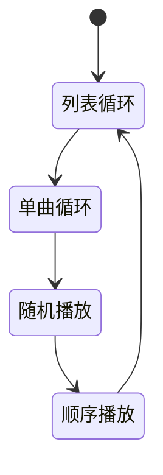
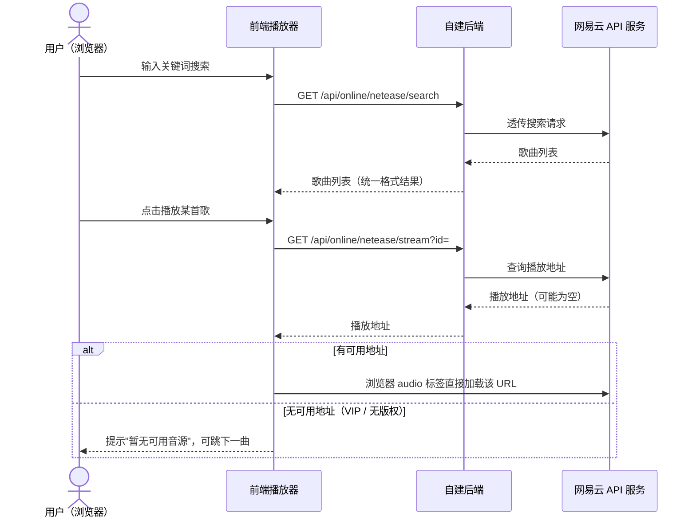
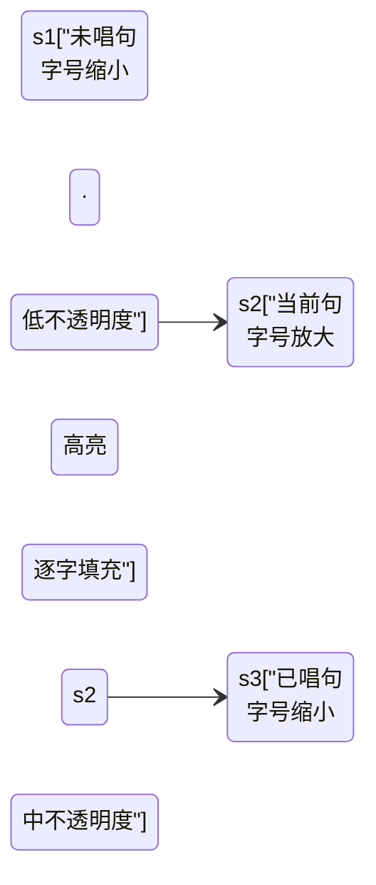
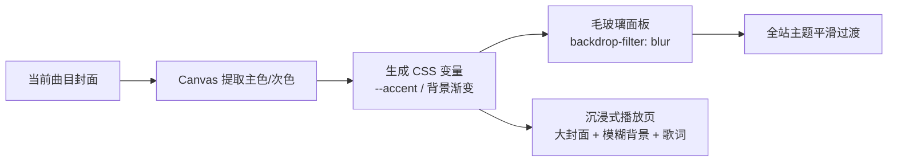
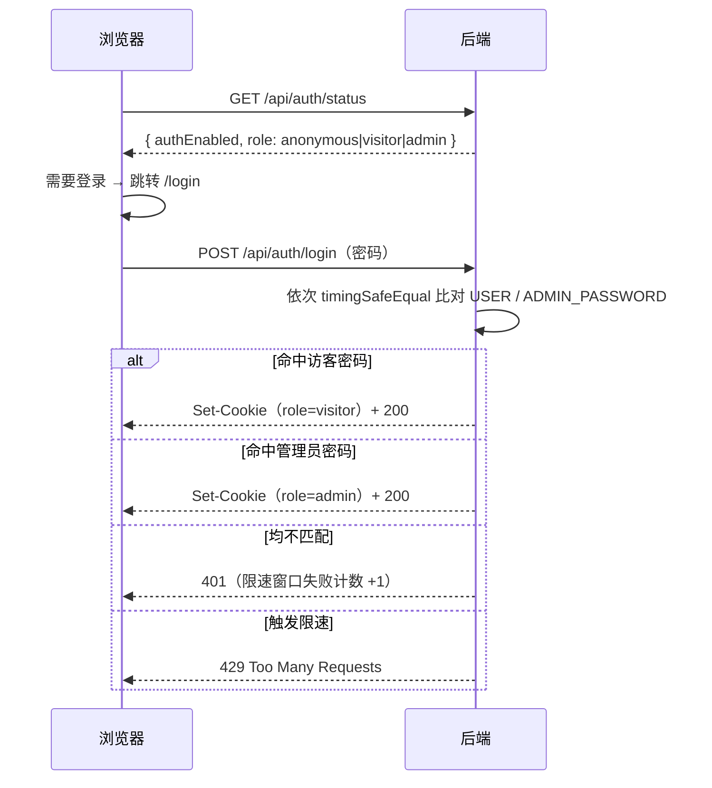
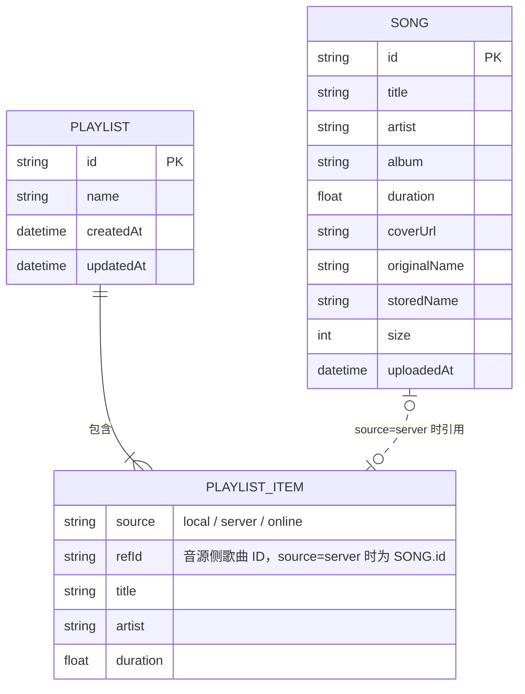

# 音乐软件需求文档（PRD）

| 项目名称 | 轻听音乐（2026-09-28 确认） |
| --- | --- |
| 文档版本 | v4.15（定稿） |
| 编写日期 | 2026-09-28（v2.6 起 2026-09-29） |
| 目标平台 | Web 网页应用（浏览器访问，响应式适配桌面优先） |
| 文档状态 | 已定稿 |

---

## 目录

- 1. 项目概述
- 2. 用户故事与核心场景
- 3. 功能需求：3.1 模块总览 / 3.2 播放器核心 / 3.3 本地播放 / 3.4 云端音乐库 / 3.5 在线音源 / 3.6 歌单 / 3.7 歌词 / 3.8 界面 / 3.9 视觉与动效 / 3.10 多端适配 / 3.11 访问控制 / 3.12 管理台
- 4. 非功能需求：性能 / 兼容性 / 安全 / 可靠性 / 部署
- 5. 技术方案：选型 / API 草案 / 数据模型 / 工程结构 / 环境变量汇总 / 技术规范
- 6. 里程碑规划（M1 / M2 / M3 / 远期）
- 7. 埋点与度量
- 8. 风险与约束
- 9. 术语表
- 10. 决策记录
- 11. 测试与验收计划
- 12. 部署手册大纲
- 修订记录

---

## 1. 项目概述

### 1.1 产品定位

一款**可私有部署的 Web 音乐播放器**：既能播放用户电脑里的本地音乐文件，也能通过自建服务器建立个人云端音乐库（上传、流式播放），并支持接入第三方在线音源（网易云音乐等）进行搜索和试听。

产品形态为"**本地 + 自有云端 + 在线聚合**"三合一的个人音乐中心，数据由用户自己掌控。

### 1.2 产品目标

1. **一处集中听歌**：本地文件、自建服务器音乐、在线音源在同一个界面内无缝切换播放。
2. **私有云音乐库**：用户部署自己的服务器，上传音乐后可在任意设备（电脑、手机浏览器）访问播放。
3. **够用且好用的播放体验**：覆盖主流播放器的基础体验（进度拖拽、播放模式、音量、封面、歌词）。
4. **架构可扩展**：在线音源以"适配器"方式接入，后续可扩展更多音源而无需改动播放器核心。

### 1.3 目标用户

- 本人（开发者本人）及小范围朋友使用；不面向公众提供服务。
- 用户特征：拥有一定量本地音乐文件（MP3/FLAC 等）；具备基本的服务器部署能力；在多设备（PC、手机）上听歌。

### 1.4 不做的事（Scope 边界）

- 不做面向公众的流媒体服务，不提供音乐分发。
- 不内置任何第三方音源的破解/去版权功能；在线音源仅做搜索与播放代理，仅供个人学习研究。
- 首期不做移动端原生 App（用移动端浏览器访问 Web 即可）。
- 不做多用户体系与社交功能（评论、分享、关注等）；权限仅"未登录 / 访客 / 管理员"三档（见 3.11）。

---

## 2. 用户故事与核心场景

### 2.1 核心用户故事

| 编号 | 用户故事 | 优先级 |
| --- | --- | --- |
| US-01 | 作为用户，我想把电脑里的音乐文件拖进网页直接播放，这样不用安装任何软件。 | P0 |
| US-02 | 作为用户，我想把音乐上传到自己的服务器，这样在其他设备上也能听。 | P0 |
| US-03 | 作为用户，我想在播放器里控制播放/暂停、切歌、拖进度、调音量，获得基础听歌体验。 | P0 |
| US-04 | 作为用户，我想看到歌曲的标题、歌手、专辑、封面、时长，而不是一串文件名。 | P0 |
| US-05 | 作为用户，我想搜索并播放在线音源（网易云）的歌曲，补充我没有的曲目。 | P1 |
| US-06 | 作为用户，我想创建歌单并把不同来源的歌曲收录进同一个歌单。 | P1 |
| US-07 | 作为用户，我想边听歌边看滚动歌词。 | P2 |
| US-08 | 作为用户，我想在手机浏览器里也能正常使用。 | P1 |
| US-09 | 作为部署者，我希望未登录的访问者只能播放本地文件；访客密码使用者可听云端曲库与在线音源；上传/删除等管理功能仅管理员密码解锁。 | P0 |
| US-10 | 作为管理员，我想要一个集中管理台页面：上传歌曲、管理曲库（搜索/删除/批量删除）、查看存储统计。 | P0 |

### 2.2 典型场景

**场景 A：本地听歌（无需服务器）**
用户打开网页 → 拖入 20 个本地 MP3 → 生成临时播放列表 → 点击播放、切歌、随机播放 → 关闭页面即结束，文件不上传、不留存。

**场景 B：云端音乐库（需要服务器）**
管理员在 PC 上打开"管理台"（3.12）→ 拖入文件夹批量上传（显示进度条）→ 服务器自动解析出标题/歌手/封面 → 用户在手机浏览器打开同一地址并以访客身份登录 → 在线流畅播放，拖动进度条即时响应。

**场景 C：在线补充听歌**
用户在"在线搜索"页输入关键词 → 调用网易云 API 返回结果列表 → 点击播放；遇到 VIP/无版权歌曲时给出明确提示并自动跳过或提示换源。

**场景 D：混合播放**
用户把 5 首本地歌 + 3 首服务器歌 + 2 首在线歌加进同一个歌单，连续播放时无感知切换来源。

---

## 3. 功能需求

优先级定义：

- **P0**：MVP 必须，第一版就要可用。
- **P1**：第一版发布后尽快补充。
- **P2**：远期规划，视情况排期。

### 3.1 模块总览

> 系统架构图（正式版）：`docs/design/系统架构图.drawio`（drawio 绘制，draw.io 打开可编辑，可导出 PNG 嵌入本文档）。

**关键设计概念——统一曲目（Track）抽象**：播放器核心只面向统一的 `Track` 对象播放，每个 Track 标记来源 `source: local | server | online`。本地文件对应浏览器 Blob URL，服务器文件对应后端流地址，在线歌曲对应第三方音频 URL。三种来源对播放器透明，这是"混合播放"（场景 D）得以实现的基础。

### 3.2 播放器核心（P0）

| 编号 | 需求 | 说明 | 优先级 |
| --- | --- | --- | --- |
| PL-01 | 播放/暂停 | 点击按钮或空格键切换 | P0 |
| PL-02 | 上一首/下一首 | "上一首"规则：当前播放超过 3 秒则回到本曲开头，否则切上一曲 | P0 |
| PL-03 | 进度条 | 显示当前进度/总时长；支持点击和拖拽跳转（seek） | P0 |
| PL-04 | 音量 | 滑杆调节 + 静音按钮，记忆上次音量 | P0 |
| PL-05 | 播放模式 | 顺序播放 / 列表循环 / 单曲循环 / 随机播放，四种模式循环切换 | P0 |
| PL-06 | 播放队列 | 当前播放队列列表：显示正在播放标识、可移除单曲、可清空 | P1 |
| PL-07 | 播放状态持久化 | 刷新页面后恢复上次播放的曲目与进度（localStorage） | P1 |
| PL-08 | 快捷键 | 空格播放/暂停、左右方向键快进快退 5 秒、上下方向键调音量 | P2 |
| PL-09 | 异常处理 | 音源加载失败时给出提示；**“这一首坏了” 与 “服务器断了” 分开处理**：前者**3 秒后**自动跳下一曲（这 3 秒留给用户自己换歌，他一动手就取消），后者**不跳**、只说清楚并停下来（v6.26 需求方定） | P0 |
| PL-10 | 睡眠定时器 | 定时停止播放（15/30/60 分钟或播完当前列表），到点音量淡出后停止 | P2 |
| PL-11 | 淡入淡出 | 切歌/暂停/定时停止时的音量平滑过渡，可开关 | P2 |
| PL-12 | 倍速播放 | 0.5~2.0x 变速（有声书/播客场景），倍速随会话记忆 | P2 |
| PL-13 | 均衡器与音效 | 10 段图形 EQ（31Hz~16kHz，Web Audio BiquadFilterNode 链）+ 整体增益；预设（平直/流行/摇滚/爵士/古典）+ 自定义曲线保存；A/B 对比开关（关闭时音频直通）；增益过大时限幅防爆音；设置按浏览器本地存储（每设备独立）；界面位于设置页"音效" Tab（**v5.68 已实现**） | P1 |

**播放模式切换关系（PL-05）**：



**验收标准**：
- 切歌到出声延迟 ≤ 1 秒（网络正常时）。
- 进度拖拽后 0.5 秒内从新位置继续播放（依赖服务端 Range 支持）。
- 播放到列表末尾时，各播放模式行为符合定义。

### 3.3 本地音乐播放模块（P0）

| 编号 | 需求 | 说明 | 优先级 |
| --- | --- | --- | --- |
| LC-01 | 文件添加 | 点击按钮选择 或 拖拽文件/文件夹到页面；支持多选 | P0 |
| LC-02 | 格式支持 | MP3、FLAC、WAV、OGG、M4A/AAC、OPUS；非音频文件自动过滤并提示 | P0 |
| LC-03 | 信息解析 | 无元数据时按文件名解析"歌手 - 歌名"格式 | P0 |
| LC-04 | 元数据读取 | 前端解析 ID3/Vorbis 等标签，显示内嵌标题/歌手/封面 | P1 |
| LC-05 | 临时列表 | 添加后进入本地临时列表，可整体播放、单曲播放、清空 | P0 |
| LC-06 | 隐私约束 | 本地文件仅用浏览器 Blob URL 播放，**不经服务器、不上传** | P0 |
| LC-07 | 快捷转存 | 本地列表提供"上传到音乐库"入口，跳转管理台并带入所选文件（与 3.4/3.12 打通）；仅管理员身份可见 | P1 |

**验收标准**：拖入含 50 个文件（其中混有非音频）的文件夹时，仅音频进入列表，且界面无卡顿（解析异步进行）。

### 3.4 云端音乐库模块（P0，需服务器）

| 编号 | 需求 | 说明 | 优先级 |
| --- | --- | --- | --- |
| LB-01 | 上传 | 单个/批量/拖拽上传；显示每文件实时进度与总进度；支持同时上传多个 | P0 |
| LB-02 | 上传校验 | 按扩展名白名单校验；单文件大小上限默认 300MB（可配置）；重复文件（同文件名+同大小）提示跳过或覆盖 | P0 |
| LB-03 | 元数据解析 | 服务端解析音频标签：标题、歌手、专辑、时长、内嵌封面图；解析失败时回退用文件名 | P0 |
| LB-04 | 音乐列表 | 展示封面、标题、歌手、专辑、时长、大小、上传时间；支持按标题/歌手/上传时间排序 | P0 |
| LB-05 | 删除 | 单曲删除（需二次确认）；同步删除音频文件与封面文件；界面入口在管理台（3.12） | P0 |
| LB-06 | 流式播放 | 后端按 HTTP Range 响应音频流，支持边下边播、任意位置 seek | P0 |
| LB-07 | 搜索过滤 | 在音乐库内按关键词实时过滤（标题/歌手/专辑） | P1 |
| LB-08 | 分页/虚拟滚动 | 曲目超过 500 条时保证列表流畅。v6.27 实现选**虚拟滚动**（渲染收窄、接口仍全量）—— 为什么不分页、以及这么选的后果见决策记录 v6.27 | P2 |
| LB-09 | 批量操作 | 批量删除、批量加入歌单 | P2 |
| LB-10 | 存储统计 | 曲目总数、总占用空间；由管理台实现，见 3.12 AD-03 | P1 |
| LB-11 | 索引重建 | "扫描 uploads 目录重建曲库索引"：重新解析元数据、重建 songs.json，用于索引损坏/误删后的容灾恢复；入口在管理台（AD-05） | P1 |
| LB-12 | 断点续传上传 | 大文件上传中断后从已传分片继续，避免整文件重传（分片上传） | P2 |

> 注：上传/删除/统计等管理操作的界面入口统一在管理台（3.12）；音乐库页面对所有登录用户为纯浏览视图。

**验收标准**：
- 上传 50MB 文件过程中页面可正常操作，失败文件有明确错误提示且不影响其他文件。
- 播放服务器曲目时拖动进度条到未缓冲位置，0.5 秒内从该位置继续播放。
- 删除歌曲后，列表、存储文件、封面均被清除。

### 3.5 在线音源接入模块（P1）

| 编号 | 需求 | 说明 | 优先级 |
| --- | --- | --- | --- |
| ON-01 | 音源适配层 | 定义统一 Provider 接口（search / getStreamUrl / getLyrics），播放器与前端页面不感知具体音源；多源架构参考 Folia（folia-major）的设计思路。v6.28 已落地：`server/src/services/online/`（provider 接口 + 网易云适配器），新增音源只改 `resolveProvider` 一处；封面代理的白名单也在接口上 | P0（架构） |
| ON-02 | 网易云搜索 | 接入 NeteaseCloudMusicApi（增强分支）：关键词搜索，返回标题/歌手/专辑/时长。v6.28 落地（`/cloudsearch`，统一格式 `OnlineTrack`）；v6.29 起以**内嵌库**形态默认可用（外接服务改为可选覆盖） | P1 |
| ON-03 | 网易云播放 | 获取歌曲播放地址并加入播放；对 VIP/无版权歌曲（无可用地址）给出明确提示。v6.28 已落地：直链**开播前现解析**（签名地址约 20 分钟过期，不进队列与存档）；`url: null` 是 200 业务结果，前端说清「需要 VIP 或暂无版权」并停下、**不自动跳歌**（与坏文件的 3 秒跳过不同，理由见决策记录 v6.28） | P1 |
| ON-04 | 配置开关 | 后端通过环境变量配置第三方 API 地址；未配置时前端隐藏/置灰在线功能并显示配置指引。v6.28 落地；**v6.29 语义更新：音源内嵌、默认可用（`onlineEnabled` 恒真），`NETEASE_API_BASE` 变为"改走外接服务"的覆盖项** —— 需求方裁决（"能直接加 server 端"），部署零配置 | P1 |
| ON-05 | 歌词获取 | 通过音源接口获取歌词（含逐字格式 yrc），进入歌词模块。v6.28 已落地（`/lyric/new` 优先取 yrc，旧版服务回落 `/lyric`；翻译歌词 tlyric 未做） | P1（配合 3.7 歌词 P1） |
| ON-06 | QQ 音乐接入 | 参考 yakult-green-tea/qq-music-api（Folia 同款方案）：需微信扫码登录后播放，作为独立适配器接入 | P2 |
| ON-07 | 多音源聚合搜索 | 一次搜索同时查询多个音源并合并结果 | P2 |
| ON-08 | 酷狗音乐接入 | 参考 MakcRe/KuGouMusicApi，作为独立适配器接入 | P2 |
| ON-09 | 歌词/封面多源回退匹配 | 歌词与封面按"网易云 → QQ → 酷狗"顺序自动回退匹配，失败支持手动修正（参考 Folia） | P2 |
| ON-10 | 音源账号登录 | 扫码登录音源账号（v6.30 需求方新增："加上 Folia 中扫描登陆功能吧，这样用户就可以听他们在不同平台上收藏的歌曲了"）：登录后可浏览/播放账号在该平台的歌单（收藏夹）。**v6.31 模型修订（需求方定）**：会话存**各浏览器自己的 localStorage**（随 `X-Online-Auth` 头带给后端转交，服务端不落盘）—— 否则两个人先后扫码，后扫的会覆盖先扫的，账号就串了。已落地网易云；QQ/酷狗随各自适配器接入 | P1 |

> 注：Folia（folia-major）为 AGPL-3.0 协议。本项目只借鉴其交互设计与接入思路、代码自行实现，不复制其源码；若未来直接引用其代码，本项目须同样以 AGPL-3.0 开源（见 9. 风险）。

**验收标准**：未配置网易云 API 时，其余功能不受任何影响；配置后无需改前端代码，重启后端即生效。

**在线播放核心流程（ON-02 / ON-03）**：



### 3.6 歌单管理模块（P1）

| 编号 | 需求 | 说明 | 优先级 |
| --- | --- | --- | --- |
| PS-01 | 创建/重命名/删除歌单 | 歌单存储在服务器端 | P1 |
| PS-02 | 添加曲目 | 支持把任意来源（本地/云端/在线）的曲目加入歌单 | P1 |
| PS-03 | 播放歌单 | 整单播放、从某曲开始播放 | P1 |
| PS-04 | 曲目排序/移除 | 歌单内拖拽排序、移除单曲 | P2 |
| PS-05 | 收藏/最近播放 | 一键收藏单曲；自动记录最近播放 100 条（**v5.67 已实现**） | P2 |
| PS-06 | 歌单导出 | 将歌单导出为文件（M3U8/JSON，格式开发时定） | P2 |

> 交互形态（2026-09-29 原型确认）：歌单以**侧栏分区**呈现（"歌 单"标题 + "＋"新建，列表项含曲目数徽标）；点击歌单在内容区打开**详情页**——头部（渐变封面/名称/曲目数/总时长）+ 操作（播放全部/重命名/导出/删除）+ 编号曲目列表；原"卡片网格"方案废弃。高保真原型见 `docs/design/mockup/`。

**说明**：本地文件加入歌单时，仅记录文件名等元信息作为"占位引用"——该文件在其他设备上不存在时，显示为灰色"本地缺失"状态，跳过播放。在线曲目入歌单时保存其音源与歌曲 ID。

### 3.7 歌词模块（P1，经 3.9 VS-03 确认提前）

**动效基准：Apple Music 歌词页**（2026-09-28 确认为歌词动效的唯一主要参考）。Folia 相关内容均为远期参考：其歌词效果在**项目主体完成后**再行评估探索（见里程碑"远期"），当前不进入任何里程碑。歌词行的三种视觉状态：



| 编号 | 需求 | 说明 | 优先级 |
| --- | --- | --- | --- |
| LR-01 | 歌词展示与解析 | P1 范围：LRC（行级时间轴，**含行内词级标签的增强型** `[mm:ss.xx]<mm:ss.xx>字`，v4.87 补上）+ yrc（网易云逐字，支撑卡拉OK填充），无逐字数据时自动退化为行级模式；qrc / krc / ttml / vtt 等其余逐字格式为远期增强，随对应音源接入后再支持 | P1 |
| LR-02 | 歌词来源 | 优先级：**用户手动导入 > 音频内嵌歌词 > 在线音源歌词接口**（多源回退匹配，见 ON-09）。注：v4.87 把手动导入从最后提到了最前，理由见下方“歌词来源”。 | P1 |
| LR-03 | 播放页 | 与沉浸式播放页合并实现，见 3.9 VS-03 | P1 |
| LR-04 | Apple Music 风格动效 | 当前句大字号高亮，前后句渐进缩小、降低不透明度，形成景深层次；句间切换用 transform/opacity 平滑过渡（遵守 VS-07 性能约束）；歌词区上下边缘渐隐遮罩 | P1 |
| LR-05 | 逐字卡拉OK填充 | 有逐字时间轴时，当前句内按字/词渐进填充高亮（Apple Music 标志性效果）；**仅行级数据时只高亮当前行**（v6.20 需求方定：LRC 没有字级时间，自左向右渐亮只能编个速度出来，所以不做伪逐字） | P1（无逐字数据时自动降级，不阻塞验收） |
| LR-06 | 点击行跳转 | 点击任意歌词行 seek 到该句时间点；播放中当前句自动滚动居中 | P1 |
| LR-07 | 滚动交互 | 用户手动滚动歌词时暂停自动居中，数秒无操作后恢复，并提供"回到当前句"按钮；滚轮 / 拖动 / **键盘（↑↓、PgUp/PgDn、Home/End，v4.87）** 三种操作等价 | P2 |

> 动效参考开源库 **AMLL**（amll-dev/applemusic-like-lyrics，**AGPL-3.0**）：提供 `@applemusic-like-lyrics/core`（DOM 原生）与 Vue 绑定、YRC/QRC/TTML 逐词歌词解析模块，另有社区逐词歌词数据库；完整效果需 Chromium 120+（`mix-blend-mode: plus-lighter`）。
>
> **许可更正（v4.83 核实）**：本行早期版本写作“MIT”，**是错的**——GitHub 仓库与 npm 上 `core` / `vue` / `lyric` / `react` 四个包均为 `AGPL-3.0-only`（`npm view` 实测）。AGPL 是强传染许可：接入其代码，**整个项目（含 server）都成为 AGPL 衍生作品**，且本软件是网络服务（AGPL §13 还要求向使用者提供完整源码）。
>
> **决策：只参考它的思路，代码自己写（v4.86 定稿）**。三步演进：v4.84 直接接入 npm 包（需求方澄清“要抄的是代码，不是装包”）→ v4.85 回退为**移植其代码** → v4.86 又把移植的部分改成**按公式/按效果自行实现**（弹簧 = 阻尼简谐振子的解析解；逐字辉光爆发 = 按自己的峰形曲线生成）。这样既拿到了它的效果，**项目里也不含 AGPL / GPL 代码**（无 `LICENSE`、`package.json` 无 license 字段），界面风格、主题色、锦线策略、渐隐语言全是我们自己的。
>
> **自研与参考的分工（v4.86）**：歌词解析在 `utils/lyrics.ts`；行级景深/逐字与行级填充/点击跳转/手动滚动在 `LyricsView.vue`；**弹簧**在 `utils/spring.ts`（参考 pushkine 的 MIT 实现，文件头署名）；**逐字辉光爆发**在 `utils/lyricEmphasis.ts`。详见 [`docs/dev/架构与代码地图.md`](./docs/dev/架构与代码地图.md) 7.5。

#### 歌词来源：手动导入提到最前（v4.87）

需求方选的方向是“把逐字动效真正用起来”，而**用户的歌里没有逐字数据**——内嵌歌词大多只有行级，LR-05 的逐字填充与辉光爆发就永远显不出来。所以这一版补了两件事，把数据来源打开：

1. **解析端**：支持**增强型 LRC**（`[00:12.00]<00:12.00>你<00:12.80>好<00:13.60>`），这是各地歌词站与 K 歌工具导出的常见形式（末尾那个没有文字的标签就是收尾标记，末字时长靠它落定；漏了收尾就用下一句开始兜底）；顺手把 `[offset:]` 也补给了 yrc（此前只有普通 LRC 吃）。
2. **导入端**：沉浸页顶栏加一个**「歌词来源」**入口，可导入手上的 `.lrc` / `.yrc`，按曲目记住（服务器/在线曲目按 id，**本地曲目按“歌手|曲名”**——本地 id 每次拖进来都会变），可一键退回自带歌词。读文件时按 BOM → UTF-8 → **GBK 回退**（老播放器导出的歌词多半是 GBK，硬按 UTF-8 读是满屏乱码）。

**优先级因此改成：手动导入 > 内嵌 > 在线。** 原文档把手动排在最后，但手动导入是用户对着这首歌做的显式动作，而内嵌那份往往只有行级——不覆盖的话，这个入口对“内嵌已有行级歌词”的歌等于没用（而那正是最需要升级成逐字的场景）。想退回自带歌词，菜单里一键即可，所以这个“覆盖”是可逆的。

### 3.8 界面需求（信息结构）

整体布局：左侧导航 + 中间内容区 + 底部常驻播放条。

```
┌──────────┬────────────────────────────────────┐
│ ♫ 轻听音乐 │  [页面标题]  [排序/搜索/操作按钮]     │
│          ├────────────────────────────────────┤
│ ▸ 本地播放 │                                    │
│ ▸ 音乐库   │   内容区                             │
│ ▸ 在线搜索 │   （歌曲列表 / 搜索结果 / 歌单详情）    │
│ ▸ 我的歌单 │                                    │
│   ├ 日常   │                                    │
│   └ 运动   │                                    │
│ ▸ 管理     │  ← 仅管理员身份可见（3.12）           │
├──────────┴────────────────────────────────────┤
│ [封面] 歌名/歌手  │ ⏮ ▶ ⏭ 🔀 🔁 │ 1:23 ────●── 3:45 │ 🔊 │
└────────────────────────────────────────────────┘
```

> 注：图表规范见 5.6.6——线框类图不属于 Mermaid 擅长范围，正式线框已用 drawio 绘制：`docs/design/主界面线框.drawio`（本节）与 `docs/design/管理台线框.drawio`（3.12）；下文 ASCII 仍为快速示意。

界面要求：

- 玻璃拟态风格基调（见 3.9），支持深色/浅色主题切换（VS-08），默认深色。
- 图标统一来自 Iconify + Phosphor 图标集（单一图标集，见 5.1）；图标颜色使用 currentColor，随主题变量与封面取色联动；状态约定：普通态用 regular 粗细，播放中/激活态（如随机播放开启、正在播放入口）用 fill 粗细，对齐 Apple Music 的填充式播放态惯例。
- 歌曲行结构统一：封面缩略图（44px）、标题+歌手、专辑、时长、操作按钮（播放/加入歌单/删除）；行 hover 高亮，正在播放行有动效标识。
- 底部播放条常驻，任何页面都在；含封面、控制按钮组（播放模式 / 上一首 / 播放暂停 / 下一首 / 静音）、进度条、音量。
- **音量交互形态（v4.19 定稿）**：静音键位于控制按钮组末位（与原型的 5 按钮布局一致）；鼠标悬浮或键盘聚焦时在其上方展开**竖向**音量条——玻璃悬浮层材质 + 主题色填充轨道 + 百分比读数，点按钮即静音/取消静音；纯 CSS 控制显隐（含 `:focus-within`），触摸设备上仍可直接点按钮静音。
- 响应式与多端策略见 3.10（断点规范 RT-01 在 M1 确定，手机布局 M2 实施）。
- 侧栏支持**折叠为纯图标窄栏**（约 68px，含状态记忆），原型已实现（2026-09-29）。
- 侧栏底部仅保留"设置"入口与"折叠侧边栏"；主题切换、退出登录、管理控制台入口统一收纳至**设置页**——设置页为**顶部 Tab 形态**（常规 / 账户 / 在线音源 / 快捷键 / 音效 / 管理 / 关于，活跃 Tab 主题色下划线；管理 Tab 仅管理员可见，2026-09-29 确认）。
- 空状态设计：音乐库为空、无搜索结果、在线音源未配置等场景均有引导性文案与操作入口。

### 3.9 视觉风格与动效（已确认，2026-09-28）

**风格基调：玻璃拟态（Glassmorphism）双主题（默认深色）+ 跟随封面动态取色**



| 编号 | 需求 | 说明 | 优先级 |
| --- | --- | --- | --- |
| VS-01 | 玻璃拟态基底 | 封面模糊背景 + 半透明毛玻璃面板（backdrop-filter）+ 半透明描边；列表视图为默认视图；M1 以深色主题实现，且颜色全部走 CSS 变量，为 VS-08 双主题预留 | P0（M1 即按此实现） |
| VS-02 | 封面取色主题 | 从当前曲目封面提取主色/次色，注入 CSS 变量生成主题色与背景渐变，切歌平滑过渡；封面缺失/加载失败时回退固定色板；取色结果按当前主题适配亮度/对比度（浅色主题下使用加深的 accent 变体，保证文字对比度） | P1 |
| VS-03 | 沉浸式播放页 | 点击播放条展开全屏，布局参考用户稿并简化（2026-09-29）：左侧方形封面 + 右侧"标题/歌手 + 滚动歌词列" + 底部居中控制与进度；歌名条/喜欢/评论/HQ/歌词开关/队列/伴唱等周边控件不做；歌词动效按 3.7 的 Apple Music 基准实现（当前句主题色 + 逐字填充） | P1 |
| VS-04 | 封面动效 | 播放中封面缓慢旋转（或呼吸浮动），暂停即停；遵循 prefers-reduced-motion 降级为静态 | P1 |
| VS-05 | 频谱可视化 | Web Audio API（AnalyserNode）实时频谱：播放页大图 + 播放条迷你指示；在线音源受 CORS 限制取不到音频数据时自动隐藏 | P2 |
| VS-06 | 列表+网格混合 | 音乐库/歌单为紧凑列表（行高约 48px），专辑视图为封面卡片网格，视图可切换 | P1 |
| VS-07 | 性能与降级 | backdrop-filter 使用层数克制；模糊背景用低分辨率封面图；不支持的浏览器/低端设备降级为半透明纯色 | P0 |
| VS-08 | 主题切换 | 深色/浅色双主题，全部经 CSS 变量（`data-theme` 属性）驱动；默认跟随系统 `prefers-color-scheme`，用户手动切换后记忆选择（localStorage）；界面提供切换入口（导航/设置）；切换即时生效、无刷新；深色为推荐默认 | P1 |
| VS-09 | 歌词页布局选择 | 沉浸式播放页提供三种布局（2026-09-29 确认，参考 QQ 音乐）：经典双栏（封面左·歌词右）/ 沉浸歌词（纯歌词居中）/ **彩胶唱片**（v5.86 从「海报背景」改名、同日定稿 —— 旧名的卖点是“溢出去当背景的盘”，现在盘完整可见还有唱臂；卡片文案改了，内部继续叫彩胶 / 存值仍为 `poster`，改 key 会作废已存的偏好）——歌词左，右侧为按封面取色渲染的整张彩胶（纹路+胶环，播放时旋转）＋唱臂（**v5.85 从“悬于右上角、半出画”改成真正的两列**：唱臂的支点在盘外右上方，盘不完整就没地方站它；配方见下方）；在设置-外观 Tab 以缩略图卡片选择，即时生效并按设备记忆（localStorage）；三种布局均沿用 3.7 歌词动效。**M1 组件化要求（2026-09-30 定稿）**：三布局在 Vue 中实现为三个独立组件（ImLayoutDuo / ImLayoutCenter / ImLayoutPoster），经 `<component :is>` 动态挂载切换；歌词滚动引擎、标题块、播放控制栏抽为共享子组件复用，布局组件只负责各自的版式与专属视觉层（如海报布局独占彩胶装配）。原型 mockup 的单页 CSS 类切换（.layout-duo/-center/-poster）仅是原型手段，且已证明易生层叠逃逸 bug（v3.9），不得照搬进 Vue；**v4.74：三布局全部落地**（`ImLayoutDuo` / `ImLayoutCenter` / `ImLayoutPoster`，设置 › 外观 以缩略图卡片选择、按设备记忆），彩胶按下方配方实现 | P1 |

> 彩胶实现配方（VS-09 海报背景，2026-09-30 定稿：QQ 音乐官方分层素材 + 用户实机验证实现，原型已移植）：**素材四张**（`glow`=background@2x（**自 v5.89 起不再使用：外圈柔光改成纯 CSS**，素材已删）/ `base`=hightlight1@2x / `grooves`=hightlight2@2x / `emboss`=shadow@2x，270×270 @2x）。分层组装（自后向前）：**① 外圈光晕** = glow 素材作 `mask`、填主题色 `hsl(--theme-h,--theme-s,62%)`（素材本身浅灰、灰色无意义，有意义的是 alpha 分层——mask 填色才得到跟封面配色走的有机柔光，box-shadow 做不出这种不规则衰减；比盘体大 1.4 倍居中，随盘旋转 + 呼吸）→ **② 盘体装配**（圆形裁剪 `border-radius:50% + overflow:hidden + isolation:isolate`，混合只在盘内生效；整体随盘旋转）内叠三层：主题色 conic 漩涡 `--vinyl-gradient`（同色相只做明度/饱和度漩涡，即彩胶质感）→ emboss 大理石纹理（`mix-blend-mode:overlay` 0.6）→ 封面中心标签（inset 21%，原型用取色渐变，M1 接入真实封面 ``）→ **③ 固定高光** = base+grooves 两张叠同一元素（深反光 α 中位仅 8~9/255，拆开互相看不见，同元素 overlay 混合才凑出完整盘面光泽），**不随盘旋转**（光源固定）；定位只有一条驱动量 `--vinyl-d`（盘径；`--vinyl-t/-r` 两个偏移自 v5.85 删掉——盘有自己的栅格列，不再从右上角溢出去，也就不再需要“同源派生偏移”那套）。整体 `rotate` **8s/圈**（45°/s 顺时针，QQ 实机视频实测值）、盘缘内阴影环（白边 1px + 向内 26px 深色晕开，源色 Tone 0.30 派生）增加厚度感、`will-change: transform`、暂停即停在最亮帧、遵循 prefers-reduced-motion。**DOM 结构对齐用户 01-colorfull 实现（2026-09-30 定稿；v5.23 修订一处）**：外壳 `.vinyl-assembly`（不转、不裁剪 —— 共享元素过渡捕获到的就是“盘”本身；边缘环 = `::after`）> 旋转盘 `.v-disc`（转 + overflow:hidden 裁剪）> 盘体/纹理/标签；高光 `.v-gloss` 为外壳子元素。**光晕自 v5.23 起是装配的兄弟节点 `.vinyl-glow`**（仍与盘同心、1.4 倍盘径居中，位置尺寸由同一组 `--vinyl-t/-r/-d` 派生）：它必须溢出盘外，而 View Transition 只快照“带名字那个元素”的边框盒 —— 留在外壳里会被方框硬裁出一圈方边（v5.23 实测：飞行末段盘外可见方形残影、落地即消失）；它随盘同频旋转 + 呼吸（v5.24 补齐漏掉的旋转那一半；暂停时旋转冻结在当前角度、呼吸撤掉停在最亮帧）。**彩胶不参与封面共享元素过渡（v5.25 撤回）**：它只走整页交叉淡化，所以上面这条“留在外壳里会被方框硬裁”的风险已不再适用；光晕挂装配外面这个结构保留（装饰物不放进将来可能要当共享元素的盒子里）。颜色源 `--cover-src/--cover-src-2` 须经 `@property` 注册为 `<color>`，调校用 OKLCH 相对颜色语法在 CSS 派生（见 3.9⑤），换封面整页平滑过渡而非硬切。注意：盘面颜色必须经 CSS 变量注入，禁止 JS 写内联 background（会覆盖全部图层，原型曾踩此坑）。**v5.85 补：版式与唱臂。** 版式改成两列（左歌词 / 右彩胶）：`.poster` 是 `grid-template-columns: minmax(0,1fr) auto`，盘完整可见（仅需为唱臂在上方留 10% 盘径、右侧留 8% 的余地）；窄屏（≤720px）转成上下两行（盘在上）。**唱臂**素材用参照实现那张（`01-colorfull/assets/arm@2x.png` → `assets/vinyl/arm.png`，130×600；底座 `ArmBottom@2x.png` → `arm-base.png`，84×116），几何全部对应素材自带的坐标：支点在盘的 90% / 5%、臂体高 = 盘径的 75%、臂体自身的旋转轴心在图片的 61.9% / 15.3%（轴承圆心位置，与支点重合）；底座不随臂转、臂体绕支点转，底座圆心落在支点上（实测 781,221 = 理论值）；落针 -4° / 抬起 **-26°**（v5.88）= 唱臂扫过的范围是版式的一部分：右侧余量按抬起时的针尖给（`--art-right: 0.3 × 盘径`，实测针尖到盘的 125%、唱头壳 132%），余量给小了针会被窗口裁掉；落针后 ±0.8° / 4.4s 轻摆（延迟 0.9s 等落针动画走完，v5.87）。**节奏起伏（v5.91）**：外圈柔光外面套一层 `.glow-pulse`，由 CSS 变量 `--beat`（0~1）驱动 `transform: scale(1→1.11)` 与 `opacity: 0.96→1`；JS 每帧只写这一个数，表达全在 CSS —— 两个属性都在合成层上，逐帧改变量不重绘渐层。拿不到频谱 / 关了开关 / 减动效时 `--beat` 恒为 0，就是纯底光 —— 不需要降级分支。（v5.90 曾做成盘下面的 **canvas 加法光**，v5.91 按需求方“光晕随着音乐的节奏起伏就好了，其他不用做那么多”撤掉：canvas 的价值是任意形状与随机光斑，这里用不上，而逐帧光栅化比合成层变换贵得多。）

#### 设计令牌速查（从原型 mockup.css 提取，M1 前端直接迁移）

> 界面样式的唯一事实来源为 `docs/design/mockup/css/mockup.css`（已浏览器实测）；下表为关键令牌与配方的速查。

**① 玻璃拟态材质（.glass 面板，VS-01）**

| 令牌 | 深色 | 浅色 |
| --- | --- | --- |
| --glass-bg | rgba(255,255,255,.055) | rgba(255,255,255,.55) |
| --glass-border | rgba(255,255,255,.12) | rgba(255,255,255,.75) |
| --text-1 / 2 / 3 | 白 .92 / .60 / .36 | 深蓝黑 .92 / .62 / .40 |
| 毛玻璃 | backdrop-filter: blur(28px) saturate(1.5)（两主题同） | 同左 |
| 投影 | 0 8px 32px rgba(0,0,0,.35) | 0 8px 32px rgba(30,40,80,.12) |

> **材质双模式（v4.55 引入，v5.92 收口）**：`.glass` 那套玻璃是**默认档（玻璃浮岛）**；另一档「实心面板」（设置 › 外观 可切、`localStorage` `qt-material` 记忆，且是**默认值**）把所有面都换成实心：中性页底 + 实心岛与卡片，**一层 `backdrop-filter` 都不留**，层级全部由投影说（岛内卡片 `--card-shadow`、常驻 chrome `--chrome-shadow`、浮层 `--panel-shadow` / `--tray-shadow`）。两档共用同一套令牌名字，组件不判断模式。**两套语言的分工（v6.2 需求方定稿：“实心面板：实心、阴影；玻璃浮岛：透明、光效”）**：光效（主题色光晕、悬浮光、播放键那圈描边）只属玻璃浮岛；实心面板下一层光晕都不留，层级全交给投影。

> **岛内卡片（v4.16）**：放在 `.glass` 岛（侧栏/内容区/控制台主区）**里面**的卡片不再叠 backdrop-filter，改用更实的底色（深 `rgba(255,255,255,.1)` / 浅 `rgba(255,255,255,.8)`）+ 描边与岛面区分（前端类名 `.card`）。原因：VS-07 要求模糊层数克制，且玻璃叠玻璃会互相稀释成一片灰糊。深色文字不透明度亦由 .92/.60/.36 上调为 .94/.64/.46（实机偏暗，可读性优先于原型数值）。

**② Island 布局参数**

- 应用外壳网格：侧栏 224px（折叠 68px）+ 内容 1fr；行 = 1fr + 播放条 84px；岛间距与页边 14px；面板圆角 18px（v4.17 自 12/16 微调）
- 圆角体系：面板 18 / 行与卡片 12 / 按钮与输入框 10 / 封面缩略图 9（v4.17）
- 文字三级：--text-1 主文本 / --text-2 次级 / --text-3 弱化；深色实取值 .94/.64/.46，浅色 .94/.66/.48（可读性优先，v4.16 上调）
- 浅色主题专属：底色 #f1f2f5；岛面不透明度 .66（深色 .055，浅色底平、需更实）；描边用淡灰蓝细线 rgba(30,40,80,.09)；背景光晕按主题降为 accent 9%/6%（深色 26%/20% 会把浅色整页染紫，v4.17）
- 歌词页内容组：fit-content + 水平垂直居中，组内封面列 / 歌词列 / 间距均按 vh/vw 相对缩放（clamp 限幅）

**③ 动效参数**

| 动效 | 参数 |
| --- | --- |
| 唱臂落针（v5.85） | 播放 `rotate(-4deg)` 落针 / 暂停 `rotate(-26deg)` 抬起（v5.88 自 -15° 加大：-15° 时唱头壳只有 96% 盘半径，等于坐在唱片上—— 需求方：“唱臂无法完全离开唱片”；-26° 实测针尖 159% 盘半径、唱头壳 132%），0.9s `cubic-bezier(0.34,1.1,0.4,1)`（参照实现实测值）；针尖落在外圈纹槽上（实测 0.99 盘半径，中心的封面只占 0.58 半径，够不到）；播放时随音乐轻摆 ±0.8° / 4.4s（延迟 0.9s 等落针走完，v5.87）；`prefers-reduced-motion` 去掉过渡与轻摆、保留落针状态 |
| 彩胶旋转 | 8s linear/圈（45°/s 顺时针，2026-09-30 对照 QQ 实机视频实测修正，旧值 32s 差 4 倍）；播放 running / 暂停 paused；reduced-motion 静止 |
| 光晕呼吸 | 3.4s ease-in-out；opacity 1↔0.72；随盘旋转（素材形状不规则，转起来才可见）；**暂停时一起停，停在最亮帧**。v5.89 起外圈柔光是**三团径向渐变**：主团 8s（与盘同频）、两团副光 13s（反向）/ 17s，偏移与大小都不同 —— 合出来的形状一直在缓慢变形，周期 LCM(8,13,17) ≈ 30 分钟（人眼看着不重复） |
| 节奏起伏（v5.91） | 低频 **40~160Hz 的峰值** → 包络（起 40ms / 落 350ms）→ **相对常态归一**（慢跟随估“常态强度 + 常态波动”，量的是“比平时重多少”）→ 写成 CSS 变量 `--beat`（0~1），只表达为缩放 1→1.11 与不透明度 0.96→1。**均值指标与不做归一都不行**：实测均值让整首 `--beat` 挤在 0.70~0.89（缩放只差 1.3%）；改后 min 0.000 / 中位 0.201 / max 0.917，缩放实测 1.0000→1.1009。暂停即回 0（不是“停在最后一帧”）；减动效或关了设置开关时循环不跑、`--beat` 恒为 0 |
| 歌词滚动弹簧 | **自研**（`utils/spring.ts`；求解思路参考 pushkine 的 MIT 实现）：基础 mass 0.9；跳转 / 首末句 100/16（稳）、结束 150/24、正常播放 180~230（按句间间隔微调）且 damping = `√stiffness × 2.3`（过冲幅度稳定）。`prefers-reduced-motion` 与页面不可见时直接落位 |
| 逐字辉光爆发 | **自研**（`utils/lyricEmphasis.ts`，效果参考 AMLL）：字刚唱完时跑一次 0.7~1.8s 的关键帧（峰形 `sin²(πx)` 从 0 冲到峰再收回），带轻微放大/上浮/邻字推挤，辉光用我们的 `--accent-soft`；与常驻辉光叠加，降低动效时不跑 |
| 非当前句模糊 | **按距离递增**（对齐 AMLL `resolveBlurLevel` 的机制）：距当前句 1 / 2 / ≥3 行 = blur 1.1 / 2.2 / 3.3px；不透明度 未唱 0.5 / 已唱 0.58 / 当前 1；缩放 0.965（= AMLL `SCALE_ASPECT` 97）；**悬浮时取消模糊**（点击跳转要先看清） |
| 逐字发光 | 已唱字符常驻 `text-shadow: 0 0 18px accent-soft, 0 0 6px accent-soft`（常驻主题色，不用它的白色瞬时爆发） |
| 行级填充柔边 | 填充前沿 ±0.25em 渐变过渡（带宽合计 0.5em，= AMLL `wordFadeWidth` 默认值）；无此柔边时前沿是一道硬边 |
| 歌词渐隐与留白 | 下缘 14%；**上缘按需**（贴顶时 `0%`——否则当前句被压暗；锦线铺开后 `8%`——已唱句已被退远，宽渐隐带会让上半部分过渡发硬）；列表**顶部不留白**（第一句紧贴标题）、**底部留半屏**（末句能走到中线） |
| 面板/行反馈 | background 0.15s；主题切换 background 0.5s 无刷新 |
| 页面/弹层过渡 | iOS 曲线 cubic-bezier(0.32,0.72,0,1)：页面切换 fade+上移 0.32s（v5.28 补齐实现：只做进场，旧页直接让位）、**队列弹层：桌面 scale+fade 0.3s（右下原点）／手机 = 从底部升起的半屏抽屉（`translateY(100%)→0`，0.34s，同一曲线，v5.40）**；**沉浸页 = 底部升起的 sheet：进场 translateY(100%)→0，退回时同一段位移反向沉下（两向均 0.42s，v5.27 需求方指定，取代原来的 fade+scale 0.36s）；飞行期间 sheet 带 18px 上圆角（落地收回直角，所以不会看到圆角“啪”地弹平）与朝上的面板级投影，下层主壳同步压暗到 brightness(0.68) 再亮回来（v5.28）**；登录页 fade 0.4s；reduced-motion 全部静止 |
| View Transition 增强（**v5.26 已撤除**） | 曾在 v5.18~v5.25 用 View Transition API 做封面共享元素飞入/飞出（播放条小图 ⇆ 沉浸页大图，`qt-cover`、0.42s）。两个理由整体下线：① 彩胶那一对两端既不同形也不同画，怎么调都留痕（v5.23 方框残影 → v5.24 落地硬切 → v5.25 撤回）；② 撤掉后页面只靠各自的 CSS 入场动画（沉浸页 `im-in` 0.36s），少一层浏览器级的快照与清理逻辑。要做回来见 git 历史 v5.18~v5.25 与 `docs/dev/开发约定.md` 的归档小结 |

**④ 图层顺序（海报/彩胶布局，自后向前）**

外圈柔光（**三团径向渐变叠加**，颜色 `currentColor` 从 `--cover-src` 取一次，1.4 倍盘径、以盘心为中心，三团各自 8s / 13s（反向）/ 17s（正向）旋转 —— v5.89 起不用素材 mask）→ **节奏起伏层**（`.glow-pulse`，套在柔光外、只做缩放与不透明度，v5.91 —— 不能写进 `.vinyl-glow` 里面：它的 transform 被自转、opacity 被呼吸动画占着）→ 彩胶圆形装配（conic 漩涡+大理石纹理+封面标签，圆形裁剪+isolate）→ 固定光源高光层（不随盘转）→ **唱臂**（底座 z-4 不随臂转 → 臂体 z-5 绕支点转；v5.85）→ 歌词列（z-2）。**本布局不加全页渐变遮罩**（v4.74 定的：页面已有统一薄雾保证文字可读，再叠一层会把彩胶左缘掠白）

**⑤ 取色注入（VS-02）**

切歌时由 JS 将颜色源写入 `--cover-src / --cover-src-2` 两个原始色变量（预设调色板的 c1/c2，或封面提取的桶平均色 hex），另写 `--accent / --accent-soft / --glow1 / --glow2` 四个展示变量；**一切调校在 CSS 完成**——`--cv1 / --cv2 / --cover-deep / --vinyl-gradient` 与光晕填充全部用 **OKLCH 相对颜色语法**从颜色源派生（Monet/HCT 思路的 CSS 原生实现，Chrome 119+/Safari 16.4+）：`oklch(from var(--cover-src) clamp(0.4, l, 0.62) clamp(0.07, c, 0.15) h)`。**为什么是 OKLCH**：L（Tone）感知均匀——clamp 即统一所有封面盘面深度，绿黄不再过曝（HSL 需要 Rec.601 色相偏置表补偿的问题在此不存在）；C（Chroma）钳制 0.07~0.15 防过艳也防过灰（晨雾这类刻意低饱和配色不被强行提艳，这是 HSL 方案的已证缺陷）。光晕 = Tone 0.52~0.68 派生；标签描边环 = `--cover-deep`（Tone 0.30）+ color-mix 透明度。**降级**：每个派生都先写一条无 OKLCH 的声明（`var(--cover-src)` 原色 / color-mix），不支持相对色语法的浏览器自动保留降级值，功能无损仅失去统一深度。`--cover-src/2` 经 @property 注册为 `<color>`，换歌整页平滑过渡。两个颜色源变量严禁 JS 写内联 background（会覆盖多层图层，原型曾踩此坑）。背景光晕、彩胶盘体、外圈光晕、主题色、逐字发光全部联动；**严禁 JS 写内联 background**（重复强调，原型曾踩此坑）。

> **真实取色管线（VS-02 完整实现，原型已落地）**：带真实封面的歌，播放时 `loadThemes(cover)` 异步提取——封面缩 64×64、按色相分 24 桶加权（权重 = 饱和度 × 明度居中度，丢灰白黑与 l<0.1/l>0.95 像素），最高权重桶即主题色相，色相差 ≥0.11 的前 4 个候选留作备选，**原始桶平均色**交 CSS 调校后覆盖预设色源；预设调色板即时兜底（提取失败/画布污染自动保留），切歌竞态用 playingId 比对丢弃过期结果，提取结果按图片地址缓存。中心标签接真实封面 ``（无封面歌回落取色渐变）。**样张实测**（蓝帽人像，caijiao cover.jpg）：候选 = 201° 天蓝（胜，即画面主体蓝帽）/ 6° 肤色暖调 / 49° 黄 / 308° 品红，OKLCH 调校后盘面深青蓝、深度与 QQ 实机持平且深浅两主题无过曝。历史决策记录：QQ 式压深（提饱和+压明度）与 HSL 手调（偏置表+区间收束）均经用户对比后淘汰，OKLCH 方案由用户在对比实验室页（docs/design/mockup/hct-test.html）定稿。注意 file:// 下画布会被污染，真实管线必须走 http。

> **M1 实现（v4.77 落地，取代原型版 JS 调校）**：`client/src/utils/coverColor.ts` —— 封面画进 32×32 canvas 取像素（原型是 64×64，实测 32 已足够且更省），纯函数按**色相 12 桶**、每像素按「饱和度 × 中间调偏好」投票（丢半透明、近黑近白、彩度 <0.1 的像素），得票最高的桶取**平均色**当主色；第二色源优先取**异族**（色相差 ≥40° 且权重占比 ≥12%），否则取主色**同色相浅一档**（**不旋转色相**：实测 +45° 会把肤色棕 #c8aba2 转成橄榄绿 #c8c8a2，页脚环境光直接发浑）。**与原型的关键差异**：原型在 JS 里跑 `tuneTheme`（HSL 调校后再写六个变量），M1 按铁律 3 只写 `--cover-src / --cover-src-2` 两个**原始色源**，亮度/彩度夹取全部交给 CSS 的 OKLCH 相对颜色——包括 `--accent / --accent-2 / --accent-soft / --glow1 / --glow2` 也不再由 JS 写。取不到可用颜色（纯灰阶 / 全透明 / canvas 被污染）一律保持默认配色，**不拿灰凑色**。

### 3.10 多端适配（已确认，2026-09-28）

**结论**：手机适配在 M2 实施，目标为原生级体验；M1 仅保证移动端不白屏。平板不做单独布局。支持 PWA。

| 编号 | 需求 | 说明 | 优先级 |
| --- | --- | --- | --- |
| RT-01 | 断点规范 | ≥1280px 桌面完整布局；768~1280px 平板沿用桌面布局；<768px 手机布局 | P0（M1 定规范并按桌面实现） |
| RT-02 | 手机布局 | <768px：导航收起为底部标签栏或抽屉；播放条简化为迷你条，点击展开沉浸式播放页；列表单列 | P1 |
| RT-03 | 听歌完整 | 手机端覆盖浏览/搜索/播放/切歌/歌词；上传、删除、歌单管理等管理操作以桌面为主（手机端隐藏或只读） | P1 |
| RT-04 | 锁屏/通知栏控制 | 集成 Media Session API：锁屏与通知栏显示封面/歌名/歌手，支持播放/暂停/上一首/下一首 | P1 |
| RT-05 | 手势操作 | 沉浸式播放页左右滑动切换上/下一曲、下滑收起；列表侧滑操作为 P2 可选 | P1 |
| RT-06 | 横竖屏 | 手机横屏时播放页自适应布局 | P2 |
| RT-07 | PWA 支持 | vite-plugin-pwa：manifest（名称/图标/主题色）+ Service Worker 缓存应用外壳与静态资源（音频不缓存）；可添加到主屏幕全屏运行（**v5.65 已实现**） | P1 |
| RT-08 | 移动端底线 | M1 期间移动端访问不白屏、布局不崩；无法正常使用时给出"请使用电脑访问"提示 | P0 |

### 3.11 访问控制（已确认，2026-09-28）

**访问模型（三档）**：未登录 = 仅本地播放；访客密码（USER_PASSWORD）= 听云端曲库/歌单/在线音源；管理员密码（ADMIN_PASSWORD）= 额外解锁管理台（上传/删除/统计）。

| 编号 | 需求 | 说明 | 优先级 |
| --- | --- | --- | --- |
| AC-01 | 未登录（匿名）模式 | 未登录时仅可使用本地播放模块（3.3，纯浏览器、不经服务器）；服务器功能不可用，界面展示"登录后解锁"引导 | P0 |
| AC-02 | 登录（密码即角色） | 登录页输入密码，前端提交 POST /api/auth/login；后端以 crypto.timingSafeEqual 依次与 USER_PASSWORD、ADMIN_PASSWORD 比对，命中即获得对应角色（visitor / admin），Set-Cookie 颁发含角色的签名 Cookie，之后免输 | P0 |
| AC-03 | 接口分级保护 | 接口分两级：访客级（音乐库列表/音频流/歌单/在线音源搜索播放）要求 visitor 及以上；管理级（上传/删除/统计）要求 admin。鉴权中间件统一校验：未登录 401、角色不足 403 | P0 |
| AC-04 | 登出 | 提供登出入口（POST /api/auth/logout），清除凭证回到未登录状态 | P1 |
| AC-05 | 密码配置 | 两档密码均为环境变量。组合规则：两把都未配置 → 门禁关闭、全功能开放（本机场景）；仅配置 ADMIN_PASSWORD → 无访客档，登录页仅管理员入口；仅配置 USER_PASSWORD → 访客可听，管理功能对所有人关闭；两把都配置 → 完整三档 | P0 |
| AC-06 | 登录防爆破 | /api/auth/login 失败限速（express-rate-limit）：默认 15 分钟窗口内最多 10 次失败，超限返回 429 并提示稍后再试 | P0 |
| AC-07 | 登录页 | 独立 /login 路由：玻璃拟态登录卡片（居中 + 封面模糊背景，风格同 3.9）；单密码输入框（后端自动识别角色）；提供"先听听本地歌"未登录入口；登录成功跳回来源页；门禁关闭的环境直接跳过登录页 | P0 |
| AC-08 | 角色凭证 | 角色写入签名 Cookie 载荷（签发时间戳 + 角色 + HMAC），无状态校验；已知限制：修改密码后旧凭证在有效期内仍可用，需要强制全员下线时轮换 AUTH_SECRET | P0 |

**技术实现（已确认，2026-09-28）**：



- **凭证方案：签名 Cookie**（cookie-parser + HMAC 签名）。载荷为"签发时间戳 + 角色"，无状态、无服务端存储；属性 httpOnly + sameSite=Lax，HTTPS 部署时启用 secure；有效期默认 30 天，环境变量 AUTH_TTL 可配。登出即清除 Cookie。
- **签名密钥**：环境变量 AUTH_SECRET；未配置时服务首次启动自动生成随机密钥并持久化到 data 目录（重启后会话不失效）。
- **不引入**：密码哈希库（明文比对 + timingSafeEqual 已足够）、JWT、session 存储、鉴权框架。

**认证 API 草案**：

| 方法 | 路径 | 说明 |
| --- | --- | --- |
| GET | `/api/auth/status` | 返回 `{ authEnabled, role }`（anonymous / visitor / admin），前端据此决定进入未登录模式、登录页还是管理台 |
| POST | `/api/auth/login` | 密码与两把密码依次比对，返回角色并 Set-Cookie；受 AC-06 限速保护 |
| POST | `/api/auth/logout` | 清除凭证 Cookie |

说明：两把密码均为部署者单密码，不做注册、多用户体系、找回密码（私有部署定位）；每个设备各自登录一次。访客/管理员已是本产品最大权限粒度，更细粒度权限列为远期评估。

### 3.12 管理控制台（已确认，2026-09-29 改版）

**独立系统形态**（2026-09-29 确认，参照商品后台模式）：管理功能不内嵌于播放器，而是独立的控制台页面（`/admin` 独立布局）——自己的侧栏导航（概览 / 曲库管理 / 上传导入）与页面结构，从播放器侧栏"管理台"入口进入，"返回播放器"退出；仅 admin 角色可进入（AD-04）。

| 编号 | 需求 | 说明 | 优先级 |
| --- | --- | --- | --- |
| AD-01 | 上传导入 | 独立分区页：拖拽/多选上传，单文件与总进度实时显示；重复文件（同名同大小）提示跳过/覆盖；失败逐文件提示不影响批次（即 LB-01/02 的界面呈现） | P0 |
| AD-02 | 曲库管理 | 独立分区页：搜索过滤、按标题/歌手/大小/上传时间排序、单曲删除（二次确认）、复选框批量删除（二次确认并显示条数）、**编辑曲目元信息**（歌名/歌手/专辑，见 v5.61）+ **手动设置封面与歌词**（选图 / 上传 .lrc / 直接粘文本，见 v6.13；标签与内嵌资源缺失或不对时用） | P0 |
| AD-03 | 概览统计 | 存储统计（曲目总数/占用空间，LB-10）与上传统计；更多图表（最常播放/来源占比）随 M2 交付 | P1 |
| AD-04 | 访问控制 | /admin 仅 admin 角色可进入，visitor/未登录访问时重定向登录页；播放器导航入口仅管理员可见 | P0 |
| AD-05 | 索引重建入口 | "重建索引"按钮（实现 LB-11）：执行时显示扫描/解析进度，完成后刷新列表并提示结果 | P1 |

说明：音乐库页（3.4）面向所有登录用户为纯浏览视图；上传/删除等管理操作全部在控制台。歌曲元信息编辑（歌名/歌手/专辑）**已实现**（AD-02 / v5.61）：改的是曲库索引，不重写音频容器的标签，改过的字段记在 `editedFields` 里、重建索引时保住。**封面替换与歌词设置也已落地**（v6.13）：封面可传一张图或去掉（换过的封面记在 `editedAssets` 里，重建索引不会拿内嵌图顶掉），歌词可传 `.lrc` / `.yrc` 或直接粘文本（正文存 `data/lyrics/<id>.lrc`，同样记账保护）。仍然算远期的是**批量编辑**（一次改多首）。

---

## 4. 非功能需求

### 4.1 性能

| 指标 | 要求 |
| --- | --- |
| 首屏加载（生产构建） | ≤ 2 秒（常规网络） |
| 切歌响应 | ≤ 1 秒出声 |
| seek 响应 | ≤ 0.5 秒 |
| 音乐列表（1000 条） | 滚动流畅，无感知卡顿（必要时虚拟滚动） |
| 并发 | 私有部署，满足 1~5 人同时在线播放即可 |

### 4.2 兼容性

- 浏览器：Chrome、Edge、Firefox、Safari 最新版及前一主版本。
- 玻璃拟态依赖 backdrop-filter（Safari 需 -webkit- 前缀），不支持的环境按 VS-07 降级为半透明纯色，不影响功能。
- 音频格式在 Safari 上与 Chrome 存在差异（如 FLAC/OPUS），按浏览器能力降级提示，不白屏；服务端按需转码为远期评估项（见 8 / 里程碑"远期"）。
- 移动端浏览器（iOS Safari、Android Chrome）可用（P1）。
- iOS 音频策略：首次播放必须由用户手势触发（自动播放受限）；后台/锁屏播放依赖 Media Session（RT-04），移动端实现时真机逐项验证。

### 4.3 安全

- 上传仅允许音频扩展名白名单；服务端存储文件名使用随机名，杜绝路径穿越。
- 删除/上传接口做基础校验；访问控制按 3.11 实现（未登录仅本地播放，访客密码听云端，管理员密码解锁管理台；接口分级校验，未登录 401、角色不足 403）；反向代理鉴权（Nginx BasicAuth 等）可作为额外加固。
- 敏感配置（第三方 API 地址等）走环境变量，不硬编码。
- 公网部署必须启用 HTTPS（音频接口经 HTTPS 混合内容限制）。

### 4.4 可靠性与容错

- 上传失败（网络/超限/格式）逐文件提示，不中断批次中其他文件。
- 在线音源请求失败时明确提示"音源服务不可用"，并给出配置指引。
- 后端数据（曲目索引、歌单）以文件形式落盘，服务重启不丢失。

### 4.5 部署

- 提供 `npm install && npm run dev` 的本地开发方式。
- 提供生产部署方式：前端构建产物由后端静态托管，单进程即可对外服务；支持 Docker 部署（P1 提供 Dockerfile）。
- 端口、存储路径、第三方音源地址等均可通过环境变量配置。

---

## 5. 技术方案（选型已确认）

### 5.1 技术选型

> 以下选型已与需求方确认（2026-09-28），作为开发约束执行。

| 层 | 选型 | 说明 |
| --- | --- | --- |
| 前端框架 | Vue 3 + Vite | 组合式 API + `<script setup>` 语法 |
| 开发语言 | TypeScript（前后端） | 数据模型即类型定义，见下方"类型共享" |
| 状态管理 | Pinia | 播放器状态（当前曲目/队列/播放模式/音量）做成全局单例 store |
| 路由 | Vue Router | 对应左侧导航的四个页面 |
| UI 样式 | 手写 CSS + CSS 变量；**Reka UI（原 Radix Vue，unovue/reka-ui）提供行为层** | 玻璃拟态风格（VS-01）：毛玻璃面板/模糊背景全定制，**不引入带样式的组件库**；主题色由封面取色动态注入（VS-02）；深色/浅色双主题经 data-theme 切换（VS-08）。组件策略（2026-09-30 定稿，同日由 Headless UI 改选）：无障碍交互复杂件用 Reka UI 无样式行为层——其 data-attribute 样式模型（data-state 等）与纯 CSS 令牌方案天然契合；分工：DropdownMenu/ContextMenu（歌曲「…」与右键菜单，含子菜单/勾选项）、Tooltip、Toast、Dialog（元信息弹窗 focus trap）、Select（EQ 预设）、Switch（A/B 开关）等 ~50 原语覆盖 Headless UI 缺席的件；简单件（Button/Input/滑杆/复选框）直接手写 CSS（原型已验证：滑杆自绘 + 自定义复选框 + selection/focus-visible 令牌化，v4.11~v4.12）；禁止 UI 库自带皮肤破功；**迁移规则（2026-09-30，用户定稿）**：参考 shadcn-vue 系实现时只翻译结构与行为（组件组合、Reka API、collapse/tooltip 门控），**丢弃其 Tailwind utility 类**，样式一律翻成自有语义类 + 令牌（参照原型 sb-/nav- 命名）——视觉语言必须保持 mockup.css 单一事实来源，不做 utility-first |
| 图标 | Iconify（unplugin-icons 构建期打包）+ Phosphor 图标集（前缀 ph） | 聚合 200+ 开源图标集按需引入；构建期本地化、不依赖运行时图标 API，符合 PWA 离线要求（RT-07）；全站锁定单一图标集。Phosphor：圆角端点 + 6 种粗细（thin/light/regular/bold/fill/duotone），公认最接近 Apple SF Symbols 的开源图标库，9000+ 图标 MIT；fill 变体用作播放/激活态（对齐 Apple Music 惯例） |
| 封面取色 | Canvas 自实现（备选 node-vibrant） | 从封面提取主色/次色，生成 --accent 等主题变量 |
| 频谱可视化 / 均衡器 | Web Audio API（AnalyserNode + BiquadFilterNode 链） | 同一 AudioContext 图：频谱（VS-05）与 10 段 EQ（PL-13）共用，零框架依赖 |
| PWA | vite-plugin-pwa | manifest + Service Worker，添加到主屏幕（RT-07） |
| 移动端增强 | Media Session API（浏览器内置） | 锁屏/通知栏播放控制（RT-04） |
| 歌词动效 | 自研实现（弹簧在 `utils/spring.ts`，逐字爆发在 `utils/lyricEmphasis.ts`；仅**参考** AMLL 与 pushkine 的思路与公式，**未拄代码、未装包**），项目不含 AGPL / GPL 代码 | Apple Music 风格（LR-04/05）：弹簧滚动、按距离模糊、逐字渐变与辉光爆发、点击跳转、手动滚动与回位 |
| 后端 | Node.js + Express（TypeScript） | 开发用 tsx watch，部署前编译为 JS |
| 上传处理 | multer | 磁盘存储 + 大小/扩展名校验 |
| 元数据解析 | music-metadata | 解析 ID3/Vorbis/FLAC 标签与内嵌封面 |
| 数据存储 | JSON 文件起步；**功能全部完成后**统一迁 SQLite（v5.60 需求方定稿） | 私有规模下 JSON 足够，降低部署依赖；迁移边界与低成本原因见 v5.60 |
| 在线音源 | **内嵌库（v6.29 定稿）**：`@neteasecloudmusicapienhanced/api`（MIT，原 NeteaseCloudMusicApi 的活跃续作）以库形态随 server 安装，部署零配置；`NETEASE_API_BASE` 可选覆盖为外接自部署服务。QQ 音乐（qq-music-api）/ 酷狗（KuGouMusicApi）P2 接入时同走适配层（注意：qq-music-api 在 npm 上**无 license 字段**，接入前先解决） | 避免浏览器跨域，统一出口；各音源为独立适配器可插拔（见 3.5） |
| 访问门禁 | 签名 Cookie（cookie-parser）+ timingSafeEqual + express-rate-limit | 双密码角色门禁（3.11：访客/管理员）；新增依赖仅 cookie-parser、express-rate-limit 两个，不引入密码哈希库与 JWT/session 框架 |

**类型共享**：`Track / Song / Playlist / PlaylistItem` 等接口定义放在 `shared/` 目录，前后端引用同一份（workspace 内路径引用）。接口字段变更时前后端编译期即可发现不一致，避免"后端改了字段、前端还在用旧的"这类问题。

### 5.2 核心 API 草案

| 方法 | 路径 | 说明 |
| --- | --- | --- |
| GET | `/api/auth/status` | 登录态与门禁开关查询（见 3.11 认证 API） |
| POST | `/api/auth/login` | 登录：校验访问密码，颁发签名 Cookie（限速保护） |
| POST | `/api/auth/logout` | 登出：清除凭证 |
| GET | `/api/config` | 返回功能开关（如 onlineEnabled） |
| GET | `/api/songs` | 云端音乐列表（访客及以上） |
| POST | `/api/songs/upload` | 上传音频（multipart，字段 file）（管理员） |
| PUT | `/api/songs/:id` | 改曲目元信息：歌名/歌手/专辑（管理员，AD-02） |
| PUT | `/api/songs/:id/cover` | 换封面（multipart，字段 cover，JPG/PNG/WebP）（管理员，AD-02 扩展） |
| DELETE | `/api/songs/:id/cover` | 去掉封面（管理员，AD-02 扩展） |
| PUT | `/api/songs/:id/lyrics` | 设置歌词正文（JSON `{ text }`，带时间标签）（管理员，AD-02 扩展） |
| DELETE | `/api/songs/:id` | 删除曲目及文件（管理员） |
| POST | `/api/songs/reindex` | 扫描 uploads 重建曲库索引（管理员，LB-11） |
| GET | `/api/stats` | 存储统计：曲目数/总大小（管理员） |
| GET | `/audio/:storedName` | 音频流（支持 Range 请求，206 响应） |
| GET | `/api/playlists` / `POST` / `PUT` / `DELETE` | 歌单 CRUD |
| GET | `/api/online/:provider/search?keywords=` | 音源搜索（透传代理） |
| GET | `/api/online/:provider/stream?id=` | 获取播放地址 |
| GET | `/api/online/:provider/lyrics?id=` | 获取歌词（含逐字格式，ON-05，配合 3.7） |
| POST | `/api/online/:provider/login/qr` | 生成扫码登录二维码（ON-10，v6.30） |
| GET | `/api/online/:provider/login/check?key=` | 轮询扫码状态；成功即落盘会话 |
| GET / DELETE | `/api/online/:provider/login` | 当前音源账号 / 退出登录 |
| GET | `/api/online/:provider/collections[/:id]` | 账号在音源里的歌单列表与曲目（登录后） |

### 5.3 数据模型草案

**实体关系（服务端持久化部分）**：



> 命名约定：全链路统一 camelCase（含 JSON 文件存储与 SQLite 列名），不做存储层与接口层的命名映射，见 5.6。

前端统一抽象（TypeScript）：

```ts
// 前端统一曲目抽象（播放器只认它）
Track {
  id: string
  source: 'local' | 'server' | 'online'
  url: string            // 本地=Blob URL；服务器=/audio/xx；在线=第三方URL
  title, artist, album: string
  cover: string | null
  duration: number | null
}

// 服务端曲目记录
Song {
  id, title, artist, album
  duration: number
  coverUrl: string | null
  originalName, storedName: string   // 原名 / 随机存储名
  size: number
  uploadedAt: timestamp
}

// 歌单
Playlist {
  id, name: string
  items: PlaylistItem[]   // { source, refId?, title, artist, cover?, duration? }
  createdAt, updatedAt
}
```

### 5.4 工程结构（建议）

```
music-app/
├── package.json            # workspace 根：一条命令装齐依赖，同时启动前后端
├── client/                 # Vue 3 + Vite + TS
│   └── src/
│       ├── stores/player.ts     # Pinia 播放器 store（核心状态与控制逻辑）
│       ├── views/               # LocalView / LibraryView / OnlineView / PlaylistView / LoginView / AdminView
│       ├── components/          # PlayerBar、SongRow、UploadZone、CoverArt…
│       ├── api/                 # 后端接口封装（fetch，含上传进度）
│       └── assets/              # 全局样式（图标经 unplugin-icons 按需打包，不落本地文件）
├── server/                 # Express + TS
│   └── src/
│       ├── routes/              # auth / songs / playlists / online（音源代理）/ stats
│       ├── middleware/          # 鉴权（角色门禁，见 3.11）、登录限速
│       ├── services/            # 元数据解析、曲库/歌单索引与歌词读写（JSON 文件，曲目量大再迁 SQLite）、Range 解析
│       └── index.ts             # 应用入口
│   └── uploads/            # 音频 + 封面（运行时生成，不入库）
└── shared/                 # 前后端共享 TS 类型（Track/Song/Playlist…）
```

### 5.5 环境变量汇总

> 所有配置项的唯一权威清单（此前散落于 3.5 / 3.11 / 4.5，此处汇总）。

| 变量 | 作用 | 默认值 | 必填 |
| --- | --- | --- | --- |
| PORT | 服务监听端口 | 3000 | 否 |
| DATA_DIR | 数据目录（曲库/歌单索引 JSON、AUTH_SECRET 持久化） | ./data | 否 |
| UPLOAD_DIR | 音频与封面存储目录 | ./uploads | 否 |
| MAX_UPLOAD_SIZE | 单文件上传上限 | 300MB | 否 |
| USER_PASSWORD | 访客密码（未配置则无访客档） | 无 | 否 |
| ADMIN_PASSWORD | 管理员密码（未配置则无管理档；两把都未配置 = 门禁关闭，见 AC-05） | 无 | 否 |
| AUTH_SECRET | Cookie 签名密钥（未配置时首次启动自动生成并持久化到 DATA_DIR） | 自动生成 | 否 |
| AUTH_TTL | 登录有效期 | 30d | 否 |
| TRUST_PROXY | 信任的反向代理**跳数**（0 = 不信任）。打开后 `req.ip` 取 `X-Forwarded-For`，仅当确实部署在 Nginx 等代理后面时才设（常见 1）——直连部署下这个头谁都能伪造，登录限速（AC-06）会被“每次换一个 IP”绕过（v6.8） | 0 | 否 |
| NETEASE_API_BASE | 外接网易云 API 服务的地址；**不配置 = 使用内嵌音源库（v6.29 起默认可用，无需此变量）**。想把音源隔离成独立服务（docker 版 / 换增强分支）时才配 | 无 | 否 |
| STATIC_DIR | 前端静态产物目录（生产托管：一个域名同时服务前端与 `/api`）；目录不存在时自动关闭（开发期就是这样，前端归 Vite） | 仓库里的 `client/dist` | 否 |
| QQ_API_BASE / KUGOU_API_BASE | QQ 音乐 / 酷狗 API 地址（M3 接入时启用，见 ON-06/08） | 无 | 否 |

说明：全部变量均可选，最小配置 = 一条启动命令即可运行（门禁关闭、无在线音源）。登录限速参数（AC-06）内置默认值（15 分钟 / 10 次），暂不暴露为环境变量。

### 5.6 技术规范

#### 5.6.1 命名与数据格式

- **命名全链路 camelCase**：API JSON 字段、JSON 文件存储、SQLite 列名统一 camelCase（如 coverUrl、uploadedAt），不做存储层与接口层的命名映射。
- 时间：ISO 8601 字符串（UTC）；时长用秒（number）。
- ID：nanoid 随机生成；在线音源曲目在歌单等引用场景用 `provider:id` 形式（如 `netease:123456`）。

#### 5.6.2 API 设计规范

- 响应结构：成功 `{ code: 0, data: ... }`；失败时 HTTP 状态码正确使用（400/401/403/404/429/500），body 为 `{ code: <业务码>, message: "<人读信息>" }`。业务码仅在前端需要分支处理时定义（如 SONG_DUPLICATE），不预先建大而全的错误码表。
- 分页（**改成服务端分页时才启用**）：请求 `?page=&pageSize=`，响应 `{ items, total, page, pageSize }`。
  LB-08 落地时选的是**前端虚拟滚动**（v6.27），列表接口至今仍是全量返回（`{ songs, totalSize }`）——
  这条契约只为“曲库上万条、不得不把搜索与排序一起下推到服务端”的那天留着，别提前用它。
- 路径：资源用复数名词（/songs、/playlists），动作用动词（/upload、/reindex、/auth/login）；音频流走 /audio 前缀（非 /api）。

#### 5.6.3 Git 规范

- 提交信息：Conventional Commits（feat / fix / docs / test / refactor / chore），与现有仓库实践一致。
- 分支：main 直接开发；里程碑完成打 tag（m1 / m2 / m3）；大型功能可选 feature/* 分支。
- 粒度：实现与测试同次提交（呼应 11.2）；文档变更用独立 docs: 提交。

#### 5.6.4 代码风格

- TypeScript strict 模式；禁用 any（确需动态类型时 unknown + 类型收窄）。
- ESLint + Prettier，配置入库；格式以 Prettier 输出为准，不争论风格。
- 命名：Vue 组件 PascalCase、composables 用 useXxx、其余标识符 camelCase；文件名与主导出体一致。
- 公共导出函数写一句话 JSDoc；注释解释"为什么"，不复述"做什么"。

#### 5.6.5 CSS 规范

- 变量命名分组：`--color-*`（语义色）、`--glass-*`（玻璃拟态面板）、`--space-*` / `--radius-*` / `--font-*`。
- 主题：变量在 `:root`（深色默认）与 `[data-theme="light"]` 两处定义；组件样式**只引用变量，不写死颜色**（VS-08 双主题的实现前提）。
- 类名：简化 BEM（block__element--modifier）。

#### 5.6.6 图表规范

- **Mermaid**（文档内嵌、Git 原生渲染）：时序图、状态机、逻辑关系流程图、小规模 ER 图——即 Mermaid 擅长且效果好的类型；现存 6 张均属此类。
- **drawio**（`docs/design/*.drawio`，XML 可入 Git）：架构总览、界面线框等 Mermaid 无法良好表达的布局类图；导出 PNG 供文档引用。经 drawio MCP（`npx @drawio/mcp`）由 AI 生成，draw.io 编辑器可继续手调。
- **HTML mockup**（高保真界面设计）：开发阶段由 AI 直接编写静态 HTML/CSS 预览真实观感（玻璃拟态、双主题、动效），可演进为前端组件代码；Figma 类 MCP 偏读取设计稿、组件生成类 MCP 偏产代码，均不优于该路径，故不引入。
- 原则：文档正文图表优先 Git 内可直接渲染；布局精确性与美观需求外置到 drawio / HTML mockup。

---

## 6. 里程碑规划

| 阶段 | 内容 | 交付标准 |
| --- | --- | --- |
| **M1（MVP）** | 播放器核心（3.2 P0）+ 本地播放（3.3 P0）+ 云端音乐库（3.4 P0）+ 访问门禁与登录页（3.11，AC-01~03、05~08）+ 管理台上传与曲库管理（3.12，AD-01/02/04）+ 玻璃拟态基础视觉（VS-01/07，列表视图）+ 断点规范与移动端底线（RT-01/08） | 场景 A、B 完整走通；一人可部署自用 |
| **M2（V1）** | 沉浸式播放页 + 歌词（Apple Music 基准，LR-01~06）+ 封面取色 + 封面动效 + 主题切换（VS-02/03/04/08，3.7）+ 网易云接入（3.5 P1）+ 歌单（3.6 P1）+ 音乐库过滤 + 均衡器（PL-13）+ 手机原生级适配（RT-02~05）+ PWA（RT-07）+ 登出（AC-04）+ 存储统计（AD-03）+ 索引重建（LB-11/AD-05）+ 播放状态持久化 | 场景 C、D 走通；手机浏览器体验接近原生 App；视觉体验完整 |
| **M3（V2）** | 频谱可视化（VS-05）+ 专辑网格视图完善（VS-06）+ 歌词滚动交互（LR-07）+ 收藏/最近播放 + 快捷键 + Docker 部署 + QQ 音乐接入（ON-06）+ 酷狗接入（ON-08）+ 歌词多源回退（ON-09）+ 断点续传（LB-12） | 长期自用体验完善 |
| **远期（主体完成后）** | 参考 Folia 探索更多歌词动效（文字 PV 式主题等）及其余逐字格式（qrc/krc/ttml/vtt）；服务端音频转码评估（ffmpeg，FLAC→AAC）；播放体验细节（PL-10~12：睡眠定时器/淡入淡出/倍速） | 选做，不构成发布承诺 |

---

## 7. 埋点与度量（自用版可简化）

- 基础统计：曲库总量、最常播放 Top 20、各来源播放占比。
- 健康：后端接口错误率、上传失败率。

---

## 8. 风险与约束

| 风险 | 影响 | 应对 |
| --- | --- | --- |
| **版权合规**：在线音源代理仅限个人学习使用，若公开提供服务存在法律风险 | 高 | 产品定位私有部署；文档与界面明确"仅供个人学习"；不对外注册开放 |
| **第三方 API 不稳定**：网易云非官方接口随时可能变动失效 | 中 | 适配层隔离（ON-01），失效不影响本地/云端功能；API 地址可配置可更换 |
| **QQ 音乐需扫码登录、接口非官方** | 中 | 参考 yakult-green-tea/qq-music-api（Folia 同款）做独立适配器（ON-06）；失效不影响主线 |
| **参考项目 AGPL-3.0 协议**（Folia 等） | 中 | 只借鉴交互设计与接入思路，代码自行实现；若直接引用其代码，本项目须同样 AGPL-3.0 开源 |
| 浏览器音频格式兼容（Safari） | 低 | 按能力检测提示；远期评估服务端 ffmpeg 按需转码（FLAC→AAC），兼顾外网带宽 |
| 大批量上传稳定性 | 低 | 逐文件独立处理 + 失败重试；断点续传见 LB-12（M3） |
| 服务器存储容量增长 | 低 | 存储统计（LB-10）提示清理 |
| 外网访问上行带宽（公网播放无损） | 中（公网部署时） | 远期评估服务端转码与码率切换；局域网使用不受影响 |
| iOS 音频策略限制（自动播放/后台播放） | 中（M2 起） | 首播绑定用户手势；Media Session 接入（RT-04）；真机走查列入 M2 验收清单 |

---

## 9. 术语表

| 术语 | 含义 |
| --- | --- |
| Track（曲目） | 播放器内统一抽象，屏蔽本地/云端/在线三种来源差异 |
| 音乐库 | 部署在自建服务器上的个人曲库 |
| 音源 / Provider | 第三方在线音乐服务的适配器（如网易云） |
| Range 请求 | HTTP 分段请求，流式播放与进度拖拽的基础 |
| 角色（Role） | 访问控制三档身份：anonymous（未登录）/ visitor（访客）/ admin（管理员） |
| 管理台 | 管理员专用页面（/admin）：上传、曲库管理、存储统计（见 3.12） |
| 签名 Cookie | 登录凭证：签发时间戳 + 角色 + HMAC 签名，无状态校验（见 3.11） |
| MVP | 最小可用版本（里程碑 M1） |

---

## 10. 决策记录（原待确认问题，已全部关闭）

| 编号 | 决策点 | 结论 |
| --- | --- | --- |
| D1 | 产品名称 | 轻听音乐；Logo 暂缓，先用文字标识 |
| D2 | 多端适配时机 | M1 纯桌面（移动端保底不白屏）；M2 手机原生级适配 + PWA（见 3.10） |
| D3 | 访问保护 | 双密码三档：未登录仅本地 / 访客听云端 / 管理员解锁管理台；未配置密码则不启用门禁（见 3.11/3.12） |
| D4 | 在线音源 | 网易云优先（P1）；QQ 音乐、酷狗参考 Folia 所用 API 于 M3 接入（见 3.5） |
| D5 | 歌词 | 提前至 P1；动效唯一基准 Apple Music（见 3.7）；Folia 为远期探索 |
| D6 | 主题 | 深色/浅色双主题切换（VS-08），默认深色、跟随系统可记忆（v1.4 确认，推翻 v0.4"浅色暂不做"） |
| D7 | 图标 | Iconify + Phosphor 图标集（v1.5/v1.6 确认）；状态约定：regular=普通态，fill=播放/激活态 |

---

## 11. 测试与验收计划

**策略**：强制单元测试（11.2）+ 里程碑手工验收走查（11.1）双轨，E2E 自动化为建议增强（11.3），测试报告由 AI 汇总生成（11.4）。**每个基础函数必须有单元测试用例（非可选）**；HTTP 集成测试为建议增强，不设覆盖率百分比指标，以"每个基础函数至少一条用例"替代。

### 11.1 手工验收 checklist

- 浏览器矩阵：Chrome / Edge 最新版（M1 必测）；Safari、iOS Safari / Android Chrome（M2 起必测）。
- 发现的缺陷记录后修复并复验，通过才算里程碑交付。

**M1 验收清单（对照场景 A / B）**：

| 编号 | 检查项 | 预期 |
| --- | --- | --- |
| T1 | 拖入本地音频（混入非音频文件） | 仅音频入列，界面无卡顿 |
| T2 | 播放/暂停/切歌/进度拖拽/音量 | 符合 3.2 验收标准（seek ≤ 0.5s，音量记忆） |
| T3 | 四种播放模式切换 | 列表循环 / 单曲循环 / 随机 / 顺序行为正确 |
| T4 | 管理台上传 50MB 文件 | 进度正常；失败不影响批次；元数据/封面解析成功，失败回退文件名 |
| T5 | 播放云端曲目并拖拽进度 | Range 生效，任意位置 ≤ 0.5s 续播 |
| T6 | 管理台删除曲目 | 列表、音频文件、封面同步清除 |
| T7 | 三档权限走查 | 未登录仅本地；访客可听不可管；管理员全功能；401/403 行为正确 |
| T8 | 未配置任何密码启动 | 门禁关闭，全功能直接可用（AC-05） |
| T9 | 界面与底线 | 深色玻璃拟态渲染正常（毛玻璃/描边/播放条）；移动端访问不白屏（RT-08） |

M2 / M3 清单在对应里程碑开工前补充（歌词动效、主题切换、移动端手势、PWA 离线等）。

### 11.2 单元测试（强制）

**硬性规则：每个基础函数——工具函数、服务层核心逻辑、解析器、store 逻辑——必须有至少一个单元测试用例（正常路径 + 异常路径），实现与测试同次提交；无用例的基础函数视为未完成。** 框架统一用 Vitest（前后端通用）；HTTP 层集成测试用 supertest（建议、非强制）。

首批必测的基础函数（随 M1 开发逐步建立，新增基础函数同样适用本规则）：

| 层 | 基础函数 / 逻辑 | 对应需求 |
| --- | --- | --- |
| 服务端 | 扩展名白名单校验、文件名"歌手 - 歌名"回退解析 | LB-02 / LC-03 |
| 服务端 | 元数据解析及失败回退 | LB-03 |
| 服务端 | 签名 Cookie 签发/校验、角色判定、密码 timingSafeEqual 比对 | AC-02 / AC-08 |
| 服务端 | Range 请求边界解析（起点/终点/越界/非法值） | LB-06 |
| 前端 | LRC / yrc 歌词解析器（含非法行容错） | LR-01 |
| 前端 | 播放模式状态机（四种模式切换与边界） | PL-05 |
| 前端 | 播放队列操作（增/删/清空、随机下一曲计算） | PL-05/06 |
| 前端 | 封面取色主色提取与主题变量映射（含深浅主题对比度适配） | VS-02 |
| 前端 | 时间/进度与文件大小格式化 | 界面通用 |
| 前端 | 长列表虚拟滚动的窗口与垫片几何（含“不漏行”“位置对得上”） | LB-08 |

### 11.3 E2E 自动化（建议，非强制）

- **框架与范围**：Playwright 驱动真实浏览器，把场景 A~D 与 11.1 清单 T1~T9 中可自动化的部分固化为回归脚本。
- **断言手段**：`page.evaluate` 读取 `<audio>` 播放状态（paused / currentTime 推进）；网络层断言 seek 触发 Range 请求与 206 响应；Cookie 预置遍历三档角色验证 401/403；设备模拟（手机视口）验证移动端不白屏（RT-08）；关键页面截图做视觉回归对比（深浅主题切换、玻璃拟态渲染未崩坏）。
- **保留手工**：真机 iOS 锁屏/通知栏与手势（RT-04/05）；玻璃拟态质感、歌词动效流畅度等"好不好看"的视觉终审。
- **AI 探索性测试**：里程碑发布前，用 AI 浏览器代理做边界探索（异常输入：0 字节/超大/非音频文件；快速连点；进度条两端拖拽；权限绕过尝试等），发现的问题转为正式用例或缺陷单。

### 11.4 测试报告（AI 生成）

- **触发时机**：每个里程碑（M1/M2/M3）交付前必须产出一份测试报告并入库；日常回归可产出简化版。
- **生成方式**：AI 汇总三类输入——Playwright 运行结果（JSON/HTML）、手工走查记录、AI 探索测试发现——生成 Markdown 报告初稿，**人工确认后**入库至 `docs/test-reports/`（命名如 `2026-XX-XX-M1-验收报告.md`）。
- **报告内容规范**：

| 章节 | 内容 |
| --- | --- |
| 基本信息 | 版本号、日期、测试环境、浏览器矩阵 |
| 执行汇总 | 用例总数 / 通过 / 失败 / 跳过，按需求编号（PL / LB / AC…）分组统计 |
| 失败详情 | 对应需求编号、复现步骤、日志与截图路径 |
| 手工项结果 | 真机走查结论、视觉终审结论 |
| 探索测试发现 | AI 探索性测试发现的问题，及转为正式用例的清单 |
| 结论 | 是否达到该里程碑交付标准（见第 6 章）及遗留问题清单 |

---

## 12. 部署手册大纲

> 开发完成后按此大纲落地为项目 README 的部署章节。

1. **运行环境**：Node.js ≥ 20 LTS；生产模式 = 前端构建产物由后端静态托管，单进程对外服务。
2. **快速开始**：安装依赖 → 配置 .env（见 5.5）→ 启动 → 浏览器访问 `http://localhost:PORT`。
3. **数据目录结构**：
   - `uploads/` — 音频文件（随机名）+ 封面图片
   - `data/` — 曲库索引 songs.json、歌单 playlists.json、auth-secret（自动生成）
4. **备份与恢复**：定期备份 `data/` 与 `uploads/` 两个目录即可完整恢复；索引损坏时用索引重建（LB-11）从音频文件重新生成。
5. **公网部署**：必须启用 HTTPS（见 4.3）；建议 Nginx 反向代理并加装访问限速；域名仅部署者本人使用。
6. **Docker（M3 提供）**：单镜像部署，DATA_DIR / UPLOAD_DIR 挂载为数据卷。
7. **升级**：停服 → 备份数据目录 → 替换程序 → 启动；数据格式变更时在 CHANGELOG 注明迁移步骤。

---

## 修订记录

| 版本 | 日期 | 变更 |
| --- | --- | --- |
| v0.1 | 2026-09-28 | 初稿 |
| v0.2 | 2026-09-28 | 图表改用 Mermaid：架构图重构为流程图，新增播放模式状态图、在线播放时序图、数据模型 ER 图 |
| v0.3 | 2026-09-28 | 技术选型经确认定稿：Vue 3 + Vite + Pinia + Vue Router + 手写 CSS（前端），Node.js + Express + TypeScript（后端）；第 5 章由"建议"改为"已确认选型"，新增 5.4 工程结构 |
| v0.4 | 2026-09-28 | 新增 3.9 视觉风格与动效：深色玻璃拟态 + 封面动态取色（VS-02）、沉浸式播放页与封面动效 P1（VS-03/04）、频谱可视化 P2（VS-05）、列表+网格混合（VS-06）；歌词由 P2 提前至 P1；同步更新界面要求、兼容性、选型表与里程碑 |
| v0.5 | 2026-09-28 | 新增 3.10 多端适配：手机适配 M2 实施且目标原生级体验（RT-02~05：手机布局/听歌完整/锁屏控制/手势），M1 仅保移动端不白屏（RT-08）；新增 PWA 支持（RT-07，vite-plugin-pwa）；平板随桌面布局；同步更新里程碑与选型表 |
| v0.6 | 2026-09-28 | 歌词动效确认以 Apple Music 为基准（LR-04：句级景深缩放/渐隐遮罩 P1；LR-05：逐字卡拉OK填充 P2 数据可用即启用；LR-06：点击行跳转 P1；LR-07：手动滚动暂停居中 P2）；LR-01 扩展为支持逐字时间轴（yrc）并自动降级；同步更新 VS-03、选型表与里程碑 |
| v0.7 | 2026-09-28 | 参考 Folia（folia-major）项目增强：3.5 新增 ON-08 酷狗接入、ON-09 歌词/封面多源回退匹配，ON-06 QQ 音乐明确采用 qq-music-api 方案，ON-05 歌词获取提前至 P1；3.7 LR-01 扩展多逐字格式（yrc/qrc/krc/ttml/vtt），新增 LR-08 歌词动画主题系统（P2）；新增 AGPL-3.0 合规风险条目；同步更新选型表与里程碑 |
| v0.8 | 2026-09-28 | 确认歌词动效唯一主要参考为 Apple Music：删除 LR-08 歌词动画主题系统（Folia 多主题方案不采用，Folia 仅保留逐字格式与多源匹配参考）；LR-05 逐字卡拉OK由 P2 提升至 P1（无逐字数据自动降级）；里程碑相应调整（逐字卡拉OK进 M2） |
| v0.9 | 2026-09-28 | 明确 Folia 定位为远期参考：其歌词效果待项目主体完成后再评估探索，新增里程碑"远期"行（文字 PV 式主题、其余逐字格式），不进入 M1~M3；LR-01 P1 范围收窄为 LRC + yrc（支撑 Apple Music 卡拉OK所需），其余逐字格式随对应音源接入后再支持 |
| v0.10 | 2026-09-28 | 产品名确认：轻听音乐（全文替换，Logo 暂缓用文字标识）；更新待确认清单 |
| v1.0 | 2026-09-28 | 访问控制确认，新增 3.11（AC-01~05）：未登录仅可本地播放，访问密码解锁音乐库/上传/歌单/在线音源，未配置密码不启用门禁；新增 US-09；同步更新安全要求、选型表与里程碑。全部待确认问题关闭，**文档定稿 v1.0** |
| v1.1 | 2026-09-28 | 登录后端技术选型确认并写入 3.11：签名 Cookie（cookie-parser + HMAC，30 天可配）、明文密码 + timingSafeEqual 比对、登录限速（AC-06，express-rate-limit）、独立登录页（AC-07，/login 玻璃拟态卡片）；新增认证 API 草案（status/login/logout）与登录时序图；新增环境变量 AUTH_SECRET/AUTH_TTL 约定；同步更新选型表与 M1 里程碑 |
| v1.2 | 2026-09-28 | 权限模型升级为双密码三档（未登录仅本地 / 访客 USER_PASSWORD 听云端 / 管理员 ADMIN_PASSWORD 解锁管理），接口分级保护（访客级/管理级，401/403），新增 AC-08 角色凭证；新增 3.12 管理台（独立 /admin：AD-01 上传区、AD-02 曲库管理、AD-03 存储统计 P1、AD-04 访问控制），含线框图；新增 US-10；LB-05/LB-10 入口归管理台；导航新增"管理"入口；API 草案标注角色并新增 /api/stats；里程碑同步 |
| v1.3 | 2026-09-28 | 文档整理：新增目录；第 10 节由"待确认问题清单"改为决策记录表（D1~D5）；术语统一为三档角色（未登录/访客/管理员）；修正单密码时代的过期描述（1.4 范围边界、场景 B、LC-07、4.3 安全）；3.4 增补管理台入口注记；5.4 工程结构补充 LoginView/AdminView 与 middleware；术语表补充角色/管理台/签名 Cookie 术语 |
| v1.4 | 2026-09-28 | 新增 VS-08 主题切换（P1，M2）：深色/浅色双主题，CSS 变量 + data-theme 驱动，默认跟随系统、手动切换后记忆；VS-01 改为 M1 深色实现但颜色全部走 CSS 变量预留双主题；VS-02 补充取色结果按主题适配对比度；同步更新 3.8 界面基调、选型表与 M2 里程碑（推翻 v0.4"浅色暂不做"决策） |
| v1.5 | 2026-09-28 | 图标方案确认：引入 Iconify 图标框架（unplugin-icons 构建期打包，默认 Lucide 图标集，currentColor 随主题联动）；3.8 增补图标规范；5.4 工程结构同步（图标经构建期打包，不落本地 assets） |
| v1.6 | 2026-09-28 | 图标集由 Lucide 换为 Phosphor（前缀 ph）：圆角端点 + 6 种粗细更贴近 Apple Music / SF Symbols 气质；定下状态约定（regular=普通态，fill=播放/激活态）；Iconify + unplugin-icons 框架不变，仅换图标集 |
| v1.7 | 2026-09-28 | 补齐交付性缺口：新增 5.5 环境变量汇总表（全量配置一处可查）；新增 11 测试与验收计划（M1 手工验收清单 T1~T9 + 可选自动化范围）；新增 12 部署手册大纲；新增 LB-11 索引重建（容灾，P1/M2）与 LB-12 断点续传（P2/M3）及管理台入口 AD-05；API 草案补 /api/songs/reindex 与歌词端点；修正 M3 里程碑残留的"存储统计"（v1.2 已移至 M2） |
| v1.8 | 2026-09-28 | 远期池轻量留档（不扩排期）：新增 PL-10 睡眠定时器 / PL-11 淡入淡出 / PL-12 倍速播放（P2，归远期）；4.2 补 iOS 音频策略限制（首播手势要求、Media Session 依赖）；风险表更新 Safari 格式应对（远期 ffmpeg 转码）并新增外网上行带宽、iOS 音频策略两条风险；远期里程碑同步转码评估与 PL-10~12 |
| v1.9 | 2026-09-28 | 决策记录补全 D6（双主题切换）/ D7（Phosphor 图标）；项目迁入独立目录 qingting-music 并建立 git 仓库，本版为首次提交版本 |
| v2.0 | 2026-09-28 | 测试策略硬化：11.2 由"自动化测试（可选，P2）"改为"单元测试（强制）"——每个基础函数必须有单测用例（正常+异常路径），实现与测试同次提交，无用例视为未完成；列出 M1 首批必测基础函数清单（9 类，含对应需求编号）；Vitest 定为统一单测框架 |
| v2.1 | 2026-09-28 | 新增 11.3 E2E 自动化（建议，非强制）：Playwright 固化场景级回归（播放状态/Range/权限/设备模拟/截图对比），真机项与视觉终审保留手工，AI 浏览器代理做发布前边界探索；新增 11.4 测试报告（AI 生成）：里程碑交付前必须产出，AI 汇总 E2E 结果 + 手工记录 + 探索发现生成 Markdown 报告，人工确认后入库 docs/test-reports/，含报告内容规范表；策略句更新为三层体系 |
| v2.2 | 2026-09-28 | 新增 5.6 技术规范：命名与数据格式（全链路 camelCase / ISO 8601 / nanoid 与 provider:id）、API 设计规范（响应结构/业务码原则/分页/路径约定）、Git 规范（Conventional Commits / main + 里程碑 tag）、代码风格（TS strict / ESLint+Prettier / 命名约定）、CSS 规范（变量分组 / data-theme 双主题 / 简化 BEM）；5.3 ER 图字段由 snake_case 改为 camelCase 消除命名不一致 |
| v2.3 | 2026-09-28 | 确立图表分工规范（新增 5.6.6）：Mermaid 擅长类（时序/状态/逻辑流/小 ER，共 7 张）留文档内嵌；线框与布局类图归 drawio（docs/design/，经 drawio MCP 生成，产出前暂以 ASCII 示意）；删除 3.10 断点策略 Mermaid 弱图（信息与 RT-01 表格重复） |
| v2.4 | 2026-09-28 | 产出正式线框：docs/design/主界面线框.drawio 与 docs/design/管理台线框.drawio（经 drawio MCP 生成，含导航/播放条/上传区/管理列表等完整布局），3.8 与 3.12 注记指向正式文件，ASCII 降为快速示意 |
| v2.5 | 2026-09-28 | 3.1 模块总览架构图由 Mermaid 迁移为 drawio（docs/design/系统架构图.drawio，含前端/后端容器、存储与音源节点及全部连线），正文改指向正式文件；5.6.6 补充高保真界面设计路径为 HTML mockup（评估 Figma 类与组件生成类 MCP 后不引入），现存 Mermaid 图更新为 6 张 |
| v2.6 | 2026-09-29 | 歌单交互改版（原型确认）：侧栏"歌 单"分区（＋新建、曲目数徽标）替代"我的歌单"页面，内容区改为歌单详情页（头部信息 + 播放全部/重命名/导出/删除 + 编号曲目列表），卡片网格方案废弃；新增 PS-06 歌单导出（P2）；mockup 已同步实现并浏览器实测通过（docs/design/mockup/） |
| v2.7 | 2026-09-29 | 侧栏折叠功能（原型实现并浏览器实测）：3.8 新增界面要求——侧栏可折叠为约 68px 纯图标窄栏、状态经 localStorage 记忆、遵循动效降级；mockup 同步实现（折叠按钮位于侧栏底部，双箭头图标随状态旋转） |
| v2.8 | 2026-09-29 | 沉浸式播放页布局改版（原型确认，参考用户稿）：左方形封面 + 右侧标题/歌词列 + 底部三段式控制栏（歌名/喜欢/评论 · 控制/进度 · HQ/歌词开关/队列 + 伴唱按钮），替换旋转圆盘方案；逐字填充与点击跳转保留；mockup 已实现并浏览器实测通过 |
| v2.9 | 2026-09-29 | 歌词动效确认 AMLL 风格并写入 3.7：参考/可接入 Steve-xmh/applemusic-like-lyrics（MIT，@applemusic-like-lyrics/core + Vue 绑定 + 逐词歌词解析）；mockup 已模拟其三大标志效果——非当前句模糊（blur 分级）、弹簧滚动（transform 缓动居中）、逐字发光（text-shadow），浏览器实测通过；选型表歌词动效行同步 |
| v2.10 | 2026-09-29 | 沉浸页简化（原型确认）：移除底部歌名条（喜欢/评论/更多）、"伴"按钮、HQ 徽章/歌词开关/队列按钮等周边控件，仅保留封面 + 标题歌词 + 居中控制与进度；mockup 与 VS-03 描述同步，冗余 CSS 一并清理 |
| v2.11 | 2026-09-29 | 管理台改版为独立控制台（原型确认）：独立页面 /admin 独立布局（侧栏导航：概览/曲库管理/上传导入 + 返回播放器），播放器内不再内嵌管理页；3.12 章节重写并删除 ASCII 线框（drawio 线框仍存 docs/design/）；mockup 实现并浏览器实测通过 |
| v2.12 | 2026-09-29 | 设置页（原型确认）：主题切换/退出登录/管理控制台入口由侧栏收纳至设置页（外观/账户/管理三卡片，管理卡仅管理员可见），侧栏底部仅留设置与折叠侧边栏；3.8 界面要求同步；mockup 实现并浏览器实测通过（主题分段切换/控制台入口/身份徽标） |
| v2.13 | 2026-09-29 | 设置页改版为顶部 Tab 形态（原型确认，参考用户稿）：常规/账户/在线音源/快捷键/管理/关于 六个 Tab（管理 Tab 仅管理员可见），新增在线音源连接状态展示（ON-04 的界面落点）与快捷键清单（PL-08）；mockup 实现并浏览器实测通过 |
| v2.14 | 2026-09-29 | 新增均衡器与音效（原型确认，参考用户稿）：PL-13（P1，M2）——10 段 EQ + 整体增益 + 预设/自定义保存 + A/B 开关 + 限幅保护 + 每设备本地存储；设置页新增"音效" Tab；选型表频谱行扩展为 AnalyserNode + BiquadFilterNode 链；mockup 实现并浏览器实测通过（预设联动/拖动标记自定义/localStorage 持久化） |
| v3.0 | 2026-09-29 | 新增 3.9 设计令牌速查：玻璃拟态材质（--glass/--text 令牌实际值）、Island 布局参数（外壳网格/圆角体系/文字三级）、动效参数表（彩胶旋转/光晕呼吸/弹簧滚动/模糊分级/逐字发光）、海报布局图层顺序、取色注入六变量清单（含"禁用内联 background"警示）；声明 mockup.css 为界面样式唯一事实来源，M1 前端直接迁移 |
| v3.1 | 2026-09-29 | 新增 iOS 风格组件过渡系统（3.9 动效表增行）：页面切换 fade+上移 0.32s、队列弹层 scale+fade 0.3s 右下原点、沉浸页 fade+scale 0.36s、登录页 fade，统一曲线 cubic-bezier(0.32,0.72,0,1)；利用 display 翻转重播动画零 JS 成本；玻璃面板补主题切换平滑过渡；reduced-motion 全覆盖 |
| v3.2 | 2026-09-29 | 接入 View Transition API（特性检测，不可用自动降级 CSS 动画）：页面切换交叉淡化 0.28s 接管；封面共享元素形变（播放条小图 ⇆ 沉浸页大图，view-transition-name 动态交换 + 0.42s iOS 曲线）；3.9 动效表增行；正式开发 Vue 可用 vue-view-transitions 或原生 API 同样接入 |
| v3.3 | 2026-09-30 | 彩胶配方换用 QQ 音乐官方分层素材并浏览器实测定稿（用户同款实现验证）：光晕 = background@2x 作 mask 填主题色（有机柔光）、盘体 = 主题色 conic 漩涡 + shadow@2x 大理石 overlay + 封面标签、高光 = hightlight1+2 同元素 overlay 固定光源；装配圆形裁剪 + isolation 约束混合；@property 注册 --theme-h/s/l 平滑换肤；3.9 配方注记/动效表/图层顺序全面同步；移除已固化的临时调参面板。同日补全取色联动：切歌时封面主色经 hexToHsl+tuneTheme 写入主题三变量，彩胶盘体/光晕随封面换色（夜行蓝盘/焰火红盘实测通过） |
| v3.4 | 2026-09-30 | 取色感知修正（用户反馈绿色过曝）：① tuneTheme 去掉预设色的饱和度 ×1.5 提升（设计色本身鲜活，提升后全部撞死 0.9 上限霓虹化），饱和度收 0.5~0.75；② 新增色相感知偏置——HSL 明度非感知均匀，绿黄观感远亮于蓝，黄绿 -0.10 / 青·橙黄 -0.05 / 品红红 -0.03 / 蓝紫 0，明度收 0.42~0.60；③ --cv1/--cv2 封面模拟色同样过 tuneTheme（原 c2 亮绿直接铺标签刺眼）；④ 光晕填充亮度改由 calc(var(--theme-l) + 4%) 派生。实测夜行蓝/落日公路金/绿野信深绿/焰火玫红四盘均无过曝；3.9⑤ 重写 |
| v3.5 | 2026-09-30 | 真实取色管线落地 mockup（VS-02 完整实现，用户指定样张实测）：canvas 64×64 → 24 色相桶加权 → 前 4 候选过 tuneTheme，预设调色板即时兜底、异步覆盖，playingId 竞态保护，按图片地址缓存；中心标签接真实封面 img（无封面歌回落渐变）；新增 s9「样张实测」测试歌曲（蓝帽人像 cover.jpg）——候选 201° 天蓝（画面主体蓝帽胜出）/6° 肤色/49° 黄/308° 品红，盘面天蓝柔和，深浅两主题实测均无过曝；3.9⑤ 增补管线注记（file:// 画布污染警示） |
| v3.6 | 2026-09-30 | 真实采样压深对齐 QQ 音乐（用户对照 QQ 实机截图反馈取样色偏淡）：tuneTheme 增加 deep 档——extractThemes 出口对候选色饱和度 ×1.5 收 0.55~0.78、明度 -0.04 收 0.36~0.52（照片色偏淡偏灰，QQ 同款「提饱和+压明度」策略）；预设调色板档位不变（保护刻意低饱和配色）；样张复测 201°/50%/60% → 201°/74%/52%，盘面深度与 QQ 实机持平；3.9⑤ 同步 |
| v3.7 | 2026-09-30 | 回退压深档（用户定稿：「还是原来颜色好看，原来颜色很符合封面」——淡蓝封面就该配浅蓝盘，取色忠实原色优先于 QQ 的压深口味）：tuneTheme 回到单一档位（饱和度 0.5~0.75、明度 0.4~0.6，预设色与照片采样同路径）；QQ 式压深配方（×1.5 收 0.55~0.78 / -0.04 收 0.36~0.52）记入 3.9⑤ 作为 M1 可配置项；样张复测回到 201°/50%/60% |
| v3.8 | 2026-09-30 | 取色调校迁移 OKLCH 感知钳制（用户在对比实验室页定稿：「原始色讨喜但可能过艳，HSL 手调不太行，OKLCH 更好」）：JS 只注入原始颜色源 --cover-src/--cover-src-2（@property 注册 <color>，0.5s 平滑过渡），--cv1/--cv2/--cover-deep/--vinyl-gradient/光晕全部改为 OKLCH 相对颜色语法派生（Tone clamp 0.4~0.62、Chroma clamp 0.07~0.15，光晕 0.52~0.68）；删除 tuneTheme/hexToHsl/偏置表约 80 行；每条派生带无 OKLCH 降级声明；标签描边环改 color-mix(in oklab)；extractThemes 改返回原始桶平均 hex；实测样张深青蓝盘/晨雾灰蓝不被提艳；3.9⑤ 与 318 配方注记重写 |
| v3.9 | 2026-09-30 | 修复双栏布局彩胶层逃逸（用户报 bug）：.vinyl-assembly 仅海报布局有定位样式，双栏/居中下无定位的装配容器令绝对定位子层（v-vinyl/v-texture/v-label/v-glow/v-gloss）逃逸到上层祖先——大椭圆即被拉扁的 v-label；修复 = 彩胶各层默认 display:none、仅 .layout-poster 作用域渲染 + .vinyl-assembly 基础 position:relative；同时发现双栏封面选择器 .im-cover 类从未存在于装配元素上（用户截图中的"封面"实为逃逸层），补 im-cover 类使双栏恢复方形封面色 |
| v4.0 | 2026-09-30 | M1 组件化决策（用户定稿）：沉浸页三布局在 Vue 中实现为三个独立组件（ImLayoutDuo/ImLayoutCenter/ImLayoutPoster），`<component :is>` 动态挂载，歌词引擎/标题/控制栏抽为共享子组件；明确原型单页 CSS 类切换只是原型手段、且已暴露层叠逃逸问题，禁止照搬；VS-09 增补实现要求 |
| v4.1 | 2026-09-30 | 核对用户 01-colorfull 实测实现（唱片效果/01-colorfull）：① 转速修正 32s→8s/圈（用户对照 QQ 实机视频实测 45°/s，旧值凭感觉拍差 4 倍）；② 移植盘缘内阴影环（白边+深色晕开增厚度感）与 will-change:transform；③ v-label 补 overflow:hidden；④ 清理前代旋转盘 .disc/.disc-wrap 死代码（连同 reduced-motion 引用）；⑤ 保留差异：光晕填充用 OKLCH 派生（优于其固定 hsl 62%）、reduced-motion 覆盖更全；动效表与 318 配方注记同步 |
| v4.2 | 2026-09-30 | 彩胶 DOM 结构对齐用户 01-colorfull（用户指出原实现用一个元素包住整个唱片）：外壳 .vinyl-assembly（不转、不裁剪；光晕改 ::before 伪元素 mask+主题色 inset -20%、边缘环 ::after）> 旋转盘新 .v-disc（spin 8s + 裁剪 + will-change）> 盘体/纹理/标签；高光 .v-gloss 移入壳内（inset:0）；独立 .v-glow div 与三变量坐标共享删除（--vinyl-t/-r/-d 仅定位外壳）；渲染经浏览器验证与重构前一致；M1 ImLayoutPoster 按此结构组织（外壳/旋转盘/高光三子件） |
| v4.3 | 2026-09-30 | 修复海报布局右下主题色"色渍"（用户报 bug）：沉浸页初版的环境光背景（双对角径向光斑 glow1 左上 / glow2 右下 85%/90%）在前彩胶时代用于平衡画面，海报布局下与彩胶有机光晕同为主题色、且脱离光源孤立存在，读作色渍；修复 = .immersive.layout-poster 撤掉右下 glow2 径向光、仅保留歌词区左上 glow1，彩胶光晕成为画面唯一主光源；双栏/居中布局的双对角环境光不变 |
| v4.4 | 2026-09-30 | 双栏封面补齐（用户提问封面四周应带主题色）：① 有真实封面的歌双栏直接显示封面图（新增 #im-cover-art 于装配壳内，duo 作用域显示，无封面歌回落 cv1→cv2 渐变）；② 封面后方铺主题色环境光——.im-cover::before（z-index -1 + 外壳 isolation 画在封面后方，inset -18%，accent 20% 径向），封面把颜色洒到四周（QQ 同款）；setLabelArt 统一管理两处封面图（hidden 属性替代 inline display） |
| v4.6 | 2026-09-30 | 双栏右列与封面垂直居中对齐（用户要求右列下移）：根因不是列未居中（.im-right 中心与封面中心本就对齐），而是歌词窗口固定 66vh、行块被钳在窗口顶部，行块下方的大段空白使整组视觉偏上；修复 = 双栏作用域 .lyrics 改 height:auto 贴合列表内容，标题+歌词行块作为整组随 .im-right 的 justify-content:center 与封面居中（实测右组中心 414 = 封面中心 414，标题下移 75px）。注：此为 v4.5 纯居中方案回退后的替代实现，不依赖 JS 重算 |
| v4.7 | 2026-09-30 | 双栏歌词改 QQ 式「钉槽」高亮（用户对照 QQ 实机截图定稿）：首句高亮在第一行自然位；自第二句起当前句永远固定停在歌词区第二行槽位（target = cur.offsetTop − children[1].offsetTop），列表在其下滑动——上句留钉位上方一行、下方逐渐放空，过渡期高亮行从第一行滑到第二行后钉住。海报布局保持锚上 1/3 不变；滚动定位抽为 positionLyrics() 并挂开页/切布局/resize 三个重算点（hidden 态几何为 0 的固化 bug 一并根治）；实测第 5 句 translate −202px = 恰好 4 行距，钉位精确 |
| v4.8 | 2026-09-30 | 控制台上传队列重做（用户反馈「应有正在上传的列表、现布局与风格不合」）：裸容器升级为玻璃拟态面板——队列头（任务数/进行中计数 + 清空已完成按钮）+ 滚动列表（≤380px）+ 空态提示；上传项加图标/文件大小/状态文案（上传中→已完成 ✓）；25% 概率模拟 AD-01 重复文件 → 橙色提示 + 跳过/覆盖按钮（跳过淡出移除、覆盖续传）；全局补 [hidden]{display:none!important} 兜底（author 级 .btn display 规则此前会盖掉 UA hidden，清空按钮在无已完成项时误显示） |
| v4.9 | 2026-09-30 | 上传后元信息管理（用户提出，AD-02 原型落地）：① 上传完成任务项出现「填写信息」按钮 → 玻璃拟态编辑弹窗（歌名/歌手/专辑，Esc/取消可关）→ 保存并入库：新歌 unshift 进 SONGS（自动轮换配色/随机时长/占位歌词），音乐库、曲库管理、概览曲目总数（128 基准 +1 累加）三处联动；② 曲库管理每行新增「编辑」按钮复用同一弹窗（预填现值，保存同步 SONGS 与行显示）；③ renderAdmin 重渲染的监听器改只绑一次（原实现每次入库重复绑定）；④ 干净回归：上传入库/编辑改名/联动计数全通过 |
| v4.10 | 2026-09-30 | 上传队列面板与拖拽区同宽对齐（用户审美反馈）：去掉 max-width 980 居中限制，面板与上方 dropzone 左右边缘逐像素对齐（实测 260/1400 完全一致）；行内栅格比例随全宽重调（图标 34 / 名称 1.1fr / 进度条 1.3fr / 状态 100px，列距 20px） |
| v4.11 | 2026-09-30 | 修复 EQ 滑杆黑色轨道（用户报 bug，对照播放进度条）：原生 range 的 accent-color 内绘轨道与主题令牌脱节（部分内核/偏好下渲染纯黑）。修复三层：① :root 按主题声明 color-scheme dark/light（原生控件全局跟随主题）；② range 全部 appearance:none 自绘——轨道用 --fill-track（与播放进度条同一令牌）、蓝色填充用渐变断点 --p 随值同步（EQ 竖杆经 rotate(-90deg) 后「向右=已填充」即朝下）、Firefox 提供 -moz 对应伪元素；③ JS syncRangeFill 在初始化与 input 时同步 --p。附：调试中发现并修复 syncRangeFill 误用已删除的 clamp() 导致的顶层 ReferenceError（脚本初始化中断、曲库空白） |
| v4.12 | 2026-09-30 | 原生控件风格统一审计收尾：自定义复选框（appearance:none + 主题色勾选块 + 白对勾，管理台批量选择用）；补 ::selection 主题色 30% 与 :focus-visible 主题色焦点环（此前为零覆盖）；滚动条已有令牌化样式确认无需改。至此原生控件自定义清单完成：滑杆/复选框/滚动条自绘，select 暂留原生 + color-scheme 跟随 |
| v4.13 | 2026-09-30 | M1 组件行为层选型定稿（用户确认）：Headless UI Vue（@headlessui/vue）——无样式、只管无障碍交互（键盘导航/focus 管理/ARIA），符合 HeadlessUI 官网风格预期；分工：Listbox 替代原生 select（EQ 预设）、Switch 替代 A/B 开关、Dialog 承载元信息弹窗、Popover/Menu 做右键/更多菜单，皮肤全部用玻璃令牌自绘；简单件（Button/Input/滑杆/复选框）继续手写 CSS（v4.11~v4.12 已令牌化验证）；选型表 UI 样式行重写 |
| v4.14 | 2026-09-30 | 组件行为层改选 Reka UI（用户确认，替代 v4.13 的 Headless UI）：原 Radix Vue（unovue/reka-ui），~50 无样式 WAI-ARIA 原语、data-attribute 样式模型与纯 CSS 令牌方案契合，shadcn-vue/Nuxt UI 底座（Vue 无头生态最活跃）；补齐轻听必需而 Headless UI 缺席的件——Context Menu（歌曲右键）、Tooltip、Toast、DropdownMenu（子菜单/勾选项）；分工：DropdownMenu/ContextMenu/Tooltip/Toast/Dialog/Select/Switch，皮肤全令牌化；简单件维持手写 CSS；选型表 UI 样式行重写 |
| v4.15 | 2026-09-30 | M1 组件迁移规则定稿（用户审美决策）：参考 shadcn-vue 系实现（如 sidebar 组件族）时只翻译结构与行为，丢弃 Tailwind utility 类，样式翻成自有语义类 + 令牌——utility-first 把视觉语言散进每个模板行、无单一事实来源，与玻璃拟态令牌体系相悖；结构/行为层（Reka API、折叠门控、快捷键、Tooltip gating）照搬 |
| v4.16 | 2026-09-30 | 界面裁决权明确归需求方感受（用户定稿）：**美观 + 易用为最高目标，原型降级为参考与素材库**，不是不可修改的教条；改样式不必先改原型，但需保持单一视觉语言并同步回写原型与本文决策记录（铁律见 AGENTS.md）。同时沉淀四条落地规则：① 控制台内容区与播放器外壳统一为玻璃岛（补完 v2.11 独立控制台形态）；② 新增"岛内卡片"材质 `.card`——放进 `.glass` 岛内的卡片不再叠 backdrop-filter（VS-07 层数克制，避免玻璃叠玻璃糊成一片）；③ 深色文字不透明度上调（--text-2/3 由 .60/.36 → .64/.46）提升可读性；④ 界面文案改为使用者口吻（不出现接口名/需求编号/"下一步接入"），未接入的功能不渲染假控件、改用完整空态说明 |
| v4.17 | 2026-09-30 | 界面二审（AI 自检后自行优化，用户授权"先改你觉得不好的点"）：① 播放条空闲态退为幽灵态（无曲目时不再显示点不动的高亮主按钮与亮色封面块，选歌后才亮主题色）；② 岛屿间距/页边 12→14px、面板圆角 16→18px；③ 空态升级——图标套主题色软底圆徽 + 光晕，新增 `fill` 属性使其在页面内垂直居中（不再顶在上方）；④ 字体栈改为 system-ui 优先（Windows 下命中 Segoe UI Variable Text，中文回落雅黑 UI）；⑤ 浅色主题重做：底色更中性（#f1f2f5）、岛面不透明度 .55→.66、描边改淡灰蓝细线（白描边在白底上等于没有）、光晕按主题降为 accent 9%/6%（原深色值会把浅色整页染成淡紫）、投影改为 -14px 扩散的深投影；⑥ 设置页 Tab 与卡片同宽 720px；⑦ 上传页正文区限宽 900px。原型 mockup.css 已同步头部声明（降级为参考）与岛屿数值 |
| v5.61 | 2026-10-02 | **曲目元信息可手动编辑（AD-02 补完：索引层编辑 + 重建索引保住 + 两处入口）**。需求方：“上传好了个歌曲应该可以编辑吧，因为有些时候我们上传的歌曲里面可能不包含歌曲相关信息”，并补一句“或者在上传时就能编辑”。落法：① **改的是曲库索引，不重写音频容器里的标签**（改写标签要重写整个容器，风险高且不是这一条的诉求）—— `PUT /api/songs/:id`（管理级）只接受 `title/artist/album`；② **手动改过的字段要记账**：索引里记 `editedFields`（共享 `SONG_EDITABLE_FIELDS` + 服务端 `songEditedFields()` 统一清洗），否则一次 `reindex` 就把用户填的歌名冲回文件名（实测：无标签 WAV 改名后重建索引仍为「夜行（边播边改）」，`editedFields` 完好；没编辑过的曲目照旧按标签刷新、不引入该字段）；③ **只提交真正改过的字段**（客户端 `utils/songMeta.ts` 的 `diffSongMeta`：前后都 trim 再比、歌名为空丢弃、无改动返回 null 不跑接口）—— 每次都发三个字段会让歌手/专辑**永久脱离标签**，将来补了标签也不会自动刷新；④ 校验在共享层（`validateSongMeta`：至少一字段、只收字符串、≤120 字、歌名不能空；歌手/专辑可清空，落库回退到「未知歌手/未知专辑」占位）；⑤ **一个弹窗两处入口**：`components/SongMetaDialog.vue`（Reka Dialog + 自研玻璃、预填现值、Enter 保存、失败就地提示），上传队列里「已完成」那一行给「编辑信息」（标签缺失时这枚键着色提示 —— 实测无标签 WAV 上传后是真的），曲库管理每行给「编辑曲目信息」；⑥ **改完到处跟着变**：`library.applyUpdated` 就地替换列表项（不动顺序、不算占用空间）并同步**队列/正在播放**那一份；曲库加载完还会拿最新列表**校准队列**（`syncQueueMetadata`）—— 队列是存盘的，刷新后恢复的那份里是旧名字（实测：改名后刷新音乐库，播放条从旧名自动跟到「夜行（边播边改）」）；歌单展示改用解析出的实时曲目（`resolvePlaylistEntry` 新增 `title/artist`，对不上实时曲目才退回歌单里的快照）。实测（真实 Chromium + 服务端 14 首真曲库）：无标签 WAV 上传 → 行显示「31.3 KB · 夜行」+ 「编辑信息」着色；弹窗 420×357 居中、预填 夜行/未知歌手/未知专辑、焦点落在第一个输入框；保存 → PUT 200、列表**不刷新**当场变名、编辑期间正在播的那首播放条同步；重开弹窗预填新值；关闭动画逐帧 opacity 0.95→0.46→0.17→0.03→0（`visibility` 淡完才 hidden，关闭态 `elementFromPoint` 不落在弹层上）；`POST /api/songs/reindex`（scanned 15、added 0、removed 0）后编辑字段仍在，未编辑曲目（海阔天空/BEYOND）照旧来自标签；临时曲目已删（uploads 回到 14 音 + 14 封面）；新增 9 例服务端单测（167）+ 12 例客户端（312）。 |
| v5.60 | 2026-10-02 | **数据层迁移的时机定稿：等整个项目做完再统一迁 SQLite**。需求方：“整个完成再往数据库迁移吧。”（此前实现里全部是 JSON 文件，这是 PRD 5.3 的选型而非半成品：`data/songs.json` 索引、`data/playlists.json` 歌单、`data/lyrics/<id>.lrc` 歌词、`data/auth-secret` 密钥；音频与封面放 `uploads/`，不进任何数据存储。）现阶段为何够用：单进程、自用规模（实测索引 5.4 KB / 14 首、歌词逐个 1.2~3.9 KB）、写入用「先写 .tmp 再 rename」的原子替换、读坏了当空库而不崩、删除先写索引再删文件（最坏留孤儿，`reindex` 能捞）。**何时必须迁**（即 5.3 那句“曲目量大后”的具体边界）：① 并发写——现在是整文件读-改-写、无事务与锁，两个上传同时完成可能丢一条；② 多进程 / 多实例；③ 曲目量上千（每次列表请求整读整写 MB 级文件）；④ 复杂查询与聚合（现在搜索排序全在客户端做，LB-07）。**迁移成本很低**：只有 `services/{storage,playlists,lyrics}.ts` 三个模块碰文件，路由/store/组件都不碰，换库等于重写这三个模块、对外契约不变；camelCase 已全链路统一（铁律 4 已写明“未来 SQLite 列名”），迁移无需命名映射；`reindex` 能从 `uploads/` 重建索引。**结论：不提前动，等功能全部完成后一次性做。** |
| v5.59 | 2026-10-02 | 需求方：“我们在上传歌曲的时候就能解析里面的歌曲信息包括歌词吧？”——对，上传时就是解析标签的时机，只是以前只抽了 标题/歌手/专辑/时长/封面。落法：① `parseAudioFile` 多返回一个 `lyrics`（归一化走共享函数 `pickEmbeddedLyrics`：MP3/ID3 的 `{language,descriptor,text}`、FLAC/Vorbis 的 `{contentType,timeStampFormat,text}`、旧版字符串数组都只认 `text`，取第一段非空的）；② 正文存 `data/lyrics/<songId>.lrc`，索引里只加一个 `hasLyrics` 标记（**正文不进列表响应**：`songs.json` 每次请求都整读一遍，一千首几 KB 的歌词会变成 MB 级开销）；③ `GET /api/songs/:id/lyrics`（访客级）按需取；④ 客户端在切到云端曲目时拉一次并回填到那条 `Track.lyrics` 上 —— 这样它自然落进 `pickLyricsSource` 的「**内嵌**」档，优先级判定与沉浸页一行都不用改（手动导入仍然优先）；⑤ 覆盖上传会清掉旧歌词、删除曲目时连歌词文件一起删、重建索引重抽并清掉孤儿歌词文件（**升级前上传的曲目就是靠重建索引补的**）。实测：合成带 USLT 的 MP3 走后端单测（上传/覆盖/删除/接口/重建 9 例）；对真实曲库跑 `POST /api/songs/reindex` → 13/13 首全部有歌词，`GET /api/songs/:id/lyrics` 返回光辉岁月 880 字 LRC；真实上传一个文件 → 201 且当场 `hasLyrics=true`、歌词 880 字（临时曲目已删）；浏览器里点播云端曲目 → 沉浸页渲染出「词：黄家驹 / 钟声响起归家的讯号…」，刷新后仍然有（标记跟着存档走）。 |
| v5.58 | 2026-10-02 | 数据按 PRD 12 存在 `data/playlists.json`（与曲库索引同一套原子写法）；接口 `GET / POST / PUT / DELETE /api/playlists` + `PUT /api/playlists/:id/items`（**整表替换**：添加/移除/排序本质都是“新的一份顺序”，客户端发整份、服务端再去重一次）；权限按 AC-03 归**访客级**（“音乐库列表/音频流/歌单…要求 visitor 及以上”）。引用口径：云端存 `Song.id`、在线存 `provider:id`、本地存**稳定键 `歌手|曲名`**（本地 id 每次重新导入都会变，与歌词库同一口径）。歌单页把“这条能不能播”收在 `utils/playlistEntries` 一处：云端被删→「已不在曲库」、本地不在当前列表→「本地缺失」、在线→「音源还没接上」，三种情况各自有话说且都点不动。新建/重命名用**行内输入**（不用 `window.prompt`，全站不再有原生弹框，v5.53 的同一原则）。本次不做（P2）：曲目拖拽排序、收藏/最近播放、导出 M3U8/JSON。实测（真实 Chromium + 服务端）：新建 → 跳转新歌单；选择器列 13 首、搜索过滤到 1 首、连点可加、已加入的不再列出；列表行 序号/封面/歌名/歌手/时长 正确，页头汇总 `2 首 · 08:06`（= 202 + 284 秒）、侧栏徽标同步；播放全部把队列换成歌单并播第一首（进度条 `00:00 / 03:21`）；重命名后页头与侧栏一起变；移除单曲后 `1 首 · 03:22`；删除走自研确认框（标题带歌单名）、点取消歌单还在、点确定后回音乐库且侧栏回到「暂无歌单」；落盘 `data/playlists.json` 与接口一致；零控制台 error/warning。新增 33 例服务端单测（136）+ 11 例客户端（294）。 |
| v5.57 | 2026-10-02 | 需求方：“这个时间改成两位显示吧。”（圈的是播放条左右两端的 `3:01` / `4:43`）`formatTime` 由 `m:ss` 改为 `mm:ss`（分钟补零），超过 59 分不截断（3600s → `60:00`、6000s → `100:00`）；非法值仍为 `--:--`（保持列宽）。实测：播放条 `00:52` / `04:43`、曲目行 `04:44`、页头汇总 `57:25`；单测用例同步更新（新增 6000s 与 59:59 两例）。 |
| v5.56 | 2026-10-01 | **队列浮层补上退场动画**。需求方：“顺便给这个播放列表也加上退场动画吧。”真因同 v5.50 的手机抽屉：Reka 的 Popover **一关就卸载**，节点直接没了，而进场是用只播一次的 `animation: q-in` —— 两个原因叠在一起，退场必然无动画。改法：`PopoverContent` 加 `force-mount`（常驻 DOM），进出场全部改由 `data-state` 驱动的**过渡**；只做 `opacity`（v5.54 的规则：面板带 `backdrop-filter`，动 transform 每帧重算模糊）；关闭态补 `visibility: hidden` + `pointer-events: none`（`opacity: 0` 不等于不可点，否则隐形面板会压住播放条右下角那一片）。实测（真实 Chromium，逐帧）：打开 0.00→0.08→0.18→0.28→0.41→0.56→0.68→…→1.00；关闭 1.00→0.98→0.95→0.90→0.84→0.76→…→0；关闭态 `visibility: hidden` 且不拦点击（`elementFromPoint` 不是面板）；离场期间队列行数 13 与高度 456 全程不变（内容不随关闭消失，v5.55 的教训同样适用）。 |
| v5.55 | 2026-10-01 | 需求方：“这个问题还在，我能看到是弹出的窗口会收缩高度最后消失。”上一条只拿掉了 transform，真因不是它：用户一作答，`utils/confirm` 里的请求就**出队**了，而对话框直接绑 `currentConfirm` —— 标题与说明当场变空；卡片又是 `force-mount` 常驻的，离场动画还在放，于是看到的是**高度先从 169 塌到 79（只剩按钮行）、然后才淡出**（实测：关后第一帧 height 就是 79、`opacity` 才刚从 1.00 开始降）。改法：组件里留一份“**正在展示的那一份请求**”（`watch(currentConfirm)` 只进不出，关闭动画期间不跟随清空，下一段请求来了再整块替换）；层登记改挂 `open`、聚焦改挂请求 `id`。实测（真实 Chromium 逐帧）：关闭全程 height 恒为 169、标题 5 字/说明 33 字一直在、`opacity` 1.00→0.06 逐帧淡出；收完后 `visibility: hidden` 且不拦点击；再打开时内容是新的那一份、高度仍 169；队列不被误清。教训已写进开发约定与 AGENTS 坑 18：**`force-mount` 弹层做离场动画时，内容不能跟着数据一起消失**。 |
| v5.54 | 2026-10-01 | 需求方：“点击取消后的动画能否改成透明逐渐为0，因为现在的动画有卡顿。”先把事实量清楚（真实 Chromium 里采样）：关闭过程中面板的 transform 是 `scale(.989)+translateY(4.35)` → `scale(.983)+translateY(6.98)`（在缩小 + 下滑），而面板带 `backdrop-filter: blur(64px)` —— **对带背景模糊的元素动 transform，浏览器每帧都要重算模糊区域并重新栅格化面板里的文字**，真机上就是那种“卡一下”的观感（本机帧间隔实测无长帧，说明不是丢帧，而是这块逐帧重算的重活）。改法：面板开/关**只做 opacity**（去掉 `transform`），关闭曲线从 `--ease-ios`（一上来就从 1.00 掉到 0.89）换成 `ease`（开头就慢慢淡），遮罩同步；节点先从不透明开始淡 ✓ 实测：关闭全程 `transform` 恒为 `none`、opacity 逐帧 1.00→0.98→0.95→…→0.30、无长帧、取消不会误清队列（仍 13 首）。维护提醒：任何**带 `backdrop-filter` 的面板**都不要拿 transform 做进出场（手机底抽屉的位移是它自身的语义，见开发约定）。 |
| v5.90 | 2026-10-02 | 需求方：“要是光晕能根据歌曲节奏发生变更好吧，是不是 canvas 实现更好吧，或者还有别的方案”（定稿选 **B：canvas**，并补“如果觉得耗电那可以换成纯歌词布局”）。调研结论：① 分析走 `AnalyserNode` —— MDN 明确“输出不接也照样出数”，所以它能当**旁路死端**挂在现有音频图上（A/B 关闭、直通输出时也照常）；但 `createMediaElementSource` 一个元素只能建一次，所以**必须复用均衡器那份图**（已加 `getAnalyser()`，并把 `activate()` 一并导出）；② CSS Houdini Paint Worklet（“CSS 里跑 JS”）**不能用** —— caniuse 实测 Firefox 至今不支持、Safari 也不支持，“Limited availability across major browsers”；③ 分析算法分三层（全在 `utils/audioReactive.ts`，10 例单测）：低频能量（只取 40~160Hz，不是总音量）→ 包络（快起慢落）→ 自适应击打（与滑动平均比，固定阈值在安静/炸的段落会失效）。实现：`composables/useBeat`（**全局只跑一个 rAF 循环**，消费者订阅）+ `components/immersive/VinylBeatGlow.vue`（画布，与底光同框同色、压在盘下面、只做加法）+ 主题 store 的 `glowBeat`（localStorage `qt-glow-beat`，默认开）+ 设置 › 外观 的「光晕跟随节奏」。实测：播放 2.6s 后画布 412×412、平均透明度 25 → 27（逐帧在动），暂停后清空为 0；颜色跟随封面（`getComputedStyle` 读 CSS 算好的 `oklch`，canvas 自己归一成 `#rrggbb`）。已知限制：跨域音源（未带 CORS）分析不到，会安静地退回纯 CSS 底光。**v5.91 已收窄**：canvas 层撤销，只留“一个数 → 缩放 / 不透明度”，分析指标改峰值并加一层相对常态归一（见 v5.91 行）。 |
| v6.48 | 2026-10-03 | **音/译按钮跟随数据有无（需求方定调："只有歌词有音译就展示音字按钮，有翻译的时候就展示译字按钮，两都有就都展示，都没就都不展示"）**：v6.46 补的"常驻"（无条件渲染）被此定调取代 —— 按钮回归**数据驱动**：这首歌有 tlyric 数据出「译」、有 romalrc 数据出「音」，都没有就不出。**连带修一个门控循环 bug**：原实现把可见开关过滤放在 ImmersiveView 的 props 链上（translationLines 按开关过滤后再传）—— 关掉开关 → 传空数组 → 按钮计数归零也跟着消失 → 再也打不开。修法：props **不过滤**地传原始解析行，显隐门控移到 LyricsView 渲染层（`v-if="store.translationVisible && translationOf(...)"`），按钮 v-if 用原始数据行数。实测：偏好 0/0（此前关闭）时两钮仍在、两行均隐藏；点钮即恢复。server 282 / client 507 全绿。|
| v6.47 | 2026-10-03 | **专辑网格视图（VS-06 落地，M3 清单一项）**：音乐库工具栏新增「列表 / 专辑」视图切换 —— 专辑模式按专辑名聚组（`utils/library.ts` 纯函数 `groupAlbums`：trim + 小写归并同名；「未知专辑」/空名归并进一组，真实曲库常态），封面卡网格（封面取组内第一首有值的，无则音符占位）+ 专辑名 + 歌手 · 曲目数；点卡片进**专辑详情**（页头标题 = 专辑名，队列 = 该专辑曲目，页头「全部专辑」返回）。搜索词在网格模式下过滤专辑名。范围：**只做音乐库**（在线曲库是专辑信息最全的库；本地/收藏页维持列表 —— 需要时再扩）。server 282 / client **513** 全绿（groupAlbums 用例 3），类型检查零错误。真机验证：373 首 → 145 张专辑网格渲染正确，点卡片进详情、返回、搜索过滤均正常。|
| v6.46 | 2026-10-03 | **音/译独立开关按钮排（需求方发了 AMLL Player 截图："音译和翻译的UI可以学这个放在右侧"）**：沉浸页歌词右侧垂直居中一列小方钮「音 / 译」（28px、玻璃底、点亮 = 显示该副线）—— **音译从"跟随翻译开关"拆为独立开关**（`romanVisible` / `qt-roman-visible`，与翻译同机制独立持久；一个想看翻译、一个想跟唱罗马音，是两件事）。**v-memo 补丁**：`.tr` 的显隐在 v-memo 依赖之外，暂停中切换会不生效 —— v-memo 依赖补 `romansKey`（音译行数进依赖）。用例：translate 开关持久化断言扩展 roman。实测（真机）：音 off → 音译行消失、翻译保留（localStorage `qt-roman-visible=0`）；音 on → 回来（pref=1）；译同。**v6.46 补（同日，需求方："音译和翻译应该常驻，歌词来源那块的显示翻译按钮可以去掉了"）**：① 「音 / 译」按钮改**常驻**（去掉按数据条件渲染 —— 随歌曲数据时有时无会让按钮位置不稳定，无法盲操作；这首歌没对应数据时点了没有可见变化，属预期）；② 歌词来源菜单里的「隐藏翻译」项移除（与右侧按钮职责重复；菜单回归"来源 + 导入"两件事）。server 282 / client 510 不变。**v6.46 补 2（同日，需求方："点击音译按钮或者翻译按钮就会让歌词滚到开始处，我的歌都放到一半了你让歌词又滚回开头了"）**：真机复现与修正 —— ① v6.48 的渲染层门控已消除"滚回开头"的主因（旧版按开关过滤 props 数组 → 数组身份/长度变化 → 全行重渲染 + 重测量竞态 → 弹簧归零）；② 残留问题：副线出现/消失**改变每一行的行高**，而 LyricsView 只在 activeIndex 变化时重测量 —— 行高全变后当前句停在偏离中线的错位处（实测偏 118px）。修法：LyricsView watch 音/译两开关 → `scheduleMeasure()`（nextTick 后 DOM 已更新，重算 offsetTop 与弹簧目标）。实测：33s 处 开→关→开，当前句 top 330/313/309 全程贴近中线，位移随行高自适应。|
| v6.45 | 2026-10-03 | **搜索结果跨页保留（需求方连说"继续"后，我把 v6.44 时记的留白收掉：此前搜索结果是页面局部状态，跳去沉浸页/别的页再回来就得重搜）**：搜索状态（关键词 / 状态 / 结果 / 错误）从 OnlineView 搬进 online store（`searchKeyword` / `searchStatus` / `searchError` / `searchTracks` / `lastSearchKeyword` + `search()` 动作，序号 stale 守卫照旧）；OnlineView 改为绑定 store（输入框 computed get/set）。搜索仍是"新的意图"——新搜索会收起打开着的歌单（逻辑进 store 的 `search()`）。**边界**：内存级保留 —— 整页刷新（F5）会重置，这是"搜索结果是易变数据"的取舍（要跨刷新持久就得进 localStorage，与"搜索是易变操作"的性质相悖，不做）。用例：store 搜索状态 2 例（结果进 store / stale 丢弃）。实测：搜索 → 跳音乐库 → 回在线搜索，关键词与 30 首结果全部保留。server 282 / client **512** 全绿，类型检查零错误。|
| v6.44 | 2026-10-03 | **间奏点（AMLL 的 interlude dots，歌词展示对齐的收官）**：长间奏（前奏/间奏/尾奏）时歌词流里渲染 3 颗呼吸圆点，随间奏进度逐个点亮 —— "这里没词是正常的，还在唱"。**实现**：`utils/lyrics.ts` 新增纯函数 `findInterludes(lines, minGapSeconds = 8)`（相邻行起点间隔 ≥ 阈值视为间奏，返回 `{ afterIndex, startTime, endTime }`；下限 8s 只对真前奏/长间奏出点，普通换句不出现）；LyricsView 的 v-for 改为 `template` 包裹（key 移到 template 上），行后按 `activeInterlude` 条件渲染 `.ly-dots`（3 颗点，`--dp` 随间奏进度逐个 0→1，transform/opacity 合成层属性，`prefers-reduced-motion` 不动画但保持可见）；点击间奏点 = seek 到间奏结束（跳过长前奏的快捷方式）。**v-memo 无需改动**：点元素是行的兄弟而非子树，逐帧更新天然不被 memo 拦截。实测（真机）：《屋顶》前奏 22s 间奏在 12s 处渲染 3 点，填充 1.00/1.00/0.12 随时间推进。用例：findInterludes 4 例（阈值/筛选/空/单行）。server 282 / client **510** 全绿，类型检查零错误。|
| v6.43 | 2026-10-03 | **音译歌词上屏（LR-02 扩展，AMLL 三线形态的最后一拼：原文 + 翻译 + 音译）**：网易 `lyric_new` 的 `romalrc` 字段（罗马音/拼音 LRC）与 `tlyric` 同机制接入 —— `OnlineLyricsInfo` / provider `getLyrics` 返回 `{ lyrics, translation, roman }`，player store 新增 `lyricsRoman`（缓存对象、切歌清除同翻译），LyricsView 在翻译之下渲染音译行（同款 0.65em 小字，受同一「显示/隐藏翻译」开关管 —— 两类都是"辅助跟唱"信息，一个开关管两件事比两个开关简约）。实测（真机）：《DAY BY DAY (Japanese Ver.)》当前句下方三层齐上：日文原文（逐字扫过）→ 深爱着的你已不在（翻译）→ a n na ni a i shi ta ki mi ga…（罗马音）。用例：adapter 三字段 + 正文为空不给孤立副线（server 281 → **282**）。client 507 不变，类型检查零错误。|
| v6.42 | 2026-10-03 | **进度条缓冲指示（需求方："播放进度条能加一个缓冲功能吗，有时候无法判断歌曲是否准备完毕"）**：① **缓冲层** —— 填充条后面垫一段浅色底（`--text-1` 16% 透明色，弱两大档不与填充抢注意力），宽度 = `audio.buffered` 末端/总时长（`progress` 事件期间刷新），在线曲目"下载到哪了"直接可见；② **缓冲中脉动** —— `loadstart` / `waiting` 时手柄光晕转为更快更明显的脉动（1s 循环，`prefers-reduced-motion` 静态），`canplay` / `playing` / 暂停即灭 —— "在等数据"有了明确反馈。store 新增 `buffering` / `bufferedEnd`（playAt 换曲即置缓冲中并清空末端；clear 复位）。实测（真机在线曲目）：加载早期缓冲层 30% 可见、播稳后脉动消失；u880p 环境下 buffer 末端稳定在 30%（CDN 分段）。**实现细节**：progress 回调里读 `audio.buffered` 用闭包内非空引用（回调里 TS 不认上方已收窄的 audio；this 在测试桩里不保留）。用例：loadstart/waiting 亮、canplay/playing 灭、progress 刷末端（FakeAudio 需在用例内自桩 + settle 后元素才建成 —— playAt 在线路径是异步的）。server 281 / client **507** 全绿，类型检查零错误。**v6.42 补（同日，需求方质疑："audio.buffered 这个不是真实加载多少吧，这只是 audio 说自己缓冲了多少，不是网络传输缓冲多少"，并建议参考网络案例）**：概念澄清 + 一处对齐改进。**概念**：`buffered` 是浏览器媒体栈**已收到并解码可播**的数据 —— 渐进式 HTTP 流（网易 CDN 的 Range 请求）下它就是由网络传输填充的，并非与网络无关；但它确实**不是字节级网络进度表**：浏览器自主决定预取多少、HTTP 缓存命中会让它偏大、CDN 分段可能造成多段不连续区间。**行业基准核实**：video.js / Brightcove / plyr 的缓冲条全部就是 `buffered` TimeRanges —— `<audio src>` 渐进式播放下没有别的窗口能看到加载进度；真要字节级得自己 fetch 整个文件喂 MSE，破坏原生流式且内存翻倍，没有播放器这么做。**改进（video.js 同款）**：`buffered` 多段不连续时，进度条取**包含当前播放位置**那一段的末端（原先恒取最后一段末端，seek 后可能显示到不含当前位置的段），用例补双段区间。|
| v6.41 | 2026-10-03 | **翻译显示开关（需求方："建议加一个按钮让用户选择是否展示翻译"）**：入口在沉浸页已有的「歌词来源」菜单 —— 该曲带翻译时出现「显示翻译 / 隐藏翻译」切换项（IconTranslate，只在此曲有翻译时渲染）；状态存 localStorage（`qt-translation-visible`，默认开、轻量显示偏好与手动歌词同域），ImmersiveView 的翻译行按开关过滤（隐藏时 `translations` 传空数组）。**连带修一个真 bug**：暂停中切开关时翻译行不消失 —— `v-memo` 依赖没有翻译数据签名，被 memo 住的行子树不重渲染（坑 30 的 v-memo 家族再添一员）；补第 5 个依赖 `translationsKey`（翻译行数）。实测：开 → 翻译行在 + 偏好 1；关 → 翻译行消失 + 偏好 0；重载后偏好保持。用例：默认开/切面/持久化（player.test，补 localStorage 桩 + nextTick 等 watch 异步 flush）。server 281 / client **506** 全绿。|
| v6.40 | 2026-10-03 | **翻译歌词（tlyric）上屏（LR-02 扩展）**：外文歌（韩文/英文）每句原文下方显示中文翻译 —— 数据本来就在：`lyric_new` 的 `tlyric` 字段是与原文同时间轴的 LRC，我们一直没取。**链路**：`OnlineLyricsInfo` / provider `getLyrics` 返回 `{ lyrics, translation }`（翻译跟正文走：正文为空不给孤立翻译；tlyric 不做 JSON 归一 —— 它本来就是纯 LRC）；路由与客户端 api 透传；player store 新增 `lyricsTranslation`（切歌即清，在线歌词缓存对象化带上翻译）；ImmersiveView 解析翻译行并按**毫秒取整对齐**到原文行（`translations` prop，三布局透传）；`LyricsView` 原文下方渲染小字（0.55em、62% 透明度）。`[by:…]` 等元信息行解析器本就跳过。手动导入的歌词不带翻译（本地文件无此数据）；云端的 server 曲目不带翻译（内嵌标签无翻译轨道，LR-02 原有边界）。实测：T-ara《DAY BY DAY》韩文句下方渲染「我的怀抱是我的避难所」→ 修正笔误：实际渲染「我的怀抱是你的避难所」。server 281（补翻译用例 2）/ client **505**（mock 同步）全绿，类型检查零错误。**v6.40 补（同日，需求方："歌词包括歌词翻译这块展示这块可以学习amll"并发仓库链接）**：研究了 AMLL core 的行结构与 `lyricSubLine` 样式（每行 = 主歌词 + 翻译 + 音译三个子元素，翻译行**常驻 DOM** 随整行状态走；样式 = 主行半高 `max(0.5em, 10px)`、行高 1.5、非当前句 30% 可见、**换句时主行先亮、翻译延迟 0.25s 跟进（`transition: opacity 0.2s 0.25s`）**）。我们的 `.tr` 按此重调：字号 0.55em→`max(0.5em, 10px)`、行高 1.4→1.5、透明度 0.62→基线 0.3 + **当前句 75%**（保证可读）、过渡同款节奏；`.tr` 只在有翻译的行渲染（credits 行不空签）。源码研究只读其结构与样式参数，实现自写（AGPL 纪律同前）。实测：当前句翻译 0.75 清晰可读、无翻译的 credits 行不渲染空签。**v6.40 补 2（同日，需求方："这个翻译字体有点小啊"）**：AMLL 的 0.5em 基于它更大的主行字号（36px+），我们的当前句是 clamp(21~38px)，0.5em 只算出 12px —— 按**等效视觉**放大到 `max(0.65em, 12px)`（24px 主行 → 16px 翻译，实测舒适）。样式改动，client 505 / server 281 不变。|
| v6.39 | 2026-10-03 | **会话失效提示 + 不可播回写进集合缓存（两笔小留白收尾）**：① `loadAccount` 验真发现"之前登录着、这次失效了"时，清掉本地会话的同时弹提示「网易云登录已失效 / 请到 设置 › 在线音源 重新扫码登录」—— 不再静默清掉让人摸不着头脑；清掉后提示不会重复出现（下次启动没有本地会话就不进这个分支）。实测：把会话 Cookie 改成假值刷新 → toast 弹出、会话清除、界面回未登录。② **不可播回写进集合缓存**（v6.36 的留白落地）：`markCollectionTrackUnavailable(provider, nativeId)` 遍历该音源的全部缓存歌单，把同一条目标上 `unavailable`（跨刷新持久，重载后不再回到「试听」）；播放器在 VIP 拦截时调用；无匹配条目静默。用例：缓存回写 2 例 + 会员感知标记组既有覆盖。**在线账号的语义就此闭环**：扫码 → 会话存本浏览器 → 缓存秒开 → 站内过滤 → 刷新列表 → VIP/试听/无版权标记（会员感知 + 播放回写）→ 失效提示 → 退出全清。server 281 / client **505** 全绿，类型检查零错误。|
| v6.38 | 2026-10-03 | **网易云账号卡重设计（需求方发了合并后的截图："这个UI能设计一下就好了"）**：不再用"标签行"表格式布局（合并后行数变多，标签列反而空出一大块、退出登录按钮孤零零挂在无标签行上），改为**账号卡**形态 —— 真实头像（登录资料里的 avatarUrl，一直没展示过）+ 昵称 + 金色 VIP 小签一行，副行给会员/试听语义（会员："网易云会员 · VIP 曲目可完整播放"；非会员："VIP 曲目为试听片段，开通会员可完整播放"；未登录："登录后可听这个账号收藏的歌单"），退出登录/扫码登录按钮右对齐；音源「可用」徽标并到卡片标题行。原 set-note 里的开发向长文案（v6.29、NETEASE_API_BASE、标记括号说明）按 §5.1 文案自检收敛/移除（NETEASE_API_BASE 属部署者信息，在配置清单里）。头像直连网易 CDN（不经 cover 代理 —— 那是为 canvas 取色 same-origin 才需要的，头像不需要）。server 281 / client 503 全绿。|
| v6.37 | 2026-10-03 | **设置页合并网易云卡片 + 账号 VIP 标识 + 行内标会员感知（需求方发设置页截图："这两个能合并吗？同时显示以登录的用户有没有vip"）**：① 设置 › 在线音源 的「网易云」与「网易云账号」两张卡**合并为一张**（音源状态 + 账号 [已登录 · 昵称，会员加 VIP 小签] + 扫码/退出；"收藏的歌单"行撤掉 —— 出口在侧栏，动作行不需要标题）；② **账号资料显示会员状态**：`OnlineProfile.vip`（adapter 从 login_status 的 `profile.vipType > 0` 取），会话存储与验证回填全链路携带；③ **行内标变得会员感知（v6.33 的留白闭环）**：`TrackRow` 的标记组按观看者身份 —— 会员看 vipOnly 曲目只标「VIP」（能完整播放），非会员标「VIP + 试听」。实测：冷-烟-雨 账号 `vip: true`（**真会员！**此前 TikTok/大鱼的试听拒绝是个别内容区域限制，并非会员身份问题 —— v6.35 补 6 里"试听标过度承诺"的判断随之弱化：会员也会遇到内容级拿不到片段，播放时回写 + toast 兜底依旧成立）。server 281 / client 503 全绿，类型检查零错误。|
| v6.36 | 2026-10-03 | **修逐字歌词从未点亮过的真 bug（需求方在沉浸页听《屋顶》时："这个歌词的高亮是不是有问题，应该是有逐字歌词的吧"）**。**排查**：store 里的歌词数据是完好的（credits 已转 LRC、唱词文本 yrc 原样保留，`[24080,5080](24080,280,0)半…`）—— 问题在下游：`wordFillProgress` 按解析器约定"字起点**相对行首**"计算（`inside = time - line.time` 再比 `word.start`），而**网易真 yrc 的字偏移是绝对歌内毫秒**（实测三份独立样本：行首与首字相等，如行 `[24080,…]` 首字 `(24080,…)`；v4.87 当年的样例 `糖` 同样如此）—— 解析器却把绝对值原样存了进去。于是 `inside(8.92s) < word.start(24.08s)` 恒成立 → 所有字恒为 0 → 整行只有均匀高亮、逐字从未点亮过。**为什么一直没发现**：单测夹具喂的是相对偏移（0/500/1000），与解析器的（错误的）透传行为正好自洽，掩盖了真实数据的绝对口径 —— 坑 30 说过"绝对时间去比相对起点"的 bug 会被夹具掩盖，这次是它的镜像。**修法**：yrc 解析分支把字偏移归一成相对行首（`Math.max(0, offset - startMs)`），与增强型 LRC 路径的口径对齐；夹具全部改成绝对偏移（与线上一致），期望不变（归一后相对值相同）。实测：《屋顶》26.5s 处当前句出现真实的逐字渐变（"只好到屋顶找"亮、"另一个梦境"渐暗）。**教训进 AGENTS 坑 38**：解析外部格式前先 dump 真实样本核对每个时间字段的口径，别拿自己写的夹具当规格。server 281 / client 503 全绿，类型检查零错误。**v6.36 补（同日，需求方发了 AMLL 的效果视频："这个逐字效果不对，应该像视频里的一样有个过渡效果就像进度条一样"）**：逐字填充的**呈现**从二值切换重做成 AMLL 的进度条式扫过 —— 每个字按**自己的时长**把颜色从 34% 可见的行色连续插值到全亮主题色（CSS `color-mix` + 每字 `--p` 0~1 逐帧由 activeWords 驱动），辉光强度也随进度走；原来的 `.ch.done` 二值类（暗 0.34 → 亮 1、0.18s 过渡）是逐字跳变，没有扫过感。`v-memo` 的 fillKey（逐字进度四舍五入到百分位）保证只有当前行逐帧重渲染（v6.9 的收窄机制照旧）；字唱完的辉光爆发动画（lyricEmphasis）保留并与扫过叠加。实测（《屋顶》seek 到 26s）：半夜睡不着觉 p=1.00 全亮、把 p=0.34 中间态、心情哼成歌 p=0 暗态 —— 软边渐变清晰可见。逻辑等价的呈现重做，client 503 / server 281 不变。|
| v6.35 | 2026-10-03 | **打开网易云歌单后，页面以歌单为主体（需求方："我都已经点击了侧边的第三方在线歌单了，但是标题还是显示在线搜索，应该显示实际歌单名称吧，还有这个搜索应该是搜索列表内的歌曲"）**。**歌单态**：标题 = 歌单名（副标题 `网易云歌单 · N 首`，总数归页头 v5.97 同一口径）；搜索框变成**在这份歌单里过滤** —— 本地纯函数（`filterSongs` 泛化为按 `{title, artist, album}` 结构约束，Song 与 Track 同用）、输入即时回显 + 150ms 防抖跟随（与音乐库站内过滤同一节奏），「搜索」按钮在歌单态隐藏（没有远程动作可触发）；无匹配给歌单态自己的空态文案；页头给「**返回搜索**」出口（收起歌单 + 清过滤词）。**搜索态**一切照旧（远程搜索、防抖 500ms、按钮/回车）。**导航口径**：侧栏点「在线搜索」= 回到搜索页，会收起打开着的歌单（`onNavClick`）—— 否则点了导航页面还是那份歌单，"在线搜索"四个字就名不副实；高亮规则不变（歌单打开时导航不亮）。切换歌单/收起时过滤词自动清空（上一份的过滤词不套在新列表上）。`filterSongs` 泛化补 Track 用例。实测：打开歌单（标题/副题/占位符/按钮隐藏/过滤"love"→3 首全对），返回搜索（标题回"在线搜索"、按钮回来、输入清空），远程搜索回归正常。server 280 / client **498** 全绿。**v6.35 补（同日）**：需求方圈掉「返回搜索」按钮："这按钮去掉，改成刷新列表" —— 页头动作换成「**刷新列表**」（`IconArrowsClockwise`，加载中禁用）：store 新增 `refreshPlaylist(id)`，**绕过缓存**重新拉取并更新缓存（点侧栏歌单走缓存秒开，这个按钮才是"跟音源对一遍"的入口；与后台静默刷新的 `refreshCollection` 分工）；实现上把无缓存加载抽成 `loadCollection` 供两条路径共用。回搜索的出口收敛到侧栏「在线搜索」（点它即收起歌单）。用例：强制刷新不展示缓存旧版、直接为音源新数据且缓存同步更新。server 280 / client **499** 全绿。**v6.35 补 2（同日）**：需求方圈了侧栏「网易云歌单」分区头右侧："这个地方也可以加一个刷新按钮，刷新整个网易云的歌单列表" —— 分区标题右侧加**刷新键**（与「＋」同一位置、同一档弱色样式；加载中禁用 + 图标旋转给反馈，`prefers-reduced-motion` 静态；折叠窄栏与「＋」一样隐藏），点击 `loadPlaylists(true)` 强制重拉整份歌单列表；**手动刷新期间旧列表保持可见**（列表闪没了很难受 —— 与 v6.34 缓存的"不消灭可用内容"同一取舍）。server 280 / client 499 复测全绿。**v6.35 补 3（同日）**：需求方："这里的来源应该改成实际的来源，如果来自于网易云就显示网易云"（圈了最近播放页的来源列，一列全是「在线」）—— TrackRow 的来源列对在线曲目改从引用键前缀解析**实际音源名**（`utils/onlineTracks` 新增 `onlineProviderLabel`：netease → 网易云；未收录的音源显示其 id；解析失败退回「在线」）。实测验最近播放：网易云 × 26、云端 × 49。future：QQ/酷狗接入时往 `PROVIDER_LABELS` 加一行即可。**v6.35 补 4（同日）**：需求方看 DevTools 问："为啥点击歌单还是会发送请求？不是会从localstorage中加载吗" —— v6.34 的 stale-while-revalidate 会缓存照摆、后台再拉一份对音源；但「刷新列表」与侧栏刷新键这两个**显式**入口出现后，那次自动请求成了多余流量。按需求方预期收敛为**纯缓存优先**：点开有缓存的歌单直接本地展示、**零请求**（实测连点两份缓存歌单 collections 请求数 0）；想跟音源对一遍，点「刷新列表」（唯一入口，绕过缓存重拉并更新缓存）。store 的后台刷新函数随之删除，用例改为断言缓存命中零请求 + 显式刷新才发请求。server 280 / client 501 全绿。**v6.35 补 5（同日）**：需求方："列表缓存应该有过期时间" —— 歌单缓存加 **24 小时有效期**（`COLLECTION_CACHE_TTL_MS`）：过期即视为无缓存，点开走「加载中」重新拉取（居中进度条）；「刷新列表」不受限；cachedAt 缺失或不是日期同样按过期处理（宁可靠网络，不拿时间不明的数据装新鲜）。量级理由：歌单不是高频变动数据，一天内陈旧基本无感。用例：新鲜读回 / 过期（25h）/ cachedAt 坏掉 三态。server 280 / client **502** 全绿。**v6.35 补 6（同日）**：需求方（点了《大鱼》弹"需要 VIP 或者暂无版权"、圈住"无版权"）："没有版权歌曲的需要有标识"。**做法**：`OnlineTrack` / `Track` 增加 `unavailable`，适配器在搜索时取**两个信号任一**：歌曲自带的 `noCopyrightRcmd` 对象（网易标注无版权并推荐替换版）或平行 `privileges` 数组里 `st < 0`（按 id 对上）—— `toOnlineTrack` 带进列表，`TrackRow` 显示「**无版权**」标（暖红描边，与"试听"的弱色提示区分：一个是"播不了"、一个是"只能听一部分"），优先于试听标（无版权的歌不是"试听"，是什么都没有）。**两点如实记录**：① 真实响应验证：搜"大鱼 周深"三首（VIP/免费）`unavailable` 均正确缺席（无误报）；真正无版权的歌（下架类）一时找不到在线样本，信号形状以网易文档与 Folia 的用法为准（unit 测双信号）。② 《大鱼（唱片版）》是 VIP 专享且该账号连试听片段都没拿到 —— 它的「试听」标存在轻微过度承诺（vipOnly ≠ 一定有试听片段，区域/账号策略影响），toast 的合并文案兜底了实际体验；彻底精确需要播放时回写真实可播状态（留白）。server 280 → **281**，client 502 → **503** 全绿。**v6.36 补（同日，留白落地）**：播放时发现试听承诺落空（`resolveOnlineUrl` 返回 unavailable，即连试听片段都没拿到）会**回写真实可播状态** —— `patchTrack(id, { unavailable: true })`，行内标当场从「试听」翻成「无版权」（队列对象与在线列表共享同一引用，页面即时更新；播放存档也带此标记），不让徽标继续过度承诺。集合缓存（localStorage）的回写仍为留白（重载后从缓存读回会暂时回到「试听」，再点一次即翻）。用例：VIP 拦截时 `queue[0].unavailable === true`。client 503 不变。**v6.35 补 7（同日）**：需求方两点反馈 —— ① "和试听一样显示一个无版权"：无版权标不再用暖红变体（深色主题下对比度差，截图里几乎看不见），与「试听」**同一款式**；② "试听那里还可以做个增强，加上vip标识说明播放这个需要vip"：VIP 专享曲目改为**标记组**「VIP」+「试听」两枚（与网易云自家列表一致，VIP 说明为什么只能试听）。实现改为 `rowFlags` 标记组（v-for 渲染，同一弱色款式）：无版权 → [无版权]；VIP → [VIP, 试听]；普通 → 无。实测：周杰伦搜索结果 VIP 曲目双标正确、非 VIP 无标。client 503 不变（逻辑等价重构），server 281。|
| v6.34 | 2026-10-03 | **歌单缓存 + 居中加载进度（需求方两点："每次点击第三方在线歌单，都会刷新一会儿，能不能把这个列表数据缓存在 localstorage 中"；"还在加载在线列表时，提醒语句应该放在页面中间，在中间有个加载进度条"）**。**缓存（stale-while-revalidate）**：新 `utils/onlineCollectionCache.ts` —— 歌单曲目按 `qt-online-collection:<provider>:<playlistId>` 分槽存 localStorage（存音源原始条目而非映射后的 Track：更小，换映射逻辑不用迁移）；`openPlaylist` 有缓存先秒开（status 直接 ready），后台照常拉最新的，到了静默替换（刷新期间切走别的歌单不误写）；没缓存才走"清掉上一份曲目 + 加载中"。退出登录连缓存一起清（缓存也是账号数据）。**为什么"加载中"会掉进空闲空态（实测撞出的真 bug）**：`openPlaylist` 开始加载时**不清上一份歌单的曲目**，视图的加载分支要求"列表为空"接不住，于是加载期间页面中间一直摆着"搜一首想听的歌"的空闲态、只有工具栏角落一行小字在说在加载 —— 正是需求方截图圈的现象。修法是两半：store 在无缓存路径清掉旧曲目（有缓存路径根本不进加载态），视图把空闲空态分支加上 `listStatus === 'idle'` 守卫。**居中加载**：提示文字（含歌单名）+ 细进度条（不确定滑动动画，`prefers-reduced-motion` 时静态停在中间）居中展示；工具栏那行加载小字移除（同一个信息不两处说）。**测试**：`onlineCollectionCache` 6 例（读写回环/分槽/坏数据拒收/按音源清除）+ store 3 例（缓存秒开与后台刷新替换、无缓存清旧曲目、退出清缓存）。**修测试时踩到两脚**：① 自己测试里的死锁 —— `await openPlaylist` 在等一份测试自己之后才 release 的挂起响应，改成不 await + `vi.waitFor` 等状态；② `clearAllMocks` **不清实现** —— 上一用例挂起的 `mockReturnValue` 会跨用例泄漏（下一个用例 5 秒超时的真凶），本文件 beforeEach 改 `resetAllMocks` 并给默认实现；另外 localStorage 桩必须带 `length`/`key()`（`clearCollectionCache` 靠遍历清缓存，桩缺了循环一次都不跑）。server 280 / client **497** 全绿；真机实测：无缓存首开显示居中进度（文字含歌单名）、二次点开无加载态直接出列表。|
| v6.33 | 2026-10-03 | **试听歌曲加行内标记（需求方："如果是试听的歌曲加上标记说明这个是试听歌曲"，附网易云播放器的 VIP/试听徽标截图 —— 正是 v6.28 留白里"待需求方裁决"的那件事）**。**做法**：`Track` 增加 `vipOnly`（在线曲目才有），`toOnlineTrack` 把音源的 `fee===1` 标记随曲目带进列表；`TrackRow` 歌手行开头渲染一枚弱色描边小签「**试听**」（`title` 说明"VIP 专享曲目，当前账号只能试听片段"）—— 标在歌手行而非歌名行，与网易云自家播放器同一位置，也不挤占歌名的截断空间。**语义边界（记录）**：标记依据是音源的 VIP 专享标记，它对**非会员账号**等价于"只会给试听片段"（当前账号实测如此）；若将来登录会员账号，这些曲目能完整播放而标记仍写"试听" —— 那时再从 profile 的 vipType 区分（留白）。播放时的**权威**判定仍是 stream 接口的 `freeTrialInfo`（试听片段 → 视同无音源 + 提示），标记只是把预期提前到点击之前。 TrackRow 是共享行（音乐库/本地/在线/收藏四处），在线来源之外的曲目不受影响；收藏/最近播放里的在线引用不带该信息，暂无标记（留白）。server 280 / client **490** 全绿。|
| v6.32 | 2026-10-03 | **网易云歌单进侧边栏（需求方："第三方在线的歌单能放在侧边栏里面？然后在上面说明这个是网易云的歌单"）**。**做法**：侧栏「歌 单」分区之下新增「**网易云歌单**」分区（标题注明来源），登录后列出账号在网易云的歌单（名称 + 曲目数徽标，与自家歌单同一套行视觉）；点击即在「在线搜索」页打开整单（store 持有 `activePlaylistId`，跳沉浸页回来还在）；折叠窄栏下与自家歌单一致退化为图标列。页内那个「打开我的网易云歌单…」下拉**随之移除**（同一份数据两处导航是重复，v5.97 的同一课）。**连带修正两处**（都是这次有真实数据后才暴露的）：① **分区不再横向缩进** —— `.sb-section` 原带 `0 12px` 横向 padding，歌单行因此比导航右移 12px（应用歌单一直是空的所以从没暴露；需求方："这里没必要往后退一个位置"）。横向 padding 挪到分区标题上，行内容与导航同一条竖线（图标 x=38 双双对齐，标题线不变）；② **打开网易云歌单时「在线搜索」不再同时高亮**（需求方："这两个不需要同时高亮了"）—— 主导航高亮从 `active-class` 改为手动判定：`route.name` 相同**且**不是"正在看网易云歌单"才亮；搜索或收起歌单后高亮自然回到「在线搜索」（两态切换已实测）。其余行为不变：未登录不显示该分区；登录态由侧栏挂载时验一次（有本地会话才触发上游验证），`loadPlaylists` 的 ready 守卫保证与在线页的触发互不打架。server 280 / client 489 全绿，类型检查零错误；真机数据实测（侧栏三分区两态高亮、点击打开、折叠窄栏、展开态对齐量测 icon x=38=38）。|
| v6.31 | 2026-10-03 | **会话模型修订：登录 Cookie 从服务端搬到各浏览器（需求方："登录的 Cookie 应该留在前端让它存在浏览器的 localStorage……要不然有两个用户同时用都扫，账户就串了"）**。需求方指出的缺陷成立：v6.30 的服务端单槽会话下，第二个人扫码会**直接覆盖**第一个人的会话（`saveProviderLogin` 整槽替换）—— A 扫完 B 扫，A 的收藏夹就变成 B 的了；而且 A 的会话对整个部署可见可用，共享面超出"一个家庭一个账号"的假设。**新模型（与 Folia 同款、也是普通网站的形态）**：扫码成功（803）时后端把会话**原样放进响应体**交给扫码的那台浏览器，浏览器存 localStorage（`utils/onlineSession`，按音源分槽 `qt-online-session:<provider>`）；此后每次在线请求经 **`X-Online-Auth` 头**带给自家后端，后端转交音源、**全程不落盘**。配套改动：① `GET /login` 变为**无状态校验** —— 浏览器把存的会话带来，后端向音源验真（没带头不打扰上游；带了但失效返回 loggedIn=false，客户端据此清本地，不会拿死会话装已登录）；② `DELETE /login` 注销**带来的那个**会话（上游 logout + 前端清本地），服务端无需清理；③ 收藏夹路由不再有"自愈补拉 profile"，改为拿会话向音源现查 uid（一次轻请求）；④ `services/online/credentials.ts` 与 `data/online-auth.json` 整个删除。**代价（已向需求方说明）**：换浏览器/清浏览器数据要重新扫码；Cookie 对页面 JS 可读（自部署、无第三方脚本，与普通网站同一信任模型；此前"服务端共享一份"的便利随之取消）。**迁移**：旧的 `data/online-auth.json` 已做撤销处理（先调上游 logout 注销会话，再删文件），需要重新扫码一次。**测试**：路由测试重写（会话在 `X-Online-Auth` 头里：无头 401/未登录、失效会话 401、有效会话出数据）；credentials 测试删除；client 新增 `utils/onlineSession` 6 例（读写回环、分槽、坏数据拒收）+ store 账号用例重写（扫码成功落 localStorage、失效清本地、验真回写新资料、退出先上游后本地）。server 281 → **278**，client 480 → **489**。**v6.31 补（同日，需求方："yrc歌词不要转成lrc啊，我们的系统是支持逐字歌词的"）**：真机续测撞到歌词新格式 —— `lyric_new` 的 `yrc`/`lrc` 字段里 **JSON 行（credits，块内只有文本+歌手图/链接元数据、没有逐字时间）与真·文本 yrc 唱词行混在同一个字段**（周深《起风了》实测：credits 是 JSON，唱词是 `[24810,3150](24810,630,0)这…`）。第一版归一化按"整段是不是 JSON"分流，会把唱词逐字整段丢掉 —— 需求方拦下后改为**逐行甄别**：JSON 行转行级 LRC（负起点夹 0），**文本 yrc 行原样保留**，混合输出交给客户端解析器（LRC 与 yrc 可同消费）。用例：混合格式逐字保留、纯 JSON 归一、普通文本行透传。实测：起风了（周深）的 credits 转成 `[00:00.00]作曲: 高桥优`、唱词 yrc 原样到前端，沉浸页逐字点亮正常。经验写进 AGENTS 坑 37。server 278 → **280**。|
| v6.30 | 2026-10-03 | **音源账号扫码登录（ON-10，需求方："加上 Folia 中扫描登陆功能吧，这样用户就可以听他们在不同平台上收藏的歌曲了"）**。**模型**：登录会话存在**服务端**（`data/online-auth.json`，走 jsonStore 原子写），**整个部署共享一份账号** —— 私有部署里部署者扫一次码、全家都能听这个账号能听的歌（含 VIP 曲目）；Cookie 不离开这台服务器。**服务端**：凭据服务（`services/online/credentials.ts`，逐字段清洗防手改坏文件）+ Provider 接口长出两个可选能力 `account`（createLogin / checkLogin / getProfile / logout）与 `collections`（getPlaylists / getPlaylistTracks）—— QQ/酷狗接入时实现同一形状；网易云适配器实现：`login_qr_key` → `login_qr_create`（qrimg，库直接给 data URL 二维码）→ 轮询 `login_qr_check`（801 等待 / 802 已扫 / 803 成功 / 800 过期，成功会话在响应的 Set-Cookie 里）；transport 归一后把 Set-Cookie 带回，路由在 803 时落盘会话并带 profile 返回。**传输层带会话**：内嵌库拼 `cookie` 字符串参数、HTTP 外接转 Cookie 头（都不进 URL —— 查询串会进日志）；资料缺失时收藏夹路由**自愈补拉**一次。**直链提档**：登录后 `song/url/v1` 请求 exhigh（320k），拿不到回落 standard —— VIP 曲目这才真的能完整听。**收藏夹**：`user_playlist` → 歌单列表；`playlist_track_all` 分页拉全（500/页、上限 2000），单曲形状与搜索一致、共用 mapSong；收藏的歌单可以直接整单播放/收藏/进歌单（与搜索结果同一条链路）。**前端**：`stores/online`（账号态 + 歌单 + 当前打开的一份歌单 —— 放 store 是为了跳去沉浸页再回来歌单还在）；`OnlineQrDialog`（扫码弹窗：与 ConfirmDialog 同一套约定 —— 非 scoped 样式、force-mount + visibility 双向过渡、topLayer 吃 Esc、内容留副本）；入口在 设置 › 在线音源（账号卡片：登录状态 + 扫码/退出），「在线搜索」页登录后出现「我的歌单」下拉（选中即整单加载，搜索会收起它），未登录时空态给登录引导；设置页过时的"连接状态"文案同步改掉（v6.29 后音源开箱可用，不再是"未配置则隐藏"）。**测试**：凭据 4 + 适配器账号 6 + 路由账号/收藏夹 2 + client store 5；**实测**：真网易 —— 二维码真实生成（data URL）、轮询状态正确（坏 key → expired）、未登录收藏夹 401、弹窗渲染与轮询文案正确、搜索/点播回归通过；**扫码到歌单的最后一步需真机扫**（验证脚本没有手机），链路已用桩会话在集成测试里走通。**v6.30 补：需求方真机扫码后全链路已验证** —— 登录态（冷-烟-雨）、歌单 3 份、「冷烟雨的默认收藏」174 首整单加载（虚拟滚动下 DOM 仅 11 行）与真实出声；过程中撞到并修掉「Reka SelectItem 空串 value 静默渲染失败」的坑（占位项改哨兵值，见 AGENTS 坑 36），VIP 曲目登录后可拿直链（API 侧验证）。**再补（同日实测）**：登录会话**不等于** VIP 权益 —— 实测该账号对收藏夹里的 VIP 曲目拿到的是 **32 秒试听片段**（HEAD 核对 `Content-Length` ≈ 500KB ≈ 32s@128k），非 VIP 曲目照常完整。这是网易云侧按账号会员状态给的，代码拿不到比试听更多的东西；**留给需求方裁决**：① 界面上给 VIP 曲目标注"试听"（`vipOnly` 字段已有）；② 接入解灰方案（Folia 用了 @unblockneteasemusic，许可证与合规风险需先行评估）；③ 维持现状。留白：QQ/酷狗的扫码（微信扫码，随各自适配器）、多账号（当前一份，需要时再按登录角色分账）、会话过期后的重登提示。server 269 → **280 例**，client 475 → **480 例**。|
| v6.29 | 2026-10-03 | **音源以库形态内嵌进 server（需求方："NeteaseCloudMusicApi 这个东西能直接加 server 端，包括后面的 QQ 音乐 / 酷狗的 api，代码应该可以参考 folia-major"）**。**选型**：`@neteasecloudmusicapienhanced/api` **4.40.1**（**MIT** ✓，原 NeteaseCloudMusicApi 自 v4.28.0 后的活跃续作，即 PRD 说的"增强分支"）——npm 上的原版 `NeteaseCloudMusicApi` 停在 4.32.0（也是 MIT），选增强分支是跟着维护状态走。**Folia 的实际做法核实过**：它把同一个包作为依赖装进项目（`package.json` 里有 `@neteasecloudmusicapienhanced/api: ^4.40.1`），另给 docker 部署留了一份独立的 `deploy/docker/netease-api`—— 两种形态它都用了；Folia 自身是 AGPL-3.0，**它的代码依旧一行没搬**（需求方同轮定调"项目打算以 MIT 开源"——注意 **MIT 开源并不能"放开"AGPL：Folia 的代码复制进来就仍须 AGPL**；好在要嵌入的包本身是 MIT，许可证完全干净，我们自己的适配器 v6.28 已写完，缺的只是直连库这一层）。**实现**：适配器的上游抽成可注入的 **transport**——① `createEmbeddedTransport`（默认）：`createRequire(import.meta.url)` 懒加载 CJS 包，按模块名函数调用（`cloudsearch` / `song_url_v1` / `lyric_new` / `lyric`），返回 `{ status, body }` 与 HTTP 同一口径，status 非 2xx / 模块缺失 / 超时（8s 上限，防库内请求悬挂）都归 `UpstreamError`（路由层照旧 502）；② `createHttpTransport`：原透传逻辑原样保留。**映射逻辑一行没改**（搜索/直链/歌词的字段映射、脏行过滤、yrc 优先、http→https 升级全在 transport 之上）。**配置语义（ON-04 更新）**：`onlineEnabled` 恒真（内嵌默认可用；上游只在真正搜索/点播/取歌词时才被请求，不会有后台流量），`NETEASE_API_BASE` 从"音源总开关"降级为"改走外接自部署服务"的覆盖项 —— 前端与 `/api/config` 契约不变，"未配置"空态保留但成为保留路径。**测试**：新增内嵌 transport 用例（数字 id 映射、模块缺失、非 2xx、超时收口），路由测试补"未配外接走内嵌"（桩库注入 `setNeteaseLib`，单测不发真网络）；config / app 测试期望同步（testConfig 默认 `onlineEnabled: true`）。server 264 → **269 例**。**实测**：**内嵌模式零配置打真网易** —— 搜索「夜曲」「晴天」返回真实结果（真实 id / 封面 / VIP 标记），点播「晴天(深情版)」**真实出声**（真实 m701.music.126.net 签名直链），歌词返回真实 LRC（字节级核对 UTF-8 无误；终端显示的"乱码"是 Git Bash 按 GBK 渲染 UTF-8 的显示假象，`od` 字节与 `JSON.parse` 双重核对过）；**生产构建**（tsup，包走 dependencies 自动 external，`createRequire` 在 dist 里正常解析）`npm start` 后同样可用。**留白**：QQ 音乐适配器（P2）——`qq-music-api` 在 npm 上**没有 license 字段**（无证 = 保留所有权利），接入前先解决许可证（找有证的分叉或自行实现）；酷狗（MakcRe/KuGouMusicApi）接入时同走适配层；内嵌库依赖较重（jsdom 等，约 20MB node_modules），部署为纯本地曲库且不要在线功能时目前没有关闭开关（上游只在用户主动搜索时被请求，不加开关是简约取舍）。|
| v6.28 | 2026-10-03 | **在线音源（3.5，ON-01~05）全链路落地** —— P1 四件套（适配层 / 搜索 / 播放 / 配置开关 / 歌词）交付，QQ 音乐、酷狗、聚合搜索、多源回退仍是 P2 留白。**适配层（ON-01）**：`server/src/services/online/provider.ts` 定义 `OnlineProvider`（search / getStreamUrl / getLyrics / canProxyCover），`resolveProvider(config, id)` 是音源唯一注册点 —— 将来 QQ（ON-06）/ 酷狗（ON-08）各写一个适配器、在这个函数挂上即可，路由层与前端**都不感知具体音源**；统一结果格式 `OnlineTrack` 在 `shared`（标题/歌手/专辑/秒数/封面/`vipOnly` 标记）。**网易云适配器**：对接自部署 NeteaseCloudMusicApi —— 搜索用 `/cloudsearch`（比 `/search` 多给封面与歌手数组）、直链 `/song/url/v1?level=standard&randomCNIP=true&https=true`、歌词 `/lyric/new`（有逐字 yrc 取 yrc，否则退行级 lrc；旧版服务没有这个接口时回落 `/lyric`）。`level` 取 standard 而不是 Folia 默认的 exhigh：我们**没有网易账号登录**（P1 无此需求），exhigh 对免登录会话经常拿不到地址；`randomCNIP`/`https` 两个参数是查看了 Folia（**AGPL-3.0，只核对了它调哪些接口、传哪些参数这类事实，未复制其代码** —— 与 v4.84→v4.86 对 AMLL 的同一纪律）后采纳的。**播放直链是临时签名地址（约 20 分钟过期），所以：① 队列与存档里的在线曲目 `url` 一律空串，开播前由 store 现解析**（`utils/onlineTracks.ts` 的口径 + player store 的 `resolveOnlineUrl`，同 id 并发只发一次请求）；② 解析成功回填到 Track 上，再播不重问；③ 上游给 http 直链时本地升到 https（HTTPS 部署下混合内容会被浏览器拦掉，CDN 签名路径两协议通用）。**VIP / 无版权（ON-03）**：`url: null` 是 **200 的业务结果**而不是错误（前端要据此分支，不值得造业务码）；前端拿到后**说清楚并停下，不自动跳歌** —— 与坏文件的“3 秒后跳”不同：坏文件是意外，VIP 是这首歌**已知**的属性，自动跳下去就成了另一种“自己换歌”，而且连着多首 VIP 会逐首 3 秒地跳穿整个队列；搜索结果里 `vipOnly` 字段已随统一格式带给前端，**要不要渲染“VIP”小徽标是界面裁决点，本版未渲染**（简约优先，等需求方定）。**封面走同源代理**（`GET /api/online/:provider/cover?url=`）：封面要进 canvas 取色（VS-02），跨域图会把画布污染掉、主题色整条失效；代理后与站点同源，取色管线一行没改。代价是这成了一个“服务端替人发请求”的口子，所以适配器接口上就挂着 `canProxyCover` 白名单（网易云只放行 `*.music.126.net`），白名单外一律 403 —— 以后加音源必须同时给白名单。**歌词（ON-05）**：进的是 `lyricsText`（`pickLyricsSource` 的「在线」档），优先级仍是 手动 > 内嵌 > 在线，沉浸页与来源菜单一行没改；store 里留了一份**有上限（30 首）的会话级缓存** —— `lyricsText` 切歌即清，不缓存的话“切走再切回”歌词就没了（这是实测撞出来的）；翻译歌词（tlyric）与逐字翻译未做，留白。**引用键**：在线曲目在歌单/收藏/最近播放里用 `provider:id`（铁律 4 本来就定了），收藏、最近播放、歌单条目解析（`resolvePlaylistEntry`）三处天然接通 —— 收藏页与歌单页的在线条目在音源已配置时直接可播（url 空串走同一条懒解析），未配置时显示「在线音源未配置」不静默消失；M3U8 导出对在线曲目仍写注释行（直链是临时的，写进去等真用这文件时早失效了）。**存档（PL-07）**：在线曲目**入存档**（id 是稳定键，随时能重解析），但 `sanitizeSnapshot` 会把它的 url 置空 —— 恢复后第一次按播放时现解析，进度照常续（`loadedmetadata` 后落 `pendingSeconds` 的老机制接住了）。**配置开关（ON-04）**：`NETEASE_API_BASE` 已在 config（此前就预留了），本次只是把 `/api/online` 挂上；未配置时路由统一 404、前端靠 `onlineEnabled` 隐藏入口，**重启后端即生效、前端零改动**（验收标准原文）。**实测（本地起了一个假网易云上游 + dev 全链路，真实浏览器）**：搜索「夜曲」出 3 首（映射、毫秒转秒、fee→VIP 标记全对）；点播 → **真实出声**（直链懒解析 + http→https 重写生效）；点 VIP 行 → 弹「需要 VIP 或暂无版权」并停下、不设 src、不自动跳；沉浸页歌词随进度高亮（00:34 停在第三句）；收藏在线曲目 → 服务端记 `online:netease:1001`，收藏页显示该行（来源列“在线”）、已删云端曲目照旧有说明行；**刷新页面** → 在线曲目从存档恢复（url 已置空、直链重解析后能续）；未配置音源时页面退回“未配置”空态。**留白**：真实自部署 NeteaseCloudMusicApi 的联调（本版只对过假上游；接口选择与 Folia 的用法一致，风险见 9. 第三方 API 不稳定）、QQ/酷狗适配器（P2）、聚合搜索（P2）、歌词多源回退（P2）、翻译歌词、VIP 徽标、网易账号登录（有了它才能把 level 提到 exhigh）、在线搜索结果不跨页保留（切去沉浸页再回来要重搜，属组件态；要保留就得进 store，待定）。server 245 → **264 例**（适配器 10 + 路由 9），client 458 → **475 例**（onlineTracks 5 + playerState 3 + store 在线路径 9）。|
| v6.27 | 2026-10-03 | 需求方选中 LB-08 并定调：“**选择（虚拟滚动），但是你得把后果给记下来**”。**为什么不用服务端分页**（5.6.2 里留着那份 `?page=&pageSize=` 契约，这里是“为什么不启用它”的说明）：① **LB-07 搜索、LB-04 排序、以及音乐库“点播时把眼前这段整份当队列”都建立在整份数据上** —— 接口一分页，搜索就只搜得到当前页；要修就得把过滤与排序整条下推到服务端，改动面从“渲染层”扩到“接口 + store + 两个页面”；② 队列元信息同步（`library.syncQueueMetadata`）也要求曲库全量在手，否则改过名的曲目在播放条上永远是旧名字；③ 量级对不上 —— 620 首的列表 JSON 才 130 KB，一次拉全完全可接受，瓶颈从来是 **DOM 行数**（620 行 = 4.7 万像素高的节点树，滚动与搜索每帧都在替看不见的行付钱）。**做法**：`utils/virtualList.ts`（纯函数 + 18 例单测：窗口边界、垫片口径、夹取、**不漏行**、**位置对得上**）+ `composables/useVirtualList.ts`（DOM：往上找“真的能滚”的祖先、从已渲染行的 `offsetTop` **量**行距、听 `scroll` / `ResizeObserver` / `visibilitychange`）+ `TrackList`（音乐库 / 本地列表共用）、控制台曲库管理与收藏 / 最近播放**三处**接入；上下垫片把没渲染的行占住地方。**两个必须记住的口径**：① 垫片高度要**减掉一份 flex `row-gap`**（垫片自己也是子元素，两侧照样吃 gap），否则滚过一屏就累积出一行的漂移；② 行距一律**量出来**、不写死（宽屏 76 = 64 + 4 + 1px 细线 + 3 + 4，≤1024px 也是 76 = 64 + 12，控制台宽屏 64 无行间）。**后果（需求方要求记下）**：① **DOM 里的行数不再等于曲库条数**（620 首时只有 13–22 行），拿 `querySelectorAll(".row")` 数条数、或靠行元素做“全量遍历”的脚本/调试习惯都会失准（要条数看页头或 store）；② 行会**按窗口重挂**，将来若给行加行内状态（展开、行内编辑）必须挂在数据上、不能留在 DOM（现在行内没有这类状态，故不受影响）；③ 阈值 `VIRTUAL_THRESHOLD = 100` 以下整份渲染，**行为随条数分档**（小列表与从前逐像素一致）；④ 找不到“真的能滚”的祖先（`overflow-y` 为 `auto` 或 `scroll` **且**内容确实溢出 —— `overflow: hidden` 的岛不算）时**整份渲染**，宁可慢也不赌；⑤ **没有做服务端分页**：曲库上万条时接口仍会一次返回全量 JSON，那天再把 5.6.2 的契约拿出来、同时把搜索/排序下推；⑥ 歌单详情页的**拖拽排序列表故意不虚拟化**（拖拽要量所有行中心点，与窗口化互斥），本版覆盖曲库那三处列表；⑦ 后台标签页（`visibilityState` 为 `hidden`）里 **rAF 不回调、连原生 `scroll` 事件都不派发**（实测 300ms 内一次都没有）—— 窗口不会跟着滚（切回前台自愈）；为此 `schedule()` 在隐藏时会作废挂起的那一帧并同步算、切回前台再强制量一次，**验证虚拟滚动必须在可见页面里做**。**实测（真实浏览器 620 首，数据走临时 `DATA_DIR`，不碰真实曲库）**：音乐库只渲染 13 行（滚到中部 19 行、`padTop` 22340 = 294×76−4）、`scrollHeight` 恒为 **47108** = 620×76−12（滚到 0 / 3800 / 22800 / 底部都不变，与全量渲染的几何逐像素相同）、**“贴顶那一行就是哪一首”**（滚到 200×76 → Track 0200、413×76 → Track 0413、3×76 → Track 0003）、行中心 `elementFromPoint` 命中行内元素（点得动，点第三行播放条标题即那一首）；搜索出 78 首（< 阈值）→ 78 行全渲染且无垫片、1 首 → 1 行、滚到底末行 Track 0619 且下垫片归零；收藏 400 首 → 只渲染 15–21 行、`scrollHeight` 恒 **27196** = 400×68−4 且行中心点得到行内元素（这一份列表**没有行间细线**，行距是 **68** 而不是 76 —— 正好证明“行距必须量、写死就错”）；≤1024px 一档 `row-gap` 12 / 细线 `display:none`，`scrollHeight` 仍是 47108（行距未变）；控制台：620 行只渲染 22 行、`scrollHeight` 39680 = 620×64、行间细线只在渲染出来的相邻两行之间（窗口顶那行没有）、表头仍在滚动区外。零控制台 error / 非媒体 warning。client 440 → **458 例**，四档全绿（server 245 / 类型检查 / 构建）。 |
| v6.26 | 2026-10-03 | 需求方：“**还有一个 bug，我们正常放这个歌曲，这时候后端服务器崩溃了，页面就会一直无限的切换歌曲。而且不是弹出 toast 提示服务器断链。如果正常的歌曲无法播放还是可以自动切下一首，但是要有 3 秒延迟，让用户可以去选择换成列表里别的歌曲。**”真因：`error` 事件一到就 `next()` —— 服务器一崩**每一首都会立刻失败**，于是“后端挂了”被演成“整个列表都坏了”，一首首飞快往下跳（列表循环下永远停不下来），用户连点一首的机会都没有，屏上还是一条条“已自动跳到下一首”。修法（PL-09 重写）：失败**先分类再决定跳不跳** —— ① **服务器在不在**用一次轻请求判（`utils/playbackFailure.ts` 的 `serverReachable`：`GET /api/config`，**任何 HTTP 响应（401/404/500）都算“活着”**，只有网络层抛错/超时才算断；**不用 `navigator.onLine`** —— 那说的是“设备有没有网”，而后端被 Ctrl+C 时设备的网照旧是通的）；② **只有云端曲目才问**（本地是 Blob、在线是第三方，与服务器无关）；③ 断链 → **不跳**、`pause()`、粘性危险提示「连接不上服务器，云端曲目暂时无法播放」；④ 这一首坏了 → **3 秒后**才跳（`createSkipScheduler`，可取消），提示「这首歌无法播放，3 秒后跳下一首」—— 这 3 秒就是用户换歌的机会，他一动（换歌/暂停）就取消；⑤ **没有下一首可跳也不重试**：`resolveNextIndex` 返回 `-1`（顺序播到末尾）**或等于当前下标**（单曲循环下“下一首”就是本曲，否则坏文件会每 3 秒重试一次、又成另一种“永远跳不完”）；⑥ 顺带修掉一个**误报**：`error` 也会让 `play()` 的 promise 被拒，那里原来无条件说“浏览器阻止了自动播放”（错方向）——改成只在元素没有 `MediaError` 时才说（真的加载失败由 ④ 那条话负责）。实测（真实 Firefox 1440×900、真把后端进程杀掉）：**时间线** 0.5/1.5/2.5s 仍在本曲、**3.5s 才跳到下一首**、5s 起不再动；3 秒窗口内点别的曲目 → 之后 3.6s 仍停在用户点的那首（待跳真被取消）；**真杀后端** → 8 秒内标题只出现过 1 个（不再无限跳）且弹出「连接不上服务器，云端曲目暂时无法播放」，重启后端后播放立即恢复（`00:01 → 00:02`）；零控制台 error / 非媒体 warning。client 425 → **440 例**（新增 `utils/playbackFailure` 9 例 + store 失败路径 6 例）。|
| v6.25 | 2026-10-03 | 需求方（两张对照截图 —— 均衡器预设是深色玻璃面板带勾选，控制台排序是一坨白框）：“**曲库管理界面的排序下拉这个样式没有对齐均衡器页面的预计**”。真因：那一处是**原生 `<select>`**，而它的**弹层由引擎/系统自己画** —— CSS 只改得了收起时那个框，展开后是另一套语言（白底、系统字体、系统行高、系统勾选，圆角/阴影/滚动条一概改不了），于是同一个应用里出现两种下拉；设置页均衡器那处是 Reka Select + 自绘玻璃面板（v4.14 的选型本来就写着 Select 用 Reka，只是这一处当初漏了）。修法：抽出**唯一一份** `components/AppSelect.vue`（Reka `SelectRoot/Trigger/Portal/Content/Viewport/Item` 行为层 + 自绘 `as-` 前缀面板；`options` 收 `{ value, label }`，`label` 直接当触发器的 `aria-label`；触发器与面板默认是**卡片内控件那一档** 34px / `--glass-bg` / 13px / 面板下限 132px），两处都用它 —— 均衡器预设、控制台排序（`sortOptions` 顺手把「按」字补进显示文案，排序逻辑用的 `SORT_OPTIONS` 不动）。**踩到一个静默坑**：`SelectRoot` 自己**不渲染元素**，组件根是 fragment，透传给组件的 `class="sort"` 被 Vue 直接丢掉 → 宿主那条 `.sort :deep(.as-trigger)` **静默失配**（不报错、只是样式不生效），改成宿主外面包一层 `<div class="sort">`，并写进 AGENTS 坑 33。实测（真实 Firefox 1440×900，浅色/深色 × 实心/玻璃四种组合）：两处面板**逐项相等** —— 底色、内边距 6px、圆角 10px、下限 132px、最高 260px、投影、层级 92、选项 7px 10px 与 13px、勾选色 `--accent`、高亮底色（`diff = []`）；触发器只差**档位**（工具栏那份 12.5px + `--glass-bg-strong`、卡片内那份 13px + `--glass-bg`，各自沿用宿主原有档位，不硬凑成一样）；交互：点「按标题」首行当场换成 Умри…，键盘 `Enter` → `↓↓` → `Enter` 选到「按大小」且焦点回到触发器，`Esc` 收起，选完节点真的卸载；无障碍：触发器 `role=combobox` + `aria-label`，面板 `listbox`、项 `option` + `aria-selected`；手机 390×844 面板不出视口（95→227）、面板中心 `elementFromPoint` 是真实菜单项、关掉后原处点得到 `.fx__bands`；零控制台 error / warning。四档全绿（server 245 / client 425）。另：需求方同一轮问的“逐字歌词支持哪些格式 / qrc 与 AMLL 的格式怎么办”已记入 `docs/dev/进度与交接.md` 留白清单（含一条**必须知道**的事实：AMLL 的解析库 `@applemusic-like-lyrics/lyric` 是 **AGPL-3.0-only**，按坑 9 只能参考思路、不能依赖）。 |
| v6.24 | 2026-10-03 | 需求方（沉浸页“沉浸歌词”布局截图，圈着左对齐的歌名）：“**这个标题应该也居中吧**”。真 bug：“沉浸歌词”布局原本写着“标题与歌词都居中”，但标题那一行是 **flex**（歌名 + 收藏键），而 `text-align` **管不到 flex items** —— 它只让下面的歌手行居中（那是块级元素），歌名与心形键仍贴在左边缘。实测（真实 Firefox 390×844）：标题中心 x=**126**、容器中心 **195**；另外两个布局标题中心 127（那是故意的左对齐，与左对齐的歌词同列）。修法：`ImLayoutCenter` 里补 `.center :deep(.im-tb__head) { justify-content: center }`（与它已有的 `:deep(.lyline)` / `.ly-list` 居中同一个写法：布局只改自己的版式，共享组件不为某个布局写成可配置的）。居中对象是**“歌名 + 收藏键”整组**（键跟在歌名右边是 v5.98 定稿的，不能把键抛到另一边），所以短歌名时歌名自身的中心会略偏左（179 vs 195）—— 这是对的。实测（三个布局 × 短/长歌名）：center 布局 `justify-content: center`、组中心 = 容器中心、`titleCentered: true`；duo / poster 仍为 `normal`、标题左移至 32（无回退）；长歌名《伯虎说 (feat.唐伯虎Annie)》仍被省略号截断、心形键仍在一行内。四档全绿（server 245 / client 425）。 |
| v6.23 | 2026-10-02 | 需求方手机实测：“**我在手机实测可以了**”—— v6.22 的 `touch-action` 修法真机确认生效（本条把上一条的“需真机复验”记成已验）。顺着同一条规则把剩下两处一起收尾（都是“自己处理拖动却没声明 `touch-action`”的同类，其中一处手机上必跣）：① **播放进度条**（`ProgressBar.vue`，写成 CSS 在 `global.css` 的 `.progress`）—— 手机上手拖进度条同样会被浏览器吞掉（只收到 `pointercancel`）；② **捕获/释放指针**过去在四处各写一遍（歌词列表 / 进度条 / 滑杆 / 歌单拖拽），而它**两边都会抛**（指针已失效、被系统收走、元素被重渲染），并且调用顺序常常是“先释放、再做正事”，一抛就把正事吞了（实测：歌词那处抛了就白点一下、进度条那处抛了 `seeking` 永远挂着）—— 统一收进 `utils/pointer.ts` 的 `togglePointerCapture`（两方向都包 try/catch，可传桩元素，+3 例单测），四处调用点全换成它。现在“需要声明 `touch-action`”的地方共七处：歌词窗口、沉浸页整页、播放进度条、滑杆、歌单拖拽、播放条滑动区（`pan-y`）、队列表头拖拽。实测（真实 Firefox 1440×900）：`.progress` 计算值 `none`；拖进度条 `currentTime` 1.06 → 152.29；音量滑杆拖到顶 `volume` 0.95；零控制台 error / warning。四档全绿（server 245 / client **425**）。 |
| v6.22 | 2026-10-02 | 需求方（手机）：“**移动端模式下歌词界面无法滑歌词**”。真因：歌词列表不是原生滚动容器（位移由弹簧写 transform），而 `.ly-view` / `.ly-list` **没有声明 `touch-action`** —— 真机上手指一动，浏览器就把这次触摸判成“它自己要滚动页面”并接管，我们**一个 `pointermove` 都收不到**（直接收到 `pointercancel`），于是怎么拽都不动；桌面用鼠标没有这套触摸仲裁，所以只在手机上显形（仓内同一先例：播放条 `.pb-left` 的 `touch-action: pan-y`，注释里写着同样的理由）。修法：歌词窗口 `.ly-view` 与沉浸页整页 `.im` 都写 `touch-action: none`（这两处都没有原生滚动，四个方向的拖拽全是我们自己在听）—— 顺带把“左右滑切歌 / 上滑歌词铺满 / 下滑收起”三个页面级手势也保住，之前它们同样会被浏览器吞掉。**又：我 v6.20 刚引入的一个坑一并拆掉** —— `pointercancel` 原来直接复用 `onPointerUp`，而 v6.20 让“没滑动就跳转”，于是真机上“想滑歌词”会变成**跳到手指下那一句**（此时 `pointermove` 一次都没到、`dragged` 还是 false）：现在 cancel 有自己的收尾函数，只结束拖动、绝不当点击。另把 `setPointerCapture` / `releasePointerCapture` 两个调用都包了 try/catch —— 释放排在“跳转”**前面**，一旦抛错就白点一下（实测合成无效指针 id 时确实抛）。实测（真实 Firefox，390×844 手机视口）：`.ly-view` / `.im` 的计算值均为 `none`；鼠标拖动 −169 → −229 且出现回位键（没回退）；`pointercancel` 后 `currentTime` 45 → 45（不跳）；三条点击路径（真实鼠标 / DOM click / 合成指针）分别跳到 55.38 / 67.25 / 76.53；零控制台 error / warning。**局限**：`touch-action` 的触摸仲裁无法在本机脚本里模拟 —— 需求方随后真机实测通过（记在 v6.23）。四档全绿（server 245 / client 422）。 |
| v6.21 | 2026-10-02 | 需求方圈上音乐库表头最后一格：“**这一列的表头加上吧，叫操作**”，随即定调：“**先不管，记成待办，待后续讨论**”与“**不能跑偏了，应该以修 bug 为主**”。当时我已把两处表头加「操作」+ 顺带拆补偿改了半截，按这个定调**全部还原**，只留下其中唯一的 bug：控制台 `.songs` 表的表头还留着 v6.18 漏拆的一条滚动条补偿 —— `.songs > .sg--head { margin-right: var(--scrollbar-size) }`。实测（真实 Firefox 1440×900，`/admin/songs`）：滚动条早已不占位（`reserved` = 0），而表头还在减 10px → 表头比行窄一格（1090 vs 1100），「大小 / 上传时间 / 最后一格」的 left 整体**偏左 10px**（1057 / 1161 / 1323 对行里 1067 / 1171 / 1333）；删后逐列对齐（曲目 664、大小 90、上传时间 148、末格 48 全等，表头与行同宽 1100）。**教训**：补偿要跟它要补的那个东西一起拆 —— v6.18 扫的是全局样式，这一处写在视图文件的 `<style scoped>` 里，当时没搜到。需求方提的表头「操作」标签记入留白清单待讨论（它含三个约束：标签跟**内容**的对齐线、那一格的固定宽不能变、两处表要一起加）。四档全绿（server 245 / client 422）。 |
| v6.20 | 2026-10-02 | 需求方连报两条（同一个区域）：① “现在歌词出了主题色的高亮不会跟着时间走了”；② “**在桌面端的情况下点击歌词是不会跳转对应的进度的**”；并补一条设计定调：“我们目前的歌词都是普通的 lrc 格式，是没有逐渐字时间的，参照设计应该降级到逐行高亮的”。查出**两个真 bug + 一个设计偏差**，全是量出来的：**① 点歌词不跳转**——实测事件落点 `pointerdown: lyline` / `pointerup: ly-list` / `click: ly-list`：`onPointerDown` 给列表 `setPointerCapture` 之后，指针事件被重定向到列表，浏览器据此把 `click` 派发给“按下与起两个目标的最近公共祖先”= 列表本身，**行按钮上的 `@click` 永远不会触发**（这是 v4.87 拖动居中那一版就埋下的）。修法：跳转改由 `pointerup` 收尾（在 `pointerdown` 里先记下那一行的下标，`data-index`），`@click` 只留给键盘 Enter/Space 与读屏，并做同行 400ms 去重。**② 逐字填充一帧都没亮**：`v-memo` 的依赖列表里没有任何“每帧会变”的量，当前行整棵子树被原样复用（实测 `--p` 在同一句内冻在 0.0078、换句才变）——补上第 4 个依赖（只对当前行生效，其它行恒为空串，不打扰它们）。**③ 拓到一个更深的老 bug**：`word.start` 是**相对本句开头**的（两个解析器都这么给），而 `wordFillProgress` 拿**绝对时间**去比 —— 任何大于半秒的时间点都让所有字算“已唱完”，逐字填充从来没真正亮过（早先那组单测喂的也是相对时间，正好把它掩盖了；这次单测改成喂绝对时间并补了增强型 LRC 一例）。**④ 设计定调落地**：行级（普通 LRC）**拆掉“自左向右渐亮”那层假填充**，只留 `.lyline.current` 的整行高亮（LR-04）；`utils/lyrics.ts` 的 `lineProgress` 因此无人使用，已连同用例一起删掉。实测（真实 Firefox 1280×800，曲目《多远都要在一起》）：点第 4 行 → `45.77 → 35.11` 当场跳过去；拖动 60px → 不跳（`45.57 → 46.26` 只是自然播放）且进手动模式（回位键出现）；行级歌词只有 `.txt`、无 `fill` / 无内联 `--p`；注入逐字歌词后按时间点量：`t=5.1→done 0`、`6.1→1`、`7.1→2`、`8.1→3`，第二句 `12.1→0`、`13.4→1`；零控制台 error/warning。客户端单测 424 → **422**（删 3 例 `lineProgress`、补 1 例逐字绝对时间）。 |
| v6.19 | 2026-10-02 | 需求方：“**会出现两个进度条**”→“截到进度条重叠时候了”→“应该不是原生进度条导致，应该就是你的代码导致两个进度条”→并贴 DevTools：`<div class="os-bar" style="top: 17px; bottom: 115px; right: 16px">`（滑坎 `height: 413.106px`），补一句“**这个进度条始终都出现右上部**”。根因就一句话：我把“内容比盒子高”当成了“能滚”—— 岛（`.content`）在页框页上是 `overflow: hidden`，但**内容照样会比盒子高**（窗口矮时里面的滚动区溢出岛），于是 `update()` 也给它画了一条；更糟的是它一旦被点亮就永远爁不掉（它滚不动，就永远等不到“内容装得下”那一刻），所以“始终挂在右上”。修法：把“现在到底能不能滚”抽成纯函数 `utils/scrollbar.ts` 的 `canScrollY`（**两条件都要**：计算样式为 `auto|scroll` **且** `scrollHeight − clientHeight > 1`，带 1px 容差），三处共用：① `update()` 用它决定画不画；② 嵌套时用它决定跳不跳过；③ 单测 5 例（含“溢出但 `hidden`/`clip`/`visible` 一律不能滚”这条会复现 bug 的用例）。同时把“不再需要时只淡出”改成**真拆掉**（新增 `destroyBar`）：`opacity: 0` 不等于不可点（AGENTS 坑 18），滑坎的 `pointer-events: auto` 是为了“淡出后还能抓回来”，不拆就会留一条看不见却呑点击的 7px。实测（真实 Firefox，按高度扫 700→300）：修前 vh ≤ 460 时同时存在三条（`sb-inner` / `page-frame` / **`app`**，第三条就是那个 bug），修后只剩前两条；设置页（同一个 `.content` 变成 `overflow: auto`）的条照旧：进页不亮、滚一下点亮、切到 `/recent` 时从 DOM 里消失；正页框页只有页框那一条。客户端单测 419 → **424**。 |
| v6.18 | 2026-10-02 | 需求方：“**我们写的每个容器基本都避让了滚动条的宽度，能不能自定义滚动条让它可以浮内容上这样就不用避让它了，你去网上找找优秀的框架**”。先把调研摆上桌、把选择权交回需求方，需求方定：**自研**（“我推荐”）。① **判据**：原生滚动条**占位**，我们为它写了三套补偿 —— 页框与表头各留一条 `scrollbar-gutter: stable`、侧栏与控制台用 `margin-right: calc(var(--scrollbar-size) * -1)` 把槽挪进内边距、`--scrollbar-size` 还要启动时离屏实测（Firefox 与 Chromium 宽度不同，v5.30/v5.31 就是被这条咬过）。改成浮层条后三套补偿**全部删掉**，`reserved`（`offsetWidth − clientWidth`）实测由 10px 变 **0**，表头与行天然同宽（实测 1122 / 1122，比补偿时代各宽 10px）。② **调研**（都看了源码与体积）：OverlayScrollbars v2.16.0（MIT，30.1 KB min / **14.5 KB gz** + CSS 13.6 / 2.5 KB gz，Spotify / IntelliJ / Storybook 在用）、SimpleBar 6.3.3（MIT，26.6 / 6.9 KB gz，靠包裹 DOM）、perfect-scrollbar 1.5.6（MIT，19.7 / 6.0 KB gz，仓库已停滞）、smooth-scrollbar 8.8.4（MIT，2023 后无更新）；另确认**原生浮层条本就是 macOS / iOS / Android 的默认**，所以这件事只影响 Windows / Linux 桌面。不引入依赖的理由：我们要的只是“显示 + 可拖 + 自隐”，几何是十几行纯函数，而样式必须全归我们的令牌（PRD 5.1 不引入带样式的组件库）。③ **落法**：几何全在 `utils/scrollbar.ts`（`thumbMetrics` 与 `scrollOffsetFromThumb` 互为反函数，12 例单测含往返性质测试），DOM 与事件在 `directives/overlayScroll.ts`（`v-overlay-scroll` + 按类名自动安装，弹层里的容器靠 MutationObserver 也能挂上）；**滚动本身仍是原生的**（只藏原生条：`scrollbar-width: none` + `::-webkit-scrollbar`），滚轮 / 触摸 / 键盘 / 滚动锚定一个都不接管；条挂在**滚动容器的父元素**上（绝对定位的子元素属于被滚动内容，挂里面会跟着列表滚走），位置**量出来写内联**（滚动区常靠负边距溢出页框，写 CSS 会落到内容中间）；滑块按比例、下限 28px；闲置 900ms 淡出、hover 轨道与拖拽时常驻；**触摸设备整条不画**（`@media (pointer: coarse)`，系统本来就有）。④ **参考开源实现**（需求方：“你自研的时候也可以参考开源代码”）：读了 OverlayScrollbars 的 `scrollbarsSetup.events.ts`，借到一条**真问题**的修法 —— 松手不能只靠滑块自己听 `pointerup`：捕获被系统收走（触控笔、系统手势、元素被重渲染）时“拖拽中”会永远挂着（滑块继续跟指针、条再也不淡出），我们补了窗口级 `pointerup`/`pointercancel` 兜底 + `lostpointercapture`（他们为触控笔专门修过 #630）；他们的 `click` 抑制（#251）我们靠 `pointerdown.preventDefault()` 已经覆盖；`scroll-snap` 临时摘吸附与 `axisScale`（元素被 transform 缩放时的换算）本仓用不上，记下不抄。⑤ 实测（真实 Chromium，1440×900）：条 `[1413,193,1424,479]` 与滚动区 `[252,190,1426,482]` 逐边对齐（上下内缩 3px、右内缩 2px）、滑块 28px；滚动到 12000 → 滑块 `translateY(235.125)`；拖 +120px → `scrollTop 6124.8` → 取整 6125、滑块 120.008px；点轨道 25% 处 → `scrollTop 6507.2`、滑块 127.5px；只在窗口 `pointerup` 也能正常收手（拖完再动指针滑块不再跟随）；设置页矮窗（1440×620）由岛自己滚、条挂在 `.app` 上且与岛盒逐边对齐（thumb 361px）；非滚动容器**不建条**（`sb-scroll`、`.content`、`.cs-nav` 只挂属性、无 DOM）；`/admin/songs` 的页框（住在 `.songs.card` 里）照常挂上。 |
| v6.17 | 2026-10-02 | 承接上一条：需求方拿真机对照后确认“**那圈蓝色背景就是浏览自带，可以解决。别人的网址就没有**”，并补“现在依旧有这个蓝色背景”（v6.16 只治了“按住把文字选成蓝”，没治点按高亮）。真因就是 UA 自己的 `-webkit-tap-highlight-color`，我们从没设过、量到的是 Chrome 默认的 `rgba(0, 0, 0, 0.18)` ——它盖在按钮/导航项/tab 上就是一层蓝灰光斑（各平台颜色还不一样），与我们的语言（颜色只表达状态）无关，而各家网站都不难看正是因为他们关了它。改法：`html { -webkit-tap-highlight-color: transparent }`（这条属性是**继承**的，写在根上全体生效），并在交互控件那一块里再写一遍（防旧的 iOS Safari 对“继承下去的”值不认）。**反馈不会因此丢**：`.btn:hover` / `.ctl:hover` / `.tab:hover` 这些自绘状态在触摸设备上由浏览器在 touchstart 时套用，不是只有 UA 高亮在顶事。实测：`getComputedStyle(html)` 与按钮上均为 `rgba(0, 0, 0, 0)`，规则确实进了产物样式表；`.btn:hover` 仍在（触摸时依旧有色差反馈）。生产构建下 PWA 是 `registerType: autoUpdate`，手机上重新打开一次即会拿到新样式。 |
| v6.16 | 2026-10-02 | 需求方（手机）：“**移动端选中按钮为啥会带有浅蓝色的背景**” → 补一句“按在上面有蓝色的背景，不松手一会儿也会消失，看起来像是选中提示”。查清是**两件不同的事**：① 持久的那层浅蓝不是 bug —— 所有“选中/点亮”态的软底都是 `--accent-soft`（主题色的 14%），而主题色整套从封面取色派生（VS-02），**未播放/取不到封面时用的是内置默认色源 `--cover-src: #5b7cfa`（蓝紫）**（实测 `.seg__pill` 背景 = `color(srgb 0.24 0.34 0.79 / 0.14)`、`--cover-src` 就是默认值）；需求方定：**保留这个默认色**（它是应用的身份色）。② 按住才出现的那种浅蓝**是我们的 `::selection`**（tokens.css 取 30% 主题色）：手机上按住一枚按钮不放，系统开始**选文字**，按钮里的字就被涂成蓝，松手前系统又把这次长按收走（看着像“选中提示”）。修法：`global.css` 里交互件（`button` / `a` / `label` / `[role=button|tab|radio|switch|slider]`）统一 `user-select: none` + `-webkit-touch-callout: none`（顺带关掉 iOS 长按的“复制/查询”浮层），**但表单控件显式收回 `user-select: text`**（`user-select` 是继承属性，不写这一条会一路传进输入框，别的引擎不保证像 Chromium 那样对可编辑元素特殊处理）。实测：按钮内选不中（选区为空）、tab/radio/link 均为 `none`、搜索框里鼠标拖选仍旧有 `光辉岁月` 的选区。副作用：歌词行本身是按钮，因此歌词文字也变得不可选（想要“歌词可复制”再说一声）。 |
| v6.15 | 2026-10-02 | 需求方（iPhone SE 375×667 截图，圈住歌词与进度条重叠那段）：“**这种情况下，歌词会卡到进度条下面，我觉封面可以在小点，歌词字体在小点**”。实测复现：`.ly-view` 底 **597** 而 `.im-body` 底 **549**，**溢出 48px**——歌词窗口自身比容器高，而 `overflow: hidden` 只管窗口**内部**、管不住窗口本身越界，于是下半截画在进度条背后（`.im-bottom` 在 DOM 后面，正好盖在它上面）。真因：三布局窄屏给歌词窗口写的是**固定 vh**（duo `38vh` / poster `30vh` / center `40vh`），它不知道“封面 + 标题已经占掉多少”。改法（三布局一致）：**高度只算剩余空间**——栅格显式写行模板（`auto minmax(0, 1fr)`），`.ly` 改 `flex: 1 1 auto; height: auto; min-height: 0`；**海报布局还要给 `.poster__col` 补 `height: 100%`**：`.poster` 带 `align-items: center`，栅格项默认**不拉伸**、高度是内容高，里面的 `flex: 1` 因无可分空间直接撑成整份歌词高度（实测 8502px 的窗口）。尺寸按需求方要求各收一档，但**只在矮屏上生效**：封面 `min(52vw, 26vh, 220px)`（667 高 → 173px，844 高 → 203px 几乎不变）；歌词字号加 `@media (max-height: 700px)`（当前句 22.7 → **19.3px**、上下文句 17 → **15px**）。两个横屏意外收获：手机横屏回到**两栏**（需求方早前那条 RT-06 规则），海报横屏原本只剭 **7px** 给歌词（等于看不到），现在 144px。实测（三布局 × 四尺寸，溢出 = `.ly-view` 底 − `.im-body` 底）：375×667 duo **48 → 0**、poster 整列溢出 → 0、center 本就 −58；390×844 均 0；**1440×900 桌面 −128，与改前逐像素一致（桌面一分未动）**；横屏 667×375 三布局均 0。 |
| v6.14 | 2026-10-02 | 上一条（v6.13）落地后的**自评修正**（需求方：“继续”），两处都是“旧值残留”：① **上传队列那一行没跟着更新**：`onMetaSaved` 只改了结果文字，没把 `Song` 换掉 —— 于是再点「编辑信息」拿到的是旧那份：手动换过封面后旧 URL 对应的文件**已经被删**（弹窗里一张破图）、刚存的歌词仍显示“曲库里还没有歌词”、`needsMeta` 也拿着旧标签（补完歌手这枚键还着色，看着像没保存成功）。实测：上传一首无标签 WAV → 弹窗里清空歌手 + 换封面 + 粘歌词 → 保存后那一行**当场变名、编辑键变着色**（说明 `item.song` 真的换了）、再开弹窗封面 `naturalWidth` 275（新版）而不是破图、状态行“曲库里已有歌词”。② **歌单页的封面拿的是快照**：`PlaylistView` 的拼贴与行缩略图用 `entry.item.cover`（加入歌单那一刻存的那份），而“手动换封面 = 新文件”之后旧文件已经被删 —— 实测旧 URL 返回 **404**，页面上就是一张破图（同类问题在“曲目被删掉”时早已存在）。按 `displayMeta` 已定下的规则把封面也收进去：`PlaylistEntry` 新增 `cover`（实时优先、快照兜底），两处渲染改用它（`playlistEntries.test.ts` 补 2 例）。实测：换封面后歌单页渲染的是新文件（`naturalWidth` 275、200），快照字段不动。 |
| v6.13 | 2026-10-02 | 需求方（曲库管理「编辑曲目信息」弹窗截图）：“**缺少封面上传和歌词上传，另外歌词不仅可以上传文件，还可以直接把文字放进去。**”① **封面**：`PUT /api/songs/:id/cover`（multipart，字段 `cover`，内存盘收图 → 自己落盘）/ `DELETE`（去掉）；② **歌词**：`PUT /api/songs/:id/lyrics`（JSON `{ text }`）—— **上传文件与直接粘文本走同一条接口**：文件那一侧由浏览器先按编码回退读成文本（`decodeLyricsBytes`，认 UTF-8 / UTF-16 / GBK），所以服务端只认一种输入。两个设计决定：**封面文件用新名字**（`<曲目 id>-<随机串>.<扩展名>`）—— `/covers` 的响应带一天缓存（文件内容本该永不改变），同名覆盖会让刚换完封面的人最长一天看不到新图；“按 id 前缀删旧封面”也否了：`nanoid()` 字母表里就有 `-`，前缀匹配会删到别人的封面（改成**按索引里那个准确文件名删** + `pruneCovers` 收引用集合）。**歌词必须有时间标签**：我们的歌词引擎（LR-01/LR-05）整条链路按时间轴走，纯文本解析出来是**零行**，收下它等于存一份永远不显示的歌词（用户只会看到“这首歌暂时没有歌词”，比直接说“这份歌词没有时间标签”更迷惑），所以校验后拒绝并说明。手动设过的封面/歌词记进新的 `editedAssets`（与 `editedFields` 对称，`services/storage.ts` 的 `withSongAssets`）—— 重建索引不再拿内嵌资源顶掉它们。弹窗（`SongMetaDialog`）加两块：封面（缩略图 + 换一张/去掉 + 白名单与上限提示）、歌词（状态行 + 选 `.lrc` + 粘贴 → 都落进同一个文本框，可以先改两笔再存）；三步（元信息 / 封面 / 歌词）分开提交，某一步失败时写明“哪几步已保存、哪一步没成”，已成功的那步就地清掉待办，重试只补没成的。`library.applyUpdated(song, { lyrics })` 顺带把封面/歌词标记同步进**正在播的那一份**（列表改了、播放条还是旧封面这种事不再发生）。实测（真实 Chromium，先上传一首临时曲目，验完已删除、库回到 373 首 / 746 个文件）：换封面后索引指向 `<id>-xxxx.png`、`GET /covers` 200 + `image/png`、旧图当场消失（jpg 计数回到 369）；`.lrc` 文件（CRLF）读进文本框（3 行）并原样存下；纯文本被拒且有内联提示、弹窗不关；去掉封面后 `coverUrl: null`、文件也没了；重开弹窗显示“曲库里已有歌词”。服务端 223 → **245 例**（新增 `songs.assets.test.ts` 等 22 例）。 |
| v6.12 | 2026-10-02 | 体检最后一项：**抽掉播放控件的重复实现**（需求方：“按照顺序做吧” → 逐批“继续”）。原先 `PlayerBar` 与 `immersive/ImControls` 各自写了一遍“模式图标映射 / 播放·暂停图标 / 总时长 / 指针拖进度 / 键盘 ±5 秒 / `role=slider` 与全部 `aria-*`”，v6.8 只留了一句“改一处记得同步另一处”的注释（新增一种播放模式就会只改一边）。落地：① `composables/usePlayback.ts` —— 模式图标、播放图标、总时长（`Record<PlayMode, Component>` 保证漏一种模式当场类型报错）；② `components/ProgressBar.vue` —— **只有轨道**（填充 / 手柄 / `role` / `aria-*` / 指针捕获 / 键盘），两侧时间与排布留给宿主（播放条桌面一行 flex、沉浸页手机档两行 grid，v5.94），所以两处版式一分不改；③ `utils/seek.ts` 的 `seekKeyTarget`（纯函数 + 9 例单测）—— 顺带纠正一处**语义错**：不能拄 `slider.ts` 的 `stepValue`，它把值对齐到步长整数倍，从 7 秒按一下只走 3 秒（“±5 秒”就没了）。统一后两处共删 208 行、新增 ~130 行（含单测）。实测（真实 Chromium，曲目暂停在 01:03 / 05:02）：键盘 → 64→69→74（各恰 5 秒、**没有**与全局快捷键各跳一次）、Home→0、End→303、填充同步；指针在 25% 按下→76、拖到 75%（指针已移出轨道上方 40px，靠指针捕获照样跟手）→227、松手后 `seeking` 摘掉且仍是暂停；沉浸页桌面进度条中心 720 = 播放键中心 720（v5.70 那条不变），手机 390 档轨道占满整行 362px、时间落在轨道两端下方（v5.94 那条不变）；控制台无告警。 |
| v6.11 | 2026-10-02 | 体检第四批（“读失败”与“真的没有”必须分开，需求方：“继续”）：① `stores/config.ts` 原先 `catch` 里把请求失败也当成“未配置”（`onlineEnabled = false`）并置 `loaded = true` **永不重试** —— 后端没起来时界面会说“在线音源未配置、去改环境变量”，把用户指错方向。现在拆出 `status: idle/loading/ready/error`（`load(force)` 可重试）：在线搜索页给“配置没能读出来 + 重试”，设置页给一条可重试的提示条，`未配置` 只在真的读到配置后才说；② 音乐库的**收藏状态**同理：接口坏掉时行尾的心一律显示未收藏（看着像“没收藏过”，点一下还会发出一次错的写请求），现在给一条“收藏状态没读出来 + 重试”；③ 两枚纯图标键（歌单行内命名的确定/取消、控制台曲库的排序方向）原先只给原生 `title`，按约定改走 `AppTooltip`（`label` 同时是 `aria-label`）。实测：打断 `/api/config` → 在线搜索页出现“配置没能读出来 + 重试”，重试后回到真实的“在线音源未配置”；行内命名的确定键包上提示后仍能正常建歌单（实测建完再经接口删除，数据复原）。 |
| v6.10 | 2026-10-02 | 体检第三批（前端性能，需求方：“继续”）：① **拖入文件夹的标签解析加上并发上限**（新增 `utils/concurrency.ts` 的 `mapWithConcurrency`，本地播放用 4 路）—— 原先 `forEach + void promise` 是无上限并行，而每个文件都要走一遍**整文件解析**，拖一整个文件夹（实测规模 369 MP3 + 4 FLAC）就是几百个解析同时开工；② **列表页搜索框拆成“输入即时值 + 过滤防抖值”**（新增 `utils/debounce.ts`，150ms）：过滤是“每敲一个字全量 filter + map / 中文排序”，且 `songToTrack` 每次都造新对象、浅比较救不了 —— 另加 `songToTrackCached`（按 Song 对象用 `WeakMap` 缓存，没改的行拿到同一条 Track，行组件不再整体重渲染）；③ **PWA 预缓存只放外壳**（`globIgnores`）：预缓存是安装时一次性全下，把按需 chunk 也塞进去等于“首屏省下的又在 SW 安装时还回去”，实测清单 **106 项 / 1240 KiB → 37 项 / 530 KiB**（去掉 15 个 `*Parser-*.js` 与 23 个单图标 chunk）；④ **歌词列表逐帧重渲染收窄**：`props.time` 每秒变 60 次而真正要跟着变的只有当前行的逐字进度 —— 把每行的 `:ref` 回调与 `--depth` 预先算好（原先每帧全表重建箭头函数 + 重算景深），非当前行用 `v-memo` 挡掉；⑤ 换封面的颜色过渡 `0.5s → 0.25s`：`--cover-src` 注册过 `@property`，过渡期间每帧都要重算整文档的派生色（含彩胶 6 段 oklch 渐变），观感不变、重算窗口减半；⑥ 打包把 Reka 收成一个 vendor chunk（实测 JS 总量 711.9 → **705.8 KB**，且 index / shortcuts / SettingsView / PlaylistView 四个业务 chunk 明显变小，库 chunk 跨版本可复用）。 |
| v6.9 | 2026-10-02 | 继续同一轮体检（需求方：“继续”）的下半批，以服务端收尾为主：① **封面孤儿清理**（新增 `server/src/services/covers.ts`）：封面名带曲目 id，而 id 在覆盖上传 / 重建索引时会换 —— 于是“旧 id 的封面、扩展名变了的封面（jpg↔png）、删歌时没在索引里指向的那一个”都会留在 `uploads/` 只增不减（歌词早就有 `pruneLyrics` 收尾，封面没有）。现在落盘前先删同名其它扩展名、重建索引收尾统一 prune，并把封面 MIME / 扩展名白名单收到一处（落盘、清理、`GET /covers` 三处同一份）；② **`trust proxy` 默认不再信任**（`TRUST_PROXY`，默认 0）：原先写死 1，而直连部署时 `X-Forwarded-For` 谁都能伪造 —— 登录限速（AC-06，15 分钟 / 10 次）逐请求换一个 IP 就失效。现在用环境变量明说（确实在代理后面就设跳数）；③ **补上铁律 6 的六个缺口单测**：`validateSongMeta`、`songEditedFields`、`withSongMeta`、`http.ts` 的 `sendOk/sendFail/apiNotFound/errorHandler`、`configuredPasswords`（AC-02 顺序）、`hasStaticSite`；④ 顺手合并两份**重复且默认值不同**的 `testConfig()`（`app.test.ts` 里 `maxUploadSize: 1024`、`helpers.ts` 里 1MB —— 这类“半对”最难发现，已实测到一次：换来源后两个 `/api/config` 用例静默失败）。服务端单测 200 → **223 例**。 |
| v6.8 | 2026-10-02 | 需求方：“你过一遍项目看看有没有什么可以优化的地方” → “按照顺序做吧”。一轮体检（服务端 / 前端性能 / 前端健康度三路只读审查 + 逐条在浏览器/单测里复验）后，按「稳定性与数据安全 → 性能 → 缺口」的轻重落地第一批：① **新增 `server/src/services/fileStream.ts`**：音频与封面三条流式响应统一走 `pipeFile` —— 原先裸 `createReadStream(...).pipe(res)` 在“一边放歌一边删歌 / 重建索引”时（文件在 `stat` 之后被删）会抛未捕获异常把**整个进程带走**，客户端 seek abort 时也不释放 fd；② **新增 `server/src/services/jsonStore.ts`**：曲库索引 / 歌单 / 收藏三份 JSON 共用一份实现 —— 临时文件带随机后缀（原先固定 `.tmp`，两个并发写会往同一个临时文件里写）、**读-改-写串行**（原先“读一份、改一份、写回”会丢更新：两个并发上传互相覆盖）、**坏文件留证**（原先解析失败直接当空库，下一次写入就把现场盖掉 = 整份索引永久丢失）；三份数据的路由全改走 `update*`，`reindex` 的整段重抽也进队列；③ 覆盖上传改成“**索引先写、旧文件后删**”，与 DELETE 同一条纪律（原先相反，中途失败会留下点不动的鬼影条目 —— 坑 20 就是踩的这个）；④ `useBeat` 卸载即停（原先离开彩胶布局后 60fps 循环会跑到会话结束）；⑤ 队列浮层内容按需挂载（原先为了退场动画 `force-mount`，整份队列一直住在 DOM 里）；⑥ 歌单页补齐“读取中 / 读不出来 + 重试”两态（原先只剩一片空白且无法自救），顺带删掉因路由守卫不可达的“未登录”分支；⑦ 播放条与沉浸页的进度条补 `role="slider"` / `tabindex` / `aria-*` 与键盘（← → 各 5 秒、Home/End，并 `stopPropagation()` 避开全局快捷键重复生效）。实测与各档数字见 `docs/dev/进度与交接.md` 的 v6.8 行；服务端 200 例 + 客户端 392 例全绿。 |
| v6.7 | 2026-10-02 | 需求方（实心面板 + 浅色设置页截图）：“上半部分的阴影是不是没有播放控件那块的深，给我的感觉是播放控件的层级比它们高”。量出来确实如此：播放条（v5.92 那条朝上投影）是 `0 -14px 34px -20px` + α **.32/.6**，而岛内卡片是 `0 1px 2px` 那一族 —— 前者是**宽、柔、深**的“浮得很高”语言（与浮层 `0 20px 46px -16px` 同一族）。**定调：层级感来自“模糊半径 + 偏移”（贴得近 = 紧），不是来自浓度**，于是把播放条收到**与岛内卡片同一档几何、只把方向翻过来**：浅色 `0 -1px 2px rgba(30,40,80,.06), 0 -10px 22px -16px rgba(30,40,80,.24)`、深色 `0 -1px 2px rgba(0,0,0,.22)`（与卡片逐字对称）。**大柔影只留给真的浮起来的层**（菜单 / 弹窗 / 提示条）。分离度没丢：`--chrome-bg` 早在 v5.92 就取 `--plane-2`（浅色纯白 vs 页底 #f0f0f2 = 15/255），影只负责收边 —— 与卡片靠描边收边是同一件事。实测（`/settings`，flat）：浅色下条 = `rgba(30,40,80,.06) 0 -1px 2px` + `rgba(30,40,80,.24) 0 -10px 22px -16px`、卡片 = 同一对数值但朝下；深色下条与卡片同为 `0 1px 2px rgba(0,0,0,.22)`（方向相反）；玻璃浮岛材质未动（那条是透明 + 光效的语言）。 |
| v6.6 | 2026-10-02 | 需求方：“音量按钮的悬浮音量条没有了，应该和之前列表按钮一样的问题” → （面板回来了，但提示压在面板下沿）“音量按钮的 tooltip 可以去掉了”。**真因与 v5.73/v5.75 同族**：`HoverCardTrigger as-child` 的**孩子必须是一个元素**，而 v5.71 给音量键加提示时写成了 `<HoverCardTrigger as-child><AppTooltip><button/></AppTooltip></HoverCardTrigger>` —— 触发器合并到的就是一个**组件**而不是按钮，**提示照旧弹、悬浮面板却从此再没打开过**（`.vol-pop` 压根不进 DOM；实测那把 `data-grace-area-trigger` 已落在按钮上，但 `pointerenter` 没接上）。改法照仓库已有写法：触发器直接包按钮（`QueuePopover` / `LyricsSourceMenu` 同款）。**顺带修两件**：① 提示去掉 —— 悬浮它的那一刻就已经弹出面板，同一条信息说两遍，而面板底边离按钮只有 6px，提示正好**压在滑杆下段**（需求方截图圈的就是这个）；名字改由按钮自己的 `aria-label` 给（图标键名字不能丢）；② 进场动画从 `.vol-pop` 基础类收进 `.vol-pop[data-state="open"]` —— 否则 Reka 的 Presence 会去等一个**永远不来的 `animationend`**，面板已 `data-state="closed"` 却赖在 DOM 里（实测离开 1.5s 仍在，AGENTS 坑 24 同族）。实测：悬浮 → 面板 `data-state="open"` / 盒 `529,565 45×124` / 距按钮 6px / 滑杆与读数在；进 DOM 里已无 `.tip`；滑杆下段 `elementFromPoint` 拿到的是 `.sld__fill`（不再被提示挡）；按住 25% 处 → 0.75、底部 → 0、顶部 → 1（`aria-valuenow` 与读数同步、值存进 `qt-player`）；移开后 `.vol-pop` **从 DOM 卸载**，可反复开合；需求方的音量/静音状态原样保留（100% / 未静音）。 |
| v6.5 | 2026-10-02 | 需求方对着收藏键的放大截图连发六条：“类似这个按钮的风格” → “这个按钮”（＝「播放全部」）→ “你怎么听不懂呢，和光晕没关系，是收藏按钮这心应该半透明的” → **“不要吧这个收藏图案套进这个透明圆形里面，而是要让这个心中间的是透明边框是实心的”** → **“心的中间要填充透明主题色”** → **“边框变成半透明的吧”**。**定形：状态完全由图标自己说，圆盘 / 描边圈 / 底 / 常驻光一样都不加** —— `.ctl.is-on` 只给 `color: var(--accent)`（**唯一的颜色源**，两层都从它派生，铁律 3）；点亮与未点亮靠**同一个轮廓的两种款**：`ph/heart-straight`（未收藏：`--text-2` 细描边、里面全空）↔ `ph/heart-straight-duotone`（已收藏：**描边那条 65% 半透明 + 心内一条更淡的填充**（图标集自带的 20% 副路径），于是“心内比边框更淡”）。三处渲染同步（`TrackRow` / `PlayerBar` / `ImTitle`）；描边不透明度想再调只需改 `.ctl.is-on .icon path:not([opacity]) { opacity: … }` 一处。**一路试过并已撤销的（别再往回走）**：v6.1 软底 + 光晕（“不要是实心的”“不要有一圈光晕”）、v6.3 islands 专属 31px 软底圆（“不要套进这个透明圆形里面”）、v6.4 整颗心 65% 半透明（“带 alpha 的心像半选”）、加粗描边心（“中间要填充”）、不透明描边（“边框变成半透明的吧”）。顺带收口：那档 30% 主题色淡边原先在四处各写一遍（`.btn-primary` / `.seg__pill` / `.fx__pill.is-on` / `::selection`），抽成令牌 `--accent-line`。**后来又试过一版“两层同档”（描边与填充都 65%）**，需求方看过之后要回原来这一版：“**之前那个透明度刚好**” —— 即**两层故意不同档**（描边 65%、心内 20%）：心内比边框淡，形状读得出来、又不至于像半选。实测（音乐库真实数据，两种材质数值一致）：点亮那枚 `background: rgba(0,0,0,0)` / `box-shadow: none` / `padding: 0` / `margin: 0` / 盒子 21×21（与未点亮完全相同 —— 切换收藏时行内几何一动不动：动作区 `749..805`、时长列 x 673 前后一致）、`color` 与两条 `path` 的 `fill` 同为主题色、两条路径 `opacity` 分别为 **0.2（填充）与 0.65（描边）**（未收藏那枚只有一条路径、`opacity: 1`）、`svg` 21px（截图确认：半透明边 + 中空偏淡的心内）。 |
| v6.4 | 2026-10-02 | 需求方：“你怎么听不懂呢，和光晕没关系，是收藏按钮这心应该半透明的”。当时把“半透明”落到了**图标自己的颜色**上（`color: color-mix(in srgb, var(--accent) 65%, transparent)`），并撤掉 v6.3 那条 islands 专属软底。**v6.5 已改**：带 alpha 的主题色心看起来像“半选”而不是一个状态，最终用**不透明**主题色 + 加粗描边（v6.5 行）。 |
| v6.3 | 2026-10-02 | 需求方：“在玻璃浮岛模式下收藏按钮被点亮是不应该是实心，应该带点透明”。与 v6.1 那两条合起来读，两套材质的差别正好落在这个键上：**islands（透明 + 光效）：点亮＝半透明主题色软底 + 主题色图标**（14% 主题色，叠在玻璃浮岛的面色上透得出来）；**flat（实心 + 阴影）：点亮＝只换颜色**（同一层 14% 放在实心页面上会读成一块实心小饼 —— 需求方先前那句“不要是实心的”就是这么来的）。实现只加一条 `:root[data-material="islands"] .ctl.is-on`（写在 `material.css`，组件一行不改）：`background: --accent-soft` + `border-radius: 50%` + `padding: 5px`/等量负 `margin`（把 21px 盒子撑成 31px 的圆，负 margin 让外边距盒仍是 21，**布局不动**）。**常驻光晕两边都不给**（v6.1）—— 光只在悬浮那一层。实测：islands 下点亮那枚为 31×31 / r=50% / `background` accent 14% / `box-shadow: none`（外边距盒 21、行高 64 不变），未收藏仍是 21×21 透明；flat 下同为 `background: transparent`、仅 `color` 是主题色（播放全部 `box-shadow: none` 也没变）。**已被 v6.5 取代**：那个圆盘就是需求方说的“透明圆形”，已整体撤掉。 |
| v6.2 | 2026-10-02 | 需求方把两套材质语言定稿：**“我们现在有两套风格 —— 实心面板：实心、阴影；玻璃浮岛：透明、光效”**。于是两种材质的差别不只是“透不透”，而是**层级靠什么说**：islands＝透明 + 光效（主题色光晕、悬浮光、播放键那圈描边）；flat＝实心 + 阴影（`--shadow` / `--card-shadow` / `--panel-shadow` / `--tray-shadow` / `--chrome-shadow`，v5.92 已把 chrome 也收进阴影）。改法照旧**只换令牌、组件一行不动**：flat 块里 `--glow-halo: transparent`（所有 `drop-shadow` 光自然消失）、`--glow-ring: transparent`（播放键那圈 1px 主题色描边）、`--soft-btn-glow: none`（软底按钮那层光晕）。播放键的阴影是**写死的**（`0 3px 14px -7px accent 45%` 不是令牌），单独覆盖 `box-shadow: none`；它的悬浮反馈本来只有光（v4.98），flat 下改成一层**中性投影**（`--card-shadow` 那套语言），否则主按钮会“悬停毫无反应”。**软底与 30% 淡边两种材质都保留**：它们表达状态，不是光效。实测：flat 下 `播放全部` 与播放键 `box-shadow: none`（软底仍在）；播放键悬浮 `filter: none` + `rgba(0,0,0,.22) 0 1px 2px`；islands 下未动（播放键 `0 0 0 1px` 描边 + `0 3px 14px -7px` 光晕、悬浮四层 `drop-shadow`）。 |
| v6.1 | 2026-10-02 | 需求方连续四条：“收藏按钮也可以改成类似的吗” → “还有只有玻璃浮岛才会这些效果” → “我说的收藏后不要是实心的” → **“收藏不要有一圈光晕，只是放上去后会有光晕”**。**试了两版都被否，最终回到“只换颜色”**：① 先给它加了软底 + 光晕（`.ctl.is-on` = `--accent-soft` 底 + `padding`/等量负 `margin` 撑出的 31px 圆 + `--soft-btn-glow`）→ “不要是实心的”；② 再改成只留常驻光晕（`filter: drop-shadow`）→ “不要有一圈光晕，只是放上去后会有光晕”。**定稿：状态键只换颜色（`color: --accent`），光只在悬浮那一层给**（由 `.ctl:hover…` 统一管，与旁边几枚键完全一致）—— 常驻的光在列表里会一直亮着，那就成装饰了（v4.30：“颜色只用于表达状态”）。实测：已收藏那枚静置 `background: transparent` / `filter: none` / `box-shadow: none`，只有 `color` 是主题色；悬浮 `filter: drop-shadow(0 0 6px --glow-halo)`（与未收藏那枚同一条）；三处（播放条 / 沉浸页歌名旁 / 列表行）同步。**顺带核实“只有玻璃浮岛才会这些效果”**：逐项量了 flat 与 islands 两种材质 —— `播放全部` 与播放键的软底 / 光晕数值**完全相同**，效果不挑材质；真正只属于玻璃浮岛的只有页面级封面环境光（flat 下 `--glow1/2` 为透明，v4.30 定的“中性底色”）与玻璃模糊本身。要不要把软底 / 光晕也限定在玻璃浮岛，已问需求方。 |
| v6.0 | 2026-10-02 | 需求方：“还可以加上光效”。给上一条里刚改成软底的两处**加上与播放键同一语言的主题色光晕**（v4.52 定的本来就是“软底 + 主题色图标 + 极淡描边 + 一层主题色光晕”一整套，v5.99 只落了前三样）：新增令牌 `--soft-btn-glow`（`0 2px 9px -4px` + `color-mix(in srgb, var(--accent) 45%, transparent)`）—— 播放键是 42/48px 的圆盘、用 `0 3px 14px -7px`，这两个是 30~34px 的扁按钮，半径减半、负 spread 收一半；`.btn-primary` 与音效药丸 `.fx__pill.is-on` 共用它。悬浮再亮一档：`filter: drop-shadow(0 0 6px --glow-halo) drop-shadow(0 0 14px --glow-halo)`（**只有光、不换颜色**，同 v4.98 对播放键定的那条；两层就够 —— 矩形按钮带 1px 描边，轮廓像素比 14% 不透明度的圆盘多得多，照搬那四层反而糊边）。**分段控件的选中底板不加光晕**：它住在 `.seg` 的轨道里，而 `.seg` 没有 `overflow: hidden`，光会溢到轨道外（看着像轨道在发光）。实测（深色）：静置 `box-shadow: accent 45% 0 2px 9px -4px`；悬浮 `background` 升到 20% 且 `filter` 为两层 drop-shadow；音效 A/B 开关打开→有光晕、关闭→`box-shadow: none`。原型 `mockup.css` 同步。 |
| v5.99 | 2026-10-02 | 需求方（我的收藏截图，圈住「播放全部」）：“这播放按钮能不搞成实心的吗，看来有点丑，你在看看其他地方有没有这样的”。**这条规则 v4.52 就定过**（“主操作按钮不铺不透明主题色块”——播放/上传这类主操作用 `--accent-soft` 半透明软底 + 主题色文字），但当时只落到了播放键 `.ctl.play`，`.btn` 那一族漏了。本次把同类补齐，共三处：① `.btn-primary`（播放全部 / 去管理台上传 / 登录 / 保存等）——由“实心主题色 + `--on-accent` 文字 + `brightness(1.1)` 悬浮”改成与 `.btn-danger` 同一套配方（`--accent-soft` 底 + `--accent` 文字 + 30% 淡边，悬浮升到 20% 浓度）；② `SegmentedControl` 的选中底板 `.seg__pill`（主题 / 材质 / 布局 / 各种开关）——由实心主题色块改成软底 + 淡边，选中项文字由 `--on-accent` 改成 `--accent`（与“选中曲目行”的淡底同一套语言）；③ 音效页的 A/B 开关 / 预设药丸 `.fx__pill.is-on` ——同上（关闭时仍是普通面）。**排查后保留实心的**（都属“状态标记”而非可点控件）：复选框打勾、进度条/音量条/滑杆的填充、上传进度 `.bar__fill`、侧栏与控制台的选中指示条、`.brand-mark` 品牌标记。实测（深色 + 浅色）：三处背景都是 `--accent` 的 14% 软底、文字 `--accent`（深色 `oklch(0.6687 0.11 84.36)` / 浅色 `oklch(0.4687 0.11 84.36)`）、描边 30%；A/B 开关点开→软底、再点→复原（没改需求方的设置）。原型 `mockup.css` 同步（并把那里重复写的一份 `.btn-primary` 删掉）。 |
| v5.98 | 2026-10-02 | 需求方（彩胶布局截图，圈了底部控制栏）：“这里的按钮不对称难受，要不把这个收藏按钮放在歌曲标题旁边吧，因为这个东西是歌曲强相关的”，随后补一句**“是控件数量不是奇数个带来不对称”** —— 定调准确：那一排当时是**模式 / 上一首 / 播放 / 下一首 / 音量 / 收藏 共 6 个（偶数）**，“正中”落在两组之间，谁也到位不了（实测播放键比控制簇与进度条中心偏左 **21px**）。改法：把收藏键从底栏挪到**歌名旁边**（`ImTitle` 承担 —— 三布局共享的标题块，与底栏同一套分工：状态与动作都走 store）。于是底栏成 **5 个（奇数）**，且左右对称（模式 22px ↔ 音量 22px、上一首 ↔ 下一首），播放键正是正中那枚。手机档同样成 5 个（模式 / 走带三枚 / **队列**）。实测（866×771 彩胶）：控件数 5、顺序 模式→上一首→播放→下一首→音量、播放键中心 **433 = 控制簇中心 433 = 进度条中心 433**（偏差 **0**，改前 −21），收藏键在歌名右侧 10px 处、与歌名同一行；390×844 手机档同样 5 个、偏差 0。点收藏键：键变“取消收藏”、底部曲目**不变**、再点一次回到原状（`/api/listening` 条数前后一致）。 |
| v5.97 | 2026-10-02 | 需求方（音乐库截图，同时圈了页头的「14 首」与工具栏的「共 14 首」）：“重复显示了，你在看看其他地方有没有类似的问题”。**定调：同一个数在一个页面只说一次** —— 总数归**页头**（它是页面级摘要），工具栏那个位置只负责**筛选结果**（“找到 N 首”，没筛就不说）。改法：① 音乐库 `共 N 首` → `v-if="isSearching"` + `找到 N 首`；② 控制台曲库管理原本是 `rows.length === songs.length ? 共 N 首 : 找到 N 首`，同一处重复 —— 改成只在 `isFiltering` 时报结果数（那个 `<span>` 常驻但没筛时为空：右边那枚批量删除按钮靠它的 `margin-left: auto` 贴边，删掉元素按钮就会跑到排序控件旁边）；③ 顺手修的同类问题：控制台**概览页的卡片是写死的 `0`/`0 B`**（注释写着“随曲库索引接入后改为 /api/stats”，而接口早就在了）—— 接上 `GET /api/stats`（新增 `client/src/api/stats.ts`；没读到时给破折号而不是 0，好区分“没数”与“真的是 0”），并把没有数据来源的「本月上传」卡片删掉（未接入的功能不渲染假卡片）。**逐页排查的结论**（同一页里同一个数说两遍的只剩这两处）：收藏/最近播放页头只说一次；本地列表页头只说一次；歌单详情页头 `N 首` 与侧栏徽标同屏 —— 徽标是**导航列表**的常态（用来横向比较各个歌单），保留；队列浮层触发键上的“（14 首）”只在 `aria-label`/悬停提示里（`QueuePopover` 的 `label`），不是可见文字，不算重复。**保留但记录**：列表的「来源」列在当前每页都恒定（音乐库全是云端、本地列表全是本地），看着像重复，但它是为**在线音源**（3.5）混源准备的，先留着。实测：音乐库未筛时工具栏无计数、筛“光辉”→`找到 1 首`、清空后消失；曲库管理未筛时计数为空、筛“beyond”→`找到 5 首`；概览页三张卡为 `14 曲目总数` / `174.2 MB 占用空间` / `未配置 在线音源`。 |
| v5.96 | 2026-10-02 | 需求方澄清上一版：“没这么简单，我的意思播放和暂停都不应该在列表中有这功能，列表行的最右应该放操作歌曲相关的动作，例如收藏歌曲，从列表删除等”。改法：① `TrackRow` **删掉行内播放/暂停键**（连 `isPlaying`、`IconPlay/IconPause` 一起），行尾那列只留**对这首歌的动作**（收藏、从列表移除）；② **点整行即播**从触摸专属扩到鼠标（原来的“桌面双击播放”一并去掉：播放键没了，双击不再是必要的兵底，而且它会让第二下把这首歌从头再放一遍）；③ 点**已经是当前曲目**的那行**不做事** —— 列表只负责“选播哪一首”，暂停/续播归底部播放条与沉浸页（与需求方那句“我直接看底部的播放控件”同一口径）；顺手删掉 LibraryView / LocalView 里因此变成死路径的“再点一下即暂停”分支；④ 行补上 `cursor: pointer` 与 `播放 <歌名>` 的 `title`（当前曲目那行不给，它没有“播这首”的语义）；⑤ 音乐库行尾补上**收藏键**（`TrackList` 新增 `showFavorite` / `favoriteOf` / `toggleFavorite` 透传）：播放键拿掉之后那列不能空着，而音乐库这一档的合法动作就是收藏（删除在控制台，LB-05）。实测（866×771 桌面浅色，先静音）：每行动作键只剩 `收藏`（`hasPlayBtn: false`）；点第 3 行 → 底部播放条换成那一首并开始播；点当前行 → `currentTime` 21.30 → 22.02 **继续走**（没从头重启）；点收藏键 → 键变 `取消收藏`、底部那条曲目**不变**（点键不换歌）、再点一次回到原状（`/api/listening` 收藏条数前后一致，没动已有的收藏）。 |
| v5.95 | 2026-10-02 | 需求方（音乐库列表截图，圈着正在播放那一行那枚 ▶）：“这个播放按钮有点多此一举了，我直接看底部的播放控件就知道有那首歌正在播放了”。真因：行内操作键本来都是**悬浮才显形**（`opacity: 0`），但另有一条 `.row--active .row__actions .ctl { opacity: 1 }` 把**正在播放那一行**的键钉成常显、当成“正在播放”的标记 —— 于是列表里孤零零挂着一枚按钮。定调：这个标记是重复的（① 行自己已经说了：歌名主题色 + 加粗 + `--accent-soft` 底色；② 底部播放条一直在说），删掉那条钉住规则，当前曲目回归行自身的强调。触摸设备不受影响（`@media (hover: none)` 让所有键常显 —— 那是“点整行”之外的兵底入口）。**顺手修同族一处**：`.row:hover`（0,2,0）会盖掉 `.row--active`（0,1,0）的底色 —— 悬浮到正在播的那一行，它会从主题色淡底（α .14）掉成更淡的通用悬浮底（α .06），越靠近越不像当前曲目；补一条 `.row--active:hover` 保住。实测（866×771 桌面浅色）：未悬浮时当前行播放键 `opacity: 0`、其他行同样 0；悬浮当前行 → 1（暂停入口仍在一次悬浮之外）；底色全程 `color(srgb …/0.14)` 不变。 |
| v5.94 | 2026-10-02 | 需求方（QQ 手机版播放页截图：“模仿一下这个把时间放到音量条底部两端”）。改法（只在手机档 `≤767px`）：时间从“轨道两侧同一行”挪到**轨道下面一行的两端**（`00:30` 贴左、`05:02` 贴右，与轨道两端对齐）。用命名 grid 区域（`.im-progress` 的 `grid-template-areas: "bar bar" / "elapsed total"` + 两个 `.time` 的 `justify-self`），不用 flex-wrap + order —— 区域名直接说明“谁在哪”，将来多一个子元素也不会错位。附带收益：时间让出横向空间后**轨道独占整行**（390×844 实测 270 → **362px**，拇指拖拽行程变长；底栏高 110 → 119px）。桌面档未动（866×771 实测仍是 flex + 时间在两侧、控制区 560 居中）。⚠️ 首版没生效，真因是**源码顺序**：`.im-progress` / `.time` 的基础规则原本写在文件**末尾**（媒体查询之后），同特异性按顺序分胜负 → 手机档的 `display: grid` 被压回 `flex`，而同一块里的 `grid-template-areas` 却生效了（量出来是 `display: flex` + `"bar bar"` 这种不可能的组合，**半套生效最难查**）。已把基础规则移到媒体查询之前，并把这条写进 `开发约定`。 |
| v5.93 | 2026-10-02 | 需求方（窄窗下的彩胶播放页截图，两侧圈出大片空白）：“移动端模式下歌词界面底部的进度条和按钮组能否距离两边更近一点”。量出来是两处留白叠加：控制区自己被 `width: min(560px, 74vw)` 收成 74vw（390px 屏上 288px、600px 窗上 444px），外面还有 `.im-bottom` 的 20px 侧内边距 —— 390px 屏两侧各空 71px，600px 窗两侧各空 78px。改法（只在手机档 ≤767px，**桌面不动**）：① `.im-bottom` 侧内边距 20 → 14px（留 14 而不贴边：进度条手柄画在填充末端，贴边会被裁掉半个手柄）；② `.im-ctl` 宽度改 `min(560px, 100%)` —— 宽度只认容器一处（同“同源派生”）；③ `.im-ctrls` 从“居中一簇”改成 `grid-template-columns: 1fr auto 1fr` + `width: 100%`：模式贴左、队列与收藏贴右、走带键居中。**不能用 space-between** —— 左组 22px、右组 66px，中间那组会被推偏 22px（“播放键中心与进度条中心对齐”这条 v5.70 定的规则在手机上同样要成立）；④ `.im-ctrls` 必须显式 `width: 100%`：`.im-ctl` 是 `align-items: center` 的列，子项默认收成内容宽（实测 324 vs 容器 362，模式键落在 33、进度条左端在 14，两边对不齐）。实测：390×844 → 控制区与进度条同为 14..376，模式键 14..36、收藏键 354..376、播放键中心 195 = 容器中心；600×1150 → 20..580（此前按钮簇 138..462，两侧各近 118px）；桌面 1280×800 **逐像素未变**（560 宽、20px 留白、按钮簇 511..769）。 |
| v5.92 | 2026-10-02 | 需求方（实心面板 + 浅色截图，圈了播放条）：“音乐控件那块都快和背景融为一体了，既然是实心面板干脆都变成实心的，用阴影表示层级”。复现并量出真因：`--chrome-bg` 是 `rgba(245,245,247,.55)`，叠在 flat 浅色的页底 `#f0f0f2` 上合出来只差 **3/255** —— 同一页的岛面是纯白（差 15/255），所以只有播放条糊掉。定调：**flat 就是全实心，一层玻璃都不留**（v5.81 那条“玻璃只留在 chrome”作废），层级改由投影说。改法只在 `material.css`：① flat 块里 `--chrome-bg: var(--plane-2)`、`--chrome-blur: none`、新增 `--chrome-shadow`（浅 `0 -14px 34px -20px rgba(20,28,60,.32)` / 深 `…rgba(0,0,0,.6)`）—— 这条影必须**朝上**：播放条贴在页面下沿，而本仓的投影全是朝下的偏移，它一条都吃不到；② `.playerbar` 的 flat 规则改成实心 + 读 `--chrome-shadow`；③ `.drag-veil` 的 `blur(4px)` 在 flat 下也撤。组件一行未改（只读令牌）。实测（866×771）：flat 浅色播放条 `rgb(255,255,255)` + `backdrop-filter: none` + 朝上投影、与页底差 **15/255**（此前 3/255）；flat 深色 `rgb(43,43,47)` + 黑色朝上投影；玻璃浮岛两档**完全未变**（浅 `rgba(255,255,255,.66)` + `blur(28px) saturate(1.5)`）。顺带修两处已过时的界面文案：设置页材质说明仍写“玻璃只留给…播放条”、光晕说明仍写“每次击打随机甩出一团光”（后者是 v5.91 就已经撤掉的东西）。 |
| v5.91 | 2026-10-02 | 需求方把 v5.90 的目标收窄：**“我的想法光晕会随着音乐的节奏起伏就好了，给你视频里有，只不过把条纹成光晕了”** —— 只要一个数在动，其他不用做那么多。撤掉 canvas（`VinylBeatGlow.vue` 删除、`useBeat` 去掉订阅回调、`audioReactive` 删掉击打判定与光斑几何；5 文件 +79/−394）：canvas 的价值是任意形状与随机光斑，这里用不上，而逐帧光栅化比合成层变换贵得多。改成 **JS 每帧只写一个 CSS 变量 `--beat`（0~1），表达全交给 CSS** —— `.glow-pulse` 外层 `transform: scale(calc(1 + var(--beat) * 0.11))` + `opacity: calc(0.96 + var(--beat) * 0.04)`（要套一层：里层的 transform 被 8s 自转、opacity 被呼吸动画占着，CSS 动画优先于普通声明）；拿不到频谱 / 关开关 / 减动效时 `--beat` 恒为 0 = 纯底光，无降级分支。**关键修正（第一版做错）**：只把原始强度缩放上去等于没动 —— 实测（光辉岁月，40 帧）`--beat` 一直挤在 **0.70~0.89**，缩放只差 **1.3%**。两处改：① 低频指标从**均值**改成**峰值** —— 某条 bin 从 120 冲到 220（0.47→0.86）时，5 条 bin 的均值只动 0.08，均值把鼓点摊平了；峰值还与频段宽度、采样率无关。② 加一层**相对常态归一**（`follow` 慢跟随估“常态强度 / 常态波动”，`pulse = (值 − 基线) / max(0.05, 波动 × 1.6)`）—— 量的是“比平时重多少”，与音量、段落都无关（这叫自动量程，不是击打判定：没阈值、没历史窗口、不挑“哪一下算拍”）。重测（60 帧）：**min 0.000 / 中位 0.201 / 均值 0.238 / max 0.917**、33 个不同取值，缩放实测 **1.0000 → 1.1009**、不透明度 0.960 → 0.997，轨迹一冲一落；暂停后 `--beat` 0.000（缩放 1.0000 / 不透明度 0.96，与改前一致）、恢复播放回到 0.386。客户端单测 384 → **392**（`lowBandEnergy` 改峰值语义 + 新增 `follow` / `pulse` 用例）。 |
| v5.89 | 2026-10-02 | 需求方：“唱片下这个阴影光晕能不能不用图片遮罩，改成用 css 实现，这样我们可以光晕更加灵动和随机”。改法：外圈柔光从“`glow.png` 当 `mask` + `oklch(from var(--cover-src))` 填色”改成**三团径向渐变叠加**（`.vinyl-glow` 主团 + `::before` / `::after` 两团副光）：圆心各自偏移（47%/53%、40%/42%、58%/60%）、大小与不透明度递减、转速 8s / 13s（反向）/ 17s —— 合出来的形状持续变形，周期 LCM(8,13,17) ≈ 30 分钟。颜色只在容器上取一次、三团都用 `currentColor`（JS 仍只写 `--cover-src`，铁律 3）；暂停时三团一起冻结（同 `.v-disc` 语义）、减动效时全关。素材 `client/src/assets/vinyl/glow.png` 已删。实测：`maskImage: none`、三团 `backgroundImage` 均为 `radial-gradient(...)`、光晕颜色 `oklch(0.628692 0.07 84.3618)`（跟随封面）、与盘圆心偏差 (0,0)、倍率 1.4；播放时三团 `animation-play-state` 均为 running。PRD 3.9 那句“box-shadow 做不出不规则衰减”仍然成立（单团做不出），补上：**多团叠加可以**。 |
| v5.88 | 2026-10-02 | 需求方（参照图：一张抬起、一张落针）：“现在唱片太大了，导致唱臂无法完全离开唱片”。复现：抬起角 -15° 时**唱头壳只有 96% 盘半径**（坐在唱片上），而参照图里抬起时针是离开盘面的。改法：① 抬起角 -15° → **-26°**（实测针尖 159% / 唱头壳 132% 盘半径，完全离盘）；② 右侧余量 `--art-right` 从 0.08 → **0.3 × 盘径** —— 唱臂**扫过的空间是版式的一部分**，只按静止位置留余量的话抬起时针会被窗口裁掉（实测 0.08 时针尖越出视口 10px）；③ 盘径 `min(56vh, 40vw, 560px)` → `min(52vh, 34vw, 520px)`（866×771 实测 347 → 295px）：盘与唱臂的摆动半径要同时挤进一列里，盘大一圈就腾不出唱臂抬起的位置。实测：抬起时针尖 (843,380) 在视口内、唱头壳 1.32 盘半径（在盘外），落针时针尖 0.99 盘半径（盘面外圈），歌词列 23..421 < 盘左 461。④ 同日补丁（需求方：“移动端下唱片不居中了”）：窄屏把右侧那 0.3 盘径的余量**补到左边**（`margin-left: var(--art-right)`）—— 栅格居中会把“画布”居中，而盘住在画布左侧，不补就看得出偏左；盘径同时 66vw → 56vw（把余量算进去，盘居中后唱臂抬起仍不出屏）。实测 390×844：盘 219px、**盘中心偏差 0**、抬起针尖 (369,189) 在屏内；430×932 盘 241px、偏差 0。⑤ 同日再补（需求方：“非移动端下也不居中，这是对的吗？”）：**不对**——横向那 110px 空带是唱臂抬起要用的（参照图里也有，但它的底盒把两边框住了），而**纵向那 15px 是我的疏漏**（上方给配重留了 0.1 盘径、下方没留）。改成**以盘为中心对称留白**（左右各 0.3、上下各 0.1 盘径）：盘在自己那格里正中（实测盘在画布内偏移 (0,0)）、与歌词列纵向对齐（实测 0）、两列布局下不再左重右轻，窄屏也不需再补偿。注：所有派生自留白的偏移要一起改——光晕还按旧坐标写，就跑到盘左下方去了（盘中发灰发虚，v5.88 踩到；现与盘圆心得偏差 (0,0)）。 |
| v5.87 | 2026-10-02 | 需求方：“我给你看到 01-colorfull 案例应该有播放是唱臂微微摆动的动画吧” —— v5.85 我把参照的 `arm-sway` 当“装饰不承载信息”砍了，**那是判断错**：轻摆正是“唱片在转、针在纹槽里走”的体感（同一天先砍后补，记录留着当教材）。改动：`.poster.is-playing .tonearm__arm { animation: v-arm-sway 4.4s ease-in-out 0.9s infinite }` + 关键帧 `±0.8°`（首尾回 0deg，循环不跳帧），延迟 0.9s 等落针动画走完再开始；`prefers-reduced-motion` 下关掉轻摆、保留落针状态。实测：采样 8 次得 −0.12 / −0.58 / −0.8 / −0.7 / −0.35 / +0.12 / +0.55 / +0.78（正好 ±0.8°），暂停后 `animation-name: none`。 |
| v5.86 | 2026-10-02 | 需求方（窄窗口下的沉浸页截图）：“移动端布局时把唱片放到歌词头上，唱片不能缩的太小了” ＋ “可以”（同意把卡片改名）。改法：① 窄屏（≤720px）两行改成**盘在第一行、歌词在第二行**（DOM 里的顺序不动，用 `grid-row` 摆）—— 盘是这页的主视觉，竖屏下先看到它才像“唱片机”；② 盘径从 `min(34vmin, 52vw, 260px)` 改成 `min(78vw, 44vh, 400px)`（旧值在 390px 宽的手机上只剩 133px；新的以屏宽为主驱动，实测 390×844 下盘 305px = 78% 屏宽、完整在视口内，盘底 388 ≤ 歌词列顶 422）；歌词窗口相应收到 `min(26vh, 230px)`。③ 设置页那张卡片从「海报背景」改名「黑胶唱片」（组件名 `ImLayoutPoster` 与存值 `poster` 不动）。④ 需求方看过 78vw 的效果后：“移动端布局下唱片也别太大了，名称应该叫彩胶唱片” → 盘径收到 `min(66vw, 40vh, 340px)`（390×844 实测 305 → 258px、430×932 284px）；歌词窗口回到 `min(30vh, 260px)`；卡片名最终定为「彩胶唱片」。 |
| v5.85 | 2026-10-02 | 需求方：“彩胶布局还是改成左边歌词右边胶，同时把把唱臂加进来”（参照 `D:\Programming\Workspace\music-player\唱片效果\01-colorfull`），随后补充“`arm@2x.png` 这个是唱臂”（指定用那张素材，不要自绘）。改法：① 版式从“歌词 + 一张从右上角溢出、半出画的背景盘”改成**真两列**（`grid-template-columns: minmax(0,1fr) auto`），删掉 v4.75 那套从盘径派生的 `--vinyl-t/-r` 偏移（位置交给版式，不留按窗口百分比算的偏移，v4.75 那个“缩放窗口盘到处跑”的病因一起消失）；盘完整可见后才有地方站唱臂。② 唱臂：外层与盘**同框**（同一左/下对齐的盘径方块），臂长 = 盘径 75%，支点 = 盘的 90%/5%；播放落针 -4°、暂停抬起 -15°（0.9s）；底座圆心实测 781,221 与理论支点 781,221 重合，针尖 0.91 盘半径（在盘面外圈、够不到封面）。③ 参照的 `arm-sway`（落针后持续轻摆）当时**没抄**（判断为“装饰不承载信息”）—— **v5.87 按需求方指出的补上**（见 v5.87 行）。素材许可待确认（需求方指定的参照资源，130×600 1x）。④ 设置页的布局缩略图跟着改（需求方：“这里图片展示也要改一下”）：原来画的是“右上一角被框边裁掉的盘”，现为左三行 + 右**完整**彩胶 + 唱臂（支点落在盘的 90%/5%、落针态几乎竖直，与实况同一套几何等比缩小；只给海报布局显示）。 |
| v5.84 | 2026-10-02 | 需求方（沉浸页截图，圈了顶栅居中的那句）：“这个正在播放提示去掉，多此一举”。**定调**：这一页满屏都是正在播的那首（封面 / 歌名 / 歌词 / 走带进度），这句话不承载任何信息 —— 按“简约优先”的判据（答不出“它承载什么信息”就删）拿掉。改法：删 `.im-top__label` 与那句 CSS，顶栅只剩两枚键，靠 `justify-content: space-between` 分列两端（从前是那句标签的 `margin: 0 auto` 把右侧键顶到边上）。实测（866×771）：顶栅文字为空、收起键 20..41、歌词来源键 825..846（= 视口宽 − 20）；三种布局共用同一个顶栅，一起生效。 |
| v5.83 | 2026-10-02 | 需求方（「我的音乐」页截图，圈了标题与两个页签）：“这个标题应该叫我的收藏或者我喜欢，其次最近播放列表应该单开一个在侧边栏里面，现在这种布局让你迷惑”。**定调**：收藏与最近播放是两件不同的事（我收下的 / 我听过什么）—— 塞在一页里既没有共同标题，又让侧栅少了一个入口。做法：拆成两个一级入口 —— `/favorites`「我的收藏」（用“收藏”而不是“我喜欢”：与界面里那枚心的 `aria-label`“收藏 / 取消收藏”同一套用词，“我喜欢”是动词短语，当标题要读者自己补语义）与 `/recent`「最近播放」（`ph/clock-counter-clockwise`）；两页共用一个组件 `views/ListeningView.vue`，`mode` 由路由 props 给（标题 / “清空记录” 一处动作 / 数据源 / 空态不同），列表骨架与音乐库一致；页签控件与 `.my-tabs` 一并删除。未登录（本地模式）两项都不出现（与音乐库同一条权限）。 |
| v5.81 | 2026-10-02 | 需求方：“统一成一套写法”（收藏页 / 歌单页的列表不在滚动区里）＋“好的”（同意 flat 模式材质拆档）。① **列表页骨架全部统一**：`.page-frame` + 唯一的 `.page-frame__scroll`（状态进 `.page-frame__fill`）——「我的音乐」补上 `TrackListHead` 与滚动区（原本 `.row-list` 直接挂在帧上，收藏一多就被岛 `overflow: hidden` 裁掉且无处可滚）；「歌单详情」的页头（封面 / 名称 / 操作）**当页头钉住、只有曲目滚**（拖拽自滚靠 `findScroller` 找最近的可滚祖先，实测仍命中 `.page-frame__scroll`）。② **材质**：flat（纯色）下**所有浮层都退实心** —— 原先只有菜单 / 抽屉 / 对话框退了，音量、队列、提示条仍是玻璃，同一页上两套观感；现按“玻璃只留在真正浮在滚动内容之上的 chrome（播放条）”的判据统一；**菜单与抽屉不必再拆档**（两者玻璃取值本来就一致，flat 下的差别已经落在各自读的阴影令牌里：菜单 `--panel-shadow` / 抽屉 `--tray-shadow`）。③ 顺手修歌单页头被按钮组挤成“一个字一行”（`.pl-info` 的 `flex: 1` 基准宽度为 0，按钮组一挤就归零）。实测：收藏页 12 行（岛 `hidden`、页头 36→36、表头 155→155、末行可达）；歌单页 12 行（页头 36→36、英雄区 85→85、末行可达）；flat 深色下队列浮层背景 `rgb(43,43,47)` 实心、`backdrop-filter: none`、描边 `rgba(255,255,255,.11)`。**v5.92 已取代其中“玻璃只留在 chrome”那条**：flat 下连播放条也退实心（见 v5.92 行）。 |
| v5.80 | 2026-10-02 | 需求方：“这表头不能滚动”，紧接着“表头高度降低点”。**表头**原来与行同在 `.page-frame__scroll` 里，所以跟着一起滚；改法是把滚动区**移进卡**（`.songs` 变成撑满页框的卡、表头留在卡顶、只有行滚）—— 两者共享卡的同一套内边距，天然对齐，不用吸顶、不加底色（与曲目列表同一条规则）。高度：`height: 34px` 一直是**死代码**（`.sg` 基类的 `min-height: 64px` 压得住 `height`，实测就是 64px），显式 `min-height: 0` 后降到 34px，与 `TrackListHead` 同档。顺手修一处**既有列错位 48px**（表头末尾空占位 0 宽 vs 行里两个图标键 48px，`1fr` 列于是在表头里多吞一段）。实测（818×771）：滚 300px 表头 top 恒 203、六列中五列与行逐像素一致。**窄屏（≤1024px）行距 v5.82 补回**：滚动区移进卡后，行距只剩「表头 / 滚动区」那一段、行与行贴在一起（没有线也没有间距）—— 间距要加在卡里的滚动区上（实测 64 → 76px）。 | 需求方（控制台·曲库管理截图）：“这个会跟着滚动，还有整个控制台子页面都是这样的，你得都检查一下” + “我们的风格肯定是要和主界面统一的”。真因：**控制台的页框外面多了一层 `.cs-body`**（手机端用它整块隐藏），而 v4.36 那条固定帧契约写的是直接子选择器 `.cs-main:has(> section.page-frame)` → 失配；后果两个：① 岛仍然是 `overflow-y: auto`、页框的 `height: 100%` 又没有确定高度可依（长成“内容多高就多高”）→ **页头与操作区跟着列表一起滚走**；② `.cs-main > section { padding-top: 22px }` 同样失配 → 控制台标题贴到岛顶。修法（三行规则）：① 判“岛里有没有页框”改用**后代匹配** `.cs-main:has(section.page-frame)`；② `.cs-body:has(> section.page-frame) { height: 100%; min-height: 0 }` 把高度链传下去；③ 补 `.cs-body > section { padding-top: 22px }`。六页实测（866×771）：音乐库（对照）岛 `overflow-y: hidden`、页头 top 恒 36、工具栏 104、内层可滚；控制台·曲库管理改前页头 top `14 → −226`（跟着滚）、改后 `36 → 36`、工具栏 **104（与音乐库逐像素一致）**、内层可滚；上传导入同契约（队列空时不需滚）；概览页本来就不是页框（岛保持 `auto`，内容长了自己滚），只补回 22px 留白。手机端 390px 仍为“请使用电脑访问”提示、正文隐藏。定为规则：**依赖 DOM 层级的契约一律用后代匹配；哪天再加一层包装，按“页头位置 / 岛能不能滚 / 内层能不能滚”三项量一遍**。**追加（同日，同一页面）**：需求方：“这表头不能滚动” —— 表头原来与行同在滚动区里（`.songs.card` 整个包在 `.page-frame__scroll` 内），所以跟着一起滚。改法：把滚动区**移进卡里**（`.songs` 变成撑满页框的卡，表头留在卡顶、只有行滚），表头与行因此共享卡的同一套内边距、天然对齐；卡里的滚动区要撤掉全局那条“负边距铺到岛边”（它是为“滚动区当页框直接子元素”写的），并由表头自己让出滚动条宽度。顺手修一处**既有列错位**：表头最后一格是空占位（列宽 0），而行里两个图标键占 48px → `minmax(0, 1fr)` 的曲目列在表头里多吞 48px（实测表头「大小」484 vs 行 436），改为占位格与图标键同宽（宽度从 `--ctl-icon-size` 派生）。实测（818×771）：表头 top 恒 203（滚 300px 不动）、六列中五列与行逐像素一致（第二列是 40px 栅格轨 vs 封面图片 36px，不算错位），岛 `overflow-y: hidden`；表头高度 64 → 34px（与曲目列表同档：`.sg` 的 `min-height: 64px` 压得住 `height`，必须显式关掉）。 |
| v5.78 | 2026-10-02 | 需求方（圈图）：“这个是不是也要加上阴影和玻璃拟态”——**歌词来源菜单的材质脱离了大部队**。复现：`.lsm` 写的是 `--chrome-bg` + `blur(18px)` + `--line` + `--shadow-2`（v4.87 沉浸页那套 chrome 令牌），而 `--chrome-*` 是给**无边无影的常驻条**（播放条）用的 chrome 玻璃 —— 落在菜单上就是一块平的深色块；同一时刻 `.pl-menu` / `.fx-menu` 走的是菜单材质（`--tray-bg` + `--tray-blur` + `--glass-border` + `var(--panel-sheen), var(--panel-shadow)` + `--radius-panel`）。改法：把 `.lsm` 收口到后者（菜单里是成片小字，取“大面”那一档 0.88/0.80，而不是列表浮层的 0.52/0.46），并在 `开发约定` 里立一条“浮层材质只有两档（`--panel-*` 列表类 / `--tray-*` 成片文本与大面），不许自己拼 blur / `--shadow-N` / `--line`”。实测（dark + islands，866×771）：背景 `rgba(50, 50, 54, 0.8)` = 令牌、`backdrop-filter: blur(64px) saturate(1.9)` = 令牌、描边 `0.8px rgba(255, 255, 255, 0.14)`、投影 = sheen + `rgba(0, 0, 0, 0.66) 0 20px 46px…`、圆角 18px = `--radius-panel`；菜单盒 `(582,45) 264×156` 仍在视口内，零控制台告警。（原型里没有这个菜单，无需同步。） |
| v5.77 | 2026-10-02 | 需求方（两问）：“Tooltip Popper 这两个不能同时挂在一个元素上，这个算是框架的 bug 吧？”→ “这要管（改文档）／不用管（不提 issue）”。**成因更正**（v5.74 那句“两层 `PopperAnchor` 抢同一元素、内层算成零尺寸”不准确）：源码里 `PopperAnchor` 只有一句 `rootContext.onAnchorChange(props.reference ?? currentElement.value)`，而 `rootContext` 来自 `injectPopperRootContext()` —— **最近的那个 `PopperRoot`**。`TooltipRoot` 自己就渲染一个，所以“提示在外”时 **Popover 的触发器把锚点登记给了 Tooltip 的 Root**，`PopoverContent` 读自己的 Root 恒为 `undefined` → 浮层落到 `translate(0, -200%)`。对照实据：同一版结构下**提示是对的**（`translate(750px, 667px)`）、**只有浮层错**（`translate(0px, -200%)`）—— 若真是“两个锚点抢一个元素”，坏的该是提示或两个都坏。另：一个元素上叠两层 `as-child` 本身**允许**（Vue 把两层的 ref 合并后逐个调用）。**upstream 查证**（按需求方要求先查再定）：① 无人报过 —— 搜索 `PopperRoot` 5 条均无关、`anchor` + `offscreen` 0 条；② #923 “Is it possible to use Tooltip with Popover?”（同场景，2024-05）官方答复 “you can totally compose both component together” 后转 Discussions 关闭 —— 即**没留下嵌套顺序的限制**；③ 设计层面 #2826（v3 roadmap）写过 “**A Trigger must live inside its Root's subtree**”，并要用 detached triggers（对标 Base UI `createHandle()`）解决 —— 说明这是**隐式约束**，官方文档里查不到；④ 参考：Radix 的 context 按 scope 隔离（`packages/react/context/src/create-context.tsx`），Reka 移植时退成了 Vue 的 `provide/inject`（`shared/createContext.js` 单个 Symbol、最近者胜）。**定：不提 issue，只把正确规则写进本仓**（AGENTS 坑 25、`开发约定` ①⑤、`QueuePopover` / `LyricsSourceMenu` 注释、v5.74 两条记录就地标注更正）。 |
| v5.76 | 2026-10-02 | 需求方：“图标外部的黑框要去掉”——v5.75 把提示挂到图标上后，**指针点一下会把 DOM 焦点落到图标自己身上**，Chromium 于是给它画一圈默认焦点环（`outline: auto`），深色面板上就是一个黑框（实测图标 `outline` 从 `auto/4.8px` → `none/2.4px`）。定调：**焦点环属于控件（按钮 / 链接 / 输入框），图标只是图形**，`global.css` 里 `.icon` 统一落 `outline: none`（图标没有 `tabindex`，本来也进不了 Tab 序；按钮那圈仍由 `:focus-visible` 给）。 |
| v5.75 | 2026-10-02 | 需求方：“不能两个都要吗？”——能。v5.74 为了修“浮层被摆到屏幕外”把这两枚的提示降级成了原生 `title`，其实可以共存：把 `AppTooltip` 从**按钮外面**挪到**按钮里面的图标**上 —— 图标本身就是个元素，于是提示的锚点是图标（与按钮相邻几像素、位置观感一致），而浮层那条 `as-child` 链**一个锚点都不多**（Reka 的 `PopoverTrigger` 自己那一层照旧）。实测：悬停出的提示盒 `(750,667) 116×30` 在视口内、底边距按钮顶 8px（正是 side-offset）；点击后的浮层盒 `(444,591) 390×104` 仍**在视口内**、距键顶 10px；按钮的 `aria-label` 仍是“播放队列（1 首）”（名字不受影响）、子元素只有 `svg.icon`（无多余 role）；零控制台告警。`QueuePopover` 的两个壳层分支与 `LyricsSourceMenu` 都改成这个写法，归入 AGENTS 坑 25。 |
| v5.74 | 2026-10-02 | 需求方：“还是一样的。”（上一条 v5.73 修的是另一件事）。真因（v5.77 更正，原始描述不准确）：把 `AppTooltip` 套在 Reka 的 `PopoverTrigger` 外面时，**Popover 的触发器把锚点登记到了 Tooltip 的 `PopperRoot` 上** —— `PopperAnchor` 注入的是**最近**的那个 Root，而 `TooltipRoot` 自己就渲染一个；`PopoverContent` 读自己的 Root 永远是 `undefined`，于是浮层没有参考元素、被摆到屏幕外。实测 `.q-pop`：`data-state=open`、`visibility: visible`、`opacity: 1`，但盒子是 `0,-208`（在视口上方 208px）、`elementFromPoint` 拿到 `null` —— 从用户角度看就是“点了没反应”（自动化验证也在这一步上栽了：只读 `data-state` 以为一切正常）。修法：这两个组合触发键（队列、歌词来源）**不再套我们的 Tooltip**，用 `aria-label` + 原生 `title` 说名字；其余 ~30 枚单用途图标键继续用 `AppTooltip`。实测（866×771，与需求方窗口同比）：队列浮层盒 `(444,591) 390×104`、**在视口内**、面板底距键顶 **10px**（正是 `side-offset`）；歌词来源菜单 `(582,45)` 也在视口内；零控制台告警。教训（写进 AGENTS 坑 25 与开发约定）：**判断“浮层开了没有”必须量它的盒子在不在视口内**，别只读 `data-state`。 |
| v5.73 | 2026-10-02 | 需求方：“你别的写出了 bug，现在点击主界面的播放列表按钮它不生效了”。先复现：**新鲜加载的页面上复现不出来** —— 在队列键上挂事件探针，真实鼠标点击的 `pointerdown;pointerup;click` 三件事都到了按钮上、`aria-expanded` 变 true、`.q-pop` 变 open；又补验了两种“正常人的顺序”（先把鼠标停上去等提示弹出来再点、屏幕上有提示条时点）与手机壳层（`.q-sheet` 变 open），都正常。定位到结构上真正脆弱的地方：**触发键本体写在调用方文件里、而包住它的 `as-child` 包装（Tooltip / Popover / Dialog 触发器等）写在壳层组件里** —— `as-child` 链要求触发器的孩子就是一个元素，两边版本一旦不一致（改了一半、HMR 半新半旧，本次会话中途重启过开发服务器、Vite 也报过 failed reload），`PopoverTrigger` 就会去合并一个组件而不是按钮，症状就是**点了完全没反应**（同一类问题 v5.71 已经咬过一次 —— 当时是包装顺序写反）。于是把这层跳文件的契约拆掉：`QueuePopover` / `LyricsSourceMenu` **自己渲染触发键**（`.ctl` + 图标），调用方只传 `label`（顺带删掉三处不再用的图标导入）。实测（VS Code 自带浏览器）：桌面队列键悬停出提示、点击 `.q-pop` 变 open / `aria-expanded` true、再点变 closed；沉浸页“歌词来源”菜单 open；390px 下队列键开半屏抽屉；零控制台告警。 |
| v5.72 | 2026-10-02 | 需求方：“reka-ui 的 Toast 这个也要用上，比如报错时就可以用这个。”落地：新增 `utils/toast.ts`（**唯一入口 + 队列**，照 `utils/confirm` 的老规矩：`showToast({ title, description?, tone?, duration? })` / `dismissToast(id)`；纯函数 `upsertToast`（同文同色不堆叠、超上限丢最早的）/ `removeToast`，8 例单测）+ `components/AppToast.vue`（Reka Toast 行为层 + 自绘玻璃皮肤，挂 App.vue 全站一份）。Reka 白送的：计时自动关、**悬停/聚焦/窗口失焦时暂停倒计时**、左右滑动关闭、`F8` 把焦点送到提示容器、`Esc` 关掉聚焦那条、`aria-live` 与 `type="foreground"` 的朗读优先级。**第一条真正上车的消息是 PL-09 的播放提示**：以前它是长在播放条信息区里的一行红字（位置局促、手机上把两行信息挤成三行、而且没有关闭入口），现在 `stores/player.ts` 的 `notify()` 直接发提示条 —— 出错（加载失败 / 本地曲目刷新后丢失）用 `danger` 状态色 + 10s，提示类（已导入歌词 / 自动播放被拦）中性色 + 5s；“播放真的起来了就收掉瞬时提示”改成记 id 后 `dismissToast`（`notice` 状态与其 TTL 一并移除）。**判据（写进开发约定）**：与用户当前操作无关、或消失掉也不影响继续操作的消息走提示条；绑在控件或表单项上的错误留在原地（表单校验、上传队列里某一行的失败、带“重试”的曲库失败面板）。两处细节：① 提示条容器 `pointer-events: none`（只有提示本身吃点击）—— 否则它会挡住窗口右下角那一片；② 位置要**落在播放条上方**，为此新增令牌 `--playerbar-h`（桌面 84 / 手机 56），外壳栅格与提示条读同一个值。实测（VS Code 自带浏览器，用存档里“刷新后恢复不了的本地曲目”真触发）：文案与色号（`rgb(225,29,72)`）、尺寸 340×60、距底 100（= 84 + 16）、`animation: toast-in`、`z-index: 120`、容器 `pointer-events: none` 而提示 `auto`（关闭键点得动）、零控制台告警；**悬停 6 秒仍在**（倒计时真的暂停）、移开 5 秒后自动收；点关闭键即刻消失；390px 下宽 366、距底 68（= 56 + 12）。客户端 372 例（+9）。 |
| v5.71 | 2026-10-02 | 需求方：“reka-ui 的 #Tooltip 这个要用上”——选型表里列了 Tooltip 却一处未用（图标键一直靠原生 `title`）。落地：新增共用 `components/AppTooltip.vue`（Reka Tooltip 行为层 + 自绘玻璃皮肤，内容样式写非 scoped 块），`App.vue` 挂**一个** `TooltipProvider`（`delay-duration` 400ms；“连续移到下一枚键不再等”全靠 `skip-delay-duration` + 单一 Provider；`ignore-non-keyboard-focus` 防“关掉对话框后焦点落回触发键、提示自己冒出来”；`disable-hoverable-content` 让指针离开即收 —— 我们的提示只有几个字，没有需要把指针移进去读的内容）。**适用范围：只有图标的按钮**（`label` 同时作为 `aria-label`：图标键没有可见文字，而 `aria-describedby` 只在打开时存在，不能当名字用），有可见文字的控件继续用原生 `title`（截断时看全文）。三处踩到的坑：① **组合顺序**（v5.77 更正：当时写成了“Tooltip 在外、触发器在内”，**方向是反的** —— 那样会让 Popover 的锚点被登记进 Tooltip 的 `PopperRoot`、浮层被摆到屏幕外（见 v5.74 / v5.77）；现行规则是**提示在按钮里面（挂图标）、Popover/Dialog 的触发器包住按钮**，见开发约定 ①⑤）；② **进场动画必须挂在 `[data-state]` 上**，写在内容基础类里会让 Reka 的 Presence 关闭时去等一个永远不来的 `animationend`，节点不卸载（提示“赖着不走”，还一直占着 `data-dismissable-layer` 名额）；③ 列了一次发现：v5.56 给队列浮层加 `force-mount` 后，Reka 的“最上面那层”判别（`index === layers.size - 1`）对常驻层不再可靠——顺手让桌面浮层的 Esc 也走我们自己的 `utils/topLayer`（与手机壳层同一条规则）。实测（VS Code 自带浏览器）：悬停出提示（400ms）、连续划到下一枚键立即出、指针移开节点卸载且层名额回落、键盘 Tab 聚焦也会出、触发键上同时有 `aria-label` 与 `aria-describedby`，零控制台 error/warning。 |
| v5.70 | 2026-10-02 | 需求方：“把主页的收藏按钮放到播放列表的左侧吧，保持播放进度条上按钮的对称性”。改法：`PlayerBar` 把收藏键从中间控件组挪到最右那组、排在队列键**左侧**（`.pb-right` 的 `gap` 与中间组统一成 18px）—— 中间组因此从 6 枚收成 5 枚（模式/上一首/播放/下一首/音量），对进度条左右对称：**实测播放键中心 = 进度条中心 = 701**（改前 651 vs 670，偏左 19px，因为播放键站在 6 枚键的左半边）。手机端本来就把最右那组整组收起（迷你条只留播放/下一首，收藏入口仍在沉浸页控制栏），所以 `.pb-fav` 那条单独的隐藏规则一并撤掉（由 `.pb-right { display: none }` 覆盖）。**顺手修一个同源的既有缺陷**（就在这枚键上）：`.ctl:hover:not(:disabled):not(.play)` 那条通用“提色”规则会连**状态键**一起改 —— 收藏着的心，指针一放上去就从主题色变成 `--text-1`（实测 `oklch(.39 .11 45)` → `rgba(18,24,38,.94)`），看起来像“一悬停就变成没收藏”（与 v4.98 主按钮那个病同源）。改法：悬停拆成两半 —— **光**（`drop-shadow`）给所有图标键（含状态键，悬停总要有反馈）、**提色**只给没有状态的键（`:not(.is-on)`）；并把状态色收到 `.ctl.is-on` **一条规则**上，播放条 / 沉浸页控制栏 / 列表行三处共用（沉浸页那枚原来压根没有状态色、只换图标，同一枚键两处两种表现），列表行那份只留“已收藏常显”的 `opacity`。实测（VS Code 自带浏览器）：中间组 `[mode,prev,play,next,volume]`、最右组 `[收藏, 队列]`；收藏键悬停 = 主题色 + `drop-shadow` 光，对照的非状态键悬停 = 提色 + 光；手机（390px）最右组 `display: none`、可见键只剩 `[播放, 下一首]`、迷你条仍 56px；沉浸页 `.im-fav` 收藏后为主题色；零控制台 error/warning。 |
| v5.69 | 2026-10-02 | 需求方（圈图）：“均衡器中增益显示有bug”。查证出**两层真因**：① 整体增益沿用原型那根**原生 `input[type=range]`**，而原生 range 的填充是**从 min 端起算**的（`-10~+10` 在 0 处就填满一半），双极控件因此被画成 0~100% 的进度条，且 Chromium 画这条填充、Firefox 不画（同一控件两引擎两种观感）；② 更硬的一层：`tokens.css` 里那段 range 配方用渐变断点 `--p` 表达填充，而**维护 `--p` 的那段 JS 在原型里（`js/mockup.js` 的「滑杆填充同步」）、我们当初只搬了 CSS** —— 于是 `--p` 恒为默认 50%，填充完全不跟值走（实测 `+10dB` 时条子只填到中线、手柄已在最右）。落法：滑杆收成**一个实现** —— 新增 `utils/slider.ts`（`sliderRatio` / `quantizeValue` / `valueFromRatio` / `fillGeometry` / `stepValue`，纯函数 + 18 例单测），`components/VerticalSlider.vue` 改名并扩成 `components/Slider.vue`（新 `orientation` 属性，竖=音量条与均衡器十根、横=整体增益；几何全走上面那份纯函数），整体增益改用横杆（`centered`）—— **与原型的有意偏差**：原型那根是原生 range，填充语义修不了（且两引擎不一致），故不照搬；顺手删掉 `tokens.css` 里那段「只有 CSS、没有 JS 就永远是死的」原生 range 配方，换成一句说明。实测（真实 Chromium + 真实 Firefox，读数一致）：0dB → 填充宽 0%；+6dB → 从 50% 处向右 30%；−5dB → 从 25% 到 50%；±10dB → 各填一半；十根竖杆 +7 → `bottom:50% / height:29.17%`、手柄 79%；手柄位置与值处处吻合（0/25/50/71/79/100%）；键盘 ←→ 与 ↑↓ 各走一格、Home/End 到两端；窄屏（420px）竖杆 20×118、横杆铺满 220×20；零控制台 error/warning。客户端 363 例（+18）。 |
| v5.68 | 2026-10-02 | **均衡器与音效（PL-13）**。音频路径：`<audio>` → MediaElementSource → **10 段 BiquadFilterNode 链**（31Hz~16kHz；两端用搁架、中间用峰值 Q=1.1）→ 整体增益（GainNode，±10dB）→ **限幅器**（DynamicsCompressorNode：threshold -1dB / ratio 20 / attack 3ms，接近砖墙，PL-13 的“增益过大防爆音”）→ 输出。三条要紧的取舍：① **懒建图 + 拿到手势才接线** —— `AudioContext` 没手势时是 suspended，把 `<audio>` 接进挂起的图里就是**静音**（最容易踩的坑）；所以建图 / `resume()` / 接线分三步，`resume()` 没成功就原样不动（顶多均衡器不生效，绝不静音）；② **A/B 关闭 = 真直通**：source 直接连输出，连限幅器都不经过（PRD 写着“关闭时音频直通”）；③ **设置存本机**（`localStorage`，每设备一份）—— 均衡器是“这套设备 + 这套耳机”的事，不跟着服务器走（PRD 也是这么定的）。界面在设置 › 音效：标题+说明 + A/B 胶囊按钮 + 预设（Reka Select，选型表指定）+ 十根竖杆（**自绘**，与音量条共用 `VerticalSlider`）+ 整体增益 + 自定义曲线保存/删除。**竖杆为什么自绘**：原生 range 加 `rotate(-90deg)` 之后点击映射对、拖动不跟手（AGENTS 坑 7，原型那版正是这么写的）—— 顺手把音量条那份实现抽成了 `components/VerticalSlider.vue`，两处不再各写一套。拖任意一段之后预设自动落到「自定义」（逐段比对），没改过就回到命中的那个预设。实测（真实 Firefox，全程开着播放在跑）：播放中 SPA 切到设置页 1.39→3.45 不中断；**打开均衡器后 3.45→4.91→6.09 继续推进**（不静音、不卡住）；拖第一段到 75% 位置得 `+6`（= 0.75×24−12，精确）且预设转「自定义」、`localStorage` 同步；选「摇滚」→ 十段变成 `+3/+2/-1/-2/0/+2/+3/+3/+2/+1`；存「我的曲线」后刷新仍在（开关状态与曲线一起恢复）；零控制台 error/warning。新增 9 例单测（客户端 345）。 |
| v5.67 | 2026-10-02 | **收藏与最近播放（PS-05）**。放**服务端**（`data/listening.json`，与歌单同一套原子写法）而不是 localStorage：这两份是“我的音乐”的一部分 —— 手机上收藏的、电脑上要能看见；清一次浏览器数据不该把它清掉（自部署的私有数据）。接口 `GET /api/listening`（两份一起给，都很小）+ `POST/DELETE /api/listening/favorites` + `POST/DELETE /api/listening/recent`，均**访客级**（AC-03：这是听歌数据不是管理操作）；引用口径与歌单**完全同一套身份键**（`playlistItemKey`：云端 Song.id / 在线 provider:id / 本地“歌手|曲名”），所以改过元信息的曲目重记一次就自动覆盖旧记录。语义：**收藏幂等**（已收藏再来一次原样返回，不重复也不改顺序，连点第二下不会让列表跳一下）；**最近播放去重置顶**（同一首只留一条、移到最前、超出 `RECENT_LIMIT=100` 从尾部丢）。前端：`stores/listening`（不做乐观更新，一律用服务端那份回填）+ `composables/usePlayHistory`（挂在 App.vue，看的是“当前曲目 id”的变化 → 暂停/恢复不重复记）+ `views/CollectionView`（`/collection`「我的音乐」：收藏 / 最近播放两个页签，行复用 `TrackRow`，多一枚收藏键）+ 播放条与沉浸页控制栏各一枚收藏键（手机上播放条那枚收起 —— 迷你条按 v5.33 只留两枚键，手机入口在沉浸页）。**列不出来的条目（本地引用、云端已删）不静默消失**：用一行小字说清楚有几条、为什么。实测（真实 Firefox + 真实服务端）：播放条收藏键 `aria-pressed` false→true、图标空心→实心、颜色取封面派生的主题色（`oklch(0.478 0.11 86)`）；播放一首自动进最近播放；`/collection` 显示「收藏 1 首 · 最近播放 1 条」、两页签行内容正确；刷新后两端仍在；列表里的心可取消收藏；清空记录走自研确认框。新增 10 例服务端单测（185）+ 6 例客户端（336）。 |
| v5.66 | 2026-10-02 | **生产静态托管（AC-07 私有部署的最后一块）**：后端把前端产物一并发出去，**一个域名同时服务前端与 `/api`**（同源顺带解决跨域与 Cookie）。做法：`STATIC_DIR` 指向 `client/dist`（默认值用 `import.meta.url` 推仓库里的位置，从哪个目录启动都对；**目录不存在就自动关闭** —— 开发期前端归 Vite，后端不插手，行为与以前完全一致），`server/src/static.ts` 只干三件事：发静态文件、SPA 兜底、给响应加缓存策略。两条容易踩的规矩：① **`/api`、`/audio`、`/covers` 不参与 SPA 兜底** —— 它们是 JSON/文件，找不到就该 404，不能被兜底成一份 `index.html`（症状是“接口静默变成一坨 HTML”；这三条与 Service Worker 的 `navigateFallbackDenylist` 是同一份名单，一起维护）；② **入口文件与 SW 一律不缓存，只有带哈希的产物长缓存** —— `index.html` / `sw.js` / `manifest.webmanifest` 一旦被缓存住，下次更新就推不下去，而 Vite 把带内容哈希的东西全放 `assets/` 下，所以规则写得很干脆（`assets/` 里的哈希文件 `immutable`，其余 `no-cache`）。实测（`npm run build` → `PORT=3100 npm start`）：`/`、`/library`、`/playlist/xyz` 均 200 `text/html` + `no-cache`；`/api/songs` 是 JSON、`/api/nope` 与 `/audio/nope.mp3` 都是 **404 JSON 而非 HTML**；`/sw.js` / `manifest.webmanifest` / 图标 `no-cache`，`assets/index-*.js` 为 `immutable`；浏览器里直接开 `http://localhost:3100/library` 渲染出完整应用并列出 14 首（同源 `/api`），点播光辉岁月进度推进（`/audio` Range 正常）；SW `scope=/`、预缓存 93 项、**断网重载外壳照旧打开**。新增 8 例服务端单测（175）。 |
| v5.65 | 2026-10-02 | **PWA（RT-07）**：manifest + Service Worker + 可添加到主屏幕全屏运行。按选型表用 `vite-plugin-pwa`（1.3.0 / MIT，peer 已支持 Vite 8）。① manifest：名称「轻听音乐」/ 短名「轻听」、`display: standalone`、`theme_color` / `background_color` 取页面底色 `#0a0c12`、图标 192 + 512 + **maskable 512**；② 图标**用应用自己的品牌标记合成**（在真实浏览器里把 `logo-mark.png` 的 alpha 涂白、叠在主题色 `#7c8cff` 圆角底上导图）——不另画一套 logo，图标与界面里的 `.brand-mark` 同源；③ iOS 补 `apple-touch-icon` 与三个 `apple-mobile-web-app-*` meta（不写的话加到主屏幕是个页面截图、且不进全屏）；④ `theme-color` 由 `utils/themeColor.ts` 跟着主题改写（本项目的主题是**手动切换**的，不是 `prefers-color-scheme`，两条带 media 的 meta 静默分流做不到），状态栏与页面连成一片；⑤ **只预缓存应用外壳与构建产物**（`globPatterns` 覆盖 dist 里的 js/css/html/图标/字体，实测 93 条）——RT-07 写了“音频不缓存”，且 `/api`、`/audio`、`/covers` 都是后端挂在根路径下的路由，必须进 `navigateFallbackDenylist`：否则离线时它们会被 SPA 兜底成一份 `index.html`（与开发代理漏配 `/covers` 是同一个毛病，坑 11）。实测（真实 Firefox，`vite preview` 跑 dist）：SW `scope=/`、`controller=true`、预缓存 93 项且**不含音频**；断网重载 **应用外壳照旧打开**（侧栏/列表/播放条都在，截图存证）；断网时直接访问 `/audio/xxx.mp3` **不会被兜底成 App**（`NS_ERROR_OFFLINE`）；联网状态零控制台 error/warning。开发期不开 SW（`devOptions.enabled=false`：HMR 与 SW 抢请求是老坑）。 |
| v5.64 | 2026-10-02 | **歌单导出（PS-06）**。两种格式，各有各的用处：**M3U8**（别的播放器/车机直接能读）与 **JSON**（自留一份备份，带 `format` + `version`，以后能照着还原）。落法：① 整个导出在**浏览器里生成文件**交付下载（不新增接口、不动服务端存储）；② 能播的曲目在 M3U8 里写**绝对地址**（`<origin>/audio/<storedName>` —— 导出的文件常常是拿到手机/车机上另一个播放器里开的，相对路径就废了），不知道时长写 `-1` 而不是 0；③ **本地曲目与未接入的在线音源没有可用地址**，写成注释行把名字留住，不假装它们能播（与歌单页“这条能不能播”同一套口径）；④ 文件名过一遍清洗（`/ \ : * ? " < > |` 换下划线、“歌单名 / 2026” → “歌单名 _ 2026”、超长截 80 字、空名给“歌单”）；⑤ 入口是“导出”按钮下的下拉菜单（Reka DropdownMenu，两个选项各带一句人话说明），**故意不加 `force-mount`**：菜单不需要退场动画，关上就卸载，而带定位的浮层一旦常驻就会留一块隐形命中区（v5.62 的坑）。实测（真实 Firefox，真实下载）：`导出实测 / 2026` → M3U8 文件名为 `导出实测 _ 2026.m3u8`，内容 `#EXTM3U / # 名 / #EXTINF:303,BEYOND - 光辉岁月 / http://localhost:5173/audio/….mp3`（UTF-8 ✓）；JSON 为 `{format:"qingting-playlist",version:1,name,exportedAt,items:[…]}`；鼠标点开 → 焦点在 `role=menu` 上，Esc / 点外面都能关并把焦点还给触发器；键盘 Enter 打开 → 焦点在第一个 `menuitem` 上；菜单关闭后 `elementFromPoint` 命中的仍是底下那个按钮（没有隐形命中区）；零控制台 error/warning。新增 10 例单测（客户端 328）。 |
| v5.63 | 2026-10-02 | **歌单内拖拽排序（PS-04）**。做法：① 排序就是“新的一份顺序”，直接复用已有的整表替换接口（`PUT /api/playlists/:id/items`），服务端那一份顺序是唯一真相 —— 本地不先改、等响应回填（失败就把话说在页面上，列表不会停在一个服务端并不知道的顺序上）；② 下标运算抽成纯函数 `movePlaylistItem`（`utils/playlistEntries`，**插入语义**而非互换 —— 互换会让“拖到末尾”变成做不到的事；越界夹到两端，不改入参），带 6 例单测；③ 拖拽用**指针事件自研**（原生 HTML5 拖放做不出“行跟手”的观感、触屏上也基本不可用）：抓住指针 → 行跟着 `translateY` 走、越过某行中心线就把它定为落点（画一条主题色细线表示“它将占这一行的位置”）→ 松手才发一次请求；靠近上下边缘会帮着滚（长歌单不滚就够不着首尾）；把手 `touch-action: none`，拖的时候不会把页面滚走；④ **把手就是序号那一格**（不另占一列、也不和行里的播放按钮抢点击）：平时显示序号，hover / 键盘聚焦 / 触屏（`hover: none`）时换成把手图标；⑤ 不能只服务鼠标：焦点在把手上时 ↑ ↓ 挪一格，挪完**把焦点送回那把把手**（行是按身份键渲染的，Vue 直接搬同一个 DOM 节点，而节点被搬动 / 按钮被 disabled 时焦点会丢 —— 不送回的话键盘用户每挪一格都得重新 Tab）。实测（真实 Firefox + 真实 Chromium 内置浏览器）：桌面拖第 1 行下移 → 中间帧 `transform: matrix(1,0,0,1,0,192)`、落点线与落地结果一致（顺序 倒数→第3、落盘 `playlists.json` 同步）；键盘 ↓ 后 `document.activeElement` 仍是那把把手（`aria-label` 里的序号也更新）；触屏（390×844，`hover: none`）把手图标可见、列表无横向溢出。⚠️ 两个坑：① 跟手那一行**底色必须不透明** —— 半透明底色会让被盖住的那一行浮上来（看着像两行字叠在一起）；而 `.pl-row:hover` 与 `.pl-row.is-dragging` **特异性相同**、前者写在后面，所以“指针就在拖拽行上”时反而享受了悬浮底色 —— 写成 `.pl-row:hover:not(.is-dragging)` 才稳（教训已写进开发约定）；② 顺手修了一个本页面的窄屏缺陷（390px 下页头的四个按钮把歌单名挤成一字一行）：窄屏让按钮整组换到第二行。 |
| v5.62 | 2026-10-02 | **修一个“隐形面板吞点击”的真 bug（队列浮层收起后仍拦着右下角）**。在实测编辑元信息时发现：音乐库列表下部的「播放」按钮点不动，Playwright 报 `div[data-reka-popper-content-wrapper] intercepts pointer events`。查证：v5.56 给队列浮层加 `force-mount` 后，**Reka 自己的浮层包装元素**仍是 `pointer-events: auto`，且盒子就是面板大小（390×116，`visibility: hidden` 的子树照样占位）—— 而 v5.56 的 `visibility: hidden` + `pointer-events: none` 只写在**我们自己的面板** `.q-pop` 上，包装层没有被关掉命中测试（实测 `elementFromPoint` 打到它）。改法：从里面用 `:has()` 反着关它 —— `[data-reka-popper-content-wrapper]:has(> .q-pop[data-state="closed"]) { pointer-events: none }`（只有我们的浮层是那个包装层的唯一子节点，`data-state` 限定保住打开态）。实测：关闭态包装层 `pointer-events: none`、同一坐标 `elementFromPoint` 变回 `MAIN.content`；打开态回到 `auto`（面板照常用），Esc 关闭后又回到 `none`。教训已写进 AGENTS 坑 21 与开发约定：**给 Reka 浮层做 `force-mount` 时，要连它的包装层一起关掉命中区。** |
| v5.53 | 2026-10-01 | 需求方：“在点击清空列表按钮后能否弹出我们自己对话框。”原来 `utils/confirm` 是原生 `confirm()` 占位（系统白框、样式不可改、挡住整个标签页，手机上没得调）。改法：入口不变（`await confirmAction({ title, description, confirmText, tone })`，全站只有这一处），界面换成 `components/ConfirmDialog.vue`（Reka Dialog 行为层 + 自绘玻璃，挂在 App.vue 全站一份），请求进模块内的 FIFO 队列、由对话框渲染并回传 boolean。文案从“一句问句”升级为**标题 + 后果说明**（“列表里的 13 首会全部移除，播放同时停止；不会删除任何歌曲文件”），破坏性动作用 `btn-danger`、上传这类用 `primary`。⚠️ 两处体验决策：① **默认焦点给“取消”**（回车 = 取消，macOS 同款）——破坏性动作里“回车 = 确定”太容易误删；② 材质取“大面”那一档 `--tray-*`（而不是小浮层的 `--panel-*`）：对话框背后常常是成片正文（队列抽屉、列表页），0.52 会让两层文字叠成一片。顺带把“Esc 只关最上面那层”抽成 `utils/topLayer.ts`（沉浸页 / 队列抽屉 / 对话框共用），并修掉两个真 bug：① `QueuePanel` 的 `if (!confirmAction(...))` 漏了 `await` → 判断永远为假，**点取消也会照清**；② 遮罩/面板的 `transition: visibility .2s` 写法在打开后的前 100ms 仍是 hidden → `focus()` 静默失败（时间线实测 0/16ms 两次聚焦都不生效，100ms 后手动聚焦才成功），改为 `visibility 0s .2s`（显示立即、隐藏延迟）。实测（1280×800 / 390×844）：卡片 360×169 居中、浅色 `rgba(252,252,253,.88)` / 深色 `rgba(50,50,54,.80)`；Esc / 点遮罩 / 取消 / 确定 四条路径均正确（确定才真清 13→0）；**原生对话框 0 次**；三层叠加时 Esc 依次只关：对话框 → 抽屉 → 整页；关闭态遮罩不拦点击；焦点落在取消键上；零控制台 error/warning。 |
| v5.52 | 2026-10-01 | 需求方：“背景的光晕能动起来吗，现在背景的光晕很死板。”原来两个 `radial-gradient` 直接写在 `.im` 的 `background` 上 —— 是**静态**的。改法：拆出独立图层 `.im-glow`（`position:absolute` + `z-index:-1`，画在主题底色之上、薄雾与内容之下），两个伪元素各持一层渐变、各自漂移；动画**只动 `transform` / `opacity`**（合成层，不必逐帧重绘整屏渐变），位移 + 缩放 + 明暗 + 轻微倾斜四个属性合起来像呼吸，周期取 16s / 26s 且**不成倍数**（看不出循环）。⚠️ 两个坑：① `.im > *`（给每个子元素建绘制层那条）与 `.im-glow` 的规则**特异性相同、源码顺序在后**，会把它的 `position:absolute` 压成 `relative` —— 空 div 高度塌成 0，什么都不画（表面症状就是“光晕没了”，一度误判成父级是 flex 列容器）；改成 `.im > :not(.im-glow)`。② 图层要比视口**大一圈**（`inset: -12%`），否则位移会让边缘露出一条没染上色的硬边（左上那片颜色很浓，看得出来）；代价是层内百分比要按 1.24 倍视口折算（`120% 90% at 16% 0%` → `96.8% 72.6% at 22.6% 9.7%`）。幅度是实测调出来的，别凭感觉调小：±2.5%/scale 1.08 时两端状态像素差只有 3.4/255，把两张端点图摆在一起都看不出区别（等于还是死板）→ 现在 ±7%、scale 1↔1.3、opacity .65↔1。实测（390×844）：图层 484×1047 盖满视口且**不产生滚动条**；`glow-drift-a 16s` / `glow-drift-b 26s` 在跑，3s 内位移与缩放都在变；`prefers-reduced-motion: reduce` 下 `animation-name` 为 `none`（静止即 v5.51 的静态观感）；零控制台 error/warning。 |
| v5.51 | 2026-10-01 | 需求方：“在歌词界面如果这时刷新页面就会播放歌词界面从下往上的动画，这好像有点不合理。”真因：`<Transition>` 本来不管首屏（默认没有 `appear`），但**路由组件是懒加载的** —— 首屏先渲染成空、拿到 chunk 之后再挂上，于是这一次“从无到有”被当成一次普通的 enter，连那段“从底部升起”一并播了（实测刷新后头一帧就是 `im-sheet-enter-from,im-sheet-enter-active` + 位移 844 = 整个屏幕外）。而那段动画的语义是“从列表页进入沉浸页”，刷新时压根没有“上一页”。改法：首个路由组件挂载之前不允许 CSS 过渡（`:css="false"`，Vue 跳过过渡类与等待、元素一帧到位），**那一次 enter 走完之后再放开**（用 `@after-enter`，加一条“第二次导航后也放开”的兜底）。两个失败方案已实测排除并写进注释：① 在 App 的 `onMounted` 放开 —— 路由组件懒加载，App 挂载时 RouterView 里还是空的，那一刻放开盖不住首屏那一次 enter；② 用 `router.isReady()` —— 它与首屏渲染谁先谁后取决于微任务顺序。实测（390×844，零控制台错误）：应用内从列表进入沉浸页仍有 enter 类与 844 位移（动画保留）；**刷新后首帧 `m42 = 0`、无任何 enter 类**（直接到位）；刷新后再从应用内进入，动画又恢复。 |
| v5.50 | 2026-10-01 | **队列抽屉补上收起动画**。需求方：“歌曲列表收回是没有过渡动画”。真因：Reka 的 Dialog **一关就卸载**，所以只有进场动画（CSS `animation`），收起时元素直接消失 —— 这不是样式没写，而是根本没有可以播动画的元素。改法：`DialogOverlay` 与 `DialogContent` 都加 `force-mount`（常驻 DOM），开合改由 Reka 的 `data-state` 驱动 CSS **过渡**：base 态是“收在屏幕外”（`transform: translateY(100%)` + `visibility: hidden`），`[data-state="open"]` 才是升起后的位置；`visibility` 一同过渡（离散属性会在过渡结束时才真的隐藏，反向在开头就可见），所以收起动画能完整放完。⚠️ 连带两条：① 遮罩也必须带 `visibility: hidden` —— `opacity: 0` 不等于不可点，实测关闭态的透明遮罩把**整页点击**都拦住了（列表行点不动）；② 之前那条“抽屉打开时淡出走带键”的选择器要补上 `[data-state="open"]`，否则常驻 DOM 后控件会被永久淡出。实测（390×844）：关闭态 sheet `translateY(422)` / `visibility: hidden`、遮罩 `opacity 0` 且不拦点击（该点无元素）、控件 `opacity 1`；打开后 sheet 回到 `translateY(0)`、遮罩 1、控件 0；点遮罩关：120ms 时 sheet 已在 `375/422`（中间帧）、遮罩 0.11（渐变中）→ 500ms 后完全收起；Esc 同路径同样有中间帧；再次打开正常；零控制台错误。 |
| v5.49 | 2026-10-01 | **队列抽屉的透度改成“面板玻璃那一档”**。需求方：“并没有过分的透，甚至看不出来透”—— v5.48 把两个抽屉统一到 `--tray-*`（0.88 / 0.80），但那是为**左侧抽屉**定的：它背后是“被遮罩压暗过的页面 + 成片正文”，要实一档才不显脏、不会比页面上的岛暗；而队列抽屉背后是沉浸页本身（明亮 + 封面光晕），0.88 在白底上根本看不出透，反而不像玻璃。改法：队列抽屉改用 `--panel-bg` / `--panel-blur`（0.52 / 0.46，与队列浮层同一套）—— 透度看得见，封面颜色能透上来。能这么透的底气来自 v5.48 那条“打开时把走带键与进度行淡出”：背后已无同屏控件，所以不靠模糊也站得住。实测（390×844）：浮岛浅色 `rgba(252,252,253,.52)` + `blur(64px) saturate(2)`；浮岛深色 `rgba(46,46,50,.46)` + `saturate(1.9)`；打开时控件与进度行 `opacity 0`、关闭后回到 1；零控制台错误。 |
| v5.48 | 2026-10-01 | **队列底部抽屉 тоже 玻璃化：材质跟模式走，并把背后的走带键淡出**。需求方（实拍）：“这个下弹出的播放列表有玻璃浮岛效果吗？”—— 之前是刻意的实心面（`--plane`）：背后正好是同屏那排走带键，玻璃一透就是“两层控件叠着”，而模糊在某些环境里不参与合成（实测 0.94 遮盖度下仍能认出那几个键）。改法两步：① 队列抽屉与左侧抽屉**共用同一套 `--tray-*` 令牌**（浮岛 = 玻璃 `rgba(255,255,255,.88)` / 深色 `rgba(50,50,54,.80)` + `blur(64px)`；flat = `--plane` 实心），材质不再靠组件判断；② 抽屉打开时把那排走带键与进度行**淡出**（`body:has(.q-sheet) .im-ctrls, … .im-progress { opacity: 0 }` + 0.2s 过渡）—— 它们本来就被抽屉盖住，淡出在视觉上零代价，却让玻璃背后变干净，于是“不靠模糊也能看”。用 `:has()` 而不是共享状态：`.q-sheet` 只在手机端存在（桌面是浮层），不会误触；不支持 `:has()` 的环境只是少一层润色。实测（390×844）：浮岛浅色 `rgba(255,255,255,.88)` + `blur(64px) saturate(2)`、浮岛深色 `rgba(50,50,54,.80)` + `saturate(1.9)`、flat 深色 `rgb(35,35,38)` + 无模糊；抽屉打开时 `.im-ctrls` / `.im-progress` 均为 `opacity: 0`（带 opacity 过渡），关闭后回到 1；`:has()` 支持为 true；零控制台错误。仍存的权衡：玻璃背后的**正文**（如歌词行）在模糊不生效的环境里会留一层淡影，这是“内容透玻璃”的常规表现（与控件不同，不需要再处理）。 |
| v5.47 | 2026-10-01 | **设置页 Tab 窄屏改横向滚动（标签不再被挤成竖排）**。需求方（手机实拍）：“设置界面 tab 的标题文字都竖起来了，我的想法是可以滑动或者滚动”。真因：`.tabs` 是 flex 行，而 `.tab` 默认 `flex-shrink: 1` —— 7 个标签（总需求宽度实测 478px）排不进 330px 的可用宽时，它们被压缩到只能一字一行。改法：`.tabs-wrap` 变横向滚动容器（`overflow-x: auto` + 隐掉滚动条）、`.tab` 加 `flex: none` + `white-space: nowrap`、`.tabs` 加 `width: max-content; min-width: 100%`（发丝线仍铺满）；并给 `useActiveIndicator` 加 `keepInView`：选中项（点、键盘、身份变化导致 Tab 增减、或从别处进来）自动滚回可视区（`scrollIntoView({ block: "nearest", inline: "nearest" })`）。**备选方案与取舍**：① 换行成两行——标签全可见，但下划线是一根横线、只能描述“单行里的位置”，换行后它就没意义（要退回每格自带下划线，丢掉 v5.6 那个滑动效果），且页头高度变成两行；② 窄屏改下拉选择器——肯定放得下，但把“页内导航”读成了表单控件，而且每次切换多一步；③ 缩写标签——会动 PRD 里的分组名。选横滑：单行不变 → 下划线仍成立，手机上手势天然，而 768px 及以上这 7 个标签本来就放得下（实测 1280 不产生滚动）。实测（390×844）：wrap 可视 330 / 内容 478、7 个标签高度均为 39px（单行）、下划线与选中格完全重合（x/w 一致）、页面无横向溢出；点「关于」后 `scrollLeft` 148、选中格完整可见；1280 下 `scrollW == clientW`（无滚动）；零控制台错误。 |
| v5.46 | 2026-10-01 | **抽屉的材质跟着材质模式走：浮岛 = 玻璃、flat = 实心**（需求方：“玻璃岛模式下侧边栏应该也有玻璃拟态风格吧”，随后又指出“浅色模式下玻璃岛外观下，侧边栏为什么有点暗？”）。v5.43 为了让抽屉不把背后正文透出来，把它做成了不透明面 —— 代价是浮岛模式下它不再是玻璃。改法：把抽屉材质提成一组令牌（`--tray-bg` / `--tray-blur` / `--tray-shadow`）：浮岛 = `rgba(255,255,255,.88)` + `blur(64px) saturate(2)`（深色 `rgba(50,50,54,.80)` + `saturate(1.9)`）+ 右向投影，flat = `--plane` 实心（无模糊、无投影）—— 组件只读令牌、不判断模式。两个数值都是量出来的：① 透明度不能照抄小浮层（.52/.46）—— 抽屉玻璃透出来的那部分**恰好是“被遮罩压暗过的页面”**（遮罩在抽屉下面），而桌面侧栏岛透出来的是没被压暗的页面，同一句 .78 在抽屉里就比岛暗一截（这就是“有点暗”的真因）；取 .88/.80 后与页面上的岛大致同亮，仍留 12% / 20% 的透度（封面色还在）；② 也不能太透 —— `backdrop-filter` 在部分环境里不参与合成（无头 Firefox 与 VS Code 自带浏览器（Electron）实测都不合），太透就会糊成两层字。**队列底部抽屉是例外**：它背后是同屏的第二套控件（走带键），所以始终不透明（`--plane`）。实测（390×844）：浮岛浅色 `rgba(255,255,255,.88)` + `blur(64px) saturate(2)`；浮岛深色 `rgba(50,50,54,.80)` + `saturate(1.9)`；flat 深色 `rgb(35,35,38)` + `blur: none` + 无投影；队列抽屉两种材质下都不透明；右描边 1px；零控制台错误。 |
| v5.45 | 2026-10-01 | **深色下抽屉不再像一块黑斑：新增 `--tray-bg` 令牌**。需求方（玻璃浮岛外观 + 深色）：“深色模式下，这个侧边栏也太黑了吧”。真因：抽屉与队列抽屉的底色都用了 `--bg-base`，而浮岛模式下深色的页面底是**近黑** `#0a0c12`（flat 是 `#191919`）—— 页面自己还有一层封面环境光撑着，抽屉没有，于是它比身后的页面更黑、读成一块黑斑。改法：临时“大面”（手机左侧抽屉、队列底部抽屉）统一改用新令牌 `--tray-bg`（= `--plane`，即“实心面板色”，**比页面底亮一档**：深色 `#232326`、浅色 `#ffffff`）—— “比页面底亮一档”正是“这块浮在页面之上”的通用写法（iOS 的 sheet 同理）。实测（浮岛，无头 Firefox 390）：浅色 页面底亮度 242 → 抽屉 / 队列抽屉 255；深色 页面底 12 → 抽屉 / 队列抽屉 35（`rgb(35,35,38)`）；两处抽屉同值；零控制台错误。 |
| v5.44 | 2026-10-01 | **修掉抽屉里“选中项背景右侧被切平”**（需求方：“侧边栏按钮选中这块背景处又出现了之前一样的问题右侧部分被分割”—— 就是 v4.70 那类“行的底色与容器宽度不一致”）。真因：`AppSidebar` 的内容层 `.sb-inner` 写死了展开态宽度 **224px**（那是桌面外壳的列宽），而抽屉内宽只有 **208** —— 溢出的 16px 被 `.sidebar` 的 `overflow: hidden` 裁掉，于是行的**右圆角与 12px 内缩全没了**（实测：项 26~226 宽 200，而岛只到 222 → 左 12px / 右 0px）。改法：抽屉里让内容层跟着宿主走（`.nav-drawer :deep(.sb-inner) { width: 100% }`；抽屉不会折叠，不需要那两档固定宽度）。**顺带修掉同源的第二例**：`AppSidebar` 里四条 `.app.collapsed …` 规则（改宽度、藏标签、藏折叠箭头、藏新建按钮）在外壳折叠时会**跨进抽屉**（抽屉里渲染的是同一个组件），已全部收窄为 `.app.collapsed > .sidebar …`。实测：抽屉里内容层 208 = 岛宽、项 184、左右内缩各 12px、右圆角完整；把外壳置为折叠态后抽屉仍是 208/184、标签与新建按钮都在；桌面 1280 侧栏不受影响（224 / 200 / 12-12）；零控制台错误。 |
| v5.43 | 2026-10-01 | **修好手机左侧抽屉（点 ☰ 没反应 + 只看到一层“黑阴影”）**。需求方：“点击展开侧边栏按钮你得测试一下，我现在点击没有反应而且会有一层黑阴影覆盖在上面”。真因：v5.34 为手机加的那条**通用** `.sidebar { display: none }` 把抽屉里那份 `AppSidebar`（`.nav-drawer > .sidebar`）也一起藏了 —— 抽屉面板自己没有底色，于是只剩遮罩那一层压暗，点哪里都被遮罩吃掉（所以“没反应”）。也就是说手机抽屉从 v5.34 起一直是**空面板**，之前的验证只量了“抽屉的 transform / 遮罩状态”，没量“抽屉里有没有内容”。改法：① 收窄为 `.app > .sidebar`（只管外壳里那条常驻侧栏）；② 抽屉自己当成一块**面**（`--bg-base` + 右侧 18px 圆角 + 朝右投影），并撤掉里面侧栏那层“岛”壳（面板里再套卡 = 同一层级说两遍，简约优先；不垫底时正文会从抽屉里透出来，截图里两层字叠在一起）；③ 底部内边距带 `env(safe-area-inset-bottom)`（页脚的设置/收起侧栏是可点的）。实测（无头 Firefox 390×844 + VS Code 自带浏览器 500×934）：手机端抽屉 236×844、`x=0`、`visibility: visible`，里面侧栏 208×816、`display: block`，三项导航都在，点导航项 → 路由 `/local` 且抽屉自动收起，遮罩/左滑/Esc 仍能关；浅色与深色都看过截图；桌面 1280 下外壳侧栏仍是 224×674、无抽屉/遮罩/入口按钮；零控制台错误。 |
| v5.42 | 2026-10-01 | **手机队列抽屉补上无障碍描述（顺手消掉一条控制台告警）**。在 VS Code 自带浏览器里复核时发现 Reka 报 `Missing Description or aria-describedby="undefined" for DialogContent` —— v5.40 只给了 `DialogTitle`（Reka 的 Dialog 对**标题与描述两者**都有要求，Popover 没这条，所以桌面浮层从来没报过），而之前的无头验证脚本**只收 `console` 的 error**，把这条 warning 漏了。改法：补 `<DialogDescription class="sr-only">`（“查看当前播放队列，可切换曲目，或把某一首移出队列。”）。实测（自带浏览器）：抽屉的 `aria-labelledby` → “播放队列”、`aria-describedby` → 那段描述，同一查询下 Warnings 归零。附带结论（写进 AGENTS）：验证要把 warning 一起看。 |
| v5.41 | 2026-10-01 | **进度行两侧缝隙对齐 + 手机队列抽屉高度自适应**（需求方：“1. 不需要收起 2. 可以”，并提出“进度条左右时间和进度条之间缝隙宽度不一致”）。① 缝隙真因：`.time` 有 `min-width`（给 `4:43` 这种 4 位数留位），而文字默认左对齐 —— 多出来的空隙全堆在“时间 ↔ 进度条”之间，实测桌面播放条**左 21px / 右 10px**（沉浸页同一个毛病，只是尺寸小一档）。改法：两枚时间都**贴着进度条**排（`first-child` 靠右、`last-child` 靠左），多余空间放到外侧；实测两侧都是 10px、外侧留白从 0/11 变成 11/11（沉浸页 12/12）。配方写在 `global.css` 的 `.time` 上，播放条与沉浸页共用一份。② 抽屉高度：`height: 50vh` → `max-height: 50vh`（由内容撑），队列只有一两首时贴着底部收短、不再空着半屏（实测：13 首 = 422px 顶到上限；只留两行 = 184px）。③ 点某首之后抽屉**保持打开**（需求方：“不需要收起”）。 |
| v5.40 | 2026-10-01 | **手机队列从浮层改为「从底部升起的半屏抽屉」**。需求方：“这个得改进一下了，点击列表按钮后让它从底部弹出来占满下半屏幕”。做法与理由：① 壳层按断点分家 —— 桌面仍是 Reka Popover 浮层（一分未动），手机改成 Reka **Dialog** 的半屏抽屉（`height: 50vh`、上圆角、把手、遮罩；Esc / 点遮罩关闭 / 焦点锁在面板里 / `aria-modal` / 关闭后焦点归还触发器都由 Dialog 给）。用 `50vh` 而不是 `50dvh`：外壳本身就是 `100vh`（`global.css` 的 `.app`），两处同单位抽屉上沿才正好落在屏幕正中。② **内容抽成 `components/QueuePanel.vue`**：标题行 + 清空 + 列表只有一份，两套壳层共用（原来整个队列内容都写在 `QueuePopover` 里）。③ 排版按“手机上的当前播放列表”重做：行文字 14px（跟主列表同尺寸，浮层那套 12.5px 在半屏里显小）、**删除键常显**（触屏没有 hover，原来 `opacity: 0` 等于这枚键在手机上不存在 —— 需求方旧实拍里整列 × 都是隐形的）、底部内边距带 `env(safe-area-inset-bottom)`。④ 材质：抽屉是**实心面**（`--bg-base`），不是玻璃 —— 实拍发现背后那排走带键（实测 y 762~818 就在抽屉范围内）会从 0.94 遮盖度的玻璃里透出轮廓，而且 `backdrop-filter` 在部分环境里不参与合成（无头浏览器实测不糊），不能把“看不清”赌在模糊上；半屏的实时 64px 模糊在手机上也是真开销。“透”交给遮罩（抽屉外的页面仍然透出来并被压暗）。⑤ **Esc 分层**：沉浸页在 `window` 上听 Esc（收起整页）、Reka 也在 `window` 上听（关抽屉），两个同级监听“谁先注册谁先跑”——实测按一下会把抽屉与整页一起关。改成在**捕获阶段**的 `window` 监听里拦住并自己关抽屉（捕获一定先于冒泡），保证“Esc 只关最上面那层”。⑥ 手势：把手下滑 ≥40px 收起，与左抽屉的左滑同一档阈值，且只认真实触摸。实测（无头 Firefox 390×844）：抽屉 x=0 / y=422 / w=390 / h=422（正好下半屏）、遮罩覆盖视口、把手 `touch-action: none`、`DialogTitle`（`sr-only`）就位、行标题 14px、删除键 `opacity: 1`、列表可滚、无横向溢出；点第 3 行 → 换到第 3 首且抽屉保持打开；Esc / 点遮罩 → 只关抽屉、沉浸页仍在；把手下滑 30px 不关、60px 关；桌面侧 `.q-pop` 仍是 390×470 的浮层、无抽屉、零控制台错误。 |
| v5.39 | 2026-10-01 | **手机沉浸页底部：一排五个键，音量整枚收起**。需求方：“去掉音量按钮，把播放模式切换按钮放在上一曲的左侧，列表按钮放在下一首的右侧，音量按钮功能直接由手机自己接管了”。做法：① 模板里把队列与音量放进**同一组、顺序相邻**（队列在前）→ DOM 顺序天然就是「模式 / 走带键 / 队列+音量」，手机上去掉音量后正好是「模式 上一曲 播放 下一曲 队列」，**不用 order 去搬**；桌面照旧显音量（队列 `v-if="isMobile"` 不渲染）。② 手机图标统一 22px（原来“次级键”是 19px，这个概念随两排布局一起取消），走带键间距 26px、整排 `nowrap`。③ 音量收起踩了一个坑：`.vctl` 是 `VolumeControl` 的根元素，在 `ImControls` 的 scoped 样式里写 `.im-ctrls .vctl` 会被编译出 `data-v` 属性、**永远匹配不上**（实测没藏住且无任何报错）—— 必须用 `:deep()`（顺带把特异性抬到 (0,3,0)，压过组件自己的 (0,2,0)）。实测（无头 Firefox 390×844）：可见键 5 枚，x 依次 75 / 119 / 167 / 249 / 293（模式在最左、队列在最右、播放 56px）、`.vctl` 为 `display:none`、无横向溢出；桌面仍是 模式/上一曲/播放/下一曲/静音 五枚、无队列键，与改前一致。 |
| v5.38 | 2026-10-01 | **手机沉浸页：进度条与走带键上下调换**。需求方（QQ 音乐截图，红框圈住底部进度条）：“播放按钮那一排和进度条调换位置”。做法：只改**手机断点**的排布（`.im-progress { order: -1 }`），DOM 结构与桌面都不动 —— 进度条移到上面、走带键落到屏幕最底部，把最好够到的区域留给最常用的三个键（进度只是“看一眼”的信息）。实测（无头 Firefox）：手机 progressY 734 < ctrlsY 762（进度在上）、`order: -1`；桌面 progressY 760 > ctrlsY 698（进度在下）、`order: 0`，与改前一致；零控制台报错。 |
| v5.37 | 2026-10-01 | **迷你条进度改成封面外圈的环（QQ 音乐那种）**。需求方：“这里播放进度条去掉，改成 qq 音乐端围绕封面的进度条”，并指出“我们的封面是圆角矩形，你写的是圆形的”。做法（**抄的是社区标准配方**：CSS-Tricks《Building a Progress Ring, Quickly》+ MDN `pathLength` / `stroke-dashoffset`）：① 顶部那条 3px 细线撤掉（同一个信息不再两个入口，而且 3px 热区本就点不准）；② 环用 SVG（`conic-gradient` 在 40px 小圆上有锯齿、且做不了圆头收尾），**形状跟着封面轮廓** —— 封面是 40×40 圆角矩形，所以用 `<rect>` 而不是 `<circle>`：圆环会切在封面的四个角上（角上离中心最远）。环画在封面**外扩 3px** 的圆角矩形上，且圆角半径同步 +3px（`rx: calc(var(--radius-cover) + 3px)`，用 CSS 属性写，改令牌环自己跟上）→ 四边与四角间距均匀。③ 圆弧长度用 `pathLength="100"` 归一化（就是原文评论区那个“把路径凑成 100”的手工技巧的标准写法）→ 进度只跟比例有关，**与周长、圆角半径都无关**，于是 JS 一行几何都不用算（原文要在 JS 里 `r.baseVal.value * 2π` 再写内联样式）；④ 原文的 `rotate(-90deg)`（把圆挪到 12 点方向）**不适用**：转矩形会把矩形转歪，`<rect>` 的起点本来就在上边。踩坑：`calc()` 算出的是**无单位数**，而 `stroke-dashoffset` 要长度 → 写成 `calc(100 * …)` 整条声明会被丢弃（实测偏移恒 0、环不动），必须写 `calc(100px * …)`。实测（无头 Firefox 390×844）：环 46×46 与封面 40×40 同心、`rx` 生效（圆角矩形）、`p=0.60` 时 `dashoffset=39.69px`（≈ 100×0.4）、描边取封面主题色；顶部进度行在手机上 `display:none`、桌面仍为 `flex`（不受影响）；特写截图确认环跟着封面轮廓。 |
| v5.36 | 2026-10-01 | **页头收尾：☰ 与标题“看着一样高”、描述与图标左对齐**。需求方：“标题字体可以小一点或者图标大一点，要让图标和标题的高度看起来一样高，且下面的描述也要能和图标左对齐”。① **尺寸同源**：手机标题 22→**20px**、☰ 图标 20→**26px**、触摸目标 34→**40px**，三者由 `.page-head` 上的 `--page-h1-size` / `--nav-toggle-size` / `--nav-toggle-icon` 一组变量给（改一处三处一起变）。为什么图标要比字号大一档：**汉字字形几乎占满 em，而 Phosphor 图标只占画布 ~80%** —— 20px 图标配 20px 汉字看着就是小一号；26px 图标的“墨高”≈ 21px，与 20px 汉字相当。② **描述与图标（而非按钮热区）左对齐**：缩进 = `calc((--nav-toggle-size − --nav-toggle-icon) / 2)` = 7px，只在手机断点写（桌面没有这枚按钮，写了会凭空多出缩进）。③ **顺带修一个叠加偏差**：标题块栅格原本 `align-items: center`，它先把 ☰ 在本行居中、再叠上“按标题行盒算的负 margin-top” → 实测偏高 3.5px；改 `align-items: start`，让负边距单独决定位置（☰ 中心 = 标题首行中心，实测差 0）。实测（无头 Firefox 390×844）：按钮 40×40、图标 26×26（内缩 7），标题 20px / 行盒 26px，☰ 与标题首行中心差 **0**，描述文字与图标同 x；零控制台报错。**又补**：需求方圈出 ☰ 与标题之间那段空白（“汉堡菜单图标和标题之间再近一点”）→ 间距由 12px 收到 **4px**：按钮透明热区自带 7px 内缩，图标墨迹到标题最终 11px（实测标题左缘 82→**74**、墨迹间距 19→**11px**）。 |
| v5.35 | 2026-10-01 | **手机抽屉的入口按钮移进页头，与标题同一行**。需求方：“手机端汉堡菜单按钮建议和标题在一行”。原实现把按钮 `position: fixed` 在 (18, 18) 对齐内容岛左上角，而标题在自己那一行的更下方 —— 两者靠“猜标题的行高与页面内边距”对齐，改一处样式就错位（实测差 23px）。改法：新增 `components/NavToggle.vue`，**渲染在各页 `.page-head` 的第一个子元素**，于是与标题天然同行同中线；页头本就住在滚动区外面（v4.41 的固定帧），按钮不会被列表滚走，也就不再需要 `fixed` / `z-index` / `pointer-events` 那一套。抽屉面板仍在外壳里（它要盖住整页），所以开合状态提到 `composables/useNavDrawer.ts`（模块级单例，只一个布尔值：按钮与面板分居两处，不抽一层就无法共享）。同时删掉 `global.css` 里给浮动按钮让位的 `.page-head { padding-left: 42px }`（按钮进流后自己就占了那一段）。实测（Chromium 390×844，library / local / settings / online 四页）：按钮与 h1 的**中线差 0px**、同一行；按钮开合抽屉正常（drawerX −245→0、遮罩与 aria-expanded 同步）；桌面无按钮无抽屉，栅格 68px/224px 与改前一致。**补充**（需求方看截图后指出）：按钮应对齐**标题那一行**，不被下面那行描述带偏。`<h1>` 里包着 `.sub` 描述（整块 47～64px 高），而 flex 居中的参照又是“最高的那个元素”——页头里那组操作按钮在窄屏会换行、把标题块挤下去（/local 实测偏低 11px）。改法：标题的字号/行高抽成 `--page-h1-size` / `--page-h1-leading`，抽屉按钮按同一组值把自己居中到标题的**行盒**上（不写魔法数）；手机断点里标题块也改成按页头顶端对齐（`.page-head h1 { align-self: flex-start }`）。实测四页（library / local / settings / online）按钮与标题首行的**中线差均为 0px**，标题顶端恒在 53px；桌面 `align-self` 仍为 `auto`、标题 y=37、栅格 68px/1170px 不变。**再补**（需求方圈出描述：“这个要左对齐”）：`.sub` 当时在 `<h1>` 里，只能跟着标题缩进。改成页头**两行结构** —— `components/NavToggle` + `<h1>` + `.sub` 一起装进 `.page-head__title`（`display: grid`，`grid-template-columns: auto minmax(0,1fr)`，描述 `grid-column: 1/-1` 横跨两列）→ 描述回到页面内容左边界（与搜索框/列表同列，实测 x=31 = ☰ 的 x），标题仍在 ☰ 右侧；顺带修掉一个无效 HTML（`<div>` 不能放进 `h1`，它只接短语内容）。另一处连带问题：给☰腾出的 46px 把 `/local` 的标题挤成两行（列宽 67px < 文字 88px），而标题换行又会让按钮按“整行”居中时偏低 14px —— 两条一起修：按钮保持按**首行**定位（顶 + 派生偏移，换行也不怕），手机断点下页头允许换行（`.page-head { flex-wrap: wrap }`，宁可让两个操作按钮另起一行，也不让标题断字）。实测四页（library/local/online/settings）：描述与 ☰ 同 x=31、标题均 1 行、按钮与标题首行差 **−1px**、无横向溢出；桌面仍为“标题在上描述在下”（h1x = subx = 123）且 `flex-wrap: nowrap` 不泄露。 |
| v5.34 | 2026-10-01 | **手机导航改成 Salt 式左侧抽屉（取代 v5.32 的底部标签栏）；桌面侧栏一分不变**。需求方：“之前的侧边栏不能像 salt player 收起来吗？”→ 本轮只改手机端（中途我一度把桌面也改成“收起即完全隐藏 + 左缘临时滑出”，需求方澄清后回退）。① 新增 `components/NavDrawer.vue`：**只在 <768px 渲染**（桌面零元素、零副作用），抽屉里直接装同一份 `AppSidebar`（导航项仍与桌面共用 `useNavItems`）；打开＝左上角按钮（仅手机出现，页头在手机断点给它让出 42px）或**屏幕左缘右滑**；关闭＝遮罩、抽屉内左滑、Esc、选完页面自动收起 —— 与 Salt 的抽屉语言一致。② 外壳回到两行（内容 / 迷你播放条）：底栏那 52px 常驻高度还给封面与列表。③ 桌面侧栏保持既有行为（收起 = 缩成 **68px 图标条**，`AppSidebar` 自己的按钮），无汉堡键、无遮罩、无抽屉。④ `AppSidebar` 多加一个 `toggleLabel` 属性（默认仍是“折叠侧边栏”，抽屉里传“收起侧栏”），桌面文案不变。实测（Chromium 390×844 / 1280×800）：手机两行栅格 746/56px、无底栏、无横向溢出，按钮与左缘右滑都能拉出（drawerX -245→0）、遮罩仅在打开时出现、点导航项即切页并自动收起（/library → /local）；桌面两态 68px/224px 与改前完全一致，无汉堡键/遮罩/抽屉残留，重载后零警告零报错。 |
| v5.33 | 2026-10-01 | **按 Salt Player（椒盐音乐）对齐手机端**。需求方给定移动端参考对象并要求“都要”。① **迷你条只留两枚键**：播放/暂停 + 下一首（上一首改走手势）—— 390px 宽下更接近 Salt 的松弛感；音量/模式/队列仍收起（沉浸页才是完整控制区）。② **迷你条显示歌词**（Salt：“支持迷你播放条歌词”）：第二行优先显示当前歌词行（`currentLineIndex` 复用），无歌词时退回「歌手 · 专辑」；不做跑马灯（歌词几秒换一句，每换一句重启滚动很乱）；断点判断用 `composables/useMediaQuery`（`MOBILE_QUERY` 与 CSS 同值）—— **内容不同**只能换文本，不能靠 CSS 显隐（两个 ScrollingText 都在树上会各跑一份测量）。③ **长按播放键进沉浸**（Salt：“独家长按播放键沉浸模式”）：500ms 长按打开沉浸页，并抑制随之而来的 click（不会误切播放/暂停）。④ **手势（RT-05）**：迷你条信息区左右滑切歌（滑过就抑制 click，不会误开沉浸页）；沉浸页封面区左右滑切歌、下滑收起、上滑歌词铺满（`is-lyrics-focus`：封面让位、歌词 300→473px）；手势均**只认真实触摸**且排除歌词区/控件区/顶栏（它们自己有滚动与点击语义）。⑤ **沉浸页手机版控件分布**：走带键独占一排（主键 48→56px、间距 26px），模式/队列/静音降到下一排小键（图标 19px）—— 顺带补上手机端缺失的**队列入口**（迷你条收起了队列键，此前手机上打不开队列）；桌面三组仍是一行（组间距与键间距同为 20px，看不出分组）。⑥ **横屏手机（RT-06）**：宽够高不够时上下叠会把封面顶出屏幕，改成回到两栏、封面尺寸由**高度**派生（`min(38vh, 220px)`）。实测（Chromium 390×844 / 667×375 横屏 / 1280×800）：左滑→下一首、右滑→上一首、歌词区不抢手势、上滑 300→473px 且封面隐藏、下滑先退铺满再收起（路径回 /library）、长按后 playbackState 仍为 playing（未被误切）、桌面控件仍是一排且无队列键、横屏两栏 142.6/468.6 无溢出，两轮均零控制台报错。 |
| v5.32 | 2026-10-01 | **手机端从“不白屏”变成“能用”（RT-01/02/03）+ 锁屏与通知栏控制（RT-04）；移动端参考对象定为 Salt Player（椒盐音乐）**。需求方：“继续完善client端”并选定两项。① **导航**：`<768px` 侧栏原本直接 `display:none`，手机上根本进不了音乐库/设置 —— 新增 `components/MobileTabBar.vue` 底部标签栏（外壳栅格第三行），一级导航抽成 `composables/useNavItems.ts` 由侧栏与底栏**共用一份**（按身份/音源裁剪的逻辑不再两处各写）；选中态只改主题色 + 字重（不只靠颜色区分），触摸目标 ≥52px，底部吃 `env(safe-area-inset-bottom)`。② **播放条→迷你条**：手机只留 封面+曲目信息（点它展开沉浸页，与桌面同一处热区）、上一首/播放/下一首、**顶沿 3px 进度细线**（信息不丢、不占高度，且**不可交互**：3px 热区点不准，快进统一进沉浸页）；模式/音量/队列收起。外壳行数 `1fr 72px` → `1fr auto auto`（`auto` 才装得下安全区）。③ **列表**：手机再收「来源」列（`--row-grid: 44px 1fr 48px 40px`，列距 20→12px；表头与行**同断点各自隐藏单元格**，否则列会错位），删除键按 RT-03 隐藏（属管理操作）。**触摸可达性（本轮最实的一处）**：行的播放手势是双击、操作键靠 `:hover` 显形 —— 手机上两样都点不出来。补 `utils/pointer.ts` 的 `isTouchTap`（`click` 的 `pointerType === "touch"` 即播这首，桌面行为不变）+ `@media (hover: none)` 常显操作键兜底。④ **管理台**：手机端不出管理界面（RT-03），改 `EmptyState` 提示「请使用电脑访问」+ 一条回音乐库的出口（控制台布局里没有底部标签栏，不给出口就是死路）。⑤ **RT-04 Media Session**：`utils/mediaSession.ts`（纯函数 `buildMetadata` / `buildPositionState` + 浏览器薄封装）+ `composables/useMediaSession.ts` 挂在 `App.vue`（播放器是单例，挂 PlayerLayout 会一进控制台就解绑）；锁屏/通知栏显示封面+歌名+歌手+专辑，`play/pause/nexttrack/previoustrack/seekbackward/seekforward` 六个动作全接上（快退快进与 PL-08 键盘同档 ±5s）；`setPositionState` 的非法值引擎会**抛异常**（`position > duration`、NaN、`duration ≤ 0`），所以取值先过纯函数：非有限值放弃、越界**夹取**。实测（Chromium 390×844 + 真实 Firefox 156 无头）：`--scrollbar-size` 两边均 0px、三行栅格 681/56/51px（FF 680.8/56/51.2）、底栏 3 项且选中态正确、迷你条只剩三键、进度线 3px 贴顶、行栅格一致、`scrollWidth` = 视口宽（无横向溢出）、**两引擎 `navigator.mediaSession.playbackState` 均为 playing 且 metadata 齐全、`setPositionState` 7 次采样递增无一次非法值**、零控制台报错；新增 `useNavItems` / `mediaSession` / `pointer` 三份单测（client 275、全量 378）。 |
| v5.31 | 2026-10-01 | **`--scrollbar-size` 的两处隐患收口（Firefox 侧栏那条的真正病根）**。需求方自己查出并圈出了 `margin-right: calc(var(--scrollbar-size) * -1)`（DevTools 截图：`<html>` 的内联 style 里有 `--dpr` 却**没有** `--scrollbar-size`）。一条声明上叠了两个隐患：① **令牌缺失/为空时 `calc()` 整条失效** → 声明被丢弃（不是算出 0）→ 引擎预留了滚动条槽却拿不到补偿，内容被挤歪；② v5.30 的实测逻辑在量到 0 时**跳过写入** → 于是“根本不预留槽”的引擎反而留着 10px 补偿，往另一边歪。改法：三处用法（`AppSidebar` / `ConsoleLayout` / `.page-frame > *`）全部改成 `var(--scrollbar-size, 0px)` 兜底；`syncScrollbarSize` **0 也照写**（0 = 本引擎不占位 → 补偿归零）。实测（Chromium）：令牌 10px、探针复算 10、`margin-right: -10px`、侧栏几何与改前一致（内容盒展开 200 / 折叠 44）。实测（Firefox 155，Playwright 驱动真实 Firefox）：`--scrollbar-size: 0px`（该环境下 gutter 实际预留 **0**）→ `margin-right: 0` → 侧栏内容盒 **200 / 折叠 44**，与 Chromium 完全一致，控制台零错误；需求方刷新后实测通过。 |
| v5.30 | 2026-10-01 | **滚动条宽度改成实测（修 Firefox 下侧栏被挤歪）**。需求方（Chromium / Firefox 并排截图，红框圈在侧栏导航图标处）：“最新版火狐浏览器侧边栏这里会有 bug”。真因：`--scrollbar-size` 写死 **10px** —— 那是 Chromium `::-webkit-scrollbar` 的宽度；Firefox 不认这个伪元素、只认 `scrollbar-width: thin`（宽度由引擎/平台给，不是 10px），而侧栏/页框/控制台都靠 `scrollbar-gutter: stable` + `margin-right: calc(var(--scrollbar-size) * -1)` 把滚动条槽挪进内边距 —— 令牌与实际宽度不等，内容盒就窄/宽出几个像素（折叠态最明显：导航项与它的高亮一起被挤歪）。改法：新增 `utils/scrollbar.ts`（纯函数 `scrollbarSizeFrom(外框宽, 内容盒宽)` + 离屏探针 `syncScrollbarSize`），`main.ts` 启动时实测一次写回令牌，CSS 里的 10px 降为**首帧兑底值**；宽度不随窗口尺寸变，所以不需跟 resize。实测（Chromium）：令牌 10px = 实测值，侧栏几何与改前**完全一致**（内容盒展开 200 / 折叠 44）；新加 5 例单测。 |
| v5.29 | 2026-10-01 | **从沉浸页退回时，设置页的面板不再“白播”一次滑入**。需求方：“假设主页内容是设置界面，从歌词界面返回时，TabsContent 会出现从右向左的过渡动画”。真因：面板滑入是 CSS **动画**、挂在面板**内容**上（Reka 面板懒挂载，内容每次切换都重建 —— 这正是 v5.5/v5.7 想要的），而“整页重挂”也会重建它：进入沉浸页时主壳连同设置页一起被卸载，退回时重新挂载 → 动画从头播一次，看着像刚切过 Tab。改法：加持久标记 `is-switching`（与下划线那条 `is-ready` 同一个思路）—— 只有用户真的切过 Tab（`watch(active)` 里置真）才给面板加动画，选择器改成 `.is-switching .tabs-wrap ~ [role="tabpanel"] > *`。实测：从沉浸页来回一趟后面板 `getAnimations()` 为空、`transform: none`；键盘切一次 Tab 则 `is-switching: true` + `tab-panel-in` 在跑、起始 `translateX(10px)`。**顺带修掉一个静默失效**：那两条 Tab 相关的 `prefers-reduced-motion` 覆盖原本写在文件前面那个通用块里，而同优先级的原规则在**后面** —— 按源码顺序被压掉，等于减少动效下面板照样滑（同 v5.7 的教训：@media 不增加优先级，覆盖块要跟在被覆盖的规则后面）。 |
| v5.28 | 2026-10-01 | **沉浸页 sheet 补齐三笔 + 内页切换终于有了过渡**（需求方确认三项全做）。① **sheet 只在该动的时候带圆角与投影**：飞行期间 `border-radius: 18px 18px 0 0`（面板语言）+ 朝上的面板级投影，升到铺满时圆角收回直角 —— 关键是**把圆角也放进 transition 里一起插值**，否则落地那一帧会把 18px 圆角“啪”地弹平（实测飞行中 5.7px → 0.24px 平滑收敛；退回时反向 14.5px → 18px）。② **主壳压暗**（scrim）：升起时下面的主壳 `filter: brightness(0.68)`、退回时同一时长亮回来（实测 0.782 → 0.684 / 0.938 → 0.999），用 filter 表达就不用额外加一层遮罩元素。③ **内页切换（PRD 3.9 里写着、此前一直是瞬切）**：主壳与控制台的 `<RouterView>` 各包一层 `<Transition name="page">`，淡入 + 上移 10px / 0.32s（数字沿用原型 `page-in`），**只做进场、不给 leave 类** —— 两页同时在场会叠字、也会把内容高度撑成两份，所以旧页直接让位。实测进设置页：70ms 时 opacity 0.33 / y 7px，210ms 0.97 / 0，610ms 类已摘。 |
| v5.27 | 2026-10-01 | **沉浸页改成“从底部升起的 sheet”，退回时反向沉下**。需求方：“点击主界面封面时歌词界面从底部往上升上去，点击退回时动画反向播放、向下沉下去”。做法：`App.vue` 的 `<RouterView>` 外包一层 `<Transition :name>`，用“首个匹配记录的 path”当**层**标识（主壳内换页不换层，侧栏/播放条不会被重挂）；只有 `/now` 参与的换层才叫 `im-sheet`，过渡类写在 `ImmersiveView` 的 scoped 样式里，于是**两个方向都只有那张 sheet 在动**：进场 `translateY(100%) → 0`、退回 `0 → translateY(100%)`，两向均 0.42s + iOS 曲线（视觉上就是同一段动画正反播）。原来的 `im-in`（fade+scale 0.36s）与它的关键帧一并删除。主壳在 sheet 升起时“原地留住”（`.app.im-sheet-lease-active` 只声明时长、不改属性：Vue 靠元素上声明的 transition 时长决定何时拆除离场元素，少了这条它会一开场就消失、sheet 升到一片空白上）。实测：开 y 560→34→0、关 y 415→728→移除，主壳全程在原地且过渡结束才被拆除。**踩到并已修**：过渡名必须在**路由变化的那一刻**算出来（只看当前 route 的话，`/now` → 主壳时名字已是空字符串 —— 升上去有动画、沉下去没有）。 |
| v5.26 | 2026-10-01 | **View Transition 代码整体删除**。需求方：“VT 代码你给删除干净吧”。删掉的东西：`utils/viewTransition.ts` 与其单测（`VT_WATCHDOG_MS` / `withViewTransition` / `shouldUseViewTransition`；client 单测 254 → 246，全量 357 → 349）、`global.css` 里整套 `::view-transition-*` 规则与方向开关/关键帧、两个组件的 `vt-cover`、`<html data-vt>` / `data-vt-dir` 与沉浸页的 `no-enter`（v5.21 的“持久标记”也随之退休）。保留 `router.replace(来路)`：它原本是为 VT 选的，但理由已经独立成立 —— 不往历史里再压一条 `/now`，关掉沉浸页后浏览器后退不会又跳回来。现在沉浸页开合只剩它自己的 CSS 入场动画（`im-in` 0.36s）。 |
| v5.25 | 2026-10-01 | **彩胶从封面共享元素过渡里撤出（回到整页交叉淡化）**。需求方：“如果做不到完美就退回普通过渡效果吧”。背景：v5.22 把彩胶接进封面飞入，之后连着修了三轮（v5.23 方框残影、v5.24 落地硬切改交叉淡化），但根上的问题修不掉 —— **View Transition 只能形变盒子、不能换形换画**，而这一对两端既不同形（圆唱片 vs 圆角方封面）也不同画（唱片+中心小标签 vs 满幅封面），每修一层就冒出下一层。据此按需求方裁决撤回：`.vinyl-assembly` 不再挂 `.vt-cover`，彩胶只走整页交叉淡化（与 v5.18 的原始结论一致），同时删掉已无对象的 `data-vt` 盘暂停规则（不再有快照，盘就该照常转），并在组件与 CSS 里写清“想接回来要加回哪两处”。实测（读 `document.getAnimations()`）：彩胶方向只剩 `root` 的整页交叉淡化与播放条封面在原地的淡出/淡入（**没有** `group(qt-cover)`，即没有飞行）；双栏方向仍有 `group(qt-cover)` 飞行 + 头/尾交叉淡化。**保留的成果**：① 双栏的头/尾交叉淡化（v5.24，落地不再硬切）；② 光晕随盘旋转（v5.24）；③ 光晕作为装配的兄弟节点（v5.23，结构本身更干净）。**规律（已写进开发约定）**：先问“两端是不是同一张画”，否则不接共享元素过渡；真想让形状变形，那是自己写 `clip-path` 的事，与 VT 无关。 |
| v5.24 | 2026-10-01 | **彩胶飞出的“落地硬切”修掉（换成头/尾交叉淡化）+ 光晕补上随盘旋转**。需求方：“从彩胶歌词页面到主页封面过渡还是突兀——最后阶段突然从圆形唱片一下子变成方形封面”，并要求把 v5.23 记下的光晕旋转偏差按原型补上。① **硬切的原因**：View Transition 只能形变**盒子**，位图本身不换形（圆形唱片那侧始终是圆的），而两端根本不是“同一张画”（彩胶是圆唱片+中心小标签，播放条是满幅方形封面），于是快照层被拆掉的那一瞬必然是硬切。改法：**方向的语义从“按死一侧”改成“谁唱主角 + 一小段交叉淡化”** —— 飞入时小图（旧）在开头 ~28% 内淡出，飞出时方形封面（新）在末尾 ~28% 内淡入，中间 ~70% 仍只有一张大位图（保住 v5.19 的“不叠两张半透明图”）。实测（慢放到 1.4s、读 `document.getAnimations()`）：飞出时 `vt-cover-tail-in` 关键帧 `0:0 / 0.72:0 / 1:1`，在 77.7% 处不透明度 0.20、89.3% 处 0.62；飞入时 `vt-cover-head-out` 关键帧 `0:1 / 0.28:0 / 1:0`，在 11% 处 0.6、26% 处 0.07；另一侧整段无动画（全程不透明）。② **光晕旋转**：按原型与 3.9 动效表补上 `v-spin 8s linear infinite`（与盘同频同向，实测两者的 `matrix` 完全一致），呼吸仍只随播放挂、暂停不变（旋转冻结在当前角度、呼吸撤掉停在最亮帧）。 |
| v5.23 | 2026-10-01 | **彩胶飞入/飞出：方框裁光晕的“方形残影”修掉**。需求方：“到最后彩胶外部会有可见方形残影包裹；彩胶到主页面会从彩胶盘突然过渡成方形封面”。复现（把封面组放慢到 1.4s 逐帧截屏，比看录像准）：飞行末段盘外出现**一圈直边**，落地即消失。根因：**View Transition 只快照“带名字那个元素”的边框盒**，而光晕是外壳的 `::before`、`inset: -20%` 天生要溢出盘外 —— 在快照里被方形盒子硬裁（落地换成实况的完整柔光，所以只在飞行中出现、落地就没了；缩小到播放条大小时这圈方边就直接读成“方形封面”）。改法：**把光晕挪出共享元素的子树** —— 从 `.vinyl-assembly::before` 改成它的兄弟节点 `.vinyl-glow`（位置尺寸仍由同一组 `--vinyl-t/-r/-d` 派生，实测 1.4 倍盘径、圆心与盘严格重合）。飞行快照从此只剩圆盘（盒子四角本就透明），光晕照常跟着页面淡化／淡入，两边互不干扰；`data-vt` 的暂停规则也随之收窄成只管 `.v-disc`（不在快照里的东西不用停）。实测：两个方向的中途帧都是干净的一张圆彩胶、无方边；落地后实况与改前逐像素一致。**另记一处已知偏差（未改，待需求方定）**：原型与 3.9 动效表都写着光晕“随盘旋转 + 呼吸”，Vue 版只做了呼吸、`disc-spin` 那一半漏了。 |
| v5.22 | 2026-10-01 | **彩胶（海报布局）也参与封面飞入；顺带修掉方向开关“写了但从未生效”的老毛病**。需求方：“从主界面到彩胶界面应该也有过渡动画”。v5.18 曾判定“海报布局不能参与”（彩胶半出画 + 随盘旋转 + 与播放条小图不是同一张画 → 两图叠加），v5.22 逐条推翻：① 共享元素**取外壳 `.vinyl-assembly`**（只管摆放、不旋转）而不是中心标签或旋转盘 —— 后两者跟着盘一起转，点击那一刻的角度是随机的，飞起来就是“边飞边转”，落地还差出 8s/圈 → 420ms 的 19°；② “不是同一张画会叠加”不再是问题，那本该由方向开关解决；③ 半出画不影响：View Transition 做的就是两端目标盒的形变（现在两个方向飞的都是一整张彩胶，落地落回右上角原位）。另修掉一个 **v5.19 就潜伏的缺陷**：方向开关 `html[data-vt-dir="out"] ::view-transition-new(qt-cover) { opacity: 0 }` **从来没生效**（`::view-transition-*(名字)` 不是 `<html>` 的元素后代，规则静默失效），所以**飞出方向一直在飞播放条那张 52px 糊图**（需求方看到的就是“关闭时闪一下方图”）。定位手段（建议留用）：给 old/new 两侧各画一圈描边（红/蓝）截中途帧 → 飞的是蓝（new=小图）；再试一次“两侧同时 `opacity: 0 !important`”确认写法本身有效（那次飞行的图彻底消失）→ 锁定问题只在“方向前缀”。改法：方向改用**继承的自定义属性**（`html[data-vt-dir="in"] { --vt-old-opacity: 0 }` + `::view-transition-old(qt-cover) { opacity: var(--vt-old-opacity, 1) }`）。实测四组（双栏/彩胶 × 进/出）都只画大位图那一侧。**补一条动效纪律**：盘在过渡期间要停住（快照是冻结帧、实况在转，落地会跳），用 `animation-play-state: paused` 而非撤掉动画 —— 实测 `currentTime` 冻在 1512ms、结束后从 1512 继续（不回 0），且这条要写成 `html[data-vt="on"] .poster.is-playing .v-disc` 才压得过组件自己的 `running`。 |
| v5.21 | 2026-10-01 | **封面飞入结束后“闪一下”修掉（压动画的方式错了）**。需求方：“主页面点击封面进入歌词界面后动画结束后会闪烁一下”。复现：展开过渡末尾（390ms）`.im` 上没动画（被 v5.18 那条 `html[data-vt="on"] .im { animation: none }` 压着），但**过渡一结束 `data-vt` 被撤掉，那条覆盖失效，被取消的入场动画 `im-in` 就从第一帧重新开播**（650ms 采样：`im-in@running`）—— 快照刚拆、页面刚露出来，正好看到它从透明淡入一遍。改法：不再拿“过渡的生死”当开关，改用**持久标记**——`<html data-vt>` 只当“这次进了过渡”的信号，`ImmersiveView` 在 **setup 里读一次**，是就给自己挂 `no-enter` 类（`animation: none`），整个页面实例都不再放入场动画。实测：过渡中与结束后 `.im` 透明度**稳定 1.000、无任何动画**（修前结束后 `im-in@running`）；直接进 `/now`（无过渡）时仍然是 `animation-name: im-in` / 0.36s —— 正常入场动画没被误伤；关闭方向全页无重播动画。 |
| v5.20 | 2026-10-01 | **未登录也能进设置页（修掉“看得见但点不进去”的入口）**。需求方：“为什么点击设置需要密码？”。两个原因叠在一起：① **开发环境被改了**（AI 自查时用 `$env:USER_PASSWORD=...; $env:ADMIN_PASSWORD=...; npm run dev` 重启过后端，这台机器从「门禁关闭」变成了「门禁开启」，未登录时任何非 anonymous 路由都被送去 /login，而设置页就在其中；现已按原样重启、并把我测试时留下的 admin cookie 登出清掉）；② **确实是产品缺陷**：侧栏在未登录时也会显示「设置」，点进去却要密码。而设置里真正跟服务端有关的只有「在线音源」一个分组，主题 / 沉浸页布局 / 快捷键 / 音效 都是**纯本地偏好**（AC-01 的未登录模式同样需要它们）。改法：`/settings` 加 `meta.anonymous`；分组按身份裁剪（`在线音源` 仅 `canUseServer` 时出现，管理台仍由 `meta.admin` 挡）；账户分组按身份换文案与动作（未登录：「未登录：只能用本地文件…」+「去登录」（带 redirect 回设置页），已登录才是「退出登录」）；身份变化把当前分组抽走时退回「外观」（否则面板停在不存在的值上白屏）。实测：门禁开启且未登录 —— 侧栏只剩「本地播放」，点设置**进得去**，分组 = 外观/账户/快捷键/音效/关于，账户页身份「未登录」，「去登录」→ `/login?redirect=/settings` → 用访客密码登录后回到设置页且分组多出「在线音源」；门禁关闭（原状态）下分组为 外观/账户/在线音源/快捷键/音效/管理/关于。 |
| v5.19 | 2026-10-01 | **对照原型（mockup）逐条核了封面飞入，并改掉一处观感缺陷**。需求方：“你还是结合 docs/design/mockup 原型里面的参考一下吧”。原型那边三处与我们的实现不同，逐条结论：① **动态搬名字**（`#pb-cover.style.viewTransitionName = show ? "none" : "cover"`）——原型是单页 overlay，两个封面共存，所以它必须在回调里把名字从一个小图搬到另一个；我们的 `/now` 是顶层路由、播放条会挂掉，任一时刻只有一个带名字的元素，**不需要这一步**（但把这条记进代码与约定：将来若改成 overlay，这步就是必需的）；② **时长/曲线的写法**——原型把时长写在 `::view-transition-old/new(root)` 上、曲线用 `var(--ease-ios)`，这两个我们已采纳（同时保留 `group(root)` 那份；曲线改用令牌 + 字面量兼底，自定义属性是继承的，确实拿得到）；③ **交叉淡化**——原型没关掉默认的旧/新交叉淡化，我们**没采纳**：实测那一版飞行中途两张半透明的图叠在一起、**几乎看不见封面**（截图对比）；但参考仓库那种“`animation: none` 两侧都画”也不对——飞行中的快照是被拉伸的位图，两端分辨率差 5 倍（播放条 52px / 沉浸页 ~254px），有一侧必定是糊图。定稿：**只画大位图那一侧**，方向由调用方告知（`withViewTransition(update, "in" | "out")` → `<html data-vt-dir>`），飞入藏 `old`、飞出藏 `new`。实测两个方向的中途帧都能看清封面上的 “BEYOND CONTROL” 小字（改前那一帧是糊的）。**（v5.22 复核纠正：这里“两个方向都验过”的说法不成立 —— 那条方向开关的写法当时就没匹配上，飞出方向一直在飞糊图，见 v5.22 行。）** |
| v5.18 | 2026-10-01 | **封面飞入/飞出沉浸页落地（View Transition API，VS-03）**。需求方：“这个封面飞入歌词页面的功能能做吗，代码可以参考 D:\Programming\Workspace\music-player1，我记得是 view transition API”。做法：① 两端（播放条 `.pb-left .cover`、双栏 `.cover`）各挂 `.vt-cover` → 同一个 `view-transition-name: qt-cover`，浏览器把“旧状态/新状态”配成同一元素的位移与尺寸形变；两个页面不会同时存在（`/now` 是顶层路由、不套主布局），不会撞“同名元素只能有一个”；② 新工具 `utils/viewTransition.ts`（纯函数 `shouldUseViewTransition` + `withViewTransition`）：回调里 `await 导航` 再 `nextTick()`（快照要等 DOM 落地）、**看门狗 1.5s** 超时强拆快照层（参考仓库同一思路）、过渡期间给 `<html>` 挂 `data-vt` 让新页面自己的入场动画让位（否则快照拍到的是 opacity 0 的空页）；③ CSS 只在 `global.css` 一份：cover 组 420ms / root 280ms、封面这一对 **关掉交叉淡化**（否则大小两图飞行中叠影），封面组的旧/新 `height: 100%`。**三个实测发现**：① **`router.back()` 会把手动起的过渡掐掉** —— 同一次关闭，`back()` 时过渡在 ready 后 **11ms** 就被跳过（伪元素动画 6→0），`replace()` 时 6 个动画跑满 **435ms**，所以关闭改成 `router.replace(来路)`（副作用正好是对的：`/now` 这条历史被来路替掉，关掉后按浏览器后退回到的是进沉浸页之前那页）；② 缓动是**生效的**：直接读 `getComputedTiming().progress` 是线性（看不出），但采样渲染出来的 transform 宽度（52→254）实测 58ms 已走 28%、160ms 走 89% —— 快起慢收的 iOS 手感 ✓；③ **海报布局不能参与**：把彩胶（或它的中心标签）当共享元素时，目标本身半出画且随盘旋转，而且它与播放条小图**不是同一张画**，“免掉交叉淡化”就变成两图直接叠加（实测：绿色方形压住黄盘）——所以海报布局只走整页淡化。实测：展开/关闭 `::view-transition-group(qt-cover)` 都在跑、持续时间 420ms/435ms，旧新两态都只有一个共享元素；`prefers-reduced-motion: reduce` 下**连 `startViewTransition` 都不调**（0 次）但导航照常。 |
| v5.17 | 2026-10-01 | **折叠窄栏里 logo 不居中修掉（按中轴对齐图标列）**。需求方（截图圈出窄栏里的标记）：“这个 logo 在侧边栏是不是没有居中”。复现：窄栏（68px）中轴 = 48，而标记盒 38–64、中轴 51 —— **偏右 3px**（这正是 v5.16 把标记从 22px 加到 26px 带来的）—— 图标仍然是 38–57、中轴 47.5。“宽度不同但左内边距相同”并不等于中轴对齐：图标列宽 19px、标记盒 26px，差 7px，左对齐后中轴就差了 (26−19)/2 = 3.5px。改法：把品牌行的**左内边距改成 `calc(12px − (--brand-mark-size − 19px) / 2)`**（侧栏 26 → 8.5px，控制台 24 → 9.5px）。于是标记中轴与图标列中轴**重合**，而且顺带把品牌文字与导航文字对到同一条竖向基准（68.5 / 69）。实测窄栏：标记轴 47.5 = 图标轴 47.5（与侧栏轴 48 的 −0.5 两者完全相同）；左内边距与折叠状态无关，所以仍然没有“点一下换布局”的瞬跳。 |
| v5.16 | 2026-10-01 | **品牌 logo 上页 + 抹掉 AI 水印（需求方给图）**。需求方：“先把 AI 生成的水印去掉（在右下角）；然后把 logo 加到页上”。做法三步：① **裁掉水印而不是涂白** —— 用“只认深色”的严格阈值（亮度 < 140）求 artwork 包围盒（129,54)–(668,685)，水印是浅灰、像素落在 x 631–751 / y 725–753，天然在包围盒之外，按包围盒 + 2% 边距裁剪后就根本不在结果里（涂白/模糊在有渐变或纹理的底上一定会露）；② **取覆盖率做透明底单色标记** —— 原图是“墨色标记压在白底上”，按白底合成的逆运算（alpha = 1 − 归一化亮度）得到 alpha，768² → 裁到 566×658 → 导出 275×320（21 KB）；③ **上页用遮罩上色而不是直接 **：`.brand-mark { background: var(--accent); mask: url(logo-mark.png) center / contain }`，于是深浅主题与封面取色都跟着走，也不会拖着一个白底方块进玻璃岛；侧栏（26px）/ 控制台（24px）/ 登录页（30px，复用 `--brand-mark-size`）三处共用一条规则（原来三处各写一份 ♫ 字形）。实测：标记在展开/收起两态都是 26×26、与导航图标左边界对齐（都在 38），折叠全过程 logo 盒 / 标记 / 首项的几何**各只有 1 个取值**（v5.12/v5.13 的“不跳”承诺没被破）；登录页 30px 渲染正常。 |
| v5.15 | 2026-10-01 | **侧栏的“滚动条问题”修掉（结构性改动：品牌/页脚固定，中段滚动 + 滚动条槽常留且挪进内边距）**。需求方：“先修一下侧栏的滚动条问题”。复现：窗口高 ≤ 440px 时侧栏整列出现 10px 竖向滚动条，而且**「设置 / 折叠侧边栏」被推到滚动区外面**（实测 300px 高时页脚底 318 > 可视底 174，页脚整体不可见）；歌单列表长起来后是同一个后果。真因不是某条样式写错，而是**滚动范围划错了**：整个 `.sb-inner` 都是滚动容器（`overflow-y: auto`），品牌、导航、歌单、页脚全在一条滚动流里 —— 于是 ① 外壳控件会被内容挤走，② 任何“要不要滚动”的变化都会把项与高亮挤窄 10px。改法两条：**分工** —— 品牌与页脚 `flex: none` 钉住，导航 + 歌单包进 `.sb-scroll` 作为唯一滚动区（shadcn 的 SidebarHeader/Content/Footer 同样分工），窗口再矮也只是中段变矮并可滚动，页脚永远在手边；**滚动条槽常留并挪进内边距** —— `scrollbar-gutter: stable` + `margin-right: calc(var(--scrollbar-size) * -1)`，于是滚动区的内容盒宽度与不滚动时**完全一致**（展开 200 / 折叠 44，左右都是 12px 对称），滚动条落在面板边缘 2px 处、永远不压住项与高亮（没有这条负边距，稳定槽会让内容永久缩窄 10px，变成左 12 / 右 22，一眼就歪）。实测：窗口高 880 / 620 / 420 / 300 四档，再加注入 40 条歌单令列表溢出 —— 导航项始终 `[26, 200]`（滚动条出现前后同值）、页脚四档全部可见、侧栏自身滚动条 0；溢出状态下收起/展开 11 帧，高亮 left 恒 26、图标/品牌/页脚各只有 1 个取值。控制台侧栏（`ConsoleLayout`）同一毛病一并改掉，顺手把它的项间距从 0 / 2px 两种节奏统一到 4px。 |
| v5.14 | 2026-10-01 | **侧栏折叠/展开时“底部跳一下”修掉——是横向滚动条（v5.10~v5.13 系列的最后一处）**。需求方：“侧边栏底部在收起和展开时会出现跳变，看起来这个跳变东西是滚动条”（判断完全正确）。真因：`.sb-inner` 只写了 `overflow-y: auto`，按 CSS 规范配对的 `overflow-x` 会被算成 `auto`；而展开动画里有那么两三帧内层只有 81px 宽、标签与品牌文字已经**瞬时显形**（`nowrap`，宽 117px）→ 触发横向溢出 → **底部冒出一条 10px 高的横向滚动条**，两帧后才消失。实测（每 25ms 采一次 `scrollWidth - clientWidth` 与 `offsetHeight - clientHeight`）：展开第 25ms 横向溢出 36px、滚动条高度 10px，第 50ms 溢 6px，第 75ms 起恢复 0；收起方向因为没有“文字瞬时显形”而不复现（这也是为什么它只在展开时看得见）。改法：显式写 `overflow-x: hidden`（要的是**裁切**不是滚动），纵向滚动行为不变。实测两方向**滚动条高度 0 帧 > 1px**。 |
| v5.13 | 2026-10-01 | **选中高亮改成“跟着面板一起缩”（v5.10 的接续修正）**。需求方：“被选中后会有高亮，这个高亮的背景在侧边栏收起或者展开时会前后动”。真因：v5.10 为了避免文字回流，把内层宽度做成了**瞬时**切换（224 ↩ 68），而高就是项自己的底色 —— 于是它在点击那一帧从 200px 瞬变 44px，面板才开始慢慢缩，看着就是“高亮先跳一下”。改法：**让内层宽度与内边距跟列宽用同一时长/缓动一起动画**（`transition: width 0.25s ease, padding 0.25s ease`），文字仍然不会回流（标签 `nowrap` + 外层 `overflow: hidden`）；同时把折叠态那些“点一下就地换布局”的覆盖全删了（`.nav-item` 的 `justify-content/padding`、`.sb-sep` 的 margin、`.sb-section-head` 的 justify、`.sb-logo` 的 text-align）—— 它们的后果是每个元素都在点击那一帧横跳；包车时图标本来就在 `12+12=24`，恰好也是窄栏的居中位（68/2 − 19/2 = 24.5），不需要额外居中。`.sb-add`（歌单分组右上角）在折叠态直接 `display: none`（shadcn 的 `SidebarGroupAction` 在 icon 态也是 hidden），否则标签一藏它会被 `space-between` 推到最左、瞬跳 161px。实测（收起 224 → 68）：高亮宽度 9 个中间值、**left 恒 26**，主图标与页脚图标的 x/y **只有 1 个取值**（全程不动），分隔线跟着面板平滑变化。 |
| v5.12 | 2026-10-01 | **侧栏折叠/展开时“图标在跳”修掉（v5.10/v5.11 的收尾）**。需求方（发来录屏）：“侧边栏展开收起时图标感觉在跳动”。逐帧量了一下（每 30ms 采一次图标的绝对坐标）：收起瞬间图标从 `[38, 86.4]` **瞬时下跳 4px 到 `[38.5, 90.4]`**，之后面板从 203 → 68 动画的整个过程中图标一动不动 —— 也就是“跳”是**点击那一帧的瞬移**，不是动画。真因：折叠态为了让 ♫ 在窄栏里有存在感把字号提到 20px，而**字号一变行高就跟着变**，logo 盒子 44 → 48，下面所有项整体下移 4px。改法：给 `.sb-logo` 写死 `line-height: 22px`（两态盒子都是 44）—— 不再靠“行高由字号推”。实测：收起与展开全程 **0 帧图标位置发生变化**（页脚那枚折叠箭头除外，它是 `transform` 旋转 0.25s，测到的是旋转中的包围盒）。 |
| v5.11 | 2026-10-01 | **侧栏导航项之间加 4px 间距，并与页脚统一（折叠态的“挤在一起”）**。需求方（圈住折叠态的前两项）：“又挤在一起了”。先查了历史：`.nav-item` **从来没有过纵向间距**（`.nav-item { gap: 12px }` 是图标与文字的横向间距），而页脚那两枚是 2px —— 也就是“主体 0、页脚 2px”两种节奏并存（不是这次改出来的回归，但确实看着像 bug：悬浮/选中的圆角底色上下贴成一块）。改法：主导航包一层 `<nav class="sb-nav">`（顺便拿到 `navigation` 地标），`.sb-nav` 与 `.sb-foot` **共用一条规则** `display:flex; flex-direction: column; gap: 4px`（4px 取自 shadcn 的 sidebar：`SidebarMenu` 的 `gap-1`）。实测：折叠/展开两态下导航与页脚的项间距都是 4px，`<nav>` 地标就位。 |
| v5.10 | 2026-10-01 | **侧栏折叠/展开时文字被挤成竖排的抖动修掉（参考 shadcn-vue 的 sidebar 做法）**。需求方（发来录屏 + 指向 `music-player1`）：“主页面侧边栏还有 bug”。先复现出真因（列宽动画的 0.25s 里，列宽从 68 → 224，而标签/logo 在那一刻已经显形且会换行）：实测 t=30ms 侧栏只有 89px，标签高度被挤成 **67px（四行）**、logo 的 scrollWidth 104 溢出容器，而且 `.sidebar` 只写了 `overflow-y: auto` —— 按 CSS 规范 overflow-x 会被计算成 auto，于是**动画期间真的会出横向滚动条**。改法照 shadcn-vue 的 sidebar（v4.15 早就定过：参考它只翻译结构与行为，丢 Tailwind）：① 内容包一层 `.sb-inner`，**固定“展开时的宽度”（224px / 折叠态 68px —— 等于列宽本身）**，宽度动画只发生在网格列上，所以文字**不跟着列宽回流**；② 外层 `.sidebar` 改成 `overflow: hidden`（只裁切、不滚动），“多出来的部分被窗口慢慢露出来”；③ 标签与 logo `white-space: nowrap`（只能被裁，不能变成竖排）。实测：收起与展开全程 `clientWidth == scrollWidth`（不再溢出）、标签高度**恒定 17px**（不再是 67/34）、折叠态图标左右各 9px 居中、窄屏仍 `display: none`。**修正（同一版内）**：内层宽度一开始写成 200/52（把 224 − 2×12 的 padding 又减了一次），而全局是 border-box —— 结果侧栏 224 而内层只有 200，右侧多出一条 **24px 空面板**（需求方圈图问“这里为什么多出来一部分”）；改成等于列宽的 224/68 后，内层右边界与侧栏右边界重合（实测右边距 0）。 |
| v5.9 | 2026-10-01 | **设置页的「模式 / 材质」分段控件抽成组件，并给选中底板加上滑动（v5.8 的下一站）**。需求方：“这个在切换时没有动画过渡”（圈的是材质那排）。原来的做法是“选中项自己的 `background: var(--accent)`”，所以只能原地淡入淡出。改法：新建 `components/SegmentedControl.vue` —— **行为层给 Reka 的 `RadioGroup`**（`role=radiogroup/radio`、`aria-checked`、roving tabindex、←→ 切选项），**皮肤仍是我们的**（`.seg` 那套从 global.css 搬进组件，选中态改挂 `[data-state="checked"]`），选中底板抽成一条**共享元素**，位置尺寸由新的组合式函数 `composables/useActiveIndicator.ts` 量出来写成 CSS 变量，滑动交给 `transform / width 0.22s var(--ease-ios)`。同一份实现也回接给 Tab 的下划线（v5.6 那段内联逻辑搬过去），因为两处干的是同一件事（“两处各写一份必然漂”—— v4.95 的教训）。踩到两个坑：① **底板是 `.seg` 之后的兄弟节点、后画的在上，选中项的文字被盖得看不见**（看上去像字体或颜色问题）→ 给 `.seg__opt` 加 `position: relative; z-index: 1` 把文字提到上面；② **`ref="name"` 这种字符串 ref 在 vue-tsc 眼里不算“读过这个变量”**，只在模板里用它会被 `noUnusedLocals` 报 TS6133 → 改用**函数 ref**（`:ref="setRoot"`，组合式函数内部持有那个 ref）。实测：`role=radiogroup` + 两个 `button[role=radio]`、底板与选中项偏差 ≤0.2px（dpr 1.25 的舍入）、切页中途抓到 `transform@220` 在跑（确实在滑）、主题切换与复原正常、Tab 下划线重构后仍逐项对齐、刷新控制台无告警。 |
| v5.8 | 2026-10-01 | **快捷键的键帽改成“真键”的样子（参考 Reka 文档里那排键帽）**。需求方：“表示键盘按钮的快捷风格可以参考 [Stepper | Reka UI]”（指的是文档 Accessibility 里那排键帽）。做法：不再是一枚“灰底小标签”，按三个细节做 —— ① **等宽 + 居中**（`min-width: 22px` + `inline-flex` 居中：← → ↑ ↓ 与「空格」长短不同但脊线对齐）；② **底部那道“边”**（`inset 0 -1px 0 rgba(0,0,0,.2)` = 键的前脸，`0 1px 2px rgba(0,0,0,.12)` = 键坐在桌面上 —— 厚度感全在这里，不是把描边加粗）；③ **文字用 `--text-1`**（键是画面里的“实体”，不该跟正文注释一样灰）。格子 22px 高、圆角 6px、字号 11.5/500，底色与描边仍走 `--glass-bg-strong` / `--glass-border`（深浅主题自动对）。配方收进 `global.css` **共用**（以后沉浸页提示、弹层要键帽直接写 `<kbd>`），宿主只留“一组键的间距”（`.keys { inline-flex; gap: 6px }`）。实测：深色 `rgba(255,255,255,.1)` + 白 11% 描边 + 近白文字、浅色 `rgba(255,255,255,.92)` + `rgba(0,0,0,.1)` 描边 + 近黑文字，都是 22px 高 / 6px 圆角 / 间距 6px，两主题截图都确认像键。期间第三次踩到“**页面不可见 → transition 不推进**”：主题切换后标题色看着“落后一个主题”，一度当成 bug（真因是 `body { transition: color .3s }` 冻在起点），已写进开发约定。 |
| v5.7 | 2026-10-01 | **切 Tab 的内容改成正向滑入，并修掉 v5.6 引入的一个静默回归**。需求方：“tabs 内容切换能有过渡效果吗？”（v5.5 明明加过淡入）—— 一查发现**那条规则从 v5.6 起就再没匹配过**：v5.6 给 `TabsList` 外面裹了 `.tabs-wrap`，面板因此变成 `.tabs-wrap` 的兄弟、不再是 `.tabs` 的兄弟，而选择器写的是 `.tabs ~ [role="tabpanel"]` —— **靠 DOM 结构写的选择器，加一层包裹就静默失效**（页面毫无报错，只是不再有动画）。修掉之后顺手把过渡升级成**跟方向一致的滑入**：新增纯函数 `utils/tabs.ts` 的 `tabSlideDirection(keys, to, from)` 算出 `--panel-dir`（±1）挂在 TabsRoot 上（JS 只写原始值），关键帧 `translateX(calc(var(--panel-dir) * 10px))` + opacity、0.2s ease-out —— 与下划线“往哪边滑”是同一个方向、说的是同一件事。不做真交叉淡入的理由：懒挂载下旧内容会立刻被卸掉，想两边同时在只能 forceMount + 把非活动面板脱离文档流，而各页高度差很多 —— 要么高度“啪啪”跳，要么容器永远跟最高那页一样高。实测：内容动画确实挂在 `tab-panel-in 0.2s ease-out` 上、TabsRoot 行内能看到 `--panel-dir: 1`；方向逻辑 8 个用例（往后 / 往前 / 同一项 / 找不到 key / 列表为空）全绿，单测 341 → **349**。 |
| v5.6 | 2026-10-01 | **Tab 下划线改成“会滑过去”的指示条**。需求方（发来操作视频）：“是 tabs 下的横线没有滑动效果”。真因：下划线原来是**每个 tab 自己的 `border-bottom`**（选中时把 `transparent` 换成主题色）—— 边框不会从一格滑到另一格，只能原地淡入淡出，切页时看着就是“灭了又亮”。改法：改成一条**共享的指示条** `.tabs__ink`（`position: absolute`，2px 主题色），位置与宽度由 JS 量当前 Tab 的 `offsetLeft / offsetWidth` 写成两个 CSS 变量（`--ink-x` / `--ink-w` —— 与取色管线同一条原则：**JS 只写原始值，怎么用留在 CSS**），滑动交给 `transition: transform / width 0.25s var(--ease-ios)`；tab 自己那 2px 透明边框留着占位（否则整条矮 2px），选中态只剩“文字变亮”。三条兜底：① 首帧量完再加 `is-ready` 才开过渡，否则开页时指示条会从 0 滑到第一格（假动画）；② 点击 / 键盘 / “管理”Tab 因身份出现都要重量（`watch(active)` + `watch(tabs)`）；③ `ResizeObserver` 兜窗口缩放、侧栏折叠、字体替换；`prefers-reduced-motion` 下不滑、直接到位。实测：指示条与当前格子的 x / 宽 / 底边**逐项对齐**（278 / 59 / 122），切页中途抓到“指示条 304、目标 494”且 `transform@250ms` 在跑，键盘 ←→ 也带动指示条，缩到 1000px 宽仍对齐。 |
| v5.5 | 2026-10-01 | **切 Tab 时面板内容淡入（补上“没有动画过渡”的另一半）**。需求方：“那为什么没有动画过渡”。查下来是两半：标签本身**有**过渡（`.tab` 的 `color / border-color 0.15s`，切页时 `getAnimations()` 抓得到），缺的是**面板内容** —— Reka 的面板是懒挂载的（非活动面板只留一个 `hidden` 的空壳，因为 `aria-controls` 要指得到），内容每次切换都是重新创建，所以它“无中生有”地出现。改法：把动画挂到**内容**上（`.tabs ~ [role="tabpanel"] > * { animation: tab-panel-in 0.18s ease-out }`，只做 opacity + 2px 位移）—— 挂在面板壳上不会重播（壳一直存在、不重新挂载）；`prefers-reduced-motion` 下不播。实测：每次切换内容元素都是 `tab-panel-in 0.18s ease-out`、起始 `opacity: 0`（中途抓到 0.057）→ 稳定 1。附带（v5.4，未单列一行）：核对 Reka Tabs 现状时发现 `TabsList` 没有无障碍名字，补了 `aria-label="设置分组"`。 |
| v5.3 | 2026-10-01 | **浮层面板的主题色光晕调弱（v5.2 的收尾，两轮）**。需求方实拍（暗色 + 黄色封面的沉浸页）：面板四周一圈明显的黄光 →“光效再低一点”→“还可以再弱点”。做法：从“一团光”收紧到几乎只剩“暖边”——光晕浓度 深 45% → 25% → **12%**、浅 50% → 30% → **15%**，半径 34 → 30 → **26px**、负 spread -6 → -10 → **-14px**。教训：**主题色亮度随封面变**，同一个浓度在黄/亮色封面上比深色封面浓得多，所以这类光晕要按“最亮的那一档封面”定浓度；浮层的层级本来也主要靠投影与描边，光晕只做补充 ——“要亮”是播放按钮悬停那边的事。实测（终值）：暗色 `color(srgb .647 .502 .167 / .12) 0 0 26px -14px`、浅色 `… / .15) 0 0 26px -14px`，面板四周无泛光，只剩描边 + 投影 + 一丝暖边。 |
| v5.2 | 2026-10-01 | **浮层面板改成“真透”，层级改由描边 / 阴影 / 光效承担（“越靠上越实”的材质阶梯退役）**。需求方：“现在看着有点不那么透”→“不能该透就透吗，然后用阴影或者光效表示层级吗？”。先查“为什么看着不透”，结论是物理的：**面板色与它背后的底色太接近**（浅色面板 252 vs 页底 245、深色面板 46 vs 页底 ~25），所以在平坦底色上调 alpha 几乎看不出来——实测把 alpha 从 0.74 降到 0.55、blur 40 → 64px，曲库页只差 4/255，而背后有内容的沉浸页平均差 22/255。据此改：① `--panel-bg` 深 0.74 → **0.46**、浅 0.72 → **0.52**，`--panel-blur` 40 → **64px**；② 层级不再靠“越靠上的层越实”，改为**描边 + 加强的投影（0 18px 44px -16px / 0 20px 46px -16px）+ 一圈跟着封面走的主题色光晕**（`0 0 34px -6px`，深 45% / 浅 50%）。实测曲库页旧→新：深色 14162 像素有变化（峰值 11）、浅色 9039（峰值 20），差异主要在面板边缘的光晕与投影；队列面板用的是同一份 `--panel-*`，文字依旧清晰，浅色下能看见背后内容淡淡透出。 |
| v5.1 | 2026-10-01 | **播放按钮的光效再加强一档（v4.99/v5.0 的继续）**。需求方：“在加点”。做法：不是换一个更亮的颜色，而是**灯芯变实 + 再铺一层**——原三层 3px/9px/20px 改为四层：2px 的**灯芯**（同一个主题色、浓度 55% → 90%）+ 9px / 20px / 32px 三层 `--glow-halo`（让衰减连续、不出现一圈硬边）。横向比了 8 个写法（都相对“无光基线”量 `.im-ctrls` 268×60）：现状三层 浅色峰值 88 / 可见 6531、深色 51 / 5820；只把半径推大（4/12/28）反而**峰值下降到 74**（摊薄了）；只加宽不加密（4 层同浓度）浅色 96 / 9164；近核加密（2px/90%）浅色 124 / 7201、深色 72 / 5977；**灯芯 + 四层（采用）浅色 133 / 9527、深色 77 / 8068**，两主题都又亮又宽。另试过给灯芯掺白（80% 主题色 + 20% 白）：深色峰值 85 略高，但浅色主题白芯落在浅色圆盘上基本看不见（面积反而小了），仍然不采用。实测：图标色仍是主题色；旁边几枚按钮的 6px 光未动。 |
| v5.0 | 2026-10-01 | **光效的过渡改成“进慢出快”**。需求方：“改改，我看效果”。做法：`transition` 取的是**目标状态**那份声明，所以两程可以不一样——`.ctl`（静止态）写**熄灭**那一程 `filter 0.12s ease`（移开马上收、不黏手），`.ctl:hover:not(:disabled)` 写**亮起**那一程 `filter 0.22s ease-out`（快起慢收，像灯丝升温）；`color` 两程都留 0.15s（旁边那几枚按钮的文字色过渡不变）。实测：悬停瞬间 `getAnimations()` 抓到 `filter / 220ms / ease-out`、移开瞬间 `filter / 120ms / ease`，静止态声明为 0.12s；邻居按钮是 `color 150ms` + `filter 220ms ease-out`，与主按钮同步。 |
| v4.99 | 2026-10-01 | **播放按钮的悬停光效加强成三层次，并查清“HDR 光效”这条路（v4.98 的继续调亮）**。需求方问：“要是有 hdr 光效是不是可以更加明显”。先把 HDR 摸清：① 真 HDR 输出浏览器只给**视频与图片**（PQ/HLG），CSS 颜色一律被映射回 SDR，“只让一个按钮进 HDR”做不到；② 实测本机 `(color-gamut: p3)` 与 `(dynamic-range: high)` 都是 false、`color(rec2100-pq)` 不支持；③ `oklch(1.2 …)` 这类“超白”语法虽被接受，但会被裁到屏幕白点 —— 在 SDR 屏上它就等于**加白**，而浅色主题里的“光”是**暗色**的主题色（v4.98），加白只会被洗掉。所以“更亮”只能靠**把浓度压在轮廓上 + 多铺几层**：两层 4px/14px → **三层 3px / 9px / 20px（仍是同一个 `--glow-halo`）**，也就是灯丝的衰减形状。横向比了 5 个写法（都相对“无光基线”量 `.im-ctrls`，268×60）：现状两层 浅色峰值差 60 / 深色 34；加白亮芯（`color-mix(--accent 35%, white)`）深色 96 但**浅色主题失效**（反而降到 46——白芯落在浅色圆盘上看不见）；纯白 1px 芯 深色 133 / 浅色 58；**三层 浅色 88 / 深色 51**，两主题都增强且不引入新颜色 → 采用三层次。实测：浅色峰值 60 → **88**、可见像素 5100 → 6531；深色 34 → **51**、4419 → 5820；图标色仍是主题色。 |
| v4.98 | 2026-10-01 | **播放按钮悬停不再把图标换成白/黑，改成加光（v4.97 的同一条“光效”线）**。需求方指出：“鼠标放在播放按钮上时中间图标的颜色不应该变成白色或者黑色，应该加上光效”。真因：`.ctl:hover:not(:disabled) { color: var(--text-1) }` 本来是给**旁边那几枚图标按钮**（--text-2 → --text-1）写的，但主按钮自带 `class="ctl play"`，这条 (0,3,0) 会盖掉 `.ctl.play` 的 (0,2,0) 主题色——实测悬停色浅色主题 `rgba(18,24,38,.94)`（近黑）、深色主题 `rgba(255,255,255,.94)`（近白），正是需求方看到的现象。改法：① 那条规则加 `:not(.play)`，主按钮图标保持主题色；② 主按钮的悬停反馈只剩光——`filter: drop-shadow(0 0 4px var(--glow-halo)) drop-shadow(0 0 14px var(--glow-halo))`（同一令牌：4px 贴着轮廓 + 14px 向外散），并去掉原来的 `brightness(1.12)`（乘性提亮同样属于“颜色变了”）。踩到的坑：**只用一层 10px 在浅色主题下几乎看不见**（峰值差只剩 4/255）——圆盘只有 14% 不透明度，而 `drop-shadow` 的浓度跟着内容 alpha 走，散开就把浓度摊没了；收紧到 4px 才压得住（峰值差 60/255、5100+ 像素可见；深色 34/255）。顺带收口：沉浸页那份 scoped 的 `.ctl` / `.ctl.play` / hover / 图标尺寸（v4.95“两处各写一套”的第二个例子）删掉，宿主只留尺寸令牌（`--ctl-icon-size` / `--ctl-play-size` / `--ctl-play-icon`），配方只在 global.css（默认 21 / 42 / 26px，沉浸页 22 / 48 / 30px）。实测：两处主按钮悬停色＝主题色（浅色 `oklch(0.38 0.11 84.5)`、深色 `oklch(0.62 0.11 84.5)`），邻居按钮仍是 --text-1 + 6px 光；两处主按钮尺寸与图标尺寸与改前完全一致（播放条 42/26、沉浸页 48/30，邻居 21/22）。 |
| v4.97 | 2026-10-01 | **播放中，走过的这一段进度条也散一圈柔光**。需求方：“进度条是不是也可以加点光效？”做法：`.progress.playing .fill` 加 `box-shadow: 0 0 8px var(--accent-soft)`——**与手柄共用同一份柔光配方**，于是“亮着的这一整段”看着是同一个光源（手柄是灯芯、走过的部分是灯身），光色仍跟着封面走（VS-02），不新增颜色。三条规矩：① **静止不亮**，暂停就收拾干净（v4.30），只留 0.3s 亮/灭过渡；② **不跟着手柄一起呼吸**——一幅画面只让一个东西脉动，且 `box-shadow` 不是合成层属性、逐帧动它就是每帧重绘（v4.94 记过的坑）；填充宽度本来就跟 `timeupdate`（~4Hz）在变，这层光搭同一趟重绘，不额外加负担；③ 与手柄同在一条轨道上，**别各写一个 blur 值**（要调两处一起调）。客观量了一下（把截图塞回 `<canvas>` 逐像素比对 `.im-ctl` 700×95）：无光基线 vs 现状，浅色 4353 像素有差异（>4 级 2624、峰值 128/255，集中在走过的段与播放头那一端），深色 4865 像素（>4 级 3806、峰值 166）；另比过更亮的 10px/38% 与 12px/50%（差异像素约翻倍）。**先按“与手柄同一份配方”上线**：同一画面里两个光值不一致会显脏，要更亮就连手柄一起调。 |
| v4.96 | 2026-10-01 | **滑杆手柄改成“指针在轨道上 / 键盘聚焦 / 拖动中”才显示（v4.95 的收尾）**。需求方：“手柄只有鼠标放在轨道时才显示”。做法：`.progress .knob, .vol-pop__thumb` 默认 `opacity: 0`（+ 0.15s 淡入），出现条件收成**共用的一条规则**：`:hover` / `:focus-within` / **`.seeking` / `.dragging`**——最后一条是必需的，**指针捕获不保证 `:hover` 还在**（实测按住手柄拖到轨道外，手柄直接消失）；两个宿主因此各加一个状态类（`PlayerBar` 的 `seeking`、`VolumeControl` 的 `dragging`）。实测四态：指针移开 opacity 0 → 悬停轨道 1；音量面板刚打开时指针还在喇叭键上，thumb 仍是 0 → 悬停轨道 1 → 拖出轨道外仍是 1（类为 `vol-pop__track dragging`）；进度条播放中组合类 `progress playing seeking` 正确，松手挪开回到 0。`prefers-reduced-motion` 下取消淡入淡出，直接切换。 |
| v4.95 | 2026-10-01 | **音量条与进度条统一成同一套「滑杆语言」（v4.94 的收尾）**。需求方：“音量条样式也优化一下吧”。原来两条各写一套：进度条是 5px 轨道 + 9px 圆点 + 柔光（v4.93/v4.94 刚修好），音量条还是 6px 轨道 + 13px 无光圆点。做法：把**手柄的视觉配方抽成共用的一条规则**（`global.css` 的 `.progress .knob, .vol-pop__thumb`：9px / 主题色 / `0 0 8px var(--accent-soft)`），两个宿主各自只留定位（进度条横向 `left` + `translate`，音量竖向 `bottom` + `translateY`）；音量条的底轨与填充 6 → 5px，与进度条一致（面板只有 18px 宽，轨道再粗就显得笨）。实测：两处手柄都是 9.0×9.0、底轨与填充都是 5px、滑块带柔光；深色探针截图确认体积感与进度条一致。 |
| v4.94 | 2026-10-01 | **播放中，进度手柄四周散一圈主题色光晕（v4.93 的下一步）**。需求方：“个手柄还能优化一下吗？比如说播放时它的四周散发主题颜色光效这样更加好看”。做法：手柄加一个 `::after` 光晕（`inset: -5px` + `radial-gradient(circle, var(--accent-soft), transparent 70%)`），**只有播放中才呼吸**（`knob-glow` 2.4s：`scale` 0.85 → 1.55、`opacity` 0.6 → 0），暂停就干干净净；颜色取 `--accent-soft`，跟着封面取色走（VS-02）。两个规矩：① 光晕**只动 `transform` / `opacity`**（合成层）——动 `box-shadow` 会每帧重绘、动 `filter: blur()` 会每帧重算，是这类“呼吸光”最常见的性能坑；② `prefers-reduced-motion` 下不呼吸，改成一圈**静态**光晕（opacity .35），状态仍看得出来。实测：播放中 `animation: knob-glow 2.4s`（中途读到 scale 1.30 / opacity 0.21）、暂停 `animation: none` + 光晕 opacity 0、降级态静态 0.35；深色探针截图确认无黑环、光晕柔和。两份重复的手柄样式已收到 `global.css`（沉浸页只留“悬停才出现”的差异）。 |
| v4.93 | 2026-10-01 | **深色下进度条手柄的黑圈去掉（VS-08 双主题）**。需求方：“在深色模式下进度条手柄处有圈黑色”。真因：`.progress .knob` 用 `border: 2px solid var(--bg-base)` 描了一圈“表面色”，想做“从轨道里挖出来”的效果——浅色下 `--bg-base ≈ #f0f0f2` 恰好与条子同色所以看不出问题，**深色下它接近纯黑**，套在玻璃条上就是一圈黑圈。改法：**不描边**，手柄就是一枚 9px 主题色圆点 + 一圈柔光（`0 0 8px var(--accent-soft)`，本来就有的那个）。启发：**“拿表面色描一圈”只在表面色可预测时成立**，而播放条/沉浸页的底是玻璃与封面渐变，预测不了。顺带把两份重复的手柄样式收口到 `global.css`（沉浸页只保留“悬停才出现”的差异）。实测：深色下 `border: 0px`、9×9 圆点无环（元素探针截图确认）。 |
| v4.92 | 2026-10-01 | **细线“有的粗有的细”修掉（v4.91 的收尾）**。需求方实拍：“怎么有的细线粗有的细”。真因是几何的，量出来三条：① 屏幕 `devicePixelRatio = 1.25`（Windows 125% 缩放）→ 1px 的 CSS 线 = **1.25 个设备像素**，浏览器凑整后有的位置占 1 个、有的占 2 个；② 行距 77px → 线的设备 y 落在 65 / 161.25 / 257.5 / 353.75…，相位按 0 / .25 / .5 / .75 循环（实测）；③ 于是同一种线看起来粗细深浅不一。修法：**① 让线恒等于 1 个设备像素**——JS 在启动与缩放变化时把 `devicePixelRatio` 写进 `--dpr`，CSS 里 `--px-scale: calc(1 / var(--dpr, 1))`，分隔线 `transform: scaleY(var(--px-scale))`（JS 只写一个原始值，怎么用留在 CSS）；**② 行距取 4 的倍数**——`--row-list-gap` 4px（flex gap 在分隔线两侧各算一次）+ 线的下外边距 3px = 12px，行距 76px；控制台曲库行高 62 → 64（它的线是行的 `::before`，行距就是行高）。实测（CDP 模拟 125%）：12 条线的**相位完全一致**（种类数 1）、线高 0.8 CSS = **1.0 设备像素**、行距 76px；窄屏仍无线、行距同 76px。附带：排障中发现 Vite 把这份 CSS 的转换缓存成了空串（`__vite__css = ""`，整页掉样式），重启 dev server 即恢复。 |
| v4.91 | 2026-10-01 | **行分隔线改成按“宽/窄”自动切换（把 v4.90 的取舍落成机制）**。需求方：“那就窄列表不采取细线，宽列表采用细线吧”。做法：把 v4.90 删掉的 1px 分隔线（`.row-sep`，仍是独立元素、归属明确）恢复并常驻，由 CSS 按**同一个 1024px 断点**切换——宽屏（专辑列展开、行横跨多列）看得见线，≤1024px（专辑列收起）隐掉；`--row-list-gap` 宽屏 6px、窄屏 13px，**两种模式行距都是 13px（实测 77px）**，区别只在那条线。控制台曲库列表同一口径（它的线是行内 `::before`，宽屏 gap 0 / 窄屏 13px）；队列弹层算窄列表，不画线。断点**刻意复用“专辑列收起”那条**：列一收，线就不必要了——不新造第二条断点。实测：1532px 宽 → gap 6px、12 条可见、行距 77px；900px 窄 → gap 13px、0 条可见、行距仍 77px。 |
| v4.90 | 2026-10-01 | **列表去掉行分隔线，分隔交给间距（v4.30 简约优先）**。需求方圈住曲库的行间细线：“这些细线都可以去掉了”。删掉 v4.45 的独立 1px 元素（`.row-sep`）与控制台曲库行的 `::before` 分隔线；`.row-list` / `.songs` 的 gap 由 6px 补到 **13px**（= 原先 6 + 1 + 6）——实测**行距仍是 77px、一格没变**，只是不再有那道横线，`--row-list-gap` 成为唯一旋钮。没动两类“不是行分隔”的线：控制台上传队列**卡片标题**的分隔线（分组用，不是行间）、与表头/卡片自身的结构描边（v4.57 “影管深度、边管边界”）。实测：曲库 13 行、`.row-sep` 归零、行距 [77,77,77,77]、首行高 64px 不变；控制台曲库页因当前身份非管理员未能在浏览器复核（纯 CSS 改动，与曲库同一套）。**补充（需求方提醒）：“有细线和没有细线是不同取舍吧”** —— 是。细线的功能是**引导视线不串行**（列铺得越宽、行首锚点越少越有用），间距则更透气；本次按需求方当下偏好选间距，**不是“细线就是装饰/就是错”**。判据（行是否跨很多列、有无行首锚点、是否想用底色/宽屏才加线）已写进 [`docs/dev/开发约定.md`](./docs/dev/开发约定.md)；回退成本：`--row-list-gap` 调回 6px + 在 `TrackList` 里恢复那个 1px 元素。 |
| v4.89 | 2026-10-01 | **封面动效改为“参考实现的做法”：摆正 + 播/停缩放（VS-03）**。需求方问“这个界面封面是不是有个初始倾斜角度？”，继而要求“参考一下别人是怎么做的”。查了 AMLL 的 `react-full/Cover`（我们认的 Apple Music 参考实现）：封面**平面**（`transform: scale(1)`，无任何 rotate）、一层大而柔的投影（`drop-shadow(0 1em 1.2em rgba(0,0,0,.19))`）、**状态靠缩放表达**——暂停时缩到 `--scale-level`（默认 0.75）、投影一并收紧，过渡曲线 `cubic-bezier(.3,.2,.2,1.4)`（带回弹）；圆角是 squircle（`corner-smoothing`）。据此：① 去掉 v4.71~v4.88 的**静置 5° 斜侧 + 指针跟随**（参考实现里封面都是平的，3D 倾斜是电视/影音类封面的语言，不是音乐播放器的）；② `playing` 驱动 `.cover.paused`：暂停 `scale(0.9)` + 投影收紧，幅度取 0.9 而不是参考的 0.75（我们的封面铺满固定栅格列，缩太狠会利一大块空），曲线照搬它的回弹；③ `prefers-reduced-motion` 下去掉过渡过程、状态直接到位。实测：暂停 `matrix(0.9)`、播放 `matrix(1)`，投影随之切换。未做：squircle 圆角（需要 JS 库或 mask，当前 border-radius 14px 已统一）。 |
| v4.88 | 2026-10-01 | **沉浸页文字列加横向留白（LR-04 微调）**。需求方圈图：“歌词左边没有过渡显得很生硬”——量下来是文字紧贴列的左边界（内边距 0，原型那里有 8px），左边完全没有呼吸空间。改为给整条文字列留出 **16px 横向内缩**（新令牌 `--im-text-pad-x`，**歌词与标题共用**：列内只能有一条左边界，两处各写一份迟早会错开）；实测标题与歌词的文字左边界同落在 607。排查时还确认了两件事：① 行的模糊软边确实会被裁剪框切掉一点，但 A/B 探针截图对比只差 ~2px、肉眼几乎看不出，不是这次的原因；仍按预防性处理保留“裁剪框左右各外扩 24px、内容位置不动”（负外边距 + 等量内边距）。② 当前句字号是**一帧跳完**的（22.6 → 32px，`transition` 里没有 font-size），与原型（只变模糊/颜色）不同，已记入待办。 |
| v4.87 | 2026-10-01 | **歌词来源打开 + 滚动键盘化（LR-01/02/07）**，需求方选的是“继续打磨歌词（LR-05/LR-07）”。① **增强型 LRC**：解析行内词级标签 `[mm:ss.xx]<mm:ss.xx>字…`（歌词站/K 歌工具导出的常见格式），末尾无文字的收尾标签决定末字时长，漏了就由下一句开始兜底；顺带把 `[offset:]` 补给 yrc（此前只有 LRC 吃）；时间统一归整到毫秒，避免相减带来 `0.8000000000000007` 这类浮点尾巴。② **手动导入歌词**：沉浸页顶栏新增「歌词来源」菜单（Reka 弹层），可导入 `.lrc` / `.yrc`，按曲目记忆（本地曲目用“歌手|曲名”当键，因为本地 id 每次重生成），可一键退回；解码走 BOM → UTF-8 → **GBK 回退**（实测 GBK 文件导入后中文正常）。来源优先级因此改成 **手动导入 > 内嵌 > 在线**（原文档把手动排最后，但那是唯一能把“已有行级歌词”升级成逐字的入口，详见 3.7）。③ **LR-07 键盘化**：歌词区可聚焦，↑↓ / PgUp、PgDn / Home、End 滚动，并 **stopPropagation** 避开全局 ↑↓ 调音量；点行跳转后退出手动浏览；键盘焦点也有焦点环。④ **顺手修一个真缺陷**：Vite 开发代理漏了 `/covers`，被 SPA 兜底成 index.html——**封面在开发环境一直没加载出来**，取色也跟着退回了默认色（实测 `naturalWidth` 从 0 变 800，`--cover-src` 才真的有了值）。门禁：typecheck / build 0，单测 **341**（server 103 + client 238）。 |
| v4.86 | 2026-10-01 | **去掉 AGPL + 逐字辉光爆发落地（LR-04/05，需求方："1、2 都做"）**。① **去 AGPL**：上一版的弹簧是抄 AMLL 的（参数策略那段属 AGPL），本版换成**按公式自行实现**——求解器写的是阻尼简谐振子的解析解（欠/过阻尼两支，思路与署名归 pushkine 的 MIT 实现），参数策略换成我们自己的常数（跳转/首末句 100/16、结束 150/24、正常 180~230、damping = `√stiffness×2.3`）；根 `LICENSE` 删除、`package.json` 去掉 license 字段。**项目里现在不含 AGPL / GPL 代码。** ② **逐字辉光爆发**（新增 `utils/lyricEmphasis.ts` + 10 例单测）：字刚唱完时跑一次 0.7~1.8s 的关键帧动画——峰形用 `sin²(πx)`（两端 0、中段 1），同时轻微放大/上浮/邻字相互推挤；辉光用我们的 `--accent-soft`（不是它的白），与常驻 `.done` 辉光叠加（常驻管"一直亮着"，爆发管"刚亮起来那一下"）；降低动效时不跑、大跳（seek）不当成"刚唱完"而白闪。③ **顺手修掉一个真缺陷（LR-06/07）**：列表位移的夹取上限一直用“内容总高 − 窗口高”，而**末句能到中线时，内容（含半屏下留白）还比窗口矮**，上限算出 0——也就是说**自动居中与手动滚动其实一起被夹死在原位**（改这一版时才在浏览器里量出来）。现在改成“末句中心刚好到中线”为上限，并明确口径：**正值 = 列表上移**（DOM 写 `-shift`），上端仍然夹住（首句贴标题，不把开头的行推到中线）。实测：中间句中心 484 / 窗口中线 483、末句 483/483，滚轮能走并弹「回到当前句」，点回位回到 483。门禁：typecheck / build 0，单测 **315**（server 103 + client 212）。 |
| v4.85 | 2026-10-01 | **回退 npm 包接入，改为"移植它们的代码"（LR-04/05/06/07）**。需求方澄清：「我说的是抄他们的代码，这样才能有我们的风格，不是直接让你把他们的 npm 包给加进来」——v4.84 我理解错了。**做法**：① 卸载 `@applemusic-like-lyrics/*`、删除桥接层 `utils/amllLyrics.ts`，**恢复自研实现**（同时补回 v4.83 那两处修正：列表顶部不留白、底部留半屏给末句走中线、顶部渐隐按需）；② 把值得抄的部分**移植进我们自己的代码**：**物理弹簧**新增 `client/src/utils/spring.ts`（移植其 `solveSpring` 解析解、`arrived()` 同口径阈值、以及 `getPosYSpringPolicy` 那套参数策略——基础 mass 0.9、跳转 90/15、结束 140/22、正常播放 stiffness 170~220 且 damping = `sqrt(stiffness)×2.2`，12 例单测），`LyricsView.vue` 的列表位移改由 rAF 逐帧推弹簧（去掉 CSS 过渡），跳转/首末句换慢速参数，`prefers-reduced-motion` 与页面不可见时直接落位。**弹簧为什么比 CSS 过渡好**：过渡是固定曲线只能"滑过去"；弹簧从当前位置与**当前速度**续算，中途改目标不会顿，句子间隔短时自然带一点过冲。**许可**：弹簧求解器在 AMLL 源码里就标注 `MIT License github.com/pushkine`（pushkine 的 MIT），但同一次抄入的其它机制属 AGPL 的 AMLL，因此仓库仍为 **AGPL-3.0-only**，并在文件头保留署名与"改编自 AMLL"注释。实测：首句贴顶（y=0，标题下 18px）、末句中心 **210 = 视窗高 420 的一半**、铺开后 `--ly-fade-top: 8%`。门禁：typecheck / build 0，单测 304（server 103 + client 201）。 |
| v4.81 | 2026-10-01 | **播放快捷键落地（PL-08）**。空格切播放、左右方向键快退/快进 5 秒、上下方向键按 5% 调音量（PRD 原定键位）。**抽成共享纯函数** `utils/shortcuts.ts` 的 `handleShortcut()`：主壳与沉浸页共用同一套判定——沉浸页当时就是因为没有共享件而自己接了个空格键，两处各写一份必然漂。规则：焦点在输入框里一律不接管（否则打字时按方向键会去拖进度条，实测验证）；带 Ctrl/Alt/Meta/Shift 的组合不接管；空格不允许长按连发（会疯狂切换），方向键允许（按住连续快进是预期行为）。**沉浸页还多一条**：空格只在没聚焦元素时接管（聚焦在按钮上时空格该按那个按钮，否则会出现“既点了按钮又切了播放”的双动作），而**方向键焦点在哪都接管**（按钮不吃方向键）。设置 › 快捷键 那页从“随后续版本补上”换成真实键位表。新增 7 例单测（客户端 182 → 189）。实测：主壳 ArrowRight 2.13→7.13、ArrowLeft 回到 2.13、音量 0.52→0.62→0.57、空格播放暂停；搜索框聚焦时方向键不动任何东西；沉浸页 ArrowRight 1.93→6.93；沉浸页聚焦关闭按钮时空格只关页、不切播放。 |
| v4.84 | 2026-10-01 | **歌词动效整个接入 AMLL（LR-04/05/06/07；仓库许可改为 AGPL-3.0-only）**。需求方先提“实在不行直接搬别人源码”，在得知 AMLL 为 AGPL-3.0、接入会令整个项目（含 server）成为 AGPL 衍生作品后明确“**不商用、后续会开源**”，遂定案接入——AGPL 的两项要求本就满足。**做了什么**：装 `@applemusic-like-lyrics/core@0.6.0` + `@applemusic-like-lyrics/vue@0.6.0`，`LyricsView.vue` 改为壳层，渲染与全部动效（物理弹簧、逐字渐变遮罩、按距离模糊、缩放、悬浮取消模糊、滚轮/拖动与自动回位）交给它；歌词数据仍走自己的解析器 + 新增纯函数 `utils/amllLyrics.ts`（秒→毫秒整数、行级歌词补“整行一词”、逐字行行尾取末字结束时间，5 例单测）。**删掉自研实现**（`wordFillProgress` / `lineProgress` / `centerShift` / `clampManualShift` 及其单测，客户端 189 → 179 例）。**四个踩坑与决定**：① AMLL 的根元素是**包裹层**、真正的播放器在里层且 `height: 100%`——包裹层高度为 auto 时百分比解析成 0，它会把所有行当“不在可视区”剔除（DOM 里只剩间奏点与底栏，实测），必须给包裹层确定高度；② 它的 class 落在包裹层，内层要用 `:deep()` 才能改；③ 它默认 `mix-blend-mode: plus-lighter`（那是为**深色**底设计的）——我们的沉浸页在浅色封面下整页浅底，叠加会把歌词冲淡到看不见，改回常规混合（逐字高亮靠它内部遮罩，不依赖混合模式）；④ **锚线策略仍故意偏离 AMLL**：它每句都对齐同一锚线、不做两端夹取（歌开头必留大片空白，它的封面/标题长在那片空白里），我们的标题在歌词区**上方**，那片空白是纯浪费——所以开头几句把锚线压到“该句贴顶”（等价 v4.83 的夹取），攒够已唱句后回到 `BASE_ALIGN = 0.5`。实测：首句中心 23px（贴标题），中段/末段当前句中心 **205px = 视窗高 410 的一半**（末句也能到中线，需求方圈图第二处）；点击行 seek 到 71.3s 生效；滚轮后出现回位胶囊、点它调 `resetScroll()` 收回。门禁：typecheck / build 0，单测 282（server 103 + client 179）。**注：本版做法已于 v4.85 回退并改为“移植其代码”（需求方本意），保留此记录以便追溯。** |
| v4.83 | 2026-10-01 | **歌词锚线策略重定 + 许可更正（LR-04/06）**。需求方圈图指出两处：① 最后一句被顶在底部、不在中线；② 标题与第一句之间凭空一条空当（DevTools 圈出 `padding-top: 57px` 即 v4.82 那条留白）。**先核实 AMLL 源码再动手**：`packages/core/src/lyric-player/base/index.ts` 的 `layoutConfig = { alignAnchor: Center, alignPosition: 0.35 }`，`layout.ts` 里 `viewportStartY = containerHeight * alignPosition - anchorOffset - scrollOffset - focalTopY`——即**每句（含首末）都对齐同一条锚线**（默认容器高 35%，非正中），`minOffset/maxOffset` 只钳制**用户手动滚动的量**，自动对齐不夹取：它开头/结尾都留大片空白（那片空白是它的封面与标题长的地方）。**决策：不接入也不抄 AMLL 源码**——其许可为 **AGPL-3.0**（GitHub 仓库与 npm 上 core/vue/lyric/react 四个包均为 `AGPL-3.0-only`，`npm view` 实测；本 PRD 早期条目误记为 MIT，此处更正），AGPL 是强传染许可，而本软件是网络服务，接入即令**整个项目（含 server）**成为 AGPL 衍生作品并须向使用者提供源码。因此仍按其**机制**自行实现，锚线策略按本产品需求定（需求方定案：**上端不越界、下端可到中线**）。**修法**：① 顶部留白取消（`padding-top: 0`），第一句紧贴标题（实测标题底边→第一句 ≈ 18px，修前 75px）；② 顶端渐隐改**按需**（`--ly-fade-top` 由 JS 按是否滚动写值：未滚动 `0%`、滚过后 `14%`）——没滚动时顶上本来就没有正在离开的行，淡出只会白吃掉第一句还逼出一条留白；③ 列表**底部留白 = 视图半高**，给末句走到中线留出行程。实测：duo 布局 viewH 420 / padBottom 210，poster 410/205；点最后一句（第 44 句）后末句中心 **205 = 视图高一半**（修前被夹在底部）；未滚动时 `--ly-fade-top: 0%` 且遮罩首段为 `#000 0%`（第一句不淡），滚过后 `14%`。门禁：typecheck/build 0，单测 292 不变。 |
| v4.82 | 2026-10-01 | **AMLL 对照核实 + 三处动效对齐（LR-04/05/06）+ 顺手修一个真缺陷**（需求方问“动效参考 AMLL 这块有参考吗”，属于文档诚实性核查）。**核实结论**：未引入 AMLL 依赖（全仓 `package.json` 无相关包），原型与正式实现都是按其效果自行实现——但对着 AMLL 源码逐条核后，机制上有 4 处与文档/AMLL 不一致。本次对齐三处：① **模糊改成按距离递增**（AMLL `resolveBlurLevel` = 1 + 距当前句的行数，5px 上限、窄视口 ×0.8；我们取 1.1px × min(距离, 3)，实测 computed = 0 / 1.1 / 2.2 / 3.3px，此前是“所有非当前句固定 1.7px”，远景没有纵深）；② **行级填充前沿加柔边** ±0.25em（AMLL `wordFadeWidth` 默认 0.5em = 整段渐变带宽，我们取单边一半；实测解析出的渐变 = `accent calc(50% − 7.58px) → accent 50% → text-2 calc(50% + 7.58px)`，此前前沿是一道硬边）；③ **悬浮取消模糊**（AMLL 同做法 `:hover .lyricLine { filter: unset }`）——LR-06 是点击行跳转，得先看清才点得下去。**有意不做的两处**（取舍交给需求方，见 3.7 注）：物理弹簧（AMLL 默认真弹簧、按行间隔动态调 stiffness 170~220）——它是 rAF 逐帧推位置，会与 LR-07 手动滚动抢控制权，且页面不可见时不推进；逐字发光用常驻主题色 `text-shadow` 而非 AMLL 的白色**瞬时爆发**（`Element.animate` + `mix-blend-mode: plus-lighter`，要 Chromium 120+）。**自评发现的真缺陷**：歌开头/结尾时“正在唱的那句”正好落在上下渐隐带里被遮罩压到半透明（最该看清的一句最看不清）——根因是 `centerShift()` 的夹取（不把列表推出两端，需求方早前定案）让首句停在 y=0、末句停在 y=viewH，都压在 14% 渐隐带内。修法：渐隐带高度写成 CSS 变量 `--ly-fade`（**单一事实来源**），`measure()` 读同一个变量把等宽留白垫在列表两端，首句停在不透明区上沿、末句停在下沿；留白只有渐隐带高（≈59px），不会回到“隔太远”。实测 viewH 420 → pad 59px、当前句 y 58~156 → 遮罩 alpha 0.99/1（修前落在 0~0.7），中间句仍精确居中（offFromCenter = 0），末句 bottom = 不透明区下沿。**踩坑记录**：页面 `visibility: hidden` 时 CSS transition 不推进，`getComputedStyle().transform` 读到的是动画前的旧值（与已知的“不可见时 rAF 不触发”同源）——我一度据此误判“位移慢一拍”，实际内联 `style` 一直是对的；判断这类问题看 `getAttribute("style")` 而不是 computed。门禁：typecheck / build 0，单测 292（server 103 + client 189）不变（本次都在组件内，未新增纯函数）。 |
| v4.80 | 2026-10-01 | **快捷转存到音乐库落地（LC-07）**。本地列表页头加「上传到音乐库」（**仅管理员可见**，且只有在真的拿得到原始文件时才出现——不做点了没反应的置灰按钮）；点下先确认“把本地列表里的 N 首上传到音乐库？”，确认后带文件跳到管理台上传页，用那边现成的队列/进度/重试/重复处理来传。**关键实现**：`Track.url` 只是 Blob URL，转存必须拿到**原始 File**，而 File 只在拖入的那一刻存在——新增模块级登记处（`utils/localFiles.ts` 的 `rememberLocalSource`/`localSourceFor`/`forgetLocalSource`，4 例单测），放模块作用域是为了让 LocalView 切页再回来时不丢；**释放时机与 Blob URL 完全对齐**（`player.ts` 的 `releaseTrack()` 里一起忘掉，否则会拿一个早已移除的曲目的 File）。交接不塞路由/URL（File 不可序列化），改用一个一次性交接 store（`stores/transfer.ts` 的 `queue()` / `take()`，上传页挂载时取走并清空，刷新或后退都不会重复上传）。实测：本地列表 3 首 → 确认对话框 → 跳到上传页并自动开传 → “3 个任务 · 完成 2 · 重复 1”（重复的那首正是之前已上传过的，走 LB-02 的 409+覆盖/跳过），曲库从 1 首变 3 首。 |
| v4.79 | 2026-10-01 | **歌词手动滚动落地（LR-07）**。滚轮 / 拖动（鼠标与触摸同一套 pointer 事件）接管歌词位移：一动就进入手动浏览（从当前显示位置接着走、**不跳**），不再跟随当前句；无操作 6 秒自动回到当前句，并给一个「回到当前句」入口（浮在歌词列底部的小肚囊，走浮层材质 `--chrome-bg`）。细节：① 换歌/换歌词直接回位（老位置对新歌没有意义）；② 拖动超过 6px 就不算点击——否则滑一下歌就跳走了（LR-06 的点击 seek 必须活下来）；③ 手动时把 `.ly-list` 的位移过渡 0.7s 缩到 0.16s、拖动中完全去掉（0.7s 的减速曲线在手动场景下不跟手）；④ 指针停在按钮上时暂停倒计时——**实测教训**：不加这条时倒计时到点会在你鼠标伸过去的路上把按钮收走，连点都点不到。**顺手修一个真缺陷**：原来的上下渐隐 `mask-image` 挂在 `.ly` 上，会把底部的回位按钮一起淡掉（实测按钮几乎看不见）；拆成 `.ly`（只定位、承载按钮）+ `.ly-view`（渐隐与裁剪）两层，遮罩只罩歌词。新增纯函数 `centerShift`（把 v4.69 的斜取规则从组件里提出来——它当时没有单测）与 `clampManualShift`，歌词单测 22 → 28 例（客户端 170 → 178）。实测：滚轮 → `translateY(-191px)` + 按钮出现；悬停 7.5 秒不被收回；点按钮 → 回位；再滚一次等 6 秒 → 自动回位；拖动 140px 期间播放时间不变（没被当成点击）。 |
| v4.78 | 2026-10-01 | **曲目级持久化落地（PL-07）**。存档从“只有偏好（模式/音量/静音）”扩成 **偏好 + 队列 + 当前曲目 + 播放进度**；新增纯函数模块 `client/src/utils/playerState.ts`（**16 例单测**，客户端 154 → 170）：`isResumableUrl` / `sanitizeSnapshot` / `parseSnapshot`。**关键约束与决策**：本地文件走 Blob URL，刷新后必然失效——存下来只会得到点了没反应的死行，所以**只存非 blob 的地址**（云端曲目 `/audio/xx` 尚能续上），并把**“丢了几首本地曲目”一并存下**（一开始想在恢复时事后统计，实测算不出来：存盘时那些曲目就已经滤掉了，提示永远不会出现）；刷新后不恢复成“缺失占位”而是**直接不显示 + 一句提示**（占位行就是假控件，违 §5.1）。恢复**不自动播放**（浏览器会拦、用户也没点），只把曲目与进度摆好：实测刷新后 `audio.currentTime = 7.59`、界面 0:07/3:59，按播放从 7.6 继续而不是从头。其他细节：进度存盘 5s 节流（timeupdate ≈4Hz）、暂停/点进度即存（停在离开的地方）、队列上限 300 首、`localStorage` 满了不影响播放。**顺手修一个真 bug**：`restore()` 原先只在 `PlayerLayout` 的 `onMounted` 里调，直接从 `/now`（沉浸页，不挂该布局）刷新时根本不会恢复——挪到 `main.ts` 与 `theme.init()` 并列，首屏前落到 store。 |
| v4.77 | 2026-10-01 | **封面取色落地（VS-02），主题色/光晕/彩胶从此跟着封面走**（需求方：“主题会跟着封面颜色走这个还没做吧”——确实没做）。新增 `client/src/utils/coverColor.ts`：纯函数 `extractCoverColors`（RGBA 像素 → 两个原始色源）+ 薄 DOM 层（`loadCoverColors` / `applyCoverColors`），**14 例单测**（客户端 140 → 154）。接入：`stores/player.ts` 在 `cover` 变化时写 `<html>` 的两个变量（缓存上限 64 + 竞态序号——切歌快时慢的那次不许覆盖新的；无封面 → 撒掉变量回默认；跳域才设 `crossOrigin`；canvas 读不到就诚实降级）。`tokens.css` 把 `--accent / --accent-2`（及由其派生的 `--accent-soft / --glow1 / --glow2`）全部改为从色源派生，深浅主题分别夹取（浅色主题压到 L 0.38~0.54，否则亮黄封面在白底上看不清）。**四处基于实测的修正**：① **主题色彩度地板 0.06 → 0.11**（实测灰调封面——深色人像、暮片色——取出来是暖灰，悬浮行/进度/主按钮集体发脏灰，整页丢掉颜色身份；彩胶仍留 0.07：大面积装饰色不该被强行提艳，PRD 的“晨雾”原则）；② 新增 **`--on-accent`** 取代写死的白：主题色现在由封面决定，深色主题下它是浅色，白字实测只有 **1.91:1**，改用 `--bg-base`（深色主题近黑）后 **9.22:1**，浅色主题用纯白 5.32:1；③ **盘面比环境光再沉一档**（`--vinyl-gradient` 上限 0.62 → 0.56、彩度地板 0.09）——盘面是**物体**不是**光**，实测暖色低彩度封面下盘体被夹到 0.62 后变成一圈奶白、与中间那张亮封面糊在一起；④ 次色源不旋转色相（见 ⑤）。实测：A-Lin（深色人像封面）→ `#c8aba2` 暖棕；光辉岁月 → `#8a7b5d`；喜欢你 → `#a2623e`；切歌整页 0.5s 过渡，两主题下主题色对底色的对比度 ≥ 4.5:1。 |
| v4.76 | 2026-10-01 | **界面文案自检（需求方：“这个文字描述有问题”）**。起因：设置 › 外观 的布局说明写着“海报背景＝…（盘面颜色跟着封面走）”，但 **VS-02 封面取色尚未接入**（客户端没有任何地方写 `--cover-src` / `--accent`，值在 `tokens.css` 里写死），界面在承诺一个不存在的能力——违反 §5.1「未接入的功能不假装可用」。顺同一规则把所有**渲染出来的**文案过了一遍，共修 8 处：① 删掉上述假承诺；② 删掉界面上的**需求编号 / 里程碑名**（“（VS-08）”“（AC-01/03）”“（ON-04）”“（PL-08）”“（PL-13）”“里程碑 M2（PS-01~05）”“随 M2 交付”“v0.1.0 · M1 开发中”）——编号只该留在注释/提交/文档里；③ 删掉**实现细节**（“全部颜色走 CSS 变量，切换即时生效”“可切换比对”）；④ 删掉**与控件重复的说明**（三张缩略图卡片已经把版式画出来了，不必再逐条列“经典双栏＝封面左…”）；⑤ 未实现的键位不再渲染成可用（快捷键页原来把 `←/→`、`↑/↓` 列成两行 kbd 提示）；⑥ 歌单页不再显示内部 ID（“歌单 ID：xxx”）与“侧栏分区与详情页结构已就位”，改用标准空态（标题 + 说明）；⑦ 设置卡标题与行标签去重（“歌词页布局 / 沉浸式播放页” → “沉浸式播放页 / 布局”，与“主题 / 模式·材质”同构）；⑧ 关于页删掉“需求文档见仓库根目录”。自检清单写进 `开发约定.md` §5.1（四条：需求编号 / 实现细节 / 未实现的能力承诺 / 与控件重复的说明）。 |
| v4.75 | 2026-10-01 | **彩胶定位重构：从“三个视口单位各管一摊”改为“同源派生”，真正钉在右上角**（需求方：放大缩小页面时彩胶会到处跑动；参照实拍 QQ 音乐，唱片应固定在右上角）。原实现 size = `min(86vh, 62vw)`（高度/宽度两个驱动轮流接管）+ `top: -27vh` + `right: -19vw`——**三个变量三种缩放率**，纵横比一变盘就滑走（实测同一台机器换窗口尺寸：盘心在窗口宽的 88%～94.8% 之间摆、盘径 558～860px 之间变、盘底 56.6%～65.8%）。改为：① **盘径只由 `vmin` 一条驱动** `min(80vmin, 62vw, 860px)`（宽高都平滑跟随、不会在两种模式间切换；`62vw` 是方屏/竖屏下的安全网——否则 vmin 偏大会把盘顶到歌词嘴边，721×1200 实测只剩 28px；`860px` 是大屏绝对上限）；② **两个偏移改成盘径的百分比** `calc(var(--vinyl-d) * -0.34 / -0.31)`——不论窗口多大，盘与右上角的相对关系永远一致（系数按需求方实拍校准：1226×935 下盘心落在窗口 88% 宽 / 18% 高处，与 QQ 参照一致）；③ 窄屏媒体查询只改盘径，偏移自动跟着派生，不再手写第二份。实测新口径（八个窗口尺寸，含 760×760 方屏与 480×900 窄屏）：盘心 X 88.2～91.4%、盘底 57.3～59.6%、盘心 Y 16.4～19.8%，无一与歌词重叠（最小空隙 31px）。 |
| v4.74 | 2026-10-01 | **海报背景（彩胶）落地，VS-09 三布局收口**。新增 `components/immersive/ImLayoutPoster.vue`，按 3.9⑤ 配方装配：四张官方分层素材搬进 `client/src/assets/vinyl`（glow 270²、base/emboss/grooves 800²）；外壳 `.vinyl-assembly`（`::before` = glow 作 mask、填 oklch 从 `--cover-src` 派生的色，`inset:-20%` 溢出盘外 1.4 倍，随盘旋转 + 播放时呼吸；`::after` = 盘缘内阴影环）> 旋转盘 `.v-disc`（8s/圈顺时针 + 圆形裁剪 + `isolation`）> 盘体（`--vinyl-gradient` conic 漩涡，新增到 `tokens.css`）/ 纹理（emboss `overlay` 0.6）/ 中心标签（真实封面 ``，无封面退主题色渐变 + 音符图标），固定光源高光 `.v-gloss` 挂外壳内、不随盘转；暂停 = `animation-play-state: paused`（停在当前角度）+ **整个呼吸动画撤掉**（回到 opacity 1 最亮帧）；reduced-motion 全静止。**三处主动偏离原型**（都写清了理由）：① **不加方向性遮罩**——原型那层左实右虚的全页渐变淡到 70% 处会把彩胶左侧掠白，页面已有的统一薄雾已足够保证可读，而彩胶最左的鼓包在画面外的右上角、天然与歌词错开（简约优先：能用一层说清的可读性不加第二层）；② 盘径补宽度上限 `min(86vh, 62vw)`——实测 1226×935 下原型值会让盘左缘 618px 贴到歌词右缘 613px；③ 页面级环境光改成**按布局表开关**：`ImmersiveView` 用一张 `LAYOUTS` 表声明「组件 + 该布局要不要右下环境光」（海报布局关掉——那束光与彩胶光晕同色却脱离光源孤立存在，读作色渍，v4.3），**而不是让布局组件盖一层不透明底**（那样会在顶栏/底栏留接缝）。设置 › 外观 的布局选择改为**三张缩略图卡片**（CSS 画的版式小样，用封面色源着色），满足 VS-09「缩略图卡片选择」；`ImmersiveView` 加 `overflow:hidden`（彩胶伸出视口，不能变成滚动区域）。实测：浅/深两主题 + 480px 窄屏三口径，盘面/纹理/高光/边缘环/光晕（`oklch(0.667 0.15 269)` = 封面色派生）全部到位，盘与歌词列间距 86px、无横向滚动。 |
| v4.73 | 2026-10-01 | **队列行加行间距**（需求方：“这个挨的有点紧了”）。队列行之间原本没有间距，悬浮态与“播放中”的底色直接贴在一起；改用与主列表**同一套行节奏**（flex 列 + `gap: 6px`，与 `.row-list` 一致），并给行加 `flex: none` 防止列方向 flex 把行压矮。不用给行加 `margin`（首尾会多出半格、滚动位置也不好算）。 |
| v4.72 | 2026-10-01 | **队列弹层：当前行的底色铺满整行**（需求方：“正在播放的和悬浮选中的长度要一样”）。原来底色铺在 `.q-main` 上（不含右侧删除键那块），看着比悬浮态短一截；改铺到 `.q-item.current` 并排在 `:hover` 之后（保证播放中的行悬停时仍是主题色）。实测：当前行与悬浮行宽度一致（368px = 368px）。 |
| v4.71 | 2026-10-01 | **沉浸页封面：卡片式 3D 倾斜取代呼吸浮动**（需求方：“不要让封面乱动，斜侧着放一点，鼠标悬浮时跟着鼠标位置改方位，像一张卡片”）。去掉 `cover-breathe` 关键帧与 `is-playing` 动画；`cover-wrap` 加 `perspective: 1000px`，封面静置 `rotateX(1.5deg) rotateY(-5deg)`，悬浮时由 `--mx/--my`（JS 只写**原始指针位置** 0~1，角度在 CSS 用 `calc` 派生）驱动。旋转方向按 CSS 的右手系推导并写进注释：**rotateX 为正时下边靠近观看者（抬头要取负）、rotateY 为正时右边转进去（指针在右应取负）**。遵循 `prefers-reduced-motion`（不跟指针、去掉过渡）。**踩坑**：节流把**取值**放进了 rAF 回调 → 丢掉同一帧内最后一次移动（实测移到 85% 处只读到 0.33）；改为事件里先记最新位置、rAF 只负责应用。 |
| v4.70 | 2026-10-01 | **队列弹层：滚动条贴面板边缘**（需求方实拍：“有点抽象，两个宽度最好一致”）。原来面板右内边距 10px + 列表再加 2px，滚动条就“悬”在右留白中间，行宽与面板内宽看着不一致。改法与列表页 `.page-frame__scroll` 同一套：把面板水平内边距提成变量 `--q-pad`，列表 `margin-right: calc(var(--q-pad) * -1)` + `padding-right: var(--q-pad)` —— 滚动条落进面板的留白区，行右边缘到边框的距离不变。实测：列表右边缘距面板边框 **1px**（即边框本身），行内容仍距面板边框 11px，滚动条宽 9px。 |
| v4.69 | 2026-10-01 | **歌词自动居中加夹取 + 第二个布局（沉浸歌词）+ 设置页可选**。① **修“隔太远”**（需求方实拍）：自动居中原来没有夹取，整首歌刚开头时把第 1 行硬推到中线 → 上方空出一大片；末尾同理会推过头。改为 `shift = clamp(desired, 0, listHeight - viewportHeight)`（前几句从顶部开始排，当前句越过中线才真正居中，Apple / Spotify 同款）。实测：第 1 句时 `translateY(0px)`、上方空隙 0px；第 21 句中心 210px = 视窗中线 210px。② 新增 `ImLayoutCenter.vue`（版式取自原型 `.layout-center`：单列 720px、标题与歌词居中），经 `<component :is>` 与双栏切换——仍是**独立组件**，不照搬原型的类切换（VS-09）。③ 设置 › 外观 新增「歌词页布局」选择（经典双栏 / 沉浸歌词），按设备记忆 `qt-im-layout`。**未做**：海报背景（彩胶）与其缩略图卡片选择——`ImLayout` 类型暂不含 `poster`，避免类型允许而组件不存在（切过去会渲染空白）。 |
| v4.68 | 2026-10-01 | **光效浓度调准 + `--accent-soft` 改为派生**（需求方：“光效颜色应该是主题色”）。① 光本来就是 `--accent` 派生，但 38% 透明度在浅色底上会被洗成淡紫灰、看不出是主题色 → `--glow-halo` 38% → **55%**（光圈 `--glow-ring` 保持 16%：它只是 1px 边界，再亮就抢画面）；② `--accent-soft` 原来是**写死的** `rgba(124,140,255,.14)`——数值恰好与当前 accent 一致，但 VS-02 取色管线接上后它不会跟着封面走，会出现“同一套光分家”，改为 `color-mix(in srgb, var(--accent) 14%, transparent)`。实测：悬浮 `drop-shadow(color(srgb .486275 .54902 1 / .55) 0 0 6px)` = `rgb(124,140,255)`@55% = 主题色。 |
| v4.67 | 2026-10-01 | **悬浮反馈从“放大”改成“光效”**（需求方：“这些按钮都不要放大效果”，并提议把 HarmonyOS 那种光效引入玻璃拟态）。定稿：**光只用在“可交互”与“播放中/选中”两种状态上**——它承载信息（这里能点 / 正在放），不是装饰（遵守 v4.30 “颜色只用于表达状态”）。新增令牌 `--glow-ring`（淡主题色光圈）/ `--glow-halo`（柔光），全部由 `--accent` 派生（VS-02 取色接上后自动跟封面走）；`.ctl:hover` 去掉 `transform: scale(1.08)`，改用 `filter: drop-shadow(0 0 6px var(--glow-halo))`（SVG 图标只能靠 drop-shadow 上光，text-shadow 无效；filter 也不改盒子尺寸 → 悬浮时目标不会动）；两条 `filter` 必须写在一起（后写的会覆盖前写的）；过渡从 `transform` 改成 `filter`。播放键与沉浸页控制行同步。实测：模式键/播放键悬浮前后均 `transform: none`、尺寸不变，悬浮时 `filter: drop-shadow(... 0.38)` 生效。 |
| v4.66 | 2026-10-01 | **音量按钮悬浮不再放大**（需求方）。理由：它悬浮本来就会开面板，**面板就是反馈**；再让按钮自己 `scale(1.08)`，鼠标刚落上去目标就变大，反而像在躲。保留颜色变化（`--text-2` → `--text-1`），移除 `transform` 的过渡。播放条上其他只有图标的控件（播放 / 上一首 / 下一首）**保持放大**——它们除放大没有别的反馈。实测：音量按钮悬浮前后 `21×21 / transform: none` 且面板照常打开；对照组模式键 `21 → 23`（`matrix(1.08)`）不变。 |
| v4.65 | 2026-10-01 | **修 v4.64 自绘滑杆的两处遗漏**（需求方：“离按钮太近 / 音量轨道不显示”）。① **漏了底轨**：原来那条灰轨是原生 `input[type=range]` 的轨道（由 tokens.css 画），换成自绘后只画了“已填充部分 + 滑块”，灰轨就没了——已用 `.vol-pop__track::before` 补回（`--fill-track`，6px，与填充同轴）；② 面板与按钮间距 `side-offset` 4 → 10（实量间隙 9px）。实测：轨道 `rgba(18,24,38,.12)`，52% 时填充 44px、上方灰轨 40px，分界清楚。**教训：把原生控件换成自绘时，要把原生“白送”的那几层逐个列出来对一遍（轨道、滑块、焦点环、键盘、ARIA），漏一个就是一个 bug**。 |
| v4.64 | 2026-10-01 | **修：音量滑杆拖不动**（需求方：“无法拖拽了”）。真因是浏览器层面的硬伤：`input[type=range]` 被 CSS **旋转**后，**点击映射对、拖动不跟手**——Chrome 用未旋转的几何算拖动位移，实测指针从底部拖到顶部、值只从 0 走到 0.01（约 1%）。那个 `rotate(-90deg)` 的老写法本身就撑不住，改成**自绘竖向滑杆**（与播放条进度条同一套 pointer 交互，向上 = 变大）；同时自己接键盘（↑↓/←→/Home/End，Shift 步长 0.1）并补 `role="slider"` + `aria-valuenow/valuetext/orientation`，把原生输入框本来白送的键盘与 a11y 补回来。实测拖拽逐步跟手：底部 3% → 23% → 47% → 72% → 92%，`aria-valuenow` 同步。 |
| v4.63 | 2026-10-01 | **浮层改回玻璃：建立材质阶梯**（需求方：“音量条应该也有玻璃拟态效果吧”）。v4.60 把音量面板改成实底、理由写的是“背后平坦没有内容可模糊”——**真因搞错了**：面板与它下面的播放条用了**同一个填充值**（都是 `--chrome-bg`），同色叠同色当然等于没画。定稿为三层阶梯（同 iOS）：页面底 → 岛/播放条（`--chrome-*`）→ 弹出的临时面板（`--panel-bg` 更实一档 / `--panel-blur` 更强 / `--panel-sheen` 顶部内高光 / `--panel-shadow`）。音量面板与队列弹层均改用 `--panel-*`（仍是玻璃）。另：`--shadow` 在 flat 模式被归零，浮层的投影改用 `--panel-shadow`，否则平坦模式下弹层会“贴”在背景上。 |
| v4.62 | 2026-10-01 | **音量控件抽成共享组件**（需求方：“歌词页面的音量条风格和主页保持一致”）。新增 `components/VolumeControl.vue`：播放条与沉浸页**共用同一个**（触发按钮 + Reka HoverCard 竖向面板 + 静音语义全在里面），沉浸页原来那条横向滑杆删掉。两处不再各写一套——同一个控件写两遍必然走偏，这次就是实例（主页 v4.60 已换成悬浮竖条，沉浸页还留着横条）。图标尺寸由 `--ctl-icon-size` 交给宿主（播放条 21px / 沉浸页 22px）。**已知债务**：`ImControls` 与 `PlayerBar` 的**标记与进度条交互**仍有重复（逻辑无重复，store 是唯一来源），等第三个消费者出现时一起抽 `PlaybackControls`。 |
| v4.61 | 2026-10-01 | **音量面板收尾（需求方意见：去三角 / 贴近按钮 / 窄一点）**：① `HoverCardArrow` 小三角拿掉（底边离按钮只有 4px，箭头反而多一层噪音）；② `:side-offset` 10 → 4，面板下移贴近音量按钮；③ 面板 60 → 46px 宽（内边距 10 → 8），只需容下 18px 滑杆与“100%”读数（实测读数 29px）。另清理 scoped 块里那段失效的 `prefers-reduced-motion`（对 Teleport 出去的面板永远匹配不上，是死代码）。实测：箭头元素不存在、面板宽 47px、与按钮间距 4px。 |
| v4.60 | 2026-10-01 | **Reka 接入做干净：音量浮层换 HoverCard、设置页 Tabs 换 Reka Tabs**（延续 v4.59）。① 音量面板改用 Reka `HoverCard`（`open-delay` / `close-delay` + 可交互内容判定）—— 手写的 `::after` 透明“桥接”补丁与 `::before` 小三角**退役**，箭头用 `HoverCardArrow`；实测鼠标从按钮移入面板后仍保持打开（这正是当年补丁要解决的问题）。② 设置页 Tabs 改 `TabsRoot/TabsList/TabsTrigger/TabsContent`，**6 个面板一并包进 `TabsContent`**（否则 `aria-controls` 指向不存在的面板，等于写假 ARIA）；`.tab.active` 改为 `.tab[data-state="active"]`；实测 `role=tablist/tabpanel`、`aria-selected`、方向键切 Tab 均正常。③ 两个实测坑（已写进约定）：**Teleport 出去的内容拿不到 Vue 的 scoped 属性**（类名在但选择器不匹配 → 弹层弹出但完全没样式，两个弹层都中招过）；**素材材质要看“背后有没有内容”**——背后是平坦底色时用 chrome 玻璃会变成“看不见的一圈描边”（音量面板实拍发现的回归），改用实底 `--plane-2`。 |
| v4.59 | 2026-10-01 | **接入 Reka UI（首次真正使用）+ PL-06 播放队列弹层 + 材质默认值改为「实心面板」**。① 依赖：`reka-ui@2.10.5` 装入 client（已复核写入 `package.json`；`vue-demi` 的 postinstall 被本机策略拦下，手动执行后确认已指向 Vue 3）。② PL-06：新增 `components/QueuePopover.vue`——行为层用 Reka `Popover`（开关、点外部关闭、Esc、焦点归还、碰撞避让），样式仍全自写；内容为「正在播放标识 + 可移除单曲 + 可清空」，清空走 `confirmAction`；触发按钮由 PlayerBar 经 `#trigger` 插槽传入，避免复制播放条那套控件样式。实测：`role="dialog"` / 触发器 `aria-expanded` 正确、跳曲、移除单曲（同时从本地列表同步消失，因为本地列表就是队列）、Esc 关闭均通过。③ 材质：两套都保留，**默认改为「实心面板」（需求方 v4.59 定稿）**，`resolveInitialMaterial()` 反向默认。**未做（下一批）**：音量浮层（桥接 hack 待退役）与设置页 Tabs 换 Reka 行为层。 |
| v4.58 | 2026-10-01 | **沉浸式播放页第一批：共享件 + 经典双栏 + 入口 + 内嵌歌词打通**（VS-03 / VS-09 第一步 / LR-02 第一优先级 / LR-04~06）。新增 `components/immersive/` 下四个文件：`LyricsView.vue`（歌词引擎：LR-04 景深与上下渐隐、LR-05 逐字填充与行级降级、LR-06 点击行 seek + 当前句自动居中）、`ImTitle.vue`、`ImControls.vue`（状态与动作全部走 player store，与播放条同一来源）、`ImLayoutDuo.vue`（只管版式 + 封面呼吸动效 VS-04）；`views/ImmersiveView.vue` + 路由 `/now`（独立于主布局的全屏页，`meta.anonymous`）+ 播放条左侧点击/回车展开（VS-03）。歌词来源：`Track` 新增可选字段 `lyrics`，`pickTags` 读 `common.lyrics`，本地导入时随标签一次读入（实测需求方 D:\Music 的 MP3 自带内嵌 LRC，44 行解析成功）；在线/手动 .lrc 两条来源留 player store 的 `lyricsText` 入口（优先曲目自带，符合 LR-02 优先级）。测试计划新增 `wordFillProgress` / `lineProgress` 用例（含除零、越界、末句兜底），客户端 131 → 140 例。**本页不用玻璃面板**（v4.55 结论：玻璃后面没有高频细节时不成立），可读性靠跟随主题的薄雾。未做：另两个布局（ImLayoutCenter / ImLayoutPoster 与彩胶装配）、设置页布局选择（VS-09）、封面取色（VS-02）、LR-07 手动滚动。 |
| v4.57 | 2026-10-01 | **浅色下卡片上边缘看不清：影与边职责不同，不是二选一**（需求方：“卡片上部阴影不清楚，导致上半部分看起来和背景融为一体了”）。真因是几何的：我们的投影**全是朝下的偏移**（`0 1px 2px` / `0 10px 22px -16px`），**上边缘永远没有影**；浅色 flat 下岛面与卡面都是纯白，上半部分既无影差也无色差，必然融屏。白色已无法再提亮 → 浅色下这条边界只能由描边给。定稿：**影管深度、边管边界**；判据是“相邻两层的色差”——色差足够大（白岛 vs 灰页）不用线，色差为零（白卡 vs 白岛）必须有线；深色下 `--plane-2` 比岛面亮一档，色差本身说明分组，细线只负责收边。flat 模式的 `.card` 最终＝`--plane-2` 卡面 + `--glass-border` 细线 + `--card-shadow`。（不用“给投影加负偏移”来造上影：会同时把下边缘的深度感做脏。） |
| v4.56 | 2026-10-01 | **材质双模式修正：岛内卡片投影保留**（需求方：“岛内部的卡片阴影应该依旧存在吧”）。v4.55 把 `--card-shadow` 一起归零、改用一条细线补层次，是错的：`--shadow`（页面级、32px 大扩散）才是“岛浮在页面上”的语言，flat 模式该撤；`--card-shadow`（贴边小投影）说的是“这张卡片是表面上的一个分组”，与岛浮不浮无关——Apple 自身的 inset grouped 列表就是“白卡 + 轻投影”。**用线代替影＝拿装饰性线条换层次，违反简约优先**。改法：flat 不再覆盖 `--card-shadow`，卡片 = `--plane-2` 卡面 + `--card-shadow` + 无描边；新增 `--plane-2` 解决“深色下投影不可见”的岛内层次——浅色同岛色（靠影分层，与 islands 模式同一套），深色比岛面亮一档（`#232326` → `#2b2b2f`）。 |
| v4.55 | 2026-10-01 | **材质对比模式（回应“我们的玻璃拟态不太像 Apple Music”）**。实测 `music.apple.com/cn/new` 的材质后定位真因（不是参数问题）：① 玻璃后面没有高频细节可模糊（我背后是平滑光晕），存在感只剩描边+投影 → 读作半透明卡片而非一层材质；② 1px 描边 + 大投影是“卡片/窗口”的语言，Apple 的玻璃两者全无；③ 深色岛面填充仅 0.055，层次全靠描边撑；④ Apple 底色是不透明中性色（浅 `#fff` / 深 `#1f1f1f`），我们整页被封面光晕染紫。Apple 实测配方：导航玻璃 `saturate(2.2) blur(16px)` + `rgba(245,245,247,.55)` / 深 `rgba(38,38,40,.6)`；悬浮件 `blur(60px) saturate(2)` + alpha `.48~.6`；**描边 0 / 投影 none / 卡片完全透明**。决策：把“材质”抽成可切换维度（`<html data-material>`，设置›外观 可切、localStorage `qt-material` 记忆），**默认仍为现状的玻璃浮岛**（外观基线不替需求方改）；`flat` 模式＝中性底色 + 实心面板，玻璃只留给“浮在内容之上”的 chrome（播放条等）。样式集中在 `client/src/styles/material.css`，两模式共用同一套令牌名（组件不得判断模式）。 |
| v4.54 | 2026-10-01 | **沉浸页第一步：歌词解析器落地**（3.7 LR-01 的前置，PRD 11.2 明确要求配单测）：新增 `client/src/utils/lyrics.ts` 的 `parseLyrics()` 与 `currentLineIndex()`。支持 LRC（`[mm:ss.xx]`，一行多标签展开、`[offset:±ms]` 生效、按时间排序）与 yrc 逐字（行头 `[起始ms,时长ms]` + 行内 `(偏移,时长,0)字`，输出秒制的 `words`，`hasWordTiming` 供 LR-05 决定逐字填充还是整句渐亮）；非法行/空行/元信息标签一律跳过（容错）。单测 13 例（客户端 118 → 131）。**本步只做解析器**：三布局组件（ImLayoutDuo/Center/Poster）、歌词引擎与动效（LR-04/05/06）、封面取色（VS-02）与封面动效（VS-04）尚未开工。 |
| v4.53 | 2026-10-01 | 修掉控制台刷屏的 `ResizeObserver loop completed with undelivered notifications`（开发日志里成百条）：`ScrollingText` 的 ResizeObserver 回调直接调 `measure()`，而 `measure()` 会往 body 插一个离屏探针量字形宽度——**在 RO 回调里改布局**，本帧的 RO 通知就“送不出去”。改为合并到下一帧再量（`scheduleMeasure`：一帧内多次触发只量一次，卸载时 `cancelAnimationFrame`），初始量取与字体就绪后的重量也统一走它。实测：页面加载 + 加曲 + 侧栏折叠/展开 3 次，控制台 **0 条**错误。另：日志里那条 `Property "totalLabel" ... is not defined` 是 HMR 中间态的残留，当前源码里没有这个标识符。 |
| v4.52 | 2026-10-01 | **播放主按钮重做**（用户三步：“这个实心按钮不好看吧” → 指向空态圆徽“像这样半透明” → “周围再来主题色的阴影”）：原来 `.ctl.play` 是**实心主题色圆 + 白图标**（原型 `mockup.css` 也是这么写的）。改为与空态圆徽（`EmptyState` 的 `.empty__badge`）同一套语言：`--accent-soft` 半透明软底 + `--accent` 图标 + `0 0 0 1px accent 16%` 极淡描边 + 主题色光晕（初版 `0 6px 22px -6px accent 65%`，用户“阴影收敛点”后改为 `0 3px 14px -7px accent 45%`——半径减半、不透明度降到 45%，光晕只当“坐得稳一点”的一层，不抢旁边的进度条与图标）；悬浮只 `brightness(1.12)`（软底本身已是主题色，再叠底色会发闷）；**空闲态连软底与光晕一起收掉**（有色却点不动的按钮最像“坏了”）。原型同步改。实测：`bg = --accent-soft`、`color = --accent`、双层阴影、图标 26px（相邻控件 21px）、按钮 42px。 |
| v4.51 | 2026-10-01 | **样式 reset 边界说明 + 补齐链接**（用户问：“没有清除浏览器默认样式吗？”）：本项目有**最小 reset**（`* { box-sizing: border-box; margin: 0; padding: 0 }` + `button/input/select` 继承字体/颜色 + tokens.css 里的 `color-scheme`/`::selection`/`:focus-visible`/滚动条/`prefers-reduced-motion`），但**漏了 `a`**：按钮样式的 RouterLink（音乐库与曲库管理的空态入口）带着浏览器默认**下划线**（已用浏览器实测确认，本修订补 `a { color: inherit; text-decoration: none }`）。同时删掉 `AppSidebar`/`ConsoleLayout` 里重复的 `text-decoration: none`（规则只留一处）。`select` 仍用原生，按既有决定（原生外观 + `color-scheme` 跟随）。实测：四个页面的链接均无下划线、按钮样式链接的白字与主题色底不变。 |
| v4.50 | 2026-10-01 | **固定帧里的宽度对齐收口**（用户看上传页：“是两个宽度不一致啊”——投放卡比队列卡片宽一条滚动条）：① `scrollbar-gutter` 收窄的只是**内容盒**，块自己的底色/描边仍然满宽，所以卡片对不齐——改为在**唯一一处**（`.page-frame > *:not(.page-frame__scroll)`）给固定层加 `margin-right: var(--scrollbar-size)`，表头也吃这条规则，于是它的列与滚动区里的行天然对齐（各写一份就会漂）；② **踩到**：Chromium 里一旦设了 `scrollbar-color`，它就改用原生滚动条并**忽略** `::-webkit-scrollbar` 的宽高（实测宽度变成平台默认 16px，而不是令牌的 10px）——两个引擎分开写（`@supports not selector(::-webkit-scrollbar)` 给 Firefox），滚动条宽度令牌化 `--scrollbar-size: 10px`。实测：投放卡 / 队列卡片 / 页头右边界同为 1232，表头与行的列左边界完全一致（135 / 678 / 1004 / 1088）。 |
| v4.49 | 2026-10-01 | **后端云端曲库落地**（前端早已照契约写好，本轮补上服务端：LB-01~06 / 10 / 11 + AD-02/03/05 的服务端部分）：新增 `services/{storage,metadata,range}` 与 `routes/{songs,audio,stats}`；`/api/config` 开始返回 `maxUploadSize`。关键决策：① 索引就是 `data/songs.json`，写入用**先写 .tmp 再 rename** 的原子替换，每次请求现读现写、不上内存缓存；② **删除先写索引再删文件**（最坏留个孤儿文件，reindex 能捞回；反过来会留下指向已删文件的鬼影）；③ 音频流走 `/audio/:storedName`（访客级，AC-03），封面走 `/covers/:name` 且**只放图片扩展名**——不把 uploads 目录整个静态托管，那样音频就绕过了门禁；④ **踩到并修掉**：busboy 按 latin1 解 multipart 里的 filename，中文文件名会变成乱码（`BEYOND-海阔天空` → `æµ·é...`），新增 `decodeUploadFileName` 转回来（附单测）；⑤ 标签解析失败退到**文件名回退**（LC-03 与 LB-03 共用 shared 里同一套规则，不再各写一份）；⑥ `/api/stats` 返回 `{ songCount, totalSize }`（概览页后续接）。服务端单测 41 → **103** 例（含 Range 边界、重复/覆盖、415/413/401/403、reindex 容灾、中文文件名）。 |
| v4.48 | 2026-10-01 | 行节奏**分清两个旋钮**（用户：“行高太大了，我之前说的是要距细线远一点”——之前 v4.42/v4.43 把“拥挤”当成“行太小”，一路把行高拱到 76px，实际他指的是内容**离分隔线太近**）：行盒子收回 `min-height` 76 → **64px**、上下内边距 12 → **10px**（封面保持 44px，正好填满封面列）；而“离细线远”交给 `.row-list` 的 `gap` 2 → **6px**（分隔线上下各得一整条 gap，行到线 = gap）——这档调了三轮：2px 太贴、改为 10px 又太远，6px 才合适。实测：行盒 64px、行距 77px、行到线 6px、封面到线 ≈16px（原来 ≈14px）、四列仍对齐。**教训**：行盒子高与“内容到分隔线的距离”是两个独立旋钮，别用行高去调距离。 |
| v4.47 | 2026-10-01 | 列表项**建模定调**（用户问：“Vuetify 那个‘分隔线作为一种列表项类型’的建模，这个能抄吗”）：**抄心智模型，不抄 API**。① 采納：`.row-list` 就是一层纵向栈，行 `.row` / 分隔线 `.row-sep` / 将来的分组标题各是一种“项”，每种一个配方类，新增种类不另起结构；② 不采納：不引入类型化的项数组（`{ type: 'divider' }`）——那会把数据整形推给每个调用方，而分组逻辑应该落在带单测的纯函数里；而且当前没有分组需求（M3 路线里是专辑**网格**，不是分组列表），提前造就是没人用的分支。将来要做时给 `TrackList` 增量加 `:items`/`:groupBy` 即可，现有调用点一行不用改。 |
| v4.46 | 2026-10-01 | 二次确认**收成唯一入口**（用户：“不要这样，后期会有弹窗提示的，你现阶段用 alert 代替就行”）：新增 `utils/confirm.ts` 的 `confirmAction(message)`，当前内部是原生对话框（占位），后期换成设计好的弹窗**只改这一处**；`LocalView` 的清空、曲库管理的单曲/批量删除三处全部改走它，v4.38 那套 `.confirm-hint` 就地确认（含全局样式）一并删除。实现用 `globalThis.confirm` 而不是 `window.confirm`：单测跑在 Node 里没有 `window`，而“环境没有对话框”就该按**取消**处理（宁可不删，不可误删）——这条也写进了单测（共 3 例：确定 / 取消 / 无对话框）。 |
| v4.45 | 2026-10-01 | 分隔线**做成独立元素**（用户：“干脆细线独立出来得了，这个不是更好操作点？”）：新增 `components/TrackList.vue` 负责“行 + 行间的 `<div class="row-sep">`”，本地播放与音乐库改用它（调用方只传 `tracks`、接 `play`/`remove`）。这样既拿到了“归属明确、DevTools 可点、只写一处”，又不让每个列表自己拼分隔线。`TrackRow` 随之不再需要 `position: relative`（伪元素没了），在播判定统一改为按 id。实测：8 行 7 条线、DOM 顺序 `row, sep, row, sep…`、线高 1px、两端内缩 12px、上下各留 2px、间距 81px、四列仍对齐。 |
| v4.44 | 2026-10-01 | 分隔线**改到前一行、并且画在行外面**（用户看 DevTools：“这个写法是有问题吧”“这个线不应该写到外部 row 吗”）：原写法是后一行的 `::before { top: 0 }`，线落在行的盒子里——高亮/悬浮行的底色上会横着一条线，且最后一行下面还会凭空多一条。改为 `.row:not(:last-of-type)::after { top: 100% }`，正好落在 `.row-list` 的 2px 缝里（行外、不穿任何底色）。同时把表头与行的几何全部收进共享令牌（新增 `--row-pad-x`，此前 12px 在三处硬编码），两个曲目列表容器统一成 `.row-list`（此前本地列表有 2px 缝、音乐库没有）。实测：线 y 落在 298（行底）与 300（下一行顶）之间的缝里、高亮行 `::before` 为 `none`、末行无分隔线。 |
| v4.43 | 2026-10-01 | 再次放开列表节奏（用户：“还是有点拥挤，你确定改了？”——v4.42 确实已生效，但只动了行高）：行高 68 → **76px**、上下内边距 10 → **12px**、封面 40 → **44px**（正好填满 44px 封面列）、歌名与歌手间距 3 → **5px**、列间距 14 → **20px**。**教训**：“拥挤”不只由行高决定，行内呼吸（两行文字的行间、列与列的间距）同样重要，只调行高是治标。列间距抽成令牌 `--row-gap`，表头与行共用（各写一份就会错位）。 |
| v4.42 | 2026-10-01 | 列表**放松节奏**（用户：“你看看是不是有点拥挤”，深色下尤其明显）：曲目行 `min-height` 62 → **68px**、上下内边距 8 → **10px**（封面 40px 居中后上下各留 14px）；表头与第一行之间加 6px 留白（之前紧贴，两行字黏成一块）。实测行距 70px（68 + 2px 间隔）、首行与表头间距 6px。 |
| v4.41 | 2026-10-01 | 表头**搬到滚动区外面**（用户：“即使有底色，背景也应该保持一致”“不然看着很突兀”）：表头作为固定帧的普通子元素，标签常驻、列表在它下面滚——这样**根本不需要底色**，也就没有色带问题（比 v4.40 的“不吸顶”多保留了常驻标签）。宽度对齐用 `scrollbar-gutter: stable`（两边各留同一条槽），不写滚动条宽度的魔数；实测只给滚动区加槽时列差 11px，两边都加后完全一致。 |
| v4.40 | 2026-10-01 | 表头**取消吸顶与底色**（用户实拍：“是不是有个背景色”）：吸顶要有不透明底，而玻璃岛面上任何不透明色都会露成一条色带——两者不可兼得，取“干净”。`TrackListHead` 与曲库管理 `.sg--head` 同步去掉 `position: sticky` 与底色，v4.38 为它新增的 `--island-solid` 令牌一并移除（已无引用）。 |
| v4.39 | 2026-10-01 | 表头**不为封面列留空位**（用户：“直接对齐封面就行啊”）：`曲目` 用 `grid-column: 1 / 3` 跨过封面列，标签左边缘与封面一致；后面的专辑 / 来源 / 时长仍在原列，列对齐不受影响（≤1024px 收起专辑列时同样成立）。 |
| v4.38 | 2026-10-01 | 曲目列表**加表头 + 列宽统一**（用户要求“我们这里也能加上表头”）：新增 `TrackListHead`（曲目 / 专辑 / 来源 / 时长，随列表吸顶），列宽抽成全局 `--row-grid`，表头与 `TrackRow` 读同一份，不再各写一遍。实测踩到“表头与行错位 27~46px”：行最后一列是 `auto`，有操作键的行把 fr 列挤窄、表头（空单元格）另行计算 → 改成**固定宽 56px** 后两边列左边界完全一致。另：吸顶表头改用新令牌 `--island-solid`（`--glass-bg-strong` 在深色下只有 10% 白，滚过去的行会透出字符残影）。**清空列表按钮改红色 + 就地二次确认**（用户要求）：`btn-danger`，点后按钮区就地改写为“确定清空这 N 首？[取消][清空]”，不弹模态（与曲库管理删除同一套语言）。 |
| v4.37 | 2026-10-01 | 列表页“添加文件”动作**并入页头操作组**（用户：“选择文件按钮不能放到清空列表按钮旁边吗，不需要单独起一行”）：有内容时不再渲染紧凑投放条，空态才摆开投放卡（它承载格式/上限/重名/隐私说明）；拖入反馈改为`.drag-veil` 浮层（`pointer-events: none`、不挤动列表）。上传导入页同规则：拖拽监听从投放卡改挂 `window`（只接管 `types` 含 `Files` 的拖拽），否则投放卡隐藏后整页拖入会失效。 |
| v4.36 | 2026-09-30 | 列表页改为**“固定帧 + 列表内滚”（方案 A，用户裁决）**：岛本身不再滚动（`overflow: hidden`），页头（标题 + 计数）与操作区（拖入 / 搜索 / 排序 / 批量操作）作为**固定层**，只有内层滚动区滚——滚到任何位置都能看到“这是什么页 + 多少首 + 添加/搜索”，且不需要任何吸顶 hack。（为何不用吸顶做“整个上部”：页头待在带内边距的内容块里，吸顶时**盖不住岛全宽**，列表会从缝里露出，已实拍验证。）落地三个配方：`.page-frame` / `.page-frame__scroll`（负边距铺到岛边、滚动条贴岛，`min-height: 180px` 兵底）/ `.page-frame__fill`（空态居中），本地播放 / 音乐库 / 曲库管理 / 上传导入四页启用；曲库管理表头 `position: sticky` 随滚动停留。实测四页：岛 `scrollTop` 恒为 0、内层滚动生效、页头位置不变。 |
| v4.35 | 2026-09-30 | 列表页常驻操作条**吸顶**（用户实拍：“这块不应该滚动上去吧”）：新增配方 `.sticky-bar`（`position: sticky; top: 0` + 接近实底 + 背景模糊，否则列表文字会从它下面透叠），应用到本地页的投放区（紧凑态）与音乐库 / 曲库管理的工具条——拖入、搜索、批量操作不随列表滚走。同时把滚动容器（`.content` / `.cs-main`）的 `padding-top` 挪到内容块上：滚动容器带顶部内边距时，吸附元素只能贴到内容盒下沿，上方会留一条 22px 的缝、列表会从缝里穿过去（实测修好后吸顶条与岛顶偏差 ≤1px）。 |
| v4.34 | 2026-09-30 | 正文改为**铺满内容岛**（用户：“这块就不能占满整个卡片吗？”“还有这里也是”“可以留白但是不能留的太多”）：撤掉 v4.30/v4.32 的 880px 限宽与居中（连 `--content-width` 令牌一起删），设置页早年定下的 720px（Tab 与卡片同宽）也一并放开——页头 / 投放区 / 列表 / 设置卡片现在都随岛宽铺满（实测本地页 1119px、控制台 963px，左右只剩岛内边距 27px）。同时**行内多余空间用真实信息填**：曲目行新增**专辑列**（`44px | 歌名·歌手(1.5fr) | 专辑(1fr) | 来源 | 时长 | 操作`），窄屏（≤1024px）自动收起专辑列；留白原则细化为“**可以留白，但要克制且分布开**，不要单边一大片”。 |
| v4.33 | 2026-09-30 | 分隔线两端**内缩**（用户：“细线得短点，超过了圆角矩形就不好看了”）：伪元素直线改为 `left/right: 12px`——数值取行的水平内边距（也正好等于圆角半径），线的两端刚好落在圆角起弧处之内，不再顶到/超出圆角矩形；曲库管理表格同理（`8px`，即它自己的内边距）。 |
| v4.32 | 2026-09-30 | 正文列在岛内**居中**（用户实拍问“这里为什么空出来这么多”）：v4.30 把正文收到 880px 后，左对齐会在岛右侧留下**单边**大片空白（看着像没排好，而不是有意留白）。改为在布局层统一约束正文块：`.content > section` / `.cs-main > section { max-width: var(--content-width); margin-inline: auto }`——左右留白对称（实测本地页 146/146px、控制台两页 68/68px），同时删掉各页面重复写的 max-width（页头/投放区/列表因此自然对齐）。 |
| v4.31 | 2026-09-30 | 修复分隔线末端的“弧”（用户实拍：行末尾看到一小段弧线）：行有 12px 圆角，用 `border-top` 画分隔线时线会**沿着圆角拐下去**，两端各留一小段弧。改为**伪元素画直线**（`position: absolute; top: 0; left/right: 0; height: 1px`，`border-radius: 0`）——行的圆角仍留给悬浮/选中底色用；曲目行与曲库管理表格同步（实测 `border-top-width: 0`、伪元素 1px / radius 0 / 横跨整行）。教训：**带圆角的行不要用 border 画分割线** |
| v4.30 | 2026-09-30 | “简约优先”定调 + 正文列宽收窄（用户要求“我们的改动肯定是要遵守简约和美观的”）：① 将该原则写进 `AGENTS.md` 铁律 2 与《开发约定》（检查顺序：层级/间距 → 一条分隔线 → 才是底色/描边/图标；颜色只表意不装饰；每个新元素都要能回答“它承载什么信息”）；② 新增令牌 `--content-width: 880px`，本地列表 / 音乐库 / 上传队列 / 曲库管理表格统一引用，持 1080px 散落魔法数——原 1080px 下标题列高达 790px 而歌名只有 60~200px，每行约 600px 死空间、元信息被推到屏幕两端（实测收窄后标题列 590px）；③ 斑马纹经实拍对比后不采用（见 v4.29） |
| v4.29 | 2026-09-30 | 列表行区分方式定稿（用户问“需要加点什么来区分每一行吗？比如斑马背景”）：**斑马纹不采用**——圆角行 + 没有列分隔线时，极淡斑马纹看着像“残留的悬浮态”而非条纹（已实拍对比，密集连续表格才适合）；定稿两套语言：① **集合型列表**（本地/音乐库曲目、曲库管理表格）用**极淡细分割线**（`--glass-border`）区分相邻行，行高 62px 下不会显挤，悬浮/选中仍是圆角底色块；② **任务型列表**（上传队列，行带状态底色）用**间距 + 行块**，不与细线混用——行有底色时再画线就是 v4.28 修过的“又贴紧又描边”。 |
| v4.28 | 2026-09-30 | 列表行节奏统一（用户反馈“这个列表之间靠的有点紧凑了”）：上传队列行高 56 → 64px、行间距 6px 且**去掉 1px 分割线**（行本身有圆角与底色，再贴紧就更显挤），结果行上间距 4 → 5px；同一套“两行文字需要呼吸”的判断也应用到另外两个列表——`TrackRow`（本地/音乐库曲目行）与曲库管理表格由 54~56 → 62px；失败行补上悬浮反馈（`.up--failed:hover` 加深一档，否则悬浮时底色不变、看着像点不动） |
| v4.27 | 2026-09-30 | 上传队列的错误呈现升级（用户追问“这里展现是最优解法吗” → 自评四点不足并重做）：① **结果行紧贴文件名**——文件名下面直接叠一行结果（成功写“大小 · 解析出的歌名”，失败写原因），不再把原因对齐到最右边让眼睛横跨整行；② **区分可重试与不可重试**——“文件不合规”类错误（400 / 413 / 415）重试永远不会成功，不给重试按钮（只给移除），“网络中断 / 5xx / 429”才给重试；③ 汇总只说需要知道的：“5 个任务 · 完成 1 · 重复 1 · 失败 3”（有失败时标警示色）并给「全部重试（N）」，逐个找问题变成一眼可见；④ 失败行加极淡警示底便于扫读，汇总行挂 `aria-live="polite"` 便于读屏。附：`formatSize` 支持指定小数位（上限提示用 0 位，行文“300 MB”而不是“300.0 MB”） |
| v4.26 | 2026-09-30 | 控制台曲库两页落地（AD-01 / AD-02~03，前端先行）：① **上传导入**——拖拽与多选、逐文件顺序上传（某个失败/重复不影响后面的）、每个文件独立进度与结果、重复文件就地给“覆盖 / 跳过”（409 + 业务码 1001）、失败可重试或取消、非音频文件计入“已忽略”、单文件上限读 `/api/config`（未提供时兑底 300MB）、上传成功直接插进曲库 store；② **曲库管理**——曲目总数与占用空间、关键词搜索、按上传时间/标题/歌手/大小排序（升降序可切）、单曲删除（行内二次确认）、全选与批量删除（工具条上确认并显示条数，失败的保留选中方便重试）；③ 上传队列观感修正（用户反馈“这里没有美感了”）：进度条**不再单独占一整列**（不上传时那一列就是一条无意义的长灰线），改为“进度 / 状态共用一列、进度条仅上传时出现”，图标由硬边框方块改为**柔和着色圆形**（上传中轻微呼吸，遵 `prefers-reduced-motion`），行加悬浮反馈 |
| v4.25 | 2026-09-30 | 长文本滚动收尾 + 曲库前端数据层（用户报“有bug”并给定改法“把封面和歌曲信息都做成固定宽度”）：① 滚动改为**明显溢出才滚**（阈值 24px，`MARQUEE_MIN_OVERFLOW_PX`）——歌手行只溢 4px 却按整份副本滚，长时间停在“Ⅱ) G.E.M. …”这种断层上，看着像渲染坏了；溢出不足时回到省略号 + `title` 悬浮提示（全文仍看得到）；② 滚动时容器两嘴加 `mask-image` 渐隐，接缝处的字是沁入而不是硬切；③ 播放条左侧**固定宽度**定稿：可用宽度 `--pb-left-width` 固定 240px（封面 52 + 信息区 176，窄屏 168），不再随窗口/侧栏变化，长文本要不要滚动只取决于歌名本身；④ 曲库前端数据层先落地（接口契约写进 shared：`SongListResult` / `SONG_DUPLICATE_CODE`）：`api/songs`、`api/upload`（XHR 取进度）、`stores/library`（加载/上传插入/删除，刷新失败保留旧列表）、`utils/library`（过滤/排序/转 Track）、`LibraryView`（浏览 + 搜索 + 播放 + 失败面板与重试）；后端未接入时页面给可读提示而不是白屏 |
| v4.23 | 2026-09-30 | 音量 / 静音语义与表现统一（用户反馈“三个效果都不统一”，并定调“统一成图一就行；把音量条变灰会让人以为点不了”）：定稿 **“音量为 0 就是静音”，且统一采用“0% 表现”**——① 拖到 0 时 `muted` 一并置真，`setVolume(0)` 与点静音键等价，不再出现“0%”与“已静音”两套说法；② UI 四处一致：斜杠图标 + 滑杆按 0 显示（旋钮落底、`--p: 0%`）+ 读数统一为百分比（静音时即“0%”）；③ **不给滑杆清灰/降透明度**（会被误读成“禁用、点不了”），空轨道 + 旋钮落底已足够表达 0；④ 新增“可恢复音量” `lastAudibleVolume`：静音（或已归零）后再点静音键是**恢复音量**，而不是把 `muted` 再翻一次，修掉“点了取消静音却没声音”（PRD 3.8 / PL-04）。另：改模板时踩到 `</span>` 重复导致 Vite 报 `Invalid end tag`、而 `vue-tsc` 静默通过——改完模板要跑一次 `npm.cmd run build` 复核 |
| v4.22 | 2026-09-30 | 播放条长文本滚动定稿（用户提出“要循环滚动”“歌手和专辑也要能滚”）：① 长歌名由“来回弹”改为**无缝单向循环**——恒定渲染两份相同文本（`translateX(-50%)` 首尾相接），间隔用副本自己的 `padding-right` 而非 flex `gap`（gap 会让 -50% 少走半个间隔、接缝处跳动），速度恒定 30px/s 并夹在 8~30 秒（`utils/marquee.ts`）；② 触发条件 = 播放中或鼠标停在左侧信息区，其余时间退回**单行 + 省略号**（静止态最好读）；③ 歌手 · 专辑行同样支持滚动，并修掉“超长时折成两行”的排版问题（此前 `.pb-artist` 漏了 nowrap）；④ 抽出可复用组件 `components/ScrollingText.vue` + 离屏探针测宽 `measureTextWidth()`——模板里不再挂“测量用元素”，溢出判定与渲染分支彻底解耦（v4.21 多加一个隐藏 span 就曾让 vue-tsc 生成坏代码、报 4 个莫须有的 TS6133）；⑤ 静音态观感修正（用户反馈“这个效果不对”）：读数不再被挤成两行（nowrap + 面板 min-width 60），静音不再用错误红而改中性色，滑杆转灰但**保留音量位置**（拖动即自动解除静音，store 已有此行为）；纯 CSS 表达静音，无新增 JS 状态 |
| v4.21 | 2026-09-30 | 播放条细节（用户提出 + AI 排查）：① 长歌名在播放条溢出时**悬浮横向滚动**（只对真正溢出的标题启用，短标题不滚；滚动时长按恒定速度换算并夹在 6~20 秒，实现于 `utils/marquee.ts` 与 `.pb-title--scrollable`）；② 播放条提示改为**瞬时**（8 秒自动消失）并区分两类："播放成功即清"（自动播放被拦）与粘性（加载失败，不能被自动跳转清掉）；③ 修复播放状态与真实元素脱节——`playing` 改为跟随 `audio` 的 play/pause 事件驱动（此前会出现进度在走但图标仍为"播放"） |
| v4.20 | 2026-09-30 | 岛内卡片补回投影（用户实测浅色主题下看不清卡片边界）：新增 `--card-shadow` 令牌按主题分档——深色 `0 1px 2px rgba(0,0,0,.22)`（仅轻压边缘），浅色双层 `0 1px 2px rgba(30,40,80,.06) + 0 10px 22px -16px rgba(30,40,80,.24)`（拉开白卡片与白岛面）；`.card` 与 `.dropzone` 同步应用。修正 v4.16 "岛内卡片不叠模糊"的副作用：去模糊是对的，但当时连投影一起去掉导致浅色下失去层次 |
| v4.19 | 2026-09-30 | 3.8 界面要求补充“音量交互形态”（用户定稿）：静音键保留在控制按钮组末位（与原型 5 按钮布局一致，AI 曾擅自移到右侧，已改回），悬浮/聚焦时在其上方展开竖向音量条（玻璃悬浮层 + 主题色填充 + 百分比读数，纯 CSS 控制显隐，带 `:focus-within` 保证键盘可达）。同日修复悬浮可用性 bug（用户实测报）：浮层与按钮间的空隙让鼠标在移向滑杆的途中离开悬浮区、浮层未碰到就消失——改为底部小三角（旋转 45° 方块，背景继承浮层）指向按钮 + 一条透明“桥”填满空隙；实测从按钮向滑杆的 8 段路径上浮层全程保持展开 |
| v4.18 | 2026-09-30 | LC-03 文件名回退解析规则细化（真实曲库 D:\Music 实测后定）：除"歌手 - 歌名"（分隔符两侧带空格，含 – / —）外，**兼容无空格命名"歌手-歌名.mp3"**——按最后一个连字符拆分，要求两侧均 ≥ 2 字符（既拆 "Adele-Rolling in the Deep"，又不会把歌手名 "A-Lin" 拆成 A / Lin）。已知局限：纯西文的 "Hello-World" 这类标题会被误拆；有标签时以标签为准，回退仅在无标签/解析失败时生效 |
| v2.15 | 2026-09-29 | 歌词页多布局（原型确认，参考 QQ 音乐三形态）：新增 VS-09（P1）——经典双栏/沉浸歌词居中/海报背景，设置页"常规"Tab 更名"外观"并收纳歌词布局缩略图选择与主题切换；mockup 三布局实现并浏览器实测通过（切换即时生效、localStorage 记忆） |
| v2.16 | 2026-09-29 | 海报背景明确为"彩胶"形态（原型确认）：右侧大黑胶唱片按封面取色渲染（纹路/中心标/播放旋转/伸出右缘，颜色随切歌变化），VS-09 描述更新；mockup 实测通过 |
| v2.17 | 2026-09-29 | 彩胶重构定稿（原型确认，参考 QQ 音乐实机视频与社区通用做法）：定位右上角、顶部微出画；盘面分层 = 细纹 + 同心折射光带 + 锥形高光 + 半透明白胶 + 封面渐变（正式版换封面图）+ 外圈胶环，无中心标；修复 JS 内联背景覆盖 CSS 图层的根因缺陷；3.9 增补实现配方注记（含"禁用内联 background"警示） |
| v3.0 | 2026-09-29 | 新增 3.9 设计令牌速查：玻璃拟态材质（--glass/--text 令牌实际值）、Island 布局参数（外壳网格/圆角体系/文字三级）、动效参数表（彩胶旋转/光晕呼吸/弹簧滚动/模糊分级/逐字发光）、海报布局图层顺序、取色注入六变量清单（含"禁用内联 background"警示）；声明 mockup.css 为界面样式唯一事实来源，M1 前端直接迁移。附：v2.18~v2.19 期间原型迭代（光晕加强/消除断层/呼吸/暂停常驻/彩胶定位校准/设置 Tab 化）为纯 mockup 代码调整，未触及文档内容，故无对应修订条目 |
