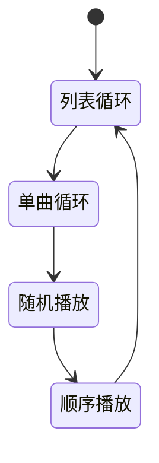
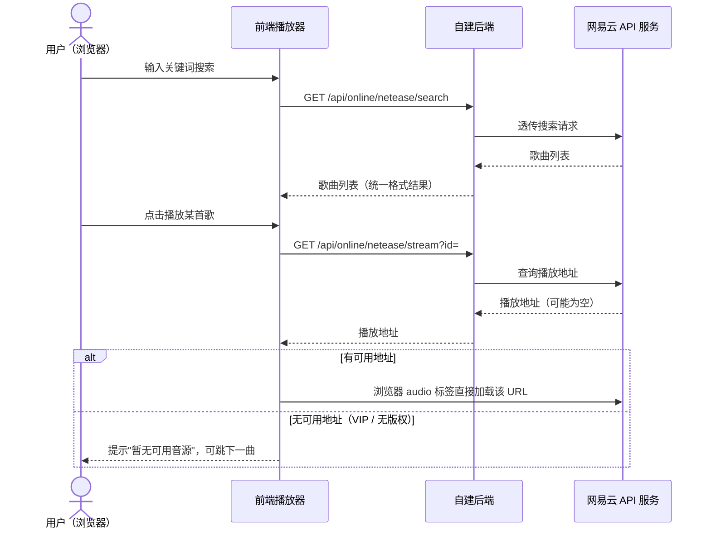
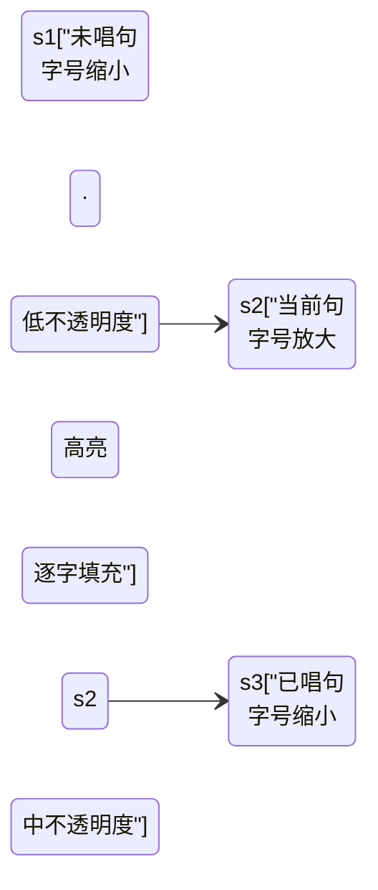
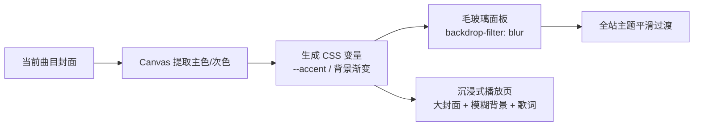
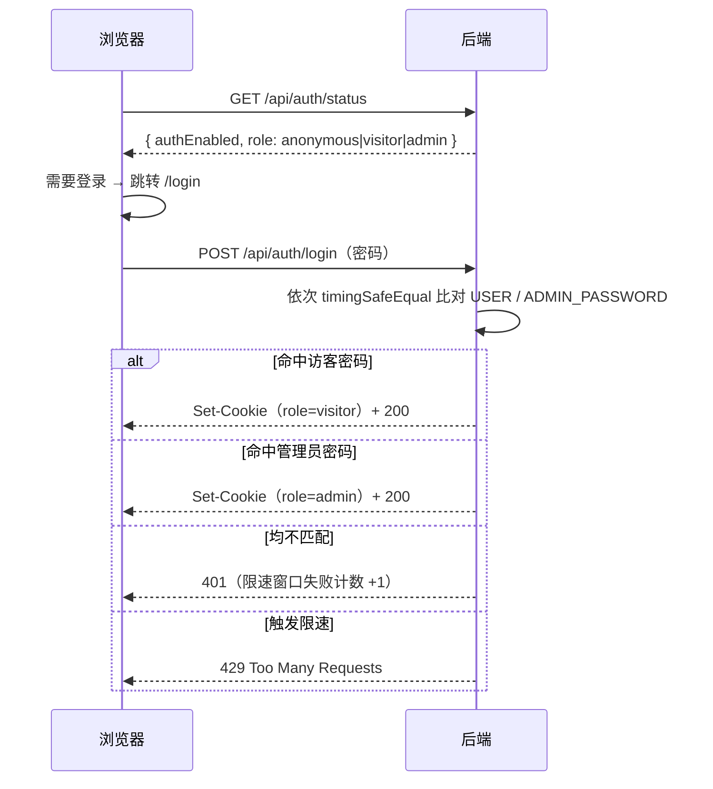
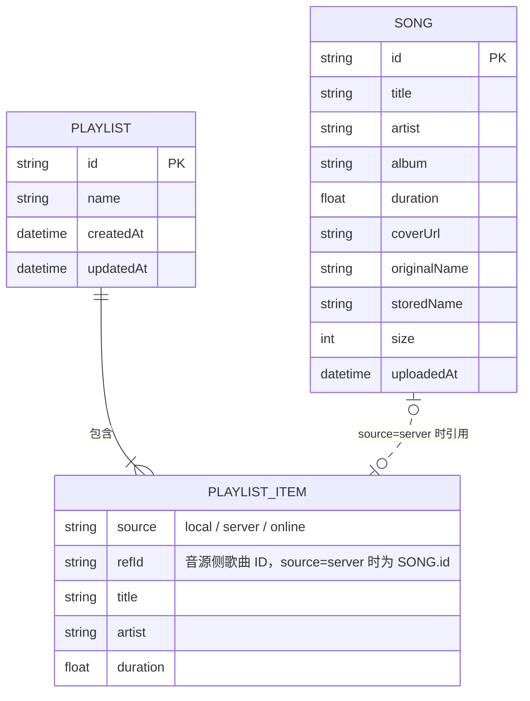

# 音乐软件需求文档（PRD）

| 项目名称 | 轻听音乐（2026-09-28 确认） |
| --- | --- |
| 文档版本 | v4.15（定稿） |
| 编写日期 | 2026-09-28（v2.6 起 2026-09-29） |
| 目标平台 | Web 网页应用（浏览器访问，响应式适配桌面优先） |
| 文档状态 | 已定稿 |

---

## 目录

- 1. 项目概述
- 2. 用户故事与核心场景
- 3. 功能需求：3.1 模块总览 / 3.2 播放器核心 / 3.3 本地播放 / 3.4 云端音乐库 / 3.5 在线音源 / 3.6 歌单 / 3.7 歌词 / 3.8 界面 / 3.9 视觉与动效 / 3.10 多端适配 / 3.11 访问控制 / 3.12 管理台
- 4. 非功能需求：性能 / 兼容性 / 安全 / 可靠性 / 部署
- 5. 技术方案：选型 / API 草案 / 数据模型 / 工程结构 / 环境变量汇总 / 技术规范
- 6. 里程碑规划（M1 / M2 / M3 / 远期）
- 7. 埋点与度量
- 8. 风险与约束
- 9. 术语表
- 10. 决策记录
- 11. 测试与验收计划
- 12. 部署手册大纲
- 修订记录

---

## 1. 项目概述

### 1.1 产品定位

一款**可私有部署的 Web 音乐播放器**：既能播放用户电脑里的本地音乐文件，也能通过自建服务器建立个人云端音乐库（上传、流式播放），并支持接入第三方在线音源（网易云音乐等）进行搜索和试听。

产品形态为"**本地 + 自有云端 + 在线聚合**"三合一的个人音乐中心，数据由用户自己掌控。

### 1.2 产品目标

1. **一处集中听歌**：本地文件、自建服务器音乐、在线音源在同一个界面内无缝切换播放。
2. **私有云音乐库**：用户部署自己的服务器，上传音乐后可在任意设备（电脑、手机浏览器）访问播放。
3. **够用且好用的播放体验**：覆盖主流播放器的基础体验（进度拖拽、播放模式、音量、封面、歌词）。
4. **架构可扩展**：在线音源以"适配器"方式接入，后续可扩展更多音源而无需改动播放器核心。

### 1.3 目标用户

- 本人（开发者本人）及小范围朋友使用；不面向公众提供服务。
- 用户特征：拥有一定量本地音乐文件（MP3/FLAC 等）；具备基本的服务器部署能力；在多设备（PC、手机）上听歌。

### 1.4 不做的事（Scope 边界）

- 不做面向公众的流媒体服务，不提供音乐分发。
- 不内置任何第三方音源的破解/去版权功能；在线音源仅做搜索与播放代理，仅供个人学习研究。
- 首期不做移动端原生 App（用移动端浏览器访问 Web 即可）。
- 不做多用户体系与社交功能（评论、分享、关注等）；权限仅"未登录 / 访客 / 管理员"三档（见 3.11）。

---

## 2. 用户故事与核心场景

### 2.1 核心用户故事

| 编号 | 用户故事 | 优先级 |
| --- | --- | --- |
| US-01 | 作为用户，我想把电脑里的音乐文件拖进网页直接播放，这样不用安装任何软件。 | P0 |
| US-02 | 作为用户，我想把音乐上传到自己的服务器，这样在其他设备上也能听。 | P0 |
| US-03 | 作为用户，我想在播放器里控制播放/暂停、切歌、拖进度、调音量，获得基础听歌体验。 | P0 |
| US-04 | 作为用户，我想看到歌曲的标题、歌手、专辑、封面、时长，而不是一串文件名。 | P0 |
| US-05 | 作为用户，我想搜索并播放在线音源（网易云）的歌曲，补充我没有的曲目。 | P1 |
| US-06 | 作为用户，我想创建歌单并把不同来源的歌曲收录进同一个歌单。 | P1 |
| US-07 | 作为用户，我想边听歌边看滚动歌词。 | P2 |
| US-08 | 作为用户，我想在手机浏览器里也能正常使用。 | P1 |
| US-09 | 作为部署者，我希望未登录的访问者只能播放本地文件；访客密码使用者可听云端曲库与在线音源；上传/删除等管理功能仅管理员密码解锁。 | P0 |
| US-10 | 作为管理员，我想要一个集中管理台页面：上传歌曲、管理曲库（搜索/删除/批量删除）、查看存储统计。 | P0 |

### 2.2 典型场景

**场景 A：本地听歌（无需服务器）**
用户打开网页 → 拖入 20 个本地 MP3 → 生成临时播放列表 → 点击播放、切歌、随机播放 → 关闭页面即结束，文件不上传、不留存。

**场景 B：云端音乐库（需要服务器）**
管理员在 PC 上打开"管理台"（3.12）→ 拖入文件夹批量上传（显示进度条）→ 服务器自动解析出标题/歌手/封面 → 用户在手机浏览器打开同一地址并以访客身份登录 → 在线流畅播放，拖动进度条即时响应。

**场景 C：在线补充听歌**
用户在"在线搜索"页输入关键词 → 调用网易云 API 返回结果列表 → 点击播放；遇到 VIP/无版权歌曲时给出明确提示并自动跳过或提示换源。

**场景 D：混合播放**
用户把 5 首本地歌 + 3 首服务器歌 + 2 首在线歌加进同一个歌单，连续播放时无感知切换来源。

---

## 3. 功能需求

优先级定义：

- **P0**：MVP 必须，第一版就要可用。
- **P1**：第一版发布后尽快补充。
- **P2**：远期规划，视情况排期。

### 3.1 模块总览

> 系统架构图（正式版）：`docs/design/系统架构图.drawio`（drawio 绘制，draw.io 打开可编辑，可导出 PNG 嵌入本文档）。

**关键设计概念——统一曲目（Track）抽象**：播放器核心只面向统一的 `Track` 对象播放，每个 Track 标记来源 `source: local | server | online`。本地文件对应浏览器 Blob URL，服务器文件对应后端流地址，在线歌曲对应第三方音频 URL。三种来源对播放器透明，这是"混合播放"（场景 D）得以实现的基础。

### 3.2 播放器核心（P0）

| 编号 | 需求 | 说明 | 优先级 |
| --- | --- | --- | --- |
| PL-01 | 播放/暂停 | 点击按钮或空格键切换 | P0 |
| PL-02 | 上一首/下一首 | "上一首"规则：当前播放超过 3 秒则回到本曲开头，否则切上一曲 | P0 |
| PL-03 | 进度条 | 显示当前进度/总时长；支持点击和拖拽跳转（seek） | P0 |
| PL-04 | 音量 | 滑杆调节 + 静音按钮，记忆上次音量 | P0 |
| PL-05 | 播放模式 | 顺序播放 / 列表循环 / 单曲循环 / 随机播放，四种模式循环切换 | P0 |
| PL-06 | 播放队列 | 当前播放队列列表：显示正在播放标识、可移除单曲、可清空 | P1 |
| PL-07 | 播放状态持久化 | 刷新页面后恢复上次播放的曲目与进度（localStorage） | P1 |
| PL-08 | 快捷键 | 空格播放/暂停、左右方向键快进快退 5 秒、上下方向键调音量 | P2 |
| PL-09 | 异常处理 | 音源加载失败时给出提示并自动跳下一曲 | P0 |
| PL-10 | 睡眠定时器 | 定时停止播放（15/30/60 分钟或播完当前列表），到点音量淡出后停止 | P2 |
| PL-11 | 淡入淡出 | 切歌/暂停/定时停止时的音量平滑过渡，可开关 | P2 |
| PL-12 | 倍速播放 | 0.5~2.0x 变速（有声书/播客场景），倍速随会话记忆 | P2 |
| PL-13 | 均衡器与音效 | 10 段图形 EQ（31Hz~16kHz，Web Audio BiquadFilterNode 链）+ 整体增益；预设（平直/流行/摇滚/爵士/古典）+ 自定义曲线保存；A/B 对比开关（关闭时音频直通）；增益过大时限幅防爆音；设置按浏览器本地存储（每设备独立）；界面位于设置页"音效" Tab | P1 |

**播放模式切换关系（PL-05）**：



**验收标准**：
- 切歌到出声延迟 ≤ 1 秒（网络正常时）。
- 进度拖拽后 0.5 秒内从新位置继续播放（依赖服务端 Range 支持）。
- 播放到列表末尾时，各播放模式行为符合定义。

### 3.3 本地音乐播放模块（P0）

| 编号 | 需求 | 说明 | 优先级 |
| --- | --- | --- | --- |
| LC-01 | 文件添加 | 点击按钮选择 或 拖拽文件/文件夹到页面；支持多选 | P0 |
| LC-02 | 格式支持 | MP3、FLAC、WAV、OGG、M4A/AAC、OPUS；非音频文件自动过滤并提示 | P0 |
| LC-03 | 信息解析 | 无元数据时按文件名解析"歌手 - 歌名"格式 | P0 |
| LC-04 | 元数据读取 | 前端解析 ID3/Vorbis 等标签，显示内嵌标题/歌手/封面 | P1 |
| LC-05 | 临时列表 | 添加后进入本地临时列表，可整体播放、单曲播放、清空 | P0 |
| LC-06 | 隐私约束 | 本地文件仅用浏览器 Blob URL 播放，**不经服务器、不上传** | P0 |
| LC-07 | 快捷转存 | 本地列表提供"上传到音乐库"入口，跳转管理台并带入所选文件（与 3.4/3.12 打通）；仅管理员身份可见 | P1 |

**验收标准**：拖入含 50 个文件（其中混有非音频）的文件夹时，仅音频进入列表，且界面无卡顿（解析异步进行）。

### 3.4 云端音乐库模块（P0，需服务器）

| 编号 | 需求 | 说明 | 优先级 |
| --- | --- | --- | --- |
| LB-01 | 上传 | 单个/批量/拖拽上传；显示每文件实时进度与总进度；支持同时上传多个 | P0 |
| LB-02 | 上传校验 | 按扩展名白名单校验；单文件大小上限默认 300MB（可配置）；重复文件（同文件名+同大小）提示跳过或覆盖 | P0 |
| LB-03 | 元数据解析 | 服务端解析音频标签：标题、歌手、专辑、时长、内嵌封面图；解析失败时回退用文件名 | P0 |
| LB-04 | 音乐列表 | 展示封面、标题、歌手、专辑、时长、大小、上传时间；支持按标题/歌手/上传时间排序 | P0 |
| LB-05 | 删除 | 单曲删除（需二次确认）；同步删除音频文件与封面文件；界面入口在管理台（3.12） | P0 |
| LB-06 | 流式播放 | 后端按 HTTP Range 响应音频流，支持边下边播、任意位置 seek | P0 |
| LB-07 | 搜索过滤 | 在音乐库内按关键词实时过滤（标题/歌手/专辑） | P1 |
| LB-08 | 分页/虚拟滚动 | 曲目超过 500 条时保证列表流畅 | P2 |
| LB-09 | 批量操作 | 批量删除、批量加入歌单 | P2 |
| LB-10 | 存储统计 | 曲目总数、总占用空间；由管理台实现，见 3.12 AD-03 | P1 |
| LB-11 | 索引重建 | "扫描 uploads 目录重建曲库索引"：重新解析元数据、重建 songs.json，用于索引损坏/误删后的容灾恢复；入口在管理台（AD-05） | P1 |
| LB-12 | 断点续传上传 | 大文件上传中断后从已传分片继续，避免整文件重传（分片上传） | P2 |

> 注：上传/删除/统计等管理操作的界面入口统一在管理台（3.12）；音乐库页面对所有登录用户为纯浏览视图。

**验收标准**：
- 上传 50MB 文件过程中页面可正常操作，失败文件有明确错误提示且不影响其他文件。
- 播放服务器曲目时拖动进度条到未缓冲位置，0.5 秒内从该位置继续播放。
- 删除歌曲后，列表、存储文件、封面均被清除。

### 3.5 在线音源接入模块（P1）

| 编号 | 需求 | 说明 | 优先级 |
| --- | --- | --- | --- |
| ON-01 | 音源适配层 | 定义统一 Provider 接口（search / getStreamUrl / getLyrics），播放器与前端页面不感知具体音源；多源架构参考 Folia（folia-major）的设计思路 | P0（架构） |
| ON-02 | 网易云搜索 | 接入自部署的 NeteaseCloudMusicApi（或增强分支 NeteaseCloudMusicApiEnhanced）：关键词搜索，返回标题/歌手/专辑/时长 | P1 |
| ON-03 | 网易云播放 | 获取歌曲播放地址并加入播放；对 VIP/无版权歌曲（无可用地址）给出明确提示 | P1 |
| ON-04 | 配置开关 | 后端通过环境变量配置第三方 API 地址；未配置时前端隐藏/置灰在线功能并显示配置指引 | P1 |
| ON-05 | 歌词获取 | 通过音源接口获取歌词（含逐字格式 yrc），进入歌词模块 | P1（配合 3.7 歌词 P1） |
| ON-06 | QQ 音乐接入 | 参考 yakult-green-tea/qq-music-api（Folia 同款方案）：需微信扫码登录后播放，作为独立适配器接入 | P2 |
| ON-07 | 多音源聚合搜索 | 一次搜索同时查询多个音源并合并结果 | P2 |
| ON-08 | 酷狗音乐接入 | 参考 MakcRe/KuGouMusicApi，作为独立适配器接入 | P2 |
| ON-09 | 歌词/封面多源回退匹配 | 歌词与封面按"网易云 → QQ → 酷狗"顺序自动回退匹配，失败支持手动修正（参考 Folia） | P2 |

> 注：Folia（folia-major）为 AGPL-3.0 协议。本项目只借鉴其交互设计与接入思路、代码自行实现，不复制其源码；若未来直接引用其代码，本项目须同样以 AGPL-3.0 开源（见 9. 风险）。

**验收标准**：未配置网易云 API 时，其余功能不受任何影响；配置后无需改前端代码，重启后端即生效。

**在线播放核心流程（ON-02 / ON-03）**：



### 3.6 歌单管理模块（P1）

| 编号 | 需求 | 说明 | 优先级 |
| --- | --- | --- | --- |
| PS-01 | 创建/重命名/删除歌单 | 歌单存储在服务器端 | P1 |
| PS-02 | 添加曲目 | 支持把任意来源（本地/云端/在线）的曲目加入歌单 | P1 |
| PS-03 | 播放歌单 | 整单播放、从某曲开始播放 | P1 |
| PS-04 | 曲目排序/移除 | 歌单内拖拽排序、移除单曲 | P2 |
| PS-05 | 收藏/最近播放 | 一键收藏单曲；自动记录最近播放 100 条 | P2 |
| PS-06 | 歌单导出 | 将歌单导出为文件（M3U8/JSON，格式开发时定） | P2 |

> 交互形态（2026-09-29 原型确认）：歌单以**侧栏分区**呈现（"歌 单"标题 + "＋"新建，列表项含曲目数徽标）；点击歌单在内容区打开**详情页**——头部（渐变封面/名称/曲目数/总时长）+ 操作（播放全部/重命名/导出/删除）+ 编号曲目列表；原"卡片网格"方案废弃。高保真原型见 `docs/design/mockup/`。

**说明**：本地文件加入歌单时，仅记录文件名等元信息作为"占位引用"——该文件在其他设备上不存在时，显示为灰色"本地缺失"状态，跳过播放。在线曲目入歌单时保存其音源与歌曲 ID。

### 3.7 歌词模块（P1，经 3.9 VS-03 确认提前）

**动效基准：Apple Music 歌词页**（2026-09-28 确认为歌词动效的唯一主要参考）。Folia 相关内容均为远期参考：其歌词效果在**项目主体完成后**再行评估探索（见里程碑"远期"），当前不进入任何里程碑。歌词行的三种视觉状态：



| 编号 | 需求 | 说明 | 优先级 |
| --- | --- | --- | --- |
| LR-01 | 歌词展示与解析 | P1 范围：LRC（行级时间轴）+ yrc（网易云逐字，支撑卡拉OK填充），无逐字数据时自动退化为行级模式；qrc / krc / ttml / vtt 等其余逐字格式为远期增强，随对应音源接入后再支持 | P1 |
| LR-02 | 歌词来源 | 优先级：音频内嵌歌词 > 在线音源歌词接口（多源回退匹配，见 ON-09） > 用户手动上传 .lrc | P1 |
| LR-03 | 播放页 | 与沉浸式播放页合并实现，见 3.9 VS-03 | P1 |
| LR-04 | Apple Music 风格动效 | 当前句大字号高亮，前后句渐进缩小、降低不透明度，形成景深层次；句间切换用 transform/opacity 平滑过渡（遵守 VS-07 性能约束）；歌词区上下边缘渐隐遮罩 | P1 |
| LR-05 | 逐字卡拉OK填充 | 有逐字时间轴时，当前句内按字/词渐进填充高亮（Apple Music 标志性效果）；仅行级数据时整句渐亮 | P1（无逐字数据时自动降级，不阻塞验收） |
| LR-06 | 点击行跳转 | 点击任意歌词行 seek 到该句时间点；播放中当前句自动滚动居中 | P1 |
| LR-07 | 滚动交互 | 用户手动滚动歌词时暂停自动居中，数秒无操作后恢复，并提供"回到当前句"按钮 | P2 |

> 动效参考开源库 **AMLL**（Steve-xmh/applemusic-like-lyrics，MIT）：提供 `@applemusic-like-lyrics/core`（DOM 原生）与 Vue 绑定、YRC/QRC/TTML 逐词歌词解析模块，另有社区逐词歌词数据库；完整效果需 Chromium 120+（`mix-blend-mode: plus-lighter`）。正式实现可直接接入其 Core/Vue 包，或按其效果自行实现。原型已在 mockup 中以原生 CSS/JS 模拟其三大标志效果（非当前句模糊 / 弹簧滚动 / 逐字发光）并浏览器实测通过。

### 3.8 界面需求（信息结构）

整体布局：左侧导航 + 中间内容区 + 底部常驻播放条。

```
┌──────────┬────────────────────────────────────┐
│ ♫ 轻听音乐 │  [页面标题]  [排序/搜索/操作按钮]     │
│          ├────────────────────────────────────┤
│ ▸ 本地播放 │                                    │
│ ▸ 音乐库   │   内容区                             │
│ ▸ 在线搜索 │   （歌曲列表 / 搜索结果 / 歌单详情）    │
│ ▸ 我的歌单 │                                    │
│   ├ 日常   │                                    │
│   └ 运动   │                                    │
│ ▸ 管理     │  ← 仅管理员身份可见（3.12）           │
├──────────┴────────────────────────────────────┤
│ [封面] 歌名/歌手  │ ⏮ ▶ ⏭ 🔀 🔁 │ 1:23 ────●── 3:45 │ 🔊 │
└────────────────────────────────────────────────┘
```

> 注：图表规范见 5.6.6——线框类图不属于 Mermaid 擅长范围，正式线框已用 drawio 绘制：`docs/design/主界面线框.drawio`（本节）与 `docs/design/管理台线框.drawio`（3.12）；下文 ASCII 仍为快速示意。

界面要求：

- 玻璃拟态风格基调（见 3.9），支持深色/浅色主题切换（VS-08），默认深色。
- 图标统一来自 Iconify + Phosphor 图标集（单一图标集，见 5.1）；图标颜色使用 currentColor，随主题变量与封面取色联动；状态约定：普通态用 regular 粗细，播放中/激活态（如随机播放开启、正在播放入口）用 fill 粗细，对齐 Apple Music 的填充式播放态惯例。
- 歌曲行结构统一：封面缩略图（44px）、标题+歌手、专辑、时长、操作按钮（播放/加入歌单/删除）；行 hover 高亮，正在播放行有动效标识。
- 底部播放条常驻，任何页面都在；含封面、控制按钮组（播放模式 / 上一首 / 播放暂停 / 下一首 / 静音）、进度条、音量。
- **音量交互形态（v4.19 定稿）**：静音键位于控制按钮组末位（与原型的 5 按钮布局一致）；鼠标悬浮或键盘聚焦时在其上方展开**竖向**音量条——玻璃悬浮层材质 + 主题色填充轨道 + 百分比读数，点按钮即静音/取消静音；纯 CSS 控制显隐（含 `:focus-within`），触摸设备上仍可直接点按钮静音。
- 响应式与多端策略见 3.10（断点规范 RT-01 在 M1 确定，手机布局 M2 实施）。
- 侧栏支持**折叠为纯图标窄栏**（约 68px，含状态记忆），原型已实现（2026-09-29）。
- 侧栏底部仅保留"设置"入口与"折叠侧边栏"；主题切换、退出登录、管理控制台入口统一收纳至**设置页**——设置页为**顶部 Tab 形态**（常规 / 账户 / 在线音源 / 快捷键 / 音效 / 管理 / 关于，活跃 Tab 主题色下划线；管理 Tab 仅管理员可见，2026-09-29 确认）。
- 空状态设计：音乐库为空、无搜索结果、在线音源未配置等场景均有引导性文案与操作入口。

### 3.9 视觉风格与动效（已确认，2026-09-28）

**风格基调：玻璃拟态（Glassmorphism）双主题（默认深色）+ 跟随封面动态取色**



| 编号 | 需求 | 说明 | 优先级 |
| --- | --- | --- | --- |
| VS-01 | 玻璃拟态基底 | 封面模糊背景 + 半透明毛玻璃面板（backdrop-filter）+ 半透明描边；列表视图为默认视图；M1 以深色主题实现，且颜色全部走 CSS 变量，为 VS-08 双主题预留 | P0（M1 即按此实现） |
| VS-02 | 封面取色主题 | 从当前曲目封面提取主色/次色，注入 CSS 变量生成主题色与背景渐变，切歌平滑过渡；封面缺失/加载失败时回退固定色板；取色结果按当前主题适配亮度/对比度（浅色主题下使用加深的 accent 变体，保证文字对比度） | P1 |
| VS-03 | 沉浸式播放页 | 点击播放条展开全屏，布局参考用户稿并简化（2026-09-29）：左侧方形封面 + 右侧"标题/歌手 + 滚动歌词列" + 底部居中控制与进度；歌名条/喜欢/评论/HQ/歌词开关/队列/伴唱等周边控件不做；歌词动效按 3.7 的 Apple Music 基准实现（当前句主题色 + 逐字填充） | P1 |
| VS-04 | 封面动效 | 播放中封面缓慢旋转（或呼吸浮动），暂停即停；遵循 prefers-reduced-motion 降级为静态 | P1 |
| VS-05 | 频谱可视化 | Web Audio API（AnalyserNode）实时频谱：播放页大图 + 播放条迷你指示；在线音源受 CORS 限制取不到音频数据时自动隐藏 | P2 |
| VS-06 | 列表+网格混合 | 音乐库/歌单为紧凑列表（行高约 48px），专辑视图为封面卡片网格，视图可切换 | P1 |
| VS-07 | 性能与降级 | backdrop-filter 使用层数克制；模糊背景用低分辨率封面图；不支持的浏览器/低端设备降级为半透明纯色 | P0 |
| VS-08 | 主题切换 | 深色/浅色双主题，全部经 CSS 变量（`data-theme` 属性）驱动；默认跟随系统 `prefers-color-scheme`，用户手动切换后记忆选择（localStorage）；界面提供切换入口（导航/设置）；切换即时生效、无刷新；深色为推荐默认 | P1 |
| VS-09 | 歌词页布局选择 | 沉浸式播放页提供三种布局（2026-09-29 确认，参考 QQ 音乐）：经典双栏（封面左·歌词右）/ 沉浸歌词（纯歌词居中）/ **海报背景（彩胶）**——歌词左，右侧为按封面取色渲染的大黑胶唱片（纹路+胶环，播放时旋转，悬于右上角）；在设置-外观 Tab 以缩略图卡片选择，即时生效并按设备记忆（localStorage）；三种布局均沿用 3.7 歌词动效。**M1 组件化要求（2026-09-30 定稿）**：三布局在 Vue 中实现为三个独立组件（ImLayoutDuo / ImLayoutCenter / ImLayoutPoster），经 `<component :is>` 动态挂载切换；歌词滚动引擎、标题块、播放控制栏抽为共享子组件复用，布局组件只负责各自的版式与专属视觉层（如海报布局独占彩胶装配）。原型 mockup 的单页 CSS 类切换（.layout-duo/-center/-poster）仅是原型手段，且已证明易生层叠逃逸 bug（v3.9），不得照搬进 Vue | P1 |

> 彩胶实现配方（VS-09 海报背景，2026-09-30 定稿：QQ 音乐官方分层素材 + 用户实机验证实现，原型已移植）：**素材四张**（`glow`=background@2x / `base`=hightlight1@2x / `grooves`=hightlight2@2x / `emboss`=shadow@2x，270×270 @2x）。分层组装（自后向前）：**① 外圈光晕** = glow 素材作 `mask`、填主题色 `hsl(--theme-h,--theme-s,62%)`（素材本身浅灰、灰色无意义，有意义的是 alpha 分层——mask 填色才得到跟封面配色走的有机柔光，box-shadow 做不出这种不规则衰减；比盘体大 1.4 倍居中，随盘旋转 + 呼吸）→ **② 盘体装配**（圆形裁剪 `border-radius:50% + overflow:hidden + isolation:isolate`，混合只在盘内生效；整体随盘旋转）内叠三层：主题色 conic 漩涡 `--vinyl-gradient`（同色相只做明度/饱和度漩涡，即彩胶质感）→ emboss 大理石纹理（`mix-blend-mode:overlay` 0.6）→ 封面中心标签（inset 21%，原型用取色渐变，M1 接入真实封面 ``）→ **③ 固定高光** = base+grooves 两张叠同一元素（深反光 α 中位仅 8~9/255，拆开互相看不见，同元素 overlay 混合才凑出完整盘面光泽），**不随盘旋转**（光源固定）；定位三变量 `--vinyl-t/-r/-d` 收敛在 `.im-cover-wrap` 上供三层共用。整体 `rotate` **8s/圈**（45°/s 顺时针，QQ 实机视频实测值）、盘缘内阴影环（白边 1px + 向内 26px 深色晕开，源色 Tone 0.30 派生）增加厚度感、`will-change: transform`、暂停即停在最亮帧、遵循 prefers-reduced-motion。**DOM 结构对齐用户 01-colorfull 实现（2026-09-30 定稿）**：两层结构——外壳 `.vinyl-assembly`（不转、不裁剪：光晕 = `::before` 伪元素 mask+主题色、`inset:-20%` 溢出盘外，边缘环 = `::after`）> 旋转盘 `.v-disc`（转 + overflow:hidden 裁剪）> 盘体/纹理/标签；高光 `.v-gloss` 为外壳子元素。光晕挂外壳伪元素后不再需要独立 div 与三变量坐标共享（`--vinyl-t/-r/-d` 仅定位外壳）。颜色源 `--cover-src/--cover-src-2` 须经 `@property` 注册为 `<color>`，调校用 OKLCH 相对颜色语法在 CSS 派生（见 3.9⑤），换封面整页平滑过渡而非硬切。注意：盘面颜色必须经 CSS 变量注入，禁止 JS 写内联 background（会覆盖全部图层，原型曾踩此坑）。

#### 设计令牌速查（从原型 mockup.css 提取，M1 前端直接迁移）

> 界面样式的唯一事实来源为 `docs/design/mockup/css/mockup.css`（已浏览器实测）；下表为关键令牌与配方的速查。

**① 玻璃拟态材质（.glass 面板，VS-01）**

| 令牌 | 深色 | 浅色 |
| --- | --- | --- |
| --glass-bg | rgba(255,255,255,.055) | rgba(255,255,255,.55) |
| --glass-border | rgba(255,255,255,.12) | rgba(255,255,255,.75) |
| --text-1 / 2 / 3 | 白 .92 / .60 / .36 | 深蓝黑 .92 / .62 / .40 |
| 毛玻璃 | backdrop-filter: blur(28px) saturate(1.5)（两主题同） | 同左 |
| 投影 | 0 8px 32px rgba(0,0,0,.35) | 0 8px 32px rgba(30,40,80,.12) |

> **岛内卡片（v4.16）**：放在 `.glass` 岛（侧栏/内容区/控制台主区）**里面**的卡片不再叠 backdrop-filter，改用更实的底色（深 `rgba(255,255,255,.1)` / 浅 `rgba(255,255,255,.8)`）+ 描边与岛面区分（前端类名 `.card`）。原因：VS-07 要求模糊层数克制，且玻璃叠玻璃会互相稀释成一片灰糊。深色文字不透明度亦由 .92/.60/.36 上调为 .94/.64/.46（实机偏暗，可读性优先于原型数值）。

**② Island 布局参数**

- 应用外壳网格：侧栏 224px（折叠 68px）+ 内容 1fr；行 = 1fr + 播放条 84px；岛间距与页边 14px；面板圆角 18px（v4.17 自 12/16 微调）
- 圆角体系：面板 18 / 行与卡片 12 / 按钮与输入框 10 / 封面缩略图 9（v4.17）
- 文字三级：--text-1 主文本 / --text-2 次级 / --text-3 弱化；深色实取值 .94/.64/.46，浅色 .94/.66/.48（可读性优先，v4.16 上调）
- 浅色主题专属：底色 #f1f2f5；岛面不透明度 .66（深色 .055，浅色底平、需更实）；描边用淡灰蓝细线 rgba(30,40,80,.09)；背景光晕按主题降为 accent 9%/6%（深色 26%/20% 会把浅色整页染紫，v4.17）
- 歌词页内容组：fit-content + 水平垂直居中，组内封面列 / 歌词列 / 间距均按 vh/vw 相对缩放（clamp 限幅）

**③ 动效参数**

| 动效 | 参数 |
| --- | --- |
| 彩胶旋转 | 8s linear/圈（45°/s 顺时针，2026-09-30 对照 QQ 实机视频实测修正，旧值 32s 差 4 倍）；播放 running / 暂停 paused；reduced-motion 静止 |
| 光晕呼吸 | 3.4s ease-in-out；opacity 1↔0.72；随盘旋转（素材形状不规则，转起来才可见）；**暂停时一起停，停在最亮帧** |
| 歌词弹簧滚动 | 0.9s cubic-bezier(0.22, 1, 0.36, 1)；行过渡 opacity/transform/filter 0.45s |
| 非当前句模糊 | 未唱 blur 2.2px / 已唱 1.1px / 当前 0（AMLL 标志效果） |
| 逐字发光 | 已唱字符 text-shadow 0 0 18px accent-soft |
| 面板/行反馈 | background 0.15s；主题切换 background 0.5s 无刷新 |
| 页面/弹层过渡 | iOS 曲线 cubic-bezier(0.32,0.72,0,1)：页面切换 fade+上移 0.32s、队列弹层 scale+fade 0.3s（右下原点）、沉浸页 fade+scale 0.36s；登录页 fade 0.4s；reduced-motion 全部静止 |
| View Transition 增强 | API 可用时（Chromium 111+/Safari 18+）接管页面切换与沉浸页开合（交叉淡化 0.28s）；封面共享元素形变：播放条小图 ⇆ 沉浸页大图（`view-transition-name: cover`，0.42s iOS 曲线）；不可用/降级时自动回退 CSS 入场动画，功能无损 |

**④ 图层顺序（海报/彩胶布局，自后向前）**

官方素材 mask 光晕（主题色填充，1.4 倍盘径，随盘旋转+呼吸）→ 彩胶圆形装配（conic 漩涡+大理石纹理+封面标签，圆形裁剪+isolate）→ 固定光源高光层（不随盘转）→ 全页渐变遮罩（保证歌词可读）→ 歌词列（z-1）→ 顶栏与底部控制（z-2）

**⑤ 取色注入（VS-02）**

切歌时由 JS 将颜色源写入 `--cover-src / --cover-src-2` 两个原始色变量（预设调色板的 c1/c2，或封面提取的桶平均色 hex），另写 `--accent / --accent-soft / --glow1 / --glow2` 四个展示变量；**一切调校在 CSS 完成**——`--cv1 / --cv2 / --cover-deep / --vinyl-gradient` 与光晕填充全部用 **OKLCH 相对颜色语法**从颜色源派生（Monet/HCT 思路的 CSS 原生实现，Chrome 119+/Safari 16.4+）：`oklch(from var(--cover-src) clamp(0.4, l, 0.62) clamp(0.07, c, 0.15) h)`。**为什么是 OKLCH**：L（Tone）感知均匀——clamp 即统一所有封面盘面深度，绿黄不再过曝（HSL 需要 Rec.601 色相偏置表补偿的问题在此不存在）；C（Chroma）钳制 0.07~0.15 防过艳也防过灰（晨雾这类刻意低饱和配色不被强行提艳，这是 HSL 方案的已证缺陷）。光晕 = Tone 0.52~0.68 派生；标签描边环 = `--cover-deep`（Tone 0.30）+ color-mix 透明度。**降级**：每个派生都先写一条无 OKLCH 的声明（`var(--cover-src)` 原色 / color-mix），不支持相对色语法的浏览器自动保留降级值，功能无损仅失去统一深度。`--cover-src/2` 经 @property 注册为 `<color>`，换歌整页平滑过渡。两个颜色源变量严禁 JS 写内联 background（会覆盖多层图层，原型曾踩此坑）。背景光晕、彩胶盘体、外圈光晕、主题色、逐字发光全部联动；**严禁 JS 写内联 background**（重复强调，原型曾踩此坑）。

> **真实取色管线（VS-02 完整实现，原型已落地）**：带真实封面的歌，播放时 `loadThemes(cover)` 异步提取——封面缩 64×64、按色相分 24 桶加权（权重 = 饱和度 × 明度居中度，丢灰白黑与 l<0.1/l>0.95 像素），最高权重桶即主题色相，色相差 ≥0.11 的前 4 个候选留作备选，**原始桶平均色**交 CSS 调校后覆盖预设色源；预设调色板即时兜底（提取失败/画布污染自动保留），切歌竞态用 playingId 比对丢弃过期结果，提取结果按图片地址缓存。中心标签接真实封面 ``（无封面歌回落取色渐变）。**样张实测**（蓝帽人像，caijiao cover.jpg）：候选 = 201° 天蓝（胜，即画面主体蓝帽）/ 6° 肤色暖调 / 49° 黄 / 308° 品红，OKLCH 调校后盘面深青蓝、深度与 QQ 实机持平且深浅两主题无过曝。历史决策记录：QQ 式压深（提饱和+压明度）与 HSL 手调（偏置表+区间收束）均经用户对比后淘汰，OKLCH 方案由用户在对比实验室页（docs/design/mockup/hct-test.html）定稿。注意 file:// 下画布会被污染，真实管线必须走 http。

### 3.10 多端适配（已确认，2026-09-28）

**结论**：手机适配在 M2 实施，目标为原生级体验；M1 仅保证移动端不白屏。平板不做单独布局。支持 PWA。

| 编号 | 需求 | 说明 | 优先级 |
| --- | --- | --- | --- |
| RT-01 | 断点规范 | ≥1280px 桌面完整布局；768~1280px 平板沿用桌面布局；<768px 手机布局 | P0（M1 定规范并按桌面实现） |
| RT-02 | 手机布局 | <768px：导航收起为底部标签栏或抽屉；播放条简化为迷你条，点击展开沉浸式播放页；列表单列 | P1 |
| RT-03 | 听歌完整 | 手机端覆盖浏览/搜索/播放/切歌/歌词；上传、删除、歌单管理等管理操作以桌面为主（手机端隐藏或只读） | P1 |
| RT-04 | 锁屏/通知栏控制 | 集成 Media Session API：锁屏与通知栏显示封面/歌名/歌手，支持播放/暂停/上一首/下一首 | P1 |
| RT-05 | 手势操作 | 沉浸式播放页左右滑动切换上/下一曲、下滑收起；列表侧滑操作为 P2 可选 | P1 |
| RT-06 | 横竖屏 | 手机横屏时播放页自适应布局 | P2 |
| RT-07 | PWA 支持 | vite-plugin-pwa：manifest（名称/图标/主题色）+ Service Worker 缓存应用外壳与静态资源（音频不缓存）；可添加到主屏幕全屏运行 | P1 |
| RT-08 | 移动端底线 | M1 期间移动端访问不白屏、布局不崩；无法正常使用时给出"请使用电脑访问"提示 | P0 |

### 3.11 访问控制（已确认，2026-09-28）

**访问模型（三档）**：未登录 = 仅本地播放；访客密码（USER_PASSWORD）= 听云端曲库/歌单/在线音源；管理员密码（ADMIN_PASSWORD）= 额外解锁管理台（上传/删除/统计）。

| 编号 | 需求 | 说明 | 优先级 |
| --- | --- | --- | --- |
| AC-01 | 未登录（匿名）模式 | 未登录时仅可使用本地播放模块（3.3，纯浏览器、不经服务器）；服务器功能不可用，界面展示"登录后解锁"引导 | P0 |
| AC-02 | 登录（密码即角色） | 登录页输入密码，前端提交 POST /api/auth/login；后端以 crypto.timingSafeEqual 依次与 USER_PASSWORD、ADMIN_PASSWORD 比对，命中即获得对应角色（visitor / admin），Set-Cookie 颁发含角色的签名 Cookie，之后免输 | P0 |
| AC-03 | 接口分级保护 | 接口分两级：访客级（音乐库列表/音频流/歌单/在线音源搜索播放）要求 visitor 及以上；管理级（上传/删除/统计）要求 admin。鉴权中间件统一校验：未登录 401、角色不足 403 | P0 |
| AC-04 | 登出 | 提供登出入口（POST /api/auth/logout），清除凭证回到未登录状态 | P1 |
| AC-05 | 密码配置 | 两档密码均为环境变量。组合规则：两把都未配置 → 门禁关闭、全功能开放（本机场景）；仅配置 ADMIN_PASSWORD → 无访客档，登录页仅管理员入口；仅配置 USER_PASSWORD → 访客可听，管理功能对所有人关闭；两把都配置 → 完整三档 | P0 |
| AC-06 | 登录防爆破 | /api/auth/login 失败限速（express-rate-limit）：默认 15 分钟窗口内最多 10 次失败，超限返回 429 并提示稍后再试 | P0 |
| AC-07 | 登录页 | 独立 /login 路由：玻璃拟态登录卡片（居中 + 封面模糊背景，风格同 3.9）；单密码输入框（后端自动识别角色）；提供"先听听本地歌"未登录入口；登录成功跳回来源页；门禁关闭的环境直接跳过登录页 | P0 |
| AC-08 | 角色凭证 | 角色写入签名 Cookie 载荷（签发时间戳 + 角色 + HMAC），无状态校验；已知限制：修改密码后旧凭证在有效期内仍可用，需要强制全员下线时轮换 AUTH_SECRET | P0 |

**技术实现（已确认，2026-09-28）**：



- **凭证方案：签名 Cookie**（cookie-parser + HMAC 签名）。载荷为"签发时间戳 + 角色"，无状态、无服务端存储；属性 httpOnly + sameSite=Lax，HTTPS 部署时启用 secure；有效期默认 30 天，环境变量 AUTH_TTL 可配。登出即清除 Cookie。
- **签名密钥**：环境变量 AUTH_SECRET；未配置时服务首次启动自动生成随机密钥并持久化到 data 目录（重启后会话不失效）。
- **不引入**：密码哈希库（明文比对 + timingSafeEqual 已足够）、JWT、session 存储、鉴权框架。

**认证 API 草案**：

| 方法 | 路径 | 说明 |
| --- | --- | --- |
| GET | `/api/auth/status` | 返回 `{ authEnabled, role }`（anonymous / visitor / admin），前端据此决定进入未登录模式、登录页还是管理台 |
| POST | `/api/auth/login` | 密码与两把密码依次比对，返回角色并 Set-Cookie；受 AC-06 限速保护 |
| POST | `/api/auth/logout` | 清除凭证 Cookie |

说明：两把密码均为部署者单密码，不做注册、多用户体系、找回密码（私有部署定位）；每个设备各自登录一次。访客/管理员已是本产品最大权限粒度，更细粒度权限列为远期评估。

### 3.12 管理控制台（已确认，2026-09-29 改版）

**独立系统形态**（2026-09-29 确认，参照商品后台模式）：管理功能不内嵌于播放器，而是独立的控制台页面（`/admin` 独立布局）——自己的侧栏导航（概览 / 曲库管理 / 上传导入）与页面结构，从播放器侧栏"管理台"入口进入，"返回播放器"退出；仅 admin 角色可进入（AD-04）。

| 编号 | 需求 | 说明 | 优先级 |
| --- | --- | --- | --- |
| AD-01 | 上传导入 | 独立分区页：拖拽/多选上传，单文件与总进度实时显示；重复文件（同名同大小）提示跳过/覆盖；失败逐文件提示不影响批次（即 LB-01/02 的界面呈现） | P0 |
| AD-02 | 曲库管理 | 独立分区页：搜索过滤、按标题/歌手/大小/上传时间排序、单曲删除（二次确认）、复选框批量删除（二次确认并显示条数） | P0 |
| AD-03 | 概览统计 | 存储统计（曲目总数/占用空间，LB-10）与上传统计；更多图表（最常播放/来源占比）随 M2 交付 | P1 |
| AD-04 | 访问控制 | /admin 仅 admin 角色可进入，visitor/未登录访问时重定向登录页；播放器导航入口仅管理员可见 | P0 |
| AD-05 | 索引重建入口 | "重建索引"按钮（实现 LB-11）：执行时显示扫描/解析进度，完成后刷新列表并提示结果 | P1 |

说明：音乐库页（3.4）面向所有登录用户为纯浏览视图；上传/删除等管理操作全部在控制台。歌曲元数据编辑（改歌名/封面等）不在本期范围，远期评估。

---

## 4. 非功能需求

### 4.1 性能

| 指标 | 要求 |
| --- | --- |
| 首屏加载（生产构建） | ≤ 2 秒（常规网络） |
| 切歌响应 | ≤ 1 秒出声 |
| seek 响应 | ≤ 0.5 秒 |
| 音乐列表（1000 条） | 滚动流畅，无感知卡顿（必要时虚拟滚动） |
| 并发 | 私有部署，满足 1~5 人同时在线播放即可 |

### 4.2 兼容性

- 浏览器：Chrome、Edge、Firefox、Safari 最新版及前一主版本。
- 玻璃拟态依赖 backdrop-filter（Safari 需 -webkit- 前缀），不支持的环境按 VS-07 降级为半透明纯色，不影响功能。
- 音频格式在 Safari 上与 Chrome 存在差异（如 FLAC/OPUS），按浏览器能力降级提示，不白屏；服务端按需转码为远期评估项（见 8 / 里程碑"远期"）。
- 移动端浏览器（iOS Safari、Android Chrome）可用（P1）。
- iOS 音频策略：首次播放必须由用户手势触发（自动播放受限）；后台/锁屏播放依赖 Media Session（RT-04），移动端实现时真机逐项验证。

### 4.3 安全

- 上传仅允许音频扩展名白名单；服务端存储文件名使用随机名，杜绝路径穿越。
- 删除/上传接口做基础校验；访问控制按 3.11 实现（未登录仅本地播放，访客密码听云端，管理员密码解锁管理台；接口分级校验，未登录 401、角色不足 403）；反向代理鉴权（Nginx BasicAuth 等）可作为额外加固。
- 敏感配置（第三方 API 地址等）走环境变量，不硬编码。
- 公网部署必须启用 HTTPS（音频接口经 HTTPS 混合内容限制）。

### 4.4 可靠性与容错

- 上传失败（网络/超限/格式）逐文件提示，不中断批次中其他文件。
- 在线音源请求失败时明确提示"音源服务不可用"，并给出配置指引。
- 后端数据（曲目索引、歌单）以文件形式落盘，服务重启不丢失。

### 4.5 部署

- 提供 `npm install && npm run dev` 的本地开发方式。
- 提供生产部署方式：前端构建产物由后端静态托管，单进程即可对外服务；支持 Docker 部署（P1 提供 Dockerfile）。
- 端口、存储路径、第三方音源地址等均可通过环境变量配置。

---

## 5. 技术方案（选型已确认）

### 5.1 技术选型

> 以下选型已与需求方确认（2026-09-28），作为开发约束执行。

| 层 | 选型 | 说明 |
| --- | --- | --- |
| 前端框架 | Vue 3 + Vite | 组合式 API + `<script setup>` 语法 |
| 开发语言 | TypeScript（前后端） | 数据模型即类型定义，见下方"类型共享" |
| 状态管理 | Pinia | 播放器状态（当前曲目/队列/播放模式/音量）做成全局单例 store |
| 路由 | Vue Router | 对应左侧导航的四个页面 |
| UI 样式 | 手写 CSS + CSS 变量；**Reka UI（原 Radix Vue，unovue/reka-ui）提供行为层** | 玻璃拟态风格（VS-01）：毛玻璃面板/模糊背景全定制，**不引入带样式的组件库**；主题色由封面取色动态注入（VS-02）；深色/浅色双主题经 data-theme 切换（VS-08）。组件策略（2026-09-30 定稿，同日由 Headless UI 改选）：无障碍交互复杂件用 Reka UI 无样式行为层——其 data-attribute 样式模型（data-state 等）与纯 CSS 令牌方案天然契合；分工：DropdownMenu/ContextMenu（歌曲「…」与右键菜单，含子菜单/勾选项）、Tooltip、Toast、Dialog（元信息弹窗 focus trap）、Select（EQ 预设）、Switch（A/B 开关）等 ~50 原语覆盖 Headless UI 缺席的件；简单件（Button/Input/滑杆/复选框）直接手写 CSS（原型已验证：滑杆自绘 + 自定义复选框 + selection/focus-visible 令牌化，v4.11~v4.12）；禁止 UI 库自带皮肤破功；**迁移规则（2026-09-30，用户定稿）**：参考 shadcn-vue 系实现时只翻译结构与行为（组件组合、Reka API、collapse/tooltip 门控），**丢弃其 Tailwind utility 类**，样式一律翻成自有语义类 + 令牌（参照原型 sb-/nav- 命名）——视觉语言必须保持 mockup.css 单一事实来源，不做 utility-first |
| 图标 | Iconify（unplugin-icons 构建期打包）+ Phosphor 图标集（前缀 ph） | 聚合 200+ 开源图标集按需引入；构建期本地化、不依赖运行时图标 API，符合 PWA 离线要求（RT-07）；全站锁定单一图标集。Phosphor：圆角端点 + 6 种粗细（thin/light/regular/bold/fill/duotone），公认最接近 Apple SF Symbols 的开源图标库，9000+ 图标 MIT；fill 变体用作播放/激活态（对齐 Apple Music 惯例） |
| 封面取色 | Canvas 自实现（备选 node-vibrant） | 从封面提取主色/次色，生成 --accent 等主题变量 |
| 频谱可视化 / 均衡器 | Web Audio API（AnalyserNode + BiquadFilterNode 链） | 同一 AudioContext 图：频谱（VS-05）与 10 段 EQ（PL-13）共用，零框架依赖 |
| PWA | vite-plugin-pwa | manifest + Service Worker，添加到主屏幕（RT-07） |
| 移动端增强 | Media Session API（浏览器内置） | 锁屏/通知栏播放控制（RT-04） |
| 歌词动效 | CSS filter/transform + rAF；正式实现参考/接入 AMLL（@applemusic-like-lyrics/core 及 Vue 绑定，MIT） | Apple Music 风格（LR-04/05）：非当前句模糊、弹簧滚动、逐字发光，原型已模拟（mockup） |
| 后端 | Node.js + Express（TypeScript） | 开发用 tsx watch，部署前编译为 JS |
| 上传处理 | multer | 磁盘存储 + 大小/扩展名校验 |
| 元数据解析 | music-metadata | 解析 ID3/Vorbis/FLAC 标签与内嵌封面 |
| 数据存储 | JSON 文件起步，曲目量大后迁移 SQLite | 私有规模下 JSON 足够，降低部署依赖 |
| 在线音源 | 后端透传代理：网易云（NeteaseCloudMusicApi / api-enhanced）、QQ 音乐（qq-music-api）、酷狗（KuGouMusicApi） | 避免浏览器跨域，统一出口；各音源为独立适配器可插拔（见 3.5） |
| 访问门禁 | 签名 Cookie（cookie-parser）+ timingSafeEqual + express-rate-limit | 双密码角色门禁（3.11：访客/管理员）；新增依赖仅 cookie-parser、express-rate-limit 两个，不引入密码哈希库与 JWT/session 框架 |

**类型共享**：`Track / Song / Playlist / PlaylistItem` 等接口定义放在 `shared/` 目录，前后端引用同一份（workspace 内路径引用）。接口字段变更时前后端编译期即可发现不一致，避免"后端改了字段、前端还在用旧的"这类问题。

### 5.2 核心 API 草案

| 方法 | 路径 | 说明 |
| --- | --- | --- |
| GET | `/api/auth/status` | 登录态与门禁开关查询（见 3.11 认证 API） |
| POST | `/api/auth/login` | 登录：校验访问密码，颁发签名 Cookie（限速保护） |
| POST | `/api/auth/logout` | 登出：清除凭证 |
| GET | `/api/config` | 返回功能开关（如 onlineEnabled） |
| GET | `/api/songs` | 云端音乐列表（访客及以上） |
| POST | `/api/songs/upload` | 上传音频（multipart，字段 file）（管理员） |
| DELETE | `/api/songs/:id` | 删除曲目及文件（管理员） |
| POST | `/api/songs/reindex` | 扫描 uploads 重建曲库索引（管理员，LB-11） |
| GET | `/api/stats` | 存储统计：曲目数/总大小（管理员） |
| GET | `/audio/:storedName` | 音频流（支持 Range 请求，206 响应） |
| GET | `/api/playlists` / `POST` / `PUT` / `DELETE` | 歌单 CRUD |
| GET | `/api/online/:provider/search?keywords=` | 音源搜索（透传代理） |
| GET | `/api/online/:provider/stream?id=` | 获取播放地址 |
| GET | `/api/online/:provider/lyrics?id=` | 获取歌词（含逐字格式，ON-05，配合 3.7） |

### 5.3 数据模型草案

**实体关系（服务端持久化部分）**：



> 命名约定：全链路统一 camelCase（含 JSON 文件存储与 SQLite 列名），不做存储层与接口层的命名映射，见 5.6。

前端统一抽象（TypeScript）：

```ts
// 前端统一曲目抽象（播放器只认它）
Track {
  id: string
  source: 'local' | 'server' | 'online'
  url: string            // 本地=Blob URL；服务器=/audio/xx；在线=第三方URL
  title, artist, album: string
  cover: string | null
  duration: number | null
}

// 服务端曲目记录
Song {
  id, title, artist, album
  duration: number
  coverUrl: string | null
  originalName, storedName: string   // 原名 / 随机存储名
  size: number
  uploadedAt: timestamp
}

// 歌单
Playlist {
  id, name: string
  items: PlaylistItem[]   // { source, refId?, title, artist, cover?, duration? }
  createdAt, updatedAt
}
```

### 5.4 工程结构（建议）

```
music-app/
├── package.json            # workspace 根：一条命令装齐依赖，同时启动前后端
├── client/                 # Vue 3 + Vite + TS
│   └── src/
│       ├── stores/player.ts     # Pinia 播放器 store（核心状态与控制逻辑）
│       ├── views/               # LocalView / LibraryView / OnlineView / PlaylistView / LoginView / AdminView
│       ├── components/          # PlayerBar、SongRow、UploadZone、CoverArt…
│       ├── api/                 # 后端接口封装（fetch，含上传进度）
│       └── assets/              # 全局样式（图标经 unplugin-icons 按需打包，不落本地文件）
├── server/                 # Express + TS
│   └── src/
│       ├── routes/              # auth / songs / playlists / online（音源代理）/ stats
│       ├── middleware/          # 鉴权（角色门禁，见 3.11）、登录限速
│       ├── services/            # 元数据解析、文件存储
│       ├── db/                  # JSON/SQLite 读写
│       └── index.ts             # 应用入口
│   └── uploads/            # 音频 + 封面（运行时生成，不入库）
└── shared/                 # 前后端共享 TS 类型（Track/Song/Playlist…）
```

### 5.5 环境变量汇总

> 所有配置项的唯一权威清单（此前散落于 3.5 / 3.11 / 4.5，此处汇总）。

| 变量 | 作用 | 默认值 | 必填 |
| --- | --- | --- | --- |
| PORT | 服务监听端口 | 3000 | 否 |
| DATA_DIR | 数据目录（曲库/歌单索引 JSON、AUTH_SECRET 持久化） | ./data | 否 |
| UPLOAD_DIR | 音频与封面存储目录 | ./uploads | 否 |
| MAX_UPLOAD_SIZE | 单文件上传上限 | 300MB | 否 |
| USER_PASSWORD | 访客密码（未配置则无访客档） | 无 | 否 |
| ADMIN_PASSWORD | 管理员密码（未配置则无管理档；两把都未配置 = 门禁关闭，见 AC-05） | 无 | 否 |
| AUTH_SECRET | Cookie 签名密钥（未配置时首次启动自动生成并持久化到 DATA_DIR） | 自动生成 | 否 |
| AUTH_TTL | 登录有效期 | 30d | 否 |
| NETEASE_API_BASE | 网易云 API 服务地址（未配置则隐藏在线音源功能，见 ON-04） | 无 | 否 |
| QQ_API_BASE / KUGOU_API_BASE | QQ 音乐 / 酷狗 API 地址（M3 接入时启用，见 ON-06/08） | 无 | 否 |

说明：全部变量均可选，最小配置 = 一条启动命令即可运行（门禁关闭、无在线音源）。登录限速参数（AC-06）内置默认值（15 分钟 / 10 次），暂不暴露为环境变量。

### 5.6 技术规范

#### 5.6.1 命名与数据格式

- **命名全链路 camelCase**：API JSON 字段、JSON 文件存储、SQLite 列名统一 camelCase（如 coverUrl、uploadedAt），不做存储层与接口层的命名映射。
- 时间：ISO 8601 字符串（UTC）；时长用秒（number）。
- ID：nanoid 随机生成；在线音源曲目在歌单等引用场景用 `provider:id` 形式（如 `netease:123456`）。

#### 5.6.2 API 设计规范

- 响应结构：成功 `{ code: 0, data: ... }`；失败时 HTTP 状态码正确使用（400/401/403/404/429/500），body 为 `{ code: <业务码>, message: "<人读信息>" }`。业务码仅在前端需要分支处理时定义（如 SONG_DUPLICATE），不预先建大而全的错误码表。
- 分页（LB-08 启用时）：请求 `?page=&pageSize=`，响应 `{ items, total, page, pageSize }`。
- 路径：资源用复数名词（/songs、/playlists），动作用动词（/upload、/reindex、/auth/login）；音频流走 /audio 前缀（非 /api）。

#### 5.6.3 Git 规范

- 提交信息：Conventional Commits（feat / fix / docs / test / refactor / chore），与现有仓库实践一致。
- 分支：main 直接开发；里程碑完成打 tag（m1 / m2 / m3）；大型功能可选 feature/* 分支。
- 粒度：实现与测试同次提交（呼应 11.2）；文档变更用独立 docs: 提交。

#### 5.6.4 代码风格

- TypeScript strict 模式；禁用 any（确需动态类型时 unknown + 类型收窄）。
- ESLint + Prettier，配置入库；格式以 Prettier 输出为准，不争论风格。
- 命名：Vue 组件 PascalCase、composables 用 useXxx、其余标识符 camelCase；文件名与主导出体一致。
- 公共导出函数写一句话 JSDoc；注释解释"为什么"，不复述"做什么"。

#### 5.6.5 CSS 规范

- 变量命名分组：`--color-*`（语义色）、`--glass-*`（玻璃拟态面板）、`--space-*` / `--radius-*` / `--font-*`。
- 主题：变量在 `:root`（深色默认）与 `[data-theme="light"]` 两处定义；组件样式**只引用变量，不写死颜色**（VS-08 双主题的实现前提）。
- 类名：简化 BEM（block__element--modifier）。

#### 5.6.6 图表规范

- **Mermaid**（文档内嵌、Git 原生渲染）：时序图、状态机、逻辑关系流程图、小规模 ER 图——即 Mermaid 擅长且效果好的类型；现存 6 张均属此类。
- **drawio**（`docs/design/*.drawio`，XML 可入 Git）：架构总览、界面线框等 Mermaid 无法良好表达的布局类图；导出 PNG 供文档引用。经 drawio MCP（`npx @drawio/mcp`）由 AI 生成，draw.io 编辑器可继续手调。
- **HTML mockup**（高保真界面设计）：开发阶段由 AI 直接编写静态 HTML/CSS 预览真实观感（玻璃拟态、双主题、动效），可演进为前端组件代码；Figma 类 MCP 偏读取设计稿、组件生成类 MCP 偏产代码，均不优于该路径，故不引入。
- 原则：文档正文图表优先 Git 内可直接渲染；布局精确性与美观需求外置到 drawio / HTML mockup。

---

## 6. 里程碑规划

| 阶段 | 内容 | 交付标准 |
| --- | --- | --- |
| **M1（MVP）** | 播放器核心（3.2 P0）+ 本地播放（3.3 P0）+ 云端音乐库（3.4 P0）+ 访问门禁与登录页（3.11，AC-01~03、05~08）+ 管理台上传与曲库管理（3.12，AD-01/02/04）+ 玻璃拟态基础视觉（VS-01/07，列表视图）+ 断点规范与移动端底线（RT-01/08） | 场景 A、B 完整走通；一人可部署自用 |
| **M2（V1）** | 沉浸式播放页 + 歌词（Apple Music 基准，LR-01~06）+ 封面取色 + 封面动效 + 主题切换（VS-02/03/04/08，3.7）+ 网易云接入（3.5 P1）+ 歌单（3.6 P1）+ 音乐库过滤 + 均衡器（PL-13）+ 手机原生级适配（RT-02~05）+ PWA（RT-07）+ 登出（AC-04）+ 存储统计（AD-03）+ 索引重建（LB-11/AD-05）+ 播放状态持久化 | 场景 C、D 走通；手机浏览器体验接近原生 App；视觉体验完整 |
| **M3（V2）** | 频谱可视化（VS-05）+ 专辑网格视图完善（VS-06）+ 歌词滚动交互（LR-07）+ 收藏/最近播放 + 快捷键 + Docker 部署 + QQ 音乐接入（ON-06）+ 酷狗接入（ON-08）+ 歌词多源回退（ON-09）+ 断点续传（LB-12） | 长期自用体验完善 |
| **远期（主体完成后）** | 参考 Folia 探索更多歌词动效（文字 PV 式主题等）及其余逐字格式（qrc/krc/ttml/vtt）；服务端音频转码评估（ffmpeg，FLAC→AAC）；播放体验细节（PL-10~12：睡眠定时器/淡入淡出/倍速） | 选做，不构成发布承诺 |

---

## 7. 埋点与度量（自用版可简化）

- 基础统计：曲库总量、最常播放 Top 20、各来源播放占比。
- 健康：后端接口错误率、上传失败率。

---

## 8. 风险与约束

| 风险 | 影响 | 应对 |
| --- | --- | --- |
| **版权合规**：在线音源代理仅限个人学习使用，若公开提供服务存在法律风险 | 高 | 产品定位私有部署；文档与界面明确"仅供个人学习"；不对外注册开放 |
| **第三方 API 不稳定**：网易云非官方接口随时可能变动失效 | 中 | 适配层隔离（ON-01），失效不影响本地/云端功能；API 地址可配置可更换 |
| **QQ 音乐需扫码登录、接口非官方** | 中 | 参考 yakult-green-tea/qq-music-api（Folia 同款）做独立适配器（ON-06）；失效不影响主线 |
| **参考项目 AGPL-3.0 协议**（Folia 等） | 中 | 只借鉴交互设计与接入思路，代码自行实现；若直接引用其代码，本项目须同样 AGPL-3.0 开源 |
| 浏览器音频格式兼容（Safari） | 低 | 按能力检测提示；远期评估服务端 ffmpeg 按需转码（FLAC→AAC），兼顾外网带宽 |
| 大批量上传稳定性 | 低 | 逐文件独立处理 + 失败重试；断点续传见 LB-12（M3） |
| 服务器存储容量增长 | 低 | 存储统计（LB-10）提示清理 |
| 外网访问上行带宽（公网播放无损） | 中（公网部署时） | 远期评估服务端转码与码率切换；局域网使用不受影响 |
| iOS 音频策略限制（自动播放/后台播放） | 中（M2 起） | 首播绑定用户手势；Media Session 接入（RT-04）；真机走查列入 M2 验收清单 |

---

## 9. 术语表

| 术语 | 含义 |
| --- | --- |
| Track（曲目） | 播放器内统一抽象，屏蔽本地/云端/在线三种来源差异 |
| 音乐库 | 部署在自建服务器上的个人曲库 |
| 音源 / Provider | 第三方在线音乐服务的适配器（如网易云） |
| Range 请求 | HTTP 分段请求，流式播放与进度拖拽的基础 |
| 角色（Role） | 访问控制三档身份：anonymous（未登录）/ visitor（访客）/ admin（管理员） |
| 管理台 | 管理员专用页面（/admin）：上传、曲库管理、存储统计（见 3.12） |
| 签名 Cookie | 登录凭证：签发时间戳 + 角色 + HMAC 签名，无状态校验（见 3.11） |
| MVP | 最小可用版本（里程碑 M1） |

---

## 10. 决策记录（原待确认问题，已全部关闭）

| 编号 | 决策点 | 结论 |
| --- | --- | --- |
| D1 | 产品名称 | 轻听音乐；Logo 暂缓，先用文字标识 |
| D2 | 多端适配时机 | M1 纯桌面（移动端保底不白屏）；M2 手机原生级适配 + PWA（见 3.10） |
| D3 | 访问保护 | 双密码三档：未登录仅本地 / 访客听云端 / 管理员解锁管理台；未配置密码则不启用门禁（见 3.11/3.12） |
| D4 | 在线音源 | 网易云优先（P1）；QQ 音乐、酷狗参考 Folia 所用 API 于 M3 接入（见 3.5） |
| D5 | 歌词 | 提前至 P1；动效唯一基准 Apple Music（见 3.7）；Folia 为远期探索 |
| D6 | 主题 | 深色/浅色双主题切换（VS-08），默认深色、跟随系统可记忆（v1.4 确认，推翻 v0.4"浅色暂不做"） |
| D7 | 图标 | Iconify + Phosphor 图标集（v1.5/v1.6 确认）；状态约定：regular=普通态，fill=播放/激活态 |

---

## 11. 测试与验收计划

**策略**：强制单元测试（11.2）+ 里程碑手工验收走查（11.1）双轨，E2E 自动化为建议增强（11.3），测试报告由 AI 汇总生成（11.4）。**每个基础函数必须有单元测试用例（非可选）**；HTTP 集成测试为建议增强，不设覆盖率百分比指标，以"每个基础函数至少一条用例"替代。

### 11.1 手工验收 checklist

- 浏览器矩阵：Chrome / Edge 最新版（M1 必测）；Safari、iOS Safari / Android Chrome（M2 起必测）。
- 发现的缺陷记录后修复并复验，通过才算里程碑交付。

**M1 验收清单（对照场景 A / B）**：

| 编号 | 检查项 | 预期 |
| --- | --- | --- |
| T1 | 拖入本地音频（混入非音频文件） | 仅音频入列，界面无卡顿 |
| T2 | 播放/暂停/切歌/进度拖拽/音量 | 符合 3.2 验收标准（seek ≤ 0.5s，音量记忆） |
| T3 | 四种播放模式切换 | 列表循环 / 单曲循环 / 随机 / 顺序行为正确 |
| T4 | 管理台上传 50MB 文件 | 进度正常；失败不影响批次；元数据/封面解析成功，失败回退文件名 |
| T5 | 播放云端曲目并拖拽进度 | Range 生效，任意位置 ≤ 0.5s 续播 |
| T6 | 管理台删除曲目 | 列表、音频文件、封面同步清除 |
| T7 | 三档权限走查 | 未登录仅本地；访客可听不可管；管理员全功能；401/403 行为正确 |
| T8 | 未配置任何密码启动 | 门禁关闭，全功能直接可用（AC-05） |
| T9 | 界面与底线 | 深色玻璃拟态渲染正常（毛玻璃/描边/播放条）；移动端访问不白屏（RT-08） |

M2 / M3 清单在对应里程碑开工前补充（歌词动效、主题切换、移动端手势、PWA 离线等）。

### 11.2 单元测试（强制）

**硬性规则：每个基础函数——工具函数、服务层核心逻辑、解析器、store 逻辑——必须有至少一个单元测试用例（正常路径 + 异常路径），实现与测试同次提交；无用例的基础函数视为未完成。** 框架统一用 Vitest（前后端通用）；HTTP 层集成测试用 supertest（建议、非强制）。

首批必测的基础函数（随 M1 开发逐步建立，新增基础函数同样适用本规则）：

| 层 | 基础函数 / 逻辑 | 对应需求 |
| --- | --- | --- |
| 服务端 | 扩展名白名单校验、文件名"歌手 - 歌名"回退解析 | LB-02 / LC-03 |
| 服务端 | 元数据解析及失败回退 | LB-03 |
| 服务端 | 签名 Cookie 签发/校验、角色判定、密码 timingSafeEqual 比对 | AC-02 / AC-08 |
| 服务端 | Range 请求边界解析（起点/终点/越界/非法值） | LB-06 |
| 前端 | LRC / yrc 歌词解析器（含非法行容错） | LR-01 |
| 前端 | 播放模式状态机（四种模式切换与边界） | PL-05 |
| 前端 | 播放队列操作（增/删/清空、随机下一曲计算） | PL-05/06 |
| 前端 | 封面取色主色提取与主题变量映射（含深浅主题对比度适配） | VS-02 |
| 前端 | 时间/进度与文件大小格式化 | 界面通用 |

### 11.3 E2E 自动化（建议，非强制）

- **框架与范围**：Playwright 驱动真实浏览器，把场景 A~D 与 11.1 清单 T1~T9 中可自动化的部分固化为回归脚本。
- **断言手段**：`page.evaluate` 读取 `<audio>` 播放状态（paused / currentTime 推进）；网络层断言 seek 触发 Range 请求与 206 响应；Cookie 预置遍历三档角色验证 401/403；设备模拟（手机视口）验证移动端不白屏（RT-08）；关键页面截图做视觉回归对比（深浅主题切换、玻璃拟态渲染未崩坏）。
- **保留手工**：真机 iOS 锁屏/通知栏与手势（RT-04/05）；玻璃拟态质感、歌词动效流畅度等"好不好看"的视觉终审。
- **AI 探索性测试**：里程碑发布前，用 AI 浏览器代理做边界探索（异常输入：0 字节/超大/非音频文件；快速连点；进度条两端拖拽；权限绕过尝试等），发现的问题转为正式用例或缺陷单。

### 11.4 测试报告（AI 生成）

- **触发时机**：每个里程碑（M1/M2/M3）交付前必须产出一份测试报告并入库；日常回归可产出简化版。
- **生成方式**：AI 汇总三类输入——Playwright 运行结果（JSON/HTML）、手工走查记录、AI 探索测试发现——生成 Markdown 报告初稿，**人工确认后**入库至 `docs/test-reports/`（命名如 `2026-XX-XX-M1-验收报告.md`）。
- **报告内容规范**：

| 章节 | 内容 |
| --- | --- |
| 基本信息 | 版本号、日期、测试环境、浏览器矩阵 |
| 执行汇总 | 用例总数 / 通过 / 失败 / 跳过，按需求编号（PL / LB / AC…）分组统计 |
| 失败详情 | 对应需求编号、复现步骤、日志与截图路径 |
| 手工项结果 | 真机走查结论、视觉终审结论 |
| 探索测试发现 | AI 探索性测试发现的问题，及转为正式用例的清单 |
| 结论 | 是否达到该里程碑交付标准（见第 6 章）及遗留问题清单 |

---

## 12. 部署手册大纲

> 开发完成后按此大纲落地为项目 README 的部署章节。

1. **运行环境**：Node.js ≥ 20 LTS；生产模式 = 前端构建产物由后端静态托管，单进程对外服务。
2. **快速开始**：安装依赖 → 配置 .env（见 5.5）→ 启动 → 浏览器访问 `http://localhost:PORT`。
3. **数据目录结构**：
   - `uploads/` — 音频文件（随机名）+ 封面图片
   - `data/` — 曲库索引 songs.json、歌单 playlists.json、auth-secret（自动生成）
4. **备份与恢复**：定期备份 `data/` 与 `uploads/` 两个目录即可完整恢复；索引损坏时用索引重建（LB-11）从音频文件重新生成。
5. **公网部署**：必须启用 HTTPS（见 4.3）；建议 Nginx 反向代理并加装访问限速；域名仅部署者本人使用。
6. **Docker（M3 提供）**：单镜像部署，DATA_DIR / UPLOAD_DIR 挂载为数据卷。
7. **升级**：停服 → 备份数据目录 → 替换程序 → 启动；数据格式变更时在 CHANGELOG 注明迁移步骤。

---

## 修订记录

| 版本 | 日期 | 变更 |
| --- | --- | --- |
| v0.1 | 2026-09-28 | 初稿 |
| v0.2 | 2026-09-28 | 图表改用 Mermaid：架构图重构为流程图，新增播放模式状态图、在线播放时序图、数据模型 ER 图 |
| v0.3 | 2026-09-28 | 技术选型经确认定稿：Vue 3 + Vite + Pinia + Vue Router + 手写 CSS（前端），Node.js + Express + TypeScript（后端）；第 5 章由"建议"改为"已确认选型"，新增 5.4 工程结构 |
| v0.4 | 2026-09-28 | 新增 3.9 视觉风格与动效：深色玻璃拟态 + 封面动态取色（VS-02）、沉浸式播放页与封面动效 P1（VS-03/04）、频谱可视化 P2（VS-05）、列表+网格混合（VS-06）；歌词由 P2 提前至 P1；同步更新界面要求、兼容性、选型表与里程碑 |
| v0.5 | 2026-09-28 | 新增 3.10 多端适配：手机适配 M2 实施且目标原生级体验（RT-02~05：手机布局/听歌完整/锁屏控制/手势），M1 仅保移动端不白屏（RT-08）；新增 PWA 支持（RT-07，vite-plugin-pwa）；平板随桌面布局；同步更新里程碑与选型表 |
| v0.6 | 2026-09-28 | 歌词动效确认以 Apple Music 为基准（LR-04：句级景深缩放/渐隐遮罩 P1；LR-05：逐字卡拉OK填充 P2 数据可用即启用；LR-06：点击行跳转 P1；LR-07：手动滚动暂停居中 P2）；LR-01 扩展为支持逐字时间轴（yrc）并自动降级；同步更新 VS-03、选型表与里程碑 |
| v0.7 | 2026-09-28 | 参考 Folia（folia-major）项目增强：3.5 新增 ON-08 酷狗接入、ON-09 歌词/封面多源回退匹配，ON-06 QQ 音乐明确采用 qq-music-api 方案，ON-05 歌词获取提前至 P1；3.7 LR-01 扩展多逐字格式（yrc/qrc/krc/ttml/vtt），新增 LR-08 歌词动画主题系统（P2）；新增 AGPL-3.0 合规风险条目；同步更新选型表与里程碑 |
| v0.8 | 2026-09-28 | 确认歌词动效唯一主要参考为 Apple Music：删除 LR-08 歌词动画主题系统（Folia 多主题方案不采用，Folia 仅保留逐字格式与多源匹配参考）；LR-05 逐字卡拉OK由 P2 提升至 P1（无逐字数据自动降级）；里程碑相应调整（逐字卡拉OK进 M2） |
| v0.9 | 2026-09-28 | 明确 Folia 定位为远期参考：其歌词效果待项目主体完成后再评估探索，新增里程碑"远期"行（文字 PV 式主题、其余逐字格式），不进入 M1~M3；LR-01 P1 范围收窄为 LRC + yrc（支撑 Apple Music 卡拉OK所需），其余逐字格式随对应音源接入后再支持 |
| v0.10 | 2026-09-28 | 产品名确认：轻听音乐（全文替换，Logo 暂缓用文字标识）；更新待确认清单 |
| v1.0 | 2026-09-28 | 访问控制确认，新增 3.11（AC-01~05）：未登录仅可本地播放，访问密码解锁音乐库/上传/歌单/在线音源，未配置密码不启用门禁；新增 US-09；同步更新安全要求、选型表与里程碑。全部待确认问题关闭，**文档定稿 v1.0** |
| v1.1 | 2026-09-28 | 登录后端技术选型确认并写入 3.11：签名 Cookie（cookie-parser + HMAC，30 天可配）、明文密码 + timingSafeEqual 比对、登录限速（AC-06，express-rate-limit）、独立登录页（AC-07，/login 玻璃拟态卡片）；新增认证 API 草案（status/login/logout）与登录时序图；新增环境变量 AUTH_SECRET/AUTH_TTL 约定；同步更新选型表与 M1 里程碑 |
| v1.2 | 2026-09-28 | 权限模型升级为双密码三档（未登录仅本地 / 访客 USER_PASSWORD 听云端 / 管理员 ADMIN_PASSWORD 解锁管理），接口分级保护（访客级/管理级，401/403），新增 AC-08 角色凭证；新增 3.12 管理台（独立 /admin：AD-01 上传区、AD-02 曲库管理、AD-03 存储统计 P1、AD-04 访问控制），含线框图；新增 US-10；LB-05/LB-10 入口归管理台；导航新增"管理"入口；API 草案标注角色并新增 /api/stats；里程碑同步 |
| v1.3 | 2026-09-28 | 文档整理：新增目录；第 10 节由"待确认问题清单"改为决策记录表（D1~D5）；术语统一为三档角色（未登录/访客/管理员）；修正单密码时代的过期描述（1.4 范围边界、场景 B、LC-07、4.3 安全）；3.4 增补管理台入口注记；5.4 工程结构补充 LoginView/AdminView 与 middleware；术语表补充角色/管理台/签名 Cookie 术语 |
| v1.4 | 2026-09-28 | 新增 VS-08 主题切换（P1，M2）：深色/浅色双主题，CSS 变量 + data-theme 驱动，默认跟随系统、手动切换后记忆；VS-01 改为 M1 深色实现但颜色全部走 CSS 变量预留双主题；VS-02 补充取色结果按主题适配对比度；同步更新 3.8 界面基调、选型表与 M2 里程碑（推翻 v0.4"浅色暂不做"决策） |
| v1.5 | 2026-09-28 | 图标方案确认：引入 Iconify 图标框架（unplugin-icons 构建期打包，默认 Lucide 图标集，currentColor 随主题联动）；3.8 增补图标规范；5.4 工程结构同步（图标经构建期打包，不落本地 assets） |
| v1.6 | 2026-09-28 | 图标集由 Lucide 换为 Phosphor（前缀 ph）：圆角端点 + 6 种粗细更贴近 Apple Music / SF Symbols 气质；定下状态约定（regular=普通态，fill=播放/激活态）；Iconify + unplugin-icons 框架不变，仅换图标集 |
| v1.7 | 2026-09-28 | 补齐交付性缺口：新增 5.5 环境变量汇总表（全量配置一处可查）；新增 11 测试与验收计划（M1 手工验收清单 T1~T9 + 可选自动化范围）；新增 12 部署手册大纲；新增 LB-11 索引重建（容灾，P1/M2）与 LB-12 断点续传（P2/M3）及管理台入口 AD-05；API 草案补 /api/songs/reindex 与歌词端点；修正 M3 里程碑残留的"存储统计"（v1.2 已移至 M2） |
| v1.8 | 2026-09-28 | 远期池轻量留档（不扩排期）：新增 PL-10 睡眠定时器 / PL-11 淡入淡出 / PL-12 倍速播放（P2，归远期）；4.2 补 iOS 音频策略限制（首播手势要求、Media Session 依赖）；风险表更新 Safari 格式应对（远期 ffmpeg 转码）并新增外网上行带宽、iOS 音频策略两条风险；远期里程碑同步转码评估与 PL-10~12 |
| v1.9 | 2026-09-28 | 决策记录补全 D6（双主题切换）/ D7（Phosphor 图标）；项目迁入独立目录 qingting-music 并建立 git 仓库，本版为首次提交版本 |
| v2.0 | 2026-09-28 | 测试策略硬化：11.2 由"自动化测试（可选，P2）"改为"单元测试（强制）"——每个基础函数必须有单测用例（正常+异常路径），实现与测试同次提交，无用例视为未完成；列出 M1 首批必测基础函数清单（9 类，含对应需求编号）；Vitest 定为统一单测框架 |
| v2.1 | 2026-09-28 | 新增 11.3 E2E 自动化（建议，非强制）：Playwright 固化场景级回归（播放状态/Range/权限/设备模拟/截图对比），真机项与视觉终审保留手工，AI 浏览器代理做发布前边界探索；新增 11.4 测试报告（AI 生成）：里程碑交付前必须产出，AI 汇总 E2E 结果 + 手工记录 + 探索发现生成 Markdown 报告，人工确认后入库 docs/test-reports/，含报告内容规范表；策略句更新为三层体系 |
| v2.2 | 2026-09-28 | 新增 5.6 技术规范：命名与数据格式（全链路 camelCase / ISO 8601 / nanoid 与 provider:id）、API 设计规范（响应结构/业务码原则/分页/路径约定）、Git 规范（Conventional Commits / main + 里程碑 tag）、代码风格（TS strict / ESLint+Prettier / 命名约定）、CSS 规范（变量分组 / data-theme 双主题 / 简化 BEM）；5.3 ER 图字段由 snake_case 改为 camelCase 消除命名不一致 |
| v2.3 | 2026-09-28 | 确立图表分工规范（新增 5.6.6）：Mermaid 擅长类（时序/状态/逻辑流/小 ER，共 7 张）留文档内嵌；线框与布局类图归 drawio（docs/design/，经 drawio MCP 生成，产出前暂以 ASCII 示意）；删除 3.10 断点策略 Mermaid 弱图（信息与 RT-01 表格重复） |
| v2.4 | 2026-09-28 | 产出正式线框：docs/design/主界面线框.drawio 与 docs/design/管理台线框.drawio（经 drawio MCP 生成，含导航/播放条/上传区/管理列表等完整布局），3.8 与 3.12 注记指向正式文件，ASCII 降为快速示意 |
| v2.5 | 2026-09-28 | 3.1 模块总览架构图由 Mermaid 迁移为 drawio（docs/design/系统架构图.drawio，含前端/后端容器、存储与音源节点及全部连线），正文改指向正式文件；5.6.6 补充高保真界面设计路径为 HTML mockup（评估 Figma 类与组件生成类 MCP 后不引入），现存 Mermaid 图更新为 6 张 |
| v2.6 | 2026-09-29 | 歌单交互改版（原型确认）：侧栏"歌 单"分区（＋新建、曲目数徽标）替代"我的歌单"页面，内容区改为歌单详情页（头部信息 + 播放全部/重命名/导出/删除 + 编号曲目列表），卡片网格方案废弃；新增 PS-06 歌单导出（P2）；mockup 已同步实现并浏览器实测通过（docs/design/mockup/） |
| v2.7 | 2026-09-29 | 侧栏折叠功能（原型实现并浏览器实测）：3.8 新增界面要求——侧栏可折叠为约 68px 纯图标窄栏、状态经 localStorage 记忆、遵循动效降级；mockup 同步实现（折叠按钮位于侧栏底部，双箭头图标随状态旋转） |
| v2.8 | 2026-09-29 | 沉浸式播放页布局改版（原型确认，参考用户稿）：左方形封面 + 右侧标题/歌词列 + 底部三段式控制栏（歌名/喜欢/评论 · 控制/进度 · HQ/歌词开关/队列 + 伴唱按钮），替换旋转圆盘方案；逐字填充与点击跳转保留；mockup 已实现并浏览器实测通过 |
| v2.9 | 2026-09-29 | 歌词动效确认 AMLL 风格并写入 3.7：参考/可接入 Steve-xmh/applemusic-like-lyrics（MIT，@applemusic-like-lyrics/core + Vue 绑定 + 逐词歌词解析）；mockup 已模拟其三大标志效果——非当前句模糊（blur 分级）、弹簧滚动（transform 缓动居中）、逐字发光（text-shadow），浏览器实测通过；选型表歌词动效行同步 |
| v2.10 | 2026-09-29 | 沉浸页简化（原型确认）：移除底部歌名条（喜欢/评论/更多）、"伴"按钮、HQ 徽章/歌词开关/队列按钮等周边控件，仅保留封面 + 标题歌词 + 居中控制与进度；mockup 与 VS-03 描述同步，冗余 CSS 一并清理 |
| v2.11 | 2026-09-29 | 管理台改版为独立控制台（原型确认）：独立页面 /admin 独立布局（侧栏导航：概览/曲库管理/上传导入 + 返回播放器），播放器内不再内嵌管理页；3.12 章节重写并删除 ASCII 线框（drawio 线框仍存 docs/design/）；mockup 实现并浏览器实测通过 |
| v2.12 | 2026-09-29 | 设置页（原型确认）：主题切换/退出登录/管理控制台入口由侧栏收纳至设置页（外观/账户/管理三卡片，管理卡仅管理员可见），侧栏底部仅留设置与折叠侧边栏；3.8 界面要求同步；mockup 实现并浏览器实测通过（主题分段切换/控制台入口/身份徽标） |
| v2.13 | 2026-09-29 | 设置页改版为顶部 Tab 形态（原型确认，参考用户稿）：常规/账户/在线音源/快捷键/管理/关于 六个 Tab（管理 Tab 仅管理员可见），新增在线音源连接状态展示（ON-04 的界面落点）与快捷键清单（PL-08）；mockup 实现并浏览器实测通过 |
| v2.14 | 2026-09-29 | 新增均衡器与音效（原型确认，参考用户稿）：PL-13（P1，M2）——10 段 EQ + 整体增益 + 预设/自定义保存 + A/B 开关 + 限幅保护 + 每设备本地存储；设置页新增"音效" Tab；选型表频谱行扩展为 AnalyserNode + BiquadFilterNode 链；mockup 实现并浏览器实测通过（预设联动/拖动标记自定义/localStorage 持久化） |
| v3.0 | 2026-09-29 | 新增 3.9 设计令牌速查：玻璃拟态材质（--glass/--text 令牌实际值）、Island 布局参数（外壳网格/圆角体系/文字三级）、动效参数表（彩胶旋转/光晕呼吸/弹簧滚动/模糊分级/逐字发光）、海报布局图层顺序、取色注入六变量清单（含"禁用内联 background"警示）；声明 mockup.css 为界面样式唯一事实来源，M1 前端直接迁移 |
| v3.1 | 2026-09-29 | 新增 iOS 风格组件过渡系统（3.9 动效表增行）：页面切换 fade+上移 0.32s、队列弹层 scale+fade 0.3s 右下原点、沉浸页 fade+scale 0.36s、登录页 fade，统一曲线 cubic-bezier(0.32,0.72,0,1)；利用 display 翻转重播动画零 JS 成本；玻璃面板补主题切换平滑过渡；reduced-motion 全覆盖 |
| v3.2 | 2026-09-29 | 接入 View Transition API（特性检测，不可用自动降级 CSS 动画）：页面切换交叉淡化 0.28s 接管；封面共享元素形变（播放条小图 ⇆ 沉浸页大图，view-transition-name 动态交换 + 0.42s iOS 曲线）；3.9 动效表增行；正式开发 Vue 可用 vue-view-transitions 或原生 API 同样接入 |
| v3.3 | 2026-09-30 | 彩胶配方换用 QQ 音乐官方分层素材并浏览器实测定稿（用户同款实现验证）：光晕 = background@2x 作 mask 填主题色（有机柔光）、盘体 = 主题色 conic 漩涡 + shadow@2x 大理石 overlay + 封面标签、高光 = hightlight1+2 同元素 overlay 固定光源；装配圆形裁剪 + isolation 约束混合；@property 注册 --theme-h/s/l 平滑换肤；3.9 配方注记/动效表/图层顺序全面同步；移除已固化的临时调参面板。同日补全取色联动：切歌时封面主色经 hexToHsl+tuneTheme 写入主题三变量，彩胶盘体/光晕随封面换色（夜行蓝盘/焰火红盘实测通过） |
| v3.4 | 2026-09-30 | 取色感知修正（用户反馈绿色过曝）：① tuneTheme 去掉预设色的饱和度 ×1.5 提升（设计色本身鲜活，提升后全部撞死 0.9 上限霓虹化），饱和度收 0.5~0.75；② 新增色相感知偏置——HSL 明度非感知均匀，绿黄观感远亮于蓝，黄绿 -0.10 / 青·橙黄 -0.05 / 品红红 -0.03 / 蓝紫 0，明度收 0.42~0.60；③ --cv1/--cv2 封面模拟色同样过 tuneTheme（原 c2 亮绿直接铺标签刺眼）；④ 光晕填充亮度改由 calc(var(--theme-l) + 4%) 派生。实测夜行蓝/落日公路金/绿野信深绿/焰火玫红四盘均无过曝；3.9⑤ 重写 |
| v3.5 | 2026-09-30 | 真实取色管线落地 mockup（VS-02 完整实现，用户指定样张实测）：canvas 64×64 → 24 色相桶加权 → 前 4 候选过 tuneTheme，预设调色板即时兜底、异步覆盖，playingId 竞态保护，按图片地址缓存；中心标签接真实封面 img（无封面歌回落渐变）；新增 s9「样张实测」测试歌曲（蓝帽人像 cover.jpg）——候选 201° 天蓝（画面主体蓝帽胜出）/6° 肤色/49° 黄/308° 品红，盘面天蓝柔和，深浅两主题实测均无过曝；3.9⑤ 增补管线注记（file:// 画布污染警示） |
| v3.6 | 2026-09-30 | 真实采样压深对齐 QQ 音乐（用户对照 QQ 实机截图反馈取样色偏淡）：tuneTheme 增加 deep 档——extractThemes 出口对候选色饱和度 ×1.5 收 0.55~0.78、明度 -0.04 收 0.36~0.52（照片色偏淡偏灰，QQ 同款「提饱和+压明度」策略）；预设调色板档位不变（保护刻意低饱和配色）；样张复测 201°/50%/60% → 201°/74%/52%，盘面深度与 QQ 实机持平；3.9⑤ 同步 |
| v3.7 | 2026-09-30 | 回退压深档（用户定稿：「还是原来颜色好看，原来颜色很符合封面」——淡蓝封面就该配浅蓝盘，取色忠实原色优先于 QQ 的压深口味）：tuneTheme 回到单一档位（饱和度 0.5~0.75、明度 0.4~0.6，预设色与照片采样同路径）；QQ 式压深配方（×1.5 收 0.55~0.78 / -0.04 收 0.36~0.52）记入 3.9⑤ 作为 M1 可配置项；样张复测回到 201°/50%/60% |
| v3.8 | 2026-09-30 | 取色调校迁移 OKLCH 感知钳制（用户在对比实验室页定稿：「原始色讨喜但可能过艳，HSL 手调不太行，OKLCH 更好」）：JS 只注入原始颜色源 --cover-src/--cover-src-2（@property 注册 <color>，0.5s 平滑过渡），--cv1/--cv2/--cover-deep/--vinyl-gradient/光晕全部改为 OKLCH 相对颜色语法派生（Tone clamp 0.4~0.62、Chroma clamp 0.07~0.15，光晕 0.52~0.68）；删除 tuneTheme/hexToHsl/偏置表约 80 行；每条派生带无 OKLCH 降级声明；标签描边环改 color-mix(in oklab)；extractThemes 改返回原始桶平均 hex；实测样张深青蓝盘/晨雾灰蓝不被提艳；3.9⑤ 与 318 配方注记重写 |
| v3.9 | 2026-09-30 | 修复双栏布局彩胶层逃逸（用户报 bug）：.vinyl-assembly 仅海报布局有定位样式，双栏/居中下无定位的装配容器令绝对定位子层（v-vinyl/v-texture/v-label/v-glow/v-gloss）逃逸到上层祖先——大椭圆即被拉扁的 v-label；修复 = 彩胶各层默认 display:none、仅 .layout-poster 作用域渲染 + .vinyl-assembly 基础 position:relative；同时发现双栏封面选择器 .im-cover 类从未存在于装配元素上（用户截图中的"封面"实为逃逸层），补 im-cover 类使双栏恢复方形封面色 |
| v4.0 | 2026-09-30 | M1 组件化决策（用户定稿）：沉浸页三布局在 Vue 中实现为三个独立组件（ImLayoutDuo/ImLayoutCenter/ImLayoutPoster），`<component :is>` 动态挂载，歌词引擎/标题/控制栏抽为共享子组件；明确原型单页 CSS 类切换只是原型手段、且已暴露层叠逃逸问题，禁止照搬；VS-09 增补实现要求 |
| v4.1 | 2026-09-30 | 核对用户 01-colorfull 实测实现（唱片效果/01-colorfull）：① 转速修正 32s→8s/圈（用户对照 QQ 实机视频实测 45°/s，旧值凭感觉拍差 4 倍）；② 移植盘缘内阴影环（白边+深色晕开增厚度感）与 will-change:transform；③ v-label 补 overflow:hidden；④ 清理前代旋转盘 .disc/.disc-wrap 死代码（连同 reduced-motion 引用）；⑤ 保留差异：光晕填充用 OKLCH 派生（优于其固定 hsl 62%）、reduced-motion 覆盖更全；动效表与 318 配方注记同步 |
| v4.2 | 2026-09-30 | 彩胶 DOM 结构对齐用户 01-colorfull（用户指出原实现用一个元素包住整个唱片）：外壳 .vinyl-assembly（不转、不裁剪；光晕改 ::before 伪元素 mask+主题色 inset -20%、边缘环 ::after）> 旋转盘新 .v-disc（spin 8s + 裁剪 + will-change）> 盘体/纹理/标签；高光 .v-gloss 移入壳内（inset:0）；独立 .v-glow div 与三变量坐标共享删除（--vinyl-t/-r/-d 仅定位外壳）；渲染经浏览器验证与重构前一致；M1 ImLayoutPoster 按此结构组织（外壳/旋转盘/高光三子件） |
| v4.3 | 2026-09-30 | 修复海报布局右下主题色"色渍"（用户报 bug）：沉浸页初版的环境光背景（双对角径向光斑 glow1 左上 / glow2 右下 85%/90%）在前彩胶时代用于平衡画面，海报布局下与彩胶有机光晕同为主题色、且脱离光源孤立存在，读作色渍；修复 = .immersive.layout-poster 撤掉右下 glow2 径向光、仅保留歌词区左上 glow1，彩胶光晕成为画面唯一主光源；双栏/居中布局的双对角环境光不变 |
| v4.4 | 2026-09-30 | 双栏封面补齐（用户提问封面四周应带主题色）：① 有真实封面的歌双栏直接显示封面图（新增 #im-cover-art 于装配壳内，duo 作用域显示，无封面歌回落 cv1→cv2 渐变）；② 封面后方铺主题色环境光——.im-cover::before（z-index -1 + 外壳 isolation 画在封面后方，inset -18%，accent 20% 径向），封面把颜色洒到四周（QQ 同款）；setLabelArt 统一管理两处封面图（hidden 属性替代 inline display） |
| v4.6 | 2026-09-30 | 双栏右列与封面垂直居中对齐（用户要求右列下移）：根因不是列未居中（.im-right 中心与封面中心本就对齐），而是歌词窗口固定 66vh、行块被钳在窗口顶部，行块下方的大段空白使整组视觉偏上；修复 = 双栏作用域 .lyrics 改 height:auto 贴合列表内容，标题+歌词行块作为整组随 .im-right 的 justify-content:center 与封面居中（实测右组中心 414 = 封面中心 414，标题下移 75px）。注：此为 v4.5 纯居中方案回退后的替代实现，不依赖 JS 重算 |
| v4.7 | 2026-09-30 | 双栏歌词改 QQ 式「钉槽」高亮（用户对照 QQ 实机截图定稿）：首句高亮在第一行自然位；自第二句起当前句永远固定停在歌词区第二行槽位（target = cur.offsetTop − children[1].offsetTop），列表在其下滑动——上句留钉位上方一行、下方逐渐放空，过渡期高亮行从第一行滑到第二行后钉住。海报布局保持锚上 1/3 不变；滚动定位抽为 positionLyrics() 并挂开页/切布局/resize 三个重算点（hidden 态几何为 0 的固化 bug 一并根治）；实测第 5 句 translate −202px = 恰好 4 行距，钉位精确 |
| v4.8 | 2026-09-30 | 控制台上传队列重做（用户反馈「应有正在上传的列表、现布局与风格不合」）：裸容器升级为玻璃拟态面板——队列头（任务数/进行中计数 + 清空已完成按钮）+ 滚动列表（≤380px）+ 空态提示；上传项加图标/文件大小/状态文案（上传中→已完成 ✓）；25% 概率模拟 AD-01 重复文件 → 橙色提示 + 跳过/覆盖按钮（跳过淡出移除、覆盖续传）；全局补 [hidden]{display:none!important} 兜底（author 级 .btn display 规则此前会盖掉 UA hidden，清空按钮在无已完成项时误显示） |
| v4.9 | 2026-09-30 | 上传后元信息管理（用户提出，AD-02 原型落地）：① 上传完成任务项出现「填写信息」按钮 → 玻璃拟态编辑弹窗（歌名/歌手/专辑，Esc/取消可关）→ 保存并入库：新歌 unshift 进 SONGS（自动轮换配色/随机时长/占位歌词），音乐库、曲库管理、概览曲目总数（128 基准 +1 累加）三处联动；② 曲库管理每行新增「编辑」按钮复用同一弹窗（预填现值，保存同步 SONGS 与行显示）；③ renderAdmin 重渲染的监听器改只绑一次（原实现每次入库重复绑定）；④ 干净回归：上传入库/编辑改名/联动计数全通过 |
| v4.10 | 2026-09-30 | 上传队列面板与拖拽区同宽对齐（用户审美反馈）：去掉 max-width 980 居中限制，面板与上方 dropzone 左右边缘逐像素对齐（实测 260/1400 完全一致）；行内栅格比例随全宽重调（图标 34 / 名称 1.1fr / 进度条 1.3fr / 状态 100px，列距 20px） |
| v4.11 | 2026-09-30 | 修复 EQ 滑杆黑色轨道（用户报 bug，对照播放进度条）：原生 range 的 accent-color 内绘轨道与主题令牌脱节（部分内核/偏好下渲染纯黑）。修复三层：① :root 按主题声明 color-scheme dark/light（原生控件全局跟随主题）；② range 全部 appearance:none 自绘——轨道用 --fill-track（与播放进度条同一令牌）、蓝色填充用渐变断点 --p 随值同步（EQ 竖杆经 rotate(-90deg) 后「向右=已填充」即朝下）、Firefox 提供 -moz 对应伪元素；③ JS syncRangeFill 在初始化与 input 时同步 --p。附：调试中发现并修复 syncRangeFill 误用已删除的 clamp() 导致的顶层 ReferenceError（脚本初始化中断、曲库空白） |
| v4.12 | 2026-09-30 | 原生控件风格统一审计收尾：自定义复选框（appearance:none + 主题色勾选块 + 白对勾，管理台批量选择用）；补 ::selection 主题色 30% 与 :focus-visible 主题色焦点环（此前为零覆盖）；滚动条已有令牌化样式确认无需改。至此原生控件自定义清单完成：滑杆/复选框/滚动条自绘，select 暂留原生 + color-scheme 跟随 |
| v4.13 | 2026-09-30 | M1 组件行为层选型定稿（用户确认）：Headless UI Vue（@headlessui/vue）——无样式、只管无障碍交互（键盘导航/focus 管理/ARIA），符合 HeadlessUI 官网风格预期；分工：Listbox 替代原生 select（EQ 预设）、Switch 替代 A/B 开关、Dialog 承载元信息弹窗、Popover/Menu 做右键/更多菜单，皮肤全部用玻璃令牌自绘；简单件（Button/Input/滑杆/复选框）继续手写 CSS（v4.11~v4.12 已令牌化验证）；选型表 UI 样式行重写 |
| v4.14 | 2026-09-30 | 组件行为层改选 Reka UI（用户确认，替代 v4.13 的 Headless UI）：原 Radix Vue（unovue/reka-ui），~50 无样式 WAI-ARIA 原语、data-attribute 样式模型与纯 CSS 令牌方案契合，shadcn-vue/Nuxt UI 底座（Vue 无头生态最活跃）；补齐轻听必需而 Headless UI 缺席的件——Context Menu（歌曲右键）、Tooltip、Toast、DropdownMenu（子菜单/勾选项）；分工：DropdownMenu/ContextMenu/Tooltip/Toast/Dialog/Select/Switch，皮肤全令牌化；简单件维持手写 CSS；选型表 UI 样式行重写 |
| v4.15 | 2026-09-30 | M1 组件迁移规则定稿（用户审美决策）：参考 shadcn-vue 系实现（如 sidebar 组件族）时只翻译结构与行为，丢弃 Tailwind utility 类，样式翻成自有语义类 + 令牌——utility-first 把视觉语言散进每个模板行、无单一事实来源，与玻璃拟态令牌体系相悖；结构/行为层（Reka API、折叠门控、快捷键、Tooltip gating）照搬 |
| v4.16 | 2026-09-30 | 界面裁决权明确归需求方感受（用户定稿）：**美观 + 易用为最高目标，原型降级为参考与素材库**，不是不可修改的教条；改样式不必先改原型，但需保持单一视觉语言并同步回写原型与本文决策记录（铁律见 AGENTS.md）。同时沉淀四条落地规则：① 控制台内容区与播放器外壳统一为玻璃岛（补完 v2.11 独立控制台形态）；② 新增"岛内卡片"材质 `.card`——放进 `.glass` 岛内的卡片不再叠 backdrop-filter（VS-07 层数克制，避免玻璃叠玻璃糊成一片）；③ 深色文字不透明度上调（--text-2/3 由 .60/.36 → .64/.46）提升可读性；④ 界面文案改为使用者口吻（不出现接口名/需求编号/"下一步接入"），未接入的功能不渲染假控件、改用完整空态说明 |
| v4.17 | 2026-09-30 | 界面二审（AI 自检后自行优化，用户授权"先改你觉得不好的点"）：① 播放条空闲态退为幽灵态（无曲目时不再显示点不动的高亮主按钮与亮色封面块，选歌后才亮主题色）；② 岛屿间距/页边 12→14px、面板圆角 16→18px；③ 空态升级——图标套主题色软底圆徽 + 光晕，新增 `fill` 属性使其在页面内垂直居中（不再顶在上方）；④ 字体栈改为 system-ui 优先（Windows 下命中 Segoe UI Variable Text，中文回落雅黑 UI）；⑤ 浅色主题重做：底色更中性（#f1f2f5）、岛面不透明度 .55→.66、描边改淡灰蓝细线（白描边在白底上等于没有）、光晕按主题降为 accent 9%/6%（原深色值会把浅色整页染成淡紫）、投影改为 -14px 扩散的深投影；⑥ 设置页 Tab 与卡片同宽 720px；⑦ 上传页正文区限宽 900px。原型 mockup.css 已同步头部声明（降级为参考）与岛屿数值 |
| v4.60 | 2026-10-01 | **Reka 接入做干净：音量浮层换 HoverCard、设置页 Tabs 换 Reka Tabs**（延续 v4.59）。① 音量面板改用 Reka `HoverCard`（`open-delay` / `close-delay` + 可交互内容判定）—— 手写的 `::after` 透明“桥接”补丁与 `::before` 小三角**退役**，箭头用 `HoverCardArrow`；实测鼠标从按钮移入面板后仍保持打开（这正是当年补丁要解决的问题）。② 设置页 Tabs 改 `TabsRoot/TabsList/TabsTrigger/TabsContent`，**6 个面板一并包进 `TabsContent`**（否则 `aria-controls` 指向不存在的面板，等于写假 ARIA）；`.tab.active` 改为 `.tab[data-state="active"]`；实测 `role=tablist/tabpanel`、`aria-selected`、方向键切 Tab 均正常。③ 两个实测坑（已写进约定）：**Teleport 出去的内容拿不到 Vue 的 scoped 属性**（类名在但选择器不匹配 → 弹层弹出但完全没样式，两个弹层都中招过）；**素材材质要看“背后有没有内容”**——背后是平坦底色时用 chrome 玻璃会变成“看不见的一圈描边”（音量面板实拍发现的回归），改用实底 `--plane-2`。 |
| v4.59 | 2026-10-01 | **接入 Reka UI（首次真正使用）+ PL-06 播放队列弹层 + 材质默认值改为「实心面板」**。① 依赖：`reka-ui@2.10.5` 装入 client（已复核写入 `package.json`；`vue-demi` 的 postinstall 被本机策略拦下，手动执行后确认已指向 Vue 3）。② PL-06：新增 `components/QueuePopover.vue`——行为层用 Reka `Popover`（开关、点外部关闭、Esc、焦点归还、碰撞避让），样式仍全自写；内容为「正在播放标识 + 可移除单曲 + 可清空」，清空走 `confirmAction`；触发按钮由 PlayerBar 经 `#trigger` 插槽传入，避免复制播放条那套控件样式。实测：`role="dialog"` / 触发器 `aria-expanded` 正确、跳曲、移除单曲（同时从本地列表同步消失，因为本地列表就是队列）、Esc 关闭均通过。③ 材质：两套都保留，**默认改为「实心面板」（需求方 v4.59 定稿）**，`resolveInitialMaterial()` 反向默认。**未做（下一批）**：音量浮层（桥接 hack 待退役）与设置页 Tabs 换 Reka 行为层。 |
| v4.58 | 2026-10-01 | **沉浸式播放页第一批：共享件 + 经典双栏 + 入口 + 内嵌歌词打通**（VS-03 / VS-09 第一步 / LR-02 第一优先级 / LR-04~06）。新增 `components/immersive/` 下四个文件：`LyricsView.vue`（歌词引擎：LR-04 景深与上下渐隐、LR-05 逐字填充与行级降级、LR-06 点击行 seek + 当前句自动居中）、`ImTitle.vue`、`ImControls.vue`（状态与动作全部走 player store，与播放条同一来源）、`ImLayoutDuo.vue`（只管版式 + 封面呼吸动效 VS-04）；`views/ImmersiveView.vue` + 路由 `/now`（独立于主布局的全屏页，`meta.anonymous`）+ 播放条左侧点击/回车展开（VS-03）。歌词来源：`Track` 新增可选字段 `lyrics`，`pickTags` 读 `common.lyrics`，本地导入时随标签一次读入（实测需求方 D:\Music 的 MP3 自带内嵌 LRC，44 行解析成功）；在线/手动 .lrc 两条来源留 player store 的 `lyricsText` 入口（优先曲目自带，符合 LR-02 优先级）。测试计划新增 `wordFillProgress` / `lineProgress` 用例（含除零、越界、末句兜底），客户端 131 → 140 例。**本页不用玻璃面板**（v4.55 结论：玻璃后面没有高频细节时不成立），可读性靠跟随主题的薄雾。未做：另两个布局（ImLayoutCenter / ImLayoutPoster 与彩胶装配）、设置页布局选择（VS-09）、封面取色（VS-02）、LR-07 手动滚动。 |
| v4.57 | 2026-10-01 | **浅色下卡片上边缘看不清：影与边职责不同，不是二选一**（需求方：“卡片上部阴影不清楚，导致上半部分看起来和背景融为一体了”）。真因是几何的：我们的投影**全是朝下的偏移**（`0 1px 2px` / `0 10px 22px -16px`），**上边缘永远没有影**；浅色 flat 下岛面与卡面都是纯白，上半部分既无影差也无色差，必然融屏。白色已无法再提亮 → 浅色下这条边界只能由描边给。定稿：**影管深度、边管边界**；判据是“相邻两层的色差”——色差足够大（白岛 vs 灰页）不用线，色差为零（白卡 vs 白岛）必须有线；深色下 `--plane-2` 比岛面亮一档，色差本身说明分组，细线只负责收边。flat 模式的 `.card` 最终＝`--plane-2` 卡面 + `--glass-border` 细线 + `--card-shadow`。（不用“给投影加负偏移”来造上影：会同时把下边缘的深度感做脏。） |
| v4.56 | 2026-10-01 | **材质双模式修正：岛内卡片投影保留**（需求方：“岛内部的卡片阴影应该依旧存在吧”）。v4.55 把 `--card-shadow` 一起归零、改用一条细线补层次，是错的：`--shadow`（页面级、32px 大扩散）才是“岛浮在页面上”的语言，flat 模式该撤；`--card-shadow`（贴边小投影）说的是“这张卡片是表面上的一个分组”，与岛浮不浮无关——Apple 自身的 inset grouped 列表就是“白卡 + 轻投影”。**用线代替影＝拿装饰性线条换层次，违反简约优先**。改法：flat 不再覆盖 `--card-shadow`，卡片 = `--plane-2` 卡面 + `--card-shadow` + 无描边；新增 `--plane-2` 解决“深色下投影不可见”的岛内层次——浅色同岛色（靠影分层，与 islands 模式同一套），深色比岛面亮一档（`#232326` → `#2b2b2f`）。 |
| v4.55 | 2026-10-01 | **材质对比模式（回应“我们的玻璃拟态不太像 Apple Music”）**。实测 `music.apple.com/cn/new` 的材质后定位真因（不是参数问题）：① 玻璃后面没有高频细节可模糊（我背后是平滑光晕），存在感只剩描边+投影 → 读作半透明卡片而非一层材质；② 1px 描边 + 大投影是“卡片/窗口”的语言，Apple 的玻璃两者全无；③ 深色岛面填充仅 0.055，层次全靠描边撑；④ Apple 底色是不透明中性色（浅 `#fff` / 深 `#1f1f1f`），我们整页被封面光晕染紫。Apple 实测配方：导航玻璃 `saturate(2.2) blur(16px)` + `rgba(245,245,247,.55)` / 深 `rgba(38,38,40,.6)`；悬浮件 `blur(60px) saturate(2)` + alpha `.48~.6`；**描边 0 / 投影 none / 卡片完全透明**。决策：把“材质”抽成可切换维度（`<html data-material>`，设置›外观 可切、localStorage `qt-material` 记忆），**默认仍为现状的玻璃浮岛**（外观基线不替需求方改）；`flat` 模式＝中性底色 + 实心面板，玻璃只留给“浮在内容之上”的 chrome（播放条等）。样式集中在 `client/src/styles/material.css`，两模式共用同一套令牌名（组件不得判断模式）。 |
| v4.54 | 2026-10-01 | **沉浸页第一步：歌词解析器落地**（3.7 LR-01 的前置，PRD 11.2 明确要求配单测）：新增 `client/src/utils/lyrics.ts` 的 `parseLyrics()` 与 `currentLineIndex()`。支持 LRC（`[mm:ss.xx]`，一行多标签展开、`[offset:±ms]` 生效、按时间排序）与 yrc 逐字（行头 `[起始ms,时长ms]` + 行内 `(偏移,时长,0)字`，输出秒制的 `words`，`hasWordTiming` 供 LR-05 决定逐字填充还是整句渐亮）；非法行/空行/元信息标签一律跳过（容错）。单测 13 例（客户端 118 → 131）。**本步只做解析器**：三布局组件（ImLayoutDuo/Center/Poster）、歌词引擎与动效（LR-04/05/06）、封面取色（VS-02）与封面动效（VS-04）尚未开工。 |
| v4.53 | 2026-10-01 | 修掉控制台刷屏的 `ResizeObserver loop completed with undelivered notifications`（开发日志里成百条）：`ScrollingText` 的 ResizeObserver 回调直接调 `measure()`，而 `measure()` 会往 body 插一个离屏探针量字形宽度——**在 RO 回调里改布局**，本帧的 RO 通知就“送不出去”。改为合并到下一帧再量（`scheduleMeasure`：一帧内多次触发只量一次，卸载时 `cancelAnimationFrame`），初始量取与字体就绪后的重量也统一走它。实测：页面加载 + 加曲 + 侧栏折叠/展开 3 次，控制台 **0 条**错误。另：日志里那条 `Property "totalLabel" ... is not defined` 是 HMR 中间态的残留，当前源码里没有这个标识符。 |
| v4.52 | 2026-10-01 | **播放主按钮重做**（用户三步：“这个实心按钮不好看吧” → 指向空态圆徽“像这样半透明” → “周围再来主题色的阴影”）：原来 `.ctl.play` 是**实心主题色圆 + 白图标**（原型 `mockup.css` 也是这么写的）。改为与空态圆徽（`EmptyState` 的 `.empty__badge`）同一套语言：`--accent-soft` 半透明软底 + `--accent` 图标 + `0 0 0 1px accent 16%` 极淡描边 + 主题色光晕（初版 `0 6px 22px -6px accent 65%`，用户“阴影收敛点”后改为 `0 3px 14px -7px accent 45%`——半径减半、不透明度降到 45%，光晕只当“坐得稳一点”的一层，不抢旁边的进度条与图标）；悬浮只 `brightness(1.12)`（软底本身已是主题色，再叠底色会发闷）；**空闲态连软底与光晕一起收掉**（有色却点不动的按钮最像“坏了”）。原型同步改。实测：`bg = --accent-soft`、`color = --accent`、双层阴影、图标 26px（相邻控件 21px）、按钮 42px。 |
| v4.51 | 2026-10-01 | **样式 reset 边界说明 + 补齐链接**（用户问：“没有清除浏览器默认样式吗？”）：本项目有**最小 reset**（`* { box-sizing: border-box; margin: 0; padding: 0 }` + `button/input/select` 继承字体/颜色 + tokens.css 里的 `color-scheme`/`::selection`/`:focus-visible`/滚动条/`prefers-reduced-motion`），但**漏了 `a`**：按钮样式的 RouterLink（音乐库与曲库管理的空态入口）带着浏览器默认**下划线**（已用浏览器实测确认，本修订补 `a { color: inherit; text-decoration: none }`）。同时删掉 `AppSidebar`/`ConsoleLayout` 里重复的 `text-decoration: none`（规则只留一处）。`select` 仍用原生，按既有决定（原生外观 + `color-scheme` 跟随）。实测：四个页面的链接均无下划线、按钮样式链接的白字与主题色底不变。 |
| v4.50 | 2026-10-01 | **固定帧里的宽度对齐收口**（用户看上传页：“是两个宽度不一致啊”——投放卡比队列卡片宽一条滚动条）：① `scrollbar-gutter` 收窄的只是**内容盒**，块自己的底色/描边仍然满宽，所以卡片对不齐——改为在**唯一一处**（`.page-frame > *:not(.page-frame__scroll)`）给固定层加 `margin-right: var(--scrollbar-size)`，表头也吃这条规则，于是它的列与滚动区里的行天然对齐（各写一份就会漂）；② **踩到**：Chromium 里一旦设了 `scrollbar-color`，它就改用原生滚动条并**忽略** `::-webkit-scrollbar` 的宽高（实测宽度变成平台默认 16px，而不是令牌的 10px）——两个引擎分开写（`@supports not selector(::-webkit-scrollbar)` 给 Firefox），滚动条宽度令牌化 `--scrollbar-size: 10px`。实测：投放卡 / 队列卡片 / 页头右边界同为 1232，表头与行的列左边界完全一致（135 / 678 / 1004 / 1088）。 |
| v4.49 | 2026-10-01 | **后端云端曲库落地**（前端早已照契约写好，本轮补上服务端：LB-01~06 / 10 / 11 + AD-02/03/05 的服务端部分）：新增 `services/{storage,metadata,range}` 与 `routes/{songs,audio,stats}`；`/api/config` 开始返回 `maxUploadSize`。关键决策：① 索引就是 `data/songs.json`，写入用**先写 .tmp 再 rename** 的原子替换，每次请求现读现写、不上内存缓存；② **删除先写索引再删文件**（最坏留个孤儿文件，reindex 能捞回；反过来会留下指向已删文件的鬼影）；③ 音频流走 `/audio/:storedName`（访客级，AC-03），封面走 `/covers/:name` 且**只放图片扩展名**——不把 uploads 目录整个静态托管，那样音频就绕过了门禁；④ **踩到并修掉**：busboy 按 latin1 解 multipart 里的 filename，中文文件名会变成乱码（`BEYOND-海阔天空` → `æµ·é...`），新增 `decodeUploadFileName` 转回来（附单测）；⑤ 标签解析失败退到**文件名回退**（LC-03 与 LB-03 共用 shared 里同一套规则，不再各写一份）；⑥ `/api/stats` 返回 `{ songCount, totalSize }`（概览页后续接）。服务端单测 41 → **103** 例（含 Range 边界、重复/覆盖、415/413/401/403、reindex 容灾、中文文件名）。 |
| v4.48 | 2026-10-01 | 行节奏**分清两个旋钮**（用户：“行高太大了，我之前说的是要距细线远一点”——之前 v4.42/v4.43 把“拥挤”当成“行太小”，一路把行高拱到 76px，实际他指的是内容**离分隔线太近**）：行盒子收回 `min-height` 76 → **64px**、上下内边距 12 → **10px**（封面保持 44px，正好填满封面列）；而“离细线远”交给 `.row-list` 的 `gap` 2 → **6px**（分隔线上下各得一整条 gap，行到线 = gap）——这档调了三轮：2px 太贴、改为 10px 又太远，6px 才合适。实测：行盒 64px、行距 77px、行到线 6px、封面到线 ≈16px（原来 ≈14px）、四列仍对齐。**教训**：行盒子高与“内容到分隔线的距离”是两个独立旋钮，别用行高去调距离。 |
| v4.47 | 2026-10-01 | 列表项**建模定调**（用户问：“Vuetify 那个‘分隔线作为一种列表项类型’的建模，这个能抄吗”）：**抄心智模型，不抄 API**。① 采納：`.row-list` 就是一层纵向栈，行 `.row` / 分隔线 `.row-sep` / 将来的分组标题各是一种“项”，每种一个配方类，新增种类不另起结构；② 不采納：不引入类型化的项数组（`{ type: 'divider' }`）——那会把数据整形推给每个调用方，而分组逻辑应该落在带单测的纯函数里；而且当前没有分组需求（M3 路线里是专辑**网格**，不是分组列表），提前造就是没人用的分支。将来要做时给 `TrackList` 增量加 `:items`/`:groupBy` 即可，现有调用点一行不用改。 |
| v4.46 | 2026-10-01 | 二次确认**收成唯一入口**（用户：“不要这样，后期会有弹窗提示的，你现阶段用 alert 代替就行”）：新增 `utils/confirm.ts` 的 `confirmAction(message)`，当前内部是原生对话框（占位），后期换成设计好的弹窗**只改这一处**；`LocalView` 的清空、曲库管理的单曲/批量删除三处全部改走它，v4.38 那套 `.confirm-hint` 就地确认（含全局样式）一并删除。实现用 `globalThis.confirm` 而不是 `window.confirm`：单测跑在 Node 里没有 `window`，而“环境没有对话框”就该按**取消**处理（宁可不删，不可误删）——这条也写进了单测（共 3 例：确定 / 取消 / 无对话框）。 |
| v4.45 | 2026-10-01 | 分隔线**做成独立元素**（用户：“干脆细线独立出来得了，这个不是更好操作点？”）：新增 `components/TrackList.vue` 负责“行 + 行间的 `<div class="row-sep">`”，本地播放与音乐库改用它（调用方只传 `tracks`、接 `play`/`remove`）。这样既拿到了“归属明确、DevTools 可点、只写一处”，又不让每个列表自己拼分隔线。`TrackRow` 随之不再需要 `position: relative`（伪元素没了），在播判定统一改为按 id。实测：8 行 7 条线、DOM 顺序 `row, sep, row, sep…`、线高 1px、两端内缩 12px、上下各留 2px、间距 81px、四列仍对齐。 |
| v4.44 | 2026-10-01 | 分隔线**改到前一行、并且画在行外面**（用户看 DevTools：“这个写法是有问题吧”“这个线不应该写到外部 row 吗”）：原写法是后一行的 `::before { top: 0 }`，线落在行的盒子里——高亮/悬浮行的底色上会横着一条线，且最后一行下面还会凭空多一条。改为 `.row:not(:last-of-type)::after { top: 100% }`，正好落在 `.row-list` 的 2px 缝里（行外、不穿任何底色）。同时把表头与行的几何全部收进共享令牌（新增 `--row-pad-x`，此前 12px 在三处硬编码），两个曲目列表容器统一成 `.row-list`（此前本地列表有 2px 缝、音乐库没有）。实测：线 y 落在 298（行底）与 300（下一行顶）之间的缝里、高亮行 `::before` 为 `none`、末行无分隔线。 |
| v4.43 | 2026-10-01 | 再次放开列表节奏（用户：“还是有点拥挤，你确定改了？”——v4.42 确实已生效，但只动了行高）：行高 68 → **76px**、上下内边距 10 → **12px**、封面 40 → **44px**（正好填满 44px 封面列）、歌名与歌手间距 3 → **5px**、列间距 14 → **20px**。**教训**：“拥挤”不只由行高决定，行内呼吸（两行文字的行间、列与列的间距）同样重要，只调行高是治标。列间距抽成令牌 `--row-gap`，表头与行共用（各写一份就会错位）。 |
| v4.42 | 2026-10-01 | 列表**放松节奏**（用户：“你看看是不是有点拥挤”，深色下尤其明显）：曲目行 `min-height` 62 → **68px**、上下内边距 8 → **10px**（封面 40px 居中后上下各留 14px）；表头与第一行之间加 6px 留白（之前紧贴，两行字黏成一块）。实测行距 70px（68 + 2px 间隔）、首行与表头间距 6px。 |
| v4.41 | 2026-10-01 | 表头**搬到滚动区外面**（用户：“即使有底色，背景也应该保持一致”“不然看着很突兀”）：表头作为固定帧的普通子元素，标签常驻、列表在它下面滚——这样**根本不需要底色**，也就没有色带问题（比 v4.40 的“不吸顶”多保留了常驻标签）。宽度对齐用 `scrollbar-gutter: stable`（两边各留同一条槽），不写滚动条宽度的魔数；实测只给滚动区加槽时列差 11px，两边都加后完全一致。 |
| v4.40 | 2026-10-01 | 表头**取消吸顶与底色**（用户实拍：“是不是有个背景色”）：吸顶要有不透明底，而玻璃岛面上任何不透明色都会露成一条色带——两者不可兼得，取“干净”。`TrackListHead` 与曲库管理 `.sg--head` 同步去掉 `position: sticky` 与底色，v4.38 为它新增的 `--island-solid` 令牌一并移除（已无引用）。 |
| v4.39 | 2026-10-01 | 表头**不为封面列留空位**（用户：“直接对齐封面就行啊”）：`曲目` 用 `grid-column: 1 / 3` 跨过封面列，标签左边缘与封面一致；后面的专辑 / 来源 / 时长仍在原列，列对齐不受影响（≤1024px 收起专辑列时同样成立）。 |
| v4.38 | 2026-10-01 | 曲目列表**加表头 + 列宽统一**（用户要求“我们这里也能加上表头”）：新增 `TrackListHead`（曲目 / 专辑 / 来源 / 时长，随列表吸顶），列宽抽成全局 `--row-grid`，表头与 `TrackRow` 读同一份，不再各写一遍。实测踩到“表头与行错位 27~46px”：行最后一列是 `auto`，有操作键的行把 fr 列挤窄、表头（空单元格）另行计算 → 改成**固定宽 56px** 后两边列左边界完全一致。另：吸顶表头改用新令牌 `--island-solid`（`--glass-bg-strong` 在深色下只有 10% 白，滚过去的行会透出字符残影）。**清空列表按钮改红色 + 就地二次确认**（用户要求）：`btn-danger`，点后按钮区就地改写为“确定清空这 N 首？[取消][清空]”，不弹模态（与曲库管理删除同一套语言）。 |
| v4.37 | 2026-10-01 | 列表页“添加文件”动作**并入页头操作组**（用户：“选择文件按钮不能放到清空列表按钮旁边吗，不需要单独起一行”）：有内容时不再渲染紧凑投放条，空态才摆开投放卡（它承载格式/上限/重名/隐私说明）；拖入反馈改为`.drag-veil` 浮层（`pointer-events: none`、不挤动列表）。上传导入页同规则：拖拽监听从投放卡改挂 `window`（只接管 `types` 含 `Files` 的拖拽），否则投放卡隐藏后整页拖入会失效。 |
| v4.36 | 2026-09-30 | 列表页改为**“固定帧 + 列表内滚”（方案 A，用户裁决）**：岛本身不再滚动（`overflow: hidden`），页头（标题 + 计数）与操作区（拖入 / 搜索 / 排序 / 批量操作）作为**固定层**，只有内层滚动区滚——滚到任何位置都能看到“这是什么页 + 多少首 + 添加/搜索”，且不需要任何吸顶 hack。（为何不用吸顶做“整个上部”：页头待在带内边距的内容块里，吸顶时**盖不住岛全宽**，列表会从缝里露出，已实拍验证。）落地三个配方：`.page-frame` / `.page-frame__scroll`（负边距铺到岛边、滚动条贴岛，`min-height: 180px` 兵底）/ `.page-frame__fill`（空态居中），本地播放 / 音乐库 / 曲库管理 / 上传导入四页启用；曲库管理表头 `position: sticky` 随滚动停留。实测四页：岛 `scrollTop` 恒为 0、内层滚动生效、页头位置不变。 |
| v4.35 | 2026-09-30 | 列表页常驻操作条**吸顶**（用户实拍：“这块不应该滚动上去吧”）：新增配方 `.sticky-bar`（`position: sticky; top: 0` + 接近实底 + 背景模糊，否则列表文字会从它下面透叠），应用到本地页的投放区（紧凑态）与音乐库 / 曲库管理的工具条——拖入、搜索、批量操作不随列表滚走。同时把滚动容器（`.content` / `.cs-main`）的 `padding-top` 挪到内容块上：滚动容器带顶部内边距时，吸附元素只能贴到内容盒下沿，上方会留一条 22px 的缝、列表会从缝里穿过去（实测修好后吸顶条与岛顶偏差 ≤1px）。 |
| v4.34 | 2026-09-30 | 正文改为**铺满内容岛**（用户：“这块就不能占满整个卡片吗？”“还有这里也是”“可以留白但是不能留的太多”）：撤掉 v4.30/v4.32 的 880px 限宽与居中（连 `--content-width` 令牌一起删），设置页早年定下的 720px（Tab 与卡片同宽）也一并放开——页头 / 投放区 / 列表 / 设置卡片现在都随岛宽铺满（实测本地页 1119px、控制台 963px，左右只剩岛内边距 27px）。同时**行内多余空间用真实信息填**：曲目行新增**专辑列**（`44px | 歌名·歌手(1.5fr) | 专辑(1fr) | 来源 | 时长 | 操作`），窄屏（≤1024px）自动收起专辑列；留白原则细化为“**可以留白，但要克制且分布开**，不要单边一大片”。 |
| v4.33 | 2026-09-30 | 分隔线两端**内缩**（用户：“细线得短点，超过了圆角矩形就不好看了”）：伪元素直线改为 `left/right: 12px`——数值取行的水平内边距（也正好等于圆角半径），线的两端刚好落在圆角起弧处之内，不再顶到/超出圆角矩形；曲库管理表格同理（`8px`，即它自己的内边距）。 |
| v4.32 | 2026-09-30 | 正文列在岛内**居中**（用户实拍问“这里为什么空出来这么多”）：v4.30 把正文收到 880px 后，左对齐会在岛右侧留下**单边**大片空白（看着像没排好，而不是有意留白）。改为在布局层统一约束正文块：`.content > section` / `.cs-main > section { max-width: var(--content-width); margin-inline: auto }`——左右留白对称（实测本地页 146/146px、控制台两页 68/68px），同时删掉各页面重复写的 max-width（页头/投放区/列表因此自然对齐）。 |
| v4.31 | 2026-09-30 | 修复分隔线末端的“弧”（用户实拍：行末尾看到一小段弧线）：行有 12px 圆角，用 `border-top` 画分隔线时线会**沿着圆角拐下去**，两端各留一小段弧。改为**伪元素画直线**（`position: absolute; top: 0; left/right: 0; height: 1px`，`border-radius: 0`）——行的圆角仍留给悬浮/选中底色用；曲目行与曲库管理表格同步（实测 `border-top-width: 0`、伪元素 1px / radius 0 / 横跨整行）。教训：**带圆角的行不要用 border 画分割线** |
| v4.30 | 2026-09-30 | “简约优先”定调 + 正文列宽收窄（用户要求“我们的改动肯定是要遵守简约和美观的”）：① 将该原则写进 `AGENTS.md` 铁律 2 与《开发约定》（检查顺序：层级/间距 → 一条分隔线 → 才是底色/描边/图标；颜色只表意不装饰；每个新元素都要能回答“它承载什么信息”）；② 新增令牌 `--content-width: 880px`，本地列表 / 音乐库 / 上传队列 / 曲库管理表格统一引用，持 1080px 散落魔法数——原 1080px 下标题列高达 790px 而歌名只有 60~200px，每行约 600px 死空间、元信息被推到屏幕两端（实测收窄后标题列 590px）；③ 斑马纹经实拍对比后不采用（见 v4.29） |
| v4.29 | 2026-09-30 | 列表行区分方式定稿（用户问“需要加点什么来区分每一行吗？比如斑马背景”）：**斑马纹不采用**——圆角行 + 没有列分隔线时，极淡斑马纹看着像“残留的悬浮态”而非条纹（已实拍对比，密集连续表格才适合）；定稿两套语言：① **集合型列表**（本地/音乐库曲目、曲库管理表格）用**极淡细分割线**（`--glass-border`）区分相邻行，行高 62px 下不会显挤，悬浮/选中仍是圆角底色块；② **任务型列表**（上传队列，行带状态底色）用**间距 + 行块**，不与细线混用——行有底色时再画线就是 v4.28 修过的“又贴紧又描边”。 |
| v4.28 | 2026-09-30 | 列表行节奏统一（用户反馈“这个列表之间靠的有点紧凑了”）：上传队列行高 56 → 64px、行间距 6px 且**去掉 1px 分割线**（行本身有圆角与底色，再贴紧就更显挤），结果行上间距 4 → 5px；同一套“两行文字需要呼吸”的判断也应用到另外两个列表——`TrackRow`（本地/音乐库曲目行）与曲库管理表格由 54~56 → 62px；失败行补上悬浮反馈（`.up--failed:hover` 加深一档，否则悬浮时底色不变、看着像点不动） |
| v4.27 | 2026-09-30 | 上传队列的错误呈现升级（用户追问“这里展现是最优解法吗” → 自评四点不足并重做）：① **结果行紧贴文件名**——文件名下面直接叠一行结果（成功写“大小 · 解析出的歌名”，失败写原因），不再把原因对齐到最右边让眼睛横跨整行；② **区分可重试与不可重试**——“文件不合规”类错误（400 / 413 / 415）重试永远不会成功，不给重试按钮（只给移除），“网络中断 / 5xx / 429”才给重试；③ 汇总只说需要知道的：“5 个任务 · 完成 1 · 重复 1 · 失败 3”（有失败时标警示色）并给「全部重试（N）」，逐个找问题变成一眼可见；④ 失败行加极淡警示底便于扫读，汇总行挂 `aria-live="polite"` 便于读屏。附：`formatSize` 支持指定小数位（上限提示用 0 位，行文“300 MB”而不是“300.0 MB”） |
| v4.26 | 2026-09-30 | 控制台曲库两页落地（AD-01 / AD-02~03，前端先行）：① **上传导入**——拖拽与多选、逐文件顺序上传（某个失败/重复不影响后面的）、每个文件独立进度与结果、重复文件就地给“覆盖 / 跳过”（409 + 业务码 1001）、失败可重试或取消、非音频文件计入“已忽略”、单文件上限读 `/api/config`（未提供时兑底 300MB）、上传成功直接插进曲库 store；② **曲库管理**——曲目总数与占用空间、关键词搜索、按上传时间/标题/歌手/大小排序（升降序可切）、单曲删除（行内二次确认）、全选与批量删除（工具条上确认并显示条数，失败的保留选中方便重试）；③ 上传队列观感修正（用户反馈“这里没有美感了”）：进度条**不再单独占一整列**（不上传时那一列就是一条无意义的长灰线），改为“进度 / 状态共用一列、进度条仅上传时出现”，图标由硬边框方块改为**柔和着色圆形**（上传中轻微呼吸，遵 `prefers-reduced-motion`），行加悬浮反馈 |
| v4.25 | 2026-09-30 | 长文本滚动收尾 + 曲库前端数据层（用户报“有bug”并给定改法“把封面和歌曲信息都做成固定宽度”）：① 滚动改为**明显溢出才滚**（阈值 24px，`MARQUEE_MIN_OVERFLOW_PX`）——歌手行只溢 4px 却按整份副本滚，长时间停在“Ⅱ) G.E.M. …”这种断层上，看着像渲染坏了；溢出不足时回到省略号 + `title` 悬浮提示（全文仍看得到）；② 滚动时容器两嘴加 `mask-image` 渐隐，接缝处的字是沁入而不是硬切；③ 播放条左侧**固定宽度**定稿：可用宽度 `--pb-left-width` 固定 240px（封面 52 + 信息区 176，窄屏 168），不再随窗口/侧栏变化，长文本要不要滚动只取决于歌名本身；④ 曲库前端数据层先落地（接口契约写进 shared：`SongListResult` / `SONG_DUPLICATE_CODE`）：`api/songs`、`api/upload`（XHR 取进度）、`stores/library`（加载/上传插入/删除，刷新失败保留旧列表）、`utils/library`（过滤/排序/转 Track）、`LibraryView`（浏览 + 搜索 + 播放 + 失败面板与重试）；后端未接入时页面给可读提示而不是白屏 |
| v4.23 | 2026-09-30 | 音量 / 静音语义与表现统一（用户反馈“三个效果都不统一”，并定调“统一成图一就行；把音量条变灰会让人以为点不了”）：定稿 **“音量为 0 就是静音”，且统一采用“0% 表现”**——① 拖到 0 时 `muted` 一并置真，`setVolume(0)` 与点静音键等价，不再出现“0%”与“已静音”两套说法；② UI 四处一致：斜杠图标 + 滑杆按 0 显示（旋钮落底、`--p: 0%`）+ 读数统一为百分比（静音时即“0%”）；③ **不给滑杆清灰/降透明度**（会被误读成“禁用、点不了”），空轨道 + 旋钮落底已足够表达 0；④ 新增“可恢复音量” `lastAudibleVolume`：静音（或已归零）后再点静音键是**恢复音量**，而不是把 `muted` 再翻一次，修掉“点了取消静音却没声音”（PRD 3.8 / PL-04）。另：改模板时踩到 `</span>` 重复导致 Vite 报 `Invalid end tag`、而 `vue-tsc` 静默通过——改完模板要跑一次 `npm.cmd run build` 复核 |
| v4.22 | 2026-09-30 | 播放条长文本滚动定稿（用户提出“要循环滚动”“歌手和专辑也要能滚”）：① 长歌名由“来回弹”改为**无缝单向循环**——恒定渲染两份相同文本（`translateX(-50%)` 首尾相接），间隔用副本自己的 `padding-right` 而非 flex `gap`（gap 会让 -50% 少走半个间隔、接缝处跳动），速度恒定 30px/s 并夹在 8~30 秒（`utils/marquee.ts`）；② 触发条件 = 播放中或鼠标停在左侧信息区，其余时间退回**单行 + 省略号**（静止态最好读）；③ 歌手 · 专辑行同样支持滚动，并修掉“超长时折成两行”的排版问题（此前 `.pb-artist` 漏了 nowrap）；④ 抽出可复用组件 `components/ScrollingText.vue` + 离屏探针测宽 `measureTextWidth()`——模板里不再挂“测量用元素”，溢出判定与渲染分支彻底解耦（v4.21 多加一个隐藏 span 就曾让 vue-tsc 生成坏代码、报 4 个莫须有的 TS6133）；⑤ 静音态观感修正（用户反馈“这个效果不对”）：读数不再被挤成两行（nowrap + 面板 min-width 60），静音不再用错误红而改中性色，滑杆转灰但**保留音量位置**（拖动即自动解除静音，store 已有此行为）；纯 CSS 表达静音，无新增 JS 状态 |
| v4.21 | 2026-09-30 | 播放条细节（用户提出 + AI 排查）：① 长歌名在播放条溢出时**悬浮横向滚动**（只对真正溢出的标题启用，短标题不滚；滚动时长按恒定速度换算并夹在 6~20 秒，实现于 `utils/marquee.ts` 与 `.pb-title--scrollable`）；② 播放条提示改为**瞬时**（8 秒自动消失）并区分两类："播放成功即清"（自动播放被拦）与粘性（加载失败，不能被自动跳转清掉）；③ 修复播放状态与真实元素脱节——`playing` 改为跟随 `audio` 的 play/pause 事件驱动（此前会出现进度在走但图标仍为"播放"） |
| v4.20 | 2026-09-30 | 岛内卡片补回投影（用户实测浅色主题下看不清卡片边界）：新增 `--card-shadow` 令牌按主题分档——深色 `0 1px 2px rgba(0,0,0,.22)`（仅轻压边缘），浅色双层 `0 1px 2px rgba(30,40,80,.06) + 0 10px 22px -16px rgba(30,40,80,.24)`（拉开白卡片与白岛面）；`.card` 与 `.dropzone` 同步应用。修正 v4.16 "岛内卡片不叠模糊"的副作用：去模糊是对的，但当时连投影一起去掉导致浅色下失去层次 |
| v4.19 | 2026-09-30 | 3.8 界面要求补充“音量交互形态”（用户定稿）：静音键保留在控制按钮组末位（与原型 5 按钮布局一致，AI 曾擅自移到右侧，已改回），悬浮/聚焦时在其上方展开竖向音量条（玻璃悬浮层 + 主题色填充 + 百分比读数，纯 CSS 控制显隐，带 `:focus-within` 保证键盘可达）。同日修复悬浮可用性 bug（用户实测报）：浮层与按钮间的空隙让鼠标在移向滑杆的途中离开悬浮区、浮层未碰到就消失——改为底部小三角（旋转 45° 方块，背景继承浮层）指向按钮 + 一条透明“桥”填满空隙；实测从按钮向滑杆的 8 段路径上浮层全程保持展开 |
| v4.18 | 2026-09-30 | LC-03 文件名回退解析规则细化（真实曲库 D:\Music 实测后定）：除"歌手 - 歌名"（分隔符两侧带空格，含 – / —）外，**兼容无空格命名"歌手-歌名.mp3"**——按最后一个连字符拆分，要求两侧均 ≥ 2 字符（既拆 "Adele-Rolling in the Deep"，又不会把歌手名 "A-Lin" 拆成 A / Lin）。已知局限：纯西文的 "Hello-World" 这类标题会被误拆；有标签时以标签为准，回退仅在无标签/解析失败时生效 |
| v2.15 | 2026-09-29 | 歌词页多布局（原型确认，参考 QQ 音乐三形态）：新增 VS-09（P1）——经典双栏/沉浸歌词居中/海报背景，设置页"常规"Tab 更名"外观"并收纳歌词布局缩略图选择与主题切换；mockup 三布局实现并浏览器实测通过（切换即时生效、localStorage 记忆） |
| v2.16 | 2026-09-29 | 海报背景明确为"彩胶"形态（原型确认）：右侧大黑胶唱片按封面取色渲染（纹路/中心标/播放旋转/伸出右缘，颜色随切歌变化），VS-09 描述更新；mockup 实测通过 |
| v2.17 | 2026-09-29 | 彩胶重构定稿（原型确认，参考 QQ 音乐实机视频与社区通用做法）：定位右上角、顶部微出画；盘面分层 = 细纹 + 同心折射光带 + 锥形高光 + 半透明白胶 + 封面渐变（正式版换封面图）+ 外圈胶环，无中心标；修复 JS 内联背景覆盖 CSS 图层的根因缺陷；3.9 增补实现配方注记（含"禁用内联 background"警示） |
| v3.0 | 2026-09-29 | 新增 3.9 设计令牌速查：玻璃拟态材质（--glass/--text 令牌实际值）、Island 布局参数（外壳网格/圆角体系/文字三级）、动效参数表（彩胶旋转/光晕呼吸/弹簧滚动/模糊分级/逐字发光）、海报布局图层顺序、取色注入六变量清单（含"禁用内联 background"警示）；声明 mockup.css 为界面样式唯一事实来源，M1 前端直接迁移。附：v2.18~v2.19 期间原型迭代（光晕加强/消除断层/呼吸/暂停常驻/彩胶定位校准/设置 Tab 化）为纯 mockup 代码调整，未触及文档内容，故无对应修订条目 |
